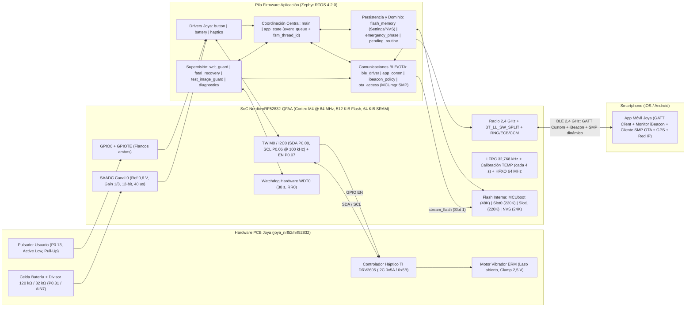
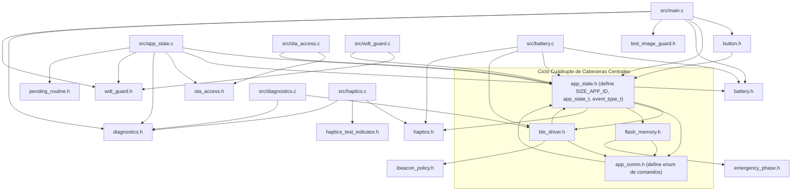
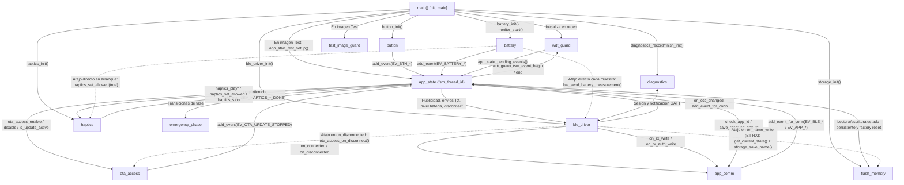

# 01. Arquitectura General del Sistema

> **Capítulo del Manual Técnico Integral de Ingeniería del Producto — Firmware Joya**
> Navegación: [Índice General (README.md)](README.md) | Siguiente: [02. Hardware y Devicetree](02_hardware_devicetree.md) | Véase también: [03. Configuración del Firmware, Kconfig y Sysbuild](03_firmware_configuration.md), [05. Máquina de Estados](05_state_machine.md), [20. Referencia de Código](20_code_reference.md)

---

## 1. Propósito del Producto y Concepto Operativo

**Joya** es un dispositivo *wearable* discreto de seguridad personal silenciosa y acompañamiento de rutinas cotidianas, concebido para operar vinculado mediante **Bluetooth Low Energy (BLE)** a un teléfono inteligente (*smartphone*) que ejecuta la aplicación móvil homónima.

A diferencia de un reloj inteligente o un localizador autónomo con módem celular, el diseño electrónico e industrial de Joya prescinde deliberadamente de pantallas, indicadores luminosos visibles en el producto final, micrófonos, altavoces, receptor GNSS/GPS y transceptor celular. Toda la interacción física con la usuaria se concentra en dos transductores:

1. **Entrada táctil única**: un pulsador mecánico cableado al pin `P0.13` del microcontrolador, cuyos gestos temporales (1 clic corto, 2 clics cortos, 3 o más clics cortos, pulsación media de `0,5..5 s`, pulsación larga de `5..15 s` y pulsación sostenida de `>= 15 s`) codifican todas las intenciones de usuario sin requerir contacto visual con la joya.
2. **Salida háptica silenciosa**: un motor vibrador de masa rotatoria excéntrica (**ERM**) gobernado por un controlador dedicado Texas Instruments `DRV2605` sobre bus `I2C0`, capaz de sintetizar patrones temporales diferenciados de vibración para confirmar comandos locales y notificar eventos recibidos desde la red de contactos de confianza.

Esta partición física impone un **modelo arquitectónico acoplado periférico–teléfono**:

- El **firmware embebido** actúa como nodo sensor/actuador de ultrabajo consumo, responsable de clasificar gestos mecánicos sin rebotes, custodiar en memoria no volátil el identificador de emparejamiento lógico (`APP_ID`), el estado de emergencia (`joya/emergency`) y la última rutina pendiente (`joya/routine`), administrar la energía de la batería, despertar o atraer la reconexión del teléfono mediante tramas `BLE` conectables más una baliza `Apple iBeacon`, supervisar la salud del propio sistema mediante un *watchdog* hardware y exponer un canal controlado de actualización inalámbrica (*Over-The-Air*, **OTA**) firmada criptográficamente.
- La **aplicación móvil** aporta la conectividad IP (celular/Wi-Fi), el posicionamiento geográfico (GNSS/triangulación del teléfono), la lógica de negocio de contactos/servidor backend, la gestión de tiempos de seguimiento y la orquestación activa de reconexiones y actualizaciones OTA.

> [!IMPORTANT]
> Joya **no posee canal autónomo de transmisión de largo alcance**. Si la usuaria dispara una emergencia fuera del alcance radioeléctrico BLE de su teléfono (o con el teléfono apagado), el firmware persiste la fase `EMERGENCY_PENDING_ACK` en Flash (`NVS`), emite la confirmación háptica local y activa o mantiene la publicidad BLE más el `iBeacon` de conexión para entregar la alerta automáticamente en cuanto el enlace BLE se restablezca y supere la autenticación de aplicación.

---

## 2. Identificación Exacta de la Versión Documentada y Estado del Repositorio

Toda afirmación técnica de este manual está referida de manera exacta y reproducible a la siguiente instantánea del código fuente:

| Atributo de trazabilidad | Valor verificado | Fuente / Evidencia |
|---|---|---|
| **Directorio raíz del firmware** | `JoyaPhoneConnectionFirmware/` | Raíz del proyecto Zephyr |
| **Rama activa Git** | `develop` | `1` commit por delante de `origin/develop` (`b48aa4577e768b6e0df82769f535bb0df92d189a`, tag `v2.3.2`) |
| **Commit exacto (`HEAD`)** | `c1128e5d0c0d6f98be0a580d287c0926ca27f01f` | Fecha: `2026-11-25 20:41:08 -0300` |
| **Mensaje de commit `HEAD`** | `Simplifica iBeacon y persiste rutinas pendientes` | Elimina el segundo UUID de iBeacon (emergencia), conserva únicamente `BLE_IBEACON_CONNECTION`, agrega persistencia `joya/routine` en `NVS`, inicia publicidad diferida tras confirmar batería apta en el arranque y refuerza validaciones de sesión BLE |
| **Estado de archivos rastreados** | **Limpio** (`0` modificaciones locales sin commitear) | `git diff HEAD -- JoyaPhoneConnectionFirmware` vacío |
| **Directorios locales no rastreados** | `build_joya/`, `build_fsm_hang/`, `ota/`, `otros/` | Presentes en el árbol de trabajo local sin seguimiento Git |

### 2.1. Nota metodológica sobre artefactos compilados de referencia (`build_joya/`)

El directorio local `build_joya/` contiene una compilación completa `sysbuild` (`app` + `mcuboot`) generada el `2026-11-24` sobre el corte inmediatamente anterior (`b48aa45` / `v2.3.2`). Dado que entre `b48aa45` y `c1128e5` **no se modificó ninguno** de los archivos de configuración o definición de hardware (`[prj.conf](../../prj.conf)`, `[Kconfig](../../Kconfig)`, `[CMakeLists.txt](../../CMakeLists.txt)`, `[VERSION](../../VERSION)`, `[sysbuild.conf](../../sysbuild.conf)`, `[sysbuild/CMakeLists.txt](../../sysbuild/CMakeLists.txt)`, `[sysbuild/mcuboot.conf](../../sysbuild/mcuboot.conf)` ni `[boards/joya/joya_nrf52/](../../boards/joya/joya_nrf52/)`), los artefactos `build_joya/app/zephyr/.config`, `build_joya/app/zephyr/zephyr.dts`, `build_joya/mcuboot/zephyr/.config` y `build_joya/mcuboot/zephyr/zephyr.dts` reflejan con exactitud la resolución efectiva de Devicetree y Kconfig del commit `c1128e5`. Por rigor, cuando se citan tamaños exactos de secciones binarias (`.text`, `.data`, `.bss`), se advierte que corresponden al enlazado de `b48aa45` (con una variación marginal de decenas/centenas de bytes respecto de los cambios en `.c`/`.h` de `c1128e5`).

### 2.2. Discrepancias de versionado detectadas en el repositorio

Existen tres identificadores de versión divergentes coexistiendo en el repositorio en el commit `c1128e5d0c0d6f98be0a580d287c0926ca27f01f`:

1. **Archivo `[VERSION](../../VERSION)` (líneas 1–4)**:
   ```text
   VERSION_MAJOR = 2
   VERSION_MINOR = 3
   PATCHLEVEL = 1
   VERSION_TWEAK = 0
   ```
   Zephyr y `sysbuild` consumen este archivo para inyectar automáticamente `CONFIG_MCUBOOT_IMGTOOL_SIGN_VERSION="2.3.1+0"` al firmar `zephyr.signed.bin` con `imgtool`. Por consiguiente, toda imagen compilada desde `HEAD` declara versión `2.3.1+0` en su cabecera `MCUboot` (visible vía comando SMP `image list`), pese a ser posterior al tag Git `v2.3.2` (`b48aa45`). Como `CONFIG_MCUBOOT_BOOTLOADER_NO_DOWNGRADE` está deshabilitado, esta falta de incremento en `VERSION` no bloquea actualizaciones OTA, pero impide distinguir por número de versión en `SMP` entre los binarios de `v2.3.1`, `v2.3.2` y `c1128e5` (debiendo diferenciarse por el hash `SHA-256` TLV de la imagen).
2. **Archivo `[CMakeLists.txt](../../CMakeLists.txt)` (líneas 9–13)**: declara `project(joya_phone_connection_fw VERSION 2.0 ...)`. Este valor afecta únicamente a variables internas de CMake (`PROJECT_VERSION`) y no se propaga ni al kernel ni a la cabecera `MCUboot`.
3. **Etiqueta Git previa (`v2.3.2`)**: asociada al commit padre `b48aa4577e768b6e0df82769f535bb0df92d189a` sin haber actualizado simultáneamente `[VERSION](../../VERSION)`.

---

## 3. Arquitectura Hardware y Firmware de Extremo a Extremo

### 3.1. Diagrama estructural de extremo a extremo



### 3.2. Síntesis de la plataforma física (`nRF52832-QFAA`)

El detalle eléctrico, de registros y de nodos Devicetree se desarrolla exhaustivamente en [02_hardware_devicetree.md](02_hardware_devicetree.md). A nivel arquitectónico, los bloques físicos que condicionan el diseño del software son:

1. **Unidad de procesamiento y memoria**:
   - **SoC**: Nordic Semiconductor `nRF52832-QFAA` (`CONFIG_SOC_NRF52832_QFAA=y`), núcleo `ARM Cortex-M4` a `64 MHz` con caché de instrucciones activada (`CONFIG_NRF_ENABLE_ICACHE=y`). Aunque el silicio incorpora unidad de punto flotante (`CONFIG_CPU_HAS_FPU=y`), el firmware se compila deliberadamente con **`soft-float ABI`** (`# CONFIG_FPU is not set`, flags ELF `0x5000200`), eliminando el costo de apilado perezoso (*lazy stacking*) de registros `S0..S31` en interrupciones de radio y reduciendo el consumo de pila, dado que toda la aritmética del firmware (conversión mV de batería, temporizaciones, contadores) es entera de 32/64 bits.
   - **Flash interna (`512 KiB`, `0x00000000..0x00080000`)**: organizada en 128 páginas de borrado de `4096 B` y palabra mínima de escritura de `4 B`. Se divide estáticamente en `mcuboot` (`48 KiB`), `slot0_partition` (`220 KiB`, ejecución XIP), `slot1_partition` (`220 KiB`, descarga OTA) y `storage_partition` (`24 KiB`, `Settings`/`NVS`).
   - **SRAM interna (`64 KiB`, `0x20000000..0x20010000`)**: compartida entre pilas de hilos/ISR, buffers del controlador y host BLE, buffers `net_buf` de `MCUmgr`, caché `stream_flash` (`512 B`) y variables estáticas de los módulos. El heap dinámico global `k_malloc` está fijado en **cero bytes** (`CONFIG_HEAP_MEM_POOL_SIZE=0`), imponiendo asignación 100 % determinista en tiempo de compilación.
2. **Interfaz de usuario por botón único (`P0.13`)**:
   - Declarado en `/joya_buttons/emergency_button` (alias `boton-emergencia` y `sw0` en `[boards/joya/joya_nrf52/joya_nrf52_nrf52832.dts](../../boards/joya/joya_nrf52/joya_nrf52_nrf52832.dts)`, líneas 23–43) como entrada `GPIO_ACTIVE_LOW` con `GPIO_PULL_UP` interno (~`13 kΩ` nominales) e interrupción por ambos flancos (`GPIO_INT_EDGE_BOTH`) mediante `GPIOTE`.
   - Nota crítica de placa: el pin `P0.21` (`nRESET` opcional en los nRF52) **no** tiene resistencia de *pull-up* externa en la PCB de Joya, por lo que `[boards/joya/joya_nrf52/joya_nrf52_nrf52832_defconfig](../../boards/joya/joya_nrf52/joya_nrf52_nrf52832_defconfig)` (líneas 3–4) prohíbe expresamente activar `CONFIG_GPIO_AS_PINRESET` para evitar reinicios espurios por ruido electromagnético en un pin flotante.
3. **Subsistema háptico (`DRV2605` + motor ERM)**:
   - Conectado al periférico `TWIM0` (`&i2c0`) con `EasyDMA` a `100 kHz` (`I2C_BITRATE_STANDARD`), empleando `P0.08` (`SDA`) y `P0.06` (`SCL`) **sin *pull-up* interno del SoC** (descansando en resistencias externas en PCB y pasando al estado `low-power-enable` cuando el periférico se suspende mediante `pm_device_action_run()`).
   - Gobernado energéticamente por el pin `P0.07` (`/zephyr,user/haptic_en_gpios`, `GPIO_ACTIVE_HIGH`), que habilita el `DRV2605` únicamente durante la inicialización y mientras se reproduce una secuencia vibratoria, regresando a `0` lógico en reposo (`drv2605_idle()`).
   - El driver sondea en arranque la dirección I2C primaria `0x5A` (`DRV2605_I2C_ADDR_LOW`) y, si no obtiene ACK, prueba `0x5B` (`DRV2605_I2C_ADDR_HIGH`, `[src/haptics.c](../../src/haptics.c)`, líneas 516–527). Configura el CI para actuador **ERM en lazo abierto** (`N_ERM_LRA = 0`, `ERM_OPEN_LOOP = 1`), formato RTP con signo y limitador de sobretensión `OD_CLAMP = 0x72` (~`2,5 V`, líneas 539–567).
4. **Rastro histórico/residual del booster de supercapacitor `NBM5100A`**:
   - En iteraciones tempranas del hardware (`v1.0`..`v1.2`), la PCB empleaba un CI gestor de supercapacitor Nexperia `NBM5100A` (dirección I2C `0x2E`) para sostener picos de corriente del motor.
   - En el commit documentado (`c1128e5`), **no existen drivers, nodos Devicetree ni GPIOs asociados al `NBM5100A`**. El único vestigio en todo el código fuente es la función `static int nbm_bypass_init(void)` en `[src/haptics.c](../../src/haptics.c)` (líneas 465–479), que escribe en el esclavo `0x2E` para forzar el modo *bypass* (`VDH` conectado a `VBT`), pero **jamás es invocada** (código muerto/residual eliminado por el optimizador `-Os`).
5. **Subsistema de medición de batería (`VBAT` en `P0.31` / `AIN7`)**:
   - Un divisor resistivo permanente de `120 kΩ` (rama superior) y `82 kΩ` (rama inferior) escala `VBAT` por un factor $\frac{82}{202} \approx 0{,}40594$ hacia la entrada analógica `AIN7` (`P0.31`), leída por el canal `0` del `SAADC` con referencia interna de `0,6 V`, ganancia `1/3` (fondo de escala `1,8 V` en pin, equivalente a $\approx 4{,}434\,\text{V}$ en `VBAT`), resolución de `12 bits` y tiempo de adquisición $t_{\text{ACQ}} = 40\,\mu\text{s}$ (`[boards/joya/joya_nrf52/joya_nrf52_nrf52832.dts](../../boards/joya/joya_nrf52/joya_nrf52_nrf52832.dts)`, líneas 36–37 y 106–119).
6. **Ausencia de interfaces serie y de depuración en unidades finales**:
   - `uart0`, `i2c1`, `spi0`, `spi1` y `spi2` están deshabilitados en Devicetree; los subsistemas `LOG`, `PRINTK`, `CONSOLE` y `SEGGER_RTT` están apagados en `[prj.conf](../../prj.conf)` (líneas 15–33). Además, según consta en `[docs/auditorias/Avances.md](../../docs/auditorias/Avances.md)` (líneas 27–40), las unidades ensambladas finales carecen de acceso físico a los pines SWD, convirtiendo al canal **BLE OTA** y al **watchdog hardware** en los únicos mecanismos de mantenimiento y recuperación en campo.

### 3.3. Pila de software base y versiones efectivas

| Componente de plataforma | Versión / Selección efectiva | Rol arquitectónico en Joya |
|---|---|---|
| **RTOS y HAL** | **Zephyr RTOS `4.2.0`** (`KERNEL_VERSION_STRING = "4.2.0"`, SDK `0.17.4`, `picolibc`, `nrfx`) | Planificador híbrido cooperativo/preemptivo, colas de trabajo (`sysworkq`), `k_msgq`, mutexes, spinlocks, gestión de energía de dispositivos (`PM_DEVICE`) y drivers nRF52. |
| **Orquestador multi-imagen** | **West `1.5.0` + `Sysbuild`** (`SB_CONFIG_BOOTLOADER_MCUBOOT=y`) | Compila, enlaza y firma coordinadamente dos dominios independientes: el bootloader `mcuboot` y la aplicación `app`, compartiendo el mapa de particiones DTS y la clave RSA. |
| **Bootloader seguro** | **MCUboot** (`CONFIG_BOOT_SWAP_USING_MOVE=y`, `RSA-2048` + `SHA-256` vía `mbedTLS`) | Raíz de confianza en el arranque (`0x00000000`), validación criptográfica de `slot0` en cada encendido (`CONFIG_BOOT_VALIDATE_SLOT0=y`), permutación (*swap-using-move*) con reversión automática (*rollback*) ante imágenes `Test` no confirmadas, y alimentación activa de `WDT0` durante operaciones de Flash (`CONFIG_BOOT_WATCHDOG_FEED_NRFX_WDT=y`). |
| **Controlador y Host BLE** | **Zephyr Split BLE Stack** (`CONFIG_BT_LL_SW_SPLIT=y`, sin SoftDevice de Nordic) | Implementa tanto el Link Layer en tiempo real (`LLL`/`ULL`) sobre `RADIO`, `RTC0`, `TIMER0`, `ECB`, `CCM` y `PPI` como el Host (`HCI`, `L2CAP`, `ATT`, `GATT`, `GAP`), con soporte simultáneo de 2 conjuntos de publicidad (`CONFIG_BT_EXT_ADV=y`, `MAX_ADV_SET=2`), `ATT_MTU = 247` y `DLE = 251`. |
| **Transporte y gestión OTA** | **MCUmgr / SMP sobre BLE** + `zcbor` + `stream_flash` + `img_manager` | Expone bajo demanda (tras comando autenticado `0x70`) el servicio GATT SMP para listar slots, transferir bloques de imagen hacia `slot1_partition`, marcar `Test`, confirmar `slot0` y solicitar reinicio (`OS reset`). |
| **Almacenamiento persistente** | **Zephyr `Settings` sobre `NVS`** (`storage_partition`, `24 KiB` = 6 páginas de `4 KiB`) | Almacén transaccional clave-valor resistente a cortes de alimentación con nivelación de desgaste (*wear leveling*) circular sobre Flash NOR interna para las 4 claves `joya/*`. |

---

## 4. Organización Completa del Árbol de Código Fuente

El directorio `JoyaPhoneConnectionFirmware/` se estructura de la siguiente forma:

```text
JoyaPhoneConnectionFirmware/
├── CMakeLists.txt                       # Definición de build de la aplicación (14 .c fijos + 1 condicional)
├── Kconfig                              # Menú Kconfig propio (CONFIG_JOYA_HAPTICS_TEST_INDICATOR)
├── prj.conf                             # Configuración Kconfig de producción de la aplicación
├── VERSION                              # Versión inyectada a imgtool/MCUboot (2.3.1+0)
├── sysbuild.conf                        # Activación global de MCUboot en Sysbuild
├── sysbuild/
│   ├── CMakeLists.txt                   # Propagación de BOARD_ROOT al dominio Sysbuild
│   └── mcuboot.conf                     # Fragmento Kconfig específico del bootloader (MPU + LFRC 500 ppm)
├── boards/joya/joya_nrf52/              # Definición de la placa objetivo propia (joya_nrf52/nrf52832)
│   ├── board.yml                        # Metadatos de placa y SoC nrf52832
│   ├── board.cmake                      # Argumentos de runners jlink y nrfjprog
│   ├── Kconfig.joya_nrf52               # Selección de SOC_NRF52832_QFAA
│   ├── joya_nrf52_nrf52832_defconfig    # CONFIG_GPIO=y y prohibición de CONFIG_GPIO_AS_PINRESET
│   ├── joya_nrf52_nrf52832.dts          # Nodos chosen, particiones Flash, GPIO, I2C0, SAADC, TEMP
│   └── joya_nrf52-pinctrl.dtsi          # Asignación pinctrl de TWIM0 (SDA P0.08, SCL P0.06)
├── nrf52dk_nrf52832.overlay             # Overlay de desarrollo para kit Nordic nRF52 DK (PCA10040)
├── nrf52dk_battery_adc.overlay          # Overlay de banco para inyectar divisor VBAT en P0.31 del DK
├── include/                             # 16 archivos de cabecera (.h) de los módulos del firmware
├── src/                                 # 15 archivos fuente (.c) de los módulos del firmware
├── tests/                               # Pruebas unitarias nativas en host (gcc + assert, sin Zephyr)
│   ├── test_emergency_phase.c           # Verifica transiciones de fase de emergencia y política iBeacon
│   ├── test_pending_routine.c           # Verifica lógica pura de sustitución/descarte de rutinas
│   ├── test_pending_storage.c           # Verifica persistencia NVS mockeada, tombstones y dirty flags
│   └── run_*.sh                         # Scripts ejecutores de las tres suites nativas
├── docs/                                # Documentación técnica y notas de diseño/auditoría
│   ├── DIAGNOSTICS.md                   # Especificación de la característica GATT de diagnóstico
│   ├── IBEACON.md                       # Especificación del iBeacon único y entrega diferida
│   ├── RECOVERY_VALIDATION.md           # Plan de validación de WDT, rollback y downgrade en DK
│   ├── auditorias/                      # Informes y matriz de seguimiento de auditoría (Avances.md, etc.)
│   └── technical/                       # Este Manual Técnico Integral de Ingeniería del Producto
├── compile.sh / compile_test.sh         # Scripts auxiliares de invocación de west build
├── mergear.sh / mergear_test.sh         # Scripts srec_cat para fusionar MCUboot + app firmada
├── ota/                                 # [No rastreado] Consola OTA Python + puente/simulador ESP32
├── otros/                               # [No rastreado] Docs históricos, Dockerfile, binarios previos y tests antiguos
└── build_joya/ , build_fsm_hang/        # [No rastreado] Árboles de compilación locales
```

---

## 5. Inventario Exhaustivo de Módulos y Grafos de Dependencias

### 5.1. Catálogo completo de unidades de compilación y encabezados (`15 .c` + `16 .h`)

El árbol fuente contiene exactamente **15 archivos `.c`** (`4.159` líneas totales) en `src/` y **16 archivos `.h`** (`650` líneas totales) en `include/`. La relación entre encabezados y fuentes no es estrictamente biunívoca (`1:1`), pues existen **dos encabezados puros (*header-only*)** (`ibeacon_policy.h` y `pending_routine.h`), **un encabezado vacío residual** (`main.h`) y **una unidad `.c` sin encabezado propio** (`fatal_recovery.c`, que redefine *hooks* globales del kernel y del controlador BLE).

| # | Archivo fuente (`src/`) | Líneas | Archivo cabecera (`include/`) | Líneas | Compilación en `CMakeLists.txt` | Capa arquitectónica | Estado y responsabilidad principal |
|---:|---|---:|---|---:|---|---|---|
| 1 | `[src/main.c](../../src/main.c)` | 89 | `[include/main.h](../../include/main.h)` *(vacío)* | 0 | Siempre (`L17`) | Coordinación / Arranque | Secuencia de inicialización ordenada, distinción entre imagen confirmada e imagen OTA `Test` (*fail-fast* vs. degradación agraciada), registro de bits de diagnóstico de arranque y entrega de testigo a `wdt_guard_main_ready()`. `include/main.h` está vacío (`0 B`) y ningún módulo lo incluye (**residual**). |
| 2 | `[src/app_state.c](../../src/app_state.c)` | 1017 | `[include/app_state.h](../../include/app_state.h)` | 112 | Siempre (`L19`) | Coordinación / Aplicación | Núcleo del firmware: define `event_queue` (`20` mensajes `app_event_t`), el hilo dedicado `fsm_thread_id` (`4098 B`, prioridad `5`), la máquina de estados principal (`current_state`), las banderas ortogonales (`suspended_idle`, `critical_idle`, `critical_window_open`, `boot_reconnect_pending`), los 4 `k_work_delayable` de coordinación y el despachador central `process_event()`. |
| 3 | `[src/app_comm.c](../../src/app_comm.c)` | 80 | `[include/app_comm.h](../../include/app_comm.h)` | 87 | Siempre (`L18`) | Comunicaciones (Protocolo) | Traduce callbacks GATT (`RX` `...5002`, `RX_AUTH` `...5101`) y eventos de enlace BLE a mensajes tipados en `event_queue` validando longitud exacta (`1 B` / `16 B`) y `offset == 0`; encapsula `check_app_id()` y `save_received_app_id()`; enumera los códigos de comando Joya/App. |
| 4 | `[src/ble_driver.c](../../src/ble_driver.c)` | 778 | `[include/ble_driver.h](../../include/ble_driver.h)` | 92 | Siempre (`L20`) | Comunicaciones (Transporte BLE) | Inicializa el stack BLE (`bt_enable`), define estáticamente los 4 servicios GATT propietarios (`COMMANDS`, `AUTH`, `CONFIG`, `BATTERY`), administra el ciclo de vida y referencias de `current_conn` bajo `conn_mutex`, controla la publicidad conectable legacy y el set extendido `ibeacon_adv` bajo `ibeacon_mutex`, gestiona lectura/escritura de `NAME` y el transporte de sesiones de `DIAGNOSTICS`. |
| 5 | — *(header-only)* | — | `[include/ibeacon_policy.h](../../include/ibeacon_policy.h)` | 16 | Incluido por `ble_driver.h` | Comunicaciones (Política pura) | Define `ble_ibeacon_mode_t` (`BLE_IBEACON_OFF`, `BLE_IBEACON_CONNECTION`) y la función pura `static inline ibeacon_mode_for_state(bool has_app_id)` desacoplada de Zephyr para facilitar verificación unitaria en host. |
| 6 | `[src/ota_access.c](../../src/ota_access.c)` | 148 | `[include/ota_access.h](../../include/ota_access.h)` | 13 | Siempre (`L21`) | Comunicaciones / OTA | Compuerta dinámica del servicio GATT `MCUmgr SMP`: desregistra SMP antes de `bt_enable()`, lo registra bajo demanda (`0x70`), observa hooks DFU (`STARTED`, `CHUNK`, `PENDING`, `STOPPED`), protege transferencias activas frente a cierres prematuros, aplica timeout de inactividad de `2 min` y limpia estado al desconectar. |
| 7 | `[src/test_image_guard.c](../../src/test_image_guard.c)` | 61 | `[include/test_image_guard.h](../../include/test_image_guard.h)` | 10 | Siempre (`L22`) | Supervisión y Resiliencia | Salvaguarda anti-*brick* para imágenes OTA marcadas como `Test` no confirmadas: arma un temporizador independiente de `5 minutos` que ejecuta `sys_reboot(SYS_REBOOT_COLD)` (forzando *rollback* en `MCUboot`) salvo que `MCUmgr` notifique `MGMT_EVT_OP_IMG_MGMT_DFU_CONFIRMED`. |
| 8 | `[src/wdt_guard.c](../../src/wdt_guard.c)` | 128 | `[include/wdt_guard.h](../../include/wdt_guard.h)` | 14 | Siempre (`L29`) | Supervisión y Resiliencia | Configura `WDT0` a `30 s` (`CRV = 983040`, canal `RR[0]`), verifica compatibilidad de registros heredados tras *soft reset* y ejecuta cada `10 s` en `sysworkq` la auditoría de salud de `main_ready`, duración de eventos FSM (`<= 15 s`) y avance de `event_queue` (`<= 15 s`). |
| 9 | `[src/fatal_recovery.c](../../src/fatal_recovery.c)` | 19 | — *(sin header propio)* | — | Siempre (`L30`) | Supervisión y Resiliencia | Sobrescribe `k_sys_fatal_error_handler()` (errores fatales/excepciones ARM en Zephyr) y `bt_ctlr_assert_handle()` (aserciones del controlador `BT_LL_SW_SPLIT`) ejecutando `NVIC_SystemReset()` inmediato. |
| 10 | `[src/diagnostics.c](../../src/diagnostics.c)` | 83 | `[include/diagnostics.h](../../include/diagnostics.h)` | 26 | Siempre (`L27`) | Supervisión y Observabilidad | Acumula de forma atómica la máscara de éxito de inicialización (`0xA0 MM`, bits `0x01..0x10`) y despacha vía `sysworkq` notificaciones *best-effort* de errores en tiempo de ejecución (`0xE1..0xE5`) ligadas a la época de sesión autenticada (`diagnostics_session_epoch`). |
| 11 | `[src/flash_memory.c](../../src/flash_memory.c)` | 398 | `[include/flash_memory.h](../../include/flash_memory.h)` | 65 | Siempre (`L25`) | Persistencia (`Settings`/`NVS`) | Gestiona el subárbol `joya/*` (`joya/app_id`, `joya/emergency`, `joya/routine`, `joya/name`) aplicando política *RAM-first*, validaciones de integridad al cargar, protección contra filtración de rutinas huérfanas (`pending_routine_owner`, `pending_routine_dirty`) y borrado completo en `storage_factory_reset()`. |
| 12 | `[src/emergency_phase.c](../../src/emergency_phase.c)` | 31 | `[include/emergency_phase.h](../../include/emergency_phase.h)` | 25 | Siempre (`L26`) | Dominio Puro (Emergencia) | Autómata puro libre de dependencias de RTOS para las fases de emergencia (`EMERGENCY_NONE = 0`, `EMERGENCY_PENDING_ACK = 1`, `EMERGENCY_ACKED = 2`), decodificación retrocompatible con `bool` (`0`/`1`) y predicado de necesidad de reintento (`emergency_phase_needs_notification()`). |
| 13 | — *(header-only)* | — | `[include/pending_routine.h](../../include/pending_routine.h)` | 17 | Incluido por `app_state.c` | Dominio Puro (Rutinas) | Función pura `static inline pending_routine_next()` que codifica la invariante de negocio de rutinas pendientes: conservación exclusiva del último comando (`0x02`/`0x03`), exigencia de `APP_ID` válido y anulación total bajo emergencia activa. |
| 14 | `[src/button.c](../../src/button.c)` | 200 | `[include/button.h](../../include/button.h)` | 32 | Siempre (`L23`) | Abstracción de Hardware | Driver de gestos sobre `P0.13`: interrupción en ambos flancos, *debounce* de `50 ms`, filtrado de pulsación preexistente en el arranque, medición de duración (`0,5 s`, `5 s`, `15 s`), disparo anticipado en umbral de `15 s` y ventana de conteo multiclic de `900 ms`. |
| 15 | `[src/haptics.c](../../src/haptics.c)` | 700 | `[include/haptics.h](../../include/haptics.h)` | 94 | Siempre (`L24`) | Abstracción de Hardware | Driver del `DRV2605` sobre `i2c0` y `P0.07`: sondeo `0x5A`/`0x5B`, recuperación de bus I2C, configuración ERM open-loop `2,5 V`, motor asíncrono de secuencias RTP con callback opcional de finalización, control por política energética (`haptics_allowed`) y suspensión/reanudación `PM_DEVICE` del bus `TWIM0`. |
| 16 | `[src/haptics_test_indicator.c](../../src/haptics_test_indicator.c)` | 42 | `[include/haptics_test_indicator.h](../../include/haptics_test_indicator.h)` | 11 | Condicional (`L33`, `CONFIG_JOYA_HAPTICS_TEST_INDICATOR`) | Diagnóstico de Banco (DK) | Pulsa `led0` durante `200 ms` en la placa `nrf52dk/nrf52832` cuando se solicita vibración permitida por batería, aun sin `DRV2605` conectado. En compilación de producción (`joya_nrf52/nrf52832`) no se compila el `.c` y la llamada se expande a `do { } while (0)`. |
| 17 | `[src/battery.c](../../src/battery.c)` | 385 | `[include/battery.h](../../include/battery.h)` | 36 | Siempre (`L28`) | Abstracción de Hardware | Adquisición síncrona `SAADC` en `AIN7`, reconstrucción entera redondeada del divisor `120 kΩ / 82 kΩ`, habilitación temprana condicional de háptica en el arranque, muestreo periódico (`60 s`), ventana de verificación (`6` muestras cada `10 s`, quórum `5/6`), histéresis ascendente (`+50 mV`) y emisión de telemetría en mV. |

### 5.2. Grafo de dependencias de compilación (`#include`) y análisis del ciclo cuádruple

El análisis estático de las directivas `#include` internas revela dos familias claramente diferenciadas en `include/`:

1. **Encabezados desacoplados (hojas limpias)**: `battery.h`, `diagnostics.h`, `emergency_phase.h`, `haptics.h`, `haptics_test_indicator.h`, `ibeacon_policy.h`, `ota_access.h`, `pending_routine.h`, `test_image_guard.h` y `wdt_guard.h` no incluyen ningún otro encabezado propio de la aplicación.
2. **Núcleo fuertemente acoplado con ciclo cuádruple de inclusión**: cuatro encabezados centrales mantienen dependencias circulares mutuas:
   - `[include/app_state.h](../../include/app_state.h)` (líneas 6–9) incluye `"ble_driver.h"`, `"app_comm.h"`, `"flash_memory.h"` y `"haptics.h"`.
   - `[include/ble_driver.h](../../include/ble_driver.h)` (líneas 10–11) incluye `"app_state.h"` y `"app_comm.h"`.
   - `[include/app_comm.h](../../include/app_comm.h)` (línea 9) incluye `"app_state.h"`.
   - `[include/flash_memory.h](../../include/flash_memory.h)` (línea 8) incluye `"app_comm.h"` (y transitivamente `"app_state.h"` y `"ble_driver.h"`).



#### ¿Por qué compila el ciclo cuádruple sin errores de tipos incompletos y qué consecuencias tiene?

- **Orden frágil pero funcional de declaraciones**:
  1. En `[include/app_state.h](../../include/app_state.h)` (línea 4), `#define SIZE_APP_ID 16` aparece **antes** de los `#include` de las líneas 6–9.
  2. Ni `ble_driver.h`, ni `app_comm.h`, ni `flash_memory.h` utilizan los tipos por valor `app_state_t`, `event_type_t` o `app_event_t` en sus prototipos de funciones públicas; solo referencian punteros opacos de Zephyr (`struct bt_conn *`, `const struct bt_gatt_attr *`), tipos enteros estándar, `ble_ibeacon_mode_t` (definido previamente en `ibeacon_policy.h`) y `emergency_phase_t` (definido en `emergency_phase.h`).
  3. Por su parte, `app_event_t` en `app_state.h` (líneas 74–78) necesita conocer `struct bt_conn *`, cuya declaración llega transitivamente porque `ble_driver.h` incluye `<zephyr/bluetooth/bluetooth.h>` y `<zephyr/bluetooth/gatt.h>` antes de reintentar incluir `"app_state.h"`.
- **Consecuencias prácticas de ingeniería**:
  - **Contaminación del espacio de nombres y recompilación global**: cualquier archivo `.c` que incluya `app_state.h`, `ble_driver.h`, `app_comm.h`, `flash_memory.h` o `button.h` arrastra automáticamente las cabeceras completas de Bluetooth (`bluetooth.h`, `gatt.h`, `conn.h`), I2C, GPIO y `Settings` de Zephyr. Cualquier edición en uno de estos cuatro encabezados fuerza la recompilación de casi todas las unidades del proyecto.
  - **Fricción para pruebas unitarias en host**: en `[tests/test_pending_storage.c](../../tests/test_pending_storage.c)` (líneas 2–27), para poder probar la lógica de `src/flash_memory.c` con `gcc` en Linux sin compilar el árbol de Zephyr, fue necesario definir manualmente `#define FLASH_MEMORY_H` antes de incluir `../src/flash_memory.c` con el único fin de inhibir la lectura de `include/flash_memory.h` y evitar que el ciclo `flash_memory.h` → `app_comm.h` → `app_state.h` → `ble_driver.h` exigiera los encabezados del stack Bluetooth de Zephyr.
- **Declaraciones residuales en encabezados detectadas**:
  - `[include/button.h](../../include/button.h)` (línea 10): declara `extern struct k_msgq event_queue;`, acoplamiento histórico previo al encapsulamiento mediante `add_event()`. Ni `button.c` ni ningún otro módulo externo usa ya el símbolo `event_queue` directamente (`wdt_guard.c` usa `app_state_pending_events()`).
  - `[include/ble_driver.h](../../include/ble_driver.h)` (línea 90): declara el prototipo `int ble_start_setup_advertising_backup(void);`, cuya implementación **no existe** en ningún archivo `.c`.
  - `[include/main.h](../../include/main.h)`: archivo de `0` bytes no referenciado.

### 5.3. Dependencias e interacciones en tiempo de ejecución

En tiempo de ejecución, la arquitectura evita casi por completo los bloqueos circulares aplicando el patrón **eventos asíncronos hacia arriba (`add_event` / `add_event_for_conn`) y comandos imperativos hacia abajo (desde `fsm_thread_id`)**, con un conjunto acotado de interacciones transversales directas que es indispensable tener presentes:



**Observación crítica sobre los cuatro atajos transversales (líneas punteadas)**:
1. **`battery_init()` → `haptics_set_allowed(true)`** (`[src/battery.c](../../src/battery.c)`, líneas 67–70): habilita preventivamente el subsistema háptico durante el arranque si la primera lectura cruda supera `3000 mV`, sin esperar los `60 s` que tarda la ventana de 6 muestras en emitir `EV_BATTERY_NORMAL` a la FSM. De lo contrario, la usuaria no tendría vibración durante el primer minuto tras encender la pulsera.
2. **`battery_monitor_work_handler()` → `ble_send_battery_measurement(voltage_mv)`** (`[src/battery.c](../../src/battery.c)`, líneas 301–303): envía la tensión en milivoltios directamente desde `sysworkq` hacia el stack GATT cada vez que obtiene una muestra válida, evitando despertar a la FSM cada minuto (o cada `10 s` en verificación) solo para reenviar telemetría. `ble_send_battery_value()` consulta internamente `get_current_state() == STATE_AUTHENTICATED` y toma `conn_mutex`.
3. **`on_name_write()` en `ble_driver.c` → `get_current_state()` y `storage_save_name()`** (`[src/ble_driver.c](../../src/ble_driver.c)`, líneas 273–320): la escritura GATT de la característica `NAME` (`...5201`) **no pasa por `event_queue` ni por `fsm_thread_id`**; se ejecuta síncronamente dentro del contexto del hilo receptor BLE (`BT RX`), llamando a `bt_set_name()` y `settings_save_one("joya/name", ...)` allí mismo para poder devolver un código de respuesta ATT síncrono (`BT_ATT_ERR_*` o `len`).
4. **`on_disconnected()` en `ble_driver.c` → `ota_access_on_disconnect()`** (`[src/ble_driver.c](../../src/ble_driver.c)`, líneas 264–267): revoca inmediatamente el servicio SMP y limpia las banderas de transferencia en el mismo callback de desconexión del stack BLE, antes siquiera de que `EV_BLE_DISCONNECTED` sea consumido de `event_queue` por la FSM, cerrando cualquier ventana de carrera con una nueva conexión entrante.

---

## 6. Separación en Capas Arquitectónicas

El diseño del sistema se organiza verticalmente en **siete capas** bien delimitadas:

| Nivel | Capa | Componentes | Responsabilidad y garantías |
|---:|---|---|---|
| **L6** | **Coordinación y Aplicación** | `main`, `app_state` | Secuencia de encendido, serialización determinista de eventos de negocio en `fsm_thread_id`, gobierno del ciclo de conexión/autenticación, coordinación de reintentos de emergencia, gestos compuestos de suspensión/factory reset y políticas energéticas globales. |
| **L5** | **Reglas de Dominio Puras** | `emergency_phase`, `pending_routine`, `ibeacon_policy` | Lógica funcional determinista sin estado oculto ni llamadas al RTOS. Permite verificación exhaustiva mediante compilación nativa en host (`tests/test_*.c`). |
| **L4** | **Comunicaciones y Control de Acceso** | `app_comm`, `ble_driver`, `ota_access` | Superficie GATT (`4` servicios Joya + `SMP` dinámico), publicidad dual (conectable + `iBeacon`), control de sesión autenticada ligada al puntero `struct bt_conn *` y protección del ciclo de actualización OTA. |
| **L3** | **Persistencia Transaccional** | `flash_memory` | Caché autoritativa en RAM respaldada por `Settings`/`NVS` sobre `storage_partition`, validación estricta de formato al cargar y preservación de invariantes de propiedad (`pending_routine_owner`) ante reinicios o fallos parciales de borrado. |
| **L2** | **Supervisión, Salud y Resiliencia** | `wdt_guard`, `test_image_guard`, `fatal_recovery`, `diagnostics` | Detección de bloqueos en `main`, `fsm_thread_id` y `sysworkq` vía `WDT0`; reinicio inmediato ante pánicos de kernel o controlador BLE; *rollback* temporizado de imágenes OTA `Test` no confirmadas; telemetría de salud de arranque y fallos en vivo. |
| **L1** | **Abstracción de Hardware de Placa** | `button`, `haptics`, `haptics_test_indicator`, `battery` | Encapsulación de registros `DRV2605`, filtrado temporal de rebotes y clasificación de gestos sobre `GPIOTE`, muestreo/votación/histéresis sobre `SAADC` y gestión dinámica de bajo consumo (`PM_DEVICE`) del bus `I2C0`. |
| **L0** | **Plataforma Base y Arranque Seguro** | `MCUboot` + Kernel/Drivers `Zephyr 4.2.0` + `BT_LL_SW_SPLIT` + Hardware `nRF52832` | Verificación criptográfica `RSA-2048`/`SHA-256` antes de ejecutar código de aplicación, planificación RTOS, temporización tickless sobre `RTC1` (`32.768 Hz`), calibración térmica de `LFRC` y pila de radio `2,4 GHz`. |

---

## 7. Flujo Arquitectónico General: Del Reset Hardware a la Operación Estacionaria

### 7.1. Diagrama de secuencia de arranque completo

```mermaid
sequenceDiagram
    participant HW as "Reset / SoC nRF52832"
    participant BOOT as "MCUboot (0x00000)"
    participant ZEP as "Zephyr Pre/Post-Kernel"
    participant MAIN as "main() [Prio 0]"
    participant FSM as "fsm_thread_id [Prio 5]"
    participant WDT as "wdt_guard [sysworkq]"
    participant BAT as "battery [sysworkq]"
    participant BLE as "ble_driver / Stack BLE"

    HW->>BOOT: Vector Reset (0x00000000)
    BOOT->>BOOT: Alimenta WDT0 si venía activo (NRFX_WDT)
    BOOT->>BOOT: Verifica SHA-256 + RSA-2048 de slot0 (y swap/revert con slot1 si aplica)
    BOOT->>ZEP: Salto a aplicación en slot0 + 0x200 (0x0000C200)
    ZEP->>ZEP: Init CLOCK (LFRC + cal), GPIO, GPIOTE, TWIM0, SAADC, FLASH, TEMP, RNG
    ZEP->>ZEP: Init subsistema MCUmgr (registra temporalmente servicio SMP en RAM)
    ZEP->>FSM: Crea e inicia fsm_thread_id -> k_work_init_delayable x4 -> bloquea en event_queue
    ZEP->>MAIN: Invoca main()
    MAIN->>WDT: wdt_guard_init() -> instala RR[0] 30 s, inicia WDT0, agenda guard_work (10 s)
    MAIN->>MAIN: ota_test_boot = !boot_is_img_confirmed()
    MAIN->>MAIN: storage_init() -> settings_subsys_init() + settings_load() + sanea joya/routine

    alt Imagen OTA en modo Test (ota_test_boot == true)
        MAIN->>MAIN: test_image_guard_init() (registra callback CONFIRMED)
        MAIN->>MAIN: button_init() [Si != 0 -> sys_reboot(SYS_REBOOT_COLD)]
        MAIN->>BLE: ble_driver_init() -> ota_access_init() (smp_bt_unregister) + bt_enable() + ext_adv create [Si != 0 -> reboot]
        MAIN->>FSM: app_start_test_setup() -> EV_BOOT_TEST_SETUP_REQUEST (espera test_setup_sem <= 10 s)
        FSM->>BLE: start_advertising_with_ibeacon(true) ["Joya Setup"] + critical_window 5 min
        FSM-->>MAIN: k_sem_give(&test_setup_sem) [Si != 0 -> reboot]
        MAIN->>MAIN: test_image_guard_start() -> plazo fatal rollback 5 min
    else Imagen Confirmada Normal (ota_test_boot == false)
        MAIN->>BLE: ble_driver_init() -> ota_access_init() + bt_enable() + ibeacon_adv create
        Note over MAIN,WDT: Si ble_driver_init() != 0: no llama main_ready; duerme hasta reset WDT0 (30 s) o reboot SW tras 30 s
        MAIN->>MAIN: button_init() [Si != 0: registra fallo en diag y continúa degradado]
    end

    MAIN->>MAIN: haptics_init() -> P0.07=1, probe 0x5A/0x5B, ERM 2,5 V, drv2605_idle() (P0.07=0 + I2C suspend)
    MAIN->>BAT: battery_init() -> 1 muestra SAADC (si > 3000 mV -> haptics_set_allowed(true))
    MAIN->>BAT: battery_monitor_start() -> agenda battery_monitor_work(K_NO_WAIT)
    MAIN->>MAIN: diagnostics_finish_init() (marca init_complete = 1)
    MAIN->>WDT: wdt_guard_main_ready() -> habilita alimentación de WDT0 y agenda guard_work inmediato
    MAIN->>MAIN: k_sleep(K_FOREVER)

    BAT->>BAT: t = 0 s: muestra disparadora -> confirmed_level == -1 -> inicia ventana verificación (6 muestras c/10 s)
    BAT->>BAT: t = 10, 20, 30, 40, 50, 60 s: acumula votos de nivel
    BAT->>FSM: t ≈ 60 s: quórum >= 5/6 -> add_event(EV_BATTERY_NORMAL o EV_BATTERY_LEVEL_1)
    FSM->>BLE: Si tiene APP_ID e imagen confirmada: pasa a STATE_BONDED_DISCONNECTED y arranca Advertising + iBeacon
```

### 7.2. Análisis detallado de las etapas de arranque y transición a régimen estacionario

1. **Etapa 0 — Bootloader (`MCUboot`, `0x00000000..0x0000C000`)**:
   - Tras un Power-On Reset (POR), un reset por watchdog (`WDT0`), un reset por fallo fatal (`NVIC_SystemReset()`) o un `sys_reboot(SYS_REBOOT_COLD)`, el procesador arranca en `0x00000000`.
   - `MCUboot` ejecuta con `CONFIG_ARM_MPU=y` y sin multihilo (`# CONFIG_MULTITHREADING is not set`). Si `WDT0` ya venía corriendo de la sesión previa, `MCUboot` lo alimenta durante la verificación criptográfica y las operaciones de copia/borrado de Flash (`CONFIG_BOOT_WATCHDOG_FEED_NRFX_WDT=y`).
   - Inspecciona los *trailers* de `slot0` y `slot1`: si hay una actualización marcada como `Test` en `slot1`, ejecuta *swap-using-move* hacia `slot0`; si el arranque proviene del reinicio de una imagen `Test` que nunca escribió `image_ok` (confirmación), revierte (*rollback*) la imagen anterior desde `slot1` hacia `slot0`. Antes de ceder el control valida siempre el hash `SHA-256` y la firma `RSA-2048` de `slot0` (`CONFIG_BOOT_VALIDATE_SLOT0=y`), limpia el núcleo ARM (`CONFIG_MCUBOOT_CLEANUP_ARM_CORE=y`) y salta al vector de entrada de la aplicación desplazado `0x200` bytes tras la cabecera de imagen (`0x0000C200`, punto de entrada `__start` en `0x00012461` en `build_joya`).

2. **Etapa 1 — Inicialización temprana del Kernel Zephyr (antes de `main()`)**:
   - Se inicializan los drivers de reloj (`LFRC` + sensor `TEMP` para calibración), `GPIO0`, `GPIOTE`, `FLASH`, `I2C0` (`TWIM0`), `SAADC` y `RNG`.
   - En nivel `APPLICATION` (`CONFIG_APPLICATION_INIT_PRIORITY=90`), el transporte Bluetooth de `MCUmgr` registra automáticamente el servicio GATT `SMP` en memoria antes de entrar en `main()`. Por eso `ble_driver_init()` invoca obligatoriamente `ota_access_init()` (`smp_bt_unregister()`) **antes** de `bt_enable(NULL)` (`[src/ble_driver.c](../../src/ble_driver.c)`, líneas 494–502), garantizando que el servicio OTA nazca cerrado e invisible para cualquier escáner externo.
   - El hilo estático `fsm_thread_id` declarado con `K_THREAD_DEFINE(..., 4098, fsm_thread_loop, ..., 5, 0, 0)` (`[src/app_state.c](../../src/app_state.c)`, línea 36, con `delay = 0`) queda listo para ejecutar, inicializa sus cuatro estructuras `k_work_delayable` y se suspende en `k_msgq_get(&event_queue, &entry, K_FOREVER)` (`[src/app_state.c](../../src/app_state.c)`, líneas 356–364). Como `main` tiene prioridad `0` (más prioritaria en Zephyr que la prioridad `5` de `fsm_thread_id`), `fsm_thread_id` corre en cuanto `main` bloquea (p. ej., durante `storage_init()` en esperas de Flash o al tomar `test_setup_sem`).

3. **Etapa 2 — Ejecución de `main()` (`[src/main.c](../../src/main.c)`, líneas 11–89)**:
   - **Paso 2.1 (`wdt_guard_init()`, línea 12)**: configura e inicia inmediatamente `WDT0` a `30 s` antes de tocar Flash, I2C o BLE, pero **retiene la alimentación** del perro guardián hasta que `main()` alcance `wdt_guard_main_ready()` en la línea 82. Si cualquier inicialización posterior se cuelga en un bucle o espera infinita de hardware, `WDT0` reinicia el SoC a los `30 s`.
   - **Paso 2.2 (`storage_init()`, líneas 16–20)**: carga las claves `joya/*` desde `NVS` hacia RAM y purga cualquier `joya/routine` cuyo propietario no coincida con `joya/app_id` o que coexista con una emergencia activa (`[src/flash_memory.c](../../src/flash_memory.c)`, líneas 241–245). Si `NVS` falla, restaura valores seguros por defecto en RAM y continúa el arranque.
   - **Paso 2.3 (Bifurcación crítica según confirmación `MCUboot`, líneas 13 y 22–58)**:
     - **Rama OTA Test (`!boot_is_img_confirmed()`)**: una imagen recién actualizada **debe demostrar** que el botón de rescate y la pila BLE funcionan; si `button_init()`, `ble_driver_init()` o el inicio de publicidad `Joya Setup` (`app_start_test_setup()`) devuelven error, ejecuta `sys_reboot(SYS_REBOOT_COLD)` inmediato para que `MCUboot` revierta al firmware anterior confirmado. Si tienen éxito, activa dos ventanas de `5 minutos`: `critical_window_work` en la FSM (que impide que un falso positivo o nivel crítico del ADC apague la radio antes de confirmar) y `confirmation_deadline_work` en `test_image_guard.c` (que fuerza `sys_reboot(SYS_REBOOT_COLD)` si no llega el comando SMP `CONFIRM` en `5 min`).
     - **Rama Imagen Confirmada (`boot_is_img_confirmed()`)**: un reinicio no ganaría un firmware distinto. Inicia primero `ble_driver_init()`; si falla, no declara `main_ready` y duerme dejando que `WDT0` reinicie en `30 s` (o hace `k_sleep(K_SECONDS(30))` + `sys_reboot` si no hubiera WDT, evitando bucles de reinicio rápido que agoten la batería). Luego llama `button_init()`; si falla, registra el fallo en diagnóstico y continúa con BLE operativo.
   - **Paso 2.4 (Háptica, Batería y Cierre de Arranque, líneas 61–88)**: inicializa `DRV2605` y suspende inmediatamente `i2c0` y `P0.07`; inicializa `SAADC` (habilitando háptica si la muestra puntual supera `3000 mV`) y lanza `battery_monitor_start()`; sella el reporte de arranque (`diagnostics_finish_init()`), habilita el alimentador del watchdog (`wdt_guard_main_ready()`) y duerme el hilo `main` permanentemente (`k_sleep(K_FOREVER)`), aunque su pila de `4096 B` permanece reservada en SRAM.

4. **Etapa 3 — Ventana transitoria de ~60 segundos y entrada en operación estacionaria**:
   - En una imagen confirmada, al concluir `main()`, `current_state` permanece inicialmente en `STATE_UNPAIRED` con la radio en silencio.
   - En `t = 0 s`, `battery_monitor_work_handler()` toma la primera muestra del monitor; al encontrarse `confirmed_level == BATTERY_STATE_UNKNOWN (-1)`, abre una ventana de verificación de `6` muestras espaciadas `10 s` (`t = 10, 20, 30, 40, 50, 60 s`).
   - En **`t ≈ 60 s`**, al alcanzar al menos `5` de `6` votos consistentes, `battery_finish_verification()` encola el primer evento de nivel confirmado (`EV_BATTERY_NORMAL`, `EV_BATTERY_LEVEL_1` o `EV_BATTERY_LEVEL_2`).
   - Al procesar dicho evento en `[src/app_state.c](../../src/app_state.c)` (líneas 429–433 y 462–475), si el dispositivo posee `APP_ID` registrado, la imagen está confirmada y el nivel no es crítico (`battery_level != 2`), la FSM conmuta automáticamente de `STATE_UNPAIRED` a `STATE_BONDED_DISCONNECTED` e inicia la publicidad conectable con su nombre personalizado más el `iBeacon` de conexión (`start_advertising_with_ibeacon(false)`). Si la usuaria interactúa antes de esos `60 s` mediante 2 clics (setup/reconexión) o 3+ clics (emergencia), la publicidad se inicia de inmediato sin esperar al monitor de batería.

---

## 8. Contextos de Ejecución, Propiedad de Recursos y Sincronización

### 8.1. Mapa de contextos de ejecución (ISRs e hilos Zephyr)

En Zephyr RTOS, las prioridades negativas corresponden a hilos **cooperativos** (no pueden ser desalojados por otros hilos, solo por ISRs, hasta que bloquean o ceden la CPU) y las prioridades `>= 0` corresponden a hilos **preemptivos** (menor número = mayor prioridad).

| Contexto de ejecución | Tipo y Prioridad | Tamaño de Stack | Código de Joya que ejecuta allí | Comportamiento de bloqueo permitido |
|---|---|---:|---|---|
| **ISRs de Periféricos y Radio** (`RADIO`, `RTC0`, `TIMER0`, `RTC1`, `GPIOTE`, `TWIM0`, `SAADC`, `TEMP`, `CLOCK`, `RNG`) | Excepciones Hardware ARM (`IRQ prio 0..5`) | `2048 B` compartidos (`CONFIG_ISR_STACK_SIZE`) | `button_isr_handler()` (`[src/button.c](../../src/button.c)`, `L54-63`), que solo ejecuta `k_work_reschedule(&debounce_work, 50 ms)`. | **Cero bloqueo** (`K_NO_WAIT` / operaciones atómicas / reprogramación de `k_work`). |
| **Controlador BLE (`ULL` / `LLL`) y `BT_DRV_RX`** | Cooperativo alta prioridad (`prio -16..-1` / `6`) | `448 B` / `896 B` / `512 B` | Subsistema interno Zephyr `BT_LL_SW_SPLIT` (eventos temporales estrictos de enlace BLE). | Tiempo real duro; cualquier aserción invoca `bt_ctlr_assert_handle()` → `NVIC_SystemReset()`. |
| **Cola de trabajo del sistema (`sysworkq`)** | Hilo Cooperativo (`CONFIG_SYSTEM_WORKQUEUE_PRIORITY = -1`) | `4096 B` (`CONFIG_SYSTEM_WORKQUEUE_STACK_SIZE`) | **12 handlers de `k_work` / `k_work_delayable`**: `debounce_work`, `click_window_work`, `factory_hold_work` (`button.c`); `battery_monitor_work` (`battery.c`); `haptics_pattern_work`, `haptics_effect_work` (`haptics.c`); `test_led_off_work` (`haptics_test_indicator.c`); `ibeacon_stop_work` (`ble_driver.c`); `diagnostics_work` (`diagnostics.c`); `idle_close_work` (`ota_access.c`); `confirmation_deadline_work` (`test_image_guard.c`); `guard_work` (`wdt_guard.c`); y los 4 timers de `app_state.c`. | **Crítico**: al ser cooperativo y alojar `guard_work` del watchdog, ningún handler debe bloquearse indefinidamente. Note que `drv2605_wake()` ejecuta `k_msleep(10)` más escrituras `I2C0` (timeout máx. `500 ms`) y `battery_monitor_work` ejecuta una lectura síncrona `SAADC` (~`50 us`). |
| **Hilo de Arranque (`main`)** | Hilo Preemptivo (`CONFIG_MAIN_THREAD_PRIORITY = 0`) | `4096 B` (`CONFIG_MAIN_STACK_SIZE`) | `main()` durante la inicialización; luego queda inactivo en `k_sleep(K_FOREVER)`. | Puede bloquearse en drivers e IPC durante el boot (vigilado por el plazo de `30 s` de `WDT0`). |
| **Cola de trabajo OTA (`mcumgr_wq`)** | Hilo Preemptivo (`CONFIG_MCUMGR_TRANSPORT_WORKQUEUE_THREAD_PRIO = 3`) | `2048 B` (`CONFIG_MCUMGR_TRANSPORT_WORKQUEUE_STACK_SIZE`) | Decodificación `zcbor` de comandos `SMP`, escritura en `slot1_partition` vía `stream_flash` e invocación de callbacks registrados en `ota_access.c` (`image_status_handler`) y `test_image_guard.c` (`image_confirmed_handler`). | Bloquea durante escrituras/borrados de páginas Flash de `4 KiB` en `slot1_partition` (sincronizados con la radio vía `SOC_FLASH_NRF_RADIO_SYNC_TICKER`). |
| **Hilo de Máquina de Estados (`fsm_thread_id`)** | Hilo Preemptivo (`prio = 5`, `K_THREAD_DEFINE` en `app_state.c:36`) | `4098 B` (redondeado por alineación a `4104 B`) | `fsm_thread_loop()` y `process_event()`. Único consumidor de `event_queue` y propietario exclusivo de `current_state`. | Espera ociosa ilimitada en `k_msgq_get(..., K_FOREVER)` (saludable); dentro de `process_event()` cada evento está acotado por `FSM_STALL_MS = 15000 ms` en `wdt_guard`. |
| **Hilos Host BLE (`BT TX` / `BT RX`)** | Hilos Preemptivos (`prio = 7` y `prio = 8`) | `768 B` (`BT_HCI_TX`) / `1200 B` (`BT_RX`) | En `BT RX` (`1200 B`) se ejecutan todos los callbacks GATT y de conexión: `on_connected`, `on_disconnected`, `on_ccc_changed`, `on_battery_*_ccc_changed`, `on_diagnostics_ccc_changed`, `on_rx_write`, `on_rx_auth_write`, `on_name_read`, `on_name_write` y `on_diagnostics_read`. | Debe retornar con baja latencia para no agotar buffers HCI/ACL; **punto sensible**: `on_name_write()` ejecuta `settings_save_one()` (`NVS`) sobre la pila de `1200 B` de `BT RX`. |
| **Hilo `idle`** | Preemptivo mínima prioridad (`prio = 15`) | `320 B` (`CONFIG_IDLE_STACK_SIZE`) | Lazo de reposo del kernel (`WFE`/`WFI` → System ON Sleep con `HFCLK` apagado y `RTC1` + `WDT0` corriendo sobre `LFRC`). | Nunca bloquea. |

### 8.2. Propiedad de recursos compartidos y mecanismos de sincronización

| Recurso compartido | Módulo custodio | Contextos que acceden | Mecanismo de protección implementado y consideraciones de concurrencia |
|---|---|---|---|
| **Cola `event_queue` (`20 × 24 B`)** | `app_state.c` | Productores: `BT RX`, `sysworkq`, `mcumgr_wq`, `main`. Consumidor: `fsm_thread_id`. Inspector: `wdt_guard` (`sysworkq`). | `k_msgq` thread-safe del kernel. Inserción no bloqueante (`K_NO_WAIT`). Si se llena, reporta `DIAG_ERROR_EVENT_QUEUE_FULL` (`0xE3`) y libera inmediatamente la referencia `bt_conn_unref()` para evitar fugas de descriptores BLE (`[src/app_state.c](../../src/app_state.c)`, líneas 346–352). |
| **Conexión BLE (`current_conn`) y flags CCC/Auth** | `ble_driver.c` | `BT RX` (callbacks GATT/conn), `fsm_thread_id` (envíos y chequeos), `sysworkq` (`battery`, `diagnostics`, `ibeacon_stop_work`). | Protegido por `conn_mutex` (`K_MUTEX_DEFINE`) combinado con conteo explícito de referencias `bt_conn_ref()` / `bt_conn_unref()`. Para evitar inversión/deadlock en reportes de error desde secciones críticas, `ble_diagnostics_session()` y `ble_diagnostics_notify_for_session()` toman `conn_mutex` con `K_NO_WAIT` (`[src/ble_driver.c](../../src/ble_driver.c)`, líneas 574 y 588). |
| **Publicidad `ibeacon_adv`** | `ble_driver.c` | `fsm_thread_id`, `main` (init) y `sysworkq` (`ibeacon_stop_work`). | Protegido por `ibeacon_mutex` y por el flag atómico `connectable_adv_running`, evitando que el `iBeacon` quede emitiendo en solitario tras conectarse un central o al fallar `bt_le_adv_start()`. |
| **Bus `i2c0` (`TWIM0`), pin `P0.07` y `DRV2605`** | `haptics.c` | `main` (arranque), `fsm_thread_id` (`haptics_play*`, `haptics_stop`, `haptics_set_allowed`) y `sysworkq` (`haptics_pattern_work`, `haptics_effect_work`). | Al iniciar o cancelar un patrón desde `fsm_thread_id`, se usa `k_work_cancel_delayable_sync()` (`[src/haptics.c](../../src/haptics.c)`, líneas 594–595, 638–639 y 669–670) para esperar a que termine cualquier paso activo en `sysworkq` antes de ejecutar `drv2605_wake()` o `drv2605_idle()`. **Matiz de concurrencia**: no existe un mutex dedicado si dos hilos distintos invocasen simultáneamente `haptics_play()`/`haptics_stop()`, aunque tras concluir `main()` solo `fsm_thread_id` invoca dichas APIs públicas. |
| **Convertidor `SAADC` y estado de votación** | `battery.c` | `main` (`battery_init`, `battery_monitor_start`) y `sysworkq` (`battery_monitor_work`). | Protegido por `battery_monitor_lock` (`k_mutex`), contador de época `monitor_generation` (que descarta conversiones obsoletas si el monitor se reinicia durante `adc_read_dt()`) y variables atómicas `initialized`, `last_valid` y `last_voltage_mv`. |
| **Partición `storage` (`Settings`/`NVS`) y cachés RAM** | `flash_memory.c` | `main` (`storage_init`), `fsm_thread_id` (`app_id`, `emergency`, `routine`, `factory_reset`) y `BT RX` (`on_name_write` / `on_name_read`). | El backend `NVS` de Zephyr posee su propio mutex interno para escrituras Flash, pero las variables en RAM de `flash_memory.c` **carecen de mutex propio**. `app_id`, `emergency` y `routine` solo se mutan desde `fsm_thread_id` tras el boot; sin embargo, `joya_name` puede escribirse desde `BT RX` (`on_name_write`) mientras `fsm_thread_id` la lee (`storage_get_name`), constituyendo una condición de carrera benigna/acotada documentada en auditoría (`N-08`). |
| **Estado del servicio OTA (`service_enabled`, `uploading`, `upload_complete`)** | `ota_access.c` | `main`, `fsm_thread_id`, `BT RX` (`on_disconnected`), `mcumgr_wq` (`image_status_handler`) y `sysworkq` (`idle_close_handler`). | Totalmente serializado bajo `ota_mutex` (`K_MUTEX_DEFINE`), liberando el mutex antes de llamar `add_event(EV_OTA_UPDATE_STOPPED)` (`[src/ota_access.c](../../src/ota_access.c)`, líneas 68–71) para impedir bloqueos cruzados. |
| **Cola de un slot de diagnóstico** | `diagnostics.c` | Cualquier hilo reportador (`fsm_thread_id`, `BT RX`, `sysworkq`, `main`) y `diagnostics_work` (`sysworkq`). | Protegido mediante `struct k_spinlock pending_lock` + atómicos `init_bits` e `init_complete`, apto para secciones breves sin bloqueo de planificador. |
| **Periférico `WDT0`** | `wdt_guard.c` | `main` (instalación e inicio), `sysworkq` (`guard_work_handler` alimentando `RR[0]`) y `fsm_thread_id` (marcas atómicas `fsm_started_ms`, `fsm_processing`, `fsm_progress`). | Comunicación libre de bloqueos (*lock-free*) entre `fsm_thread_id` y `sysworkq` mediante `atomic_t`, evitando que un mutex retenido en la FSM bloquee al supervisor o viceversa. |

---

## 9. Decisiones Arquitectónicas Clave y Rigor Epistemológico

### 9.1. Decisiones estructurales deliberadas

1. **Política *RAM-first* ante fallos de memoria Flash (con excepción de seguridad para rutinas huérfanas)**:
   - En `[src/flash_memory.c](../../src/flash_memory.c)` (líneas 255–351), `storage_save_app_id()`, `storage_save_emergency_phase()`, `storage_save_pending_routine()`, `storage_save_name()` y `storage_factory_reset()` actualizan primero el estado en RAM y devuelven `1` (error no fatal, reportando `0xE1` en diagnóstico) si `settings_save_one()` o `settings_delete()` fallan. Esto garantiza que una degradación por desgaste de Flash no impida autenticar ni disparar una emergencia en la sesión en curso.
   - **Excepción deliberada de aislamiento entre usuarias y estados**: si falla el borrado en Flash de una rutina pendiente (`pending_routine_dirty == true`), `storage_save_app_id()` rehúsa registrar un nuevo `APP_ID` (`[src/flash_memory.c](../../src/flash_memory.c)`, líneas 267–270) y `factory_reset_and_reboot()` cancela el reinicio quedando en reposo (`[src/app_state.c](../../src/app_state.c)`, líneas 108–117) para impedir que, tras reiniciar, reviva un `APP_ID` viejo o se envíe una rutina antigua a un propietario distinto.

2. **Asimetría de tolerancia a fallos de arranque: *Fail-Fast* en imagen OTA `Test` frente a Degradación Agraciada en imagen `Confirmada`**:
   - Dado que las unidades finales ensambladas no disponen de conector SWD, aceptar una imagen OTA defectuosa como permanente inutilizaría irreversiblemente el producto (*brick*). Por ello, en `[src/main.c](../../src/main.c)` (líneas 22–40), una imagen `Test` exige éxito absoluto en botón, BLE y arranque de publicidad `Joya Setup`, reiniciando de inmediato ante cualquier error para que `MCUboot` restaure la imagen previa probada.
   - Por el contrario, cuando la imagen ya está `Confirmada` (`[src/main.c](../../src/main.c)`, líneas 40–66), un fallo en el `DRV2605` (p. ej., desoldadura por impacto mecánico) o en el botón no aborta el arranque: el firmware levanta igualmente la pila BLE para seguir permitiendo diagnóstico remoto (`0xA0 MM` reflejará el bit `0` del componente caído) y futuras actualizaciones OTA.

3. **Ortogonalidad entre el estado de conexión (`current_state`) y la fase de emergencia (`joya_emergency_phase`)**:
   - Aunque `STATE_EMERGENCY` permanece declarado en `app_state_t` (`[include/app_state.h](../../include/app_state.h)`, línea 31), la FSM **nunca asigna `current_state = STATE_EMERGENCY`**. Si la emergencia fuese un estado excluyente dentro de `current_state`, al desconectarse el teléfono se perdería la capacidad de recorrer la submáquina de reconexión (`STATE_BONDED_DISCONNECTED` → `STATE_WAITING_NOTIFICATION_ENABLE` → `STATE_SETUP_WAITING_IDENTIFIER` → `STATE_AUTHENTICATED`).
   - Al modelar la emergencia como una variable ortogonal persistida (`joya_emergency_phase` en `flash_memory.c` / `emergency_phase.c`), la pulsera puede desconectarse, reiniciar, reconectar, suscribir CCC y reautenticar `APP_ID` usando exactamente las mismas transiciones de `current_state`, reanudando automáticamente los envíos de `0x04` en `send_pending_after_auth()` si la fase sigue siendo `EMERGENCY_PENDING_ACK`.

4. **Ocultamiento por defecto del servicio OTA (`SMP`) y postergación preventiva de `MPU`**:
   - Como el enlace BLE prescinde de emparejamiento SMP estándar de Bluetooth (`# CONFIG_BT_SMP is not set`), dejar expuesto permanentemente el servicio `MCUmgr SMP` permitiría a cualquier central BLE cercano subir imágenes o reiniciar el dispositivo sin conocer el `APP_ID`. `ota_access.c` cierra esta brecha desregistrando el servicio antes de encender la radio y habilitándolo únicamente en caliente dentro de una conexión que ya superó la autenticación `APP_ID` y envió `0x70`.
   - Asimismo, según se documenta en `[docs/RECOVERY_VALIDATION.md](../../docs/RECOVERY_VALIDATION.md)` (líneas 79–83) y `[docs/auditorias/Avances.md](../../docs/auditorias/Avances.md)` (líneas 96 y 131–132), `CONFIG_ARM_MPU` se mantiene temporalmente desactivada en la aplicación hasta medir experimentalmente las marcas de agua (*high-water marks*) de las pilas bajo carga concurrente de BLE + OTA + NVS, evitando reinicios en bucle por falsos desbordamientos en unidades sin SWD.

### 9.2. Clasificación epistemológica explícita de hechos y hallazgos

Para mantener trazabilidad estricta en ingeniería de producto, la siguiente tabla clasifica los aspectos arquitectónicos según la naturaleza de su evidencia:

| Categoría epistemológica | Elementos verificados en la arquitectura | Respaldo documental / código |
|---|---|---|
| **(a) Comportamiento implementado** *(ejecutado efectivamente en `c1128e5`)* | Un único `iBeacon` (`...6001`); persistencia de `4` claves en `NVS` (`app_id`, `emergency`, `routine`, `name`); publicidad automática diferida ~`60 s` tras confirmar batería no crítica con `APP_ID`; umbrales de batería en `3000 mV` / `2900 mV` con `+50 mV` de histéresis; `WDT0` a `30 s` alimentado cada `10 s` con umbral de bloqueo FSM de `15 s`; `NVIC_SystemReset()` en fallos fatales y asserts de radio; `SMP` dinámico sin reensamblado RX (`<= 244 B`); ausencia de cifrado/pairing BLE (`CONFIG_BT_SMP=n`). | Código en `src/*.c`, `include/*.h`, `prj.conf`, `zephyr.dts` y `.config`. |
| **(b) Intención de diseño** *(explícita en comentarios, tests y docs del repo)* | Protección de unidades selladas sin SWD; compatibilidad binaria hacia atrás de `joya/emergency` (`0`/`1` bool antiguo vs `0`/`1`/`2` enum actual) y contra *rollback* OTA mediante *tombstone* previo en `joya/routine`; parámetros preferidos de conexión BLE elegidos según guías de accesorios Apple (`45..90 ms`, latencia `4`, timeout `6 s`); postergación consciente de `CONFIG_ARM_MPU` hasta perfilar stacks en DK. | Comentarios en `main.c`, `app_state.c`, `wdt_guard.c`, `prj.conf`; aserciones en `tests/test_*.c`; `docs/IBEACON.md`, `docs/DIAGNOSTICS.md`, `docs/RECOVERY_VALIDATION.md`, `docs/auditorias/Avances.md`. |
| **(c) Comportamiento inferido** *(deducción directa de hardware/RTOS + código)* | Corriente continua de fuga del divisor resistivo (`14,8..20,8 uA`) al carecer de corte por GPIO; ajuste dinámico en tiempo de montaje de `NVS` de `8` sectores pedidos en Kconfig a los `6` sectores físicos de `storage_partition` (`5` útiles + `1` GC); latencia de ~`60 s` para el auto-advertising tras reboot debida a la ventana inicial de `6 × 10 s` del monitor de batería; exposición de escritura en `GAP Device Name` (`0x2A00`) por `CONFIG_BT_DEVICE_NAME_GATT_WRITABLE=y` con `BT_SMP=n`. | Interacción entre `src/battery.c`, `prj.conf`, `build_joya/app/zephyr/.config`, Zephyr `settings_nvs.c` y especificación eléctrica `nRF52832`. |
| **(d) Código experimental, residual o no utilizado** | `include/main.h` vacío; `nbm_bypass_init()` en `src/haptics.c:465-479` (huérfano de `NBM5100A`); `ble_start_setup_advertising_backup()` en `include/ble_driver.h:90` (prototipo sin definición); `extern struct k_msgq event_queue` en `include/button.h:10`; estados `STATE_SETUP_WAITING_NEW_IDENTIFIER` y `STATE_EMERGENCY` sin `case` activo; comandos `0x07..0x09` y `0x45` (`COMMAND_FRIEND_STOP_EMERGENCY`) sin emisión/handler; APIs públicas no invocadas `battery_monitor_stop()`, `battery_get_last_voltage_mv()`, `battery_request_recheck()`, `battery_get_recheck_level()`, `EV_BATTERY_RECHECK_DONE`, `haptics_is_ready()` y `haptics_play_effect()`; bloque comentado de vibración de arranque en `src/main.c:68-74`. | Verificación cruzada completa sobre los 15 `.c` y 16 `.h`. |
| **(e) Pendiente de validación experimental o dependiente de esquemático externo** | Topología exacta de `P0.07` en la PCB (pin `EN` lógico del `DRV2605` frente a interruptor de carga MOSFET sobre `VDD`); valor de las resistencias *pull-up* externas de `SDA`/`SCL` y capacitores de filtro en `AIN7`/`P0.13`; presencia o ausencia física de red LC en pin `DCC` para habilitar futuro modo `DC/DC`; química y capacidad nominal exacta de la batería LiPo/Li-ion que justifica los umbrales `3000`/`2900 mV` frente a los `3500`/`3400 mV` comentados; calibración en campo del byte `Measured Power` (`0xC8` = `-56 dBm`) del `iBeacon`; medición de marcas de agua de pilas y pruebas de *rollback*/*downgrade* con `WDT0` activo. | Ausencia de archivos esquemáticos EDA en el repositorio; notas explícitas en `ble_driver.c:42-44` y `docs/RECOVERY_VALIDATION.md`. |

---

## 10. Dependencias respecto de la Aplicación Móvil y Matriz de Responsabilidades

El sistema Joya solo cumple sus objetivos funcionales y de seguridad cuando el firmware y la aplicación móvil respetan conjuntamente el contrato asimétrico detallado a continuación:

| Dominio funcional | Responsabilidad del Firmware (`JoyaPhoneConnectionFirmware`) | Responsabilidad de la Aplicación Móvil (iOS / Android) | Riesgo si la App incumple su contrato |
|---|---|---|---|
| **Descubrimiento y Reconexión en 2.º plano** | Emitir publicidad conectable (`Joya Setup` sin `APP_ID`; `Joya` / `Joya de <sufijo>` con `APP_ID`) acompañada del `iBeacon` `a407e00a-00c1-464d-9173-2cb8be586001` (`Major=1`, `Minor=1`) siempre que exista `APP_ID` y no haya enlace activo ni reposo. | Registrar monitoreo regional permanente del UUID `...6001` en el SO móvil (`CoreLocation` en iOS / `BeaconManager` o escaneo filtrado en Android) e iniciar conexión GATT automática al detectar presencia o desconexión inesperada. | En iOS/Android con la app suspendida en segundo plano, las alertas o rutinas generadas sin enlace activo quedarán retenidas en la NVS de la pulsera sin entregarse. |
| **Secuencia de Handshake y Autenticación** | Exigir orden estricto: `EV_BLE_CONNECTED` → `EV_BLE_NOTIFY_ENABLED` (CCC de `TX ...5001`) → `EV_APP_IDENTIFIER_RECEIVED` (`16 B` en una sola escritura sobre `RX_AUTH ...5101`, `offset == 0`); responder `0x05` (`ACK`) o `0x06` (`NACK`). En provisión inicial (`APP_ID` todo ceros), guardar el primer `APP_ID` recibido. | 1.º Generar un `APP_ID` criptográficamente aleatorio (nunca `16` bytes en cero, pues `00..00` significa "no emparejado" en el firmware). 2.º Habilitar notificaciones CCC de `COMMANDS TX` **antes** de escribir `APP_ID`. 3.º Esperar `0x05` antes de emitir cualquier comando o leer `DIAGNOSTICS`. | Si envía `APP_ID` antes de habilitar CCC, la FSM lo ignora en `STATE_WAITING_NOTIFICATION_ENABLE` y la sesión nunca autentica; si provisiona `16` ceros, el dispositivo seguirá considerándose `is_app_id_empty() == true` (`D-01`). |
| **Gestión del Ciclo de Vida de Emergencias** | Persistir `EMERGENCY_PENDING_ACK (1)` en `NVS`, vibrar `2000 ms`, transmitir `0x04` inmediatamente tras autenticar y reintentar a intervalos de `1 s, 2 s, 5 s, 10 s, 30 s, 30 s...` hasta recibir `0x41` (`ACK_EMERGENCY`, pasa a `EMERGENCY_ACKED (2)`) o `0x42` (`STOP_EMERGENCY`, vuelve a `EMERGENCY_NONE (0)`). Aceptar `0x43` (`FOLLOW_ME`) solo mientras `is_in_emergency() == true`. | Al recibir `0x04`: enviar inmediatamente `0x41` para detener el drenaje de batería por reintentos BLE, obtener posición GPS del teléfono, despachar alerta por red celular/Wi-Fi al backend/contactos (con idempotencia ante posibles `0x04` duplicados), enviar `0x43` si desea dar feedback de acompañamiento y enviar `0x42` únicamente cuando la usuaria cierre formalmente la emergencia. | Si la app no envía `0x41`, la pulsera seguirá transmitiendo `0x04` cada `30 s` indefinidamente (incluso tras reinicios). Si la app no envía `0x42` al terminar la emergencia, la pulsera quedará bloqueada en `EMERGENCY_ACKED`, ignorando para siempre comandos de rutina (`0x02`/`0x03`) y alertas de amigas (`0x44`). |
| **Acompañamiento de Rutinas (`0x02` / `0x03`)** | En conexión autenticada, enviar `0x02` (1 clic) o `0x03` (pulsación `0,5..5 s`) por notificación GATT sin reintentos; desconectado, guardar únicamente el último comando en `joya/routine` ligado al `APP_ID` actual y entregarlo una sola vez tras autenticar, borrándolo en cuanto `bt_gatt_notify()` retorna `0`. | Procesar `0x02` (inicio de temporizador/acompañamiento en nube) y `0x03` (cierre de rutina) de manera tolerante a estados repetidos (p. ej. recibir `0x03` sin haber visto un `0x02` previo porque `0x03` sobrescribió a `0x02` estando desconectado, o recibir un duplicado si la pulsera reinició entre `bt_gatt_notify` y el borrado NVS). | Asumir entrega garantizada bidireccional o cola FIFO de múltiples rutinas produciría desincronización de interfaz de usuario. |
| **Telemetría y Políticas de Batería** | Muestrear `VBAT`, confirmar niveles por votación `5/6` con histéresis `+50 mV`, desactivar háptica en Nivel `1` (`<= 3000 mV`), desconectar y entrar en reposo crítico en Nivel `2` (`<= 2900 mV`, permitiendo ventanas manuales de rescate de `5 min` con doble clic), y emitir notificaciones `...5301` (`0/1/2`) y `...5302` (`mV` LE). | Suscribir CCC de `BATTERY_CHANGE` (`...5301`) tras autenticar (y opcionalmente `BATTERY_MEASUREMENT` `...5302` para diagnóstico), alertar proactivamente a la usuaria en Nivel `1` para cargar el dispositivo antes de llegar al corte de radio de Nivel `2`, e impedir iniciar una actualización OTA con batería baja. | Si la usuaria no recarga en Nivel `1`, al entrar en Nivel `2` la pulsera cortará el enlace BLE y apagará la publicidad automática hasta superar `2950 mV`. |
| **Actualización Segura de Firmware (BLE OTA)** | Abrir `SMP` tras comando autenticado `0x70`, escribir bloques en `slot1`, proteger la carga activa frente a timeout/gestos/batería crítica, arrancar la imagen `Test` anunciando `"Joya Setup"` y forzar reinicio de *rollback* a los `5 min` si no se confirma. | 1.º Verificar localmente integridad y cabecera de `zephyr.signed.bin`. 2.º Negociar `ATT_MTU = 247` y enviar tramas `SMP` que quepan en **un único paquete ATT `<= 244 B`** (ya que `CONFIG_MCUMGR_TRANSPORT_BT_REASSEMBLY=n`), reensamblando en cambio las notificaciones de respuesta SMP. 3.º Ejecutar `UPLOAD` → `TEST <hash>` → `RESET`. 4.º Escanear `"Joya Setup"` (o la MAC conocida), reconectar, autenticar `APP_ID`, enviar `0x70` y enviar `SMP image confirm` **antes de 5 minutos**. | Enviar peticiones SMP mayores a `MTU - 3` provocará fallos de decodificación CBOR; no reconectar y confirmar dentro de los `5 minutos` posteriores al `RESET` provocará la reversión automática al firmware anterior. |

---

## 11. Referencias Cruzadas del Manual

- Detalle eléctrico del SoC, asignación pin por pin, divisor resistivo, `SAADC`, `TWIM0`, relojes y particiones Flash: [02_hardware_devicetree.md](02_hardware_devicetree.md).
- Análisis exhaustivo de todas las opciones Kconfig explícitas e implícitas de aplicación, `Sysbuild` y `MCUboot`: [03_firmware_configuration.md](03_firmware_configuration.md).
- Especificación formal de estados, subestados ortogonales y tabla completa de transiciones de `process_event()`: [05_state_machine.md](05_state_machine.md).
- Catálogo consolidado de temporizadores, umbrales y constantes del sistema: [19_timers_parameters.md](19_timers_parameters.md).
- Referencia detallada función por función de cada módulo fuente: [20_code_reference.md](20_code_reference.md) ([20a_core_fsm_comm.md](code_reference/20a_core_fsm_comm.md), [20b_ble_ota.md](code_reference/20b_ble_ota.md), [20c_peripherals_storage_wdt.md](code_reference/20c_peripherals_storage_wdt.md)).
- Casos de uso de extremo a extremo y trazas temporales: [21_use_cases.md](21_use_cases.md).
- Matriz de cobertura documental y trazabilidad completa: [25_documentation_coverage.md](25_documentation_coverage.md).
