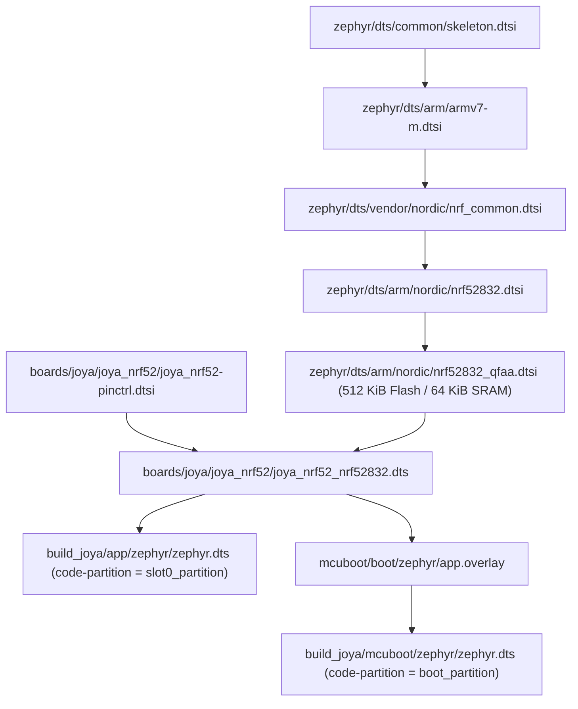

# 02. Hardware y Devicetree (`joya_nrf52/nrf52832`)

> **Capítulo del Manual Técnico Integral de Ingeniería del Producto — Firmware Joya**
> Navegación: [Índice General (README.md)](README.md) | Anterior: [01. Arquitectura General del Sistema](01_system_architecture.md) | Siguiente: [03. Configuración del Firmware, Kconfig y Sysbuild](03_firmware_configuration.md)

---

## 1. Visión General del Subsistema de Placa (Board Support Package)

El firmware de Joya define una tarjeta personalizada fuera del árbol estándar de Zephyr (*out-of-tree custom board*) bajo el directorio `[boards/joya/joya_nrf52/](../../boards/joya/joya_nrf52/)`, adaptada al modelo de hardware **HWMv2** introducido en Zephyr 3.7+/4.x. Su identificador canónico de destino (*board target*) es:

```text
joya_nrf52/nrf52832
```

Para que tanto la imagen principal (`app`) como la imagen secundaria del gestor de arranque (`mcuboot`) localicen esta definición personalizada durante una compilación multi-imagen con `sysbuild`, el directorio raíz del proyecto se inyecta en `BOARD_ROOT` en dos puntos complementarios:

1. `[CMakeLists.txt](../../CMakeLists.txt)` (línea 3): `list(APPEND BOARD_ROOT ${CMAKE_CURRENT_SOURCE_DIR})` para compilaciones directas de la aplicación.
2. `[sysbuild/CMakeLists.txt](../../sysbuild/CMakeLists.txt)` (línea 1): `list(APPEND BOARD_ROOT ${CMAKE_CURRENT_SOURCE_DIR}/..)` para que el orquestador `Sysbuild` propague `boards/joya/joya_nrf52/` tanto a `app` como a `mcuboot`.

### 1.1. Inventario de archivos de definición de hardware y Devicetree

| Archivo | Líneas | Rol técnico en la cadena de construcción |
|---|---:|---|
| `[boards/joya/joya_nrf52/board.yml](../../boards/joya/joya_nrf52/board.yml)` | 8 | Declara metadatos HWMv2: `name: joya_nrf52`, `full_name: Joya nRF52 PCB`, `vendor: joya` y el SoC soportado `nrf52832`. Habilita el selector `-b joya_nrf52/nrf52832`. |
| `[boards/joya/joya_nrf52/Kconfig.joya_nrf52](../../boards/joya/joya_nrf52/Kconfig.joya_nrf52)` | 5 | Define `BOARD_JOYA_NRF52` y fuerza `select SOC_NRF52832_QFAA`, fijando la variante física de `512 KiB` de Flash y `64 KiB` de SRAM (frente a la variante `QFAB` de `256 KiB` / `32 KiB`). |
| `[boards/joya/joya_nrf52/joya_nrf52_nrf52832_defconfig](../../boards/joya/joya_nrf52/joya_nrf52_nrf52832_defconfig)` | 4 | Activa `CONFIG_GPIO=y` a nivel de placa (tanto para `app` como para `mcuboot`) y documenta la prohibición eléctrica de activar `CONFIG_GPIO_AS_PINRESET` sobre `P0.21`. |
| `[boards/joya/joya_nrf52/joya_nrf52_nrf52832.dts](../../boards/joya/joya_nrf52/joya_nrf52_nrf52832.dts)` | 123 | Árbol de dispositivos principal de la PCB Joya: incluye `<nordic/nrf52832_qfaa.dtsi>` y `"joya_nrf52-pinctrl.dtsi"`, declara `/chosen`, `/joya_buttons`, `/zephyr,user`, `/aliases`, las cuatro particiones fijas de `&flash0`, habilita `&gpio0`, `&gpiote`, `&i2c0`, `&adc` (`channel@0`) y `&temp`, y deshabilita `&i2c1`, `&uart0`, `&spi0` y `&spi1`. |
| `[boards/joya/joya_nrf52/joya_nrf52-pinctrl.dtsi](../../boards/joya/joya_nrf52/joya_nrf52-pinctrl.dtsi)` | 20 | Define los estados `i2c0_default` y `i2c0_sleep` del multiplexor de pines (`&pinctrl`) para `TWIM0` (`SDA = P0.08`, `SCL = P0.06`), omitiendo deliberadamente resistencias *pull-up* internas y activando `low-power-enable` en reposo. |
| `[boards/joya/joya_nrf52/board.cmake](../../boards/joya/joya_nrf52/board.cmake)` | 5 | Configura argumentos para grabación inicial por SWD con `jlink` (`--device=nRF52832_xxAA`, `--speed=4000`, `4 MHz`) e incluye los *runners* comunes `jlink.board.cmake` y `nrfjprog.board.cmake`. |
| `[nrf52dk_nrf52832.overlay](../../nrf52dk_nrf52832.overlay)` | 63 | Overlay de desarrollo para emular la PCB Joya sobre el kit Nordic `nRF52 DK` (`PCA10040`), reasignando el botón, `haptic_en_gpios`, `i2c0`, apagando `uart0` y suprimiendo `gpio-as-nreset` en `&uicr`. |
| `[nrf52dk_battery_adc.overlay](../../nrf52dk_battery_adc.overlay)` | 27 | Segundo overlay opcional para banco de pruebas en `nRF52 DK`, habilitando `&adc` `channel@0` sobre `AIN7` (`P0.31`, serigrafiado `A5` en el DK) para inyección de tensión externa o simulador DAC (`ota/battery_simulation/battery_simulation.ino`). |

### 1.2. Jerarquía de inclusión y composición del Devicetree final (`zephyr.dts`)



La inspección cruzada entre `build_joya/app/zephyr/zephyr.dts` y `build_joya/mcuboot/zephyr/zephyr.dts` confirma que **ambas imágenes comparten exactamente el mismo árbol de hardware y tabla de particiones**, difiriendo únicamente en una propiedad del nodo `/chosen` sobrescrita por `bootloader/mcuboot/boot/zephyr/app.overlay`:
- En **`app`**: `zephyr,code-partition = &slot0_partition;` (`0x0000C000`, tamaño `0x37000`).
- En **`mcuboot`**: `zephyr,code-partition = &boot_partition;` (`0x00000000`, tamaño `0x0C000`).

---

## 2. Mapeo Completo de Pines del `nRF52832-QFAA` y Comportamiento Eléctrico

El `nRF52832-QFAA` dispone de un único banco GPIO de 32 pines (`&gpio0`, `P0.00..P0.31`, dirección base MMIO `0x50000000`). Tras cualquier reset de hardware, todos los pines nacen con su registro `GPIO->PIN_CNF[n] = 0x00000002` (*Input direction, input buffer disconnected, no pull, standard drive S0S1, sense disabled*), garantizando alta impedancia (`Hi-Z`) y corriente de fuga sub-nanoamperio en todos los pines no utilizados.

### 2.1. Tabla maestra de asignación de pines en `joya_nrf52/nrf52832`

| Pin SoC | Puerto / Índice | Nodo DTS / Propiedad / Alias | Función en PCB Joya | Dirección y Polaridad DTS | Pull interno / Drive | Interrupción / `pinctrl` | Estado eléctrico al Reset → tras Init → en Reposo |
|---|---|---|---|---|---|---|---|
| **`P0.06`** | `&gpio0 6` | `&pinctrl / i2c0_default`, `i2c0_sleep` (`psels = <0x0b000006>`) | Reloj serie **`I2C0 SCL`** hacia `DRV2605` | Bidireccional Open-Drain (`TWIM_SCL`) | **Sin pull interno** (`NOPULL`); drive `S0D1` gestionado por `TWIM0` | Sin IRQ GPIO; `i2c0_sleep` activa `low-power-enable` | Reset: `Hi-Z`. Durante `haptics_init()` / reproducción: `SCL` a `100 kHz`. En `drv2605_idle()`: `TWIM0` suspendido (`low-power-enable`, buffer de entrada desconectado). |
| **`P0.07`** | `&gpio0 7` | `/zephyr,user` → `haptic_en_gpios = <&gpio0 7 0x0>` | Habilitación / control de energía del **`DRV2605`** (`EN`) | Salida digital, `GPIO_ACTIVE_HIGH` (`flags = 0x00`) | Sin pull, push-pull estándar `S0S1` | Sin IRQ; controlado vía `gpio_pin_configure_dt` / `gpio_pin_set_dt` | Reset: `Hi-Z`. Al entrar en `haptics_init()`: `1` lógico (`VDD`, `10 ms` estabilización + config I2C). Al salir de `haptics_init()` (`drv2605_idle()`): **`0` lógico (`0 V`)**. Solo sube a `1` mientras vibra. |
| **`P0.08`** | `&gpio0 8` | `&pinctrl / i2c0_default`, `i2c0_sleep` (`psels = <0x0c000008>`) | Datos serie **`I2C0 SDA`** hacia `DRV2605` | Bidireccional Open-Drain (`TWIM_SDA`) | **Sin pull interno** (`NOPULL`); drive `S0D1` gestionado por `TWIM0` | Sin IRQ GPIO; `i2c0_sleep` activa `low-power-enable` | Reset: `Hi-Z`. Activo solo con `haptic_enabled == true`. En `drv2605_idle()`: desconectado en bajo consumo (`low-power-enable`). |
| **`P0.13`** | `&gpio0 13` | `/joya_buttons/emergency_button` (`gpios = <&gpio0 0xd 0x11>`); alias `boton-emergencia`, `sw0` | **Pulsador único de usuario / emergencia** (cierra a `GND`) | Entrada digital, `GPIO_ACTIVE_LOW` (`0 V` = presionado = `1` lógico en `gpio_pin_get_dt`) | **`GPIO_PULL_UP` interno** (`flags = 0x11`; $R_{\text{PU}} \approx 13\,\text{k}\Omega$, rango `11..16 kΩ`) | `GPIO_INT_EDGE_BOTH` vía canal `GPIOTE` (`[src/button.c](../../src/button.c)`, `L193`) | Reset: `Hi-Z`. Tras `button_init()`: `VDD` en reposo (`0 uA` DC); `0 V` al pulsar (consume $I \approx V_{\text{DD}} / 13\,\text{k}\Omega \approx 230..280\,\mu\text{A}$ solo mientras el dedo mantiene cerrado el contacto). |
| **`P0.31`** | `AIN7` (`P0.31`) | `/zephyr,user` → `io-channels = <&adc 0>` (`battery`); `&adc / channel@0` (`input-positive = <0x8>`) | Entrada analógica del **divisor resistivo `VBAT`** (`120 kΩ` / `82 kΩ`) | Entrada analógica *single-ended* (`NRF_SAADC_AIN7`, valor `8` en `PSELP`) | Sin pull interno (`NOPULL`), buffer digital desconectado | Conversión síncrona por interrupción interna de `SAADC` (`adc_read_dt`) | Conectado permanentemente al punto medio del divisor ($V_{\text{AIN7}} \approx 0{,}4059 \times V_{\text{BAT}}$). El multiplexor analógico interno del `SAADC` solo conecta la red capacitiva durante los ~`42 us` de cada muestra. |

### 2.2. Pines especiales del SoC con restricciones explícitas de diseño

| Pin(es) SoC | Función alternativa del silicio | Configuración efectiva en Joya | Justificación técnica e implicaciones |
|---|---|---|---|
| **`P0.21`** | `nRESET` opcional (controlado por `UICR->PSELRESET[0..1]`) | **Deshabilitado como reset** (`# CONFIG_GPIO_AS_PINRESET is not set` en `[joya_nrf52_nrf52832_defconfig](../../boards/joya/joya_nrf52/joya_nrf52_nrf52832_defconfig)`, `L3-4`) | La PCB Joya **carece de resistencia de *pull-up* externa** en `P0.21` (y cuando un pin actúa como `nRESET` en `UICR`, aunque el hardware nRF52 conecta un pull-up débil interno, pistas abiertas o ruteo sin filtrado en PCBs ultracompactas quedan expuestas a acoplamiento capacitivo/ESD). Si alguien grabase `PSELRESET = 21` en `UICR`, un simple transitorio reiniciaría el microcontrolador. Permanecer desconectado evita resets espurios. |
| **`P0.00` / `P0.01`** | `XL1` / `XL2` (Cristal externo `LFXO` de `32,768 kHz`) | **No utilizados por `CLOCK`** (`CONFIG_CLOCK_CONTROL_NRF_K32SRC_XTAL=n`, `K32SRC_RC=y`) | Tanto la aplicación (`[prj.conf](../../prj.conf)`, `L126-128`) como `MCUboot` (`[sysbuild/mcuboot.conf](../../sysbuild/mcuboot.conf)`, `L4-6`) usan el oscilador interno `LFRC`, prescindiendo del cristal externo de `32,768 kHz` (ahorro de espacio en PCB y costo BOM). No se puede confirmar sin esquemático si `P0.00`/`P0.01` están dejados sin conectar (`NC`). |
| **`P0.09` / `P0.10`** | `NFC1` / `NFC2` (Antena NFC-A Tag) | `&nfct` con `status = "disabled"` (`zephyr.dts:205-210`) y `# CONFIG_NFCT_PINS_AS_GPIOS is not set` | El periférico NFC Tag está desactivado y ningún módulo utiliza `P0.09`/`P0.10` como GPIO. |
| **`SWDIO` / `SWDCLK`** | Interfaz dedicada de programación/depuración ARM Serial Wire Debug | Activa en silicio (`# CONFIG_NRF_APPROTECT_LOCK is not set` en `.config:670`), configurada a `4000 kHz` en `board.cmake` | Usada en programación inicial de fábrica/banco. En unidades comerciales cerradas no es accesible físicamente desde el exterior (`[docs/auditorias/Avances.md](../../docs/auditorias/Avances.md)`, `L27`). Nota de seguridad: `APPROTECT` no está bloqueado por Kconfig en este corte. |
| **`P0.11`** *(histórico)* | Antiguo `nbm_ready` (`NBM5100A RDY`) en versiones `v1.x` | **Ausente** en `joya_nrf52_nrf52832.dts` | Permanece en `Hi-Z` por defecto tras eliminarse el soporte del booster `NBM5100A`. |

### 2.3. Análisis eléctrico detallado de `pinctrl` en `TWIM0` (`P0.08` / `P0.06`)

El archivo `[boards/joya/joya_nrf52/joya_nrf52-pinctrl.dtsi](../../boards/joya/joya_nrf52/joya_nrf52-pinctrl.dtsi)` (líneas 3–20) configura dos estados para el controlador de pines:

```dts
&pinctrl {
	i2c0_default: i2c0_default {
		group1 {
			psels = <NRF_PSEL(TWIM_SDA, 0, 8)>,
				<NRF_PSEL(TWIM_SCL, 0, 6)>;

			// Remove internal pull-up resistor
		};
	};

	i2c0_sleep: i2c0_sleep {
		group1 {
			psels = <NRF_PSEL(TWIM_SDA, 0, 8)>,
				<NRF_PSEL(TWIM_SCL, 0, 6)>;
			low-power-enable;
		};
	};
};
```

Esta configuración encierra **dos decisiones eléctricas importantes**:

1. **Ausencia deliberada de `bias-pull-up` interno en `i2c0_default`**:
   - En los diseños de referencia de Nordic (como el DK estándar), suele declararse `bias-pull-up;` (~`13 kΩ` hacia `VDD` del SoC) en los grupos `TWIM`. En la PCB Joya se eliminó expresamente (`// Remove internal pull-up resistor`).
   - **Consecuencia 1 (Dependencia de pull-ups externos en PCB)**: el bus `I2C0` **requiere obligatoriamente resistencias de *pull-up* físicas montadas en la PCB** (o en la placa auxiliar cuando se ensaya sobre un `nRF52 DK`, dado que `nrf52dk_nrf52832.overlay:33-38` replica la misma ausencia de `bias-pull-up`). Si se conecta un `DRV2605` sin *pull-ups* externos, `SDA` y `SCL` quedan flotando al soltar el colector abierto (`S0D1`), provocando fallo de `i2c_recover_bus()` / `drv2605_probe_addr()` en `haptics_init()` y reportando bit `DIAG_INIT_HAPTIC = 0` (p. ej. `0xA0 0x17`).
   - **Consecuencia 2 (Eliminación de fugas hacia el dominio conmutado del `DRV2605`)**: si en la PCB las resistencias *pull-up* de `SDA`/`SCL` están referenciadas a un riel conmutado por `P0.07` (o si el `DRV2605` cae a `0 V` cuando `P0.07 = 0`), activar `bias-pull-up` interno hacia `VDD` del `nRF52832` inyectaría corriente continua de fuga ($\approx \frac{V_{\text{DD}} - V_F}{13\,\text{k}\Omega} \times 2 \approx 400..500\,\mu\text{A}$) a través de los diodos de protección ESD de `SDA`/`SCL` del `DRV2605` apagado (*back-powering*). Omitir `bias-pull-up` evita por completo esa pérdida.
2. **Transición dinámica entre `i2c0_default` e `i2c0_sleep` (`low-power-enable`)**:
   - Cuando `drv2605_idle()` invoca `pm_device_action_run(haptic_i2c, PM_DEVICE_ACTION_SUSPEND)` (`[src/haptics.c](../../src/haptics.c)`, líneas 207 y 253), el driver `i2c_nrfx_twim` deshabilita el periférico `TWIM0` (liberando cualquier requerimiento sobre el bus interno de relojes de `16 MHz` / `EasyDMA`, que de otro modo impediría alcanzar los ~`2 uA` de System ON Idle) y aplica el estado `i2c0_sleep`, cuya propiedad `low-power-enable` desconecta los buffers digitales de entrada CMOS de `P0.08` y `P0.06`. Así, aunque `SDA` y `SCL` queden a un potencial intermedio o `0 V` cuando `P0.07 = 0`, no se genera corriente de *shoot-through* en los inversores de entrada del GPIO del `nRF52832`.
   - Al despertar con `drv2605_wake()`, `haptics_i2c_resume()` ejecuta `PM_DEVICE_ACTION_RESUME` (`[src/haptics.c](../../src/haptics.c)`, línea 222), restaurando `i2c0_default` antes de levantar `P0.07 = 1`.

---

## 3. Mapa de Periféricos del SoC: Habilitados, Reservados por Sistema y Deshabilitados

En un SoC `nRF52832` bajo Zephyr + `BT_LL_SW_SPLIT`, no basta mirar `status = "okay"` en `zephyr.dts` para saber qué bloques de silicio están encendidos: el controlador BLE en software y el temporizador del kernel toman posesión directa a nivel HAL (`nrfx`) de varios periféricos cuyos nodos DTS permanecen con `status = "disabled"` precisamente para impedir que código de aplicación instancie drivers sobre ellos.

| Periférico / Nodo DTS | Dirección MMIO | IRQ NVIC | `compatible` | `status` en `zephyr.dts` | Estado real en ejecución (`app` / `mcuboot`) y propósito técnico |
|---|---|---:|---|---|---|
| **`clock`** (`clock@40000000`) | `0x40000000` | `0` (compartida con `power`) | `nordic,nrf-clock` | `"okay"` | **Activo (`app` y `mcuboot`)**. Gobierna `HFXO` (`64 MHz`) y `LFRC` (`32,768 kHz`) más el temporizador hardware de calibración periódica del `LFRC`. |
| **`power`** (`power@40000000`) | `0x40000000` | `0` | `nordic,nrf-power` | `"okay"` | **Activo**. Contiene `gpregret1@4000051c`, `gpregret2@40000520` y `regulator@40000578` (`regulator-initial-mode = 0`, modo LDO). |
| **`bprot`** (`bprot@40000000`) | `0x40000000` | — | `nordic,nrf-bprot` | `"okay"` | Disponible en DTS, sin regiones bloqueadas (`CONFIG_NRF_BPROT_FLASH_REGION_SIZE=0`). |
| **`radio`** (`radio@40001000`) + `bt_hci_controller` | `0x40001000` | `1` | `nordic,nrf-radio` / `zephyr,bt-hci-ll-sw-split` | `"okay"` | **Activo en `app`** (apagado en `mcuboot`, `# CONFIG_BT is not set`). Transceptor 2,4 GHz `1M` y `2M PHY` (`ble-2mbps-supported`), potencia TX `0 dBm` (`CONFIG_BT_CTLR_TX_PWR_0=y`). |
| **`uart0`** (`uart@40002000`) | `0x40002000` | `2` | `nordic,nrf-uarte` | **`"disabled"`** | **Deshabilitado** explícitamente en `joya_nrf52_nrf52832.dts:94-96` (`# CONFIG_SERIAL is not set`). Cero consumo de `UARTE` y cero pines asignados. |
| **`i2c0`** (`i2c@40003000`) | `0x40003000` | `3` | `nordic,nrf-twim` | `"okay"` | **Activo bajo demanda en `app`** (inactivo en `mcuboot`, `# CONFIG_I2C is not set`). Maestro I2C con `EasyDMA` de 8 bits (`255 B` máx/transferencia), `clock-frequency = 0x186a0` (`100.000 Hz`), timeout `500 ms`. Comunica con `DRV2605`. |
| **`spi0`** (`spi@40003000`) | `0x40003000` | `3` | `nordic,nrf-spi` | **`"disabled"`** | **Deshabilitado** (`joya_nrf52_nrf52832.dts:98-100`). Comparte dirección base e ID de periférico `3` con `i2c0` en la matriz de periféricos del `nRF52832` (mutuamente excluyentes). |
| **`i2c1` / `spi1`** (`@40004000`) | `0x40004000` | `4` | `nrf-twim` / `nrf-spi` | **`"disabled"`** | **Deshabilitados** (`joya_nrf52_nrf52832.dts:90-92, 102-104`). |
| **`nfct`** (`nfct@40005000`) | `0x40005000` | `5` | `nordic,nrf-nfct` | **`"disabled"`** | **Deshabilitado** desde `nrf52832.dtsi`. |
| **`gpiote`** (`gpiote@40006000`) | `0x40006000` | `6` | `nordic,nrf-gpiote` | `"okay"` | **Activo (`app` y `mcuboot`)**. Gestiona la interrupción de flanco doble de `P0.13` (`CONFIG_NRFX_GPIOTE_NUM_OF_EVT_HANDLERS=1`). Nota: en `nRF52832`, usar un canal `IN[0]` de `GPIOTE` para `EDGE_BOTH` mantiene activo el bloque de detección de flanco (~`15..20 uA` según modo vs `PORT` event). |
| **`adc`** (`adc@40007000`) | `0x40007000` | `7` | `nordic,nrf-saadc` | `"okay"` | **Activo bajo demanda en `app`** (inactivo en `mcuboot`, `# CONFIG_ADC is not set`). Configura `channel@0` sobre `AIN7` (`P0.31`). Solo se energiza durante cada llamada a `adc_read_dt()`. |
| **`timer0`** (`timer@40008000`) | `0x40008000` | `8` | `nordic,nrf-timer` | `"disabled"` *(DTS)* | **Activo internamente en `app` durante ventanas de radio BLE**: reservado directamente por `BT_LL_SW_SPLIT` para temporización de microsegundos (`T_IFS = 150 us`). |
| **`timer1..4`** (`@40009000..4001b000`) | `0x40009000`..`0x4001b000` | `9, 10, 26, 27` | `nordic,nrf-timer` | **`"disabled"`** | **Deshabilitados**. |
| **`rtc0`** (`rtc@4000b000`) | `0x4000b000` | `11` | `nordic,nrf-rtc` | `"disabled"` *(DTS)* | **Activo permanentemente en `app`**: reservado directamente por el planificador *ticker* de `BT_LL_SW_SPLIT` (y por `CONFIG_SOC_FLASH_NRF_RADIO_SYNC_TICKER=y`) a `32.768 Hz`. |
| **`temp`** (`temp@4000c000`) | `0x4000c000` | `12` | `nordic,nrf-temp` | `"okay"` | **Activo (`app`)**. Sensor térmico interno en die (`CONFIG_TEMP_NRF5=y`, `CONFIG_CLOCK_CONTROL_NRF_USES_TEMP_SENSOR=y`), leído cada `4 s` para decidir si recalibrar el oscilador `LFRC` cuando $\Delta T \ge 0{,}5\,^\circ\text{C}$. |
| **`rng`** (`random@4000d000`) | `0x4000d000` | `13` | `nordic,nrf-rng` | `"okay"` | **Activo en `app`** (`zephyr,entropy = &rng`, `CONFIG_ENTROPY_NRF5_RNG=y` con corrección de sesgo). Provee números aleatorios criptográficos al controlador/host BLE (*access addresses*, *jitter* de advertising). |
| **`ecb` / `ccm`** (`@4000e000` / `@4000f000`) | `0x4000e000` / `0x4000f000` | `14` / `15` | `nrf-ecb` / `nrf-ccm` | `"okay"` | **Disponibles para el controlador BLE** (`BT_CTLR_CRYPTO`, `BT_CTLR_LE_ENC`), aunque el firmware Joya no negocia cifrado de enlace (`CONFIG_BT_SMP=n`). |
| **`wdt0`** (`watchdog@40010000`) | `0x40010000` | `16` *(sin IRQ)* | `nordic,nrf-wdt` | `"okay"` | **Activo siempre (`app` y alimentado en `mcuboot`)**. Opera sin interrupción previa (`CONFIG_WDT_NRFX_NO_IRQ=y`), reseteando directamente el SoC al expirar `CRV = 983040` (`30 s`). |
| **`rtc1`** (`rtc@40011000`) | `0x40011000` | `17` | `nordic,nrf-rtc` | `"disabled"` *(DTS)* | **Activo permanentemente (`app` y `mcuboot`)**: tomado directamente por el reloj de sistema de Zephyr (`CONFIG_NRF_RTC_TIMER=y`, `32.768 ticks/s`, modo *tickless*) en lugar del `SysTick` de ARM (`systick` deshabilitado, pues `SysTick` se detendría en System ON Sleep cuando se apaga `HFCLK`). |
| **`egu0..5` / `swi0..5`** (`@40014000..40019000`) | `0x40014000`..`0x40019000` | `20..25` | `nordic,nrf-egu` | `"okay"` | **Activos en `app`**: `SWI4`/`SWI5` usados por el sistema de ejecución diferida *Mayfly* del controlador BLE (`ULL`/`LLL`) y `EGU5` asignado a `CONFIG_NRF52_ANOMALY_109_WORKAROUND_EGU_INSTANCE=5`. |
| **`flash_controller`** (`@4001e000`) | `0x4001e000` | — | `nordic,nrf52-flash-controller` | `"okay"` | **Activo (`app` y `mcuboot`)**. Controlador `NVMC` de la Flash interna de `512 KiB`; en `app` opera sincronizado con las ranuras libres de la radio BLE (`SOC_FLASH_NRF_RADIO_SYNC_TICKER=y`). |
| **`ppi` / `mwu`** (`@4001f000` / `@40020000`) | `0x4001f000` / `0x40020000` | — | `nrf-ppi` / `nrf-mwu` | `"okay"` | **`PPI` activo**: interconecta por hardware eventos de `TIMER0`/`RTC0` con tareas `START`/`TXEN`/`RXEN` de `RADIO` sin intervención de CPU. |
| **`pwm0..2`, `pdm0`, `spi2`, `rtc2`, `i2s0`, `qdec0`, `comp`** | Varios | Varios | Varios | **`"disabled"`** | **Deshabilitados**. |

---

## 4. Topología del Bus I2C (`TWIM0`) y Dispositivos Conectados

El nodo `&i2c0` en `[boards/joya/joya_nrf52/joya_nrf52_nrf52832.dts](../../boards/joya/joya_nrf52/joya_nrf52_nrf52832.dts)` (líneas 82–88) configura el bus en velocidad estándar (`I2C_BITRATE_STANDARD` = `100 kHz`, compilado como `0x186a0` en `zephyr.dts:161`) sin declarar nodos hijos dentro del bloque `&i2c0 { ... }`. El acceso se realiza mediante la referencia al controlador de bus `DEVICE_DT_GET(DT_NODELABEL(i2c0))` en `[src/haptics.c](../../src/haptics.c)` (líneas 20–21).

| Dispositivo | Dirección I2C (7 bits) | Estado en `HEAD` (`c1128e5`) | Registros operados por el firmware | Detalles de protocolo y manejo de fallos |
|---|---|---|---|---|
| **TI `DRV2605` (primaria)** | **`0x5A`** (`DRV2605_I2C_ADDR_LOW`) | **Implementado y activo** | `0x00` (`STATUS`), `0x01` (`MODE`), `0x02` (`RTP_INPUT`), `0x03` (`LIBRARY`), `0x04` (`WAVESEQ1`), `0x05` (`WAVESEQ2`), `0x0C` (`GO`), `0x17` (`OD_CLAMP`), `0x1A` (`FEEDBACK_CONTROL`), `0x1D` (`CONTROL3`) | Sondeada primero en `haptics_init()` leyendo `STATUS` (`0x00`) tras ejecutar `i2c_recover_bus(haptic_i2c)` (`[src/haptics.c](../../src/haptics.c)`, `L511-517`). |
| **TI `DRV2605` (fallback)** | **`0x5B`** (`DRV2605_I2C_ADDR_HIGH`) | **Implementado como respaldo** | Idénticos a `0x5A` | Sondeada automáticamente si `0x5A` devuelve error/NACK (`[src/haptics.c](../../src/haptics.c)`, `L519-522`). Nota: en las hojas de datos estándar de TI `DRV2605`/`DRV2605L` la dirección fija es `0x5A`; `0x5B` obra como mecanismo defensivo ante variantes de encapsulado o ruteo. |
| **Nexperia `NBM5100A`** *(histórico)* | **`0x2E`** | **Código residual huérfano (no invocado)** | `0x08` (`COMMAND` ← `0x00`), `0x0A` (`SET2` ← `v & ~0x10`, limpia `VDHHIZ`) | Presente únicamente dentro de `static int nbm_bypass_init(void)` en `[src/haptics.c](../../src/haptics.c)` (`L465-479`). Nunca se invoca en tiempo de ejecución. |

### 4.1. Temporización y robustez eléctrica en el bus I2C

- **Recuperación antibloqueo de línea `SDA` (`i2c_recover_bus`)**: si un reinicio por watchdog o corte de energía sorprende al `DRV2605` enviando un bit `0` sobre `SDA`, el esclavo podría retener `SDA` en bajo al reenergizarse. En `haptics_init()` (`L511`), tras activar `P0.07 = 1` y esperar `10 ms`, el driver ejecuta `i2c_recover_bus(haptic_i2c)` (generando pulsos de reloj en `SCL` hasta liberar `SDA` seguido de condición `STOP`).
- **Timeout acotado de hardware/driver**: `CONFIG_I2C_NRFX_TRANSFER_TIMEOUT=500` (`500 ms` en `build_joya/app/zephyr/.config:1049`) garantiza que un cortocircuito físico en `SDA` o `SCL` (*clock stretching* infinito) nunca bloquee indefinidamente a `sysworkq` ni dispare un reset por `WDT0` (`30 s`); la transacción aborta a los `500 ms` y reporta `DIAG_ERROR_I2C` (`0xE5`).
- **Observación sobre restauración de registros tras apagado de `P0.07` (Categoría `c` / `e`)**: al finalizar `haptics_init()`, `drv2605_idle()` escribe `STANDBY` (`0x40`) en `MODE` y pone **`P0.07 = 0`**. Si en la PCB `P0.07` está conectado al pin lógico `EN` del `DRV2605` manteniendo `VDD` alimentado, el `DRV2605` **conserva** sus registros en modo *shutdown* (`FEEDBACK_CONTROL`, `CONTROL3`, `OD_CLAMP = 0x72`); en cambio, si `P0.07` corta físicamente el pin `VDD` del `DRV2605` mediante un interruptor de carga MOSFET, al volver a subir `P0.07 = 1` en `drv2605_wake()` (`[src/haptics.c](../../src/haptics.c)`, `L257-296`) el `DRV2605` sufriría un Power-On Reset interno y volvería a sus valores de fábrica (`OD_CLAMP` por defecto y lazo cerrado), dado que `drv2605_wake()` solo reescribe `MODE` (`0x00`) y `LIBRARY` (`0x01`), sin volver a escribir `FEEDBACK_CONTROL`, `CONTROL3` ni `OD_CLAMP`. Confirmar cuál de las dos topologías implementa la PCB requiere inspección del esquemático electrónico (hallazgo `N-07` en `[docs/auditorias/Avances.md](../../docs/auditorias/Avances.md)`, `L54`).

---

## 5. Subsistema Analógico de Medición de Batería (`SAADC` y Divisor Resistivo)

### 5.1. Configuración Devicetree del canal `SAADC`

En `[boards/joya/joya_nrf52/joya_nrf52_nrf52832.dts](../../boards/joya/joya_nrf52/joya_nrf52_nrf52832.dts)` (líneas 34–38 y 106–119):

```dts
	zephyr,user {
		haptic_en_gpios = <&gpio0 7 GPIO_ACTIVE_HIGH>;
		io-channels = <&adc 0>;
		io-channel-names = "battery";
	};
...
&adc {
	status = "okay";
	#address-cells = <1>;
	#size-cells = <0>;

	channel@0 {
		reg = <0>;
		zephyr,gain = "ADC_GAIN_1_3";
		zephyr,reference = "ADC_REF_INTERNAL";
		zephyr,acquisition-time = <ADC_ACQ_TIME(ADC_ACQ_TIME_MICROSECONDS, 40)>;
		zephyr,input-positive = <NRF_SAADC_AIN7>;
		zephyr,resolution = <12>;
	};
};
```

### 5.2. Modelo eléctrico, impedancia de fuente, rango dinámico y resolución

El circuito externo conectado a `P0.31` (`AIN7`) es un divisor resistivo fijo entre el positivo de la batería ($V_{\text{BAT}}$) y masa (`GND`), con $R_{\text{top}} = 120\,\text{k}\Omega$ (`BATTERY_R_TOP_KOHM`) y $R_{\text{bottom}} = 82\,\text{k}\Omega$ (`BATTERY_R_BOTTOM_KOHM` en `[src/battery.c](../../src/battery.c)`, líneas 15–16):

1. **Factor de atenuación e inversión entera con redondeo simétrico**:
   $$V_{\text{AIN7}} = V_{\text{BAT}} \cdot \frac{R_{\text{bottom}}}{R_{\text{top}} + R_{\text{bottom}}} = V_{\text{BAT}} \cdot \frac{82}{202} \approx 0{,}40594 \cdot V_{\text{BAT}}$$
   A partir de la tensión en el pin `adc_mv` calculada por `adc_raw_to_millivolts_dt()`, `[src/battery.c](../../src/battery.c)` (líneas 104–105) despeja $V_{\text{BAT}}$ en milivoltios redondeando al entero más cercano sin usar coma flotante:
   $$\text{voltage\_mv} = \left\lfloor \frac{\text{adc\_mv} \times (120 + 82) + 41}{82} \right\rfloor = \left\lfloor \frac{202 \cdot \text{adc\_mv} + 41}{82} \right\rfloor$$

2. **Fondo de escala y margen contra saturación**:
   Con referencia interna $V_{\text{REF}} = 0{,}6\,\text{V}$ (`ADC_REF_INTERNAL`) y ganancia $G = \frac{1}{3}$ (`ADC_GAIN_1_3`), el rango de entrada a fondo de escala del `SAADC` es:
   $$V_{\text{FS,AIN7}} = \frac{V_{\text{REF}}}{G} = \frac{0{,}6\,\text{V}}{1/3} = 1{,}800\,\text{V} \implies V_{\text{BAT,FS}} = 1{,}800\,\text{V} \times \frac{202}{82} \approx 4{,}434\,\text{V}$$
   Para una celda LiPo/Li-ion completamente cargada a $4{,}200\,\text{V}$, la tensión en `AIN7` es $1{,}705\,\text{V}$, dejando un margen seguro de $\approx 95\,\text{mV}$ en el pin ($\approx 234\,\text{mV}$ referidos a `VBAT`) antes de saturar el convertidor.
   Con resolución de $12\,\text{bits}$ ($2^{12} = 4096$ cuentas sobre $1800\,\text{mV}$), el peso de `1 LSB` es $\approx 0{,}4395\,\text{mV}$ en `AIN7`, equivalente a **$\approx 1{,}083\,\text{mV/LSB}$ referidos a `VBAT`**.

3. **Impedancia equivalente de Thévenin frente al tiempo de adquisición ($t_{\text{ACQ}} = 40\,\mu\text{s}$)**:
   La resistencia de fuente vista por el capacitor interno de muestreo y retención ($C_{\text{sample}} \approx 2{,}5\,\text{pF}$) del `SAADC` es:
   $$R_{\text{source}} = R_{\text{top}} \parallel R_{\text{bottom}} = \frac{120\,\text{k}\Omega \times 82\,\text{k}\Omega}{120\,\text{k}\Omega + 82\,\text{k}\Omega} = \frac{9840}{202}\,\text{k}\Omega \approx 48{,}71\,\text{k}\Omega$$
   Según la especificación eléctrica oficial de Nordic para el `SAADC` del `nRF52832`:
   - Para $t_{\text{ACQ}} \le 10\,\mu\text{s}$, la resistencia máxima permitida de fuente es $R_{\text{source}} \le 40\,\text{k}\Omega$ (que sería **incumplida** por los $48{,}71\,\text{k}\Omega$ de Joya, provocando error de ganancia por carga incompleta de $C_{\text{sample}}$).
   - Para **$t_{\text{ACQ}} = 40\,\mu\text{s}$** (valor configurado en el DTS de Joya, codificado como `0x4028` en `zephyr.dts:239`), el `SAADC` admite hasta **$R_{\text{source}} \le 800\,\text{k}\Omega$**, garantizando asentamiento completo a más de `12 bits` incluso sin depender de un capacitor externo en `P0.31`.

4. **Impacto energético de la ausencia de conmutación por GPIO en el divisor**:
   Ni el Devicetree ni `src/battery.c` controlan un transistor de corte para desconectar el divisor entre mediciones. Por tanto, circula permanentemente una corriente estática por la serie $120\,\text{k}\Omega + 82\,\text{k}\Omega = 202\,\text{k}\Omega$:
   $$I_{\text{div}}(4{,}2\,\text{V}) \approx 20{,}79\,\mu\text{A}, \qquad I_{\text{div}}(3{,}7\,\text{V}) \approx 18{,}32\,\mu\text{A}, \qquad I_{\text{div}}(2{,}9\,\text{V}) \approx 14{,}36\,\mu\text{A}$$
   Esta corriente pasiva (~`15..21 uA`) supera en casi un orden de magnitud el consumo propio del `nRF52832` en System ON Sleep con `LFRC` + `RTC1` + `WDT0` (~`2..3 uA`), estableciendo el piso físico de corriente de descarga en reposo (`suspended_idle` y `critical_idle`).

5. **Comportamiento cerca de `0 V` y workarounds de silicio**:
   - El `SAADC` del `nRF52832` almacena en EasyDMA un entero con signo `int16_t` incluso en modo *single-ended*, pudiendo entregar valores ligeramente negativos (`-1..-5` cuentas) por *offset* interno si `AIN7` está a `0 V` (p. ej., en un DK sin divisor conectado). En ese caso `voltage_mv` resulta levemente negativo, clasificándose en `BATTERY_STATE_LEVEL_2`; al transmitirse en `ble_send_battery_value()` (`[src/ble_driver.c](../../src/ble_driver.c)`, línea 705), el chequeo `if (value < 0 || value > UINT16_MAX) return -EINVAL;` descarta limpiamente lecturas negativas sin subdesbordar el `uint16_t`.
   - Zephyr aplica automáticamente `CONFIG_NRF52_ANOMALY_109_WORKAROUND=y` (protección DMA en despertado de bajo consumo mediante `EGU5`).

---

## 6. Arquitectura de Relojes, Alimentación y Fronteras del Repositorio

### 6.1. Dominios de reloj (`HFCLK` y `LFCLK`)

| Dominio | Fuente seleccionada | Frecuencia y precisión | Configuración DTS / Kconfig | Régimen de operación e impacto energético |
|---|---|---|---|---|
| **Alta Frecuencia (`HFCLK`)** | Oscilador interno `HFINT` + Cristal externo **`HFXO`** (`&hfxo`, `zephyr.dts:645-650`) | `64 MHz` (`0x3d09000 Hz`); tiempo de arranque `HFXO` declarado `1400 us` (`0x578`) | `CONFIG_BT_CTLR_XTAL_ADVANCED=y`, `XTAL_THRESHOLD=1500` us | En CPU activa sin radio corre `HFINT` (arranque instantáneo); antes de cada evento BLE o calibración de `LFRC` se enciende `HFXO` (obligatorio para cumplir precisión de portadora RF `±40 ppm` Bluetooth); en `k_cpu_idle()` ambos se apagan automáticamente si no hay DMA activo (`TWIM0`/`SAADC` suspendidos). |
| **Baja Frecuencia (`LFCLK`)** | Oscilador RC interno **`LFRC`** (`CONFIG_CLOCK_CONTROL_NRF_K32SRC_RC=y`, `XTAL=n`) | `32.768 Hz`, precisión post-calibración declarada **`±500 ppm`** (`K32SRC_500PPM=y`) | Calibración automática cada **`4000 ms`** (`CALIBRATION_PERIOD=4000`, `MAX_SKIP=1`, `TEMP_DIFF=2` cuartos de grado = `0,5 °C` sobre `&temp`) | Permanece siempre encendido (`CALIBRATION_LF_ALWAYS_ON=y`) alimentando `RTC0` (BLE), `RTC1` (kernel) y `WDT0`. Elimina el cristal externo de `32 kHz`, a cambio de ~`0,6..1 uA` adicionales por las ráfagas periódicas de medición térmica/calibración contra `HFXO` cada `4..8 s` y un mayor ensanchamiento de ventana RX (*window widening*) cuando actúa como periférico conectado con latencia de esclavo `4`. |

> [!NOTE]
> `sysbuild/mcuboot.conf` (líneas 4–6) replica exactamente `CONFIG_CLOCK_CONTROL_NRF_K32SRC_RC=y`, `XTAL=n` y `500PPM=y`. Esto es indispensable: si `MCUboot` compilase esperando el cristal externo `LFXO` por defecto en una PCB que no lo monta, el bootloader quedaría bloqueado infinitamente en el arranque esperando el evento `EVENTS_LFCLKSTARTED` (`SYSTEM_CLOCK_WAIT_FOR_STABILITY=y`).

### 6.2. Regulador interno del SoC (`LDO` vs `DC/DC`)

En `build_joya/app/zephyr/zephyr.dts` (líneas 113–118), el nodo `regulator@40000578` hereda el valor por defecto de `nrf52832.dtsi`:

```dts
reg: regulator@40000578 {
    compatible = "nordic,nrf5x-regulator";
    reg = <0x40000578 0x1>;
    regulator-name = "REG";
    regulator-initial-mode = <0x0>; /* NRF5X_REG_MODE_LDO */
};
```

Asimismo, `# CONFIG_REGULATOR is not set` en `.config` (línea 4). En consecuencia, el `nRF52832` opera permanentemente con su **regulador lineal interno `LDO`** (`DCDCEN = 0`). Durante picos de radio TX/RX a `0 dBm`, el modo `LDO` demanda ~`7,1..7,5 mA` desde `VDD` frente a ~`3,7..5,4 mA` con el convertidor reductor `DC/DC` interno a `3,0..3,7 V`.

> [!CAUTION]
> **Prohibición de activar `DC/DC` sin verificar el esquemático físico**: en el `nRF52832`, habilitar `NRF5X_REG_MODE_DCDC` (`POWER->DCDCEN = 1`) en una placa que **no** tenga montados físicamente los dos inductores externos (`10 uH` + `15 nH`) y el capacitor de `1,0 uF` entre `DCC` y `DEC4` provoca el colapso inmediato del riel interno `DEC4` (`1,3 V`) al primer intento de conmutación, inutilizando el arranque del SoC (y dejando sin vía de recuperación OTA a una unidad sellada).

### 6.3. Elementos eléctricos no determinables exclusivamente desde el repositorio

Por transparencia de ingeniería, se dejan asentados los parámetros de hardware externo que **no figuran en los archivos del repositorio** y requieren contraste con el esquemático/BOM de la PCB Joya:

1. Existencia o ausencia de la red LC externa (`10 uH` + `15 nH` + `1 uF`) en el pin `DCC` del `nRF52832-QFAA`.
2. Existencia o ausencia física de un cristal de `32,768 kHz` en `P0.00`/`P0.01` (`XL1`/`XL2`).
3. Circuito exacto comandado por `P0.07` (`haptic_en_gpios`): conexión directa al pin lógico `EN` del `DRV2605` manteniendo `VDD` permanente frente a interruptor de carga (*load switch* P-MOSFET) cortando la alimentación completa del `DRV2605` y/o de las resistencias *pull-up* del bus I2C.
4. Valor nominal y riel de referencia de las resistencias *pull-up* externas de `SDA` (`P0.08`) y `SCL` (`P0.06`).
5. Capacitores de desacoplo/filtrado antialiasing en `P0.31` (`AIN7`) y de filtrado RC en el pulsador `P0.13`.
6. Referencia comercial exacta de la batería recargable, su tensión de corte de BMS/PCM interno, el circuito integrado cargador en placa y la tensión nominal del motor ERM acoplado al `DRV2605`.

---

## 7. Geometría de Memoria Flash, Nodos `chosen` y Mapa de Particiones

### 7.1. Parámetros físicos de `flash0` (`NVMC`) y `sram0`

En `zephyr.dts` (líneas 72–75 y 459–464):
- **`sram0` (`memory@20000000`)**: `0x20000000 .. 0x20010000` (`0x10000` = `65.536 B` = **`64 KiB`**), `8` bloques RAM de `8 KiB` con retención en System ON Sleep.
- **`flash0` (`flash@0` bajo `flash-controller@4001e000`)**:
  - Rango físico: `0x00000000 .. 0x00080000` (`0x80000` = `524.288 B` = **`512 KiB`**).
  - Unidad mínima de borrado (`erase-block-size`): `0x1000` = **`4.096 B` (`4 KiB`)** → `128` páginas numeradas `0..127`.
  - Unidad mínima de programación (`write-block-size`): `0x4` = **`4 B`** (`32 bits` alineados).

### 7.2. Mapa completo de particiones fijas (`fixed-partitions`)

Definido en `[boards/joya/joya_nrf52/joya_nrf52_nrf52832.dts](../../boards/joya/joya_nrf52/joya_nrf52_nrf52832.dts)` (líneas 46–72):

```text
0x00000000 +---------------------------------------------------+  Página 0
           | boot_partition ("mcuboot")                        |  48 KiB (12 páginas)
           | Bootloader MCUboot + clave pública RSA-2048       |  Uso real ELF: ~29,7 KiB (61,8 %)
0x0000C000 +---------------------------------------------------+  Página 12
           | slot0_partition ("image-0")                       |  220 KiB (55 páginas = 225.280 B)
           | [0x0C000..0x0C200] Cabecera MCUboot (512 B)       |  zephyr,code-partition (en app)
           | [0x0C200..       ] Imagen XIP + Protected/Unp TLV |  Uso firmado ref: 165.056 B
           | [0x41000..0x43000] Footer Swap/Trailer (8 KiB)    |  Capacidad máx imagen: 216.752 B
0x00043000 +---------------------------------------------------+  Página 67
           | slot1_partition ("image-1")                       |  220 KiB (55 páginas = 225.280 B)
           | Recepción de nueva imagen firmada por BLE SMP     |  Escrita vía stream_flash (buf 512 B)
           | + área de maniobra durante SWAP_USING_MOVE        |
0x0007A000 +---------------------------------------------------+  Página 122
           | storage_partition ("storage")                     |  24 KiB (6 páginas = 24.576 B)
           | Backend Settings / NVS (5 páginas datos + 1 GC)   |  zephyr,settings-partition
           | Claves: joya/app_id, emergency, routine, name     |
0x00080000 +---------------------------------------------------+  Fin de Flash (Página 128 excl.)
```

| Nodo DTS | `label` | Inicio | Fin (excl.) | Tamaño Hex | Tamaño Bytes (`KiB`) | Páginas (`4 KiB`) | Rol en `app` y `mcuboot` |
|---|---|---|---|---|---:|---:|---|
| `boot_partition` (`partition@0`) | `"mcuboot"` | `0x00000000` | `0x0000C000` | `0x0C000` | `49.152 B` (`48 KiB`) | `12` (`0..11`) | `zephyr,code-partition` de `MCUboot`. Inmutable durante actualizaciones OTA de aplicación. |
| `slot0_partition` (`partition@c000`) | `"image-0"` | `0x0000C000` | `0x00043000` | `0x37000` | `225.280 B` (`220 KiB`) | `55` (`12..66`) | `zephyr,code-partition` de `app` (`CONFIG_FLASH_LOAD_OFFSET=0xc000`, `CONFIG_FLASH_LOAD_SIZE=0x37000`). Ejecución XIP directa; reserva `0x200` (`512 B`) de cabecera inicial y `0x2000` (`8 KiB`, 2 páginas) finales de estado de *swap* y *trailer* `image_ok`/`magic`. |
| `slot1_partition` (`partition@43000`) | `"image-1"` | `0x00043000` | `0x0007A000` | `0x37000` | `225.280 B` (`220 KiB`) | `55` (`67..121`) | Destino de escritura del grupo `IMG` de `MCUmgr` durante descargas BLE OTA y almacén de la imagen previa para *rollback* tras un *swap*. |
| `storage_partition` (`partition@7a000`) | `"storage"` | `0x0007A000` | `0x00080000` | `0x06000` | `24.576 B` (`24 KiB`) | `6` (`122..127`) | `zephyr,settings-partition`. Montada por `Settings`/`NVS` en `storage_init()` (`5` sectores activos de datos + `1` sector libre obligatorio para recolección de basura). Nunco es tocada por `MCUboot` durante updates OTA. |

### 7.3. Comparativa de propiedades `/chosen` resueltas

| Propiedad en `/chosen` | Origen DTS | Valor en `app` (`zephyr.dts:11-19`) | Valor en `mcuboot` (`zephyr.dts:11-19`) |
|---|---|---|---|
| `zephyr,sram` | `joya_nrf52_nrf52832.dts:17` | `&sram0` (`64 KiB`) | `&sram0` (`64 KiB`) |
| `zephyr,flash` | `joya_nrf52_nrf52832.dts:18` | `&flash0` (`512 KiB`) | `&flash0` (`512 KiB`) |
| `zephyr,flash-controller` | `nrf52832.dtsi:12` | `&flash_controller` | `&flash_controller` |
| `zephyr,code-partition` | `joya_nrf52...dts:19` vs `mcuboot/app.overlay:3` | **`&slot0_partition`** (`0x0000C000`) | **`&boot_partition`** (`0x00000000`) |
| `zephyr,settings-partition` | `joya_nrf52_nrf52832.dts:20` | `&storage_partition` (`0x0007A000`) | `&storage_partition` *(no usada, `CONFIG_SETTINGS=n`)* |
| `zephyr,bt-hci` | `nrf52832.dtsi:10` | `&bt_hci_controller` (`BT_LL_SW_SPLIT`) | `&bt_hci_controller` *(no usada, `CONFIG_BT=n`)* |
| `zephyr,entropy` | `nrf52832.dtsi:11` | `&rng` | `&rng` *(no usada)* |

---

## 8. Comparativa Detallada: Placa Objetivo (`joya_nrf52/nrf52832`) vs. Overlays de Desarrollo (`nrf52dk/nrf52832`)

Para validación en banco y pruebas con inyección de fallos antes de desplegar por OTA hacia unidades ensambladas (véase `[compile_test.sh](../../compile_test.sh)` y `[docs/RECOVERY_VALIDATION.md](../../docs/RECOVERY_VALIDATION.md)`), el repositorio provee dos overlays aplicables sobre la placa oficial de Zephyr `nrf52dk/nrf52832` (`PCA10040`).

### 8.1. Matriz de diferencias entre `joya_nrf52/nrf52832` y `nrf52dk/nrf52832` + Overlays

| Aspecto / Recurso | Placa Objetivo `joya_nrf52/nrf52832` | Kit de Desarrollo `nrf52dk/nrf52832` + `nrf52dk_nrf52832.overlay` (+ `nrf52dk_battery_adc.overlay`) | Impacto en pruebas y compatibilidad |
|---|---|---|---|
| **Pin físico de `boton-emergencia`** | **`P0.13`** (`gpios = <&gpio0 13 ...>`) | **`P0.14`** (`gpios = <&gpio0 14 ...>` en `[nrf52dk_nrf52832.overlay](../../nrf52dk_nrf52832.overlay)`, `L17`), que corresponde a **`Button 2`** en la serigrafía del `nRF52 DK` | **¡Inconsistencia documental en el overlay!** Véase §8.2. Al ensayar en un `nRF52 DK` debe pulsarse **`Button 2` (`P0.14`)**, no `Button 1` (`P0.13`). |
| **Propiedad `zephyr,code` y alias `sw0`** | `zephyr,code = <0>;` y `sw0 = &emergency_button` | `zephyr,code = <INPUT_KEY_0>;`; solo define `boton-emergencia = &emergency_button` (el alias `sw0` del DK sigue apuntando a `button0` en `P0.13`) | Inocuo para `src/button.c`, que resuelve el pin exclusivamente mediante `DT_ALIAS(boton_emergencia)` (`# CONFIG_INPUT is not set`). |
| **Desactivación de `P0.21` como `nRESET`** | Por Kconfig: no se selecciona `CONFIG_GPIO_AS_PINRESET` en `joya_nrf52_nrf52832_defconfig` | Por Devicetree en `[nrf52dk_nrf52832.overlay](../../nrf52dk_nrf52832.overlay)` (`L61-63`): `&uicr { /delete-property/ gpio-as-nreset; };` (en Zephyr 4.x `nrf52dk` controla el pin reset vía la propiedad `gpio-as-nreset` de `&uicr`) | Ambos mecanismos convergen al mismo resultado: no programar `PSELRESET` en `UICR`. Nota: si un DK ya tenía `UICR.PSELRESET` grabado de un proyecto previo, requiere `nrfjprog --eraseuicr` o `--recover` para limpiarlo. |
| **Canal `SAADC` de batería (`AIN7` / `P0.31`)** | Integrado siempre en `joya_nrf52_nrf52832.dts` | **Opcional / separado** en `[nrf52dk_battery_adc.overlay](../../nrf52dk_battery_adc.overlay)` (`L1-27`) | Si se compila para `nrf52dk/nrf52832` usando **solo** `nrf52dk_nrf52832.overlay` sin añadir `;nrf52dk_battery_adc.overlay` en `-DDTC_OVERLAY_FILE`, la compilación **falla en preprocesador** en `src/battery.c:19` (`ADC_DT_SPEC_GET_BY_NAME(DT_PATH(zephyr_user), battery)`) por faltar `io-channels` en `/zephyr,user`. `compile_test.sh:7` concatena correctamente ambos overlays. |
| **LED de diagnóstico háptico (`led0`)** | **No existe nodo `leds` ni alias `led0`** en `joya_nrf52_nrf52832.dts` | Heredado del DTS base de `nrf52dk/nrf52832` (`led0` = `LED 1` en `P0.17`, activo en bajo) | Permite activar `-DCONFIG_JOYA_HAPTICS_TEST_INDICATOR=y` (`Kconfig:5-11` exige `depends on BOARD_NRF52DK_NRF52832 && GPIO`), haciendo parpadear `LED 1` por `200 ms` en cada solicitud háptica permitida por batería aunque el DK no tenga un `DRV2605` cableado (`[src/haptics_test_indicator.c](../../src/haptics_test_indicator.c)`). |
| **Bus `i2c0` y `haptic_en_gpios`** | `SDA = P0.08`, `SCL = P0.06` (`100 kHz`, sin pull interno), `EN = P0.07` | Exactamente los mismos pines (`P0.08`, `P0.06`, `P0.07`) en `[nrf52dk_nrf52832.overlay](../../nrf52dk_nrf52832.overlay)` (`L24, 32-55`) | Atención en el `nRF52 DK` (`PCA10040`): por defecto de fábrica, `P0.06` (`TXD`) y `P0.08` (`RXD`) están puenteados al MCU de interfaz `J-Link OB` del DK para el puerto VCOM UART. Aunque `&uart0` se deshabilita en el SoC (`L57-59`), el `J-Link OB` conduce `P0.08` (`RXD` del nRF52) en alto si no se abren los puentes de soldadura o se reasignan pines al conectar un `DRV2605` externo en banco. |
| **Particiones Flash (`fixed-partitions`)** | Definidas en `joya_nrf52_nrf52832.dts` (`48K / 220K / 220K / 24K`) | Heredadas del DTS base de `nrf52dk_nrf52832.dts` en Zephyr (`48K mcuboot / 220K slot0 / 220K slot1 / 24K storage` idénticas al layout estándar de `512 KiB` de Zephyr 4.2) | Los tamaños de partición coinciden, pero una imagen compilada con `-b nrf52dk/nrf52832` (especialmente con `CONFIG_JOYA_HAPTICS_TEST_INDICATOR=y`, que acciona `P0.17` y lee `P0.14`) **jamás debe subirse por OTA** a una unidad ensamblada `joya_nrf52/nrf52832`. |

### 8.2. Inconsistencia detectada en `nrf52dk_nrf52832.overlay`

En `[nrf52dk_nrf52832.overlay](../../nrf52dk_nrf52832.overlay)` (líneas 6–21) se registra la siguiente discrepancia entre el comentario explicativo y la definición efectiva del nodo:

```dts
	/*
 	* NOTE:
 	* This configuration uses the nRF52 DK user button (P0.13).
 	* When running on the target hardware, replace the GPIO
 	* below with the pin connected to the emergency button.
 	*/

	joya_buttons {
		compatible = "gpio-keys";

		emergency_button: emergency_button {
			gpios = <&gpio0 14 (GPIO_PULL_UP | GPIO_ACTIVE_LOW)>;
			label = "Joya emergency button";
			zephyr,code = <INPUT_KEY_0>;
		};
	};
```

- **Causa técnica probable (inferida, Categoría `c`)**: en el DTS base `nrf52dk_nrf52832.dts` de Zephyr ya existe `/buttons/button_0` apuntando a `&gpio0 13`. Para evitar compartir el mismo pin físico `P0.13` entre dos nodos `gpio-keys` distintos en el DK, se desplazó `emergency_button` al segundo pulsador del kit (`&gpio0 14`, serigrafiado **`Button 2`**) sin actualizar el comentario superior de la línea 8.
- **Efecto práctico**: cualquier ingeniero que ejecute pruebas en `nRF52 DK` guiándose por el comentario y presione `Button 1` (`P0.13`) no generará ninguna interrupción en `button_isr_handler()`; debe accionar **`Button 2` (`P0.14`)**.

---

## 9. Referencias Cruzadas

- Visión integral del sistema y flujo de arranque sobre estas particiones y periféricos: [01_system_architecture.md](01_system_architecture.md).
- Opciones Kconfig que gobiernan los drivers de cada periférico (`SAADC`, `TWIM`, `GPIOTE`, `CLOCK`, `WDT`, `NVS`, `BT_LL_SW_SPLIT`) y diferencias con `MCUboot`: [03_firmware_configuration.md](03_firmware_configuration.md).
- Implementación línea por línea de los drivers `button.c`, `haptics.c`, `battery.c`, `flash_memory.c` y `wdt_guard.c`: [code_reference/20c_peripherals_storage_wdt.md](code_reference/20c_peripherals_storage_wdt.md).
