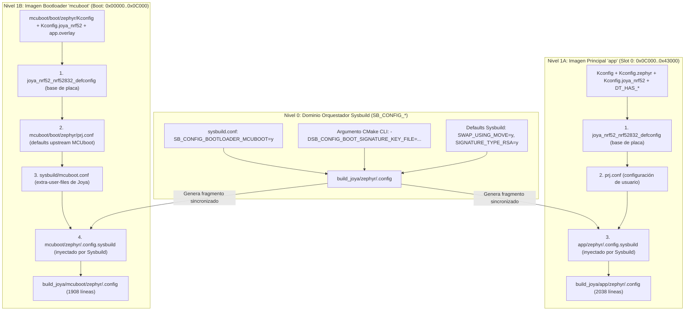

# 03. Configuración del Firmware, Kconfig y Sysbuild

> **Capítulo del Manual Técnico Integral de Ingeniería del Producto — Firmware Joya**
> Navegación: [Índice General (README.md)](README.md) | Anterior: [02. Hardware y Devicetree](02_hardware_devicetree.md) | Siguiente: [04. Arranque e Inicialización](04_boot_initialization.md)

---

## 1. Propósito, Alcance y Criterios Epistemológicos

En un sistema basado en **Zephyr RTOS 4.2.0** orquestado mediante **Sysbuild**, el comportamiento real en silicio no queda determinado únicamente por el código fuente en C bajo `src/`, sino por la intersección entre el árbol de dispositivos (**Devicetree**, analizado en [02_hardware_devicetree.md](02_hardware_devicetree.md)) y dos grafos independientes de resolución **Kconfig**: uno para la imagen principal de aplicación (`app`, alojada en `slot0_partition`) y otro para el gestor de arranque seguro (`mcuboot`, alojado en `boot_partition`). Una única opción omitida o heredada por defecto en Kconfig —como la ausencia de `CONFIG_BT_SMP`, la falta de reensamblado entrante en `MCUmgr` o el conteo por defecto de sectores `NVS`— condiciona de manera determinante el protocolo móvil, la seguridad del enlace, el consumo energético y la recuperabilidad OTA de unidades selladas sin acceso SWD.

Este capítulo documenta de forma exhaustiva la totalidad de los archivos de construcción y configuración del repositorio en el corte canónico **`c1128e5d0c0d6f98be0a580d287c0926ca27f01f`**, contrastando cada directiva declarada con los valores efectivamente resueltos por el sistema de construcción en `build_joya/zephyr/.config`, `build_joya/app/zephyr/.config` y `build_joya/mcuboot/zephyr/.config`.

> [!NOTE]
> **Trazabilidad de artefactos compilados y clasificación de afirmaciones**:
> 1. Los árboles locales `build_joya/` fueron generados con Zephyr `4.2.0` y Zephyr SDK `0.17.4` sobre el corte inmediatamente previo (`b48aa45` / `v2.3.2`). Dado que entre `b48aa45` y `HEAD` (`c1128e5`) **no sufrió ningún cambio** ninguno de los archivos de configuración ni de placa ([prj.conf](../../prj.conf), [Kconfig](../../Kconfig), [CMakeLists.txt](../../CMakeLists.txt), [sysbuild.conf](../../sysbuild.conf), [sysbuild/CMakeLists.txt](../../sysbuild/CMakeLists.txt), [sysbuild/mcuboot.conf](../../sysbuild/mcuboot.conf) ni `boards/joya/joya_nrf52/*`), **la resolución Kconfig efectiva (`.config`) es idéntica bit a bit a la del commit `c1128e5`**, mientras que las métricas exactas de bytes de código de `build_joya` reflejan el binario anterior a la simplificación de iBeacon y adición de `joya/routine` (véase [22_resources_performance.md](22_resources_performance.md)).
> 2. A lo largo del capítulo se diferencia explícitamente entre: **(a) Comportamiento implementado y resuelto** en el código y `.config`, **(b) Intención de diseño** evidenciada en comentarios, documentos de auditoría o scripts, **(c) Comportamiento inferido** a partir de la interacción con subsistemas de Zephyr/Nordic, **(d) Configuración experimental, redundante o huérfana**, y **(e) Aspectos pendientes de validación experimental o dependientes del esquemático electrónico externo**.

---

## 2. Arquitectura Multi-Imagen (`Sysbuild`) y Cadena de Resolución Kconfig

### 2.1. Inventario Completo de Archivos de Construcción y Configuración

| Archivo del repositorio | Líneas | Dominio | Propósito técnico exacto |
|---|---:|---|---|
| [sysbuild.conf](../../sysbuild.conf) | 1 | Orquestador `Sysbuild` | Activa `SB_CONFIG_BOOTLOADER_MCUBOOT=y`, instruyendo a `Sysbuild` a instanciar, configurar, compilar y firmar conjuntamente `mcuboot` + `app`. |
| [sysbuild/CMakeLists.txt](../../sysbuild/CMakeLists.txt) | 5 | Orquestador `Sysbuild` | Añade el directorio raíz del proyecto a `BOARD_ROOT` (`list(APPEND BOARD_ROOT ${CMAKE_CURRENT_SOURCE_DIR}/..)`) antes de `find_package(Sysbuild ...)` para que todas las sub-imágenes descubran la placa fuera de árbol `joya_nrf52/nrf52832`. |
| [sysbuild/mcuboot.conf](../../sysbuild/mcuboot.conf) | 6 | Imagen `mcuboot` | Fragmento Kconfig inyectado automáticamente por `Sysbuild` como `EXTRA_CONF_FILE` sobre la imagen `mcuboot` (nombre convencional `sysbuild/<image>.conf`): activa `CONFIG_ARM_MPU=y`, `CONFIG_MPU_ALLOW_FLASH_WRITE=y` y selecciona el oscilador RC interno de `32,768 kHz` (`500 ppm`). |
| [CMakeLists.txt](../../CMakeLists.txt) | 38 | Imagen `app` | Registra `BOARD_ROOT`, declara `project(joya_phone_connection_fw VERSION 2.0 ...)`, compila las 14 unidades `.c` de producción bajo `src/` y compila condicionalmente [src/haptics_test_indicator.c](../../src/haptics_test_indicator.c) mediante `target_sources_ifdef(CONFIG_JOYA_HAPTICS_TEST_INDICATOR ...)`. |
| [VERSION](../../VERSION) | 4 | Imagen `app` / `imgtool` | Define `VERSION_MAJOR = 2`, `VERSION_MINOR = 3`, `PATCHLEVEL = 1`, `VERSION_TWEAK = 0`. Zephyr y `Sysbuild` leen este archivo para sintetizar `CONFIG_MCUBOOT_IMGTOOL_SIGN_VERSION="2.3.1+0"` en la cabecera firmada de `zephyr.signed.bin`. |
| [Kconfig](../../Kconfig) | 11 | Imagen `app` | Menú raíz Kconfig de la aplicación (`mainmenu "Joya firmware"`): incluye `Kconfig.zephyr` y declara el símbolo propio `CONFIG_JOYA_HAPTICS_TEST_INDICATOR`. |
| [boards/joya/joya_nrf52/board.yml](../../boards/joya/joya_nrf52/board.yml) | 8 | Placa (`app` + `mcuboot`) | Metadatos HWMv2 del target `joya_nrf52/nrf52832` (`vendor: joya`, SoC `nrf52832`). |
| [boards/joya/joya_nrf52/Kconfig.joya_nrf52](../../boards/joya/joya_nrf52/Kconfig.joya_nrf52) | 5 | Placa (`app` + `mcuboot`) | Declara `config BOARD_JOYA_NRF52` con `select SOC_NRF52832_QFAA`, fijando la variante física de `512 KiB` Flash / `64 KiB` SRAM. |
| [boards/joya/joya_nrf52/joya_nrf52_nrf52832_defconfig](../../boards/joya/joya_nrf52/joya_nrf52_nrf52832_defconfig) | 4 | Placa (`app` + `mcuboot`) | Configuración base de placa: habilita `CONFIG_GPIO=y` y prohíbe expresamente `CONFIG_GPIO_AS_PINRESET` sobre `P0.21`. |
| [boards/joya/joya_nrf52/board.cmake](../../boards/joya/joya_nrf52/board.cmake) | 5 | Grabación SWD | Parametriza los *runners* `jlink` (`--device=nRF52832_xxAA`, `--speed=4000`) y `nrfjprog` para programación inicial en fábrica o banco DK. |
| [prj.conf](../../prj.conf) | 135 | Imagen `app` | Configuración principal de subsistemas de la aplicación: periféricos, supresión de logs/consola/RTT, stacks, pila BLE, almacenamiento Flash/NVS/Settings, Watchdog, MCUmgr/SMP OTA, reloj `LFRC`, `PM_DEVICE` y Extended Advertising. |

### 2.2. Grafo de Precedencia y Propagación entre `Sysbuild`, `app` y `mcuboot`

**(a) Comportamiento implementado**: Según consta en `build_joya/build_info.yml`, `build_joya/app/build_info.yml` y `build_joya/mcuboot/build_info.yml`, la construcción con `--sysbuild` ejecuta tres pases de Kconfig jerarquizados. El nivel superior (`SB_CONFIG_*`) no compila código C directamente, sino que genera fragmentos `.config.sysbuild` que tienen **la máxima prioridad de fusión** al final de cada sub-imagen para garantizar coherencia criptográfica y geométrica entre el bootloader y la aplicación:

### 2.3. Propagación Exacta de `SB_CONFIG_*` hacia `.config.sysbuild`

Al activarse `SB_CONFIG_BOOTLOADER_MCUBOOT=y` en [sysbuild.conf](../../sysbuild.conf) (`L1`) junto con la ruta de clave privada pasada por línea de comandos en [compile.sh](../../compile.sh) (`L2`) y [compile_test.sh](../../compile_test.sh) (`L6`), `Sysbuild` resuelve en `build_joya/zephyr/.config`:
- `SB_CONFIG_MCUBOOT_MODE_SWAP_USING_MOVE=y` (`L95`, modo por defecto de `Sysbuild` en `nRF52`).
- `SB_CONFIG_SIGNATURE_TYPE="RSA"` y `SB_CONFIG_BOOT_SIGNATURE_TYPE_RSA=y` (`L104-106`, algoritmo por defecto de `Sysbuild` si no se cambia a `ECDSA_P256` o `ED25519`).
- `# SB_CONFIG_BOOT_ENCRYPTION is not set` (`L111`, imágenes OTA firmadas pero no cifradas).

A partir de estas decisiones, `Sysbuild` escribe automáticamente dos archivos intermedios que fuerzan la alineación entre imágenes:

1. **En `build_joya/app/zephyr/.config.sysbuild` (`L1-8`)**:
   - `CONFIG_BOOTLOADER_MCUBOOT=y`: desplaza el enlace de la aplicación a `slot0_partition` (`0x0000C000`) y reserva `CONFIG_ROM_START_OFFSET=0x200` (`512 B`) para la cabecera `MCUboot`.
   - `CONFIG_MCUBOOT_BOOTLOADER_MODE_SWAP_USING_MOVE=y`, `CONFIG_MCUBOOT_UPDATE_FOOTER_SIZE=0x2000` (`8192 B`) y `CONFIG_ROM_END_OFFSET=0x2150` (`8528 B`): deduce automáticamente del techo de `slot0_partition` (`225.280 B`) el espacio de maniobra requerido por el algoritmo *swap-using-move* (1 sector de `4096 B` para desplazamiento + `4096 B` de alineación/trailer + `336 B` de área TLV), dejando una ventana máxima de carga útil para la imagen de aplicación de `225.280 - 8.528 = 216.752 B` (incluyendo los `512 B` de `ROM_START_OFFSET`, o `216.240 B` netos de secciones del binario).
   - `CONFIG_MCUBOOT_SIGNATURE_KEY_FILE="/workspace/keys/joya_dev-private.pem"` y `CONFIG_MCUBOOT_GENERATE_UNSIGNED_IMAGE=n`: ordena a `west` / `imgtool` firmar automáticamente `zephyr.signed.bin` en post-build. *(Por seguridad operativa, el repositorio no almacena archivos `.pem`; la ruta apunta a un volumen externo montado en el entorno de compilación).*

2. **En `build_joya/mcuboot/zephyr/.config.sysbuild` (`L1-17`)**:
   - Fuerza `CONFIG_BOOT_SWAP_USING_MOVE=y` (desactivando `SINGLE_APPLICATION_SLOT`, `SWAP_USING_OFFSET`, `SWAP_USING_SCRATCH`, `UPGRADE_ONLY` y `DIRECT_XIP`).
   - Fuerza `CONFIG_BOOT_SIGNATURE_TYPE_RSA=y` y extrae la clave pública RSA-2048 desde `CONFIG_BOOT_SIGNATURE_KEY_FILE` para incrustarla como arreglo constante en la memoria Flash de `MCUboot`.

### 2.4. Discrepancias en Metadatos de Versión

**(a) Comportamiento implementado / (d) Inconsistencia documental menor**: Existen tres indicadores de versión desincronizados en el repositorio:

| Fuente | Valor declarado | Efecto real sobre el binario y OTA |
|---|---|---|
| [VERSION](../../VERSION) (`L1-4`) | `2.3.1+0` (`MAJOR=2`, `MINOR=3`, `PATCHLEVEL=1`, `TWEAK=0`) | **Valor autoritativo real**: alimenta `CONFIG_MCUBOOT_IMGTOOL_SIGN_VERSION="2.3.1+0"` (`.config:553`), se estampa en el campo `ih_ver` de la cabecera `MCUboot` y es el que reporta el comando SMP `IMAGE STATE` a la app móvil. |
| [CMakeLists.txt](../../CMakeLists.txt) (`L9-13`) | `VERSION 2.0` en `project(joya_phone_connection_fw ...)` | **Sin efecto en el firmware**: al existir el archivo `VERSION` en la raíz de la aplicación, Zephyr ignora el argumento `VERSION` de `project()` para el firmado `imgtool`. |
| Historial Git | Tag `v2.3.2` (`b48aa45`) + commit `HEAD` `c1128e5` | El archivo `VERSION` no fue incrementado tras `2.3.1`. Dado que `# CONFIG_MCUBOOT_BOOTLOADER_NO_DOWNGRADE is not set` (`.config:572`), repetir `2.3.1+0` no bloquea el intercambio en `MCUboot`, pero dificulta distinguir versiones en campo mediante consultas SMP `STATE` (véase [16_ota_mcuboot.md](16_ota_mcuboot.md) y [23_known_limitations.md](23_known_limitations.md)). |

---

## 3. Análisis Sistemático de Opciones Kconfig por Dominio Técnico

En las subsecciones siguientes se examinan tanto todas las directivas explícitas del repositorio como las opciones implícitas de alto impacto resueltas en `build_joya/app/zephyr/.config` y `build_joya/mcuboot/zephyr/.config`.

---

### 3.1. SoC, Arquitectura ARM Cortex-M4, Protección de Memoria y Stacks

#### Tabla de referencia rápida del dominio

| Símbolo Kconfig | Configurado en repo | Valor efectivo (`app` / `mcuboot`) | Ubicación exacta |
|---|---|---|---|
| `CONFIG_BOARD_JOYA_NRF52` | Implícito por `-b joya_nrf52/nrf52832` | `y` / `y` | [Kconfig.joya_nrf52](../../boards/joya/joya_nrf52/Kconfig.joya_nrf52) `L4-5`; `app/.config:608` |
| `CONFIG_SOC_NRF52832_QFAA` | `select` desde `BOARD_JOYA_NRF52` | `y` / `y` | [Kconfig.joya_nrf52](../../boards/joya/joya_nrf52/Kconfig.joya_nrf52) `L5`; `app/.config:626` |
| `CONFIG_FPU` | No declarado (default Zephyr) | `n` / `n` | `app/.config:37` (`# CONFIG_FPU is not set`) |
| `CONFIG_NRF_ENABLE_ICACHE` | Default SoC `nrf52832` | `y` / `y` | `app/.config:660`; `mcuboot/.config:825` |
| `CONFIG_ARM_MPU` | `#CONFIG_ARM_MPU=y` (`app`); `=y` (`mcuboot`) | **`n`** / **`y`** | [prj.conf](../../prj.conf) `L79`; [sysbuild/mcuboot.conf](../../sysbuild/mcuboot.conf) `L1`; `app/.config:729`; `mcuboot/.config:903` |
| `CONFIG_HW_STACK_PROTECTION` | No declarado | `n` / `n` | Ausente en `app/.config` (depende de `ARM_MPU`); `mcuboot/.config:145` |
| `CONFIG_MPU_ALLOW_FLASH_WRITE` | `=y` en ambos | `y` *(huérfana en `app`)* / `y` *(activa en `mcuboot`)* | [prj.conf](../../prj.conf) `L80`; [sysbuild/mcuboot.conf](../../sysbuild/mcuboot.conf) `L2`; `app/.config:682` |
| `CONFIG_MAIN_STACK_SIZE` | `=4096` (`app`) | `4096` / `10240` | [prj.conf](../../prj.conf) `L37`; `app/.config:6`; `mcuboot/.config:99` |
| `CONFIG_SYSTEM_WORKQUEUE_STACK_SIZE` | `=4096` (`app`) | `4096` / `1024` | [prj.conf](../../prj.conf) `L38`; `app/.config:5`; `mcuboot/.config:98` |
| `CONFIG_ISR_STACK_SIZE` | Default Zephyr | `2048` / `2048` | `app/.config:22`; `mcuboot/.config:113` |
| `CONFIG_IDLE_STACK_SIZE` | Default Zephyr | `320` / `320` | `app/.config:21`; `mcuboot/.config:112` |
| `CONFIG_HEAP_MEM_POOL_SIZE` | Default Zephyr | `0` / `0` | `app/.config:862`; `mcuboot/.config:1060` |
| `CONFIG_COMMON_LIBC_MALLOC_ARENA_SIZE` | Default Picolibc | `-1` / `0` | `app/.config:86`; `mcuboot/.config:167` |
| `CONFIG_SIZE_OPTIMIZATIONS` | Default Zephyr | `y` / `y` | `app/.config:1974`; `mcuboot/.config:1844` |
| `CONFIG_TIMESLICING` / `TIMESLICE_SIZE` | Default Zephyr | `y` (`20 ms`) / `n` | `app/.config:848, 49` |

#### Análisis profundo de cada configuración clave

1. **`CONFIG_BOARD_JOYA_NRF52` y `CONFIG_SOC_NRF52832_QFAA`** ([boards/joya/joya_nrf52/Kconfig.joya_nrf52](../../boards/joya/joya_nrf52/Kconfig.joya_nrf52), `L4-5`):
   - **Propósito y efecto real (a)**: Fuerza la selección del encapsulado/variante `QFAA` (`CONFIG_FLASH_SIZE=512`, `CONFIG_SRAM_SIZE=64`, `app/.config:16, 731`), evitando cualquier ambigüedad con la variante reducida `nRF52832-QFAB` (`256 KiB` Flash / `32 KiB` SRAM), en la cual ni el mapa de dos slots de `220 KiB` ni la huella SRAM de ~`45,5 KiB` cabrían. Activa además `CONFIG_NRF_ENABLE_ICACHE=y` (`NVMC->ICACHECNF.CACHEEN = 1`), reduciendo estados de espera de Flash y ahorrando ~`20–30 %` de corriente de CPU durante ráfagas de ejecución a `64 MHz`.

2. **`CONFIG_FPU=n` (Punto flotante por hardware deshabilitado)**:
   - **Propósito y efecto real (a)**: Aunque el núcleo físico del `nRF52832` es un `ARM Cortex-M4F` (`CONFIG_CPU_HAS_FPU=y`, `app/.config:762`), el firmware no utiliza `float` ni `double` en ninguna ruta de código (toda la conversión SAADC en [src/battery.c](../../src/battery.c) `L97-105` y el cálculo de ticks `WDT_CRV_TICKS` en [src/wdt_guard.c](../../src/wdt_guard.c) `L13` emplean aritmética entera de `32` y `64` bits). El ELF se compila con `soft-float ABI` (`Flags: 0x5000200` en `zephyr.stat`).
   - **Impacto en memoria, latencia y confiabilidad**: Mantener `CONFIG_FPU=n` evita apilar contextos extendidos FPU (`S0..S15` + `FPSCR` = `72 B` por interrupción con *lazy stacking*, más `S16..S31` = `64 B` en cambios de contexto), ahorrando hasta `136 B` en cada stack de hilo y eliminando por completo la posibilidad de excepciones de punto flotante o anomalías de errata nRF52 asociadas a `FPU` e *idle* (`Errata 87`, donde la FPU pendiente impide dormir al regulador si no se limpian bits de excepción).

3. **Asimetría `CONFIG_ARM_MPU=n` en `app` vs `CONFIG_ARM_MPU=y` en `mcuboot`, y opción huérfana `CONFIG_MPU_ALLOW_FLASH_WRITE=y`**:
   - **Valor configurado y resuelto (a, d)**:
     - En [prj.conf](../../prj.conf) (`L79-80`), `#CONFIG_ARM_MPU=y` aparece comentada, dejando activo el default `# CONFIG_ARM_MPU is not set` (`app/.config:729`) —porque en la familia `nRF52` de Zephyr `ARM_MPU` no está seleccionado por defecto por el SoC salvo que la placa o `prj.conf` lo activen— mientras que en la línea siguiente permanece activa **`CONFIG_MPU_ALLOW_FLASH_WRITE=y`** (`prj.conf:80`, `app/.config:682`).
     - En cambio, en [sysbuild/mcuboot.conf](../../sysbuild/mcuboot.conf) (`L1-2`), ambas están activas (`CONFIG_ARM_MPU=y` y `CONFIG_MPU_ALLOW_FLASH_WRITE=y`, `mcuboot/.config:903, 851`).
   - **Por qué `CONFIG_ARM_MPU` está postergada en `app` (b)**: Según [docs/RECOVERY_VALIDATION.md](../../docs/RECOVERY_VALIDATION.md) (`L24, L79-83`) y [docs/auditorias/Avances.md](../../docs/auditorias/Avances.md) (`L96, L131, L261-267`), durante la implementación de `N-03` se activaron inicialmente `CONFIG_ARM_MPU=y` y `CONFIG_HW_STACK_PROTECTION=y`, pero se revirtieron preventivamente antes de desplegar porque activar guardas de pila por MPU sustrae `32 B` (`CONFIG_ARM_MPU_REGION_MIN_ALIGN_AND_SIZE=32` en Cortex-M4) de cada stack y convierte cualquier roce del límite en un `UsageFault/MemManage` inmediato (que `k_sys_fatal_error_handler` transforma en `NVIC_SystemReset()`). Sin haber perfilado antes el pico real de uso de `BT_RX` (`1200 B`) y `mcumgr_wq` (`2048 B`) durante una transferencia OTA real, existía riesgo de introducir un bucle de reset durante OTA en unidades selladas.
   - **Efecto de la opción huérfana `CONFIG_MPU_ALLOW_FLASH_WRITE=y` en `app` (d)**: En Zephyr, cuando `CONFIG_ARM_MPU=y`, la región Flash `0x00000000..0x00080000` se marca como solo lectura (`RO`) y ejecución; intentar borrar o escribir `slot1_partition` (OTA) o `storage_partition` (NVS) dispararía un `MemManage Fault` salvo que `CONFIG_MPU_ALLOW_FLASH_WRITE=y` deje habilitado el permiso de escritura sobre Flash. En `mcuboot`, donde `CONFIG_ARM_MPU=y` sí está activo (habilitando ejecución no permitida `XN` en SRAM vía `CONFIG_SRAM_REGION_PERMISSIONS=y`, `mcuboot/.config:959`), `CONFIG_MPU_ALLOW_FLASH_WRITE=y` es **indispensable** para que `MCUboot` pueda ejecutar el intercambio de imágenes (`SWAP_USING_MOVE`) y actualizar trailers en Flash. En `app`, al estar `CONFIG_ARM_MPU=n`, la MPU de ARM está apagada (`MPU->CTRL = 0`) y `CONFIG_MPU_ALLOW_FLASH_WRITE=y` no genera ningún código ni registro efectivo (queda lista únicamente para cuando se descomente `CONFIG_ARM_MPU=y`).
   - **Consecuencias sobre seguridad y confiabilidad**: En `app` (`c1128e5`), no existe guarda hardware contra desbordamiento de stacks (`# CONFIG_HW_STACK_PROTECTION is not set`, `# CONFIG_STACK_SENTINEL is not set`), ni detección de puntero nulo (`CONFIG_NULL_POINTER_EXCEPTION_DETECTION_NONE=y` — además en `0x00000000` reside la tabla de vectores válida de `MCUboot`, por lo que desreferenciar `NULL` en lectura lee el MSP inicial de `MCUboot` sin disparar `HardFault`), ni protección `XN` sobre SRAM.

4. **Dimensionamiento de Stacks de Hilos e Interrupciones**:
   - **`CONFIG_MAIN_STACK_SIZE=4096`** ([prj.conf](../../prj.conf) `L37`): Usado exclusivamente por `main()` durante la secuencia de inicialización (`wdt_guard_init`, `storage_init` + `settings_load`, `ble_driver_init`, `button_init`, `haptics_init`, `battery_init`) antes de dormir permanentemente en `k_sleep(K_FOREVER)` ([src/main.c](../../src/main.c) `L88`). En **`mcuboot`**, `CONFIG_MAIN_STACK_SIZE=10240` (`10 KiB`, default de `mcuboot/boot/zephyr/prj.conf`) porque `MCUboot` corre sin heap dinámico y aloja en la pila de `main` los buffers de `bootutil` y las estructuras enteras de exponenciación modular RSA-2048 de `mbedTLS`.
   - **`CONFIG_SYSTEM_WORKQUEUE_STACK_SIZE=4096`** ([prj.conf](../../prj.conf) `L38`): Pila del hilo `sysworkq` (prioridad cooperativa `-1`, `CONFIG_SYSTEM_WORKQUEUE_PRIORITY=-1`, `app/.config:828`). Ejecuta **todos** los `k_work` y `k_work_delayable` del firmware: `guard_work` (`wdt_guard.c`), `debounce_work` / `click_window_work` / `factory_hold_work` (`button.c`), `battery_monitor_work` (`battery.c`, incluyendo `adc_read_dt` y `bt_gatt_notify`), `haptics_pattern_work` / `haptics_effect_work` (`haptics.c`, transacciones I2C `TWIM0`), `diagnostics_work`, `ibeacon_stop_work`, `idle_close_work` (`ota_access.c`) y los cuatro timers de `app_state.c`. `4096 B` provee margen holgado para llamadas `bt_gatt_notify` anidadas desde `battery_monitor_work` o `diagnostics_work`.
   - **Hilos internos de BLE y MCUmgr (valores por defecto en `app/.config`)**:
     - `CONFIG_ISR_STACK_SIZE=2048` (`L22`): Pila compartida por todas las rutinas de interrupción (`RADIO`, `RTC1`, `GPIOTE`, `SAADC`, `TWIM0`, `TEMP`, `RNG`, `SWI`).
     - `CONFIG_BT_RX_STACK_SIZE=1200` (`L1425`, prioridad `8` preemptiva): **Punto más sensible de uso de pila**. En este hilo se ejecutan los callbacks GATT de escritura (`on_rx_write`, `on_rx_auth_write` y singularmente **`on_name_write`** en [src/ble_driver.c](../../src/ble_driver.c) `L273-320`, que invoca `bt_set_name()` y `storage_save_name()` $\to$ `settings_save_one()` $\to$ escritura `NVS` directamente sobre la pila de `1200 B` de `BT_RX`).
     - `CONFIG_MCUMGR_TRANSPORT_WORKQUEUE_STACK_SIZE=2048` (`L1806`, prioridad `3` preemptiva): Ejecuta la decodificación CBOR (`zcbor`), `img_mgmt_upload`, `stream_flash_buffered_write` y borrado de páginas de `slot1_partition`.
     - *(Nota complementaria)*: El hilo propio de la FSM se define por código en [src/app_state.c](../../src/app_state.c) (`L36`) con `4098` bytes solicitados (redondeados por alineación de 8 bytes `CONFIG_STACK_ALIGN_DOUBLE_WORD=y` a `4104 B`), prioridad `5` preemptiva (véase [06_concurrency.md](06_concurrency.md)).

5. **Ausencia de Heap del Kernel (`CONFIG_HEAP_MEM_POOL_SIZE=0`) y Arena C (`CONFIG_COMMON_LIBC_MALLOC_ARENA_SIZE=-1`)**:
   - **Efecto real (a)**: `k_malloc()` / `k_free()` carecen de pool (`0 B`), por lo que ni la aplicación ni los subsistemas de Zephyr (`BT`, `NVS`, `MCUmgr`) realizan asignación dinámica en el heap del kernel; todos los buffers (`net_buf`, colas, contextos GATT/LLCP) están preasignados estáticamente en `.bss`/`.noinit`, eliminando fragmentación de memoria a largo plazo. `Picolibc` (`CONFIG_PICOLIBC=y`, `app/.config:1158`) define por defecto `MALLOC_ARENA_SIZE=-1` (asignando la SRAM libre remanente tras `.noinit` como arena `malloc` estándar de C si alguna función de librería la invocase, aunque el código de Joya no llama `malloc` en ningún módulo).

---

### 3.2. Relojes, Temporización del Sistema y Regulación Energética

#### Tabla de referencia rápida del dominio

| Símbolo Kconfig | Configurado en repo | Valor efectivo (`app` / `mcuboot`) | Ubicación exacta |
|---|---|---|---|
| `CONFIG_CLOCK_CONTROL_NRF_K32SRC_RC` | `=y` en ambos | `y` / `y` | [prj.conf](../../prj.conf) `L126`; [sysbuild/mcuboot.conf](../../sysbuild/mcuboot.conf) `L4` |
| `CONFIG_CLOCK_CONTROL_NRF_K32SRC_XTAL` | `=n` en ambos | `n` / `n` | [prj.conf](../../prj.conf) `L127`; [sysbuild/mcuboot.conf](../../sysbuild/mcuboot.conf) `L5` |
| `CONFIG_CLOCK_CONTROL_NRF_K32SRC_500PPM` | `=y` en ambos | `y` (`ACCURACY=500`) / `y` | [prj.conf](../../prj.conf) `L128`; [sysbuild/mcuboot.conf](../../sysbuild/mcuboot.conf) `L6` |
| `CONFIG_CLOCK_CONTROL_NRF_K32SRC_RC_CALIBRATION` | Auto-seleccionado por `K32SRC_RC` | `y` / `y` | `app/.config:965`; `mcuboot/.config:1156` |
| `CONFIG_CLOCK_CONTROL_NRF_CALIBRATION_PERIOD` | Default driver `clock_control_nrf` | `4000` (ms) / `4000` | `app/.config:968`; `mcuboot/.config:1158` |
| `CONFIG_CLOCK_CONTROL_NRF_CALIBRATION_MAX_SKIP` | Default driver `clock_control_nrf` | `1` / `1` | `app/.config:969`; `mcuboot/.config:1159` |
| `CONFIG_CLOCK_CONTROL_NRF_CALIBRATION_TEMP_DIFF` | Default driver `clock_control_nrf` | `2` (`0,5 °C`) / `2` | `app/.config:970`; `mcuboot/.config:1160` |
| `CONFIG_CLOCK_CONTROL_NRF_USES_TEMP_SENSOR` | Auto-seleccionado si `&temp` `"okay"` | `y` (`TEMP_NRF5=y`) / `n` | `app/.config:972, 1097, 1105` |
| `CONFIG_TICKLESS_KERNEL` / `SYS_CLOCK_TICKS_PER_SEC` | Default `nrf_rtc_timer` | `y` (`32768 Hz`) / `y` | `app/.config:34, 23, 77` |
| `CONFIG_NRF52_ANOMALY_132_WORKAROUND` | Default SoC `nrf52832` | `y` (`330 us`) / `y` | `app/.config:78, 661`; `mcuboot/.config:160, 826` |
| `CONFIG_PM_DEVICE` | `=y` (`app`) | **`y`** / **`n`** | [prj.conf](../../prj.conf) `L131`; `app/.config:33`; `mcuboot/.config:124` |
| `CONFIG_PM_DEVICE_RUNTIME` | No declarado | `n` / `n` | `app/.config:81` |
| `CONFIG_REGULATOR` | No declarado | `n` / `n` | `app/.config:4`; `mcuboot/.config:97` |

#### Análisis profundo de cada configuración clave

1. **Fuente de reloj de baja frecuencia `LFRC` (`CONFIG_CLOCK_CONTROL_NRF_K32SRC_RC=y`) y lazo de calibración térmica cada `4000 ms`**:
   - **Propósito y efecto real (a)**: Prescinde del cristal de cuarzo externo de `32,768 kHz` (`LFXO` en `P0.00`/`P0.01`), alimentando tanto el temporizador del kernel (`RTC1`), el ticker del Link Layer BLE (`RTC0`) y el hardware Watchdog (`WDT0`, aunque `WDT` en `nRF52` siempre fuerza `LFRC` si no hay otra fuente LF activa) desde el oscilador RC interno de `32,768 kHz`.
   - **Cadena de dependencias automáticas en `app/.config` (`L958-981`)**: Al seleccionar `K32SRC_RC=y` y estar habilitado `&temp { status = "okay"; }` en [joya_nrf52_nrf52832.dts](../../boards/joya/joya_nrf52/joya_nrf52_nrf52832.dts) (`L121-123`), Zephyr activa automáticamente `CONFIG_SENSOR=y`, `CONFIG_TEMP_NRF5=y` y el calibrador autónomo del driver `clock_control_nrf`:
     - Cada **`4000 ms`** (`CALIBRATION_PERIOD=4000`), el temporizador de calibración lee el sensor de temperatura en chip (`NRF_TEMP`, resolución de `0,25 °C` por LSB).
     - Si la temperatura varió menos de `TEMP_DIFF = 2` unidades (`< 0,5 °C`) respecto de la última calibración y aún no se omitió el máximo permitido (`MAX_SKIP = 1`), el driver **omite esa calibración**, ejecutando una recalibración efectiva contra el cristal de alta frecuencia `HFXO` (`64 MHz`, `32 MHz × 2`) al menos cada **`8000 ms`** en régimen isotérmico, o cada **`4000 ms`** ante gradientes térmicos (p. ej., al colocarse la pulsera en la muñeca).
   - **Consecuencias sobre BLE, latencia y consumo**:
     - Declara al controlador BLE una exactitud de reloj dormido (**SCA**, *Sleep Clock Accuracy*) de **`500 ppm`** (`CONFIG_CLOCK_CONTROL_NRF_ACCURACY=500`). Durante una conexión BLE, el periférico debe encender el receptor radio antes de cada evento de conexión para compensar la deriva combinada $\pm(\text{SCA}_{\text{central}} + 500\,\text{ppm}) \cdot \Delta t_{\text{sleep}}$. Con un intervalo efectivo de `450 ms` (`90 ms × (1 + 4)`), `500 ppm` añade $\pm 225\,\mu\text{s}$ de ensanchamiento de ventana RX (*window widening*) respecto de un cristal de `20 ppm`, elevando levemente el consumo medio en conexión y añadiendo ~`1–2 µA` por los despertares de calibración del `LFRC` (véase Sección 6 de [14_battery_power.md](14_battery_power.md)).
     - Si se cambiase por error `K32SRC_XTAL=y` en una PCB que **no** tenga soldado el cristal de `32,768 kHz`, `CONFIG_SYSTEM_CLOCK_WAIT_FOR_STABILITY=y` (`app/.config:1121`) bloquearía el arranque eternamente antes de `main()` esperando `EVENTS_LFCLKSTARTED`, inutilizando por completo la unidad tras una OTA. Por ello **está estrictamente prohibido** pasar a `XTAL=y` sin certeza física sobre la PCB.

2. **Gestión de energía de periféricos (`CONFIG_PM_DEVICE=y`, `CONFIG_PM_DEVICE_RUNTIME=n`)**:
   - **Propósito y efecto real (a)**: Habilita la API `pm_device_action_run()`, utilizada exclusivamente por [src/haptics.c](../../src/haptics.c) (`L201-229`) para conmutar manualmente `&i2c0` (`TWIM0`) entre `PM_DEVICE_ACTION_SUSPEND` (apaga `TWIM0` y aplica `pinctrl-1 = <&i2c0_sleep>` con `low-power-enable`) y `PM_DEVICE_ACTION_RESUME`.
   - **Interacción sutil con `zephyr,pm-device-runtime-auto`**: En `zephyr.dts` (`L159, L228`), los nodos heredados de `nrf52832.dtsi` (`i2c0` y `adc`) poseen la propiedad `zephyr,pm-device-runtime-auto`. Sin embargo, como `# CONFIG_PM_DEVICE_RUNTIME is not set` (`app/.config:81`), dicha propiedad DTS queda inactiva: `i2c0` arranca encendido tras el boot hasta que `haptics_init()` invoca `drv2605_idle()` $\to$ `haptics_i2c_suspend()`. Si se eliminase `CONFIG_PM_DEVICE=y`, [src/haptics.c](../../src/haptics.c) fallaría en compilación o dejaría `TWIM0` activo permanentemente.

3. **Regulador interno en modo LDO (`# CONFIG_REGULATOR is not set`)**:
   - **Efecto real (a, e)**: Aunque el árbol de dispositivos define `regulator@40000578` (`compatible = "nordic,nrf5x-regulator"`, `regulator-initial-mode = <0x0>`), ni el DTS cambia el modo inicial a `NRF5X_REG_MODE_DCDC` (`0x1`) ni Kconfig compila el subsistema `CONFIG_REGULATOR`. En consecuencia, el registro `NRF_POWER->DCDCEN` permanece en su valor de reset `0` (**regulador lineal LDO activo, convertidor buck DC/DC apagado**). Activar `DCDCEN = 1` reduciría drásticamente la corriente extraída de la batería durante TX/RX BLE, **pero exige obligatoriamente que la PCB Joya tenga montada la red LC externa en el pin `DCC`** (`10 µH` + `15 nH` + `1,0 µF`); activarlo por software en una PCB sin inductor en `DCC` colapsaría instantáneamente el riel interno `DEC4` dejando el SoC irrecuperable.

---

### 3.3. Periféricos de E/S y Resiliencia Hardware (GPIO, ADC, I2C, Watchdog, Reset)

#### Tabla de referencia rápida del dominio

| Símbolo Kconfig | Configurado en repo | Valor efectivo (`app` / `mcuboot`) | Ubicación exacta |
|---|---|---|---|
| `CONFIG_GPIO` | `=y` en `defconfig` y `prj.conf` | `y` / `y` | [joya_nrf52_nrf52832_defconfig](../../boards/joya/joya_nrf52/joya_nrf52_nrf52832_defconfig) `L1`; [prj.conf](../../prj.conf) `L4` |
| `CONFIG_GPIO_AS_PINRESET` | **Ausente deliberadamente** | **`n`** / **`n`** | Comentario en [joya_nrf52_nrf52832_defconfig](../../boards/joya/joya_nrf52/joya_nrf52_nrf52832_defconfig) `L3-4` |
| `CONFIG_ADC` / `CONFIG_ADC_ASYNC` | `CONFIG_ADC=y` | `y` (`ASYNC=n`) / `n` | [prj.conf](../../prj.conf) `L5`; `app/.config:937-940` |
| `CONFIG_I2C` / `I2C_NRFX_TRANSFER_TIMEOUT` | `CONFIG_I2C=y` | `y` (`500 ms`) / `n` | [prj.conf](../../prj.conf) `L10`; `app/.config:1042-1050` |
| `CONFIG_JOYA_HAPTICS_TEST_INDICATOR` | `default n` (`Kconfig`) | `n` (en `joya_nrf52`) / N/A | [Kconfig](../../Kconfig) `L5-11`; [compile_test.sh](../../compile_test.sh) `L8` |
| `CONFIG_WATCHDOG` | `=y` (`app`) | **`y`** / **`n`** *(usa `NRFX_WDT`)* | [prj.conf](../../prj.conf) `L83`; `app/.config:102`; `mcuboot/.config:178, 67-68` |
| `CONFIG_WDT_NRFX_NO_IRQ` | `=y` (`app`) | `y` / N/A | [prj.conf](../../prj.conf) `L84`; `app/.config:1143` |
| `CONFIG_BT_CTLR_ASSERT_HANDLER` | `=y` (`app`) | `y` / N/A | [prj.conf](../../prj.conf) `L87`; `app/.config:1652` |
| `CONFIG_NRF_APPROTECT_LOCK` | Default SoC (`n`) | `n` / `n` | `app/.config:670`; `mcuboot/.config:832` |

#### Análisis profundo de cada configuración clave

1. **Ausencia crítica de `CONFIG_GPIO_AS_PINRESET` (`P0.21`)**:
   - **Justificación eléctrica (a, b)**: En el `nRF52832`, el pin `P0.21` es un GPIO ordinario salvo que se programen los registros no volátiles `UICR->PSELRESET[0]` y `PSELRESET[1]` (lo que en Zephyr realiza el código de arranque o el devicetree `&uicr { gpio-as-nreset; }`, habiendo sido reemplazada la antigua opción Kconfig por la propiedad DTS en Zephyr 4.x, aunque la advertencia en [joya_nrf52_nrf52832_defconfig](../../boards/joya/joya_nrf52/joya_nrf52_nrf52832_defconfig) `L3-4` y `/delete-property/ gpio-as-nreset;` en [nrf52dk_nrf52832.overlay](../../nrf52dk_nrf52832.overlay) `L61-63` preservan la misma invariante). En `build_joya/app/zephyr/zephyr.dts` (`L65-69`), el nodo `uicr` **no** contiene `gpio-as-nreset`. La PCB Joya no monta resistencia de *pull-up* externa en `P0.21`; habilitar `nRESET` en `P0.21` expondría la pulsera a reinicios espurios ante descargas electrostáticas (ESD) o acoplamiento capacitivo con la antena o el motor ERM.

2. **`CONFIG_I2C_NRFX_TRANSFER_TIMEOUT=500` (`app/.config:1049`)**:
   - **Efecto sobre confiabilidad y Watchdog (a, c)**: Fija un plazo máximo de `500 ms` por transacción en el driver `i2c_nrfx_twim`. Si el `DRV2605` o una línea `SDA`/`SCL` sufriese un bloqueo eléctrico (p. ej. `SCL` retenido en bajo), cualquier llamada `i2c_write` / `i2c_reg_read_byte` aborta a los `500 ms` devolviendo `-ETIMEDOUT` y reportando `DIAG_ERROR_I2C` (`0xE5`), en vez de colgar indefinidamente `sysworkq` y disparar un reset completo del SoC por expiración del Watchdog de `30 s`.

3. **`CONFIG_JOYA_HAPTICS_TEST_INDICATOR`** ([Kconfig](../../Kconfig) `L5-11`):
   - **Propósito y dependencias (a)**: Única opción Kconfig personalizada del proyecto. Tiene `default n` y restricción estricta `depends on BOARD_NRF52DK_NRF52832 && GPIO`: **es imposible activarla accidentalmente al compilar para la placa real `joya_nrf52/nrf52832`** (`BOARD_JOYA_NRF52=y`), donde no existe alias `led0` en DTS (de hecho, [src/haptics_test_indicator.c](../../src/haptics_test_indicator.c) `L8-10` aborta con `#error` si `led0` no existe). Cuando se compila con [compile_test.sh](../../compile_test.sh) para `nrf52dk/nrf52832`, pulsa `LED0` durante `200 ms` cada vez que `haptics_allowed != 0` permite una vibración, facilitando verificar en banco la política de inhibición háptica de Nivel 1 / Nivel 2 sin conectar un `DRV2605` físico.

4. **`CONFIG_WATCHDOG=y` + `CONFIG_WDT_NRFX_NO_IRQ=y` (en `app`) + `CONFIG_BOOT_WATCHDOG_FEED_NRFX_WDT=y` (en `mcuboot`)**:
   - **Propósito e interacción cruzada entre imágenes (a)**:
     - En `app`, `CONFIG_WDT_NRFX_NO_IRQ=y` suprime la rutina de interrupción de pre-aviso del `WDT0` (que en el `nRF52832` solo concede `2` ciclos de `32,768 kHz` $\approx 61\,\mu\text{s}$ antes del reset físico) y ahorra Flash/RAM del vector ISR, exigiendo que `cfg.callback == NULL` en [src/wdt_guard.c](../../src/wdt_guard.c) (`L88`).
     - En `mcuboot`, aunque `# CONFIG_WATCHDOG is not set` (`mcuboot/.config:178`, no compila el subsistema genérico de Zephyr), sí se compilan `CONFIG_NRFX_WDT=y`, `CONFIG_BOOT_WATCHDOG_FEED=y` y **`CONFIG_BOOT_WATCHDOG_FEED_NRFX_WDT=y`** (`mcuboot/.config:67-68, 423-424`). Esto hace que `MCUboot` detecte en sus registros hardware si `NRF_WDT->RUNSTATUS` quedó encendido tras un reinicio suave (`sys_reboot(SYS_REBOOT_COLD)` o `NVIC_SystemReset()`) y **alimente todos los canales activos en `RREN` durante el copiado/borrado de `SWAP_USING_MOVE` y la verificación RSA-2048**, evitando que el watchdog de `30 s` heredado de la aplicación aborte una actualización OTA a mitad de camino (véase [16_ota_mcuboot.md](16_ota_mcuboot.md) y [18_error_handling.md](18_error_handling.md)).

5. **`CONFIG_BT_CTLR_ASSERT_HANDLER=y`** ([prj.conf](../../prj.conf) `L87`):
   - **Propósito y efecto real (a)**: Redirige las aserciones internas de tiempo real del controlador Link Layer (`BT_LL_SW_SPLIT`, como fallos de planificación `ASSERT_OVERHEAD_START`) hacia la función `bt_ctlr_assert_handle(char *file, uint32_t line)` implementada en [src/fatal_recovery.c](../../src/fatal_recovery.c) (`L13-19`), la cual ejecuta `NVIC_SystemReset()` inmediato en lugar de quedarse atrapada en un lazo infinito esperando los `30 s` del `WDT0`.

---

### 3.4. Subsistema Bluetooth Low Energy (Host, GATT, GAP, Seguridad, Privacidad y Link Layer)

#### Tabla de referencia rápida del dominio

| Símbolo Kconfig | Configurado en repo | Valor efectivo en `app/.config` | Ubicación exacta |
|---|---|---|---|
| `CONFIG_BT` / `CONFIG_BT_PERIPHERAL` | `=y` | `y` (selecciona `BT_BROADCASTER=y`, `BT_CONN=y`) | [prj.conf](../../prj.conf) `L44-45`; `.config:1377-1391` |
| `CONFIG_BT_LL_SW_SPLIT` | Default SoC `nrf52` en Zephyr | `y` (`TX_PWR_DBM=0`) | `.config:1548, 1568` |
| `CONFIG_BT_MAX_CONN` | `=1` | `1` (`BT_ID_MAX=1`) | [prj.conf](../../prj.conf) `L54`; `.config:1392, 1507` |
| `CONFIG_BT_SMP` | No declarado (default `n`) | **`n`** (`BT_MAX_PAIRED=0`) | `.config:1445, 1497` |
| `CONFIG_BT_SETTINGS` | No declarado (default `n`) | **`n`** | `.config:1435` |
| `CONFIG_BT_PRIVACY` / `BT_CTLR_PRIVACY` | No declarado (default `n`) | **`n`** / **`n`** | Ausente (`SMP=n`) / `.config:1585` |
| `CONFIG_BT_DEVICE_NAME` | `="Joya"` | `"Joya"` | [prj.conf](../../prj.conf) `L48`; `.config:1504` |
| `CONFIG_BT_DEVICE_NAME_DYNAMIC` / `MAX` | `=y` / `=32` | `y` / `32` | [prj.conf](../../prj.conf) `L51-52`; `.config:1502-1503` |
| `CONFIG_BT_DEVICE_NAME_GATT_WRITABLE` | **Implícito (default `y` si `DYNAMIC=y`)** | **`y`** (`WRITABLE_ENCRYPT=y`) | `.config:1474-1476` |
| `CONFIG_BT_GATT_DYNAMIC_DB` | `=y` | `y` (`GATT_SERVICE_CHANGED=y`) | [prj.conf](../../prj.conf) `L55`; `.config:1462-1463` |
| `CONFIG_BT_GATT_ENFORCE_SUBSCRIPTION` | Default Zephyr (`y`) | `y` | `.config:1464` |
| `CONFIG_BT_EXT_ADV` / `MAX_ADV_SET` | `=y` / `=2` | `y` / `2` (`CTLR_ADV_SET=2`) | [prj.conf](../../prj.conf) `L134-135`; `.config:1387-1389, 1589` |
| `CONFIG_BT_GAP_PERIPHERAL_PREF_PARAMS` | `=y` (`36`, `72`, `4`, `600`) | `y` (`45..90 ms`, `lat=4`, `6 s`, `AUTO_UPDATE=y`) | [prj.conf](../../prj.conf) `L58-66`; `.config:1468-1473` |
| `CONFIG_BT_L2CAP_TX_MTU` | `=247` | `247` | [prj.conf](../../prj.conf) `L119`; `.config:108` |
| `CONFIG_BT_BUF_ACL_RX_SIZE` / `TX_SIZE` | `=251` / `=251` | `251` / `251` (`TX_COUNT=3`) | [prj.conf](../../prj.conf) `L120-123`; `.config:62, 106-107` |
| `CONFIG_BT_CTLR_DATA_LENGTH_MAX` | `=251` | `251` (`AUTO_DATA_LEN_UPDATE=y`, `AUTO_PHY_UPDATE=y`) | [prj.conf](../../prj.conf) `L122`; `.config:35-36, 1580` |

#### Análisis profundo de las opciones BLE explícitas e implícitas

1. **Consecuencias estructurales de `CONFIG_BT_SMP=n`, `CONFIG_BT_SETTINGS=n` y `CONFIG_BT_PRIVACY=n`**:
   Estas tres ausencias implícitas en `app/.config` constituyen la decisión arquitectónica de mayor alcance sobre el protocolo de comunicaciones y la seguridad de Joya (analizada en profundidad en [07_ble_architecture.md](07_ble_architecture.md), [10_authentication.md](10_authentication.md) y [17_security_privacy.md](17_security_privacy.md)):
   - **Sin emparejamiento ni cifrado de capa de enlace (`CONFIG_BT_SMP=n`, `CONFIG_BT_MAX_PAIRED=0`)**: El Host BLE no incluye el *Security Manager Protocol* estándar de Bluetooth. Aunque el controlador `BT_LL_SW_SPLIT` compila por defecto el motor AES-CCM (`CONFIG_BT_CTLR_LE_ENC=y`, `.config:1574`), el Host jamás puede negociar claves `LTK` (*Long Term Key*), `IRK` (*Identity Resolving Key*) ni `CSRK`. Por consiguiente, **todas las tramas ATT/GATT viajan en texto claro por radiofrecuencia**, incluyendo el `APP_ID` de `16` bytes en `RX_AUTH`, los comandos `0x02..0x71`, el sufijo de nombre personal, las lecturas de diagnóstico/batería y los bloques de imagen OTA sobre SMP. Toda la autenticación descansa en la verificación a nivel de aplicación del `APP_ID` persistido en `joya/app_id`.
   - **Sin persistencia de pila BLE ni retención de descriptores `CCC` entre sesiones (`CONFIG_BT_SETTINGS=n`)**: Aunque la aplicación sí habilita `CONFIG_SETTINGS=y` para su propio árbol `joya/*`, **no** activa `CONFIG_BT_SETTINGS=y`. Por ello:
     1. El stack BLE no escribe claves `bt/*` en `storage_partition` (ahorrando espacio y desgaste de Flash en NVS).
     2. Los descriptores `CCC` (*Client Characteristic Configuration*, `0x2902`) de las características notificables (`COMMANDS TX`, `BATTERY CHANGE`, `BATTERY MEASUREMENT`, `DIAGNOSTICS` y `SMP`) **son puramente efímeros por conexión**. Al combinarse con `CONFIG_BT_GATT_ENFORCE_SUBSCRIPTION=y` (`.config:1464`) y la puesta a `false` de las banderas `notify_enabled` en `on_connected` / `on_disconnected` ([src/ble_driver.c](../../src/ble_driver.c) `L234-237, 258-261`), **la aplicación móvil está obligada en cada reconexión a volver a suscribirse explícitamente al `CCC` de `COMMANDS TX` (`...5001`) y a reenviar el `APP_ID` de 16 bytes**, tal como exige la transición `STATE_WAITING_NOTIFICATION_ENABLE` $\to$ `STATE_SETUP_WAITING_IDENTIFIER` $\to$ `STATE_AUTHENTICATED`.
     3. No se almacena hash persistente de caché GATT para pares vinculados (`BT_GATT_CACHING` ausente), aunque `CONFIG_BT_GATT_SERVICE_CHANGED=y` (`.config:1462`, seleccionado por `BT_GATT_DYNAMIC_DB=y`) sí emite indicaciones `Service Changed` (`0x2A05`) dentro de la sesión activa cuando `ota_access_enable()` registra o retira dinámicamente el servicio `SMP`.
   - **Sin rotación de dirección MAC (`CONFIG_BT_PRIVACY=n`, `CONFIG_BT_CTLR_PRIVACY=n`)**: Sin `SMP` ni `IRK`, el dispositivo utiliza permanentemente su única dirección aleatoria estática de fábrica grabada en `NRF_FICR->DEVICEADDR[0..1]` (`CONFIG_BT_ID_MAX=1`), sin generar *Resolvable Private Addresses* (`RPA`). Esto simplifica la reconexión directa por MAC en clientes como `joya_console.py`, pero permite correlacionar pasivamente la presencia radioeléctrica del dispositivo mientras está publicitando.

2. **Efecto colateral implícito de `CONFIG_BT_DEVICE_NAME_GATT_WRITABLE=y`** (`.config:1474-1476`):
   - **Cómo se activa y qué provoca (a, c)**: En [prj.conf](../../prj.conf) (`L51-52`) se declara `CONFIG_BT_DEVICE_NAME_DYNAMIC=y` (`MAX=32`) únicamente para que el firmware pueda invocar `bt_set_name("Joya Setup")` o `bt_set_name(storage_get_name())` en tiempo de ejecución ([src/ble_driver.c](../../src/ble_driver.c) `L306, 623, 625`). Sin embargo, en Zephyr `subsys/bluetooth/host/Kconfig.gatt`, `BT_DEVICE_NAME_GATT_WRITABLE` tiene **`default y` cuando `BT_DEVICE_NAME_DYNAMIC=y`**. Aunque también se selecciona `CONFIG_DEVICE_NAME_GATT_WRITABLE_ENCRYPT=y` (`.config:1476`), en el código del servicio GAP de Zephyr el permiso `BT_GATT_PERM_WRITE_ENCRYPT` solo se compila bajo `#if defined(CONFIG_BT_SMP)`, degradándose a `BT_GATT_PERM_WRITE` ordinario cuando `CONFIG_BT_SMP=n` (confirmado por la presencia del símbolo `write_name` en `0x0002fd61` de `zephyr.elf`).
   - **Consecuencia de seguridad/consistencia**: Cualquier cliente conectado (incluso antes de autenticarse en `STATE_AUTHENTICATED`) puede escribir directamente la característica estándar GAP `Device Name` (`0x2A00` en el servicio `0x1800`), alterando el nombre GAP en RAM sin pasar por las validaciones de longitud/prefijo `"Joya de "` de `on_name_write()` ni persistir en `joya/name` (el cambio dura hasta la siguiente llamada a `ble_start_setup_advertising()` o reinicio). Para cerrar esta superficie basta añadir `CONFIG_BT_DEVICE_NAME_GATT_WRITABLE=n` en una versión futura.

3. **Publicidad simultánea: `CONFIG_BT_EXT_ADV=y` y `CONFIG_BT_EXT_ADV_MAX_ADV_SET=2`** ([prj.conf](../../prj.conf) `L134-135`):
   - **Propósito real (a)**: Aunque tanto el anuncio conectable (`joya_adv_param`) como el iBeacon de conexión (`ibeacon_adv_param`) transmiten PDUs *legacy* de hasta `31 B` (`CONFIG_BT_CTLR_ADV_DATA_LEN_MAX=31`, `.config:1591`, compatibles con cualquier teléfono BLE 4.x/5.x), el API clásico de Zephyr solo soporta 1 instancia de publicidad. Habilitar `CONFIG_BT_EXT_ADV=y` con `MAX_ADV_SET=2` permite al planificador del Link Layer (`BT_CTLR_ADV_SET=2`) multiplexar en el tiempo dos conjuntos independientes: el set `0` implícito de `bt_le_adv_start()` (`100..150 ms`, conectable) y el set `1` creado con `bt_le_ext_adv_create()` para `ibeacon_adv` (`1000..1200 ms`, no conectable). Incrementar `MAX_ADV_SET` por encima de `2` desperdiciaría SRAM en estructuras `ll_adv_set` sin utilidad en `c1128e5` (véase [08_ibeacon.md](08_ibeacon.md)).

4. **Parámetros de conexión preferidos (`CONFIG_BT_GAP_PERIPHERAL_PREF_PARAMS=y`)**:
   - **Valores configurados ([prj.conf](../../prj.conf) `L58-66`)**:
     - `MIN_INT = 36` $\rightarrow 36 \times 1{,}25\,\text{ms} = \mathbf{45\,\text{ms}}$.
     - `MAX_INT = 72` $\rightarrow 72 \times 1{,}25\,\text{ms} = \mathbf{90\,\text{ms}}$.
     - `LATENCY = 4` eventos esclavos omitibles $\rightarrow$ intervalo efectivo en silencio de hasta $(1 + 4) \times 90\,\text{ms} = \mathbf{450\,\text{ms}}$.
     - `TIMEOUT = 600` $\rightarrow 600 \times 10\,\text{ms} = \mathbf{6000\,\text{ms}}$ (`6,0 s`).
   - **Comportamiento automático y conformidad Apple (a, b)**: Con `CONFIG_BT_GAP_AUTO_UPDATE_CONN_PARAMS=y` (`.config:1468`), tras establecerse la conexión, Zephyr aguarda `CONFIG_BT_CONN_PARAM_UPDATE_TIMEOUT=5000` (`5 s`) y solicita automáticamente al central móvil estos parámetros (hasta `3` intentos separados `5 s`). Los valores cumplen simultáneamente todas las reglas de las *Apple Accessory Design Guidelines* ($\text{Interval}_{\min} \ge 15\,\text{ms}$; $\text{Interval}_{\min} + 15\,\text{ms} \le \text{Interval}_{\max}$; $\text{Latency} \le 30$; $2\,\text{s} \le \text{Timeout} \le 6\,\text{s}$ y $\text{Interval}_{\max} \times (\text{Latency} + 1) \times 3 = 1350\,\text{ms} < 6000\,\text{ms}$), logrando una latencia de envío de comandos `TX` $\le 90\,\text{ms}$ con un ciclo de sueño de radio de hasta `450 ms` cuando no hay tráfico. *(Nota: el comentario `# For debug` en `prj.conf:57` es histórico; los valores son aptos para operación normal, aunque durante OTA la ausencia de `CONFIG_MCUMGR_TRANSPORT_BT_CONN_PARAM_CONTROL` mantiene el intervalo de `45..90 ms` salvo que el central fuerce un intervalo menor de `7,5..15 ms`).*

5. **Cadena de MTU, DLE y Buffers ACL (`251 / 247 / 244 bytes`)** ([prj.conf](../../prj.conf) `L119-123`):
   - **Alineación exacta de capas**:
     $$\underbrace{251\text{ B}}_{\text{LL Data PDU (`DATA_LENGTH_MAX` / `ACL_RX/TX_SIZE`)}} = \underbrace{4\text{ B}}_{\text{Cabecera L2CAP}} + \underbrace{247\text{ B}}_{\text{`BT_L2CAP_TX_MTU` (ATT\_MTU)}} = 4\text{ B} + \underbrace{3\text{ B}}_{\text{Opcode + Handle ATT}} + \underbrace{244\text{ B}}_{\text{Carga útil ATT máx.}}$$
   - Con `CONFIG_BT_AUTO_DATA_LEN_UPDATE=y` y `CONFIG_BT_AUTO_PHY_UPDATE=y` (`.config:35-36`, `BT_CTLR_PHY_2M=y`), al conectar con un teléfono moderno el enlace negocia automáticamente tramas físicas de `251 B` (*Data Length Extension*) a `2 Mbps` (`LE 2M PHY`), multiplicando por ~`6–8x` el caudal OTA y reduciendo a la mitad el tiempo de radio encendido por byte transmitido frente al mínimo BLE 4.0 (`27 B` LL / `23 B` ATT MTU a `1 Mbps`). `CONFIG_BT_BUF_ACL_TX_COUNT=3` permite encolar hasta 3 notificaciones salientes consecutivas sin bloquear al productor.

---

### 3.5. Almacenamiento Flash, `NVS` y Subsistema `Settings`

#### Tabla de referencia rápida del dominio

| Símbolo Kconfig | Configurado en repo | Valor efectivo (`app` / `mcuboot`) | Ubicación exacta |
|---|---|---|---|
| `CONFIG_FLASH` / `CONFIG_FLASH_MAP` | `=y` (**duplicadas** en `prj.conf`) | `y` / `y` | [prj.conf](../../prj.conf) `L71-72` y `L94-95`; `app/.config:58, 1890` |
| `CONFIG_FLASH_PAGE_LAYOUT` | `=y` | `y` / `y` | [prj.conf](../../prj.conf) `L73`; `app/.config:1016` |
| `CONFIG_SOC_FLASH_NRF_RADIO_SYNC_TICKER` | Default Zephyr cuando `BT_LL_SW_SPLIT=y` | **`y`** (`app`) / **`n`** (`SYNC_NONE=y` en `mcuboot`) | `app/.config:1025`; `mcuboot/.config:1204` |
| `CONFIG_NVS` | `=y` | `y` (`DATA_CRC=n`, `LOOKUP_CACHE=n`) / `n` | [prj.conf](../../prj.conf) `L74`; `app/.config:1713-1716` |
| `CONFIG_SETTINGS` / `CONFIG_SETTINGS_NVS` | `=y` / `=y` | `y` / `n` | [prj.conf](../../prj.conf) `L76-77`; `app/.config:1873-1876` |
| `CONFIG_SETTINGS_NVS_SECTOR_SIZE_MULT` | Default Zephyr (`1`) | `1` (`1 × 4096 B = 4 KiB/sector`) | `app/.config:1880` |
| `CONFIG_SETTINGS_NVS_SECTOR_COUNT` | **Implícito (default Zephyr `8`)** | **`8` en `.config` $\rightarrow$ acotado a `6` en runtime** | `app/.config:1881` vs `storage_partition` (`0x6000` = `6` págs.) |

#### Análisis profundo de cada configuración clave

1. **Sincronización cooperativa Flash/Radio (`CONFIG_SOC_FLASH_NRF_RADIO_SYNC_TICKER=y`, `app/.config:1025`)**:
   - **Por qué es vital en el `nRF52832` (a)**: En el `nRF52832`, el controlador de memoria no volátil (`NVMC`) detiene por completo a la CPU (`CPU stall`) mientras escribe una palabra (`~41 µs`) o borra una página de `4 KiB` (hasta **`85 ms`**). Si un borrado de página ocurriese de forma asíncrona justo encima de un evento de conexión o ventana de recepción BLE, el controlador `BT_LL_SW_SPLIT` perdería sus restricciones duras de microsegundos (disparando un `BT_CTLR_ASSERT` o perdiendo la conexión durante una carga OTA). `SOC_FLASH_NRF_RADIO_SYNC_TICKER=y` integra el driver `flash_nrf` con el planificador `ticker` del Link Layer BLE, fraccionando y calendarizando cada escritura y borrado de Flash en los huecos libres entre eventos de radio, con un multiplicador de timeout `CONFIG_SOC_FLASH_NRF_TIMEOUT_MULTIPLIER=10` (`.config:1027`).

2. **Desajuste entre `CONFIG_SETTINGS_NVS_SECTOR_COUNT=8` y `storage_partition` (`24 KiB = 6 sectores`)**:
   - **Análisis exacto (a, c)**: En [boards/joya/joya_nrf52/joya_nrf52_nrf52832.dts](../../boards/joya/joya_nrf52/joya_nrf52_nrf52832.dts) (`L67-70`), `storage_partition` abarca `0x0007A000..0x00080000` (`24.576 B` = **exactamente `6` páginas físicas de `4096 B`**). Sin embargo, [prj.conf](../../prj.conf) no especifica `CONFIG_SETTINGS_NVS_SECTOR_COUNT`, por lo que `app/.config:1881` hereda el default de Zephyr **`8`** (`32 KiB`).
   - **Por qué no falla en tiempo de ejecución**: En Zephyr `4.2.0` (`subsys/settings/src/settings_nvs.c`), `settings_nvs_backend_init()` consulta mediante `flash_get_page_info_by_offs()` cuántas páginas caben realmente dentro del `flash_area` de `storage_partition` y **recorta dinámicamente el conteo a `6` sectores efectivos** (`5` sectores activos de almacenamiento de hasta `20 KiB` + `1` sector libre obligatorio para *garbage collection* / compactación).
   - **Advertencia de mantenimiento (`N-15` en [docs/auditorias/Avances.md](../../docs/auditorias/Avances.md))**: Conviene fijar explícitamente `CONFIG_SETTINGS_NVS_SECTOR_COUNT=6` en futuras revisiones para documentar la geometría real, pero **jamás** reducirlo en unidades ya desplegadas sin migrar datos, pues alterar la geometría esperada sobre un sistema `NVS` ya formateado en `6` sectores invalidaría la partición existente (véase [15_flash_persistence.md](15_flash_persistence.md)).

---

### 3.6. Subsistema OTA (`MCUmgr` / `SMP`) y Gestor de Arranque (`MCUboot`)

#### Tabla de referencia rápida del dominio

| Símbolo Kconfig | Configurado en repo | Valor efectivo (`app` / `mcuboot`) | Ubicación exacta |
|---|---|---|---|
| `CONFIG_BOOTLOADER_MCUBOOT` | `=y` (`prj.conf` + `sysbuild`) | `y` / N/A (`CONFIG_MCUBOOT=y`) | [prj.conf](../../prj.conf) `L92`; `app/.config:96`; `mcuboot/.config:5` |
| `CONFIG_STREAM_FLASH` / `IMG_MANAGER` | `=y` / `=y` | `y` (`IMG_BLOCK_BUF_SIZE=512`) / `n` | [prj.conf](../../prj.conf) `L96-97`; `app/.config:1694-1698, 1894` |
| `CONFIG_IMG_ERASE_PROGRESSIVELY` | Default (`n`) | **`n`** / N/A | `app/.config:1699` |
| `CONFIG_ZCBOR` / `CONFIG_CRC` / `NET_BUF` | `=y` | `y` / `n` | [prj.conf](../../prj.conf) `L99-101`; `app/.config:534, 1183, 1224` |
| `CONFIG_MCUMGR` / `GRP_IMG` / `GRP_OS` | `=y` | `y` (`OS_RESET_MS=250`, `OS_ECHO=y`) / `n` | [prj.conf](../../prj.conf) `L103-105`; `app/.config:1749, 1773, 1791-1794` |
| `CONFIG_MCUMGR_TRANSPORT_BT` | `=y` | `y` (`PERM_RW=y`) / `n` | [prj.conf](../../prj.conf) `L106`; `app/.config:1812-1814` |
| `CONFIG_MCUMGR_TRANSPORT_BT_DYNAMIC_SVC_REGISTRATION` | `=y` | `y` | [prj.conf](../../prj.conf) `L107`; `app/.config:1816` |
| `CONFIG_MCUMGR_TRANSPORT_BT_REASSEMBLY` | **Implícito (default `n`)** | **`n`** | `app/.config:1813` |
| `CONFIG_MCUMGR_TRANSPORT_NETBUF_COUNT` / `SIZE` | Default `MCUmgr` | `4` buffers × `384 B` | `app/.config:1808-1809` |
| `CONFIG_MCUMGR_MGMT_NOTIFICATION_HOOKS` + `IMG_*_HOOKS` | `=y` (`prj.conf:108-112`) | `y` (`UPLOAD_CHECK`, `STATUS`, `SLOT_INFO`) | [prj.conf](../../prj.conf) `L108-112`; `app/.config:1750, 1782-1789` |
| `CONFIG_MCUMGR_GRP_IMG_TOO_LARGE_DISABLED` | Default `MCUmgr` | **`y`** (`TOO_LARGE_SYSBUILD=n`) | `app/.config:1785-1786` |
| `CONFIG_BOOT_SWAP_USING_MOVE` | `Sysbuild` default | `MODE_SWAP_USING_MOVE=y` / **`y`** | `app/.config:562`; `mcuboot/.config:31` |
| `CONFIG_BOOT_SIGNATURE_TYPE_RSA` / `LEN` | `Sysbuild` default | N/A / **`y` (`2048 bits`, `SHA-256`, `MBEDTLS`)** | `mcuboot/.config:6, 14, 16-17` |
| `CONFIG_BOOT_VALIDATE_SLOT0` | Default `MCUboot` | N/A / **`y`** | `mcuboot/.config:25` |

#### Análisis profundo de cada configuración clave

1. **Impacto crítico en protocolo de `# CONFIG_MCUMGR_TRANSPORT_BT_REASSEMBLY is not set` (`app/.config:1813`)**:
   - **Comportamiento asimétrico exacto (a)**: Al estar desactivado el reensamblador L2CAP/SMP de recepción en el transporte Bluetooth de `MCUmgr`, el firmware exige que **cada comando SMP enviado por el cliente hacia Joya quepa íntegramente en una única escritura GATT `Write Without Response`** ($\le \text{ATT\_MTU} - 3$). Con el `ATT_MTU` negociado de `247 B`, el paquete SMP entrante completo (`8 B` de cabecera SMP + mapa CBOR con offset, longitud, hash SHA-256 y fragmento de datos) no puede superar **`244 bytes`** (y si un cliente no negocia MTU y queda en el mínimo de `23 B`, cae a `20 B`, haciendo inviable `IMAGE UPLOAD`). En sentido inverso (**Joya $\to$ Cliente**), `MCUmgr` sí arma respuestas de hasta `CONFIG_MCUMGR_TRANSPORT_NETBUF_SIZE=384` bytes (como el reporte CBOR de `IMAGE STATE` con dos slots y sus hashes SHA-256) y el transporte `smp_bt` **las fragmenta en múltiples notificaciones GATT consecutivas**, obligando al cliente a reensamblar usando la longitud de los bytes `2..3` big-endian del encabezado SMP (tal como implementa `SmpAssembler` en [ota/joya_console.py](../../ota/joya_console.py) `L259-312`).
   - Activar `CONFIG_MCUMGR_TRANSPORT_BT_REASSEMBLY=y` añadiría un buffer estático de `384 B` en SRAM pero permitiría enviar chunks SMP de hasta `384 B` independientemente de si el `ATT_MTU` es menor.

2. **Control dinámico del servicio SMP (`CONFIG_MCUMGR_TRANSPORT_BT_DYNAMIC_SVC_REGISTRATION=y` + hooks)**:
   - **Seguridad funcional (a)**: Como `CONFIG_MCUMGR_TRANSPORT_BT_PERM_RW=y` (`.config:1814`) expone la característica SMP sin cifrado (`BT_SMP=n`), dejar el servicio registrado al arrancar permitiría a cualquier atacante en cercanía subir imágenes o enviar `OS RESET` sin conocer el `APP_ID`. Gracias a `DYNAMIC_SVC_REGISTRATION=y`, `ota_access_init()` llama `smp_bt_unregister()` **antes** de `bt_enable()` ([src/ble_driver.c](../../src/ble_driver.c) `L495`, [src/ota_access.c](../../src/ota_access.c) `L88`), ocultando el servicio hasta que una sesión autenticada envía el comando `0x70` (`COMMAND_OTA_ENABLE`). Los hooks `STATUS_HOOKS` (`prj.conf:110`) habilitan las notificaciones internas `MGMT_EVT_OP_IMG_MGMT_DFU_STARTED/CHUNK/PENDING/STOPPED` con las que `ota_access.c` evita cerrar SMP o entrar en `critical_idle` a mitad de transferencia, y `NOTIFICATION_HOOKS` (`prj.conf:108`) permite a [src/test_image_guard.c](../../src/test_image_guard.c) (`L39`) escuchar `MGMT_EVT_OP_IMG_MGMT_DFU_CONFIRMED` para cancelar el plazo de rollback de 5 minutos. *(Nota: `UPLOAD_CHECK_HOOK=y` y `SLOT_INFO=y` en `prj.conf:109, 111` están compilados, aunque el código propio de Joya no registra callbacks sobre esos dos eventos específicos).*

3. **Borrado no progresivo (`# CONFIG_IMG_ERASE_PROGRESSIVELY is not set`) y `CONFIG_MCUMGR_GRP_IMG_TOO_LARGE_DISABLED=y`**:
   - Con `IMG_ERASE_PROGRESSIVELY=n`, al recibir el primer chunk (`off == 0`) de una carga OTA si `slot1_partition` no está limpio, `img_mgmt_upload` borra las páginas ocupadas de `slot1_partition` al inicio (sincronizado con BLE vía `RADIO_SYNC_TICKER`, demorando hasta ~`2–4,6 s` en la primera respuesta SMP). Como `mcumgr_wq` corre en su propio hilo (prioridad `3`), `sysworkq` (prioridad `-1` cooperativa) sigue ejecutando `guard_work` y alimentando `WDT0` sin riesgo de falso disparo.
   - Con `TOO_LARGE_DISABLED=y`, si alguien intentase subir un binario firmado mayor que `slot1_partition`, `MCUmgr` no lo rechaza al inspeccionar el campo `len` del primer chunk CBOR, sino recién al agotar el espacio físico de `stream_flash` al final de la subida.

4. **Inmutabilidad de `MCUboot` en campo (`SWAP_USING_MOVE`, `RSA-2048`, `VALIDATE_SLOT0`)**:
   - **Restricción absoluta (a, b)**: En unidades ensambladas sin acceso SWD, `boot_partition` (`0x00000000..0x0000C000`) **no es actualizable por BLE OTA**. Por ello, toda futura imagen `app` debe mantener compatibilidad estricta con: (1) modo `SWAP_USING_MOVE` (`ROM_END_OFFSET >= 0x2150`), (2) firma `RSA-2048` (`PKCS#1 v1.5` / `PSS` verificada con la misma clave par de `MCUboot`) y hash `SHA-256`, y (3) cabecera en offset `0x200`. `CONFIG_BOOT_VALIDATE_SLOT0=y` (`mcuboot/.config:25`) verifica criptográficamente `slot0_partition` en **cada arranque**, añadiendo ~`80–180 ms` al tiempo de boot a cambio de detectar cualquier corrupción accidental de Flash antes de saltar a la aplicación.

---

### 3.7. Supresión de Consola, Logging y `SEGGER RTT`

#### Tabla de referencia rápida del dominio

| Símbolo Kconfig | Configurado en `prj.conf` | Valor efectivo (`app` / `mcuboot`) | Ubicación exacta |
|---|---|---|---|
| `CONFIG_LOG` | `=n` (`#CONFIG_LOG=y` en `L113`) | **`n`** / **`y`** (`LOG_MODE_MINIMAL=y`) | [prj.conf](../../prj.conf) `L15, 113`; `app/.config:70`; `mcuboot/.config:152, 1663` |
| `CONFIG_PRINTK` / `EARLY_CONSOLE` | `=n` / `=n` | **`n`** / **`y`** *(sin backend)* | [prj.conf](../../prj.conf) `L16, 18`; `app/.config:1678-1679`; `mcuboot/.config:1606-1607` |
| `CONFIG_CONSOLE` / `UART_CONSOLE` / `RTT_CONSOLE` | `=n` | **`n`** / **`n`** | [prj.conf](../../prj.conf) `L17, 21-22`; `app/.config:84`; `mcuboot/.config:165` |
| `CONFIG_BOOT_BANNER` | `=n` | **`n`** / **`y`** *(descartado)* | [prj.conf](../../prj.conf) `L19`; `app/.config:814`; `mcuboot/.config:1016` |
| `CONFIG_USE_SEGGER_RTT` | `=n` (`#...=y` en `L116`) | **`n`** / **`n`** | [prj.conf](../../prj.conf) `L30, 116`; `app/.config:506`; `mcuboot/.config:694` |

#### Impacto técnico integral

- **Consumo energético**: Cero retención de `UARTE0` (`&uart0` también está `disabled` en DTS, ahorrando ~`0,5–1,2 mA` de reloj `HFCLK`/EasyDMA que consumiría una consola serie activa) y cero bloque de control `_SEGGER_RTT` en SRAM.
- **Memoria**: Ahorra ~`12–25 KiB` de cadenas de formato y subsistema `log` en Flash y `1–2 KiB` de buffers circulares en SRAM.
- **Seguridad y observabilidad**: Impide filtrar secretos (`APP_ID`) por buffers RTT/UART en producción; como contrapartida, toda observabilidad en campo depende exclusivamente de la característica GATT autenticada `DIAGNOSTICS` (`...5202`, véase [18_error_handling.md](18_error_handling.md)).
- **Particularidad en `mcuboot`**: `mcuboot/boot/zephyr/prj.conf` activa por defecto `CONFIG_LOG=y` (`LOG_MODE_MINIMAL=y`), `CONFIG_PRINTK=y` y `CONFIG_BOOT_BANNER=y`, pero como `&uart0` está deshabilitado en el DTS de Joya (`# CONFIG_SERIAL is not set`, `# CONFIG_CONSOLE is not set`, `# CONFIG_USE_SEGGER_RTT is not set`), `printk()` se enlaza contra el sumidero vacío por defecto (`arch_printk_char_out` *no-op*), descartando los mensajes en pocos ciclos de CPU sin activar periféricos físicos.

---

## 4. Auditoría de Higiene de Configuración (Duplicados, Opciones Huérfanas y Bloques Comentados)

La inspección línea por línea de [prj.conf](../../prj.conf) y [joya_nrf52_nrf52832_defconfig](../../boards/joya/joya_nrf52/joya_nrf52_nrf52832_defconfig) revela las siguientes redundancias y opciones sin efecto activo (**categoría (d)**, documentadas sin alterar los archivos fuente):

| Tipo de anomalía | Símbolo(s) afectado(s) | Ubicación exacta | Diagnóstico técnico |
|---|---|---|---|
| **Duplicación exacta en el mismo archivo** | `CONFIG_FLASH=y` y `CONFIG_FLASH_MAP=y` | [prj.conf](../../prj.conf) `L71-72` (bloque *FOR FLASH STORAGE*) y repetidas idénticas en `L94-95` (bloque *MCUboot / OTA por Bluetooth*) | Kconfig procesa ambas asignaciones idénticas sin error, pero duplican mantenimiento. |
| **Redundancia entre `defconfig` y `prj.conf`** | `CONFIG_GPIO=y` | [joya_nrf52_nrf52832_defconfig](../../boards/joya/joya_nrf52/joya_nrf52_nrf52832_defconfig) `L1` y [prj.conf](../../prj.conf) `L4` | Inofensiva (es buena práctica mantenerla en ambos por si se compila sobre otra placa). |
| **Opción huérfana (dependencia funcional inactiva)** | `CONFIG_MPU_ALLOW_FLASH_WRITE=y` | [prj.conf](../../prj.conf) `L80` (junto a `#CONFIG_ARM_MPU=y` comentada en `L79`) | Aunque el símbolo existe en `app/.config:682` porque en Kconfig depende de `CPU_HAS_ARM_MPU`, el código que lo consume solo se compila cuando `CONFIG_ARM_MPU=y`. En `app` actual no produce ningún efecto. |
| **Opciones hijas ignoradas por dependencia padre `=n`** | `CONFIG_LOG_BACKEND_RTT=n`, `CONFIG_LOG_BACKEND_UART=n`, `CONFIG_SEGGER_RTT_MODE_NO_BLOCK_SKIP=n`, `CONFIG_SEGGER_RTT_INIT_MODE_ALWAYS=n` | [prj.conf](../../prj.conf) `L24-25` (hijas de `CONFIG_LOG=n`) y `L31-32` (hijas/elecciones `choice` de `CONFIG_USE_SEGGER_RTT=n`) | Al estar desactivados `LOG` y `USE_SEGGER_RTT`, estos símbolos ni siquiera se emiten en `build_joya/app/zephyr/.config`; además, `SEGGER_RTT_MODE_NO_BLOCK_SKIP` y `SEGGER_RTT_INIT_MODE_ALWAYS` son miembros de bloques `choice` en Zephyr (que no admiten asignación `=n` cuando su padre está activo). |
| **Bloques de depuración comentados** | `#CONFIG_ARM_MPU=y`, `#CONFIG_LOG=y`, `#CONFIG_MCUMGR_GRP_IMG_LOG_LEVEL_DBG=y`, `#CONFIG_USE_SEGGER_RTT=y`, `#CONFIG_LOG_BACKEND_RTT=y` | [prj.conf](../../prj.conf) `L79` y `L113-117` | Trazas de sesiones previas de depuración OTA por RTT y de la postergación preventiva de MPU documentada en [docs/auditorias/Avances.md](../../docs/auditorias/Avances.md). |
| **Comentarios desactualizados** | `# For debug` sobre PPCP y `# Test with internal RC` sobre `K32SRC_RC` | [prj.conf](../../prj.conf) `L57` y `L125` | Ambas secciones ya no son pruebas temporales, sino la configuración efectiva de producción para negociación BLE con iOS/Android y operación sin cristal externo de `32 kHz`. |

---

## 5. Comparativa Integral Resuelta: Imagen `app` vs Imagen `mcuboot`

La siguiente tabla sintetiza las diferencias arquitectónicas y de recursos entre los dos binarios generados por `Sysbuild` sobre el mismo silicio `nRF52832-QFAA`:

| Dimensión / Símbolo | Imagen `app` (`slot0_partition`) | Imagen `mcuboot` (`boot_partition`) | Razón técnica de la divergencia |
|---|---|---|---|
| **Partición y rango Flash** | `0x0000C000..0x00043000` (`220 KiB` brutos; `216.752 B` útiles con `ROM_END_OFFSET=0x2150`) | `0x00000000..0x0000C000` (`48 KiB` = `49.152 B`) | `MCUboot` arranca en el vector de reset `0x00000000` y salta a `0x0000C200` (`ROM_START_OFFSET=0x200`) tras validar `slot0`. |
| **Uso real en `build_joya` (`zephyr.stat`)** | Flash ~`164,8 KiB` (`76,1 %`); SRAM estática ~`45,5 KiB` (`69,4 %` de `64 KiB`) | Flash ~`30,4 KiB` (`61,9 %` de `48 KiB`); SRAM estática ~`21,2 KiB` (`32,4 %` de `64 KiB`) | `MCUboot` prescinde de BLE, NVS y sensores, pero enlaza `mbedTLS` RSA-2048 + `SHA-256` + `bootutil`. |
| **Modelo de ejecución (`CONFIG_MULTITHREADING`)** | **`y`** (multihilo preemptivo/cooperativo: `main`, `fsm_thread_id`, `sysworkq`, `mcumgr_wq`, hilos BLE `RX`/`TX`, `idle`) | **`n`** (ejecución secuencial *single-thread* sin planificador de hilos) | `MCUboot` ejecuta una máquina secuencial determinista de verificación/swap y cede el procesador limpiando registros core (`CONFIG_MCUBOOT_CLEANUP_ARM_CORE=y`). |
| **Tamaño de `MAIN_STACK_SIZE`** | `4096 B` (`4 KiB`) | `10240 B` (`10 KiB`) | `MCUboot` realiza verificación RSA-2048 y gestión de sectores de swap íntegramente en la pila principal (`MALLOC_ARENA_SIZE=0`). |
| **Protección `CONFIG_ARM_MPU`** | **`n`** (apagada preventivamente hasta perfilar stacks en OTA) | **`y`** (`SRAM_REGION_PERMISSIONS=y`, `MPU_ALLOW_FLASH_WRITE=y`) | `MCUboot` protege la SRAM con `XN` (*Execute Never*) durante la verificación criptográfica de arranque; antes de saltar a `app`, desactiva la MPU en `cleanup_arm_nvic`. |
| **Reloj LF (`32,768 kHz`)** | `LFRC` (`500 ppm`) + sensor `&temp` (`TEMP_NRF5=y`, calibración `4 s`) | `LFRC` (`500 ppm`) sin driver `SENSOR` (`SENSOR=n`) | Ambas evitan depender de un cristal `LFXO` inexistente en PCB; `mcuboot` permanece activo solo fracciones de segundo (salvo swap OTA). |
| **Supervisión Watchdog (`WDT0`)** | Inicia y configura `WDT0` (`30 s`, `RR[0]`) + alimenta cada `10 s` vía `guard_work` (`CONFIG_WATCHDOG=y`, `WDT_NRFX_NO_IRQ=y`) | No inicia `WDT0`, pero si ya viene corriendo lo alimenta vía `nrfx_wdt` (`CONFIG_BOOT_WATCHDOG_FEED_NRFX_WDT=y`) | Impide que un reinicio hacia OTA swap expire el watchdog de `30 s` heredado de `app`, sin arrancar el `WDT0` prematuramente en un arranque en frío. |
| **Sincronización Flash / Radio** | `CONFIG_SOC_FLASH_NRF_RADIO_SYNC_TICKER=y` | `CONFIG_SOC_FLASH_NRF_RADIO_SYNC_NONE=y` | En `app` la radio BLE está activa concurrentemente con NVS/OTA; en `mcuboot` la radio está completamente apagada (`CONFIG_BT=n`). |
| **Criptografía enlazada** | `CONFIG_MBEDTLS=n`, `CONFIG_TINYCRYPT=n` (solo `NRF_RNG` / `ECB` / `CCM` para controlador BLE) | `CONFIG_MBEDTLS=y` (`RSA_C=y`, `PKCS1_V15=y`, `PKCS1_V21=y`, `SHA256_SMALLER=y`) | La firma de imágenes se verifica exclusivamente en el arranque por `MCUboot`; `app` solo almacena los bytes recibidos en `slot1_partition`. |
| **Gestión energética de periféricos** | `CONFIG_PM_DEVICE=y` (`i2c0` suspendido en reposo háptico) | `CONFIG_PM_DEVICE=n` (`I2C=n`, `ADC=n`, `PINCTRL=n`) | `MCUboot` nunca inicializa `TWIM0` ni `SAADC`, dejando todos los pines periféricos en su estado de reset de alta impedancia (`Hi-Z`). |

---

## 6. Referencias Cruzadas del Manual

- Definición física de pines, particiones y `zephyr.dts`: [02_hardware_devicetree.md](02_hardware_devicetree.md).
- Secuencia temporal de arranque desde `MCUboot` hasta `wdt_guard_main_ready()`: [04_boot_initialization.md](04_boot_initialization.md).
- Prioridades de hilos, tamaños de stacks y exclusión mutua: [06_concurrency.md](06_concurrency.md).
- Impacto de `BT_SMP=n`, `BT_SETTINGS=n`, `EXT_ADV` y MTU sobre BLE/GATT/Autenticación: [07_ble_architecture.md](07_ble_architecture.md), [08_ibeacon.md](08_ibeacon.md), [09_gatt_protocol.md](09_gatt_protocol.md), [10_authentication.md](10_authentication.md) y [17_security_privacy.md](17_security_privacy.md).
- Impacto energético de `LDO`, `LFRC`, `PM_DEVICE` y parámetros BLE: [14_battery_power.md](14_battery_power.md).
- Geometría de `NVS` (`SECTOR_COUNT=8` vs `6` páginas) y `Settings`: [15_flash_persistence.md](15_flash_persistence.md).
- Flujo `MCUmgr`/`SMP`, fragmentación sin `BT_REASSEMBLY` y `SWAP_USING_MOVE`: [16_ota_mcuboot.md](16_ota_mcuboot.md).
- Watchdog `WDT0`, `BT_CTLR_ASSERT_HANDLER` y ausencia actual de `ARM_MPU`: [18_error_handling.md](18_error_handling.md) y [23_known_limitations.md](23_known_limitations.md).
