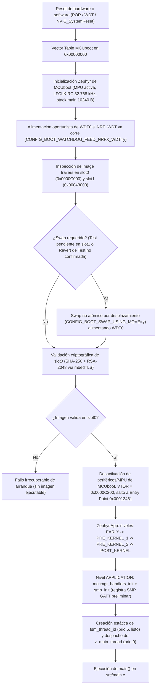
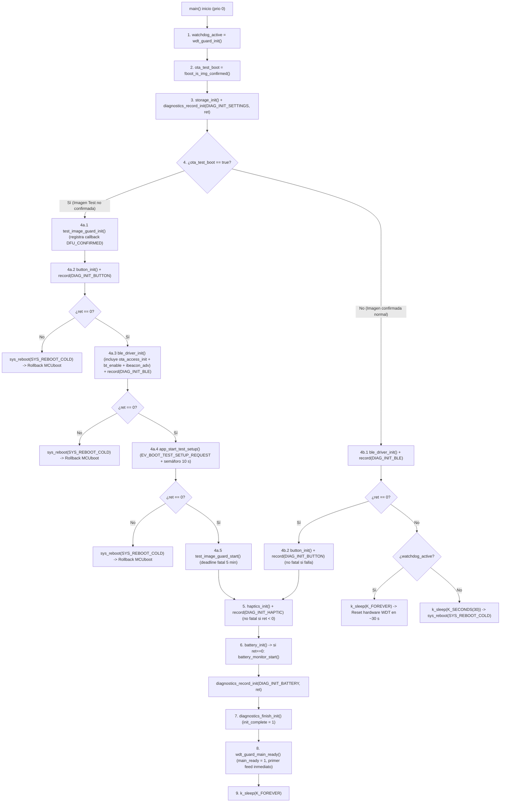

# 4. Arranque, Inicialización y Reinicio

> **Alcance y versión verificada**: Este capítulo documenta la secuencia íntegra de arranque desde el vector de reset en silicio del SoC `nRF52832-QFAA` hasta el régimen estacionario de ejecución en el commit `c1128e5d0c0d6f98be0a580d287c0926ca27f01f` (`Zephyr RTOS 4.2.0` + `MCUboot` gestionado por `sysbuild`). Para la vista arquitectónica general, consúltese [01_system_architecture.md](01_system_architecture.md); para el detalle del mapa de memoria y particiones, [03_memory_and_ota_layout.md](03_memory_and_ota_layout.md); para la máquina de estados posterior al arranque, [05_state_machine.md](05_state_machine.md); y para los contextos de ejecución y primitivos de sincronización, [06_concurrency.md](06_concurrency.md).

---

## 4.1. Secuencia extremo a extremo desde el vector de reset hasta `main()`

En la configuración efectiva del proyecto ([sysbuild.conf](../../sysbuild.conf#L1), [prj.conf](../../prj.conf#L92) y [boards/joya/joya_nrf52/joya_nrf52_nrf52832.dts](../../boards/joya/joya_nrf52/joya_nrf52_nrf52832.dts#L46-L72)), el procesador `ARM Cortex-M4` nunca salta directamente a la aplicación tras un reset: siempre atraviesa dos imágenes independientes enlazadas en Flash interna:

1. **Etapa 1 — Bootloader `MCUboot`** (`boot_partition`, `0x00000000..0x0000C000`, 48 KiB / 12 páginas de 4 KiB).
2. **Etapa 2 — Aplicación Joya sobre `Zephyr 4.2.0`** (`slot0_partition`, `0x0000C000..0x00043000`, 220 KiB / 55 páginas de 4 KiB, con `CONFIG_ROM_START_OFFSET=0x200` para la cabecera `image_header` de MCUboot).



### 4.1.1. Etapa 1: Ejecución del bootloader `MCUboot`

*(Comportamiento implementado verificado en [sysbuild.conf](../../sysbuild.conf#L1), [sysbuild/mcuboot.conf](../../sysbuild/mcuboot.conf#L1-L6), [boards/joya/joya_nrf52/joya_nrf52_nrf52832.dts](../../boards/joya/joya_nrf52/joya_nrf52_nrf52832.dts#L52-L65) y `build_joya/mcuboot/zephyr/.config`)*:

1. **Toma del vector de reset (`0x00000000`)**: Tras salir de reset, el núcleo `Cortex-M4` carga el puntero de pila inicial (`MSP`) desde `0x00000000` y el vector `Reset_Handler` desde `0x00000004`, ambos residentes en `boot_partition` (`0x00000000..0x0000C000`).
2. **Entorno de ejecución de `MCUboot`**:
   - **Reloj LFCLK**: `MCUboot` usa exactamente la misma fuente de reloj de baja frecuencia que la aplicación: el oscilador RC interno de `32,768 kHz` con tolerancia `500 ppm` y calibración térmica periódica cada `4000 ms` (`CONFIG_CLOCK_CONTROL_NRF_K32SRC_RC=y`, `CONFIG_CLOCK_CONTROL_NRF_K32SRC_XTAL=n`, `CONFIG_CLOCK_CONTROL_NRF_K32SRC_500PPM=y` en [sysbuild/mcuboot.conf](../../sysbuild/mcuboot.conf#L4-L6)). Esto evita que el bootloader quede bloqueado esperando un cristal externo `LFXTAL` inexistente en la PCB.
   - **Protección de memoria (`MPU`) y pila**: A diferencia de la aplicación principal, `MCUboot` **sí** compila con `CONFIG_ARM_MPU=y` y `CONFIG_MPU_ALLOW_FLASH_WRITE=y` ([sysbuild/mcuboot.conf](../../sysbuild/mcuboot.conf#L1-L2)), y dimensiona `CONFIG_MAIN_STACK_SIZE=10240` bytes (`10 KiB`) más `CONFIG_ISR_STACK_SIZE=2048` bytes para absorber sin desbordamiento las operaciones en pila de `mbedTLS` durante la verificación `RSA-2048`.
3. **Interacción de `MCUboot` con el Watchdog Hardware (`WDT0`)**:
   - En `MCUboot`, `# CONFIG_WATCHDOG is not set`: el bootloader **no inicia** el periférico `NRF_WDT` por cuenta propia en un encendido en frío (POR).
   - Sin embargo, compila con `CONFIG_BOOT_WATCHDOG_FEED=y` y `CONFIG_BOOT_WATCHDOG_FEED_NRFX_WDT=y`. Cuando el MCU llega a `MCUboot` tras un reinicio por software (`NVIC_SystemReset()` / `sys_reboot(SYS_REBOOT_COLD)`) desde una aplicación que ya había arrancado `NRF_WDT`, el contador hardware continúa corriendo con su configuración bloqueada (`30 s`, `RR[0]` habilitado). Los puntos de alimentación de `MCUboot` escriben la clave de recarga `0x6E524635` (`NRF_WDT_RR_VALUE`) en los canales `RR` activos durante el cálculo de hashes y las copias de páginas entre `slot1` y `slot0`, impidiendo que un swap legítimo de ~200 KiB aborte a mitad de camino por expiración del watchdog de `30 s`.
4. **Algoritmo de swap e inspección de imagen (`boot_go`)**:
   - **Estrategia `SWAP_USING_MOVE`**: Efectiva mediante `CONFIG_BOOT_SWAP_USING_MOVE=y` y `CONFIG_SWAP_NONATOMIC=y` (sin partición `scratch` dedicada). `MCUboot` reserva internamente el último sector de `slot0` como área temporal de desplazamiento página a página (4 KiB).
   - **Casos evaluados sobre los *image trailers* de `slot0` (`0x0000C000`) y `slot1` (`0x00043000`)**:
     - **Arranque ordinario sin actualización**: `slot0` contiene una imagen confirmada (`image_ok = 0x01`) y `slot1` no tiene solicitud de swap. No se escribe en Flash.
     - **Promoción a prueba (*Test swap*)**: El cliente OTA marcó previamente `slot1` como `pending` (`boot_request_upgrade(BOOT_UPGRADE_TEST)` vía comando SMP `image state` con `confirm=false`). `MCUboot` verifica criptográficamente `slot1` y permuta las imágenes entre `slot0` y `slot1` dejando la nueva imagen en `slot0` en estado **no confirmado** (`copy_done = 0x01`, `image_ok = 0xFF`).
     - **Reversión automática (*Rollback / Revert swap*)**: Si en el arranque previo se ejecutó una imagen en modo Test (`image_ok == 0xFF`) y el dispositivo se reinició (por fallo de auto-prueba en `main()`, por expiración de los 5 minutos de `test_image_guard`, por watchdog o por corte de energía) antes de recibir confirmación (`boot_write_img_confirmed()`), `MCUboot` detecta que `slot0` ya fue copiado (`copy_done == 0x01`) pero nunca confirmado (`image_ok != 0x01`), y revierte la imagen anterior desde `slot1` hacia `slot0`, marcándola como confirmada.
5. **Validación criptográfica sistemática de `slot0` (`CONFIG_BOOT_VALIDATE_SLOT0=y`)**:
   - En **todo** arranque (incluso sin swap), `MCUboot` recalcula el resumen `SHA-256` sobre la carga de `slot0` y verifica el TLV de firma `RSA-2048` (`CONFIG_BOOT_SIGNATURE_TYPE_RSA=y`, `CONFIG_BOOT_SIGNATURE_TYPE_RSA_LEN=2048`, backend `CONFIG_BOOT_USE_MBEDTLS=y`) contra la clave pública embebida en `boot_partition`.
   - **Impacto sobre latencia y consumo de arranque**: Esta validación en cada reinicio protege contra corrupción accidental o modificación parcial en `slot0`, a costa de mantener activa la CPU a `64 MHz` leyendo ~165 KiB de Flash y ejecutando exponenciación modular RSA antes de saltar a la aplicación.
6. **Salto a la aplicación (`do_boot`)**:
   - `MCUboot` deshabilita su configuración de `MPU` e interrupciones, reubica el registro `SCB->VTOR` a la tabla de vectores de la aplicación en `0x0000C200` (`slot0` en `0x0000C000` + `CONFIG_ROM_START_OFFSET=0x200`), carga el `MSP` definido en `0x0000C200` y salta al *entry point* de la aplicación (`0x00012461` en el ELF compilado de referencia `build_joya/app/zephyr/zephyr.elf`, bit `Thumb = 1`).

---

### 4.1.2. Etapa 2: Inicialización pre-`main()` del kernel `Zephyr 4.2.0`

Antes de que se ejecute la primera línea de `main()` en [src/main.c](../../src/main.c#L11), el código de arranque de Zephyr (`z_arm_reset` → `z_prep_c` → `z_cstart`) limpia `.bss`, copia `.data` desde Flash a SRAM y recorre secuencialmente las tablas de inicialización `.initlevel` en el hilo inicial del sistema (con interrupciones enmascaradas en `EARLY`/`PRE_KERNEL_*` y con el planificador ya operativo en `POST_KERNEL`/`APPLICATION`).

La inspección de la sección `.initlevel` y de los ordinales Devicetree generados (`build_joya/app/zephyr/zephyr.elf` y `devicetree_generated.h`) muestra el orden exacto ejecutado en tiempo de arranque:

| Nivel Zephyr | Orden | Símbolo / Ordinal DTS | Periférico / Subsistema inicializado | Relevancia directa para Joya |
|---|---:|---|---|---|
| `EARLY` | — | *(vacío)* | `__init_EARLY_start == __init_PRE_KERNEL_1_start` | Sin hooks tempranos personalizados. |
| `PRE_KERNEL_1` | 1 | `nordicsemi_nrf52_init` | Inicialización base SoC `nRF52832` y workarounds de erratas de silicio | Prepara el SoC antes de tocar periféricos. Note que `CONFIG_GPIO_AS_PINRESET` **no** está activo ([boards/joya/joya_nrf52/joya_nrf52_nrf52832_defconfig](../../boards/joya/joya_nrf52/joya_nrf52_nrf52832_defconfig#L3-L4)) porque `P0.21` carece de pull-up externo en la PCB. |
| `PRE_KERNEL_1` | 2 | `ord_26` (`clock@40000000`) | Driver `CLOCK` / `POWER` (`LFCLK` RC `32768 Hz`, `500 ppm`) | Arranca el reloj de baja frecuencia requerido por `RTC1` y `WDT0`. |
| `PRE_KERNEL_1` | 3 | `statics_init_pre` | Estructuras estáticas internas del kernel | Preparación previa a objetos del kernel. |
| `PRE_KERNEL_1` | 4 | `init_mem_slab_obj_core_list` | Lista de *memory slabs* | Infraestructura base de buffers. |
| `PRE_KERNEL_1` | 5 | `ord_10` (`gpio@50000000`) | Driver `GPIO0` + `GPIOTE` (`IRQ 6`) | Deja `device_is_ready()` verdadero para `P0.13` (botón) y `P0.07` (`haptic_en_gpios`), sin configurar pines de aplicación aún. |
| `PRE_KERNEL_1` | 6 | `ord_48` (`random@4000d000`) | Generador hardware `RNG` | Fuente de entropía para el controlador BLE (`BT_CTLR_ENTROPY`). |
| `PRE_KERNEL_1` | 7 | `ord_63` (`watchdog@40010000`) | Driver `wdt_nrfx` sobre `WDT0` (`CONFIG_WDT_NRFX_NO_IRQ=y`) | Registra el dispositivo `wdt0` sin arrancarlo; el arranque efectivo ocurre en `wdt_guard_init()` al inicio de `main()`. |
| `PRE_KERNEL_2` | 8 | `sys_clock_driver_init` | Temporizador de sistema `RTC1` (`32768 Hz`, *tickless*) | Habilita `k_uptime_get()`, timeouts de kernel y todos los `k_work_delayable`. |
| `POST_KERNEL` | 9 | `malloc_prepare` | Preparación de heap (`CONFIG_HEAP_MEM_POOL_SIZE=0`) | Sin heap dinámico general de aplicación. |
| `POST_KERNEL` | 10 | `k_sys_work_q_init` | `System Workqueue` (`k_sys_work_q`) | Crea y arranca el hilo cooperativo de prioridad `-1` con stack `4096 B` (`sys_work_q_stack`). |
| `POST_KERNEL` | 11 | `ord_8` (`adc@40007000`) | Driver `SAADC` (`IRQ 7`) | Deja listo `adc` para `battery_init()`. |
| `POST_KERNEL` | 12 | `ord_36` (`i2c@40003000`) | Driver `TWIM0` (`i2c0`, `P0.08`/`P0.06`, `100 kHz`, `IRQ 3`) | Configura `pinctrl` inicial `i2c0_default` y deja listo el bus para `haptics_init()`. |
| `POST_KERNEL` | 13 | `ord_65` (`flash-controller@4001e000`) | Controlador `NVMC` de Flash interna | Necesario para `NVS`/`Settings`, `stream_flash` (OTA) y `boot_write_img_confirmed()`. |
| `POST_KERNEL` | 14 | `ord_77` (`bt_hci_controller`) | Controlador BLE Split (`LLL`/`ULL`) sobre `RADIO` (`IRQ 1`) | Prepara el subsistema HCI local antes de `bt_enable(NULL)`. |
| `POST_KERNEL` | 15 | `ord_55` (`temp@4000c000`) | Sensor interno de temperatura `TEMP` (`IRQ 12`) | Usado por la calibración automática del oscilador RC de `32,768 kHz` cada `4 s` o ante `ΔT >= 0,5 °C` (`TEMP_DIFF=2` cuartos de grado). |
| `APPLICATION` | 16 | `mcumgr_handlers_init` | Grupos de comandos `MCUmgr` (`IMG` y `OS`) | Registra manejadores CBOR de subida/listado/confirmación de imagen y reset remoto. |
| `APPLICATION` | 17 | `smp_init` | Cola `smp_work_queue` + transporte `smp_bt` | Arranca `smp_work_queue` (prioridad preemptiva `3`, stack `2048 B`) y **registra automáticamente el servicio GATT SMP antes de `main()`**. |

> [!IMPORTANT]
> **Efecto colateral crítico del nivel `APPLICATION` (`smp_init`)**: Debido a que `CONFIG_MCUMGR_TRANSPORT_BT=y` registra el servicio GATT SMP durante `APPLICATION` antes de entrar en `main()`, si la aplicación llamara directamente a `bt_enable(NULL)` el servidor SMP quedaría expuesto sin autenticación desde el primer milisegundo. Por esta razón, `ble_driver_init()` invoca obligatoriamente `ota_access_init()` → `smp_bt_unregister()` **antes** de `bt_enable(NULL)` ([include/ota_access.h](../../include/ota_access.h#L6-L7), [src/ota_access.c](../../src/ota_access.c#L83-L94), [src/ble_driver.c](../../src/ble_driver.c#L494-L500)).

---

### 4.1.3. Relación de prioridades en el arranque entre `z_main_thread` y `fsm_thread_id`

Justo después de completar el nivel `APPLICATION` y antes de invocar `main()`, `bg_thread_main()` ejecuta `z_init_static_threads()`, que instancia todos los hilos declarados con `K_THREAD_DEFINE` cuyo retardo inicial sea `0`. En todo el código de Joya existe un único hilo estático de aplicación:

```c
/* src/app_state.c:36 */
K_THREAD_DEFINE(fsm_thread_id, 4098, fsm_thread_loop, NULL, NULL, NULL, 5, 0, 0);
```

La interacción exacta de planificación entre `main` y `fsm_thread_id` durante el arranque es determinista:

1. **`main` posee mayor prioridad que `fsm_thread_id`**: `z_main_thread` corre con prioridad preemptiva `0` (`CONFIG_MAIN_THREAD_PRIORITY=0`), mientras que `fsm_thread_id` tiene prioridad preemptiva `5` (en Zephyr, menor valor numérico equivale a mayor prioridad).
2. **`fsm_thread_id` no preempie a `main` en `t = 0`**: Cuando `z_init_static_threads()` marca `fsm_thread_id` como `READY`, `z_main_thread` (prio `0`) conserva la CPU e ingresa inmediatamente a `main()` ([src/main.c](../../src/main.c#L11)).
3. **Primera cesión de CPU e inicialización de los `k_work_delayable` de la FSM**: En cuanto `main()` realiza su primera operación bloqueante de E/S o sincronización —ya sea durante `storage_init()` o a más tardar dentro de `ble_driver_init()` → `bt_enable(NULL)` (que espera completado de comandos HCI procesados en `sysworkq` y `bt_workq`)—, `z_main_thread` pasa a estado pendiente y el planificador despacha `fsm_thread_id` (prio `5`).
4. **Acondicionamiento garantizado antes del primer evento**: En esa primera tajada de ejecución, `fsm_thread_loop()` ([src/app_state.c](../../src/app_state.c#L356-L365)) inicializa sus cuatro estructuras `k_work_delayable` (`emergency_retry_work`, `connection_timeout_work`, `advertising_restart_work` y `critical_window_work`) y se bloquea en `k_msgq_get(&event_queue, &entry, K_FOREVER)`. Por tanto, cuando `main()` alcanza `app_start_test_setup()` ([src/main.c](../../src/main.c#L35)) en un arranque OTA Test o `battery_monitor_start()` ([src/main.c](../../src/main.c#L78)) en un arranque normal, los cuatro `k_work_delayable` de `app_state.c` ya están inicializados y la FSM está lista para drenar `event_queue`.

*(Observación de ingeniería — Fragilidad latente de ordenamiento)*: Aunque en el binario actual `bt_enable(NULL)` bloquea siempre a `main` antes de que ningún productor invoque `k_work_reschedule()` sobre los `k_work_delayable` de `app_state.c`, el hecho de que `emergency_retry_work`, `connection_timeout_work`, `advertising_restart_work` y `critical_window_work` se inicialicen dinámicamente al inicio de `fsm_thread_loop()` (prio `5`) en lugar de declararse estáticamente con `K_WORK_DELAYABLE_DEFINE` depende implícitamente de que `main` (prio `0`) ceda la CPU al menos una vez antes de encolar eventos que los reprogramen. Si en una rama OTA Test `button_init()` registrara la interrupción `GPIOTE` ([src/main.c](../../src/main.c#L25)) y ocurriese un rebote de botón antes de `bt_enable(NULL)`, el evento solo se depositaría en `event_queue` (que sí está inicializada estáticamente con `K_MSGQ_DEFINE` en [src/app_state.c](../../src/app_state.c#L28)), por lo que sigue siendo seguro.

---

## 4.2. Orden exacto de inicialización en `main()` y grafo de dependencias

La función `main()` en [src/main.c](../../src/main.c#L11-L89) orquesta la puesta en marcha de siete subsistemas bajo una secuencia estricta donde el orden difiere deliberadamente entre una **imagen confirmada** y una **imagen OTA en modo Test**:



### 4.2.1. Justificación técnica de cada dependencia de orden en `main()`

1. **`wdt_guard_init()` va primero ([src/main.c](../../src/main.c#L12))**: Arma `NRF_WDT` (`30 s`) antes de tocar Flash (`NVS`), radio BLE (`bt_enable`), `I2C` (`TWIM0`) o `SAADC`. Si cualquiera de esos drivers quedara colgado indefinidamente durante `main()`, como `main_ready` permanece en `0`, `guard_work` **no alimenta** el watchdog ([src/wdt_guard.c](../../src/wdt_guard.c#L57-L79)) y el SoC se reinicia por hardware a los `30 s`.
2. **`boot_is_img_confirmed()` antes de inicializar periféricos ([src/main.c](../../src/main.c#L13))**: Lee el flag `image_ok` del trailer de `slot0` para decidir la política de fallos (estricta con rollback inmediato en modo Test vs. degradación elegante en modo confirmado).
3. **`storage_init()` antes de `ble_driver_init()` y de la FSM ([src/main.c](../../src/main.c#L16))**: Carga desde `storage_partition` (`NVS`) las cuatro claves persistentes (`joya/app_id`, `joya/emergency`, `joya/routine`, `joya/name`) en caché RAM ([src/flash_memory.c](../../src/flash_memory.c#L197-L248)). Esto es indispensable antes de arrancar BLE o la FSM porque:
   - `start_advertising_with_ibeacon()` consulta `is_app_id_empty()` y `storage_get_name()` para decidir el nombre anunciado (`"Joya Setup"` vs `"Joya"` / `"Joya de <sufijo>"`) y el modo de `ibeacon_adv`.
   - En `storage_init()` ([src/flash_memory.c](../../src/flash_memory.c#L241-L245)), si había una rutina pendiente cargada pero `is_app_id_empty()`, o `joya_emergency_phase != EMERGENCY_NONE`, o `pending_routine_owner != joya_app_id`, se limpia inmediatamente grabando el tombstone `0` antes de aceptar conexiones.
4. **Inversión deliberada `button_init()` ↔ `ble_driver_init()` entre ambas ramas**:
   - En **modo OTA Test** ([src/main.c](../../src/main.c#L24-L39)), `test_image_guard_init()` registra primero el callback `MGMT_EVT_OP_IMG_MGMT_DFU_CONFIRMED` para evitar cualquier ventana de carrera si una confirmación llegara apenas se habilite BLE; enseguida se prueba `button_init()` (porque el botón es el mecanismo físico de recuperación y entrada a Setup/Factory Reset) y luego `ble_driver_init()`.
   - En **modo confirmado** ([src/main.c](../../src/main.c#L41-L58)), se inicializa primero `ble_driver_init()` y después `button_init()`. Si el botón físico o su pin `GPIO` fallan en una imagen ya confirmada, el firmware continúa arrancando con BLE operativo ([src/main.c](../../src/main.c#L55-L57)), lo que permite que una unidad con `APP_ID` guardado inicie automáticamente el advertising de reconexión a los `~60 s` y siga siendo alcanzable y diagnosticable (`A0 1D`, bit `DIAG_INIT_BUTTON` en `0`) e incluso actualizable por OTA.
5. **`haptics_init()` antes de `battery_init()` ([src/main.c](../../src/main.c#L61-L79))**:
   - `haptics_allowed` nace atómicamente en `0` (`ATOMIC_INIT(0)` en [src/haptics.c](../../src/haptics.c#L36)), manteniendo bloqueada cualquier vibración mientras `DRV2605` es sondeado en `0x5A`/`0x5B`, configurado en lazo abierto ERM (`OD_CLAMP = 0x72` ≈ `2,5 V`) y llevado de vuelta a reposo (`drv2605_idle()`: `P0.07 = 0` + `PM_DEVICE_ACTION_SUSPEND` sobre `i2c0`).
   - Acto seguido, `battery_init()` ([src/battery.c](../../src/battery.c#L67-L70)) toma una única lectura síncrona de VBAT: si `voltage_mv > BATTERY_LEVEL_1_MV` (`3000 mV`), invoca `haptics_set_allowed(true)` para que los gestos inmediatos de usuario durante los primeros `60 s` dispongan de respuesta táctil sin esperar a la primera ventana completa de 6 muestras del monitor. Si `haptics_init()` se llamara después de `battery_init()`, no habría conflicto funcional porque `haptics_init()` no modifica `haptics_allowed`, pero mantener `haptics_ready = true` antes de habilitar `haptics_allowed` garantiza que desde el instante en que `haptics_allowed` pasa a `1` el controlador I2C ya está configurado y suspendido en bajo consumo. Note además que en [src/main.c](../../src/main.c#L68-L74) existe un bloque comentado (`/* haptics_play(HAPTICS_PATTERN_ACK_CONNECTION); */`): en `HEAD` (`c1128e5`) **no** se ejecuta vibración de encendido, y si ese comentario se descomentara en la posición actual (antes de `battery_init()`), tampoco vibraría porque en la línea 72 `haptics_allowed` aún vale `0`.
6. **`diagnostics_finish_init()` antes de `wdt_guard_main_ready()` ([src/main.c](../../src/main.c#L81-L82))**:
   - `diagnostics_finish_init()` ([src/diagnostics.c](../../src/diagnostics.c#L46-L50)) fija `init_complete = 1` cuando los 5 bits de `init_bits` ya son definitivos (`DIAG_INIT_SETTINGS`, `DIAG_INIT_BLE`, `DIAG_INIT_BUTTON`, `DIAG_INIT_HAPTIC`, `DIAG_INIT_BATTERY`) y solicita emitir `A0 MM` si una sesión BLE en modo Test ya se hubiese autenticado y suscripto durante los milisegundos previos.
   - Finalmente, `wdt_guard_main_ready()` ([src/wdt_guard.c](../../src/wdt_guard.c#L109-L116)) marca `main_ready = 1` y reprograma `guard_work` con `K_NO_WAIT` para realizar el **primer feed de `WDT0` en la aplicación**, tras lo cual `z_main_thread` duerme permanentemente con `k_sleep(K_FOREVER)` ([src/main.c](../../src/main.c#L88)).

> [!NOTE]
> **Impacto en memoria de `z_main_thread` tras `k_sleep(K_FOREVER)`**: Como `main()` termina durmiendo indefinidamente, la pila estática `z_main_stack` de `4096 B` (`CONFIG_MAIN_STACK_SIZE=4096` en [prj.conf](../../prj.conf#L37), ubicada en `0x20006f08..0x20007f08`) permanece reservada e inactiva durante el resto de la vida útil de la sesión de ejecución. Ese tamaño holgado está motivado exclusivamente por la fase de arranque (`bt_enable`, `settings_subsys_init`/`settings_load` y sondas `I2C`/`SAADC`).

---

## 4.3. Análisis detallado de las dos ramas de arranque

### 4.3.1. Rama 1: Arranque Normal (`boot_is_img_confirmed() == true`)

Cuando `slot0` está confirmado (`ota_test_boot == false`), `main()` inicializa `ble_driver_init()`, `button_init()`, `haptics_init()` y `battery_init()` + `battery_monitor_start()`, **sin** iniciar publicidad BLE directamente en `main()` y dejando `current_state` en su valor estático inicial `STATE_UNPAIRED` ([src/app_state.c](../../src/app_state.c#L26)).

El comportamiento posterior depende estrictamente de si existe un `APP_ID` válido en RAM/NVS (`!is_app_id_empty()`) y del resultado de la primera ronda de verificación del monitor de batería introducido en `c1128e5`:

#### A. Dispositivo no vinculado (`is_app_id_empty() == true`, 16 bytes en `0x00`)
1. Durante los primeros `60 s`, el dispositivo permanece en `STATE_UNPAIRED` con **cero actividad de radio BLE** (`connectable_adv_running == 0`, `ibeacon_running == false`), minimizando el consumo en estantería o tras un *factory reset*.
2. Cuando a los `~60 s` el monitor SAADC publica el primer evento de batería (`EV_BATTERY_NORMAL` o `EV_BATTERY_LEVEL_1`), `process_event()` ([src/app_state.c](../../src/app_state.c#L429-L433)) ejecuta:
   ```c
   if (!boot_battery_seen) {
       boot_battery_seen = true;
       boot_reconnect_pending = !is_app_id_empty() && boot_is_img_confirmed();
   }
   ```
   Como `is_app_id_empty()` es `true`, `boot_reconnect_pending` queda en `false`.
3. **Consecuencia**: Una Joya virgen o recién restablecida de fábrica **jamás inicia advertising por sí sola al arrancar**; permanece silenciosa en `STATE_UNPAIRED` hasta que la usuaria realice un doble clic (`EV_BTN_2_PULSE` → `STATE_SETUP_MODE` anunciando `"Joya Setup"` durante `90 s`) o un gesto de emergencia (`EV_BTN_EMERGENCY` → 3+ clics → `STATE_SETUP_MODE` anunciando `"Joya Setup"` sin timeout de 90 s, [src/app_state.c](../../src/app_state.c#L754-L757)). (Única excepción: si arranca con `battery_level == 2`, entra en `enter_critical_idle()`, donde `suspended_idle = true` y `critical_idle = true`).

#### B. Dispositivo vinculado (`!is_app_id_empty()`) y el mecanismo `boot_battery_seen` / `boot_reconnect_pending` (`~60 s`)

En el commit `c1128e5`, un dispositivo con `APP_ID` almacenado inicia automáticamente el advertising de reconexión tras reiniciar, pero **no en `t = 0`**, sino deliberadamente diferido hasta contar con un nivel de batería confirmado por mayoría (`5/6` muestras). El desglose exacto del cronograma es crucial para pruebas de banco y validación de consumo:

1. **`t ≈ 0,0 s` — `battery_init()` ([src/battery.c](../../src/battery.c#L45-L72))**:
   - Toma una lectura puntual `adc_read_dt()`. Si `voltage_mv > 3000 mV` (`BATTERY_LEVEL_1_MV`), llama a `haptics_set_allowed(true)`.
   - Como explica el comentario en [src/battery.c](../../src/battery.c#L64-L66), esta muestra aislada **no modifica `confirmed_level`** (que sigue valiendo `BATTERY_STATE_UNKNOWN = -1`) ni encola eventos en `event_queue`.
2. **`t ≈ 0,0 s` — Primera ejecución de `battery_monitor_work` ([src/battery.c](../../src/battery.c#L306-L325) y [src/battery.c](../../src/battery.c#L210-L304))**:
   - `battery_monitor_start()` pone `monitoring = true`, `verifying = false`, `verification_count = 0` y agenda `battery_monitor_work` con `K_NO_WAIT`.
   - Cuando `sysworkq` ejecuta `battery_monitor_work_handler` en `t ≈ 0 s`, lee `was_verifying == false` y mide `voltage_mv`.
   - Al llegar al paso 7 ([src/battery.c](../../src/battery.c#L284-L291)):
     ```c
     else if (err == 0 && battery_classify(voltage_mv) != confirmed_level) {
         verifying = true;
         verification_count = 0;
         memset(votes, 0, sizeof(votes));
         (void)k_work_reschedule(&battery_monitor_work,
                     K_MSEC(BATTERY_VERIFY_INTERVAL_MS));
     }
     ```
     Dado que `battery_classify()` devuelve `0`, `1` o `2` y `confirmed_level` vale `-1`, la desigualdad `!= confirmed_level` se cumple **siempre** en el arranque. **Esta muestra en `t = 0` actúa únicamente como disparador de verificación y no suma ningún voto** (`verification_count` se pone a `0` y `votes` se limpia). El trabajo se reprograma a `BATTERY_VERIFY_INTERVAL_MS = 10000 ms` (`10 s`).
3. **`t ≈ 10, 20, 30, 40, 50, 60 s` — Ventana de 6 muestras de verificación ([src/battery.c](../../src/battery.c#L248-L281))**:
   - En cada tick separado `10 s`, `was_verifying == true`, se incrementa `votes[battery_classify(voltage_mv)]` y `verification_count++`.
   - Al cumplirse la sexta muestra en **`t ≈ 60 s`** (`verification_count == BATTERY_VERIFY_SAMPLES == 6`), `battery_finish_verification()` ([src/battery.c](../../src/battery.c#L166-L208)) exige al menos `BATTERY_VERIFY_MIN_VOTES = 5` votos coherentes (con acumulación descendente `LEVEL_2` → `LEVEL_1`) y encola `EV_BATTERY_NORMAL`, `EV_BATTERY_LEVEL_1` o `EV_BATTERY_LEVEL_2`.
   - *(Caso borde de oscilación en umbral)*: Si durante el arranque la tensión oscila justo sobre `3000 mV` produciendo, por ejemplo, `4` votos `NORMAL` y `2` votos `LEVEL_1`, ni `votes_at_or_below(LEVEL_1)` (`2 < 5`) ni `votes[NORMAL]` (`4 < 5`) alcanzan 5 votos. En ese caso `confirmed_level` permanece en `-1`, `verifying` pasa a `false`, el monitor aguarda `BATTERY_MONITOR_INTERVAL_MS = 60000 ms` (`t ≈ 120 s`), vuelve a activar `verifying = true` y recién confirmará en **`t ≈ 180 s`**.
4. **`t ≈ 60 s` — Transición automática en `process_event()` ([src/app_state.c](../../src/app_state.c#L425-L476))**:
   - **Subcaso B1 — Batería apta (`EV_BATTERY_NORMAL` nivel `0` o `EV_BATTERY_LEVEL_1` nivel `1`)**:
     - Se fija `boot_battery_seen = true` y `boot_reconnect_pending = true`.
     - `haptics_set_allowed(battery_level == 0 && !critical_idle)` habilita háptica en nivel `0` o la deshabilita en nivel `1`.
     - Entra en la rama `else if (boot_reconnect_pending && !ble_has_connection() && (current_state == STATE_UNPAIRED || current_state == STATE_BONDED_DISCONNECTED))` ([src/app_state.c](../../src/app_state.c#L462-L475)):
       - Fija `current_state = STATE_BONDED_DISCONNECTED`.
       - Invoca `start_advertising_with_ibeacon(false)`: anuncia de forma conectable con el nombre persistido (`"Joya"` o `"Joya de <sufijo>"`, **nunca** `"Joya Setup"`) en paralelo con `ibeacon_adv` (`BLE_IBEACON_CONNECTION`, UUID `...6001`), sin timeout de `90 s` (publicidad indefinida hasta conexión).
       - Si `start_advertising_with_ibeacon(false)` tiene éxito (`ret == 0`), limpia `boot_reconnect_pending = false`. Si falla transitoriamente, deja `boot_reconnect_pending = true` y llama a `schedule_advertising_restart()` (`10 ms`, hasta 3 reintentos cada `5 s`).
   - **Subcaso B2 — Arranque en batería crítica (`EV_BATTERY_LEVEL_2`, `<= 2900 mV`) y posterior recuperación**:
     - En `t ≈ 60 s`, `boot_battery_seen` pasa a `true` y **`boot_reconnect_pending` queda armada en `true`**, pero al ser `battery_level == 2` ejecuta la rama `if (battery_level == 2)` ([src/app_state.c](../../src/app_state.c#L453-L461)), deshabilita háptica y llama a `enter_critical_idle()` (`suspended_idle = true`, `critical_idle = true`, `current_state = STATE_UNPAIRED`, radio apagada).
     - Si más adelante la batería se recarga o recupera por encima de la histéresis (`> 2950 mV` para salir a Nivel 1, o `> 3050 mV` para salir a Normal) y el monitor publica `EV_BATTERY_LEVEL_1` o `EV_BATTERY_NORMAL`, dicho evento se procesa en las líneas 425–476 **antes** del filtro `if (suspended_idle && ...)` de la línea 562. Como `boot_reconnect_pending` seguía valiendo `true` y `current_state == STATE_UNPAIRED`, ejecuta las líneas 465–470: limpia `suspended_idle = false` y `critical_idle = false`, pasa a `STATE_BONDED_DISCONNECTED` e inicia automáticamente el advertising de reconexión sin requerir intervención manual.
   - **Subcaso B3 — Interacción del usuario antes de `t = 60 s`**:
     - Si antes de los `60 s` la usuaria pulsa 2 veces el botón (`EV_BTN_2_PULSE`), la FSM pasa de `STATE_UNPAIRED` a `STATE_SETUP_MODE` y arranca el advertising de inmediato (`t < 60 s`). Si el teléfono se conecta antes de `t = 60 s`, `EV_BLE_CONNECTED` limpia `boot_reconnect_pending = false` ([src/app_state.c](../../src/app_state.c#L570)), y cuando llegue `EV_BATTERY_NORMAL` en `t = 60 s` la guarda `!ble_has_connection()` impedirá reiniciar el advertising.
     - Si antes de `t = 60 s` la usuaria mantiene pulsado `5..15 s` para suspender (`EV_BTN_SUSPEND_REQUEST`), `suspended_idle` pasa a `true`; si eso ocurre **antes** de `t = 60 s`, ¡atención al detalle de implementación!: en `t < 60 s` `EV_BTN_SUSPEND_REQUEST` hace `boot_reconnect_pending = false` ([src/app_state.c](../../src/app_state.c#L639)), pero `boot_battery_seen` todavía era `false`. Cuando en `t = 60 s` llega por primera vez `EV_BATTERY_NORMAL`, las líneas 429–433 volverán a asignar `boot_reconnect_pending = true` y las líneas 462–470 despertarán el dispositivo sacándolo de `suspended_idle` (porque el comentario en línea 465 asume `/* A boot-time critical idle has recovered. */` sin distinguir una suspensión manual ejecutada durante el primer minuto de vida). Este caso borde queda documentado en detalle en [05_state_machine.md](05_state_machine.md).

```
Cronograma de arranque normal con APP_ID almacenado y VBAT = 3,30 V:
t = 0,00 s   Reset -> MCUboot valida SHA-256/RSA-2048 de slot0 -> salta a 0x00012461
t = 0,05 s   main(): wdt_guard_init() [WDT0 = 30s], storage_init() [carga APP_ID, name, emergency, routine]
t = 0,10 s   main(): ble_driver_init() [smp_bt_unregister() + bt_enable() + ibeacon_adv creado], button_init()
t = 0,12 s   main(): haptics_init() [DRV2605 configurado -> idle, i2c0 suspendido]
t = 0,13 s   main(): battery_init() [1 muestra > 3000 mV -> haptics_allowed = 1] + battery_monitor_start()
t = 0,13 s   main(): diagnostics_finish_init() [A0 1F] + wdt_guard_main_ready() [1er feed WDT0] + k_sleep(K_FOREVER)
t = 0,13 s   sysworkq: battery_monitor_work (muestra 0 disparo): confirmed_level==-1 -> verifying=true, votes={0}
t = 10,13 s  sysworkq: battery_monitor_work (voto 1/6 NORMAL) | guard_work alimenta WDT0 cada 10 s
t = 20,13 s  sysworkq: battery_monitor_work (voto 2/6 NORMAL)
t = 30,13 s  sysworkq: battery_monitor_work (voto 3/6 NORMAL)
t = 40,13 s  sysworkq: battery_monitor_work (voto 4/6 NORMAL)
t = 50,13 s  sysworkq: battery_monitor_work (voto 5/6 NORMAL)
t = 60,13 s  sysworkq: battery_monitor_work (voto 6/6 NORMAL) -> encola EV_BATTERY_NORMAL
t = 60,13 s  fsm_thread_id: boot_battery_seen=true, boot_reconnect_pending=true -> STATE_BONDED_DISCONNECTED
             -> start_advertising_with_ibeacon(false): anuncia "Joya" / "Joya de ..." + iBeacon ...6001
```

---

### 4.3.2. Rama 2: Arranque en Modo Prueba OTA (`!boot_is_img_confirmed()`)

Cuando `MCUboot` acaba de permutar una nueva imagen desde `slot1` hacia `slot0` en modo Test (`image_ok == 0xFF`), `ota_test_boot` es `true` ([src/main.c](../../src/main.c#L13)) y se activa una coreografía de **auto-prueba estricta y ventana de rescate de 5 minutos**:

1. **`test_image_guard_init()` ([src/main.c](../../src/main.c#L24), [src/test_image_guard.c](../../src/test_image_guard.c#L42-L44))**: Registra `image_confirmed_callback` sobre el evento `MGMT_EVT_OP_IMG_MGMT_DFU_CONFIRMED` de MCUmgr.
2. **Verificación obligatoria de botón (`button_init()`) y BLE (`ble_driver_init()`) ([src/main.c](../../src/main.c#L25-L34))**: Si cualquiera de las dos devuelve `ret != 0`, `main()` ejecuta inmediatamente `sys_reboot(SYS_REBOOT_COLD)`. Como la imagen nunca fue confirmada, `MCUboot` detectará `copy_done == 1 && image_ok == 0xFF` y restaurará automáticamente el firmware anterior desde `slot1`.
3. **Sincronización `main` ↔ `fsm_thread_id` vía `app_start_test_setup()` ([src/main.c](../../src/main.c#L35-L38), [src/app_state.c](../../src/app_state.c#L324-L332))**:
   - `main()` (prio `0`) encola `EV_BOOT_TEST_SETUP_REQUEST` en `event_queue` y se bloquea en `k_sem_take(&test_setup_sem, K_SECONDS(10))`.
   - Al suspenderse `main`, `fsm_thread_id` (prio `5`) extrae `EV_BOOT_TEST_SETUP_REQUEST` y ejecuta en [src/app_state.c](../../src/app_state.c#L402-L423):
     - Comprueba `current_state == STATE_UNPAIRED` (si no, devuelve `-EBUSY`).
     - Llama a `start_advertising_with_ibeacon(true)`: configura el nombre GAP como **`"Joya Setup"`** (incluso si existe un `APP_ID` previo en NVS, porque `is_new_connection == true` fuerza `JOYA_ADV_NAME_SETUP` en [src/ble_driver.c](../../src/ble_driver.c#L622-L623)) e inicia publicidad conectable inmediata en `t ≈ 0,1 s`. *(Detalle de implementación)*: `start_advertising_with_ibeacon(true)` llama acto seguido a `sync_ibeacon_mode()`, la cual evalúa `!is_app_id_empty()`; por tanto, si la unidad ya tenía `APP_ID` antes de la OTA, emitirá simultáneamente `"Joya Setup"` y el `BLE_IBEACON_CONNECTION` (`...6001`).
     - Transiciona `current_state = STATE_SETUP_MODE`, **sin programar `connection_timeout_work` (`90 s`)**, para que la publicidad no se apague a los 90 segundos mientras el operador o la app móvil intenta reconectar para confirmar la imagen.
     - Abre la ventana protegida `critical_window_open = true` con `critical_window_deadline_ms = k_uptime_get() + 300000` (`5 minutos`) y agenda `critical_window_work` a `5 minutos`. Esto protege a la imagen Test contra desconexiones automáticas por batería crítica (`battery_level == 2` a los `60 s`): aunque el SAADC reporte nivel 2, mientras `critical_window_open == true` la FSM **no** ejecuta `ota_access_disable()` ni `enter_critical_idle()` ([src/app_state.c](../../src/app_state.c#L456-L461)), permitiendo autenticar, habilitar OTA (`0x70`) y enviar el comando SMP `CONFIRM`.
     - Libera `k_sem_give(&test_setup_sem)`.
   - `main()` retoma ejecución: si `k_sem_take` expiró a los `10 s` (`-EAGAIN`) o `test_setup_result != 0`, ejecuta `sys_reboot(SYS_REBOOT_COLD)` para forzar rollback.
4. **Armado del guardián de rollback `test_image_guard_start()` ([src/main.c](../../src/main.c#L39), [src/test_image_guard.c](../../src/test_image_guard.c#L46-L61))**:
   - Activa `atomic_set(&test_image_active, 1)` y agenda `confirmation_deadline_work` en `sysworkq` a **`K_MINUTES(5)` (`300 s`)**. Si `k_work_reschedule` devuelve `< 0`, reinicia en el acto.
   - **Desenlace antes de 5 minutos (Éxito)**: La app móvil se conecta, autentica con `APP_ID`, envía `0x70` (`COMMAND_OTA_ENABLE`), e invoca la operación SMP `Image State Write (confirm = true)`. MCUmgr graba `image_ok = 0x01` en el trailer de `slot0` y dispara `MGMT_EVT_OP_IMG_MGMT_DFU_CONFIRMED` sobre `smp_work_queue` (prio `3`). El callback `image_confirmed_handler()` ([src/test_image_guard.c](../../src/test_image_guard.c#L22-L35)) verifica `boot_is_img_confirmed() == true`, limpia `test_image_active = 0` y cancela `confirmation_deadline_work`. La imagen queda promovida permanentemente sin necesidad de reiniciar. *(Nota sobre `critical_window_open` tras confirmar)*: Si durante esos primeros 60 s llega `EV_BATTERY_NORMAL` o `EV_BATTERY_LEVEL_1` (`battery_level != 2`) una vez que la imagen ya fue confirmada (`boot_is_img_confirmed() == true`), las líneas 435–443 de `src/app_state.c` cancelan `critical_window_work`, cierran `critical_window_open = false` y, si seguía sin conexión en `STATE_SETUP_MODE`, restauran el timeout ordinario de `90 s` (`connection_timeout_work`). Si en cambio `EV_BATTERY_NORMAL` llegó *antes* de que el cliente enviara `CONFIRM` (`boot_is_img_confirmed() == false`), `critical_window_open` se cierra pero `connection_timeout_work` no se reprograma (`boot_is_img_confirmed()` es `false` en la línea 439), manteniendo vivo el advertising hasta los 5 minutos de `confirmation_deadline_work`.
   - **Desenlace al cumplirse 5 minutos sin confirmación (Rollback)**: Expira `confirmation_deadline_work` en `sysworkq`; `confirmation_deadline_handler()` ([src/test_image_guard.c](../../src/test_image_guard.c#L11-L18)) comprueba `atomic_get(&test_image_active) && !boot_is_img_confirmed()` e invoca `sys_reboot(SYS_REBOOT_COLD)`, devolviendo el control a `MCUboot` para revertir a la imagen previa.

---

## 4.4. Tratamiento de errores de inicialización y máscara de diagnóstico (`A0 MM`)

El módulo [src/diagnostics.c](../../src/diagnostics.c#L1-L83) ([include/diagnostics.h](../../include/diagnostics.h#L6-L24)) instrumenta el resultado de inicialización de los cinco subsistemas de `main()` en el registro atómico `init_bits`, expuesto en la característica GATT `DIAGNOSTICS` (`a407e00a-00c1-464d-9173-2cb8be585202`) como un mensaje de 2 bytes **`A0 MM`** (donde un bit en `1` significa éxito `ret == 0` y un bit en `0` significa fallo; un arranque íntegro reporta **`A0 1F`**).

| Orden en `main()` | Subsistema y función | Bit `MM` (`diagnostics.h`) | Posibles códigos de error (`ret`) | Acción en Arranque Confirmado (`!ota_test_boot`) | Acción en Arranque OTA Test (`ota_test_boot`) | Impacto funcional y de recuperabilidad |
|---:|---|---|---|---|---|---|
| 1 | Watchdog (`wdt_guard_init()`) | *(Sin bit dedicado en `MM`)* | `false` (o bucle infinito `__NOP()` si `NRF_WDT` ya corría con otros registros) | Continúa arranque con `watchdog_active = false` (evita reset-loop por software si el driver falla sin WDT activo) | Igual que confirmado | Si `NRF_WDT` estaba activo con otra configuración, fuerza reset hardware WDT manteniendo la CPU despierta. |
| 2 | Persistencia (`storage_init()`) | `DIAG_INIT_SETTINGS` (`0x04`, bit 2) | Error negativo de `settings_subsys_init()` o `settings_load()` (emite además `0xE2` best-effort, que en boot se descarta por no haber sesión BLE) | **No fatal**: restaura defaults seguros en RAM (`APP_ID = 0`, `EMERGENCY_NONE`, `routine = 0`, `name = "Joya"`), `storage_persistent_available = false` | **No fatal**: continúa con defaults en RAM (nota: sin `APP_ID` en RAM, el primer cliente que escriba `APP_ID` podrá autenticar en RAM para confirmar u operar OTA) | El dispositivo funciona en RAM durante la sesión (`A0 1B`), pero cualquier reinicio perderá el estado de emparejamiento. |
| 3 | Radio BLE + SMP (`ble_driver_init()`) | `DIAG_INIT_BLE` (`0x01`, bit 0) | Error de `ota_access_init()` (`smp_bt_unregister`), `bt_enable(NULL)`, `bt_le_ext_adv_create` o `bt_le_ext_adv_set_data` | **Fatal diferido**: nunca llega a `wdt_guard_main_ready()`. Si `watchdog_active == true`, ejecuta `k_sleep(K_FOREVER)` esperando reset hardware WDT en `~30 s`; si `false`, `k_sleep(K_SECONDS(30))` + `sys_reboot(SYS_REBOOT_COLD)` | **Fatal inmediato**: `sys_reboot(SYS_REBOOT_COLD)` → rollback inmediato en `MCUboot` | Sin BLE la joya carece de función útil y de vía OTA; el reinicio cada 30 s intenta recuperar fallos transitorios del controlador HCI/radio sin ciclar rápido la batería. |
| 4 | Botón (`button_init()`) | `DIAG_INIT_BUTTON` (`0x02`, bit 1) | `-ENODEV` (`gpio0` no listo) o error de `gpio_pin_configure_dt`, `gpio_pin_get_dt`, `gpio_add_callback`, `gpio_pin_interrupt_configure_dt` | **No fatal**: continúa sin gestos físicos (`A0 1D`) | **Fatal inmediato** (evaluado *antes* de BLE en rama Test): `sys_reboot(SYS_REBOOT_COLD)` → rollback en `MCUboot` | En imagen confirmada con `APP_ID`, el auto-advertising a los `~60 s` permite reconectar por BLE, leer `A0 1D` y actualizar por OTA aunque el botón esté averiado. Sin `APP_ID`, no habrá forma de iniciar Setup Mode. |
| 5 | Háptica (`haptics_init()`) | `DIAG_INIT_HAPTIC` (`0x08`, bit 3) | `-ENODEV` (`i2c0`/`gpio` no listos, o `DRV2605` no responde ni en `0x5A` ni en `0x5B`), o error `I2C` (`-EIO`) en configuración; apaga `P0.07 = 0` en etiqueta `fail:` | **No fatal**: `haptics_ready = false`, continúa sin vibración (`A0 17`) | **No fatal**: continúa sin vibración (`A0 17`); no impide confirmar la imagen | Todas las llamadas a `haptics_play*()` retornan `-ENODEV` de inmediato; en `EV_BTN_SUSPEND_REQUEST` y `EV_BTN_FACTORY_THRESHOLD`, la FSM contempla explícitamente `ret != 0` para no bloquear la suspensión ni el factory reset por falta de callback háptico ([src/app_state.c](../../src/app_state.c#L645-L649), [src/app_state.c](../../src/app_state.c#L667-L669)). |
| 6 | Batería (`battery_init()` + `battery_monitor_start()`) | `DIAG_INIT_BATTERY` (`0x10`, bit 4) | `-ENODEV` (`SAADC` no listo), error de `adc_channel_setup_dt` o `-EACCES` | **No fatal**: continúa sin telemetría ni eventos de batería (`A0 0F`) | **No fatal**: continúa (`A0 0F`) | **Consecuencia sutil**: Si `battery_init()` falla en una imagen confirmada con `APP_ID`, nunca se publicará `EV_BATTERY_*`: `boot_reconnect_pending` jamás se evaluará (no habrá auto-advertising a los `60 s`, requiriendo `EV_BTN_2_PULSE` manual), y `haptics_allowed` quedará permanentemente en `0` (sin vibración). |

### Diferencia frente a fallos fatales de ejecución (`src/fatal_recovery.c`)

Mientras los errores de inicialización devuelven códigos `errno` controlados en `main()`, las excepciones síncronas de procesador (HardFault, BusFault, UsageFault, división por cero o instrucción ilegal), `k_oops()` / `k_panic()` del kernel y las aserciones internas del controlador BLE Split (`CONFIG_BT_CTLR_ASSERT_HANDLER=y` en [prj.conf](../../prj.conf#L87)) convergen en [src/fatal_recovery.c](../../src/fatal_recovery.c#L5-L19):

- `k_sys_fatal_error_handler(unsigned int reason, const struct arch_esf *esf)` invoca `NVIC_SystemReset()` sin demora ni volcado por consola.
- `bt_ctlr_assert_handle(char *file, uint32_t line)` invoca igualmente `NVIC_SystemReset()`.
- *(Limitación deliberada en `HEAD`)*: En [prj.conf](../../prj.conf#L79), `#CONFIG_ARM_MPU=y` está comentado (`# CONFIG_ARM_MPU is not set` y `# CONFIG_HW_STACK_PROTECTION is not set` en `.config`), tal como documenta [docs/RECOVERY_VALIDATION.md](../../docs/RECOVERY_VALIDATION.md#L79-L83). Por consiguiente, un desbordamiento de pila en la aplicación **no** dispara un `MemManage Fault` inmediato asistido por MPU, sino que corrompería memoria adyacente en SRAM hasta provocar otro Fault o un bloqueo recuperado por `WDT0`.

---

## 4.5. Mecanismo del Watchdog Hardware (`src/wdt_guard.c`)

El módulo [src/wdt_guard.c](../../src/wdt_guard.c#L1-L128) ([include/wdt_guard.h](../../include/wdt_guard.h#L1-L14)) gobierna el periférico `NRF_WDT` (`0x40010000`, etiqueta DTS `wdt0`) con `CONFIG_WATCHDOG=y` y `CONFIG_WDT_NRFX_NO_IRQ=y` ([prj.conf](../../prj.conf#L83-L84), sin interrupción previa de pre-aviso de 2 ciclos `LFCLK`: al expirar resetea el SoC directamente).

### 4.5.1. Configuración exacta de registros `NRF_WDT`

En `wdt_guard_init()` ([src/wdt_guard.c](../../src/wdt_guard.c#L84-L107)):

1. **Valor de recarga `CRV` (`Counter Reload Value`)**:
   - Definido por `WDT_TIMEOUT_MS = 30000U` (`30 s`) y `WDT_CRV_TICKS = (30000 * 32768) / 1000 = 983040` (`0x000F0000`) ([src/wdt_guard.c](../../src/wdt_guard.c#L10-L13)).
   - En la arquitectura del `nRF52832`, el período real de expiración obedece a la fórmula:
     $$T_{\text{WDT}} = \frac{\text{CRV} + 1}{32768\text{ Hz}} = \frac{983040 + 1}{32768} \approx 30{,}0000305\text{ s}$$
     (con una variación máxima de $\pm 500\text{ ppm}$, es decir $\pm 15\text{ ms}$, inherente al oscilador RC interno calibrado).
2. **Registro de canales `RREN` (`Reload Request Enable`)**:
   - Se instala únicamente el canal `0` (`wdt_channel == 0`), dejando **`NRF_WDT->RREN == 0x00000001U`**.
3. **Registro de modo `CONFIG` (`0x00000001`)**:
   - Se invoca `wdt_setup(wdt, WDT_OPT_PAUSE_HALTED_BY_DBG)`. En el mapa de bits de `NRF_WDT->CONFIG` del `nRF52832`:
     - **Bit 0 (`SLEEP`) = `1`** (`WDT_CONFIG_SLEEP_Msk = 0x01`): el contador `WDT` **continúa corriendo mientras la CPU duerme en `WFE`/`WFI` (`System ON Idle`)**. Si valiera `0`, un interbloqueo lógico donde todos los hilos durmieran jamás sería rescatado por el watchdog.
     - **Bit 3 (`HALT`) = `0`**: el contador `WDT` **se pausa cuando un depurador SWD detiene el núcleo**.
   - Por eso `wdt_registers_match()` ([src/wdt_guard.c](../../src/wdt_guard.c#L25-L30)) verifica exactamente las tres igualdades tras iniciar y al heredar un WDT previo:
     ```c
     return NRF_WDT->CRV == WDT_CRV_TICKS &&
            NRF_WDT->RREN == 1U &&
            NRF_WDT->CONFIG == WDT_CONFIG_SLEEP_Msk;
     ```

### 4.5.2. Herencia tras Software Reset y rechazo de configuraciones incompatibles

En el silicio `nRF52832`, una vez escrito `TASKS_START = 1`, los registros `CRV`, `RREN` y `CONFIG` quedan **bloqueados por hardware** y **no se reinician** ante un `NVIC_SystemReset()` (soft reset); solo se desbloquean tras un Watchdog Reset, Power-On Reset o Brownout Reset.

- **Caso compatible (reinicio de la propia aplicación o actualización entre versiones con el mismo contrato WDT)**: Al entrar en `wdt_guard_init()`, `nrf_wdt_started_check(NRF_WDT)` devuelve `true` y `wdt_registers_match()` devuelve `true`. El driver `wdt_nrfx` de Zephyr acepta reinstalar el canal `0` y configurar los mismos valores, reutilizando limpiamente el `WDT` en marcha.
- **Caso incompatible (`wdt_init_failed()`, [src/wdt_guard.c](../../src/wdt_guard.c#L32-L47))**: Si una versión previa o firmware distinto dejó `NRF_WDT` corriendo con otro `CRV`, más canales en `RREN` o distinto `CONFIG`, `wdt_registers_match()` devuelve `false` y se invoca `wdt_init_failed()`:
  ```c
  if (nrf_wdt_started_check(NRF_WDT)) {
      /* Stay awake even if an inherited CONFIG pauses WDT during sleep. */
      for (;;) {
          __NOP();
      }
  }
  ```
  El bucle activo con `__NOP()` (en vez de `k_sleep(K_FOREVER)`) es una decisión de ingeniería crítica: si el firmware anterior hubiese configurado `SLEEP = 0` (pausar WDT durante sleep), dormir la CPU detendría el reloj del WDT heredado y colgaría el dispositivo para siempre. Mantener la CPU despierta garantiza que el WDT heredado expire, produzca un **Watchdog Reset de hardware** que limpie `CRV`/`RREN`/`CONFIG`, y en el siguiente arranque `wdt_guard_init()` configure los parámetros canónicos de Joya.

### 4.5.3. Política de supervisión y alimentación periódica (`guard_work`)

El ítem `guard_work` ([src/wdt_guard.c](../../src/wdt_guard.c#L52-L82)) se ejecuta en `sysworkq` (prioridad cooperativa `-1`) cada **`GUARD_INTERVAL_MS = 10000 ms` (`10 s`)**, disponiendo de hasta **3 oportunidades de alimentación** dentro de cada ventana de `30 s` de `WDT0`. Solo ejecuta `wdt_feed(wdt, wdt_channel)` si se cumplen simultáneamente **cuatro condiciones de salud**:

1. **Inicialización completa (`atomic_get(&main_ready) == 1`)**: Antes de `wdt_guard_main_ready()`, `guard_work` se reprograma sin alimentar `WDT0`. Así, cualquier bloqueo durante `main()` expira en `30 s`.
2. **Salud de `sysworkq`**: Dado que `guard_work` corre dentro de `sysworkq`, si cualquier `k_work` (p. ej. una transacción `I2C`, `SAADC` o callback) se colgara indefinidamente en `sysworkq`, `guard_work` nunca llegaría a ejecutarse y `WDT0` resetearía el chip en `<= 30 s` tras el último feed.
3. **Ausencia de evento FSM atascado (`FSM_STALL_MS = 15000 ms`)**: `fsm_thread_loop()` envuelve cada llamada a `process_event(&entry)` entre `wdt_guard_fsm_event_begin()` (registra `fsm_started_ms` y `fsm_processing = 1`) y `wdt_guard_fsm_event_end()` (incrementa `fsm_progress` y limpia `fsm_processing = 0`) ([src/app_state.c](../../src/app_state.c#L365-L367)). Si `fsm_processing == 1` y `now - fsm_started_ms > 15000 ms`, `healthy` pasa a `false`.
4. **Ausencia de inanición de `event_queue` (`> 15000 ms`)**: Si `app_state_pending_events() > 0` (`k_msgq_num_used_get(&event_queue)`) y `fsm_progress` no avanzó desde la observación anterior durante más de `15000 ms` desde `pending_since_ms` (p. ej. porque un hilo de mayor prioridad preemptiva `0..4` acaparó la CPU impidiendo correr a `fsm_thread_id` de prio `5`), `healthy` pasa a `false`. En cambio, una FSM inactiva bloqueada en `K_FOREVER` con `event_queue` vacía es completamente saludable (`pending_since_ms = 0`).

*(Ventana temporal efectiva de detección)*: Por el muestreo discreto cada `10 s`, un bloqueo de `process_event()` se detecta en `15..25 s` y el reset físico de `WDT0` ocurre entre **`20 s` y `40 s`** después del inicio del cuelgue (`last_feed + 30 s`).

---

## 4.6. Tipos de reinicio en `nRF52832` y semántica real de `SYS_REBOOT_COLD`

En el SoC `nRF52832` existen dominios de reset diferenciados según el capítulo *POWER — Reset* de la especificación de producto de Nordic. Es indispensable distinguir su efecto real frente al nombre simbólico usado en Zephyr:

| Tipo de Reset | Causa de disparo en Joya | Bit en `NRF_POWER->RESETREAS` | ¿Reinicia registros `NRF_WDT` (`CRV`, `RREN`, `CONFIG`, estado activo)? | ¿Reinicia `RESETREAS`? | ¿Reinicia RAM y periféricos (`GPIO`, `RADIO`, `TWIM0`)? |
|---|---|---|---|---|---|
| **Power-On Reset (POR) / Brownout Reset (BOR)** | Inserción/conexión inicial de batería o caída de `VDD` bajo el umbral de brownout (`~1,7 V`) |Ninguno (`0x00000000` en POR; `RESETREAS` se limpia en POR/BOR) | **Sí** (`WDT` queda detenido y desbloqueado) | **Sí** (queda en `0`) | **Sí** (estado por defecto de fábrica en registros; SRAM con contenido indeterminado hasta `.bss`/`.data`) |
| **Software Reset (`SYSRESETREQ`)** | `sys_reboot(SYS_REBOOT_COLD)` (`main.c`, `test_image_guard.c`, `app_state.c`), `NVIC_SystemReset()` (`fatal_recovery.c`), comando MCUmgr `OS Reset` (`os_mgmt_reset_work`) | Bit `SREQ` (`0x00000004`, acumulativo si no se limpia por software) | **NO**: si `NRF_WDT` estaba corriendo, **sigue corriendo** con `CRV`, `RREN` y `CONFIG` bloqueados | **NO** (acumula el bit `SREQ` junto a causas previas) | Periféricos y registros vuelven a valores de reset (pines GPIO pasan a entrada desconectada salvo configuración de retención), SRAM es reinicializada por el código C startup de MCUboot y de la App |
| **Watchdog Reset** | Expiración de `WDT0` (`30,00003 s` sin `wdt_feed`) o bucle `__NOP()` en `wdt_init_failed()` | Bit `DOG` (`0x00000002`, acumulativo) | **Sí** (`NRF_WDT` vuelve a estado detenido y reconfigurable) | **NO** (conserva bits previos y añade `DOG`) | **Sí** (equivalente a reset de sistema + reset del dominio Watchdog) |
| **Pin Reset (`nRESET`)** | **Deshabilitado** en placa Joya (`P0.21` sin `CONFIG_GPIO_AS_PINRESET`, [boards/joya/joya_nrf52/joya_nrf52_nrf52832_defconfig](../../boards/joya/joya_nrf52/joya_nrf52_nrf52832_defconfig#L3-L4)) | Bit `RESETPIN` (`0x00000001`) — solo posible en `nrf52dk` si no se aplica el overlay que borra `gpio-as-nreset` | **NO** en `nRF52832` (Pin Reset no resetea un `WDT` en ejecución según especificación Nordic) | **NO** | **Sí** |

> [!WARNING]
> **Matiz arquitectónico sobre `sys_reboot(SYS_REBOOT_COLD)` en `ARM Cortex-M` / `nRF52`**: En Zephyr para `nRF52832`, tanto `sys_reboot(SYS_REBOOT_COLD)` como `sys_reboot(SYS_REBOOT_WARM)` delegan en `sys_arch_reboot()` → **`NVIC_SystemReset()`** (solicitud `AIRCR.SYSRESETREQ`). **No es un corte de alimentación ni un POR**: `NRF_WDT` continúa corriendo a través de `MCUboot` y hacia el nuevo arranque de aplicación, y `NRF_POWER->RESETREAS` conserva los bits acumulados porque ni `MCUboot` ni la aplicación Joya limpian `RESETREAS` en el arranque actual.

---

## 4.7. Persistencia vs. volatilidad al reiniciar e interrupción de operaciones críticas

### 4.7.1. Matriz de retención de datos tras un reinicio

| Categoría / Dato | Ubicación física | ¿Se conserva en Soft Reset (`NVIC_SystemReset`)? | ¿Se conserva en Watchdog Reset / POR? | Cómo se reconstruye al arrancar |
|---|---|---|---|---|
| Identificador de emparejamiento (`joya/app_id`, 16 B) | Flash `NVS` (`storage_partition` `0x0007A000..0x00080000`) | **Sí** | **Sí** | `storage_init()` → `settings_load()` → `app_settings_set("app_id")` ([src/flash_memory.c](../../src/flash_memory.c#L42-L58)) |
| Fase de emergencia (`joya/emergency`, 1 B: `0`, `1` o `2`) | Flash `NVS` | **Sí** | **Sí** | `storage_init()` → `app_settings_set("emergency")` → `joya_emergency_phase` ([src/flash_memory.c](../../src/flash_memory.c#L61-L76)) |
| Última rutina pendiente (`joya/routine`, 1 B tombstone o 17 B `[cmd, owner]`) | Flash `NVS` | **Sí** | **Sí** | `storage_init()` → `app_settings_set("routine")`, purgada si no coincide con `joya_app_id` o si `joya_emergency_phase != EMERGENCY_NONE` ([src/flash_memory.c](../../src/flash_memory.c#L78-L96), [src/flash_memory.c](../../src/flash_memory.c#L241-L245)) |
| Nombre personalizado (`joya/name`, `"Joya de <sufijo>\0"`) | Flash `NVS` | **Sí** | **Sí** | `storage_init()` → `app_settings_set("name")`; se aplica a GAP en `ble_start_setup_advertising(false)` ([src/ble_driver.c](../../src/ble_driver.c#L625)) |
| Estado de imágenes `slot0` / `slot1` (`magic`, `swap_info`, `copy_done`, `image_ok`) | Trailers MCUboot al final de `0x00043000` y `0x0007A000` | **Sí** | **Sí** | Evaluado por `MCUboot` antes de saltar a `slot0` y leído por `boot_is_img_confirmed()` en `main()` |
| Configuración activa `NRF_WDT` (`CRV`, `RREN`, `CONFIG`) | Registros hardware `0x40010504..0x4001050C` | **Sí** (bloqueados) | **No** (vuelven a default detenido) | Verificado/reinstalado en `wdt_guard_init()` ([src/wdt_guard.c](../../src/wdt_guard.c#L84-L107)) |
| Causa acumulada de reset (`NRF_POWER->RESETREAS`) | Registro `0x40000400` | **Sí** (acumula `SREQ`) | Conserva y acumula `DOG` en WDT; **se borra** solo en POR/BOR | No leído actualmente por el firmware de producción (solo inspección SWD en banco, [docs/RECOVERY_VALIDATION.md](../../docs/RECOVERY_VALIDATION.md#L5)) |
| Estado de la FSM (`current_state`, `suspended_idle`, `critical_idle`, `critical_window_open`) | `.data` / `.bss` en SRAM | **No** | **No** | Renace en `STATE_UNPAIRED` con banderas en `false`; si hay `APP_ID`, `boot_reconnect_pending` restaura `STATE_BONDED_DISCONNECTED` a los `~60 s` |
| Sesión BLE (`current_conn`, `current_conn_authenticated`, flags CCC, servicio dinámico SMP) | `.bss` en SRAM | **No** | **No** | Enlace BLE cae (por timeout de supervisión de `6 s` en el teléfono si no hubo paquete `LL_TERMINATE_IND`); SMP nace cerrado (`ota_access_init()`) y exige reautenticación + `0x70` |
| Diagnósticos (`init_bits`, errores `0xE1..0xE5`, `diagnostics_session_epoch`) | `.bss` / `.data` en SRAM | **No** | **No** | `init_bits` se recalcula en `main()`; los errores `0xEx` previos se descartan por diseño ([docs/DIAGNOSTICS.md](../../docs/DIAGNOSTICS.md#L31-L34)) |
| Índice de reintento de emergencia (`current_retry_index`) y cola `event_queue` | `.bss` en SRAM | **No** | **No** | `current_retry_index` vuelve a `0` (`1 s`); `event_queue` nace vacía |
| Nivel confirmado de batería (`confirmed_level`, votos SAADC) | `.data` / `.bss` en SRAM | **No** | **No** | `confirmed_level` renace en `BATTERY_STATE_UNKNOWN (-1)` y exige nueva ventana de `60 s` |

---

### 4.7.2. Comportamiento ante reinicio abrupto en mitad de cada operación crítica

El diseño de persistencia en [src/flash_memory.c](../../src/flash_memory.c) sobre `Settings/NVS` (escrituras de registro con CRC en `NVS` de Zephyr) garantiza atomicidad a nivel de cada llamada individual `settings_save_one()` / `settings_delete()`, pero operaciones compuestas de múltiples claves requieren un orden cuidadoso de escritura. A continuación se detalla qué sucede si ocurre un corte de energía, fallo fatal o reset WDT en cada punto crítico:

1. **En mitad del provisionamiento inicial (`save_received_app_id` en [src/app_state.c](../../src/app_state.c#L931-L952))**:
   - **Antes de completar `settings_save_one("joya/app_id")`**: NVS no contiene `joya/app_id` válido (si el corte ocurre a mitad de escritura de la entrada NVS, el CRC de metadatos/datos de NVS la descarta al montar en `settings_subsys_init()`). Tras reiniciar, `is_app_id_empty() == true`: el dispositivo vuelve limpio a `STATE_UNPAIRED` y la usuaria debe repetir el emparejamiento con 2 clics (`"Joya Setup"`).
   - **Después de persistir `joya/app_id` pero antes de emitir `COMMAND_ACK (0x05)` por BLE**: `joya/app_id` ya quedó grabado en NVS, pero la app móvil no llegó a recibir `0x05`. Tras reiniciar, a los `~60 s` Joya anunciará reconexión (`"Joya"` + iBeacon). Si la app móvil persistió su propio `APP_ID` generado antes de escribirlo, reconectará y recibirá `0x05`; si la app móvil descartó el `APP_ID` al no recibir `0x05`, habrá una desincronización de credenciales que exigirá ejecutar el gesto de **Factory Reset (`15 s`)** en Joya.
2. **En mitad de una emergencia pendiente de ACK (`EMERGENCY_PENDING_ACK = 1`, [src/app_state.c](../../src/app_state.c#L721-L735))**:
   - El firmware persiste **primero** el tombstone `0` en `joya/routine` (`storage_save_pending_routine(0)`) y **segundo** `joya/emergency = 1` (`storage_save_emergency_phase(EMERGENCY_PENDING_ACK)`).
   - **Si se reinicia entre ambas escrituras**: La rutina vieja ya quedó anulada y la emergencia aún no llegó a NVS (la usuaria aún no sintió o apenas iniciaba el patrón háptico).
   - **Si se reinicia tras grabar `joya/emergency = 1` (antes de recibir `0x41` `COMMAND_ACK_EMERGENCY`)**: Al arrancar, `storage_init()` restaura `joya_emergency_phase = EMERGENCY_PENDING_ACK` (`is_in_emergency() == true`, `emergency_phase_needs_notification() == true`). A los `~60 s` el dispositivo anuncia reconexión (`STATE_BONDED_DISCONNECTED` con iBeacon `...6001`); apenas el teléfono reconecta, habilita CCC en `TX` y se autentica, `send_pending_after_auth()` ([src/app_state.c](../../src/app_state.c#L245-L253)) invoca `emergency_restart_alerts()` y `haptics_play(HAPTICS_PATTERN_EMERGENCY_START)`, **retransmitiendo automáticamente `COMMAND_EMERGENCY (0x04)`** desde el intervalo inicial de `1 s` sin perder la alerta crítica.
3. **En mitad de una emergencia ya reconocida (`EMERGENCY_ACKED = 2`)**:
   - Al reiniciar, `storage_init()` restaura `joya_emergency_phase = EMERGENCY_ACKED`. `is_in_emergency()` sigue siendo `true` (por lo que se suprimen rutinas `0x02`/`0x03` y se aceptan `0x43` `COMMAND_FOLLOW_ME` y `0x42` `COMMAND_STOP_EMERGENCY`), pero `emergency_phase_needs_notification()` devuelve `false` ([src/emergency_phase.c](../../src/emergency_phase.c#L19-L22)), **evitando reenviar una falsa nueva alerta `0x04`** tras reconectar.
4. **Con una rutina pendiente (`COMMAND_ROUTINE` `0x02` o `COMMAND_END_ROUTINE` `0x03`)**:
   - Si la usuaria pulsó 1 clic o pulsación larga desconectada (o falló el envío BLE), `handle_routine_button()` ([src/app_state.c](../../src/app_state.c#L268)) grabó los `17 B` `[cmd, joya_app_id]` en `joya/routine`. Tras cualquier reinicio, `storage_init()` verifica que `pending_routine_owner == joya_app_id` y que no haya emergencia; al reconectar y autenticar, `send_pending_after_auth()` → `send_pending_routine()` ([src/app_state.c](../../src/app_state.c#L231-L243)) envía el comando a la app y escribe el tombstone `0` en `joya/routine`. Si el MCU se reiniciara justo después de `ble_send_event_authenticated(command) == 0` y antes de concluir `storage_save_pending_routine(0)`, la rutina podría enviarse **una vez duplicada** (entrega *at-least-once*) en la siguiente reconexión.
5. **En mitad de la escritura del nombre personalizado (`on_name_write`, [src/ble_driver.c](../../src/ble_driver.c#L273-L320))**:
   - `bt_set_name(name)` actualiza primero el nombre en RAM del stack BLE y luego `storage_save_name(name)` llama a `settings_save_one("joya/name", ...)`. Si se reinicia antes de comitear la entrada NVS, conserva el nombre anterior en Flash (o `"Joya"` por defecto); si se reinicia después, `storage_init()` carga el nuevo `"Joya de <sufijo>"` y lo usa en el próximo advertising de reconexión.
6. **En mitad de una transferencia OTA (`uploading == true` hacia `slot1_partition`)**:
   - Los bloques recibidos se escriben exclusivamente en `slot1_partition` (`0x00043000..0x0007A000`) mediante `stream_flash`, sin alterar `slot0_partition` ni `storage_partition`. Si el MCU se reinicia a mitad de carga, el trailer de `slot1` carece de `magic` / solicitud `pending` válida (e incluso si la tuviera, fallaría la verificación `SHA-256`/`RSA-2048` en `MCUboot`). `MCUboot` ignora el `slot1` incompleto y arranca normalmente la imagen intacta de `slot0`.
7. **Durante un arranque en modo OTA Test (`!boot_is_img_confirmed()`)**:
   - Cualquier reinicio (corte de batería, error fatal, WDT o expiración de `confirmation_deadline_work` a los `5 min`) ocurrido **antes** de que MCUmgr procese `CONFIRM` y escriba `image_ok = 0x01` en el trailer de `slot0` provoca que `MCUboot` ejecute **revert/rollback automático** en el siguiente arranque, restaurando la imagen previa confirmada desde `slot1` hacia `slot0`.
8. **En mitad de un Factory Reset (`factory_reset_and_reboot` / `storage_factory_reset`, [src/app_state.c](../../src/app_state.c#L101-L120) y [src/flash_memory.c](../../src/flash_memory.c#L357-L398))**:
   - `storage_factory_reset()` borra las claves en un **orden defensivo deliberado**:
     1. `settings_delete("joya/routine")`
     2. `settings_delete("joya/app_id")`
     3. `settings_delete("joya/emergency")`
     4. `settings_delete("joya/name")`
   - **Si se corta la energía entre (1) y (2)**: Se perdió la rutina pendiente pero sigue el `APP_ID` anterior (estado coherente).
   - **Si se corta la energía después de (2) (`app_id` borrado) pero antes de (3) o (4)**: En el siguiente arranque, `is_app_id_empty()` es `true` (`STATE_UNPAIRED`), aunque hayan quedado residuos de `joya/emergency` o `joya/name` en NVS. Nótese una **sutileza real del código implementado** en `storage_init()` ([src/flash_memory.c](../../src/flash_memory.c#L240-L246)): mientras que `storage_init()` purga explícitamente `joya/routine` cuando `is_app_id_empty() == true`, **no limpia `joya_emergency_phase` ni `joya_name` si `is_app_id_empty() == true`**. En esa ventana microscópica de corte eléctrico entre (2) y (3), el dispositivo arrancaría sin `APP_ID` pero con `is_in_emergency() == true` o con un `joya_name` previo en RAM hasta completar un nuevo factory reset. En cambio, si el borrado falla en caliente sin corte de energía (`storage_factory_reset() != 0`), `factory_reset_and_reboot()` ([src/app_state.c](../../src/app_state.c#L108-L117)) **cancela el reinicio** (`reboot_pending = false`, `suspended_idle = true`) precisamente para no recargar desde Flash un estado parcialmente borrado y permitir reintentar el gesto de 15 segundos.
