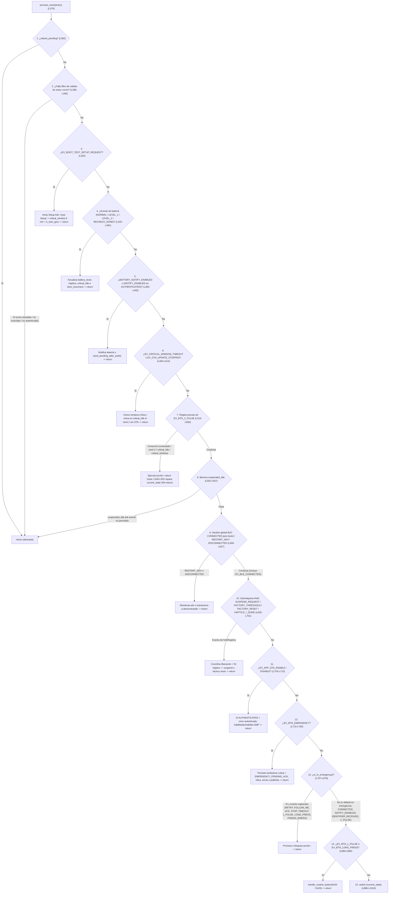
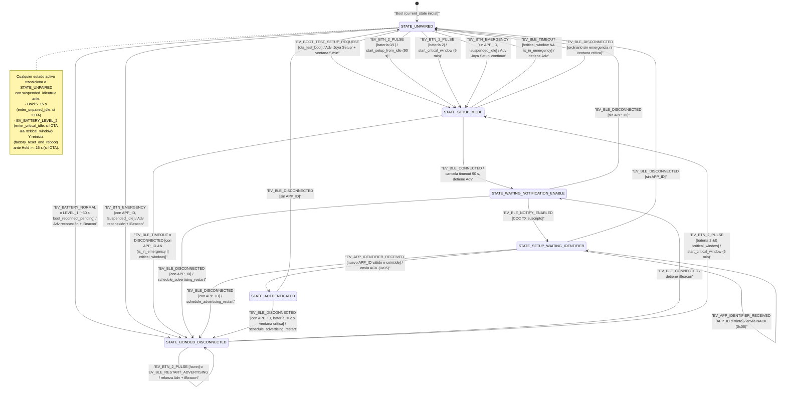
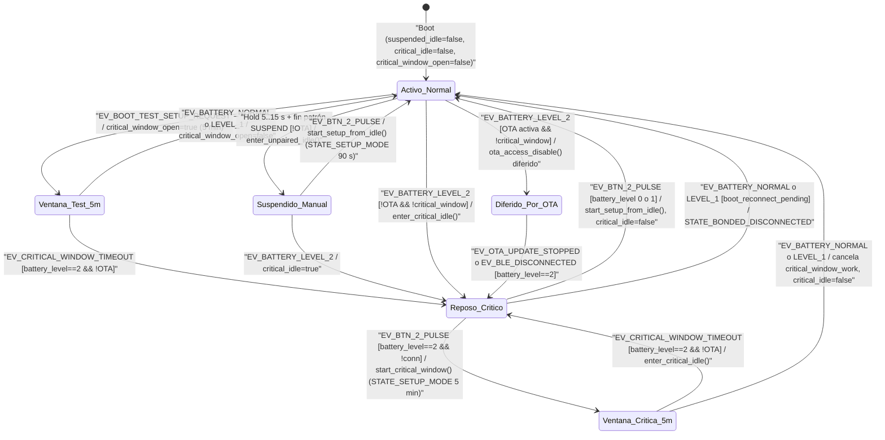
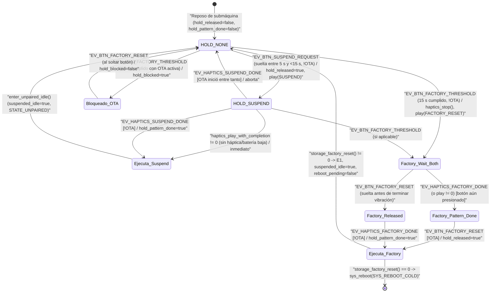
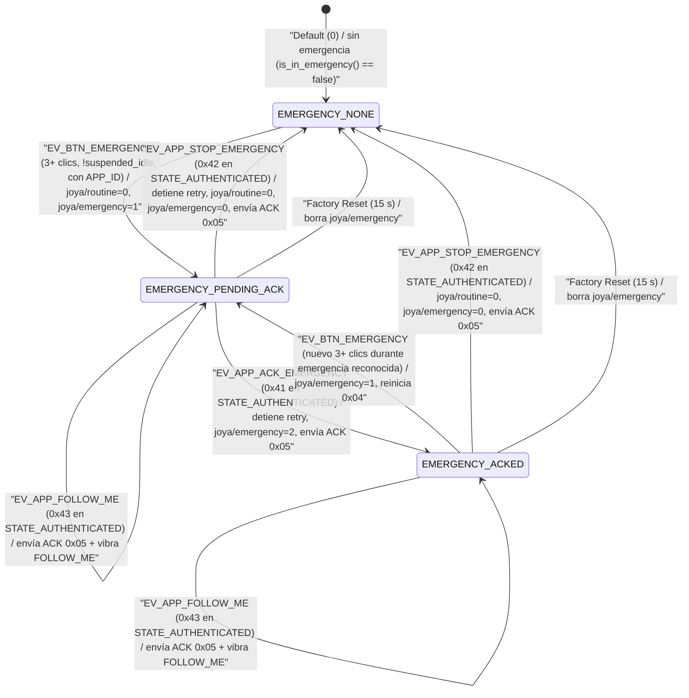

# 5. Máquina de Estados Finitos (FSM) y Subestados Ortogonales

> **Alcance y versión verificada**: Este capítulo reconstruye de forma íntegra y exacta la Máquina de Estados Finitos (FSM) implementada en [src/app_state.c](../../src/app_state.c#L1-L1017) ([include/app_state.h](../../include/app_state.h#L1-L112)) en el commit `c1128e5d0c0d6f98be0a580d287c0926ca27f01f`, junto con sus máquinas secundarias y variables de estado ortogonales distribuidas en [src/flash_memory.c](../../src/flash_memory.c), [src/emergency_phase.c](../../src/emergency_phase.c), [src/ble_driver.c](../../src/ble_driver.c) y [src/ota_access.c](../../src/ota_access.c). Para la secuencia de arranque que alimenta los primeros eventos de la FSM véase [04_boot_initialization.md](04_boot_initialization.md); para el modelo de hilos, colas y exclusión mutua véase [06_concurrency.md](06_concurrency.md); y para el detalle del protocolo GATT y comandos véase [08_application_protocol.md](08_application_protocol.md).

---

## 5.1. Arquitectura de estado: `current_state` frente al vector de estado real

Aunque la variable `static volatile app_state_t current_state` ([src/app_state.c](../../src/app_state.c#L26)) define el estado nominal de conectividad/emparejamiento, el comportamiento efectivo del firmware **no es el de un autómata plano de 8 estados**, sino el producto cartesiano restringido entre `current_state` (de cuyos 8 símbolos solo **6 son alcanzables**) y un conjunto de **variables de estado ortogonales** en RAM y NVS.

### 5.1.1. Inventario completo del vector de estado del sistema

| Variable / Subestado | Tipo y archivo | Persistencia | Valores posibles y valor inicial | Rol ortogonal sobre la FSM |
|---|---|---|---|---|
| `current_state` | `volatile app_state_t` ([src/app_state.c](../../src/app_state.c#L26)) | Volátil (RAM) | `STATE_UNPAIRED` (inicial), `STATE_SETUP_MODE`, `STATE_WAITING_NOTIFICATION_ENABLE`, `STATE_SETUP_WAITING_IDENTIFIER`, `STATE_BONDED_DISCONNECTED`, `STATE_AUTHENTICATED` *(más 2 valores residuales nunca asignados: `STATE_SETUP_WAITING_NEW_IDENTIFIER`, `STATE_EMERGENCY`)* | Gobernador primario del ciclo de vida de publicidad BLE, suscripción CCC y autenticación `APP_ID`. |
| `joya_app_id` | `uint8_t[16]` ([src/flash_memory.c](../../src/flash_memory.c#L4)) | **Persistente** (`joya/app_id` en NVS) | `16` ceros = no vinculado (`is_app_id_empty() == true`); distinto de cero = vinculado | Determina si la joya anuncia `"Joya Setup"` sin iBeacon o `"Joya"` / `"Joya de <sufijo>"` + `BLE_IBEACON_CONNECTION`, y si `EV_APP_IDENTIFIER_RECEIVED` provisiona o valida. |
| `joya_emergency_phase` | `emergency_phase_t` ([src/flash_memory.c](../../src/flash_memory.c#L5), [include/emergency_phase.h](../../include/emergency_phase.h#L9-L12)) | **Persistente** (`joya/emergency` en NVS) | `EMERGENCY_NONE (0)` (inicial), `EMERGENCY_PENDING_ACK (1)`, `EMERGENCY_ACKED (2)` | Sustituye en la arquitectura actual al antiguo `STATE_EMERGENCY`. Mientras `!= EMERGENCY_NONE` (`is_in_emergency() == true`), activa el bloque interceptor de emergencia en `process_event()`, suprime rutinas/emergencia de amiga, fuerza reconexión tras timeout/desconexión y habilita `COMMAND_FOLLOW_ME`. |
| `emergency_alerts_active` + `current_retry_index` | `bool` + `uint8_t` ([src/app_state.c](../../src/app_state.c#L14), [src/app_state.c](../../src/app_state.c#L38)) | Volátil (RAM) | `false` / `0` (`0..4` → `1s, 2s, 5s, 10s, 30s`) | Controla el bucle activo de retransmisión `COMMAND_EMERGENCY (0x04)` sobre `emergency_retry_work` cuando `joya_emergency_phase == EMERGENCY_PENDING_ACK` y `current_state == STATE_AUTHENTICATED`. |
| `joya_pending_routine` + `pending_routine_dirty` | `uint8_t` + `bool` ([src/flash_memory.c](../../src/flash_memory.c#L6-L8)) | **Persistente** (`joya/routine` en NVS: `1 B` o `17 B`) | `0` (ninguna), `0x02` (`COMMAND_ROUTINE`), `0x03` (`COMMAND_END_ROUTINE`); `dirty = false` | Almacena la última acción de rutina generada sin enlace autenticado para entregarla automáticamente en `send_pending_after_auth()`, impidiendo fugas entre `APP_ID` distintos si falló el borrado Flash. |
| `suspended_idle` | `bool` ([src/app_state.c](../../src/app_state.c#L41)) | Volátil (RAM) | `false` (inicial), `true` | Subestado de reposo lógico profundo sobre `STATE_UNPAIRED` (radio apagada, alertas detenidas, OTA deshabilitado). Actúa como barrera en `process_event()` que filtra casi todos los eventos salvo despertar por `EV_BTN_2_PULSE` y *factory reset* (`15 s`). |
| `critical_idle` | `bool` ([src/app_state.c](../../src/app_state.c#L42)) | Volátil (RAM) | `false` (inicial), `true` | Califica si la entrada a reposo (o la condición latente durante una ventana crítica) fue causada por batería crítica (`battery_level == 2`, `<= 2900 mV`). Bloquea háptica (`haptics_set_allowed(false)`) y modifica la respuesta de `EV_BTN_2_PULSE` para abrir `start_critical_window()`. |
| `critical_window_open` + `critical_window_deadline_ms` | `bool` + `int64_t` ([src/app_state.c](../../src/app_state.c#L43), [src/app_state.c](../../src/app_state.c#L46)) | Volátil (RAM) | `false` / `0` (`CRITICAL_WINDOW_MS = 300000 ms`, `5 min`) | Ventana temporal de gracia de `5 minutos` usada con **doble propósito**: (1) permitir conexión/emergencia/OTA temporal en batería crítica tras `EV_BTN_2_PULSE`, y (2) proteger la confirmación SMP durante un arranque OTA Test (`EV_BOOT_TEST_SETUP_REQUEST`). Suprime `connection_timeout_work` (`90 s`) e impide que `battery_level == 2` corte la conexión antes del deadline. |
| `battery_level` | `int` ([src/app_state.c](../../src/app_state.c#L47)) | Volátil (RAM) | `-1` (desconocido al arrancar), `0` (Normal `> 3000 mV`), `1` (Bajo `<= 3000 mV`), `2` (Crítico `<= 2900 mV`) | Espejo local en la FSM del nivel confirmado por mayoría `5/6` en `src/battery.c`. |
| `boot_battery_seen` + `boot_reconnect_pending` | `bool` + `bool` ([src/app_state.c](../../src/app_state.c#L44-L45)) | Volátil (RAM) | `false` / `false` | Orquestan la transición automática diferida (`~60 s`) desde `STATE_UNPAIRED` a `STATE_BONDED_DISCONNECTED` cuando una imagen confirmada con `APP_ID` recibe su primera lectura válida de batería (o se recupera de un nivel 2 inicial). |
| `reboot_pending` | `bool` ([src/app_state.c](../../src/app_state.c#L40)) | Volátil (RAM) | `false` (inicial), `true` | Cerrojo terminal durante `factory_reset_and_reboot()`: descarta cualquier evento ulterior mientras se desconecta BLE y se borra NVS antes de `sys_reboot(SYS_REBOOT_COLD)` (se revierte a `false` si `storage_factory_reset()` falla). |
| `hold_action`, `hold_released`, `hold_pattern_done`, `hold_blocked` | `enum` + `3 × bool` ([src/app_state.c](../../src/app_state.c#L56-L63)) | Volátil (RAM) | `HOLD_NONE`, `false`, `false`, `false` | Submáquina coordinadora que exige **tanto** la liberación física del botón como el fin del patrón háptico antes de ejecutar `enter_unpaired_idle()` (`5..15 s`) o `factory_reset_and_reboot()` (`>= 15 s`). |
| `current_conn`, `current_conn_authenticated`, `notify_enabled` | Puntero + `2 × bool` ([src/ble_driver.c](../../src/ble_driver.c#L142-L144)) | Volátil (RAM, bajo `conn_mutex`) | `NULL`, `false`, `false` | Estado real e instantáneo del enlace GATT frente al estado diferido en `event_queue`, usado para descartar eventos obsoletos de conexiones ya cerradas o no autenticadas. |
| `service_enabled`, `uploading`, `upload_complete`, `close_requested` | `4 × bool` ([src/ota_access.c](../../src/ota_access.c#L12-L15)) | Volátil (RAM, bajo `ota_mutex`) | `false` | Submáquina de acceso OTA/SMP. Mientras `uploading || upload_complete` (`ota_access_is_update_active() == true`), bloquea gestos de suspensión/factory reset e impide desconexión inmediata por batería crítica. |

---

## 5.2. Pipeline jerárquico de evaluación en `process_event()`

Una propiedad fundamental de [src/app_state.c](../../src/app_state.c#L378-L1017) es que **el `switch (current_state)` se encuentra al final de `process_event()`** (líneas 886–1016). Antes de llegar a él, todo evento extraído por `fsm_thread_loop()` atraviesa **14 filtros e interceptores secuenciales**, muchos de los cuales consumen el evento mediante `return` temprano independientemente de `current_state`.



### Detalle técnico de las etapas previas al `switch (current_state)`

1. **Etapa 1 — Cerrojo `reboot_pending` (`L382-L384`)**: Descarta todo mientras se ejecuta el cierre previo a reinicio en `factory_reset_and_reboot()`.
2. **Etapa 2 — Guardas de frescura de sesión BLE (`L386-L400`)**: Como `event_queue` desacopla asíncronamente `BT_RX` (`prio -8` coop) de `fsm_thread_id` (`prio 5` preempt), una conexión puede haberse cerrado (e incluso abierto otra nueva) antes de que la FSM lea el mensaje:
   - `EV_BLE_CONNECTED`: exige `ble_is_current_conn(entry->conn)`.
   - `EV_BLE_DISCONNECTED`: exige `!ble_has_connection()` (si ya entró una nueva conexión y `current_conn != NULL`, ignora la desconexión vieja para no derribar la sesión nueva).
   - `EV_BLE_NOTIFY_ENABLED`: exige `ble_commands_subscribed_for_conn(entry->conn)` (verifica tanto `current_conn == conn && notify_enabled` bajo `conn_mutex` como `bt_gatt_is_subscribed()` sobre `&joya_commands_svc.attrs[2]`).
   - `EV_APP_ACK_EMERGENCY`, `EV_APP_STOP_EMERGENCY`, `EV_APP_FOLLOW_ME`, `EV_APP_FRIEND_EMERGENCY`: exigen `ble_is_authenticated_conn(entry->conn)` antes siquiera de evaluar el estado de la FSM.
3. **Etapa 3 — `EV_BOOT_TEST_SETUP_REQUEST` (`L402-L423`)**: Exclusivo del arranque OTA Test desde `main()`. Solo procede si `current_state == STATE_UNPAIRED`, inicia `"Joya Setup"`, pasa a `STATE_SETUP_MODE`, abre `critical_window_open = true` por `5 min` y señaliza `test_setup_sem`.
4. **Etapa 4 — Eventos del monitor SAADC (`L425-L481`)**: Actualizan `battery_level` (`0`, `1`, `2`), gestionan `boot_battery_seen` / `boot_reconnect_pending` (`~60 s`), habilitan/inhiben háptica (`battery_level == 0 && !critical_idle`), notifican `BATTERY_CHANGE` si está en `STATE_AUTHENTICATED`, fuerzan `enter_critical_idle()` en nivel `2` (salvo `updating || critical_window_open`) o lanzan el auto-advertising diferido al salir del arranque. `EV_BATTERY_RECHECK_DONE` retorna sin efecto (`L479-L481`).
5. **Etapa 5 — Suscripciones CCC en sesión autenticada (`L483-L492`)**:
   - `EV_BLE_BATTERY_NOTIFY_ENABLED`: envía inmediatamente el nivel actual cacheado si `battery_level >= 0 && current_state == STATE_AUTHENTICATED`.
   - `EV_BLE_NOTIFY_ENABLED` cuando `current_state == STATE_AUTHENTICATED`: cubre el caso en que el cliente re-habilita CCC de `TX` después de haberse autenticado, disparando `send_pending_after_auth()` y haciendo `return`. (Cuando `current_state == STATE_WAITING_NOTIFICATION_ENABLE`, **no** entra en este `if` y cae hasta la Etapa 15).
6. **Etapa 6 — Expiración de ventana crítica y fin de OTA abortada (`L494-L514`)**:
   - `EV_CRITICAL_WINDOW_TIMEOUT`: valida `critical_window_open && k_uptime_get() >= critical_window_deadline_ms` (protección contra expiraciones prematuras/residuales), cierra `critical_window_open = false` y, si `battery_level == 2 && !ota_access_is_update_active()`, invoca `enter_critical_idle()`.
   - `EV_OTA_UPDATE_STOPPED`: emitido por `image_status_handler()` en `src/ota_access.c` cuando una subida DFU se detiene sin llegar a `PENDING`; si `battery_level == 2 && !critical_window_open && !ota_access_is_update_active() && !suspended_idle`, deshabilita SMP y entra en `enter_critical_idle()`.
7. **Etapa 7 — Cinco reglas especiales de `EV_BTN_2_PULSE` (`L516-L560`)**:
   - `L516`: Si `ble_has_connection() == true`, ignora el doble clic (`return`) para no interferir con una conexión activa.
   - `L520`: Si `!suspended_idle && battery_level == 2 && !critical_window_open`, transiciona por `enter_critical_idle()` + `start_critical_window()` (`5 min`) y retorna.
   - `L527`: Si `suspended_idle && critical_idle`: si `battery_level` ya es `0` o `1`, sale con `start_setup_from_idle()` y limpia `critical_idle = false`; si sigue en `2` (o `-1`), abre `start_critical_window()` (`5 min`) y retorna.
   - `L540`: **Autorreparación ante pérdida previa de `EV_BLE_DISCONNECTED` por cola llena**: Si `!ble_has_connection()` (verificado en `L516`), `!suspended_idle` y `current_state` había quedado atrapado en un estado "conectado" (`STATE_WAITING_NOTIFICATION_ENABLE`, `STATE_SETUP_WAITING_IDENTIFIER`, `STATE_SETUP_WAITING_NEW_IDENTIFIER`, `STATE_AUTHENTICATED` o `STATE_EMERGENCY`) porque la cola de 20 eventos estaba llena cuando ocurrió la desconexión, detiene alertas, corrige `current_state` a `STATE_UNPAIRED` (sin `APP_ID`) o `STATE_BONDED_DISCONNECTED` (con `APP_ID`) **y NO hace `return`**, dejando que el mismo `EV_BTN_2_PULSE` continúe hacia la Etapa 15 para relanzar el advertising en ese mismo ciclo.
   - `L554`: Si `critical_window_open && !suspended_idle` (y sin conexión), relanza `start_advertising_with_ibeacon(is_app_id_empty())`, ajusta `current_state` a `STATE_SETUP_MODE` o `STATE_BONDED_DISCONNECTED` y retorna sin alterar el deadline de 5 minutos.
8. **Etapa 8 — Barrera `suspended_idle` (`L562-L567`)**: Si `suspended_idle == true`, bloquea **todos** los eventos salvo cuatro: `EV_BTN_2_PULSE` (para despertar desde suspensión voluntaria cayendo a `STATE_UNPAIRED` en Etapa 15), `EV_BTN_FACTORY_THRESHOLD`, `EV_BTN_FACTORY_RESET` y `EV_HAPTICS_FACTORY_DONE`.
9. **Etapa 9 — Gestión transversal de enlace BLE (`L569-L627`)**:
   - `EV_BLE_CONNECTED` (`L569-L573`): limpia `boot_reconnect_pending = false`, cancela `advertising_restart_work`, apaga `BLE_IBEACON_OFF` y **continúa** hacia Etapa 15.
   - `EV_BLE_RESTART_ADVERTISING` (`L575-L596`): ejecuta hasta `3` intentos (`advertising_attempts < 3`, espaciados `5 s` ante `-ENOMEM`, `-EBUSY` o `-EAGAIN`) y retorna.
   - `EV_BLE_DISCONNECTED` (`L598-L627`): resuelve centralizadamente toda desconexión según prioridad (`critical_window_open` → `battery_level == 2` sin OTA → `is_in_emergency()` → `STATE_SETUP_MODE` → resto de estados conectados) y retorna.
10. **Etapa 10 — Submáquina de retención de botón (`L629-L701`)**: Gestiona suspensión (`5..15 s`) y *factory reset* (`>= 15 s`), inhibidos ambos si `ota_access_is_update_active() == true`.
11. **Etapa 11 — Control de ventana SMP/OTA (`L703-L713`)**: `EV_APP_OTA_ENABLE` y `EV_APP_OTA_DISABLE` solo surten efecto si `current_state == STATE_AUTHENTICATED && ble_is_authenticated_conn(entry->conn)`.
12. **Etapa 12 — Disparo local de emergencia (`L715-L760`)**: Procesa `EV_BTN_EMERGENCY` desde cualquier estado no suspendido.
13. **Etapa 13 — Bloque interceptor `if (is_in_emergency())` (`L767-L878`)**: Gobierna reintentos `EV_EMERGENCY_RETRY`, comandos `FOLLOW_ME`, `ACK_EMERGENCY`, `STOP_EMERGENCY`, convierte `EV_BLE_TIMEOUT` en reconexión persistente y bloquea rutinas y emergencia de amiga, dejando pasar (`default: break`) los eventos de establecimiento de conexión y autenticación (`EV_BLE_CONNECTED`, `EV_BLE_NOTIFY_ENABLED`, `EV_APP_IDENTIFIER_RECEIVED`, `EV_BTN_2_PULSE`).
14. **Etapa 14 — Gestos de rutina (`L880-L884`)**: `EV_BTN_1_PULSE` (`COMMAND_ROUTINE`) y `EV_BTN_LONG_PRESS` (`COMMAND_END_ROUTINE`) llaman a `handle_routine_button()` desde cualquier estado no suspendido y fuera de emergencia (si hay `APP_ID` guardado: si está en `STATE_AUTHENTICATED` y el envío GATT tiene éxito limpia `joya/routine = 0`; en cualquier otro estado desconectado o fallo GATT persiste `joya/routine` en NVS).

---

## 5.3. Fichas técnicas exhaustivas de los 8 valores de `app_state_t`

### 5.3.1. `STATE_UNPAIRED` (valor `0` — Estado inicial de arranque, reposo sin vínculo y soporte de `suspended_idle`)

- **Propósito**: Estado raíz tras el arranque en frío/software, estado de reposo sin actividad RF para unidades sin `APP_ID` (o cuando vence el timeout de `90 s` de `STATE_SETUP_MODE`), y estado portador de los modos de reposo `suspended_idle` y `critical_idle` (incluso cuando sí existe `APP_ID` en NVS).
- **Condiciones de entrada**:
  1. Inicialización estática al arrancar: `current_state = STATE_UNPAIRED` ([src/app_state.c](../../src/app_state.c#L26)).
  2. Expiración de `EV_BLE_TIMEOUT` (`90 s`) en `STATE_SETUP_MODE` cuando `!is_in_emergency() && !critical_window_open` ([src/app_state.c](../../src/app_state.c#L901-L905)).
  3. Desconexión `EV_BLE_DISCONNECTED` desde `STATE_SETUP_MODE` (cuando `!critical_window_open`, `battery_level != 2` y `!is_in_emergency()`, [src/app_state.c](../../src/app_state.c#L610-L616)), o desde `STATE_WAITING_NOTIFICATION_ENABLE` / `STATE_SETUP_WAITING_IDENTIFIER` / `STATE_AUTHENTICATED` cuando `is_app_id_empty() == true` ([src/app_state.c](../../src/app_state.c#L620)).
  4. Invocación de `enter_unpaired_idle()` ([src/app_state.c](../../src/app_state.c#L122-L133)) por gesto de suspensión (`5..15 s`) o por `enter_critical_idle()` (`battery_level == 2`).
  5. Autorreparación en `EV_BTN_2_PULSE` si se perdió `EV_BLE_DISCONNECTED` y `is_app_id_empty() == true` ([src/app_state.c](../../src/app_state.c#L550)).
  6. Inicio de `factory_reset_and_reboot()` ([src/app_state.c](../../src/app_state.c#L105)).
- **Condiciones de salida**:
  - Hacia `STATE_SETUP_MODE`: por `EV_BOOT_TEST_SETUP_REQUEST` (arranque Test), por `EV_BTN_2_PULSE` (`start_setup_from_idle()` o `start_critical_window()`), o por `EV_BTN_EMERGENCY` cuando `is_app_id_empty() == true`.
  - Hacia `STATE_BONDED_DISCONNECTED`: automáticamente a los `~60 s` (o al recuperar batería) cuando `boot_reconnect_pending == true` y `battery_level` es `0` o `1` ([src/app_state.c](../../src/app_state.c#L462-L475)), o por `EV_BTN_EMERGENCY` cuando `!is_app_id_empty() && !suspended_idle` ([src/app_state.c](../../src/app_state.c#L751-L753)).
- **Eventos aceptados**:
  - En el `switch`: únicamente `EV_BTN_2_PULSE` (`start_setup_from_idle()`).
  - En interceptores globales (cuando `!suspended_idle`): `EV_BOOT_TEST_SETUP_REQUEST`, `EV_BATTERY_*`, `EV_BTN_EMERGENCY`, `EV_BTN_1_PULSE` / `EV_BTN_LONG_PRESS` (si `!is_app_id_empty()`, vibran y persisten rutina en NVS aunque esté en `STATE_UNPAIRED`), `EV_BTN_SUSPEND_REQUEST`, `EV_BTN_FACTORY_THRESHOLD` / `EV_BTN_FACTORY_RESET`.
  - Cuando `suspended_idle == true`: solo `EV_BATTERY_*` (antes de la barrera), `EV_BTN_2_PULSE` y secuencia `EV_BTN_FACTORY_*` / `EV_HAPTICS_FACTORY_DONE`.
- **Eventos ignorados**: `EV_BLE_CONNECTED` (no cambia estado en el `switch`, aunque nunca debería ocurrir con advertising detenido), `EV_BLE_TIMEOUT`, `EV_BLE_RESTART_ADVERTISING`, `EV_BLE_NOTIFY_ENABLED`, `EV_APP_*`. Cuando `suspended_idle == true`, **ignora también `EV_BTN_1_PULSE`, `EV_BTN_LONG_PRESS`, `EV_BTN_SUSPEND_REQUEST` y `EV_BTN_EMERGENCY`**.
- **Acciones de entrada/salida**: En entrada vía `enter_unpaired_idle()` cancela `advertising_restart_work`, `connection_timeout_work` y `critical_window_work`, detiene alertas de emergencia, cierra SMP (`ota_access_disable()`), activa `suspended_idle = true` y ejecuta `ble_disconnect()` (que detiene también advertising e iBeacon). En salida vía `start_setup_from_idle()` inicia advertising + iBeacon (si hay `APP_ID`), limpia `suspended_idle = false`, reproduce `HAPTICS_PATTERN_SETUP_MODE` (`700 ms` ON + `100 ms` OFF) y agenda `connection_timeout_work` (`90 s`).
- **Temporizadores activos**: Ninguno de FSM (`connection_timeout_work`, `emergency_retry_work`, `advertising_restart_work` y `critical_window_work` inactivos); siguen corriendo en segundo plano `guard_work` (`10 s`) y `battery_monitor_work` (`60 s` / `10 s`).
- **Comportamiento BLE**: Sin conexión y sin advertising (ni conectable ni iBeacon). Consumo RF nulo.
- **Comportamiento háptico**: Silencioso en reposo; al salir por `EV_BTN_2_PULSE` vibra `HAPTICS_PATTERN_SETUP_MODE` si `haptics_allowed == 1`.
- **Comportamiento del botón**: Activo por interrupción `GPIOTE` en flancos (`P0.13`).
- **Restricciones de batería**: Si `battery_level == 2`, `critical_idle = true` y `haptics_allowed = 0`; un `EV_BTN_2_PULSE` no ejecuta `start_setup_from_idle()` (`90 s`), sino `start_critical_window()` (`5 min`, sin vibración).
- **Lecturas/escrituras en Flash**: Solo si `!suspended_idle && !is_app_id_empty()` y se pulsa rutina (`joya/routine`) o emergencia (`joya/routine = 0` + `joya/emergency = 1`), o al culminar *factory reset* (`settings_delete` × 4).
- **Variables internas afectadas**: `current_state`, `suspended_idle`, `critical_idle`, `critical_window_open`, `boot_reconnect_pending`.
- **Excepciones / casos borde**: Un dispositivo **con `APP_ID`** que despierta desde `suspended_idle` con `EV_BTN_2_PULSE` (`start_setup_from_idle()`) no pasa a `STATE_BONDED_DISCONNECTED`, sino a **`STATE_SETUP_MODE`** anunciando su nombre personalizado (`is_app_id_empty() == false` → `"Joya"` / `"Joya de ..."`) con timeout de `90 s`. Si nadie conecta en `90 s`, vuelve a `STATE_UNPAIRED` (`suspended_idle == false`) y queda sin anunciar hasta un nuevo gesto.

---

### 5.3.2. `STATE_SETUP_MODE` (valor `1` — Ventana de descubrimiento y publicidad conectable)

- **Propósito**: Publicitar el dispositivo para permitir una conexión entrante, ya sea en emparejamiento inicial (`"Joya Setup"`), en arranque OTA Test (`"Joya Setup"` con ventana de `5 min`), al despertar manualmente desde reposo (`"Joya Setup"` o `"Joya"` según exista `APP_ID`, durante `90 s`), o durante una ventana de emergencia/batería crítica (`5 min`).
- **Condiciones de entrada**:
  1. `EV_BTN_2_PULSE` en `STATE_UNPAIRED` → `start_setup_from_idle()` ([src/app_state.c](../../src/app_state.c#L165-L175), [src/app_state.c](../../src/app_state.c#L888-L890)).
  2. `EV_BOOT_TEST_SETUP_REQUEST` en arranque OTA Test ([src/app_state.c](../../src/app_state.c#L409)).
  3. `start_critical_window()` tras `EV_BTN_2_PULSE` con `battery_level == 2` ([src/app_state.c](../../src/app_state.c#L187)).
  4. `EV_BTN_EMERGENCY` en `STATE_UNPAIRED` cuando `is_app_id_empty() == true` ([src/app_state.c](../../src/app_state.c#L754-L756)).
  5. `EV_BLE_DISCONNECTED` cuando `is_app_id_empty() == true` y (`critical_window_open` o `is_in_emergency()`) ([src/app_state.c](../../src/app_state.c#L600), [src/app_state.c](../../src/app_state.c#L607)).
  6. `EV_BLE_TIMEOUT` durante emergencia activa cuando `is_app_id_empty() == true` ([src/app_state.c](../../src/app_state.c#L850-L853)).
- **Condiciones de salida**:
  - Hacia `STATE_WAITING_NOTIFICATION_ENABLE`: al recibir `EV_BLE_CONNECTED` válido ([src/app_state.c](../../src/app_state.c#L895-L900)).
  - Hacia `STATE_UNPAIRED`: por `EV_BLE_TIMEOUT` (`!critical_window_open && !is_in_emergency()`, [src/app_state.c](../../src/app_state.c#L901-L905)), por `EV_BLE_DISCONNECTED` ordinario ([src/app_state.c](../../src/app_state.c#L610-L616)), por gesto `EV_BTN_SUSPEND_REQUEST` (`enter_unpaired_idle()`), por `battery_level == 2` fuera de ventana crítica (`enter_critical_idle()`), o por *factory reset*.
  - Hacia `STATE_BONDED_DISCONNECTED`: si `EV_BLE_TIMEOUT` ocurre con `is_in_emergency() == true` y `!is_app_id_empty()` ([src/app_state.c](../../src/app_state.c#L854-L858)), o en `EV_BLE_DISCONNECTED` con `!is_app_id_empty()` y (`critical_window_open` o `is_in_emergency()`).
- **Eventos aceptados**: `EV_BLE_CONNECTED`, `EV_BLE_TIMEOUT`, `EV_BLE_RESTART_ADVERTISING` (solo si `is_app_id_empty()`), `EV_BLE_DISCONNECTED`, `EV_BTN_2_PULSE` (solo si `battery_level == 2 && !critical_window_open`, o si `critical_window_open`), `EV_BTN_1_PULSE` / `EV_BTN_LONG_PRESS` (si `!is_app_id_empty()`), `EV_BTN_EMERGENCY`, `EV_BTN_SUSPEND_REQUEST`, `EV_BTN_FACTORY_*`, `EV_BATTERY_*`, `EV_CRITICAL_WINDOW_TIMEOUT`.
- **Eventos ignorados**: `EV_BTN_2_PULSE` ordinario cuando `battery_level != 2 && !critical_window_open` (en `STATE_SETUP_MODE` el `switch` no tiene `case` para `EV_BTN_2_PULSE`), `EV_BLE_NOTIFY_ENABLED`, `EV_APP_IDENTIFIER_RECEIVED`, `EV_APP_*`.
- **Acciones de entrada/salida**: Al salir por `EV_BLE_CONNECTED`, cancela `connection_timeout_work` y ejecuta `ble_stop_advertising()` (además del apagado previo de `BLE_IBEACON_OFF` en `L572`). Al salir por `EV_BLE_TIMEOUT`, ejecuta `ble_stop_advertising()`.
- **Temporizadores activos**:
  - En entrada normal (`start_setup_from_idle()`): `connection_timeout_work` (`BLE_SETUP_TIMEOUT_MS = 90000 ms`).
  - En entrada por ventana crítica o arranque Test: `critical_window_work` (`CRITICAL_WINDOW_MS = 300000 ms`), con `connection_timeout_work` **cancelado**.
  - En entrada por `EV_BTN_EMERGENCY` desde `STATE_UNPAIRED` sin `APP_ID`: **ninguno de los dos** (publicita indefinidamente hasta conexión o batería crítica).
  - Si falló el re-arranque tras desconexión con `is_app_id_empty()`: `advertising_restart_work` (`10 ms` inicial, hasta 3 intentos cada `5 s`).
- **Comportamiento BLE**: Advertising legado conectable `BT_LE_ADV_OPT_ONE_TIME` rápido (`100..150 ms`, `BT_GAP_ADV_FAST_INT_MIN_2`/`MAX_2`) con nombre `"Joya Setup"` (si `is_new_connection == true`) o nombre almacenado (`false`). Si `!is_app_id_empty()`, corre en paralelo `ibeacon_adv` no conectable (`1000..1200 ms`, `BT_GAP_ADV_SLOW_INT_MIN`/`MAX`).
- **Comportamiento háptico**: `HAPTICS_PATTERN_SETUP_MODE` (`700 ms`) solo cuando se entra desde `start_setup_from_idle()` con `haptics_allowed == 1` (ni `start_critical_window()` ni `EV_BOOT_TEST_SETUP_REQUEST` vibran).
- **Restricciones de batería**: Si llega `EV_BATTERY_LEVEL_2` y `!critical_window_open`, se cancela el Setup Mode pasando inmediatamente a `enter_critical_idle()`.
- **Lecturas/escrituras en Flash**: Lectura en RAM cacheada de `joya_app_id` y `joya_name`; escritura solo si ocurre evento de rutina/emergencia/factory reset.

---

### 5.3.3. `STATE_WAITING_NOTIFICATION_ENABLE` (valor `4` — Conexión física establecida esperando suscripción CCC)

- **Propósito**: Estado transitorio de enlace BLE activo inmediatamente posterior a `EV_BLE_CONNECTED`, en el que el firmware aguarda a que la aplicación móvil escriba `0x0001` (`BT_GATT_CCC_NOTIFY`) en el descriptor CCC de la característica `TX` (`a407e00a-00c1-464d-9173-2cb8be585001`) antes de aceptar el `APP_ID`.
- **Condiciones de entrada**:
  1. `EV_BLE_CONNECTED` en `STATE_SETUP_MODE` ([src/app_state.c](../../src/app_state.c#L895-L900)).
  2. `EV_BLE_CONNECTED` en `STATE_BONDED_DISCONNECTED` ([src/app_state.c](../../src/app_state.c#L1000-L1002)).
- **Condiciones de salida**:
  - Hacia `STATE_SETUP_WAITING_IDENTIFIER`: al recibir `EV_BLE_NOTIFY_ENABLED` válido para `entry->conn` ([src/app_state.c](../../src/app_state.c#L916-L919)).
  - Hacia `STATE_UNPAIRED` (si `is_app_id_empty()`) o `STATE_BONDED_DISCONNECTED` (si `!is_app_id_empty()`): al recibir `EV_BLE_DISCONNECTED` ([src/app_state.c](../../src/app_state.c#L617-L625)), o en la autorreparación de `EV_BTN_2_PULSE` (`L541`).
  - Hacia `STATE_UNPAIRED` (`suspended_idle = true`): por `EV_BTN_SUSPEND_REQUEST`, `EV_BATTERY_LEVEL_2` (sin ventana crítica ni OTA activa) o *factory reset*.
- **Eventos aceptados**: `EV_BLE_NOTIFY_ENABLED`, `EV_BLE_DISCONNECTED`, `EV_BATTERY_*`, `EV_BTN_EMERGENCY` (persiste y vibra, quedando pendiente para cuando termine la autenticación), `EV_BTN_1_PULSE` / `EV_BTN_LONG_PRESS` (persisten rutina en NVS si hay `APP_ID`), `EV_BTN_SUSPEND_REQUEST`, `EV_BTN_FACTORY_*`.
- **Eventos ignorados**: **`EV_APP_IDENTIFIER_RECEIVED` se ignora deliberadamente en este estado** (contrato de protocolo explícito en [src/app_state.c](../../src/app_state.c#L910-L915): la escritura GATT devuelve `len = 16` sin error ATT, pero la FSM descarta el evento; la app debe suscribirse primero a `TX` para poder recibir `COMMAND_ACK` o `COMMAND_NACK`). También se ignoran todos los comandos `EV_APP_*` porque `current_conn_authenticated == false`.
- **Acciones de entrada/salida**: En la entrada desde `STATE_SETUP_MODE`, se canceló `connection_timeout_work` y se detuvo todo advertising (`connectable` e `iBeacon`). En la transición a `STATE_SETUP_WAITING_IDENTIFIER` solo se actualiza `current_state`.
- **Temporizadores activos**: **Ningún timeout de autenticación de aplicación** (observación importante de diseño/seguridad: si un cliente BLE se conecta y nunca habilita CCC en `TX`, puede mantener ocupada la única conexión `CONFIG_BT_MAX_CONN=1` indefinidamente salvo desconexión del par, supervisión BLE de `6 s`, batería crítica o gesto físico de `5 s` / `15 s` de la usuaria). Si `critical_window_open == true`, sigue corriendo `critical_window_work`.
- **Comportamiento BLE**: Conectado (`current_conn != NULL`), advertising apagado, `current_conn_authenticated = false`, `notify_enabled = false` hasta el cambio de CCC. Lecturas de `DIAGNOSTICS` y escrituras de `NAME` son rechazadas con `BT_ATT_ERR_AUTHORIZATION` (nota: `on_name_read` sí responde el sufijo sin exigir autenticación, [src/ble_driver.c](../../src/ble_driver.c#L322-L345)).

---

### 5.3.4. `STATE_SETUP_WAITING_IDENTIFIER` (valor `2` — Suscripto a `TX`, esperando provisión o verificación de `APP_ID`)

- **Propósito**: Recibir los `16 bytes` escritos en `RX_AUTH` (`a407e00a-00c1-464d-9173-2cb8be585101`) para registrar un nuevo `APP_ID` (si `is_app_id_empty()`) o autenticar la sesión contra el `APP_ID` existente en RAM/NVS.
- **Condiciones de entrada**: Únicamente desde `STATE_WAITING_NOTIFICATION_ENABLE` al recibir `EV_BLE_NOTIFY_ENABLED` ([src/app_state.c](../../src/app_state.c#L916-L919)).
- **Condiciones de salida**:
  - Hacia `STATE_AUTHENTICATED`: al recibir `EV_APP_IDENTIFIER_RECEIVED` válido (`ble_is_current_conn(entry->conn)`), tanto si provisiona un nuevo `APP_ID` no nulo ([src/app_state.c](../../src/app_state.c#L925-L953)) como si coincide `check_app_id() == 0` con el almacenado ([src/app_state.c](../../src/app_state.c#L960-L973)).
  - Permanece en `STATE_SETUP_WAITING_IDENTIFIER`:
    - Si `check_app_id() != 0`: envía `COMMAND_NACK (0x06)` y **no desconecta ni cuenta límite de intentos** ([src/app_state.c](../../src/app_state.c#L974-L982)).
    - Si `is_app_id_empty()` y el cliente envió 16 bytes todos en `0x00` (o si `pending_routine_dirty == true` y falló `storage_save_pending_routine(0)` impidiendo guardar el nuevo `APP_ID` en [src/flash_memory.c](../../src/flash_memory.c#L267-L270)): `is_app_id_empty()` sigue siendo `true` en la línea 932 y retorna sin autenticar ni enviar `ACK`/`NACK`.
  - Hacia `STATE_UNPAIRED` / `STATE_BONDED_DISCONNECTED`: ante `EV_BLE_DISCONNECTED`, suspensión, batería crítica o *factory reset*.
- **Eventos aceptados**: `EV_APP_IDENTIFIER_RECEIVED`, `EV_BLE_DISCONNECTED`, `EV_BATTERY_*`, `EV_BTN_EMERGENCY`, `EV_BTN_1_PULSE` / `EV_BTN_LONG_PRESS`, `EV_BTN_SUSPEND_REQUEST`, `EV_BTN_FACTORY_*`.
- **Eventos ignorados**: Comandos `EV_APP_*` (`current_conn_authenticated == false`), `EV_BLE_TIMEOUT` (salvo si estuviera `is_in_emergency()` y un timer residual expirase, aunque ya fue cancelado al conectar).
- **Acciones en la transición exitosa hacia `STATE_AUTHENTICATED`**:
  - **Rama Provisionamiento (`is_app_id_empty()` inicial)**:
    1. `save_received_app_id(entry->app_id)` → actualiza `joya_app_id` en RAM y graba `"joya/app_id"` en NVS.
    2. `sync_ibeacon_mode()` (como hay conexión activa, `ble_set_ibeacon_mode` mantiene el iBeacon apagado).
    3. `current_state = STATE_AUTHENTICATED`.
    4. `ble_mark_authenticated_conn(entry->conn)` → fija `current_conn_authenticated = true` y dispara `diagnostics_request_init_notification()` (emite `A0 MM` si CCC de `DIAGNOSTICS` ya estaba activo).
    5. `ble_send_event_for_conn(entry->conn, COMMAND_ACK)` (`0x05`).
    6. `notify_current_battery_level()` (envía nivel `0/1/2` si CCC de `BATTERY_CHANGE` ya estaba activo y `battery_level >= 0`).
    7. `haptics_play(HAPTICS_PATTERN_ACK_CONNECTION)` (3 pulsos de `200 ms`) seguido de `send_pending_after_auth()`.
  - **Rama Reconexión (`!is_app_id_empty()` inicial y `check_app_id == 0`)**:
    - Ejecuta los mismos pasos (sin escribir en NVS ni llamar a `sync_ibeacon_mode`), pero **invierte el orden de los dos últimos pasos** ([src/app_state.c](../../src/app_state.c#L971-L972)): llama primero a `send_pending_after_auth()` y después a `haptics_play(HAPTICS_PATTERN_ACK_CONNECTION)`.
    - **Efecto colateral real de esta inversión de líneas (`L950-L951` vs `L971-L972`)**: En reconexión con una emergencia `EMERGENCY_PENDING_ACK` pendiente, `send_pending_after_auth()` invoca `haptics_play(HAPTICS_PATTERN_EMERGENCY_START)` (`2000 ms`) en `L249`, e inmediatamente en `L972` `haptics_play(HAPTICS_PATTERN_ACK_CONNECTION)` **cancela síncronamente el patrón de emergencia recién iniciado y lo sobrescribe** con el patrón corto de `ACK_CONNECTION` (`3 × 200 ms`)! En cambio, durante un provisionamiento nuevo (`L950-L951`), prevalece `HAPTICS_PATTERN_EMERGENCY_START`.
- **Temporizadores activos**: Ninguno propio (salvo `critical_window_work` si aplica).

---

### 5.3.5. `STATE_SETUP_WAITING_NEW_IDENTIFIER` (valor `3` — **Estado residual inalcanzable**)

- **Propósito histórico / intención de diseño**: En revisiones tempranas del protocolo se previó distinguir la espera de un `APP_ID` inicial de un reemplazo de `APP_ID`. En la arquitectura actual el reemplazo sin *factory reset* no existe; `STATE_SETUP_WAITING_IDENTIFIER` resuelve tanto provisión inicial (`is_app_id_empty()`) como reconexión (`!is_app_id_empty()`).
- **Condiciones de entrada / salida**: **Inalcanzable** (`0` asignaciones `current_state = STATE_SETUP_WAITING_NEW_IDENTIFIER` en todo el código fuente).
- **Única referencia en código**: Aparece únicamente como cláusula defensiva en la recuperación de `EV_BTN_2_PULSE` ([src/app_state.c](../../src/app_state.c#L543)) y caería al `default:` vacío del `switch (current_state)` ([src/app_state.c](../../src/app_state.c#L1013)).

---

### 5.3.6. `STATE_BONDED_DISCONNECTED` (valor `5` — Vinculado sin enlace activo, publicitando reconexión)

- **Propósito**: Estado nominal desconectado de una Joya ya emparejada (`!is_app_id_empty()`), en el que anuncia de forma indefinida su nombre (`"Joya"` o `"Joya de <sufijo>"`) junto con el `BLE_IBEACON_CONNECTION` (`...6001`) para permitir que el teléfono (en primer o segundo plano en iOS/Android) detecte la joya y reconecte automáticamente.
- **Condiciones de entrada**:
  1. Auto-inicio diferido a los `~60 s` del arranque (o tras recuperarse de nivel 2 de arranque) cuando `boot_reconnect_pending == true` y `battery_level != 2` ([src/app_state.c](../../src/app_state.c#L468)).
  2. `EV_BLE_DISCONNECTED` cuando `!is_app_id_empty()` desde `STATE_WAITING_NOTIFICATION_ENABLE`, `STATE_SETUP_WAITING_IDENTIFIER` o `STATE_AUTHENTICATED` (o con `critical_window_open` / `is_in_emergency()`) ([src/app_state.c](../../src/app_state.c#L600-L624)).
  3. `EV_BTN_EMERGENCY` desde `STATE_UNPAIRED` cuando `!is_app_id_empty()` ([src/app_state.c](../../src/app_state.c#L751-L753)).
  4. `EV_BLE_TIMEOUT` durante `is_in_emergency()` cuando `!is_app_id_empty()` ([src/app_state.c](../../src/app_state.c#L854-L858)).
  5. Autorreparación de `EV_BTN_2_PULSE` tras pérdida de `EV_BLE_DISCONNECTED` con `!is_app_id_empty()` ([src/app_state.c](../../src/app_state.c#L551)), o relanzamiento en `critical_window_open` ([src/app_state.c](../../src/app_state.c#L557)).
- **Condiciones de salida**:
  - Hacia `STATE_WAITING_NOTIFICATION_ENABLE`: al recibir `EV_BLE_CONNECTED` ([src/app_state.c](../../src/app_state.c#L1000-L1002)). *(Nota: a diferencia de `STATE_SETUP_MODE`, aquí el `case` no llama explícitamente a `ble_stop_advertising()`, porque el controlador BLE ya detuvo automáticamente el advertising conectable por `BT_LE_ADV_OPT_ONE_TIME` al aceptar la conexión y `on_connected` + `L572` ya detuvieron el `iBeacon`).*
  - Hacia `STATE_UNPAIRED` (`suspended_idle = true`): por `EV_BTN_SUSPEND_REQUEST` (`5..15 s`), por `EV_BATTERY_LEVEL_2` fuera de ventana crítica (`enter_critical_idle()`), o por *factory reset* (`15 s`).
  - Hacia `STATE_SETUP_MODE` (`critical_window_open = true`): si `battery_level == 2 && !suspended_idle && !critical_window_open` y llega `EV_BTN_2_PULSE` (`L520-L524`).
- **Eventos aceptados**: `EV_BLE_CONNECTED`, `EV_BLE_RESTART_ADVERTISING`, `EV_BTN_2_PULSE` (reintenta manualmente `start_advertising_with_ibeacon(false)`, cancela `advertising_restart_work` y vibra `HAPTICS_PATTERN_SETUP_MODE`, [src/app_state.c](../../src/app_state.c#L1003-L1009)), `EV_BTN_1_PULSE` / `EV_BTN_LONG_PRESS` (vibran y persisten `joya/routine` en NVS), `EV_BTN_EMERGENCY` (persiste `EMERGENCY_PENDING_ACK`, vibra y asegura advertising activo), `EV_BTN_SUSPEND_REQUEST`, `EV_BTN_FACTORY_*`, `EV_BATTERY_*`.
- **Eventos ignorados**: `EV_BLE_TIMEOUT` (salvo el caso `is_in_emergency()` que vuelve al mismo estado), `EV_BLE_NOTIFY_ENABLED`, `EV_APP_IDENTIFIER_RECEIVED`, `EV_APP_*`.
- **Temporizadores activos**: `advertising_restart_work` tras desconexión (`10 ms`, y hasta 2 reintentos adicionales a `5 s` si la pila BLE reporta `-ENOMEM`/`-EBUSY`/`-EAGAIN`). **Sin timeout de publicidad**: a diferencia de `STATE_SETUP_MODE`, en `STATE_BONDED_DISCONNECTED` la publicidad dura indefinidamente mientras haya batería suficiente (`battery_level` `0` o `1`) y la usuaria no suspenda el dispositivo.
- **Comportamiento BLE**: Simultáneamente activos (a) el advertising legado conectable (`100..150 ms`) con el nombre personalizado (`"Joya"` o `"Joya de <sufijo>"`) y (b) el set extendido legado no conectable `ibeacon_adv` (`1000..1200 ms`, UUID `a407e00a-00c1-464d-9173-2cb8be586001`, Major `1`, Minor `1`, TxPower `0xC8`).

---

### 5.3.7. `STATE_AUTHENTICATED` (valor `6` — Sesión autenticada bidireccional operativa)

- **Propósito**: Estado plenamente operativo sobre conexión BLE activa y autenticada mediante `APP_ID`. Habilita transmisión en tiempo real de comandos de botón (rutinas y emergencias), recepción de comandos desde la app móvil (`0x41..0x44`, `0x70..0x71`), lectura/notificación de `DIAGNOSTICS`, telemetría `BATTERY_CHANGE` / `BATTERY_MEASUREMENT` y cambio de `NAME`.
- **Condiciones de entrada**: Únicamente desde `STATE_SETUP_WAITING_IDENTIFIER` tras validar o guardar un `APP_ID` en `EV_APP_IDENTIFIER_RECEIVED` ([src/app_state.c](../../src/app_state.c#L939), [src/app_state.c](../../src/app_state.c#L962)).
- **Condiciones de salida**:
  - Hacia `STATE_BONDED_DISCONNECTED` (o `STATE_UNPAIRED` si `joya_app_id` estuviera vacío): al recibir `EV_BLE_DISCONNECTED` ([src/app_state.c](../../src/app_state.c#L619-L625)) o en la autorreparación de `EV_BTN_2_PULSE` (`L544`).
  - Hacia `STATE_UNPAIRED` (`suspended_idle = true`): por `EV_BTN_SUSPEND_REQUEST` (solo si `!ota_access_is_update_active()`), por `EV_BATTERY_LEVEL_2` (solo si `!ota_access_is_update_active() && !critical_window_open`), por `EV_CRITICAL_WINDOW_TIMEOUT` o `EV_OTA_UPDATE_STOPPED` con `battery_level == 2`, o por *factory reset*.
- **Eventos aceptados**:
  - Sin emergencia (`!is_in_emergency()`): `EV_BTN_1_PULSE` (`0x02`), `EV_BTN_LONG_PRESS` (`0x03`), `EV_BTN_EMERGENCY` (`0x04` + entra en `EMERGENCY_PENDING_ACK`), `EV_APP_FRIEND_EMERGENCY` (`0x44` → vibra + `0x05`), `EV_APP_OTA_ENABLE` (`0x70`), `EV_APP_OTA_DISABLE` (`0x71`), `EV_BLE_NOTIFY_ENABLED`, `EV_BLE_BATTERY_NOTIFY_ENABLED`, `EV_BATTERY_*`, `EV_OTA_UPDATE_STOPPED`, `EV_CRITICAL_WINDOW_TIMEOUT`, `EV_BLE_DISCONNECTED`, `EV_BTN_SUSPEND_REQUEST`, `EV_BTN_FACTORY_*`.
  - En emergencia (`is_in_emergency()`): `EV_EMERGENCY_RETRY` (si `EMERGENCY_PENDING_ACK`), `EV_APP_ACK_EMERGENCY` (`0x41` → pasa a `EMERGENCY_ACKED` + `0x05`), `EV_APP_STOP_EMERGENCY` (`0x42` → pasa a `EMERGENCY_NONE` + `0x05`), `EV_APP_FOLLOW_ME` (`0x43` → `0x05` + vibra `FOLLOW_ME`), `EV_BTN_EMERGENCY` (si ya estaba en `EMERGENCY_ACKED`, reactiva `EMERGENCY_PENDING_ACK` y reinicia alertas; si ya estaba en `EMERGENCY_PENDING_ACK`, solo vibra `L716-L719`), además de `EV_APP_OTA_ENABLE`/`DISABLE`, `EV_BATTERY_*`, `EV_BLE_DISCONNECTED`, `EV_BTN_SUSPEND_REQUEST` y `EV_BTN_FACTORY_*`.
- **Eventos ignorados**:
  - Cuando `!is_in_emergency()`: **`EV_APP_FOLLOW_ME` (`0x43`), `EV_APP_ACK_EMERGENCY` (`0x41`) y `EV_APP_STOP_EMERGENCY` (`0x42`) se ignoran** porque el `case STATE_AUTHENTICATED:` solo maneja `EV_APP_FRIEND_EMERGENCY`.
  - Cuando `is_in_emergency()`: **`EV_BTN_1_PULSE`, `EV_BTN_LONG_PRESS` y `EV_APP_FRIEND_EMERGENCY` (`0x44`) se ignoran** explícitamente (`L862-L872`).
  - `EV_BTN_2_PULSE` se ignora mientras `ble_has_connection() == true` (`L516`).
- **Temporizadores activos**:
  - `emergency_retry_work`: activo (`1 s → 2 s → 5 s → 10 s → 30 s → 30 s...`) únicamente mientras `joya_emergency_phase == EMERGENCY_PENDING_ACK` y `emergency_alerts_active == true`.
  - `idle_close_work` (en `src/ota_access.c`): `2 min` tras `0x70` sin carga activa, o `1 s` tras abortar carga con cierre diferido.
- **Comportamiento BLE**: Enlace ACL activo (`interval 45..90 ms`, `latency 4`, `supervision timeout 6 s` solicitados en `prj.conf:59-66`), servicio SMP registrado bajo demanda tras `0x70`, notificaciones GATT habilitadas según CCC de cada característica.
- **Escrituras en Flash**: `joya/routine` (`0` tras entrega exitosa, o `17 B` si falló `bt_gatt_notify`), `joya/emergency` (`1`, `2` o `0`), `joya/name` (en `on_name_write` sobre el hilo `BT_RX`), y escritura de imagen OTA en `slot1_partition` (sobre `smp_work_queue`).

---

### 5.3.8. `STATE_EMERGENCY` (valor `7` — **Estado residual inalcanzable sustituido por `joya_emergency_phase`**)

- **Propósito histórico / arquitectura vigente**: En versiones tempranas la emergencia era un estado excluyente `current_state = STATE_EMERGENCY`, lo que dificultaba atravesar limpiamente la secuencia `SETUP/BONDED_DISCONNECTED → WAITING_NOTIFICATION_ENABLE → SETUP_WAITING_IDENTIFIER → AUTHENTICATED` cuando una emergencia ocurría desconectada. En la arquitectura vigente (`c1128e5`), la emergencia es una **fase ortogonal persistente** (`joya_emergency_phase` en `flash_memory.c` / `emergency_phase.c`), permitiendo que `current_state` transite libremente por todos los estados de conexión mientras `is_in_emergency()` mantiene activas las reglas de prioridad de emergencia.
- **Condiciones de entrada / salida**: **Inalcanzable** (`0` asignaciones `current_state = STATE_EMERGENCY` en todo el repositorio).
- **Única referencia en código**: Condición defensiva en `EV_BTN_2_PULSE` ([src/app_state.c](../../src/app_state.c#L545)).

---

## 5.4. Diagramas Mermaid de la FSM y sus submáquinas ortogonales

### 5.4.1. Diagrama 1: Máquina de estados principal (`current_state`)



---

### 5.4.2. Diagrama 2: Submáquina de reposo lógico y batería crítica (`suspended_idle`, `critical_idle`, `critical_window_open`)



---

### 5.4.3. Diagrama 3: Submáquina de gestos sostenidos (`hold_action`: `HOLD_SUSPEND` y `HOLD_FACTORY_RESET`)

La coordinación entre [src/button.c](../../src/button.c#L33-L130) y [src/app_state.c](../../src/app_state.c#L629-L701) garantiza que la usuaria perciba el patrón háptico completo **y** haya soltado físicamente el botón antes de desconectar o reiniciar el MCU (evitando además que un botón aún presionado al reiniciar contamine el siguiente arranque):



---

### 5.4.4. Diagrama 4: Submáquina persistente de emergencia (`emergency_phase_t`)

Implementada en [src/emergency_phase.c](../../src/emergency_phase.c#L1-L31) y persistida en `joya/emergency` ([src/flash_memory.c](../../src/flash_memory.c#L291-L320)):



> [!IMPORTANT]
> **Caso especial de `EV_BTN_EMERGENCY` sin `APP_ID` (`is_app_id_empty() == true`)**: En [src/app_state.c](../../src/app_state.c#L721-L759), si la usuaria pulsa 3+ clics cuando el dispositivo **no** está vinculado, el bloque `if (!is_app_id_empty())` **no se ejecuta**, por lo que `joya_emergency_phase` permanece en `EMERGENCY_NONE` (`is_in_emergency() == false`), aunque el dispositivo sí vibra `HAPTICS_PATTERN_EMERGENCY_START` y pasa de `STATE_UNPAIRED` a `STATE_SETUP_MODE` iniciando `"Joya Setup"` sin timeout. Como `joya_emergency_phase` no cambió a `EMERGENCY_PENDING_ACK`, si una app se empareja a raíz de ese gesto, `send_pending_after_auth()` **no** enviará `COMMAND_EMERGENCY (0x04)` automáticamente tras provisionar el nuevo `APP_ID`.

---

## 5.5. Estados inalcanzables, redundancias y situaciones ambiguas o de borde

El análisis estático exhaustivo del código en `c1128e5` revela los siguientes hallazgos de diseño e implementación que deben tenerse presentes en mantenimiento, testing y evolución del producto (documentados tal cual están implementados, sin alterar el código):

### 5.5.1. Dos estados muertos en `app_state_t`
- `STATE_SETUP_WAITING_NEW_IDENTIFIER` ([include/app_state.h](../../include/app_state.h#L27)) y `STATE_EMERGENCY` ([include/app_state.h](../../include/app_state.h#L31)) carecen por completo de sentencias `current_state = ...` en el repositorio. Permanecen únicamente en la definición del `enum` y en la guarda defensiva de `EV_BTN_2_PULSE` ([src/app_state.c](../../src/app_state.c#L543-L545)).

### 5.5.2. Símbolos y rutas de código implementadas pero no conectadas en la FSM
1. **`COMMAND_FRIEND_STOP_EMERGENCY (0x45)` ([include/app_comm.h](../../include/app_comm.h#L81))**: Definido en la enumeración del protocolo, pero ausente de la cadena `if / else if` de `on_rx_write_handler()` ([src/app_comm.c](../../src/app_comm.c#L21-L35)), que devuelve `len = 1` descartándolo silenciosamente sin generar evento FSM.
2. **`LOW_BATTERY_LEVEL_1 (0x07)`, `LOW_BATTERY_LEVEL_2 (0x08)`, `BATTERY_NORMAL (0x09)` ([include/app_comm.h](../../include/app_comm.h#L71-L73))**: Comandos heredados del canal `TX` sustituidos por la característica dedicada `BATTERY_CHANGE` (`...5301`).
3. **`EV_BATTERY_RECHECK_DONE` + `battery_request_recheck()` / `battery_get_recheck_level()` ([src/battery.c](../../src/battery.c#L357-L385), [src/app_state.c](../../src/app_state.c#L479-L481))**: El subsistema de batería implementa una verificación rápida bajo demanda (`6 muestras × 1 s = 6 s`), pero `app_state.c` nunca invoca `battery_request_recheck()` y maneja `EV_BATTERY_RECHECK_DONE` con un `return` vacío; al despertar de `critical_idle` con `EV_BTN_2_PULSE` (`L527-L538`) consulta directamente el `battery_level` periódico cacheado.
4. **`ble_start_setup_advertising_backup(void)` ([include/ble_driver.h](../../include/ble_driver.h#L90))**: Prototipo declarado en el header sin definición en ningún `.c`.

### 5.5.3. Ambigüedades operativas y colisiones entre banderas ortogonales
1. **Bloqueo de `EV_BTN_EMERGENCY` durante `suspended_idle == true` ([src/app_state.c](../../src/app_state.c#L562-L567))**:
   - Tanto en suspensión voluntaria (`5..15 s`) como en reposo por batería crítica (`critical_idle == true`), la barrera de la línea 562 descarta `EV_BTN_EMERGENCY` (`3+` clics).
   - **Consecuencia para la usuaria**: Si la joya fue suspendida o entró en `critical_idle`, pulsar 3 o más veces el botón en una emergencia real **no hace nada** (ni vibra, ni despierta, ni guarda emergencia). La usuaria debe realizar primero explícitamente **2 pulsos** (`EV_BTN_2_PULSE`) para salir de `suspended_idle` (abriendo Setup Mode o la ventana crítica de 5 minutos) y recién después realizar los **3+ pulsos** (`EV_BTN_EMERGENCY`).
2. **Colisión semántica de `critical_window_open` entre Arranque OTA Test y Batería Crítica ([src/app_state.c](../../src/app_state.c#L413-L418) vs [src/app_state.c](../../src/app_state.c#L434-L450))**:
   - `EV_BOOT_TEST_SETUP_REQUEST` reutiliza `critical_window_open = true` para proteger la imagen Test durante 5 minutos frente a lecturas de batería nivel 2.
   - Sin embargo, si el dispositivo arranca en modo OTA Test con batería sana (`battery_level` `0` o `1`), a los `~60 s` llega `EV_BATTERY_NORMAL` o `EV_BATTERY_LEVEL_1` y las líneas 434–437 ejecutan:
     ```c
     if (battery_level != 2) {
         if (critical_window_open) {
             (void)k_work_cancel_delayable(&critical_window_work);
             critical_window_open = false;
     ```
     Esto **cierra prematuramente `critical_window_open` a los 60 s** aunque la imagen Test siga sin confirmar (`!boot_is_img_confirmed()`). Si entre `t = 60 s` y `t = 300 s` la batería cayera a nivel 2 antes de enviarse `CONFIRM`, la protección de ventana ya habrá desaparecido y entraría en `enter_critical_idle()`.
   - Inversamente, si en un arranque OTA Test la primera lectura confirmada en `t = 60 s` es `EV_BATTERY_LEVEL_2` mientras `critical_window_open == true`, las líneas 448–449 ponen `critical_idle = true` mientras `suspended_idle` sigue en `false`.
3. **Suspensión manual ejecutada durante los primeros `60 s` tras el arranque (`boot_battery_seen == false`)**:
   - Si una unidad con `APP_ID` es suspendida manualmente por la usuaria (`5..15 s`) en `t = 20 s`, `EV_BTN_SUSPEND_REQUEST` limpia `boot_reconnect_pending = false` (`L639`) y pone `suspended_idle = true`.
   - Pero como `boot_battery_seen` aún era `false`, cuando en `t = 60 s` llega el primer `EV_BATTERY_NORMAL`, las líneas 429–433 re-evalúan `boot_reconnect_pending = true` y las líneas 462–470 **despiertan involuntariamente la joya** (`suspended_idle = false`, `STATE_BONDED_DISCONNECTED`) asumiendo que salía de un `critical_idle` de arranque.
4. **Sobrescritura háptica en reconexión con emergencia pendiente ([src/app_state.c](../../src/app_state.c#L971-L972))**:
   - En `STATE_SETUP_WAITING_IDENTIFIER` con `APP_ID` existente, `send_pending_after_auth()` inicia `HAPTICS_PATTERN_EMERGENCY_START` (`2000 ms`) e inmediatamente la línea siguiente llama a `haptics_play(HAPTICS_PATTERN_ACK_CONNECTION)` (`3 × 200 ms`), truncando la vibración larga de emergencia.
5. **Despertar con `EV_BTN_2_PULSE` en unidad vinculada cae a `STATE_SETUP_MODE` (`90 s`) en vez de `STATE_BONDED_DISCONNECTED`**:
   - En `start_setup_from_idle()` ([src/app_state.c](../../src/app_state.c#L165-L175)), aunque `!is_app_id_empty()` sea verdadero (por lo que anuncia su nombre normal `"Joya"` + iBeacon), `current_state` pasa a `STATE_SETUP_MODE` con `connection_timeout_work` de `90 s`. Si el teléfono no reconecta dentro de esos `90 s` (y no hay emergencia activa), `EV_BLE_TIMEOUT` apaga el advertising y devuelve la joya a `STATE_UNPAIRED` silencioso (`L901-L905`), a diferencia de `STATE_BONDED_DISCONNECTED` donde el advertising es permanente.

---

## 5.6. Tabla maestra exhaustiva de transiciones

La siguiente tabla consolida todas las transiciones efectivas de `process_event()` respetando la precedencia exacta de filtros, guardas, acciones laterales, tráfico BLE y escrituras NVS:

| Estado actual (y subestados clave) | Evento | Condiciones / Guardas | Acciones realizadas (RAM, Timers, BLE, Háptica) | Comandos BLE enviados | Cambios persistentes (NVS / Flash) | Estado resultante |
|---|---|---|---|---|---|---|
| Cualquiera | Cualquiera | `reboot_pending == true` | Descarta evento inmediatamente (`L382`) | Ninguno | Ninguno | Sin cambio |
| `STATE_UNPAIRED` | `EV_BOOT_TEST_SETUP_REQUEST` | Arranque OTA Test (`current_state == STATE_UNPAIRED`) | `start_advertising_with_ibeacon(true)` (`"Joya Setup"` + iBeacon si hay `APP_ID`), `critical_window_open = true`, agenda `critical_window_work` (`5 min`), `k_sem_give(&test_setup_sem)` | Ninguno | Ninguno | `STATE_SETUP_MODE` (`critical_window_open = true`) |
| `STATE_UNPAIRED` o `STATE_BONDED_DISCONNECTED` | `EV_BATTERY_NORMAL` / `EV_BATTERY_LEVEL_1` | Primer evento de batería con `APP_ID` e imagen confirmada (o recuperación post-nivel 2 de boot): `boot_reconnect_pending && !ble_has_connection()` | `boot_battery_seen = true`, `suspended_idle = false`, `critical_idle = false`, `haptics_set_allowed(level == 0)`, `start_advertising_with_ibeacon(false)` (si `ret == 0`: `boot_reconnect_pending = false`; si falla: `schedule_advertising_restart()`) | Ninguno | Ninguno | `STATE_BONDED_DISCONNECTED` |
| Cualquiera | `EV_BATTERY_NORMAL` / `EV_BATTERY_LEVEL_1` | Resto de casos (`!boot_reconnect_pending` o ya conectado o en otro estado) | Actualiza `battery_level` (`0`/`1`); si `critical_window_open`: cancela `critical_window_work`, `critical_window_open = false` (y si `STATE_SETUP_MODE && !conn && confirmed`: agenda `connection_timeout_work` `90 s`); si `!suspended_idle`: `critical_idle = false`; ajusta `haptics_set_allowed` | `BATTERY_CHANGE` (`0` o `1`) si `STATE_AUTHENTICATED` y CCC activo | Ninguno | Sin cambio |
| Cualquiera (`!suspended_idle`) | `EV_BATTERY_LEVEL_2` | `!ota_access_is_update_active() && !critical_window_open` | `battery_level = 2`, `haptics_set_allowed(false)`, `ota_access_disable()`, `enter_critical_idle()`: `critical_idle = true`, `suspended_idle = true`, cancela timers FSM, detiene alertas, `ble_disconnect()` | `BATTERY_CHANGE (2)` previo a desconectar si `STATE_AUTHENTICATED` y CCC activo | Ninguno | `STATE_UNPAIRED` (`suspended_idle = true`, `critical_idle = true`) |
| Cualquiera | `EV_BATTERY_LEVEL_2` | `ota_access_is_update_active() || critical_window_open` | `battery_level = 2`, si `critical_window_open`: `critical_idle = true`; `haptics_set_allowed(false)`; si `!critical_window_open`: `ota_access_disable()` (`close_requested = true`, mantiene transferencia activa) | `BATTERY_CHANGE (2)` si `STATE_AUTHENTICATED` y CCC activo | Ninguno | Sin cambio (corte diferido) |
| Cualquiera (`critical_window_open == true`) | `EV_CRITICAL_WINDOW_TIMEOUT` | `k_uptime_get() >= critical_window_deadline_ms` | `critical_window_open = false`; si `battery_level == 2 && !ota_access_is_update_active()`: `enter_critical_idle()` | Ninguno | Ninguno | `STATE_UNPAIRED` (`critical_idle = true`) si `level == 2`; si no, sin cambio |
| Cualquiera (`!suspended_idle`) | `EV_OTA_UPDATE_STOPPED` | `battery_level == 2 && !critical_window_open && !ota_access_is_update_active()` | `ota_access_disable()`, `enter_critical_idle()` | Ninguno | Ninguno | `STATE_UNPAIRED` (`suspended_idle = true`, `critical_idle = true`) |
| `STATE_AUTHENTICATED` | `EV_BLE_BATTERY_NOTIFY_ENABLED` | `battery_level >= 0` | `notify_current_battery_level()` | `BATTERY_CHANGE` (`0`, `1` o `2`) | Ninguno | `STATE_AUTHENTICATED` |
| `STATE_AUTHENTICATED` | `EV_BLE_NOTIFY_ENABLED` | `ble_commands_subscribed_for_conn(entry->conn)` | `send_pending_after_auth()`: si `EMERGENCY_PENDING_ACK` reinicia envíos + vibra `EMERGENCY_START`; si no, `send_pending_routine()` | `0x04` (`COMMAND_EMERGENCY`) o `0x02`/`0x03` si había pendiente | `joya/routine = 0` si se envió rutina pendiente | `STATE_AUTHENTICATED` |
| Cualquiera (`!suspended_idle`, `!conn`) | `EV_BTN_2_PULSE` | `battery_level == 2 && !critical_window_open` | `enter_critical_idle()` seguido de `start_critical_window()`: inicia Adv + iBeacon (según `APP_ID`), cancela `connection_timeout_work`, `suspended_idle = false`, `critical_window_open = true`, agenda `critical_window_work` (`5 min`) | Ninguno | Ninguno | `STATE_SETUP_MODE` (`critical_window_open = true`, `critical_idle = true`) |
| `STATE_UNPAIRED` (`suspended_idle && critical_idle`) | `EV_BTN_2_PULSE` | `!ble_has_connection()` y `battery_level` en `{0, 1}` | `start_setup_from_idle()`: Adv + iBeacon, `suspended_idle = false`, `critical_idle = false`, `haptics_set_allowed(level == 0)`, vibra `SETUP_MODE`, agenda `connection_timeout_work` (`90 s`) | Ninguno | Ninguno | `STATE_SETUP_MODE` |
| `STATE_UNPAIRED` (`suspended_idle && critical_idle`) | `EV_BTN_2_PULSE` | `!ble_has_connection()` y `battery_level == 2` (o `-1`) | `start_critical_window()` (`5 min`, sin vibración) | Ninguno | Ninguno | `STATE_SETUP_MODE` (`critical_window_open = true`, `critical_idle = true`) |
| Cualquiera (`critical_window_open && !suspended_idle`) | `EV_BTN_2_PULSE` | `!ble_has_connection()` | Re-ejecuta `start_advertising_with_ibeacon(is_app_id_empty())` conservando deadline de `5 min` | Ninguno | Ninguno | `STATE_SETUP_MODE` (sin `APP_ID`) o `STATE_BONDED_DISCONNECTED` (con `APP_ID`) |
| `STATE_UNPAIRED` (`!critical_idle`, incl. `suspended_idle` manual) | `EV_BTN_2_PULSE` | `!ble_has_connection()` y `battery_level != 2` | `start_setup_from_idle()`: inicia Adv (`"Joya Setup"` si sin `APP_ID`, o nombre guardado + iBeacon si con `APP_ID`), `suspended_idle = false`, vibra `SETUP_MODE`, agenda `connection_timeout_work` (`90 s`) | Ninguno | Ninguno | `STATE_SETUP_MODE` |
| `STATE_BONDED_DISCONNECTED` | `EV_BTN_2_PULSE` | `!ble_has_connection()`, `battery_level != 2`, `!critical_window_open` | `start_advertising_with_ibeacon(false)`, cancela `advertising_restart_work`, vibra `SETUP_MODE` | Ninguno | Ninguno | `STATE_BONDED_DISCONNECTED` |
| `STATE_BONDED_DISCONNECTED` o `STATE_SETUP_MODE` | `EV_BLE_RESTART_ADVERTISING` | `!reboot_pending && !suspended_idle && attempts < 3 && !conn` y (`BONDED_DISCONNECTED` con `APP_ID` o `SETUP_MODE` sin `APP_ID`) | `advertising_attempts++`, `start_advertising_with_ibeacon(is_app_id_empty())`; si falla con `-ENOMEM`/`-EBUSY`/`-EAGAIN` y `< 3`, reprograma a `5 s` | Ninguno | Ninguno | Sin cambio |
| Cualquiera conectado | `EV_BLE_DISCONNECTED` | `!ble_has_connection()` y (`critical_window_open` o `is_in_emergency()`) y `(battery_level != 2 || critical_window_open || ota_active)` | Si `is_in_emergency()`: `emergency_stop_alerts()`; `schedule_advertising_restart()` (`10 ms`) | Ninguno | Ninguno | `STATE_SETUP_MODE` (sin `APP_ID`) o `STATE_BONDED_DISCONNECTED` (con `APP_ID`) |
| Cualquiera conectado | `EV_BLE_DISCONNECTED` | `!ble_has_connection() && !critical_window_open && battery_level == 2 && !ota_access_is_update_active()` | `enter_critical_idle()` | Ninguno | Ninguno | `STATE_UNPAIRED` (`suspended_idle = true`, `critical_idle = true`) |
| `STATE_SETUP_MODE` | `EV_BLE_DISCONNECTED` | `!ble_has_connection()`, sin ventana crítica, `battery_level != 2`, `!is_in_emergency()` | Cancela `connection_timeout_work`, `ble_stop_advertising()` | Ninguno | Ninguno | `STATE_UNPAIRED` |
| `STATE_WAITING_NOTIFICATION_ENABLE` / `STATE_SETUP_WAITING_IDENTIFIER` / `STATE_AUTHENTICATED` | `EV_BLE_DISCONNECTED` | `!ble_has_connection()`, sin ventana crítica, `battery_level != 2`, `!is_in_emergency()` | Si `!is_app_id_empty()`: `schedule_advertising_restart()` (`10 ms`) | Ninguno | Ninguno | `STATE_UNPAIRED` (sin `APP_ID`) o `STATE_BONDED_DISCONNECTED` (con `APP_ID`) |
| Cualquiera (`!suspended_idle`) | `EV_BTN_SUSPEND_REQUEST` + `EV_HAPTICS_SUSPEND_DONE` | `!ota_access_is_update_active()` | `boot_reconnect_pending = false`, reproduce `HAPTICS_PATTERN_SUSPEND` (`1,4 s`), al concluir patrón (o de inmediato si háptica no disponible): `enter_unpaired_idle()` | Ninguno (desconecta BLE si había enlace) | Ninguno | `STATE_UNPAIRED` (`suspended_idle = true`) |
| Cualquiera (incl. `suspended_idle`) | `EV_BTN_FACTORY_THRESHOLD` + `EV_HAPTICS_FACTORY_DONE` + `EV_BTN_FACTORY_RESET` | `!ota_access_is_update_active()` | `haptics_stop()`, reproduce `FACTORY_RESET` (`0,9 s`); al confluir fin de patrón + liberación de botón: `factory_reset_and_reboot()` | Ninguno (desconecta BLE) | `settings_delete` sobre `joya/routine`, `joya/app_id`, `joya/emergency`, `joya/name` | Reinicio `sys_reboot(SYS_REBOOT_COLD)` (o `STATE_UNPAIRED` con `suspended_idle = true` si falla Flash + `0xE1`) |
| `STATE_AUTHENTICATED` | `EV_APP_OTA_ENABLE` (`0x70`) | `ble_is_authenticated_conn(entry->conn)` | `ota_access_enable()`: `smp_bt_register()` + agenda `idle_close_work` (`2 min`) | Ninguno *(sin `0x05` ACK)* | Ninguno | `STATE_AUTHENTICATED` (SMP abierto) |
| `STATE_AUTHENTICATED` | `EV_APP_OTA_DISABLE` (`0x71`) | `ble_is_authenticated_conn(entry->conn)` | `ota_access_disable()`: `smp_bt_unregister()` (o `close_requested = true` si carga activa) | Ninguno *(sin `0x05` ACK)* | Ninguno | `STATE_AUTHENTICATED` (SMP cerrado/diferido) |
| `STATE_AUTHENTICATED` | `EV_BTN_EMERGENCY` | `!suspended_idle` y `!emergency_phase_needs_notification()` | Vibra `EMERGENCY_START` (`2,1 s`), `emergency_restart_alerts()`, agenda `emergency_retry_work` (`1 s`) | `COMMAND_EMERGENCY (0x04)` | `joya/routine = 0`, `joya/emergency = 1` (`EMERGENCY_PENDING_ACK`) | `STATE_AUTHENTICATED` (`EMERGENCY_PENDING_ACK`) |
| Desconectado / no autenticado (`!suspended_idle`) | `EV_BTN_EMERGENCY` | `!emergency_phase_needs_notification()` | Vibra `EMERGENCY_START`, cancela/resetea `emergency_retry_work`; si estaba en `STATE_BONDED_DISCONNECTED` o `STATE_UNPAIRED`: inicia Adv + iBeacon | Ninguno (pendiente para post-auth) | Si `!is_app_id_empty()`: `joya/routine = 0`, `joya/emergency = 1` *(sin `APP_ID`: no persiste)* | `STATE_BONDED_DISCONNECTED` (si `UNPAIRED` con `APP_ID`), `STATE_SETUP_MODE` (si `UNPAIRED` sin `APP_ID`), o sin cambio |
| `STATE_AUTHENTICATED` (`is_in_emergency()`) | `EV_EMERGENCY_RETRY` | `EMERGENCY_PENDING_ACK && emergency_alerts_active` | Reenvía alerta e incrementa backoff (`1s -> 2s -> 5s -> 10s -> 30s`) | `COMMAND_EMERGENCY (0x04)` | Ninguno | `STATE_AUTHENTICATED` (`EMERGENCY_PENDING_ACK`) |
| `STATE_AUTHENTICATED` (`is_in_emergency()`) | `EV_APP_FOLLOW_ME` (`0x43`) | `ble_is_authenticated_conn(entry->conn)` | Vibra `HAPTICS_PATTERN_FOLLOW_ME` (`2 × 200 ms`) | `COMMAND_ACK (0x05)` | Ninguno | `STATE_AUTHENTICATED` (misma fase de emergencia) |
| `STATE_AUTHENTICATED` (`is_in_emergency()`) | `EV_APP_ACK_EMERGENCY` (`0x41`) | `ble_is_authenticated_conn(entry->conn)` | `emergency_stop_alerts()` (cancela `emergency_retry_work`, `idx = 0`) | `COMMAND_ACK (0x05)` | `joya/emergency = 2` (`EMERGENCY_ACKED`) | `STATE_AUTHENTICATED` (`EMERGENCY_ACKED`) |
| `STATE_AUTHENTICATED` (`is_in_emergency()`) | `EV_APP_STOP_EMERGENCY` (`0x42`) | `ble_is_authenticated_conn(entry->conn)` | `emergency_stop_alerts()` | `COMMAND_ACK (0x05)` | `joya/routine = 0`, `joya/emergency = 0` (`EMERGENCY_NONE`) | `STATE_AUTHENTICATED` (`EMERGENCY_NONE`) |
| Cualquiera (`is_in_emergency()`) | `EV_BLE_TIMEOUT` | `!critical_window_open` | Reinicia inmediatamente `start_advertising_with_ibeacon(is_app_id_empty())` | Ninguno | Ninguno | `STATE_SETUP_MODE` (sin `APP_ID`) o `STATE_BONDED_DISCONNECTED` (con `APP_ID`) |
| `STATE_AUTHENTICATED` (`!is_in_emergency()`) | `EV_BTN_1_PULSE` / `EV_BTN_LONG_PRESS` | `!suspended_idle && !is_app_id_empty()` | Vibra `ROUTINE_START` (`700 ms`) o `ROUTINE_CANCEL` (`2 × 200 ms`), envía comando GATT | `COMMAND_ROUTINE (0x02)` o `COMMAND_END_ROUTINE (0x03)` | `joya/routine = 0` si envío OK; `joya/routine = [cmd, app_id]` (`17 B`) si envío falla | `STATE_AUTHENTICATED` |
| Cualquiera desconectado / pre-auth (`!is_in_emergency()`) | `EV_BTN_1_PULSE` / `EV_BTN_LONG_PRESS` | `!suspended_idle && !is_app_id_empty()` | Vibra `ROUTINE_START` o `ROUTINE_CANCEL` | Ninguno | `joya/routine = [cmd, app_id]` (`17 B`) | Sin cambio |
| `STATE_SETUP_MODE` | `EV_BLE_CONNECTED` | `ble_is_current_conn(entry->conn)` | `boot_reconnect_pending = false`, cancela `advertising_restart_work` y `connection_timeout_work`, apaga iBeacon y Adv | Ninguno | Ninguno | `STATE_WAITING_NOTIFICATION_ENABLE` |
| `STATE_SETUP_MODE` | `EV_BLE_TIMEOUT` | `!critical_window_open && !is_in_emergency()` | `ble_stop_advertising()` | Ninguno | Ninguno | `STATE_UNPAIRED` |
| `STATE_BONDED_DISCONNECTED` | `EV_BLE_CONNECTED` | `ble_is_current_conn(entry->conn)` | `boot_reconnect_pending = false`, cancela `advertising_restart_work`, apaga iBeacon | Ninguno | Ninguno | `STATE_WAITING_NOTIFICATION_ENABLE` |
| `STATE_WAITING_NOTIFICATION_ENABLE` | `EV_BLE_NOTIFY_ENABLED` | `ble_commands_subscribed_for_conn(entry->conn)` | Habilita paso a autenticación | Ninguno | Ninguno | `STATE_SETUP_WAITING_IDENTIFIER` |
| `STATE_SETUP_WAITING_IDENTIFIER` | `EV_APP_IDENTIFIER_RECEIVED` | `is_app_id_empty()`, `ble_is_current_conn(entry->conn)`, nuevo `APP_ID` no nulo | Guarda `APP_ID`, `sync_ibeacon_mode()`, marca `current_conn_authenticated = true`, vibra `ACK_CONNECTION`, `send_pending_after_auth()` | `COMMAND_ACK (0x05)` (+ `A0 MM`, `BATTERY_CHANGE`, pendientes si aplica) | `joya/app_id` (`16 B`) | `STATE_AUTHENTICATED` |
| `STATE_SETUP_WAITING_IDENTIFIER` | `EV_APP_IDENTIFIER_RECEIVED` | `!is_app_id_empty()`, `ble_is_current_conn(entry->conn)`, `check_app_id() == 0` | Marca `current_conn_authenticated = true`, `send_pending_after_auth()`, vibra `ACK_CONNECTION` | `COMMAND_ACK (0x05)` (+ `A0 MM`, `BATTERY_CHANGE`, `0x04` o `0x02`/`0x03` pendientes) | `joya/routine = 0` si despachó rutina pendiente | `STATE_AUTHENTICATED` |
| `STATE_SETUP_WAITING_IDENTIFIER` | `EV_APP_IDENTIFIER_RECEIVED` | `!is_app_id_empty()`, `ble_is_current_conn(entry->conn)`, `check_app_id() != 0` | Rechaza credencial sin desconectar | `COMMAND_NACK (0x06)` | Ninguno | `STATE_SETUP_WAITING_IDENTIFIER` |
| `STATE_AUTHENTICATED` (`!is_in_emergency()`) | `EV_APP_FRIEND_EMERGENCY` (`0x44`) | `ble_is_authenticated_conn(entry->conn)` | Vibra `HAPTICS_PATTERN_FRIEND_EMERGENCY` (`6 pulsos`, `2,1 s`) | `COMMAND_ACK (0x05)` | Ninguno | `STATE_AUTHENTICATED` |
