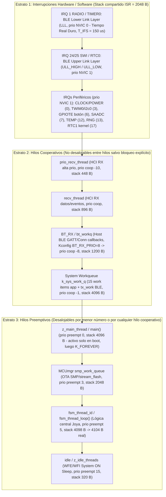
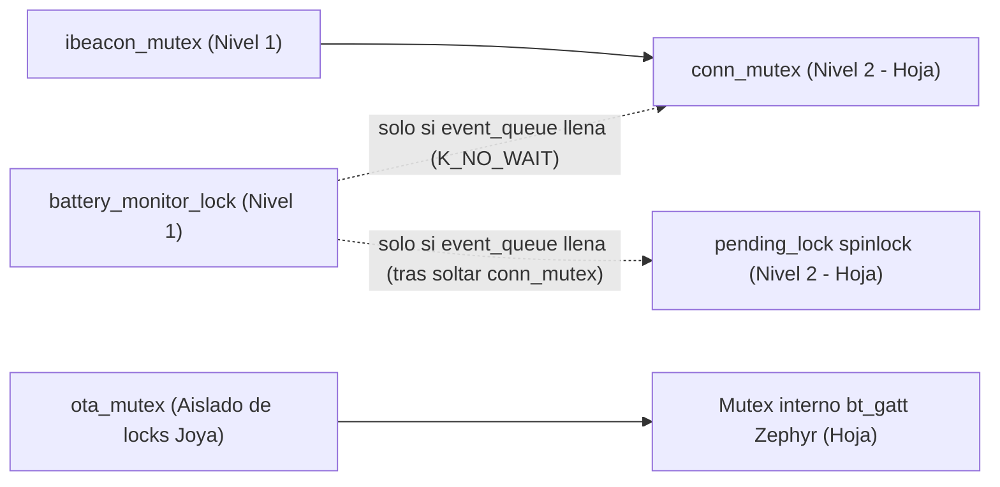

# 6. Concurrencia, Planificación y Arquitectura de Ejecución

> **Alcance y versión verificada**: Este capítulo documenta el modelo completo de ejecución en tiempo real, prioridades de interrupción e hilos, colas de trabajo, primitivos de sincronización, operaciones bloqueantes y condiciones de carrera del firmware de Joya en el commit `c1128e5d0c0d6f98be0a580d287c0926ca27f01f` (`Zephyr RTOS 4.2.0`, SoC monocore `ARM Cortex-M4` `nRF52832-QFAA` a `64 MHz`). Los tamaños de pilas, direcciones SRAM y prioridades efectivas han sido verificados tanto en el código fuente y `prj.conf` como en los artefactos compilados (`build_joya/app/zephyr/.config`, `zephyr.dts` y `zephyr.elf`). Para el orden de creación de contextos durante el arranque véase [04_boot_initialization.md](04_boot_initialization.md); para la lógica funcional del hilo FSM véase [05_state_machine.md](05_state_machine.md); y para el desglose presupuestario de SRAM véase [03_memory_and_ota_layout.md](03_memory_and_ota_layout.md).

---

## 6.1. Modelo de planificación y jerarquía global de ejecución

En `Zephyr 4.2.0` sobre `nRF52832` (`CONFIG_MP_MAX_NUM_CPUS=1`, `CONFIG_NUM_COOP_PRIORITIES=16`, `CONFIG_NUM_PREEMPT_PRIORITIES=15`, `CONFIG_NUM_METAIRQ_PRIORITIES=0`, `# CONFIG_TIMESLICING is not set`), conviven **tres estratos estrictamente jerarquizados** de preempción:

1. **Estrato 1 — Interrupciones de hardware y software (`NVIC` / `ISR`)**: Preemptan inmediatamente a cualquier hilo (cooperativo o preemptivo) salvo que la CPU ejecute una sección crítica corta con interrupciones enmascaradas (`irq_lock()` / `k_spin_lock()`), siempre respetando la prioridad cero de latencia del Link Layer BLE (`RADIO` / `LLL`). Todas las ISRs comparten una única pila estática `z_interrupt_stacks` de **`2048 B`** (`CONFIG_ISR_STACK_SIZE=2048`, `0x200065c8..0x20006dc8`).
2. **Estrato 2 — Hilos cooperativos (prioridad Zephyr `< 0`, rango `-16..-1`)**: Siempre tienen prioridad estrictamente superior a todos los hilos preemptivos (`>= 0`). **Propiedad clave de concurrencia**: una vez que un hilo cooperativo obtiene la CPU (p. ej. `BT_RX` en `-8` o `sysworkq` en `-1`), **ningún hilo cooperativo ni preemptivo puede desalojarlo** hasta que el propio hilo se bloquee voluntariamente en un primitivo del kernel (`k_sem_take`, `k_mutex_lock`, `k_msgq_get`, `k_sleep`, espera de transferencia `I2C`/`ADC`) o finalice su trabajo actual; únicamente las ISRs pueden interrumpirlo.
3. **Estrato 3 — Hilos preemptivos (prioridad Zephyr `0..15`)**: Se desalojan mutuamente según prioridad numérica (menor número = mayor prioridad: `main` `0` > `smp_work_queue` `3` > `fsm_thread_id` `5` > `idle` `15`), y son desalojados instantáneamente en cuanto cualquier hilo cooperativo (`sysworkq` `-1`, `BT_RX` `-8`, hilos HCI `-10`) pasa a estado `READY`.



---

### 6.1.1. Inventario exhaustivo de contextos de ejecución

| Contexto / Símbolo ELF | Categoría | Prioridad efectiva | Stack configurado / Real en ELF | Código ejecutado en Joya | Ciclo de actividad |
|---|---|---|---|---|---|
| `RADIO` / `TIMER0` (`LLL`) | ISR Tiempo Real Duro (`IRQ 1`, `IRQ 8`) | `NVIC 0` (`CONFIG_BT_CTLR_LLL_PRIO=0`) | `z_interrupt_stacks`: `2048 B` compartidos (`0x200065c8`) | Transmisión/recepción física a `1/2 Mbps`, conmutación `T_IFS = 150 us` | Ventanas de advertising (`100..150 ms` y `1..1,2 s`) y eventos de conexión (`45..90 ms`, latencia `4`). |
| `SWI4`/`SWI5` / `RTC0` (`ULL`) | ISR Software Link Layer (`IRQ 24`, `IRQ 25`, `IRQ 11`) | `NVIC 1` (`ULL_HIGH=1`, `ULL_LOW=1`) | `z_interrupt_stacks` (`2048 B`) | Planificación `ticker` BLE, máquinas LLCP y desencolado de PDUs hacia HCI | En cada evento de radio o actualización de estado LL. |
| `GPIOTE` (`button_isr_handler`) | ISR Periférico (`IRQ 6`) | `NVIC 1` | `z_interrupt_stacks` (`2048 B`) | [src/button.c](../../src/button.c#L54-L63): únicamente invoca `k_work_reschedule(&debounce_work, K_MSEC(50))` | Flancos de bajada y subida en `P0.13` (`GPIO_INT_EDGE_BOTH`). Ejecución `< 5 us`. |
| `TWIM0`, `SAADC`, `TEMP`, `RNG`, `CLOCK` | ISRs Periféricos (`IRQ 3, 7, 12, 13, 0`) | `NVIC 1` | `z_interrupt_stacks` (`2048 B`) | Completado de DMA `i2c0`, fin de conversión `ADC`, lectura térmica para calibrar RC LFCLK, generación de números aleatorios | Bajo demanda cuando un hilo inicia transacción o cada `4 s` para calibración RC. |
| `RTC1` (`sys_clock_isr`) | ISR Reloj Kernel (`IRQ 17`) | `NVIC 1` | `z_interrupt_stacks` (`2048 B`) | Avance de ticks `32768 Hz` y despertar de `k_sleep`, `k_sem_take` con timeout y `k_work_delayable` | *Tickless*: solo interrumpe en el próximo vencimiento programado (o overflow del contador de 24 bits cada `512 s`). |
| `prio_recv_thread` | Hilo Cooperativo Controlador HCI | Cooperativa `-10` (`CONFIG_BT_DRIVER_RX_HIGH_PRIO=6`) | `448 B` (`0x1C0`, `0x20006088`) | Transferencia prioritaria de nodos RX críticos desde `ULL` al Host BLE | Ráfagas sub-milisegundo durante tráfico BLE. |
| `recv_thread` | Hilo Cooperativo Controlador HCI | Cooperativa (driver HCI) | `896 B` (`0x380`, `0x20006248`) | Entrega de eventos HCI y paquetes ACL RX hacia la cola `bt_workq` | Durante conexión y descubrimiento/tráfico GATT. |
| `BT_RX` (`bt_workq`) | Workqueue Cooperativa Host BLE | Cooperativa `-8` (`CONFIG_BT_RX_PRIO=8`, `CONFIG_BT_RECV_WORKQ_BT=y`) | `1200 B` (`0x4B0`, `rx_thread_stack` en `0x20005b28`) | **Todos los callbacks de `src/ble_driver.c` y `src/app_comm.c`**: `on_connected`, `on_disconnected`, `on_*_ccc_changed`, `on_rx_write`, `on_rx_auth_write`, `on_name_read`, **`on_name_write`** (¡incluye escritura NVS!), `on_diagnostics_read`, y recepción de tramas SMP que reenvía a `smp_work_queue` | En cada paquete entrante ATT/GATT/L2CAP/SMP o cambio de estado ACL. |
| *(Nota Kconfig)* `BT_HCI_TX` | Parámetro Kconfig / `tx_work` | `CONFIG_BT_HCI_TX_PRIO=7` en `.config`; en Zephyr 4.2 materializado como `tx_work` (`0x200004e4`) en `sysworkq` | `CONFIG_BT_HCI_TX_STACK_SIZE=768` en `.config` (no instancia pila separada en `.bss`; corre sobre `sys_work_q_stack`) | Empuja buffers ACL/HCI TX pendientes hacia el controlador Split LL | Al emitir notificaciones GATT (`TX`, `BATTERY_*`, `DIAGNOSTICS`, `SMP`). |
| `k_sys_work_q` (`sysworkq`) | Workqueue Cooperativa de Sistema | Cooperativa `-1` (`CONFIG_SYSTEM_WORKQUEUE_PRIORITY=-1`) | `4096 B` (`0x1000`, `sys_work_q_stack` en `0x20007f08`) | **Los 15 work items de aplicación** (Sección 6.2) más trabajos internos de Zephyr (`tx_work`, `rx_work`, `recycled_work`, `temp_measure_work`, `os_mgmt_reset_work`) | Cada `10 s` en reposo (`guard_work`), cada `60 s` / `10 s` (`battery_monitor_work`), y durante patrones hápticos o gestos de botón. |
| `z_main_thread` (`main`) | Hilo Preemptivo de Arranque | Preemptiva `0` (`CONFIG_MAIN_THREAD_PRIORITY=0`) | `4096 B` (`0x1000`, `z_main_stack` en `0x20006f08`) | [src/main.c](../../src/main.c#L11-L89): secuencia completa de arranque e inicialización | Solo durante los primeros `~150 ms` tras boot; luego bloqueado eternamente en `k_sleep(K_FOREVER)`. |
| `smp_work_queue` (`mcumgr_wq`) | Workqueue Preemptiva OTA | Preemptiva `3` (`CONFIG_MCUMGR_TRANSPORT_WORKQUEUE_THREAD_PRIO=3`) | `2048 B` (`0x800`, `smp_work_queue_stack` en `0x20005328`) | Decodificación `zcbor`, borrado/escritura en `slot1_partition` (`stream_flash`), `boot_write_img_confirmed()`, y callbacks `image_status_handler` ([src/ota_access.c](../../src/ota_access.c#L35)) e `image_confirmed_handler` ([src/test_image_guard.c](../../src/test_image_guard.c#L22)) | Únicamente cuando el servicio SMP está registrado (`0x70`) o al confirmar imagen Test. |
| `fsm_thread_id` | Hilo Preemptivo Principal de Aplicación | Preemptiva `5` ([src/app_state.c](../../src/app_state.c#L36)) | Declarado **`4098 B`** → real alineado **`4104 B`** (`0x1008`, `_k_thread_stack_fsm_thread_id` en `0x20004320`) | `fsm_thread_loop()` → `process_event()` ([src/app_state.c](../../src/app_state.c#L356-L1017)), más funciones llamadas desde él (`ble_*`, `storage_*`, `haptics_*`, `ota_access_*`) | Dormido en `k_msgq_get(..., K_FOREVER)` mientras no hay eventos; despacha secuencialmente cada `app_event_t`. |
| `idle` (`z_idle_threads`) | Hilo Preemptivo de Reposo | Preemptiva `15` (mínima del sistema) | `320 B` (`0x140`, `z_idle_stacks` en `0x20006dc8`) | Instrucción `WFE`/`WFI` de bajo consumo ARM (`System ON Idle`) | Todo el tiempo restante (~99,9 % del ciclo en reposo). |

> [!NOTE]
> **Detalle del stack de `fsm_thread_id` (`4098 B` → `4104 B`)**: En [src/app_state.c](../../src/app_state.c#L36), `K_THREAD_DEFINE(fsm_thread_id, 4098, ...)` especifica `4098` bytes (probablemente un error tipográfico por `4096`). Dado que la ABI ARM EABI exige alineación de pila de `8 bytes` (`CONFIG_STACK_ALIGN_DOUBLE_WORD=y`), la macro del kernel redondea hacia arriba al múltiplo de 8 inmediato: `4104 bytes` (`0x1008`).

---

## 6.2. Inventario completo de los 15 Work Items de aplicación sobre `sysworkq`

Todos los trabajos diferidos e inmediatos definidos por el código propio de Joya se encolan sobre la **única `System Workqueue` (`k_sys_work_q`, prioridad cooperativa `-1`)**. Por consiguiente, **los 15 handlers listados abajo se ejecutan de forma mutuamente excluyente entre sí** salvo en los puntos exactos en que un handler se bloquea esperando un mutex o un periférico (`TWIM0` / `SAADC`):

| # | Símbolo | Tipo | Archivo y línea | Quién lo agenda / cancela | Retardo / Período | Qué ejecuta el handler | Duración / Bloqueo máximo |
|---:|---|---|---|---|---|---|---|
| 1 | `connection_timeout_work` | `k_work_delayable` (init en `fsm_thread_loop`) | [src/app_state.c](../../src/app_state.c#L16), handler `L284` | `fsm_thread_id` (`start_setup_from_idle`, `EV_BATTERY_*`; cancelado en `EV_BLE_CONNECTED`, `enter_unpaired_idle`, `start_critical_window`) | `90000 ms` (`BLE_SETUP_TIMEOUT_MS`) | `add_event(EV_BLE_TIMEOUT)` | `< 20 us` (no bloqueante: `K_NO_WAIT`). |
| 2 | `emergency_retry_work` | `k_work_delayable` (init en `fsm_thread_loop`) | [src/app_state.c](../../src/app_state.c#L17), handler `L273` | `fsm_thread_id` (`emergency_schedule_next_retry`; cancelado en `emergency_stop_alerts`) | Backoff `1s, 2s, 5s, 10s, 30s, 30s...` | `add_event(EV_EMERGENCY_RETRY)` | `< 20 us` (no bloqueante). |
| 3 | `advertising_restart_work` | `k_work_delayable` (init en `fsm_thread_loop`) | [src/app_state.c](../../src/app_state.c#L18), handler `L288` | `fsm_thread_id` (`schedule_advertising_restart` y `EV_BLE_RESTART_ADVERTISING`; cancelado en `EV_BLE_CONNECTED`, `EV_BTN_2_PULSE`, `enter_unpaired_idle`, `factory_reset_and_reboot`) | `10 ms` inicial; hasta 2 reintentos a `5000 ms` | `add_event(EV_BLE_RESTART_ADVERTISING)` | `< 20 us` (no bloqueante). |
| 4 | `critical_window_work` | `k_work_delayable` (init en `fsm_thread_loop`) | [src/app_state.c](../../src/app_state.c#L19), handler `L297` | `fsm_thread_id` (`EV_BOOT_TEST_SETUP_REQUEST`, `start_critical_window`) y auto-reintento desde `sysworkq` | `300000 ms` (`5 min`); reintento cada `1000 ms` si `event_queue` está llena | `add_event(EV_CRITICAL_WINDOW_TIMEOUT)`; si falla por cola llena, se reprograma a `1 s` | `< 30 us` (no bloqueante). |
| 5 | `ibeacon_stop_work` | `k_work` (`K_WORK_DEFINE`) | [src/ble_driver.c](../../src/ble_driver.c#L139), handler `L122` | `BT_RX` (`on_connected` en `L241`) | Inmediato (`k_work_submit`) | Toma `ibeacon_mutex` + consulta `ble_has_connection()` (`conn_mutex`) y ejecuta `bt_le_ext_adv_stop(ibeacon_adv)` | Típico `< 2 ms` (espera comando HCI local síncrono al controlador Split LL). |
| 6 | `debounce_work` | `k_work_delayable` (init en `button_init`) | [src/button.c](../../src/button.c#L14), handler `L65` | ISR `GPIOTE` (`button_isr_handler` en `L62`) | `50 ms` (`DEBOUNTE_TIME_MS`) | Lee `P0.13`, filtra rebotes, mide duración de pulsación y agenda `factory_hold_work`, `click_window_work` o emite `EV_BTN_LONG_PRESS` / `SUSPEND_REQUEST` / `FACTORY_RESET` | `< 50 us` (lectura registro `GPIO` + `add_event` no bloqueante). |
| 7 | `click_window_work` | `k_work_delayable` (init en `button_init`) | [src/button.c](../../src/button.c#L15), handler `L138` | `sysworkq` (`debounce_work_handler`; cancelado en pulsación siguiente o `factory_hold_work`) | `900 ms` (`CLICK_WINDOW_MS`) | Consume atómicamente `pulse_count` y emite `EV_BTN_1_PULSE` (`1`), `EV_BTN_2_PULSE` (`2`) o `EV_BTN_EMERGENCY` (`>= 3`) | `< 30 us` (no bloqueante). |
| 8 | `factory_hold_work` | `k_work_delayable` (init en `button_init`) | [src/button.c](../../src/button.c#L16), handler `L33` | `sysworkq` (`debounce_work_handler` al presionar; auto-ajuste si falta tiempo; cancelado al soltar) | `15000 ms` (`BUTTON_FACTORY_RESET_HOLD_MS`) | Comprueba que el pin siga activo a los `15 s`, limpia `pulse_count`, cancela `click_window_work` y emite `EV_BTN_FACTORY_THRESHOLD` | `< 30 us` (no bloqueante). |
| 9 | `battery_monitor_work` | `k_work_delayable` (`K_WORK_DELAYABLE_DEFINE`) | [src/battery.c](../../src/battery.c#L43), handler `L210` | `main` (`battery_monitor_start` `K_NO_WAIT`) y auto-reprogramación en `sysworkq` | `0 ms` inicial, `10000 ms` en verificación (`6×`), `60000 ms` nominal (`1000 ms` en recheck) | Toma `battery_monitor_lock`, suelta para medir `battery_get_voltage_mv()` (`adc_read_dt`), acumula votos `5/6`, encola `EV_BATTERY_*` y envía `ble_send_battery_measurement()` | Típico **`~100..300 us`** (`TACQ = 40 us` + conversión SAADC + eventual notificación GATT). |
| 10 | `haptics_pattern_work` | `k_work_delayable` (`K_WORK_DELAYABLE_DEFINE`) | [src/haptics.c](../../src/haptics.c#L43), handler `L415` | `fsm_thread_id` (`haptics_play_with_completion` `K_NO_WAIT`), auto-reprogramación en `sysworkq`; cancelación síncrona desde `fsm_thread_id` | `0 ms` paso 0, luego `100..2000 ms` por paso (`duration_ms`) | Aplica `drv2605_set_rtp(amplitude)` por `I2C` (`2` escrituras) o al terminar ejecuta `drv2605_idle()` (`2` escrituras `I2C` + `P0.07=0` + `PM_DEVICE_ACTION_SUSPEND`) e invoca `pattern_completion()` | Típico **`~0,6..1,0 ms`** a `100 kHz`; en fallo de bus `I2C` puede bloquear `sysworkq` hasta **`1000 ms`** (`2 × 500 ms` timeout `TWIM`). |
| 11 | `haptics_effect_work` | `k_work_delayable` (`K_WORK_DELAYABLE_DEFINE`) | [src/haptics.c](../../src/haptics.c#L45), handler `L447` | `fsm_thread_id` (`haptics_play_effect`, nota: API pública actualmente no invocada por `app_state.c`) | Sondeo cada `10 ms` (máx `1000` iteraciones = `10 s`) | Lee registro `DRV2605_REG_GO` por `I2C`; cuando bit `GO == 0` o error o `1000` lecturas, llama a `drv2605_idle()` | Típico `~0,4..1,0 ms`; hasta `500..1500 ms` si falla `I2C`. |
| 12 | `idle_close_work` | `k_work_delayable` (init en `ota_access_init`) | [src/ota_access.c](../../src/ota_access.c#L11), handler `L25` | `fsm_thread_id` (`ota_access_enable`) y `smp_work_queue` (`image_status_handler` en `DFU_STOPPED`) | `120000 ms` (`OTA_IDLE_TIMEOUT = 2 min`), o `1000 ms` si `close_requested` | Toma `ota_mutex`; si `!uploading && !upload_complete`, ejecuta `smp_bt_unregister()` | Típico `< 1 ms`. |
| 13 | `confirmation_deadline_work` | `k_work_delayable` (`K_WORK_DELAYABLE_DEFINE`) | [src/test_image_guard.c](../../src/test_image_guard.c#L20), handler `L11` | `main` (`test_image_guard_start` en arranque Test); cancelado desde `smp_work_queue` (`image_confirmed_handler`) | `300000 ms` (`5 min`) | Si `test_image_active && !boot_is_img_confirmed()`, ejecuta `sys_reboot(SYS_REBOOT_COLD)` | No retorna (reinicia MCU) o `< 10 us`. |
| 14 | `diagnostics_work` | `k_work` (`K_WORK_DEFINE`) | [src/diagnostics.c](../../src/diagnostics.c#L37), handler `L14` | Cualquier hilo vía `diagnostics_request_init_notification()` o `diagnostics_report_error()` | Inmediato (`k_work_submit`) | Extrae bajo `pending_lock` la sesión/código pendiente y llama a `ble_diagnostics_notify_for_session()` (`conn_mutex` con `K_NO_WAIT` + `bt_gatt_notify`) | Típico `< 500 us` (si no hay buffer TX libre puede esperar brevemente o descartar). |
| 15 | `guard_work` | `k_work_delayable` (`K_WORK_DELAYABLE_DEFINE`) | [src/wdt_guard.c](../../src/wdt_guard.c#L50), handler `L52` | `main` (`wdt_guard_init` a `10 s`, `wdt_guard_main_ready` `K_NO_WAIT`) y auto-reprogramación | `10000 ms` (`GUARD_INTERVAL_MS`) | Evalúa `main_ready`, estancamiento de `fsm_processing` (`> 15 s`) e inanición de `event_queue` (`> 15 s`), alimenta `wdt_feed(wdt, 0)` y reprograma a `10 s` | `< 30 us` (escritura directa a `NRF_WDT->RR[0]`). |

*(Ítems adicionales en `sysworkq` fuera de los 15 de producción)*:
- **Diagnóstico opcional de placa DK**: `test_led_off_work` ([src/haptics_test_indicator.c](../../src/haptics_test_indicator.c#L21), `200 ms`) solo se compila si `CONFIG_JOYA_HAPTICS_TEST_INDICATOR=y` (`default n`, exclusivo de `BOARD_NRF52DK_NRF52832`).
- **Subsistemas de Zephyr enlazados en `zephyr.elf`**: `tx_work`, `rx_work` y `recycled_work` (Host BLE), `temp_measure_work` (calibración RC LFCLK cada `4 s`) y `os_mgmt_reset_work` (reinicio diferido tras comando SMP `OS Reset`).

---

## 6.3. Primitivos de sincronización, comunicación y orden de bloqueo

### 6.3.1. Cola central de mensajes `event_queue` (`K_MSGQ_DEFINE`) y ciclo de vida de `bt_conn`

Definida en [src/app_state.c](../../src/app_state.c#L28) sobre la estructura `app_event_t` ([include/app_state.h](../../include/app_state.h#L74-L78)):

```c
typedef struct {
    event_type_t type;           /* Offset 0..3 (4 bytes con padding de alineación) */
    struct bt_conn *conn;        /* Offset 4..7 (4 bytes puntero ARM32)             */
    uint8_t app_id[SIZE_APP_ID]; /* Offset 8..23 (16 bytes copia por valor)         */
} app_event_t;                   /* sizeof(app_event_t) == 24 bytes                 */

K_MSGQ_DEFINE(event_queue, sizeof(app_event_t), 20, 4); /* 20 * 24 = 480 B en SRAM */
```

- **Política de inserción no bloqueante (`K_NO_WAIT`)**: `add_event_for_conn()` ([src/app_state.c](../../src/app_state.c#L340-L354)) inserta por copia de 24 bytes con `k_msgq_put(&event_queue, &entry, K_NO_WAIT)`. Ningún productor (`sysworkq`, `BT_RX`, `smp_work_queue`, `main`, o el propio `fsm_thread_id` al encolar callbacks hápticos) puede bloquearse jamás esperando espacio en `event_queue`, lo que elimina toda posibilidad de interbloqueo productor-consumidor cuando `fsm_thread_id` invoca funciones que esperan a `sysworkq`.
- **Política de extracción bloqueante (`K_FOREVER`)**: `fsm_thread_loop()` ([src/app_state.c](../../src/app_state.c#L364)) duerme con consumo cero de CPU en `k_msgq_get(&event_queue, &entry, K_FOREVER)`.
- **Contabilidad exacta de referencias `bt_conn_ref` / `bt_conn_unref`** *(crítica dado `CONFIG_BT_MAX_CONN=1`: una sola fuga agotaría permanentemente el único slot de conexión del stack BLE hasta reiniciar)*:
  1. **Al conectar (`on_connected`, [src/ble_driver.c](../../src/ble_driver.c#L230))**: `current_conn = bt_conn_ref(conn)` adquiere la referencia de sesión activa. Acto seguido, `on_connected_handler` llama a `add_event_for_conn(EV_BLE_CONNECTED, conn, NULL)`.
  2. **Al encolar (`add_event_for_conn`, [src/app_state.c](../../src/app_state.c#L342-L353))**: Si `conn != NULL`, adquiere una referencia dedicada para el mensaje en cola (`bt_conn_ref(conn)`). **Si `k_msgq_put` falla (`err != 0`, p. ej. `-ENOMSG` por cola llena), libera inmediatamente esa referencia con `bt_conn_unref(entry.conn)` en la línea 351**, evitando cualquier fuga de objeto `bt_conn`.
  3. **En callbacks sin parámetro `conn` directo (`on_ccc_changed`, [src/ble_driver.c](../../src/ble_driver.c#L161-L171))**: Toma una referencia temporal bajo `conn_mutex`, suelta `conn_mutex`, llama a `add_event_for_conn` (que toma su propia referencia para la cola) y libera la referencia temporal con `bt_conn_unref(conn)`.
  4. **Al consumir (`fsm_thread_loop`, [src/app_state.c](../../src/app_state.c#L368-L370))**: Una vez que `process_event(&entry)` retorna por cualquiera de sus rutas, `fsm_thread_loop` ejecuta `if (entry.conn) { bt_conn_unref(entry.conn); }`.
  5. **Al desconectar (`on_disconnected`, [src/ble_driver.c](../../src/ble_driver.c#L251-L267))**: Extrae `old_conn = current_conn`, anula `current_conn = NULL` bajo `conn_mutex`, y libera `bt_conn_unref(old_conn)` fuera del mutex. Note por qué `schedule_advertising_restart()` ([src/app_state.c](../../src/app_state.c#L308-L309)) espera `10 ms`: el evento `EV_BLE_DISCONNECTED` mantiene viva una última referencia `entry.conn` hasta que `process_event()` retorna y `fsm_thread_loop` ejecuta `bt_conn_unref(entry.conn)` en la línea 369; diferir `10 ms` el re-arranque del advertising asegura que esa referencia final haya sido liberada y el slot único de `bt_conn` esté reciclado antes de llamar a `bt_le_adv_start()`.

---

### 6.3.2. Semáforo `test_setup_sem`

Definido mediante `K_SEM_DEFINE(test_setup_sem, 0, 1)` ([src/app_state.c](../../src/app_state.c#L22), contador inicial `0`, límite `1`). Actúa como barrera de rendezvous unidireccional durante el arranque OTA Test:
- `z_main_thread` (prio `0`) encola `EV_BOOT_TEST_SETUP_REQUEST` y se bloquea en `k_sem_take(&test_setup_sem, K_SECONDS(10))` ([src/app_state.c](../../src/app_state.c#L330)).
- `fsm_thread_id` (prio `5`) escribe el código de retorno en `test_setup_result` **antes** de ejecutar `k_sem_give(&test_setup_sem)` ([src/app_state.c](../../src/app_state.c#L404-L421)), proporcionando visibilidad ordenada (*happens-before*) de `test_setup_result` hacia `main` sin necesidad de mutex adicional.

---

### 6.3.3. Los 4 Mutexes y el Spinlock del sistema

| Primitivo | Tipo y ubicación | Datos e invariantes protegidos | Hilos que lo adquieren | Timeout usado | Locks anidados adquiridos dentro de su sección crítica |
|---|---|---|---|---|---|
| `ibeacon_mutex` | `struct k_mutex` ([src/ble_driver.c](../../src/ble_driver.c#L64)) | Booleano `ibeacon_running` y serialización de llamadas HCI `bt_le_ext_adv_start(ibeacon_adv)` / `bt_le_ext_adv_stop(ibeacon_adv)` | `fsm_thread_id` (`ble_set_ibeacon_mode`, `ibeacon_stop`), `sysworkq` (`ibeacon_stop_on_connection`) | `K_FOREVER` | Adquiere **`conn_mutex`** (`K_FOREVER`) vía `ble_has_connection()` ([src/ble_driver.c](../../src/ble_driver.c#L94), `L108`, `L128`). Libera `ibeacon_mutex` **antes** de llamar a `diagnostics_report_error`. |
| `conn_mutex` | `struct k_mutex` ([src/ble_driver.c](../../src/ble_driver.c#L150)) | `current_conn`, `current_conn_authenticated`, `notify_enabled`, `battery_change_notify_enabled`, `battery_measurement_notify_enabled`, `diagnostics_notify_enabled`, `diagnostics_session_epoch` | `BT_RX`, `fsm_thread_id`, `sysworkq`; y cualquier hilo llamador de diagnósticos (`main`, `fsm_thread_id`, `BT_RX`, `sysworkq`) | `K_FOREVER` en operaciones normales; **`K_NO_WAIT`** en `ble_diagnostics_session()` (`L574`) y `ble_diagnostics_notify_for_session()` (`L588`) | **Ninguno (Lock hoja estricto)**: solo manipula punteros/booleanos y `bt_conn_ref()`. Jamás llama a `bt_gatt_notify()`, `ota_access_*` ni `add_event()` con el mutex tomado. |
| `ota_mutex` | `struct k_mutex` ([src/ota_access.c](../../src/ota_access.c#L10)) | `service_enabled`, `uploading`, `upload_complete`, `close_requested`, y serialización de `smp_bt_register()` / `smp_bt_unregister()` e `idle_close_work` | `fsm_thread_id` (`enable`, `disable`, `is_update_active`), `BT_RX` (`on_disconnect`), `sysworkq` (`idle_close_handler`), `smp_work_queue` (`image_status_handler`) | `K_FOREVER` | **Ningún lock de aplicación** (solo locks internos GATT de Zephyr dentro de `smp_bt_*`). Libera `ota_mutex` **antes** de llamar a `add_event(EV_OTA_UPDATE_STOPPED)` (`L68-L70`). |
| `battery_monitor_lock` | `struct k_mutex` ([src/battery.c](../../src/battery.c#L32)) | `monitoring`, `verifying`, `recheck_requested`, `recheck_level`, `monitor_generation`, `verification_count`, `votes[3]`, `confirmed_level` | `main` (`battery_monitor_start`), `sysworkq` (`battery_monitor_work_handler`) *(más APIs no llamadas `stop`/`recheck`)* | `K_FOREVER` | Se libera durante `adc_read_dt()` (`L229-L235`) y antes de `ble_send_battery_measurement()` (`L298`). Permanece tomado en `battery_finish_verification()` → `add_event()` (`L205`), lo que en caso de cola llena puede encadenar `conn_mutex (K_NO_WAIT)` y luego `pending_lock`. |
| `pending_lock` | `struct k_spinlock` ([src/diagnostics.c](../../src/diagnostics.c#L9)) | `pending_init_session`, `pending_error_session`, `pending_error_code` | `main`, `fsm_thread_id`, `BT_RX`, `sysworkq` | Spinlock IRQ-lock (`k_spin_lock`) | **Ninguno (Lock hoja atómico)**: solo copia/asigna 3 enteros en RAM (~5 instrucciones) y restaura interrupciones. |

---

### 6.3.4. Demostración formal de ausencia de Deadlock `AB-BA` entre locks

Sea $G = (V, E)$ el grafo dirigido de adquisición anidada de primitivos de bloqueo en todo el firmware, donde una arista $L_1 \to L_2$ existe si algún camino de código adquiere $L_2$ mientras mantiene $L_1$:



**Prueba de aciclicidad**:
1. `conn_mutex` y `pending_lock` tienen **grado de salida $0$**: en todas sus secciones críticas ([src/ble_driver.c](../../src/ble_driver.c#L161-L166), `L178-L180`, `L189-L191`, `L197-L199`, `L223-L239`, `L249-L262`, `L371-L375`, `L383-L389`, `L522-L524`, `L531-L533`, `L540-L542`, `L549-L554`, `L564-L566`, `L574-L580`, `L588-L595`, `L665-L669`, `L746-L752` y [src/diagnostics.c](../../src/diagnostics.c#L17-L23), `L65-L67`, `L78-L81`) no se invoca ninguna función que tome otro lock.
2. En `on_disconnected()` ([src/ble_driver.c](../../src/ble_driver.c#L262-L265)), `conn_mutex` se libera explícitamente en la línea 262 **antes** de adquirir `ota_mutex` dentro de `ota_access_on_disconnect()` en la línea 265.
3. En `diagnostics_request_init_notification()` y `diagnostics_report_error()` ([src/diagnostics.c](../../src/diagnostics.c#L63-L81)), `ble_diagnostics_session()` adquiere con `K_NO_WAIT` y libera `conn_mutex` **antes** de adquirir `pending_lock`.
4. `ibeacon_mutex`, `battery_monitor_lock` y `ota_mutex` tienen **grado de entrada $0$** (ningún otro lock del proyecto los adquiere dentro de su sección crítica).
5. Además, Zephyr implementa herencia de prioridad (*priority inheritance*) en `k_mutex`, acotando la inversión de prioridad cuando `fsm_thread_id` (`prio 5`) posee `conn_mutex` o `ibeacon_mutex` y `BT_RX` (`prio -8`) o `sysworkq` (`prio -1`) lo solicita.

Por tanto, $G$ es un **grafo acíclico dirigido (DAG) estricto de altura máxima 2**: el interbloqueo circular `AB-BA` entre mutexes y spinlocks es estructuralmente imposible. *(El único riesgo de auto-bloqueo del sistema reside en las cancelaciones síncronas de `k_work`, analizadas en la Sección 6.6.1).*

---

## 6.4. Catálogo completo de variables `atomic_t` y `volatile`

El proyecto declara exactamente **13 variables `atomic_t`** (`long` de 32 bits operado con instrucciones `LDREX`/`STREX` o barreras en `Cortex-M4`) y **1 variable `volatile`**. La tabla siguiente evalúa rigurosamente cuándo la atomicidad individual basta y cuándo aparecen ventanas compuestas:

| # | Variable | Tipo y archivo | Escritores (contexto) | Lectores (contexto) | ¿Suficiente como sincronización? Análisis de atomicidad compuesta |
|---:|---|---|---|---|---|
| 1 | `connectable_adv_running` | `atomic_t` ([src/ble_driver.c](../../src/ble_driver.c#L63)) | `BT_RX` (`on_connected` clear), `fsm_thread_id` (`ble_start_setup_advertising` clear/set, `ble_stop_advertising` clear) | `fsm_thread_id` (`ble_set_ibeacon_mode`), `sysworkq` (`ibeacon_stop_on_connection`) | **Parcial con mitigación**: En `ble_start_setup_advertising` (`L642-L645`), `fsm_thread_id` hace `atomic_set(1)` después de `bt_le_adv_start`; si `on_connected` (`BT_RX`, prio `-8`) hubiera corrido justo entre `bt_le_adv_start` (`L633`) y `atomic_set(1)` (`L642`), habría limpiado `0` antes de que `fsm_thread_id` escribiera `1`. Por eso las líneas 643–645 re-verifican `if (ble_has_connection()) atomic_clear(...)` cerrando la ventana para una conexión aún activa (solo quedaría en `1` si la conexión abrió *y* cerró en microsegundos entre `L633` y `L643`). |
| 2 | `pulse_count` | `atomic_t` ([src/button.c](../../src/button.c#L22)) | `main`/`fsm` en init (`0`), `sysworkq` (`debounce_work` `inc`/`set(0)`, `factory_hold_work` `set(0)`, `click_window_work` `atomic_set(0)` swap) | `sysworkq` (`debounce_work`, `click_window_work`) | **Exacta**: Todos los accesos post-init ocurren sobre el mismo hilo cooperativo `sysworkq`, y además `atomic_set(&pulse_count, 0)` en `L142` realiza un intercambio atómico *fetch-and-clear* sin pérdida de pulsos. |
| 3 | `haptics_allowed` | `atomic_t` ([src/haptics.c](../../src/haptics.c#L36)) | `main` (`battery_init`), `fsm_thread_id` (`EV_BATTERY_*`, despertar `critical_idle`) | `fsm_thread_id` (`drv2605_wake`, `haptics_play_with_completion`, `haptics_play_effect`) | **Exacta para bandera simple**: Después de `main()`, tanto el escritor (`haptics_set_allowed`) como los lectores corren en `fsm_thread_id`. |
| 4 | `initialized` | `atomic_t` ([src/battery.c](../../src/battery.c#L21)) | `main` (`battery_init`: transición única `0 -> 1`) | `main`, `sysworkq` (`battery_get_voltage_mv`, `battery_monitor_start`) | **Exacta** (bandera monótona *write-once* tras configurar canal SAADC). |
| 5 | `last_valid` | `atomic_t` ([src/battery.c](../../src/battery.c#L22)) | `sysworkq` (`battery_monitor_work`: `0 -> 1` tras escribir `last_voltage_mv`) | Cualquier llamador de `battery_get_last_voltage_mv()` *(actualmente no llamada)* | **Suficiente en Cortex-M4 monocore** porque `sysworkq` escribe `last_voltage_mv` antes de `last_valid = 1`; ante múltiples actualizaciones futuras, dos `atomic_t` separados no forman snapshot transaccional, aunque para un único `int32_t` cada lectura individual de 32 bits es atómica y consistente. |
| 6 | `last_voltage_mv` | `atomic_t` ([src/battery.c](../../src/battery.c#L23)) | `sysworkq` (`battery_monitor_work` `L243`) | `battery_get_last_voltage_mv()` | **Exacta** (entero de 32 bits leído/escrito atómicamente). |
| 7 | `init_bits` | `atomic_t` ([src/diagnostics.c](../../src/diagnostics.c#L6)) | `main` (`diagnostics_record_init` con `atomic_or`) | `BT_RX` (`on_diagnostics_read`), `sysworkq` (`diagnostics_work_handler`) | **Exacta**: `atomic_or` acumula bits sin pérdida y se congela antes de `init_complete = 1`. |
| 8 | `init_complete` | `atomic_t` ([src/diagnostics.c](../../src/diagnostics.c#L7)) | `main` (`diagnostics_finish_init`: `0 -> 1`) | `main`, `fsm_thread_id` (`ble_mark_authenticated_conn`), `BT_RX` (`on_diagnostics_ccc_changed`) | **Exacta** (bandera monótona de publicación). |
| 9 | `test_image_active` | `atomic_t` ([src/test_image_guard.c](../../src/test_image_guard.c#L9)) | `main` (`test_image_guard_start` `set(1)`), `smp_work_queue` (`image_confirmed_handler` `clear`), `sysworkq` (`confirmation_deadline_handler` `clear`) | `smp_work_queue`, `sysworkq` | **Exacta**: Ambos consumidores comprueban adicionalmente `boot_is_img_confirmed()` desde el trailer Flash antes de reiniciar o cancelar. |
| 10 | `main_ready` | `atomic_t` ([src/wdt_guard.c](../../src/wdt_guard.c#L18)) | `main` (`wdt_guard_main_ready` `set(1)`) | `sysworkq` (`guard_work_handler`) | **Exacta** (bandera monótona `0 -> 1`). |
| 11 | `fsm_processing` | `atomic_t` ([src/wdt_guard.c](../../src/wdt_guard.c#L19)) | `fsm_thread_id` (`event_begin` `set(1)`, `event_end` `clear`) | `sysworkq` (`guard_work_handler`) | **Segura gracias a las prioridades relativas** (véase análisis de par compuesto con `fsm_started_ms` abajo). |
| 12 | `fsm_started_ms` | `atomic_t` ([src/wdt_guard.c](../../src/wdt_guard.c#L20)) | `fsm_thread_id` (`event_begin` *antes* de `fsm_processing = 1`) | `sysworkq` (`guard_work_handler` *después* de leer `fsm_processing == 1`) | **Segura por prioridad cooperativa de `sysworkq`**: En `event_begin` (`L120-L121`), `fsm_started_ms` se escribe antes de `fsm_processing = 1`. Y cuando `guard_work_handler` corre en `sysworkq` (prio `-1`), `fsm_thread_id` (prio `5`) **no puede preemptarlo** entre `now = k_uptime_get_32()` (`L55`) y la lectura de `fsm_processing` / `fsm_started_ms` (`L61-L62`), por lo que jamás ocurre `fsm_started_ms > now` (underflow unsigned). |
| 13 | `fsm_progress` | `atomic_t` ([src/wdt_guard.c](../../src/wdt_guard.c#L21)) | `fsm_thread_id` (`event_end`: `atomic_inc`) | `sysworkq` (`guard_work_handler`) | **Exacta** (contador monótono módulo $2^{32}$ comparado por desigualdad `!=`). |
| 14 | `current_state` | `volatile app_state_t` ([src/app_state.c](../../src/app_state.c#L26)) | Exclusivamente `fsm_thread_id` (en inicialización y dentro de `process_event`) | `fsm_thread_id`, `BT_RX` (`on_name_write` en `src/ble_driver.c:279`), `sysworkq` (`ble_send_battery_value` en `src/ble_driver.c:715`) | **Lectura individual atómica en ARM32, pero expuesta a ventana TOCTOU en `on_name_write()`** (véase Sección 6.7.2). `volatile` impide cacheo en registros del compilador, aunque no sustituye a un mutex de sesión. |

---

## 6.5. Análisis profundo de operaciones bloqueantes por contexto

En un sistema embebido con pilas acotadas y colas cooperativas compartidas, cada operación síncrona o de Flash tiene consecuencias directas sobre latencia, presupuesto de pila y margen del watchdog:

### 6.5.1. Dormidas explícitas y bus `I2C` (`TWIM0`) en `fsm_thread_id` y `sysworkq`
1. **`k_msleep(10)` en `drv2605_wake()` ([src/haptics.c](../../src/haptics.c#L280)) sobre `fsm_thread_id`**:
   - Cada vez que la FSM inicia un patrón háptico estando el `DRV2605` apagado (`haptic_enabled == false`), `haptics_play*()` ejecuta `haptics_i2c_resume()`, levanta `P0.07 = 1` y **duerme `fsm_thread_id` durante `10 ms`** (tiempo de encendido del `DRV2605`), seguido de 2 escrituras `I2C` (`~0,6 ms`).
   - **Impacto**: Retrasa `~11 ms` el procesamiento del siguiente evento en `event_queue` (despreciable frente a la cola de 20 slots y a `FSM_STALL_MS = 15000 ms`), cediendo limpiamente la CPU a `idle` o a otros hilos durante esos `10 ms`.
2. **Transferencias `I2C` (`100 kHz`, `CONFIG_I2C_NRFX_TRANSFER_TIMEOUT=500` ms) en `sysworkq` y `fsm_thread_id`**:
   - En condiciones normales, escribir 2 bytes al `DRV2605` tarda `~300 us` (3 bytes con dirección × 9 bits a `100 kHz`), durante los cuales el driver `i2c_nrfx_twim` bloquea el hilo llamador en un semáforo interno mientras EasyDMA opera por hardware.
   - **En caso de fallo físico de bus (`SDA` o `SCL` cortocircuitado a GND o pull-up abierto en PCB)**: Cada llamada a `i2c_write` / `i2c_reg_read_byte` agota el timeout de **`500 ms`**.
     - En `haptics_pattern_work_handler` sobre `sysworkq`, `drv2605_set_rtp()` + `drv2605_idle()` en la ruta de error pueden encadenar hasta `3` escrituras fallidas = **`~1,5 s` de retraso en `sysworkq`**, posponiendo temporalmente `debounce_work` (`50 ms`) o `click_window_work` (`900 ms`), pero quedando muy por debajo de `GUARD_INTERVAL_MS` (`10 s`) y `WDT_TIMEOUT_MS` (`30 s`), por lo que **no provoca falso reset de Watchdog**.

### 6.5.2. Conversión `SAADC` (`adc_read_dt`) en `sysworkq`
- En `battery_monitor_work_handler()` ([src/battery.c](../../src/battery.c#L232)), `adc_read_dt()` toma el lock de secuencia del driver `adc_nrfx_saadc`, adquiere durante `TACQ = 40 us` y convierte 12 bits (`~2 us`), esperando la interrupción `IRQ 7` mediante un `k_sem`. El tiempo total de bloqueo en `sysworkq` es `< 100 us`, y `battery_monitor_lock` se suelta deliberadamente antes de `adc_read_dt()` (`L229`) para no retener el mutex durante la espera de hardware.

### 6.5.3. Escrituras y borrados Flash `NVMC` (`NVS` y `stream_flash`): impacto en CPU, Radio y Stack de `BT_RX`
En el `nRF52832`, existe un único banco físico de `512 KiB` de Flash interna (`NVMC`). Según la especificación de producto de Nordic:
- **Halting de CPU durante operaciones `NVMC`**: Mientras el controlador `NVMC` programa una palabra de 32 bits (`41..338 us`) o **borra una página de `4 KiB` (`2,05..85,0 ms` máx)**, la matriz Flash no puede servir instrucciones XIP, **deteniendo en seco la ejecución de instrucciones del `Cortex-M4` (incluidas las ISRs en Flash como `RADIO`/`LLL`)** hasta que concluye la operación física (salvo soporte parcial de interrupción si no está habilitado *partial erase*).

Esto impacta en tres contextos distintos del firmware:
1. **En `fsm_thread_id` (prio `5`, stack `4104 B`)**:
   - Escrituras cortas `settings_save_one()` (`1..17 B` más metadatos `NVS` de 8 B) en `EV_APP_IDENTIFIER_RECEIVED`, `EV_BTN_EMERGENCY`, `EV_APP_ACK_EMERGENCY`, `EV_APP_STOP_EMERGENCY` y `handle_routine_button()`. En régimen ordinario sin compactación toman `< 2 ms`; si el sector activo de `4 KiB` se llena y `NVS` ejecuta *garbage collection* (migración de entradas vivas al sector libre + borrado de página de `4 KiB`), la llamada puede tardar **`~15..90 ms`**.
   - Durante `storage_factory_reset()` ([src/flash_memory.c](../../src/flash_memory.c#L378-L395)), se encadenan 4 `settings_delete()`. Con un stack de `4104 B`, `fsm_thread_id` dispone de amplio margen de pila.
2. **Punto crítico de ingeniería — Escritura NVS directa dentro de `on_name_write()` sobre `BT_RX` (`1200 B` de stack)**:
   - En [src/ble_driver.c](../../src/ble_driver.c#L273-L320), el callback GATT `on_name_write()` se ejecuta **directamente en el hilo `BT_RX` (`rx_thread_stack = 1200 B`)**, sin delegar a `fsm_thread_id`.
   - Dentro de esa llamada se apilan los marcos de L2CAP → ATT → `bt_gatt_attr_write` → `on_name_write` (`char name[32]` en pila) → `bt_set_name` → `storage_save_name` → `settings_save_one("joya/name", ...)` → `settings_nvs_save` → `nvs_write` → `flash_nrf_write` (y potencialmente `nvs_gc` si coincide con fin de sector).
   - **Consecuencias sobre memoria y latencia**:
     1. **`rx_thread_stack` (`1200 B`) es la pila con menor margen relativo de toda la ruta de escritura Flash**, y como `# CONFIG_ARM_MPU is not set`, no existe guarda hardware contra desbordamiento hacia el objeto contiguo en `.bss` (`smp_work_queue_stack` en `0x20005328..0x20005b28` está debajo de `rx_thread_stack` en `0x20005b28..0x20005fd8` —en ARM la pila crece hacia direcciones decrecientes desde `0x20005fd8` hacia `0x20005b28`, por lo que un desbordamiento de `rx_thread_stack` pisaría la cima de `smp_work_queue_stack`!). Tal como advierte [docs/RECOVERY_VALIDATION.md](../../docs/RECOVERY_VALIDATION.md#L79-L83), medir la marca de agua real de `BT_RX` bajo carga NVS es requisito previo obligatorio antes de activar `MPU`.
     2. Al correr en prioridad cooperativa `-8`, mientras `on_name_write()` espera a `NVS`, **congela por completo `BT_RX`, `sysworkq` (`-1`), `main` (`0`), `smp_work_queue` (`3`) y `fsm_thread_id` (`5`)** durante los milisegundos que dure la escritura/compactación.
3. **En `smp_work_queue` (prio `3`, stack `2048 B`) durante actualización OTA**:
   - `img_mgmt` vuelca bloques de `512 B` (`CONFIG_IMG_BLOCK_BUF_SIZE=512`, alojado estáticamente en el contexto de `img_mgmt`, no en la pila) hacia `slot1_partition` (`55` páginas de `4 KiB`), borrando cada nueva página de `4 KiB` al cruzar su frontera.
   - Con intervalo de conexión BLE preferido de `45..90 ms` y `supervision timeout = 6000 ms` ([prj.conf](../../prj.conf#L59-L66)), si un borrado de página `NVMC` (`<= 85 ms`) hace perder un evento de conexión BLE puntual, la latencia esclava y el timeout de supervisión de `6 s` absorben holgadamente la pérdida sin desconectar el enlace OTA, y como `smp_work_queue` (prio `3`) cede ante `sysworkq` (prio `-1`), `guard_work` sigue alimentando puntualmente el `WDT0` cada `10 s`.

---

## 6.6. Restricciones críticas de contexto (Reglas Inquebrantables de Mantenimiento)

### 6.6.1. Prohibición absoluta de invocar la API de control háptico desde `sysworkq`

En [src/haptics.c](../../src/haptics.c#L594-L595), `L638-L639` y `L669-L670`, las funciones **`haptics_stop()`**, **`haptics_set_allowed(false)`**, **`haptics_play()`**, **`haptics_play_with_completion()`** y **`haptics_play_effect()`** ejecutan llamadas bloqueantes de cancelación síncrona:

```c
(void)k_work_cancel_delayable_sync(&haptics_pattern_work, &pattern_work_sync);
(void)k_work_cancel_delayable_sync(&haptics_effect_work, &effect_work_sync);
```

- **Por qué es fatal desde `sysworkq` (y desde cualquier ISR)**:
  1. En una ISR, `k_work_cancel_delayable_sync` puede dormir esperando un `k_sem` interno → pánico inmediato del kernel (`k_oops` → `NVIC_SystemReset()`).
  2. Desde un work handler que corre en `sysworkq` (p. ej. si en el futuro alguien llamara `haptics_play()` o `haptics_set_allowed(false)` directamente desde `battery_monitor_work_handler` o `debounce_work_handler`): si `haptics_pattern_work` o `haptics_effect_work` estuviera en estado `CANCELING` o ejecutándose en esa misma cola de un único hilo, esperar síncronamente desde el propio hilo de `sysworkq` bloquea a `sysworkq` esperando a `sysworkq` (**auto-interbloqueo cooperativo total**, tras el cual `guard_work` deja de correr y `WDT0` reinicia el equipo a los `30 s`).
- **Estado verificado en `HEAD` (`c1128e5`)**: El código actual **respeta estrictamente esta restricción**:
  - `battery_init()` en `main` (`z_main_thread`, prio `0`) solo llama `haptics_set_allowed(true)`, cuya rama `if (!allowed)` no se ejecuta (`src/haptics.c:685`).
  - Todos los demás llamados a `haptics_play*()`, `haptics_stop()` y `haptics_set_allowed()` ocurren exclusivamente desde **`fsm_thread_id` (prio `5`)**.

### 6.6.2. Invalidez de `k_mutex_lock` en contexto ISR y frontera exacta de `GPIOTE`

- En Zephyr RTOS, `k_mutex_lock()` —**incluso cuando se invoca con `K_NO_WAIT`** como en `ble_diagnostics_session()` ([src/ble_driver.c](../../src/ble_driver.c#L574))— **no es una API ISR-safe**, ya que asigna `mutex->owner = _current` y participa en el protocolo de herencia de prioridad de hilos.
- Por consiguiente, **ni `ble_*()`, ni `diagnostics_report_error()`, ni siquiera `add_event()`** (porque cuando `event_queue` se llena en [src/app_state.c](../../src/app_state.c#L348) invoca `diagnostics_report_error(DIAG_ERROR_EVENT_QUEUE_FULL)` → `ble_diagnostics_session()` → `k_mutex_lock(&conn_mutex, K_NO_WAIT)`) deben invocarse jamás desde una rutina de interrupción hardware (`ISR`).
- **Estado verificado en `HEAD` (`c1128e5`)**: La única ISR escrita en la aplicación, `button_isr_handler()` ([src/button.c](../../src/button.c#L54-L63)), **no llama a `add_event()`**, sino únicamente a `k_work_reschedule(&debounce_work, K_MSEC(50))` (que sí es 100 % ISR-safe en Zephyr), delegando toda generación de eventos a `sysworkq`.

### 6.6.3. Eventos BLE diferidos frente al estado instantáneo de sesión

Dado que `BT_RX` (`prio -8`) ejecuta `on_connected` / `on_disconnected` al instante y encola eventos en `event_queue` hacia `fsm_thread_id` (`prio 5`), durante una ráfaga rápida `Conectar A -> Desconectar A -> Conectar B` la FSM puede leer `EV_BLE_CONNECTED(A)` cuando la conexión real vigente en `ble_driver.c` ya es `B` (o `NULL`). El firmware neutraliza esta inversión temporal mediante dos barreras complementarias:
1. **Validación por identidad de puntero `entry->conn`** en `process_event()` ([src/app_state.c](../../src/app_state.c#L386-L400), `L928`, `L957`): compara `entry->conn == current_conn` bajo `conn_mutex`.
2. **Época monótona `diagnostics_session_epoch`** ([src/ble_driver.c](../../src/ble_driver.c#L148), `L231`, `L255`, `L571-L595`): se incrementa tanto en `on_connected` como en `on_disconnected`. Si `diagnostics_work` se encoló para la sesión `N`, pero antes de ejecutarse en `sysworkq` la conexión cayó y reconectó (época `N + 2`), `session == diagnostics_session_epoch` evalúa `false` y evita filtrar un error de la sesión anterior a una conexión posterior.

---

## 6.7. Catálogo de condiciones de carrera, contención y saturación

La inspección línea a línea del commit `c1128e5` identifica las siguientes condiciones de carrera y degradaciones bajo carga, clasificadas por severidad y mitigación existente:

### 6.7.1. Estado interno de `src/haptics.c` sin mutex y doble invocación de `pattern_completion`
- **Variables compartidas sin lock**: `active_pattern`, `active_step_index`, `pattern_completion`, `haptic_enabled`, `i2c_suspended`, `pattern_work_sync` y `effect_work_sync` ([src/haptics.c](../../src/haptics.c#L34-L48), `L199`) carecen de `k_mutex`.
- **Mitigación implícita actual**: Funciona en producción por dos razones estructurales: (1) solo un hilo (`fsm_thread_id`) invoca las funciones públicas `haptics_*` tras el arranque (evitando colisión concurrente sobre `struct k_work_sync pattern_work_sync`), y (2) antes de tocar `active_pattern` o `active_step_index`, `fsm_thread_id` ejecuta `k_work_cancel_delayable_sync(&haptics_pattern_work, &pattern_work_sync)`, barrera que espera a que cualquier ejecución en curso de `haptics_pattern_work_handler` en `sysworkq` termine por completo.
- **Ventana de carrera residual verificada (`haptics_set_allowed(false)`, [src/haptics.c](../../src/haptics.c#L681-L691))**:
  ```c
  void haptics_set_allowed(bool allowed)
  {
      void (*completion)(void) = pattern_completion; /* (1) Lee puntero ANTES de cancelar */
      atomic_set(&haptics_allowed, allowed);
      if (!allowed) {
          haptics_stop();                            /* (2) Espera a sysworkq si estaba corriendo */
          if (completion) {
              completion();                          /* (3) Invoca completion sin re-verificar */
          }
      }
  }
  ```
  **Escenario exacto**: Supóngase que `HOLD_SUSPEND` o `HOLD_FACTORY_RESET` está ejecutando su último paso en `haptics_pattern_work_handler` (`sysworkq`, prio `-1`) y se bloquea `~300 us` dentro de `i2c_write` en `drv2605_idle()` (`L424`, antes de limpiar `pattern_completion = NULL` en `L426`). En esa ventana de `300 us`, `fsm_thread_id` (prio `5`) procesa `EV_BATTERY_LEVEL_2` e invoca `haptics_set_allowed(false)`: lee `completion != NULL` en `(1)`, se bloquea en `haptics_stop()` → `k_work_cancel_delayable_sync` en `(2)`, `sysworkq` termina `drv2605_idle()` e **invoca `completion()` por primera vez** (`L428`), y al despertar `fsm_thread_id` en `(3)` **invoca `completion()` por segunda vez**, encolando un segundo `EV_HAPTICS_SUSPEND_DONE` o `EV_HAPTICS_FACTORY_DONE`.
  **Impacto real**: **Benigno** en la FSM actual, porque el primer evento limpia `hold_action = HOLD_NONE` ([src/app_state.c](../../src/app_state.c#L694)) y el segundo es descartado en las líneas 673–700.

### 6.7.2. Acceso sin sincronización a `joya_name` y validación incompleta de conexión en `on_name_write()`
- **Carrera de datos (`BT_RX` vs `fsm_thread_id` / `BT_RX`)**: `joya_name` (`char[32]` en [src/flash_memory.c](../../src/flash_memory.c#L12)) se actualiza con `memcpy(joya_name, name, len + 1)` en `storage_save_name()` desde `BT_RX` (`on_name_write`, [src/ble_driver.c](../../src/ble_driver.c#L312)) sin mutex, mientras `storage_get_name()` devuelve el puntero directo al arreglo mutable ([src/flash_memory.c](../../src/flash_memory.c#L15-L17)). Dado que `BT_RX` (`prio -8`) es cooperativo y `memcpy` no duerme, `fsm_thread_id` (`prio 5`) no puede ser despachado a mitad del `memcpy`; pero si `fsm_thread_id` estuviera leyendo `storage_get_name()` dentro de `bt_set_name(storage_get_name())` (`L625`) y una interrupción despertase a `BT_RX`, `BT_RX` podría sobrescribir `joya_name` a mitad de lectura de `fsm_thread_id`. En la práctica `ble_start_setup_advertising` solo corre desconectado y `on_name_write` exige `STATE_AUTHENTICATED`, por lo que rara vez coinciden.
- **Brecha de verificación de sesión en `on_name_write()` y `on_name_read()`**:
  - `on_name_write()` ([src/ble_driver.c](../../src/ble_driver.c#L279)) comprueba únicamente `get_current_state() == STATE_AUTHENTICATED`, **sin verificar `ble_is_authenticated_conn(conn)`**. Si la conexión autenticada `A` se desconectó y una conexión `B` entró y escribió en `NAME` durante los pocos milisegundos previos a que `fsm_thread_id` procesara `EV_BLE_DISCONNECTED(A)` (mientras `current_state` seguía temporalmente en `STATE_AUTHENTICATED`), `B` lograría modificar el nombre sin haberse autenticado.
  - `on_name_read()` ([src/ble_driver.c](../../src/ble_driver.c#L322-L345)) no comprueba ni `get_current_state()` ni `ble_is_authenticated_conn(conn)`, permitiendo leer el sufijo del nombre antes de autenticar (que de todos modos es público en los paquetes de advertising de reconexión).

### 6.7.3. Pérdida best-effort en `diagnostics.c` por `K_NO_WAIT` y buffer unitario
- En `ble_diagnostics_session()` y `ble_diagnostics_notify_for_session()` ([src/ble_driver.c](../../src/ble_driver.c#L574), `L588`), el uso deliberado de `k_mutex_lock(&conn_mutex, K_NO_WAIT)` evita cualquier bloqueo cruzado, pero implica que si otro hilo sostiene `conn_mutex` durante esas pocas decenas de ciclos, la notificación automática `A0 MM` (o un error `0xE1..0xE5`) **se descarta silenciosamente** (el valor `A0 MM` permanece íntegro para lectura explícita `READ`).
- Igualmente, `pending_error_code` ([src/diagnostics.c](../../src/diagnostics.c#L12)) almacena un único byte pendiente: si un fallo de Flash (`0xE1`) y un fallo BLE (`0xE4`) ocurren en la misma ráfaga de `process_event()` antes de que corra `diagnostics_work`, solo se transmite el último (`0xE4`), comportamiento documentado por diseño en [docs/DIAGNOSTICS.md](../../docs/DIAGNOSTICS.md#L31-L34).

### 6.7.4. Nota histórica ya resuelta sobre `current_retry_index`
- En [src/app_state.c](../../src/app_state.c#L87-L89) subsiste el comentario `/* Improvement: route emergency retry work through the FSM to avoid shared state between workqueue and process_event(). */`. En el código actual (`c1128e5`) **dicha mejora ya está implementada**: `emergency_retry_work_handler` (`L273-L278`) solo llama a `add_event(EV_EMERGENCY_RETRY)`, de modo que todas las lecturas y escrituras de `current_retry_index` ocurren exclusivamente en `fsm_thread_id`.

### 6.7.5. Saturación de `event_queue` (20 eventos) y recuperación por tipo de evento

Cuando `k_msgq_put(&event_queue, ..., K_NO_WAIT)` alcanza los `20` elementos pendientes (p. ej. si `fsm_thread_id` estuviera temporalmente retenido `~80 ms` en un borrado NVS mientras llegan ráfagas GATT), devuelve `-ENOMSG`, emite `0xE3` (`DIAG_ERROR_EVENT_QUEUE_FULL`) y cada subsistema aplica una estrategia distinta:

| Evento descartado por cola llena | Comportamiento implementado | Consecuencia y grado de autocuración |
|---|---|---|
| `EV_APP_*` / `EV_APP_IDENTIFIER_RECEIVED` (escrituras GATT en `RX` y `RX_AUTH`) | `on_rx_write_handler` y `on_rx_auth_write_handler` devuelven **`BT_GATT_ERR(BT_ATT_ERR_INSUFFICIENT_RESOURCES)`** (`0x11`) ([src/app_comm.c](../../src/app_comm.c#L36-L38), `L53-L55`) | Si el cliente usó GATT *Write Request* (con respuesta), recibe error explícito y puede reintentar; si usó *Write Without Response*, el paquete se pierde en transporte ATT. |
| `EV_CRITICAL_WINDOW_TIMEOUT` | `critical_window_work_handler` reprograma `critical_window_work` a **`1 s`** ([src/app_state.c](../../src/app_state.c#L300-L302)) | **100 % resiliente**: reintenta cada segundo hasta que entra en la cola. |
| `EV_BATTERY_NORMAL` / `LEVEL_1` / `LEVEL_2` | `battery_finish_verification()` **conserva el `confirmed_level` anterior** si `add_event() != 0` ([src/battery.c](../../src/battery.c#L205-L207)) | **100 % resiliente**: en el siguiente ciclo de `60 s`, el monitor vuelve a detectar `battery_classify() != confirmed_level`, repite la verificación y entrega el evento. |
| `EV_BOOT_TEST_SETUP_REQUEST` | `app_start_test_setup()` propaga `err != 0` a `main()`, que ejecuta **`sys_reboot(SYS_REBOOT_COLD)`** ([src/main.c](../../src/main.c#L35-L38)) | Rollback seguro de imagen Test en `MCUboot`. |
| `EV_BLE_DISCONNECTED` | El stack BLE ya limpió `current_conn = NULL`, `current_conn_authenticated = false` y cerró SMP en `on_disconnected()` ([src/ble_driver.c](../../src/ble_driver.c#L247-L267)), pero `current_state` queda obsoleto en un estado conectado y **no se agenda `advertising_restart_work`** | **Degradación parcial con rescate manual**: la unidad quedaría sin anunciar hasta que la usuaria pulse **2 clics (`EV_BTN_2_PULSE`)**, cuya regla de autorreparación en [src/app_state.c](../../src/app_state.c#L540-L552) detecta `!ble_has_connection()` con estado conectado, repara `current_state` y reactiva el advertising. |
| `EV_BTN_*` / `EV_EMERGENCY_RETRY` / `EV_BLE_RESTART_ADVERTISING` | Se descartan sin reintento automático local | En `EV_EMERGENCY_RETRY` se detendría la cadena periódica de reenvíos `0x04` hasta una reconexión o nuevo `3+` clics; en gestos puntuales la usuaria repetiría la pulsación al no percibir respuesta. |

---

## 6.8. Resumen de lazos de repetición y acotamiento temporal

Para garantizar que ningún mecanismo periódico agote indefinidamente la batería o sature `sysworkq` / `event_queue`, todos los lazos asíncronos del firmware responden a cotas explícitas:

| Lazo asíncrono | Condición de activación | Cadencia | Cota / Condición de parada |
|---|---|---|---|
| Reintento de advertising (`advertising_restart_work`) | Desconexión o fallo inicial de auto-advertising | `10 ms` → `5 s` → `5 s` | **Máximo estricto de `3` intentos** (`advertising_attempts >= 3`, [src/app_state.c](../../src/app_state.c#L576-L595)), y solo reintenta ante `-ENOMEM`, `-EBUSY` o `-EAGAIN`. |
| Sondeo de efecto ROM `DRV2605` (`haptics_effect_work`) | Llamada a `haptics_play_effect()` | `10 ms` | **Máximo estricto de `1000` lecturas (`10 s`)**, `GO == 0` o primer error `I2C` ([src/haptics.c](../../src/haptics.c#L453-L456)). |
| Reenvío de alerta de emergencia (`emergency_retry_work`) | `joya_emergency_phase == EMERGENCY_PENDING_ACK` en `STATE_AUTHENTICATED` | Backoff progresivo: `1 s` → `2 s` → `5 s` → `10 s` → `30 s` constante | Se detiene inmediatamente al recibir `0x41` (`COMMAND_ACK_EMERGENCY`), `0x42` (`COMMAND_STOP_EMERGENCY`), desconexión BLE, suspensión o batería crítica nivel 2. |
| Ventana de cierre por inactividad SMP (`idle_close_work`) | `COMMAND_OTA_ENABLE (0x70)` o aborto DFU | `120 s` (o `1 s` si `close_requested`) | Disparo único (`one-shot`): desregistra el servicio GATT SMP si no hay carga en curso. |
| Monitor de batería (`battery_monitor_work`) | Permanente tras `battery_monitor_start()` | `60 s` nominal (`10 s × 6` al cruzar umbral) | Corre durante toda la vida de la sesión (incluso en `suspended_idle` y `critical_idle`) con un ciclo activo de hardware `< 0,001 %`, permitiendo detectar tanto caída a nivel crítico como recuperación de carga. |
| Guardián de Watchdog (`guard_work`) | Permanente tras `wdt_guard_init()` | `10 s` (`< 30 us` por ejecución) | Corre continuamente en `sysworkq`; deja de alimentar `WDT0` si detecta bloqueo `> 15 s` de FSM o de cola. |
