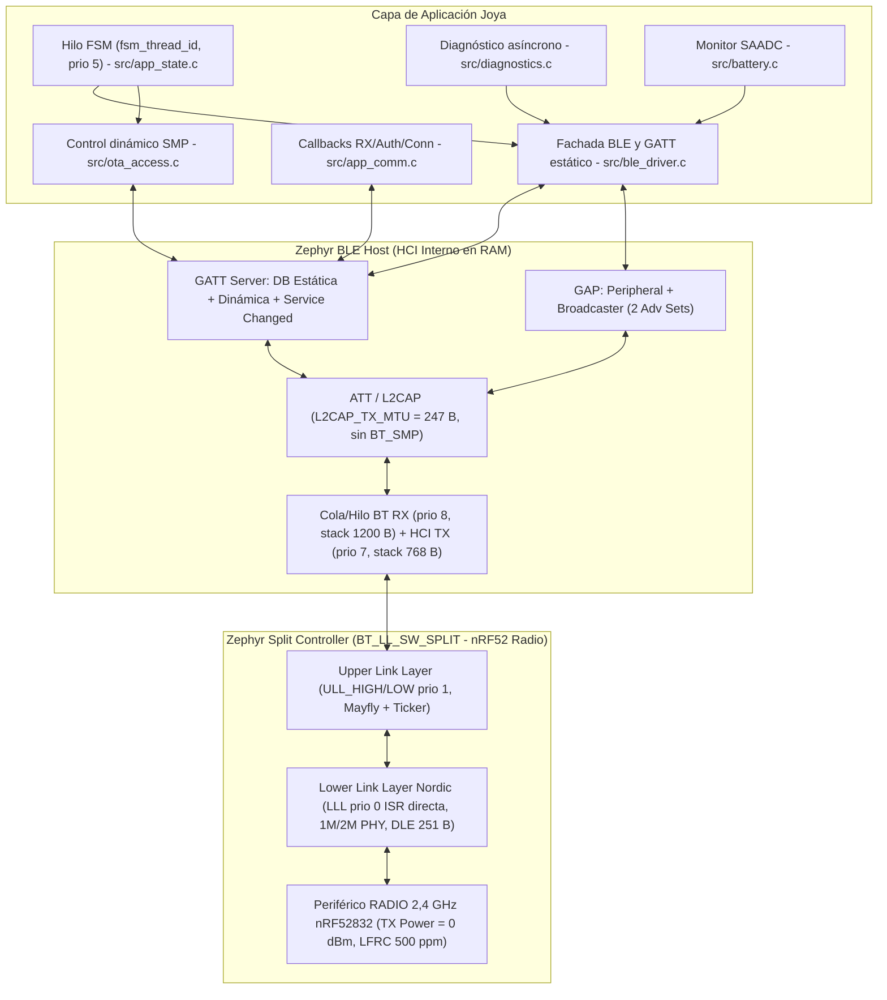
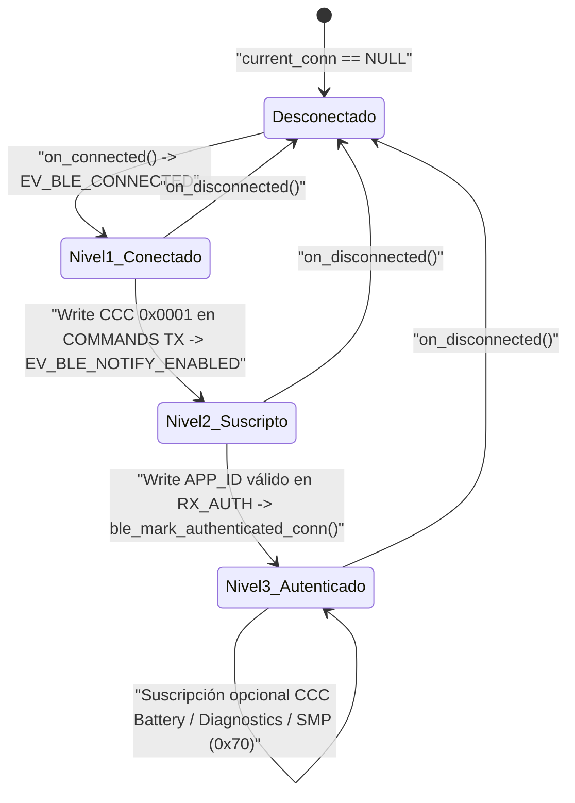

# 7. Arquitectura Bluetooth Low Energy

> **Alcance y corte documental**: Este capítulo analiza la arquitectura integral del subsistema Bluetooth Low Energy (BLE) del firmware de Joya en el commit exacto `c1128e5d0c0d6f98be0a580d287c0926ca27f01f` sobre **Zephyr RTOS 4.2.0** y el SoC **Nordic Semiconductor nRF52832-QFAA**. Para el desglose específico del paquete y política de iBeacon véase `[08_ibeacon.md](08_ibeacon.md)`; para la especificación de servicios, características y comandos de aplicación véase `[09_gatt_protocol.md](09_gatt_protocol.md)`; para el protocolo de identidad `APP_ID` véase `[10_authentication.md](10_authentication.md)`; y para el transporte OTA sobre SMP/MCUmgr véase `[11_ota_mcuboot.md](11_ota_mcuboot.md)`.

---

## 7.1. Visión General de la Pila BLE en Zephyr 4.2.0 (`BT_LL_SW_SPLIT`)

A diferencia de diseños clásicos sobre nRF52 basados en binarios precompilados *SoftDevice* de Nordic (`S132`), el firmware de Joya ejecuta íntegramente el **Zephyr Software Split Link Layer** (`CONFIG_BT_LL_SW_SPLIT=y` y `CONFIG_BT_LLL_VENDOR_NORDIC=y` en `.config` compilado) acoplado en el mismo binario monolítico de aplicación (Slot 0, `220 KiB`) con el **Host BLE de Zephyr** (`CONFIG_BT_HCI_HOST=y`).

### 7.1.1. Consecuencias arquitectónicas del modelo `BT_LL_SW_SPLIT`

1. **Unificación de imagen OTA**: Al residir tanto el controlador de radio (`LLL`/`ULL`) como el Host (`L2CAP`/`ATT`/`GATT`/`GAP`) y la lógica de aplicación dentro de `slot0_partition` (`[boards/joya/joya_nrf52/joya_nrf52_nrf52832.dts](../../boards/joya/joya_nrf52/joya_nrf52_nrf52832.dts)`, líneas 57–60), cualquier mejora futura en buffers BLE, políticas de privacidad o parámetros LL puede desplegarse mediante actualización OTA de aplicación sin tocar MCUboot ni particiones (véase restricción operativa en `[docs/auditorias/Avances.md](../../docs/auditorias/Avances.md)`, líneas 27–39).
2. **Prioridades de ejecución deterministas**:
   - **Lower Link Layer (`LLL`)**: `CONFIG_BT_CTLR_LLL_PRIO=0`, ejecutado con máxima prioridad de interrupción para cumplir ventanas estrictas `T_IFS = 150 us` (`CONFIG_BT_CTLR_EVENT_IFS_LOW_LAT_US=150` y `CONFIG_BT_CTLR_TIFS_HW_SUPPORT=y`).
   - **Upper Link Layer (`ULL`)**: `CONFIG_BT_CTLR_ULL_HIGH_PRIO=1` y `CONFIG_BT_CTLR_ULL_LOW_PRIO=1`, planificado por el subsistema `Ticker`/`Mayfly` de Zephyr (`CONFIG_BT_MAYFLY_YIELD_AFTER_CALL=y`).
   - **Hilos del Host BLE**: `BT_DRV_RX` de alta prioridad (`CONFIG_BT_DRIVER_RX_HIGH_PRIO=6`, stack `512 B`), `BT_HCI_TX` (`CONFIG_BT_HCI_TX_PRIO=7`, stack `768 B`) y `BT_RX` (`CONFIG_BT_RX_PRIO=8`, stack `1200 B`, ejecutando callbacks GATT y de conexión sobre workqueue dedicada `CONFIG_BT_RECV_WORKQ_BT=y`).
   - **Interacción con la FSM**: `fsm_thread_id` corre con prioridad cooperativa/preemptiva `5` y stack de `4098 B` (`[src/app_state.c](../../src/app_state.c)`, línea 36), por encima de `BT_HCI_TX` (`7`) y `BT_RX` (`8`), pero por debajo de `mcumgr_wq` (`CONFIG_MCUMGR_TRANSPORT_WORKQUEUE_THREAD_PRIO=3`, stack `2048 B`) y del controlador de enlace. Esta jerarquía obliga a proteger el estado compartido de conexión con `conn_mutex` (`[src/ble_driver.c](../../src/ble_driver.c)`, línea 150) y el del segundo conjunto publicitario con `ibeacon_mutex` (`[src/ble_driver.c](../../src/ble_driver.c)`, línea 64).
3. **Gestión de aserciones fatales del controlador**: `[prj.conf](../../prj.conf)` (línea 87) activa `CONFIG_BT_CTLR_ASSERT_HANDLER=y`. Cualquier violación temporal crítica del `LLL`/`ULL` invoca `bt_ctlr_assert_handle()` en `[src/fatal_recovery.c](../../src/fatal_recovery.c)` (líneas 13–19), ejecutando `NVIC_SystemReset()` inmediato para evitar que la radio quede bloqueada silenciosamente.
4. **Impacto del reloj de baja frecuencia RC (`LFRC`)**: Tanto la aplicación (`[prj.conf](../../prj.conf)`, líneas 126–128) como MCUboot operan con el oscilador RC interno de `32,768 kHz` a `500 ppm` (`CONFIG_CLOCK_CONTROL_NRF_K32SRC_RC=y`, `CONFIG_CLOCK_CONTROL_NRF_K32SRC_500PPM=y`, `CONFIG_CLOCK_CONTROL_NRF_CALIBRATION_PERIOD=4000`). En modo conectado periférico, una tolerancia `SCA = 500 ppm` obliga al controlador a ensanchar proporcionalmente la ventana de recepción (`window widening`) antes de cada evento de conexión, especialmente cuando se encadenan eventos omitidos por *Peripheral Latency* (`latency = 4`), incrementando marginalmente el ciclo de trabajo de RX respecto de un cristal externo de `20 ppm`.

---

## 7.2. Roles GAP y GATT Activos

### 7.2.1. Roles GAP: `Peripheral` + `Broadcaster` simultáneo

En `[prj.conf](../../prj.conf)` se declaran explícitamente:
- `CONFIG_BT=y` (línea 44)
- `CONFIG_BT_PERIPHERAL=y` (línea 45), que selecciona implícitamente `CONFIG_BT_BROADCASTER=y` y `CONFIG_BT_CONN=y`
- `CONFIG_BT_MAX_CONN=1` (línea 54)
- `CONFIG_BT_EXT_ADV=y` y `CONFIG_BT_EXT_ADV_MAX_ADV_SET=2` (líneas 134–135), reflejados en el controlador como `CONFIG_BT_CTLR_ADV_EXT=y` y `CONFIG_BT_CTLR_ADV_SET=2`.

Los roles `Central` (`# CONFIG_BT_CENTRAL is not set`) y `Observer` (`# CONFIG_BT_OBSERVER is not set`) están desactivados en compilación para ahorrar Flash y SRAM. Gracias a la infraestructura de **Extended Advertising** del Host y del Link Layer, el nRF52832 instancia **dos conjuntos de publicidad (Advertising Sets) concurrentes e independientes**, ambos emitiendo PDUs *legacy* sobre los canales primarios `37` (`2402 MHz`), `38` (`2426 MHz`) y `39` (`2480 MHz`) para conservar compatibilidad universal con teléfonos iOS y Android:

1. **Set 0 (implícito, rol `Peripheral`)**: Gestionado mediante la API clásica `bt_le_adv_start()` / `bt_le_adv_stop()` (`[src/ble_driver.c](../../src/ble_driver.c)`, líneas 613, 633–635, 652), que Zephyr traduce internamente a un advertising set legacy conectable y escaneable (`ADV_IND`).
2. **Set 1 (explícito, rol `Broadcaster` — iBeacon)**: Creado una única vez en `ble_driver_init()` mediante `bt_le_ext_adv_create(&ibeacon_adv_param, NULL, &ibeacon_adv)` (`[src/ble_driver.c](../../src/ble_driver.c)`, líneas 504–514), configurado con `.options = 0` para emitir tramas legacy no conectables ni escaneables (`ADV_NONCONN_IND`).

### 7.2.2. Rol GATT: `Server` con Base de Datos Híbrida (Estática + Dinámica)

El firmware actúa exclusivamente como **GATT Server** (`# CONFIG_BT_GATT_CLIENT is not set`), combinando:
- **Seis servicios estáticos en Flash** (enlazados en la sección iterable `bt_gatt_service_static_area`):
  1. Servicio estándar **Generic Attribute (`0x1801`)** de Zephyr (`_1_gatt_svc`, handles `0x0001..0x0004`), que incluye la característica **Service Changed (`0x2A05`, `INDICATE`)** gracias a `CONFIG_BT_GATT_SERVICE_CHANGED=y`.
  2. Servicio estándar **Generic Access (`0x1800`)** de Zephyr (`_2_gap_svc`, handles `0x0005..0x000B`), que expone `Device Name (0x2A00)`, `Appearance (0x2A01 = 0x0000)` y `Peripheral Preferred Connection Parameters (0x2A04)`.
  3. Cuatro servicios propietarios de 128 bits definidos con `BT_GATT_SERVICE_DEFINE` en `[src/ble_driver.c](../../src/ble_driver.c)` (líneas 398–459): `joya_auth_svc` (`...5100`), `joya_battery_svc` (`...5300`), `joya_commands_svc` (`...5000`) y `joya_config_svc` (`...5200`).
- **Un servicio dinámico en RAM** habilitado por `CONFIG_BT_GATT_DYNAMIC_DB=y` (`[prj.conf](../../prj.conf)`, línea 55) y `CONFIG_MCUMGR_TRANSPORT_BT_DYNAMIC_SVC_REGISTRATION=y` (línea 107): el servicio **SMP/MCUmgr** (`8d53dc1d-1db7-4cd3-868b-8a527460aa84`).
  - Antes de `bt_enable(NULL)`, `ble_driver_init()` invoca `ota_access_init()` (`[src/ble_driver.c](../../src/ble_driver.c)`, líneas 494–499), la cual ejecuta `smp_bt_unregister()` (`[src/ota_access.c](../../src/ota_access.c)`, líneas 83–94) para retirar el servicio SMP que el subsistema MCUmgr auto-registró durante `SYS_INIT`.
  - Durante una sesión autenticada, el comando `COMMAND_OTA_ENABLE` (`0x70`) invoca `ota_access_enable()` → `smp_bt_register()` (`[src/ota_access.c](../../src/ota_access.c)`, líneas 96–115), insertando dinámicamente los 4 atributos de SMP en la base GATT y disparando indicaciones `Service Changed` (`0x2A05`) a clientes suscriptos. Al recibir `0x71`, vencer `OTA_IDLE_TIMEOUT` (`2 min`) o desconectar, `smp_bt_unregister()` vuelve a removerlo.
  - Cabe notar que `# CONFIG_BT_GATT_CACHING is not set` en `.config`: el servidor **no** expone `Database Hash` (`0x2B2A`) ni `Client Supported Features` (`0x2B29`), sino que depende de indicaciones `Service Changed` (`0x2A05`) o de un redescubrimiento explícito de servicios por parte del cliente móvil tras enviar `0x70`.

---

## 7.3. Análisis Exhaustivo de los Conjuntos de Publicidad (Advertising Sets)

### 7.3.1. Comparativa estructural Set 0 vs. Set 1

| Parámetro / Atributo | Set 0: Publicidad Principal Conectable | Set 1: Beacon de Proximidad (`iBeacon`) |
|---|---|---|
| **Mecanismo API Zephyr** | Implícito (`bt_le_adv_start` / `bt_le_adv_stop`) | Explícito (`bt_le_ext_adv_create` / `bt_le_ext_adv_start` / `stop`) |
| **Estructura de parámetros** | `joya_adv_param` (`[src/ble_driver.c](../../src/ble_driver.c)`, líneas 33–40) | `ibeacon_adv_param` (`[src/ble_driver.c](../../src/ble_driver.c)`, líneas 45–50) |
| **Flags `.options`** | `BT_LE_ADV_OPT_CONNECTABLE \| BT_LE_ADV_OPT_ONE_TIME \| BT_LE_ADV_OPT_USE_NAME` | `0` (ningún flag activo) |
| **Tipo de PDU en aire** | Legacy `ADV_IND` (conectable, escaneable, no dirigido) + `SCAN_RSP` | Legacy `ADV_NONCONN_IND` (no conectable, no escaneable) |
| **Canales RF** | Primarios `37`, `38`, `39` | Primarios `37`, `38`, `39` |
| **Intervalo mínimo** | `BT_GAP_ADV_FAST_INT_MIN_2` = `0x00A0` (`160 × 0,625 ms` = **100,0 ms**) | `BT_GAP_ADV_SLOW_INT_MIN` = `0x0640` (`1600 × 0,625 ms` = **1000,0 ms**) |
| **Intervalo máximo** | `BT_GAP_ADV_FAST_INT_MAX_2` = `0x00F0` (`240 × 0,625 ms` = **150,0 ms**) | `BT_GAP_ADV_SLOW_INT_MAX` = `0x0780` (`1920 × 0,625 ms` = **1200,0 ms**) |
| **Jitter pseudoaleatorio LL** | `+ 0..10 ms` por evento según especificación BLE Core | `+ 0..10 ms` por evento según especificación BLE Core |
| **Payload `AD` primario** | `ad[]`: `02 01 06` (`3 bytes`: Flags `GENERAL \| NO_BREDR`) | `connection_ibeacon_ad[]`: `02 01 04` + `1A FF 4C 00 ...` (**30 bytes**) |
| **Payload `Scan Response`** | Generado automáticamente por Zephyr con `BT_DATA_NAME_COMPLETE` (`0x09`) | Vacío (`NULL, 0`; PDU no admite `SCAN_REQ`) |
| **Dirección MAC radiada** | Identidad estática aleatoria de fábrica (`NRF_FICR`, MSBs `11`) | Dirección privada no resoluble (`NRPA`, MSBs `00`) generada por Zephyr |
| **Condición de activación** | Setup (`is_new_connection=true`) o reconexión (`false`) sin enlace activo | Solo cuando `connectable_adv_running == 1 && !ble_has_connection() && !is_app_id_empty()` |
| **Comportamiento al conectar** | Se detiene automáticamente en controlador (`BT_LE_ADV_OPT_ONE_TIME`) | Se detiene asíncronamente vía `ibeacon_stop_work` y en `EV_BLE_CONNECTED` |

### 7.3.2. Funcionamiento detallado del Set 0 (`joya_adv_param`)

En `[src/ble_driver.c](../../src/ble_driver.c)` (líneas 33–40 y 464–466), `joya_adv_param` combina tres banderas fundamentales:

1. **`BT_LE_ADV_OPT_CONNECTABLE`**: Configura el set como conectable. Dado que no se activa `BT_LE_ADV_OPT_EXT_ADV`, el Host ordena al controlador emitir PDUs legacy `ADV_IND`, permitiendo tanto solicitudes de escaneo (`SCAN_REQ` → `SCAN_RSP`) como solicitudes de conexión (`CONNECT_IND`).
2. **`BT_LE_ADV_OPT_ONE_TIME`**: Esencial con `CONFIG_BT_MAX_CONN=1`. Sin esta opción, el Host BLE de Zephyr intentaría reanudar automáticamente el advertising conectable apenas se liberara un contexto de conexión al desconectar, compitiendo y causando condiciones de carrera con la política explícita de la máquina de estados (`STATE_SETUP_MODE`, `STATE_UNPAIRED`, suspensión lógica o batería crítica). Con `ONE_TIME`, una vez que el controlador acepta un `CONNECT_IND`, el Set 0 queda deshabilitado hasta que la FSM invoque deliberadamente `ble_start_setup_advertising()`.
3. **`BT_LE_ADV_OPT_USE_NAME` y ubicación del nombre en `SCAN_RSP`**: `ble_start_setup_advertising()` (`[src/ble_driver.c](../../src/ble_driver.c)`, líneas 633–635) invoca `bt_le_adv_start(&joya_adv_param, ad, ARRAY_SIZE(ad), NULL, 0)`. En Zephyr 4.2 (`le_adv_update()` en `subsys/bluetooth/host/adv.c`), cuando un set legacy es escaneable (`ADV_IND`), `sd == NULL` y no se pasa `BT_LE_ADV_OPT_FORCE_NAME_IN_AD`, el paquete primario `ADV_IND` transporta únicamente los `3 bytes` de `ad[]` (`02 01 06`: `BT_LE_AD_GENERAL | BT_LE_AD_NO_BREDR`), mientras que el Host inyecta automáticamente la estructura `BT_DATA_NAME_COMPLETE` (`0x09`) en el **Scan Response (`SCAN_RSP`)**.

> [!WARNING]
> **Condición de borde verificada entre `JOYA_SUFFIX_MAX_LEN` (23 B) y el límite legacy de `SCAN_RSP` (31 B)**:
> - **Comportamiento implementado**: `on_name_write()` (`[src/ble_driver.c](../../src/ble_driver.c)`, líneas 273–320) admite un sufijo de hasta `JOYA_SUFFIX_MAX_LEN = 23` bytes (`31 - 8`), formando `"Joya de <sufijo>"` de hasta `31` bytes útiles (`JOYA_NAME_MAX_LEN = 31`, compatible con `CONFIG_BT_DEVICE_NAME_MAX=32`).
> - **Consecuencia en `bt_le_adv_start()`**: Una PDU legacy `SCAN_RSP` admite como máximo `31` bytes totales (`CONFIG_BT_CTLR_ADV_DATA_LEN_MAX=31`). Como el encabezado AD de `BT_DATA_NAME_COMPLETE` consume `2` bytes (`Length` + `0x09`), en `SCAN_RSP` caben a lo sumo **$31 - 2 = 29\text{ bytes}$** de nombre completo, equivalentes a `"Joya de "` (`8` B) + **21 bytes de sufijo**. Si la aplicación móvil escribe un sufijo de **22 o 23 bytes** (p. ej., caracteres UTF-8 multibyte), `bt_set_name()` y `storage_save_name()` tendrán éxito (`return len`), pero en la siguiente desconexión `bt_le_adv_start()` con `BT_LE_ADV_OPT_USE_NAME` fallará con `-EMSGSIZE` (`-90`) al no caber el nombre completo en los `31` bytes de `SCAN_RSP`, reportando `DIAG_ERROR_BLE` (`0xE4`) e impidiendo volver a anunciar hasta un Factory Reset. (Nota para el equipo móvil: limitar el sufijo en UI a `<= 21` bytes UTF-8).

---

## 7.4. Identificación del Dispositivo, Nombre Dinámico y Direccionamiento MAC

### 7.4.1. Política de nombre BLE dinámico

El firmware compila `CONFIG_BT_DEVICE_NAME="Joya"`, `CONFIG_BT_DEVICE_NAME_DYNAMIC=y` y `CONFIG_BT_DEVICE_NAME_MAX=32` (`[prj.conf](../../prj.conf)`, líneas 48–52). El nombre anunciado por `ble_start_setup_advertising(bool is_new_connection)` (`[src/ble_driver.c](../../src/ble_driver.c)`, líneas 621–626) varía según el modo operativo:

| Escenario | Valor de `is_new_connection` | Nombre cargado vía `bt_set_name()` | Longitud `SCAN_RSP` (`2 + len`) | Persistencia en NVS (`joya/name`) |
|---|---|---|---|---|
| Configuración inicial sin `APP_ID` (`STATE_SETUP_MODE`) o imagen OTA `Test` (`app_start_test_setup`) | `true` | `"Joya Setup"` (`JOYA_ADV_NAME_SETUP`) | `12 bytes` (`0B 09 ...`) | **No** se persiste; solo altera `bt_set_name()` en RAM del Host BLE |
| Reconexión con `APP_ID` y nombre de fábrica por defecto | `false` | `"Joya"` (`JOYA_ADV_NAME_DEFAULT`) | `6 bytes` (`05 09 4A 6F 79 61`) | Valor por defecto en RAM si `joya/name` no existe |
| Reconexión tras personalización en `NAME` (`...5201`) | `false` | `"Joya de <sufijo>"` (`1..23` B sufijo; seguro en ADV hasta `21` B) | `11..31 bytes` | Persistido en NVS como cadena terminada en `\0` |

> **Observación sobre arranque OTA `Test` (`N-06` en `[docs/auditorias/Avances.md](../../docs/auditorias/Avances.md)`)**: En `process_event()` para `EV_BOOT_TEST_SETUP_REQUEST` (`[src/app_state.c](../../src/app_state.c)`, línea 407), el firmware invoca `start_advertising_with_ibeacon(true)` incondicionalmente. Por ende, tras reiniciar para probar una imagen OTA `Test`, Joya anuncia temporalmente el nombre `"Joya Setup"` incluso si ya posee un `APP_ID` y un nombre personalizado en NVS, emitiendo en paralelo el iBeacon de conexión si `!is_app_id_empty()`.

### 7.4.2. Direcciones BLE y ausencia de privacidad RPA

En `.config` efectivo:
- `CONFIG_BT_ID_MAX=1`
- `# CONFIG_BT_PRIVACY is not set` (Host RPA desactivado)
- `# CONFIG_BT_CTLR_PRIVACY is not set` (Controller Resolving List desactivada, pese a `CONFIG_BT_CTLR_PRIVACY_SUPPORT=y` en hardware)
- `# CONFIG_BT_SETTINGS is not set` (la identidad BLE no se persiste en NVS sino que se lee del silicio en cada arranque).

Esto produce un comportamiento diferenciado y altamente relevante entre los dos conjuntos de publicidad (verificado en el binario compilado `zephyr.elf` sobre `bt_id_init`, `bt_id_set_adv_own_addr` y `bt_id_set_adv_private_addr`):

1. **Identidad base y Set 0 conectable (`Peripheral`)**: Durante `bt_enable(NULL)`, `bt_id_init()` consulta al controlador `BT_LL_SW_SPLIT` mediante `BT_HCI_OP_VS_READ_STATIC_ADDRS`, leyendo los registros de fábrica `NRF_FICR->DEVICEADDR[0..1]` del nRF52832 y forzando sus dos bits más significativos a `11` (*Static Random Address*, p. ej., `D0:CE:92:EC:CF:96` en `[ota/bridge_ota/bridge_ota.ino](../../ota/bridge_ota/bridge_ota.ino)`, línea 8). Como `joya_adv_param` incluye `BT_LE_ADV_OPT_CONNECTABLE` y `CONFIG_BT_PRIVACY=n`, el Set 0 utiliza **siempre la misma dirección aleatoria estática de fábrica**, invariante a través de ciclos de energía, actualizaciones OTA y Factory Resets.
   - **Ventaja operativa**: Simplifica la reconexión directa en Android (`BluetoothDevice` por MAC cacheada) y clientes de banco (`joya_console.py`). En iOS, CoreBluetooth abstrae la MAC en un `CBPeripheral.identifier` (`UUID` derivado localmente por iOS) estable mientras la MAC del periférico no cambie.
   - **Implicación de privacidad RF** (registrada como `N-10` en `[docs/auditorias/Avances.md](../../docs/auditorias/Avances.md)`, línea 57): Mientras el Set 0 está publicitando (`STATE_SETUP_MODE` o `STATE_BONDED_DISCONNECTED`), la MAC fija y el nombre `"Joya de <sufijo>"` en `SCAN_RSP` permiten correlacionar radioeléctricamente la presencia del dispositivo.
2. **Dirección del Set 1 no conectable (`ibeacon_adv`)**: En `[src/ble_driver.c](../../src/ble_driver.c)` (líneas 45–50), `ibeacon_adv_param.options` vale `0` (sin `BT_LE_ADV_OPT_CONNECTABLE` y sin `BT_LE_ADV_OPT_USE_IDENTITY`). En Zephyr 4.2, cuando se inicia un advertising set **no conectable** sin `BT_LE_ADV_OPT_USE_IDENTITY`, `bt_id_set_adv_own_addr()` invoca `bt_id_set_adv_private_addr()`, asignando al Set 1 una **Non-Resolvable Private Address (`NRPA`, bits superiores `00`)** generada aleatoriamente con `bt_rand()`. En consecuencia, en un sniffer o escáner BLE como *nRF Connect*, las tramas `ADV_IND` conectables y las tramas `ADV_NONCONN_IND` del iBeacon aparecen originadas desde **dos direcciones MAC distintas** (la estática `11xx...` para el servicio GATT y una `NRPA` `00xx...` para el iBeacon). Esto no afecta en absoluto a iOS CoreLocation ni a escáneres de iBeacon, que filtran exclusivamente por la carga útil `4C 00 02 15 <UUID>` e ignoran la MAC de origen.

---

## 7.5. Ciclo de Vida de Conexiones, Desconexiones y Parámetros de Enlace

### 7.5.1. Gestión de conexión única (`CONFIG_BT_MAX_CONN=1`) y referencias `bt_conn`

El servidor admite una única conexión simultánea (`CONFIG_BT_MAX_CONN=1`). Todas las variables globales de sesión en `[src/ble_driver.c](../../src/ble_driver.c)` (líneas 142–150) se sincronizan bajo `conn_mutex`:
- `static struct bt_conn *current_conn` (con conteo explícito de referencias `bt_conn_ref()` / `bt_conn_unref()`).
- `static bool current_conn_authenticated`.
- Cuatro banderas locales de suscripción CCC (`notify_enabled`, `battery_change_notify_enabled`, `battery_measurement_notify_enabled`, `diagnostics_notify_enabled`).
- `static uint32_t diagnostics_session_epoch` (contador monótono inicializado en `1` e incrementado tanto en `on_connected` como en `on_disconnected` para invalidar notificaciones de diagnóstico en vuelo de sesiones previas).

**Secuencia exacta en `on_connected(struct bt_conn *conn, uint8_t err)`** (`[src/ble_driver.c](../../src/ble_driver.c)`, líneas 217–244):
1. Si `err != 0` (fallo de establecimiento LL, p. ej. `0x3E` `BT_HCI_ERR_CONN_FAIL_TO_ESTAB`), retorna sin asignar `current_conn` (nota: como `ONE_TIME` detuvo el Set 0 al procesar el intento fallido, si no había reintento activo véase observación `N-12` en `[docs/auditorias/Avances.md](../../docs/auditorias/Avances.md)`, línea 59).
2. Toma `conn_mutex`. Si `current_conn != NULL` (defensa en profundidad ante carrera extrema), libera el mutex y expulsa la conexión entrante con `bt_conn_disconnect(conn, BT_HCI_ERR_REMOTE_USER_TERM_CONN)` (`0x13`).
3. Adquiere referencia `current_conn = bt_conn_ref(conn)`, incrementa `diagnostics_session_epoch`, limpia `connectable_adv_running` (`atomic_clear`), y resetea `current_conn_authenticated` y las cuatro banderas CCC a `false`.
4. Encola `ibeacon_stop_work` en la `sysworkq` para detener el Set 1 fuera del contexto del callback de conexión, e invoca `on_connected_handler(conn, err)` (`[src/app_comm.c](../../src/app_comm.c)`, líneas 60–63), que encola `EV_BLE_CONNECTED` llevando su propia referencia `bt_conn_ref(conn)` dentro de `app_event_t` (`[src/app_state.c](../../src/app_state.c)`, líneas 340–354 y 368–370).

**Secuencia exacta en `on_disconnected(struct bt_conn *conn, uint8_t reason)`** (`[src/ble_driver.c](../../src/ble_driver.c)`, líneas 247–271):
1. Bajo `conn_mutex`, si `current_conn == conn`, extrae `old_conn`, anula `current_conn = NULL`, pone `current_conn_authenticated = false`, incrementa `diagnostics_session_epoch` y limpia todas las banderas CCC.
2. Fuera del mutex, si `old_conn != NULL`, llama a `ota_access_on_disconnect()` (`[src/ota_access.c](../../src/ota_access.c)`, líneas 129–138, limpiando `uploading`/`upload_complete`, cancelando `idle_close_work` y desregistrando SMP) y libera `bt_conn_unref(old_conn)`.
3. Encola `EV_BLE_DISCONNECTED` en `event_queue`. Cuando la desconexión es iniciada activamente por Joya (`ble_disconnect()`, líneas 741–778, invocada en suspensión, batería crítica o Factory Reset), se emplea el código HCI `BT_HCI_ERR_REMOTE_USER_TERM_CONN` (`0x13`), deteniendo además ambos sets de advertising.

### 7.5.2. Reintentos automáticos de advertising (`advertising_restart_work`)

Al procesar `EV_BLE_DISCONNECTED` con un `APP_ID` registrado (o durante emergencia activa / ventana crítica), la FSM no reinicia el advertising dentro del callback de desconexión, sino que llama a `schedule_advertising_restart()` (`[src/app_state.c](../../src/app_state.c)`, líneas 305–313):
- Programa `advertising_restart_work` con un retardo inicial de **`10 ms`**, dando margen al Host BLE para liberar completamente el objeto `bt_conn` único (`CONFIG_BT_MAX_CONN=1`) antes de pedir al controlador que reactive el Set 0 conectable.
- Al disparar `EV_BLE_RESTART_ADVERTISING` (`[src/app_state.c](../../src/app_state.c)`, líneas 575–596), incrementa `advertising_attempts` e invoca `start_advertising_with_ibeacon(is_app_id_empty())`. Si retorna error transitorio (`-ENOMEM`, `-EBUSY` o `-EAGAIN`) y `advertising_attempts < 3`, reprograma `advertising_restart_work` cada **`5 s`** hasta un máximo de **3 intentos totales** (`10 ms`, `+5 s`, `+10 s`). Si los 3 intentos fallan, el usuario conserva recuperación manual mediante doble clic (`EV_BTN_2_PULSE` en `STATE_BONDED_DISCONNECTED`, líneas 1003–1010).

### 7.5.3. Negociación de parámetros de conexión y compatibilidad con Apple

`[prj.conf](../../prj.conf)` (líneas 58–66) y los valores por defecto de Zephyr configuran la negociación automática de parámetros de enlace periférico:

| Parámetro | Opción Kconfig | Valor Crudo | Valor Físico | Regla *Apple Accessory Design Guidelines* | Cumplimiento |
|---|---|---|---|---|---|
| Publicación PPCP (`0x2A04`) | `CONFIG_BT_GAP_PERIPHERAL_PREF_PARAMS=y` | Activo | Característica GAP `0x2A04` | Recomendado | Sí |
| Solicitud automática de update | `CONFIG_BT_GAP_AUTO_UPDATE_CONN_PARAMS=y` | Activo | Tras `5000 ms` (`UPDATE_TIMEOUT`) | Permitido tras estabilizar | Sí |
| Reintentos de update | `CONFIG_BT_CONN_PARAM_RETRY_COUNT` / `TIMEOUT` | `3` / `5000` | Hasta 3 reintentos cada `5 s` | — | Sí |
| `Conn_Interval_Min` | `CONFIG_BT_PERIPHERAL_PREF_MIN_INT` | `36` (`× 1,25 ms`) | **`45,0 ms`** | $\ge 15\text{ ms}$ (múltiplo de $15\text{ ms}$) | **Cumple** ($3 \times 15\text{ ms}$) |
| `Conn_Interval_Max` | `CONFIG_BT_PERIPHERAL_PREF_MAX_INT` | `72` (`× 1,25 ms`) | **`90,0 ms`** | `Interval_Min + 15 ms <= Interval_Max <= 2 s` | **Cumple** ($90 - 45 = 45\text{ ms}$) |
| `Peripheral_Latency` | `CONFIG_BT_PERIPHERAL_PREF_LATENCY` | `4` eventos | **`4` eventos omitibles** | $\le 30$ eventos | **Cumple** |
| `Supervision_Timeout` | `CONFIG_BT_PERIPHERAL_PREF_TIMEOUT` | `600` (`× 10 ms`) | **`6000 ms` (`6,0 s`)** | $2\text{ s} \le T_{\text{sup}} \le 6\text{ s}$ y $> \text{Max\_Eff} \times 3$ | **Cumple en el límite superior exacto (`6,0 s`)** |

**Cálculo del intervalo efectivo con latencia periférica**:
$$T_{\text{eff,max}} = \text{Conn\_Interval\_Max} \times (1 + \text{Latency}) = 90\text{ ms} \times (1 + 4) = 450\text{ ms}$$
La condición exigida por Bluetooth Core Spec ($T_{\text{sup}} > 2 \times T_{\text{eff,max}} = 900\text{ ms}$) y la regla estricta de Apple ($T_{\text{sup}} > 3 \times T_{\text{eff,max}} = 1350\text{ ms}$ y $T_{\text{sup}} \le 6000\text{ ms}$) se satisfacen simultáneamente con amplio margen frente a desvanecimientos RF corporales.

---

## 7.6. Parámetros de Capa de Enlace y Transporte: Configurados vs. Negociados vs. Efectivos

Es indispensable distinguir entre lo que el firmware **configura** localmente, lo que ambos extremos **negocian** tras conectar y el valor **efectivo** resultante:

| Capa / Mecanismo | Configurado en Joya (`prj.conf` / `.config`) | Procedimiento de Negociación Automática | Valor Efectivo en Sesión |
|---|---|---|---|
| **Potencia de transmisión RF** | `CONFIG_BT_CTLR_TX_PWR_0=y` (`CONFIG_BT_CTLR_TX_PWR_DBM=0`), sin control dinámico (`DYNAMIC_CONTROL=n`) | No negociado | **`0 dBm`** fijos en TX para Set 0, Set 1 (iBeacon) y paquetes de conexión |
| **Modulación física (`PHY`)** | `CONFIG_BT_CTLR_PHY_2M=y` + `CONFIG_BT_AUTO_PHY_UPDATE=y` (`1M` y `2M` soportados; `Coded PHY` no soportado en nRF52832) | Al conectar en `LE 1M`, Zephyr inicia automáticamente `LL_PHY_REQ` solicitando `LE 2M PHY` | **`2 Mbps` (`LE 2M`)** con smartphones modernos (BLE 5.0+); cae a **`1 Mbps` (`LE 1M`)** si el central solo soporta BLE 4.x |
| **Data Length Extension (`DLE`)** | `CONFIG_BT_CTLR_DATA_LENGTH_MAX=251`, `ACL_RX_SIZE=251`, `ACL_TX_SIZE=251`, `CONFIG_BT_AUTO_DATA_LEN_UPDATE=y` | Zephyr envía automáticamente `LL_LENGTH_REQ` (`251 B` / `2120 us` en 1M o `1064 us` en 2M) | Hasta **`251 bytes`** de payload LL PDU (`247 B` L2CAP + `4 B` cabecera L2CAP) sin fragmentación en aire; `27 B` si el peer no soporta DLE |
| **`L2CAP MTU` / `ATT_MTU`** | `CONFIG_BT_L2CAP_TX_MTU=247` (`RX MTU` derivado de `ACL_RX_SIZE - 4 = 247`) | Como Joya es solo `GATT Server` (`BT_GATT_CLIENT=n`), **Joya no inicia `Exchange MTU Request`**; responde al `Exchange MTU Request` del teléfono | `min(247, MTU_cliente)`: **`247 B`** en Android/ESP32 (`NimBLEDevice::setMTU(247)`) e iOS modernos (`185..247 B` según versión iOS). Si el cliente **no** solicita MTU Exchange, permanece en **`23 B`** por defecto |
| **Carga útil ATT máxima** | `ATT_MTU - 3` para `Write Cmd` / `Write Req` / `Notify` | Limitado por `ATT_MTU` negociado | **`244 bytes`** con `ATT_MTU = 247` (`182 B` si iOS negocia `185 B`; `20 B` si no hay MTU Exchange) |

> [!IMPORTANT]
> **Impacto directo sobre OTA (`SMP/MCUmgr`)**: En `.config`, `# CONFIG_MCUMGR_TRANSPORT_BT_REASSEMBLY is not set`. En consecuencia, cada trama SMP enviada desde el teléfono hacia Joya debe caber en **una sola escritura ATT sin respuesta (`<= ATT_MTU - 3`)**. Si el cliente no negocia `ATT_MTU > 23` antes de usar SMP, un chunk de carga OTA no cabrá siquiera con su cabecera SMP (`8 B`) + mapa CBOR (`off`, `len`, `sha`, `data`). Véase `[ota/joya_console.py](../../ota/joya_console.py)` (líneas 638–648), que ajusta dinámicamente el tamaño del bloque a `mtu - 3`.

---

## 7.7. Suscripciones CCC y los Tres Niveles de Estado de Sesión

### 7.7.1. Ausencia de persistencia de CCC (`CONFIG_BT_SETTINGS=n`, `CONFIG_BT_SMP=n`)

La base GATT de Joya contiene **6 descriptores `Client Characteristic Configuration` (`0x2902`)** en total:
1. `Service Changed` (`0x2A05`, gestionado por Zephyr).
2. `COMMANDS TX` (`...5001`, callback `on_ccc_changed`, bandera `notify_enabled`).
3. `DIAGNOSTICS` (`...5202`, callback `on_diagnostics_ccc_changed`, bandera `diagnostics_notify_enabled`).
4. `BATTERY_CHANGE` (`...5301`, callback `on_battery_change_ccc_changed`, bandera `battery_change_notify_enabled`).
5. `BATTERY_MEASUREMENT` (`...5302`, callback `on_battery_measurement_ccc_changed`, bandera `battery_measurement_notify_enabled`).
6. `SMP Characteristic` (`da2e7828-...`, registrado dinámicamente cuando OTA está habilitado).

Debido a que `# CONFIG_BT_SMP is not set` (`CONFIG_BT_MAX_PAIRED=0`) y `# CONFIG_BT_SETTINGS is not set`, **no existe vínculo criptográfico (*Bonding*) ni persistencia de suscripciones CCC entre conexiones**. Además, `CONFIG_BT_GATT_ENFORCE_SUBSCRIPTION=y` exige en el Host que el CCC esté activo antes de transmitir notificaciones. Por ello, **en absolutamente cada conexión y reconexión**, la aplicación móvil está obligada a escribir `0x0001` (`BT_GATT_CCC_NOTIFY`) en los descriptores CCC requeridos (y `0x0002` en `Service Changed` si monitorea cambios dinámicos de SMP).

> **Limitación conocida (`D-03` en `[docs/auditorias/Avances.md](../../docs/auditorias/Avances.md)`, línea 66)**: Cuando el cliente escribe `0x0000` en el CCC de `COMMANDS TX` estando ya autenticado, `on_ccc_changed()` actualiza `notify_enabled = false` (impidiendo envíos en `ble_send_event_authenticated()`), pero **no** retrocede `current_state` desde `STATE_AUTHENTICATED` hacia `STATE_WAITING_NOTIFICATION_ENABLE`. Si luego vuelve a escribir `0x0001`, `process_event()` captura `EV_BLE_NOTIFY_ENABLED && current_state == STATE_AUTHENTICATED` (`[src/app_state.c](../../src/app_state.c)`, líneas 488–491) y reenvía pendientes mediante `send_pending_after_auth()`.

### 7.7.2. Distinción rigurosa de los tres niveles de estado de sesión

El diseño del firmware separa estrictamente tres niveles acumulativos de madurez de sesión:

| Nivel | Predicado exacto en código | Estado FSM (`current_state`) | Operaciones permitidas / bloqueadas |
|---|---|---|---|
| **Nivel 1: Conectado** | `ble_has_connection() == true` (`current_conn != NULL`), `notify_enabled == false`, `current_conn_authenticated == false` | `STATE_WAITING_NOTIFICATION_ENABLE` | Puede descubrir servicios, leer `GAP` (`0x2A00`/`0x2A01`/`0x2A04`), leer `NAME` (`...5201`) y escribir descriptores CCC. Escrituras de `APP_ID` en `RX_AUTH` se encolan pero la FSM las **descarta** por contrato de protocolo (`[src/app_state.c](../../src/app_state.c)`, líneas 909–920). Lectura de `DIAGNOSTICS` falla con `BT_ATT_ERR_AUTHORIZATION`. |
| **Nivel 2: Suscripto a CCC** | `ble_commands_subscribed_for_conn(conn) == true` (`notify_enabled == true` y `bt_gatt_is_subscribed`), `current_conn_authenticated == false` | `STATE_SETUP_WAITING_IDENTIFIER` | Habilita `ble_send_event_for_conn()` únicamente para responder `COMMAND_ACK (0x05)` o `COMMAND_NACK (0x06)` al evaluar `APP_ID`. Comandos en `COMMANDS RX` (`...5002`) siguen bloqueados por `!ble_is_authenticated_conn(entry->conn)` (`[src/app_state.c](../../src/app_state.c)`, líneas 396–400 y 703–712). |
| **Nivel 3: Autenticado** | `ble_is_authenticated_conn(conn) == true` (`current_conn == conn && current_conn_authenticated == true`) y `current_state == STATE_AUTHENTICATED` | `STATE_AUTHENTICATED` | Habilita `ble_send_event_authenticated()` (`0x02`, `0x03`, `0x04`, `0x05`), recepción de comandos `0x41..0x44` y `0x70..0x71`, escritura de `NAME` (`...5201`), lectura/notificación de `DIAGNOSTICS` (`...5202`, si `diagnostics_notify_enabled`) y notificaciones de batería (`...5301`/`...5302`, si sus respectivos CCC están activos). |

---

## 7.8. Dimensionamiento de Buffers BLE e Impacto en Rendimiento y Consumo

### 7.8.1. Inventario de pools y colas en RAM (`.config` compilado)

| Recurso / Pool | Símbolo Kconfig | Cantidad | Tamaño unitario | Propósito y efecto de agotamiento |
|---|---|---|---|---|
| **TX ACL Buffers (Host→LL)** | `CONFIG_BT_BUF_ACL_TX_COUNT` / `SIZE` | `3` | `251 B` | Tramas L2CAP/ATT salientes (notificaciones GATT y respuestas SMP). Si los 3 están en vuelo esperando ACK de radio, `bt_gatt_notify()` bloquea o falla con `-ENOMEM`. |
| **Contextos TX ATT / L2CAP** | `CONFIG_BT_ATT_TX_COUNT` / `CONFIG_BT_L2CAP_TX_BUF_COUNT` / `CONFIG_BT_CONN_TX_MAX` | `3` | `247 B` (L2CAP) | Límite de notificaciones ATT simultáneas en cola hacia la conexión única (`MAX_CONN=1`). |
| **RX ACL Buffers (LL→Host)** | `CONFIG_BT_BUF_ACL_RX_COUNT_EXTRA` (+ base `MAX_CONN`) | `2` efectivos (`1 + 1`) | `251 B` | Recepción de `Write Request` / `Write Command` (incluyendo paquetes SMP de `244 B`). Sin control de flujo HCI (`HCI_ACL_FLOW_CONTROL=n`). |
| **RX HCI Event Buffers** | `CONFIG_BT_BUF_EVT_RX_COUNT` / `SIZE` | `10` (+ `3` discardable) | `68 B` (`58 B` disc.) | Eventos de control LL→Host (conexión, desconexión, número de paquetes completados, actualizaciones PHY/DLE). |
| **Pool Transporte MCUmgr** | `CONFIG_MCUMGR_TRANSPORT_NETBUF_COUNT` / `SIZE` | `4` | `384 B` | Cola de paquetes SMP entrantes/salientes hacia `mcumgr_wq` (`2048 B` stack). |
| **Cola de eventos FSM** | `event_queue` (`K_MSGQ_DEFINE`) | `20` | `24 B` (`sizeof(app_event_t)`) | Eventos hacia `fsm_thread_id`; si se llena, `add_event_for_conn()` retorna `-ENOMSG` (`BT_ATT_ERR_INSUFFICIENT_RESOURCES` en GATT) y emite `0xE3`. |

### 7.8.2. Evaluación cuantitativa de latencia, throughput OTA y consumo energético

1. **Latencia de comandos críticos (Emergencia / Rutina)**:
   - Con el enlace ya establecido y en reposo (aprovechando `Peripheral Latency = 4`), un evento generado localmente en Joya (clic o triple clic en `button.c` tras `50 ms` de debounce y `900 ms` de ventana multiclic) **no necesita esperar los `450 ms` de latencia esclava**: el periférico puede despertar y transmitir en el **siguiente evento de conexión inmediato**, acotando la latencia de aire Host→Teléfono a **$[0,\; \text{Conn\_Interval}] = [0,\; 45..90\text{ ms}]$** (valor medio $\approx 33..45\text{ ms}$).
   - En sentido inverso (Teléfono→Joya, p. ej. `COMMAND_FRIEND_EMERGENCY` `0x44` o `COMMAND_FOLLOW_ME` `0x43`), si el periférico está durmiendo los `4` eventos de *Peripheral Latency*, la entrega desde el central puede demorar hasta **$T_{\text{eff,max}} = 450\text{ ms}$** en el peor caso (`90 ms × 5`), completamente imperceptible para una alerta háptica humana.
2. **Throughput efectivo durante OTA (`UPLOAD` sobre SMP)**:
   - Durante transferencia continua de bloques SMP (`Write Without Response` de `244 B` ATT → ~`180..210 B` de binario neto por bloque tras cabecera SMP de `8 B` y mapa CBOR), el tráfico bidireccional mantiene despierto al periférico en **cada evento de conexión** (la latencia periférica `4` solo opera cuando no hay datos pendientes).
   - Como el cliente `joya_console.py` / app móvil opera en modo *stop-and-wait* por bloque SMP (envía `Write Without Response` en el evento $N$ y recibe la notificación `Write Response` SMP en el evento $N+1$ o $N+2$, tras la escritura síncrona en `slot1_partition` vía `stream_flash`), cada round-trip consume típicamente $1\text{ a }2 \times \text{Conn\_Interval}$.
   - Con `Conn_Interval = 45 ms` ($22,2\text{ eventos/s}$) y 1 bloque por cada `1..2` intervalos ($\approx 11..22\text{ bloques/s}$ de ~`200 B` útiles), el caudal neto teórico se ubica en **$2,2\text{ a }4,4\text{ KiB/s}$** (transfiriendo una imagen firmada de `165 KiB` en ~`38..75 s`; o el doble si el central negocia `Conn_Interval = 90 ms`). Los `3` buffers `ACL_TX_COUNT` permiten que respuestas SMP fragmentadas en 2 notificaciones (p. ej. lectura `STATE` con hashes SHA-256 de dos slots) se encolen de una sola vez sin bloqueo.
3. **Impacto energético del subsistema BLE** (estimaciones analíticas sobre nRF52832 a `0 dBm`, *pendientes de caracterización experimental con perfilador de corriente sobre PCB final* debido a que el regulador opera en modo `LDO` por defecto — véase `[12_power_battery.md](12_power_battery.md)`):
   - **Desconectado con `APP_ID` (Set 0 a `100..150 ms` + Set 1 iBeacon a `1000..1200 ms`)**: El consumo de radio está dominado en más de un **90 %** por el Set 0 conectable (`~8` ráfagas triples TX+RX por segundo con `ADV_IND` + ventana de escucha `SCAN_REQ`/`CONNECT_IND`), frente a solo `~0,91` ráfagas TX-only por segundo del Set 1 (`ADV_NONCONN_IND` sin ventana RX). Mantener un intervalo rápido permanente de `100..150 ms` en `STATE_BONDED_DISCONNECTED` prioriza una reconexión casi instantánea cuando la usuaria entra en alcance o dispara una emergencia, a costa de un consumo medio significativamente superior al de un esquema de *slow advertising* (`500..1000 ms`), tal como se registra en el hallazgo `N-11` (`[docs/auditorias/Avances.md](../../docs/auditorias/Avances.md)`, línea 58).
   - **Conectado en reposo (`45..90 ms`, `latency = 4`)**: Gracias a `Peripheral Latency = 4`, sin tráfico GATT el nRF52832 solo enciende el receptor una vez cada **$225..450\text{ ms}$**, reduciendo drásticamente el consumo respecto de permanecer desconectado anunciando cada `125 ms`.
   - **Suspensión lógica y batería crítica (`STATE_UNPAIRED` con `suspended_idle == true`)**: Ambos sets publicitarios y cualquier enlace activo se apagan (`ble_disconnect()`), reduciendo el consumo BLE a **cero actividad de radio**.
