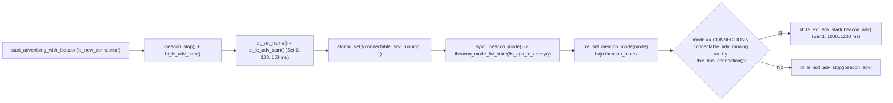
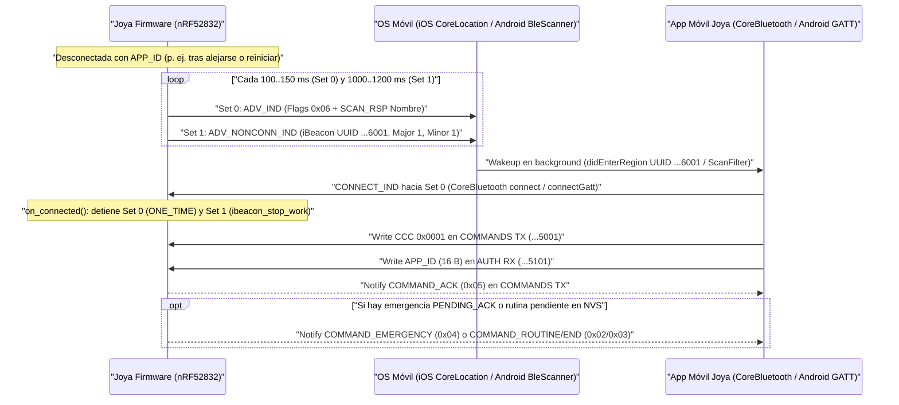

# 8. Implementación y Política de iBeacon

> **Alcance y corte documental**: Este capítulo documenta con precisión de nivel de bit el subsistema **iBeacon de conexión** implementado en el commit exacto `c1128e5d0c0d6f98be0a580d287c0926ca27f01f` (`[include/ibeacon_policy.h](../../include/ibeacon_policy.h)`, `[include/ble_driver.h](../../include/ble_driver.h)`, `[src/ble_driver.c](../../src/ble_driver.c)`, `[src/app_state.c](../../src/app_state.c)` y `[docs/IBEACON.md](../../docs/IBEACON.md)`). Se relaciona directamente con la arquitectura multi-advertising descrita en `[07_ble_architecture.md](07_ble_architecture.md)`, el flujo de entrega post-autenticación de `[09_gatt_protocol.md](09_gatt_protocol.md)` y `[10_authentication.md](10_authentication.md)`, y las políticas energéticas de `[12_power_battery.md](12_power_battery.md)`.

---

## 8.1. Evolución Arquitectónica y Propósito en `c1128e5`

> [!IMPORTANT]
> **Cambio estructural respecto de versiones previas (`v2.3.1` vs. `HEAD` `c1128e5`)**:
> En revisiones anteriores del firmware existían dos UUIDs de iBeacon diferenciados (uno de conexión `...6001` y otro de emergencia `...6002`). En el commit documentado **`c1128e5d0c0d6f98be0a580d287c0926ca27f01f`**, el iBeacon de emergencia fue **eliminado por completo**. El firmware conserva exclusivamente un **único iBeacon invariante de reconexión (`BLE_IBEACON_CONNECTION`)**, cuyo payload **no cambia jamás** ante emergencias activas, acuses de recibo ni rutinas pendientes (`[docs/IBEACON.md](../../docs/IBEACON.md)`, líneas 9–10; verificado por pruebas unitarias en `[tests/test_emergency_phase.c](../../tests/test_emergency_phase.c)`, líneas 57–70).

### 8.1.1. Motivación de ingeniería del diseño invariante

1. **Despertar de aplicación en segundo plano en iOS**: En iOS, una aplicación cerrada o suspendida en background enfrenta severas restricciones de escaneo CoreBluetooth cuando la pantalla está apagada o tras un reinicio del teléfono, especialmente porque el paquete primario `ADV_IND` de Joya (`02 01 06`, véase `[07_ble_architecture.md](07_ble_architecture.md)`) no anuncia UUIDs de servicio de 128 bits en `AD` (el nombre va en `SCAN_RSP`). El subsistema **CoreLocation Region Monitoring** (`CLBeaconRegion` / `CLBeaconIdentityConstraint`) permite delegar al hardware/OS de Apple la detección de proximidad de un iBeacon fijo y despertar la app durante unos segundos (`didEnterRegion`).
2. **Eliminación de condiciones de carrera y de fuga semántica en aire**: Al hacer que el iBeacon dependa únicamente de si Joya está provisionada (`!is_app_id_empty()`) y desconectada con publicidad activa, se eliminan dos problemas de la arquitectura dual anterior:
   - Un observador pasivo de radiofrecuencia **no puede deducir** si la usuaria ha disparado una alerta de emergencia inspeccionando el UUID del beacon (mitigando la faceta de beacon diferenciado del hallazgo `N-10` en `[docs/auditorias/Avances.md](../../docs/auditorias/Avances.md)`, línea 57).
   - La app móvil solo necesita registrar **una única región CoreLocation** (`a407e00a-00c1-464d-9173-2cb8be586001`), evitando transiciones espurias de salida/entrada de región o pérdidas de eventos cuando ocurre una emergencia o una rutina mientras el teléfono estaba fuera de alcance. Toda la semántica funcional (`0x04` emergencia, `0x02` inicio de rutina, `0x03` fin de rutina) viaja exclusivamente sobre GATT tras completar la autenticación `APP_ID`.

---

## 8.2. Desglose Completo a Nivel de Bytes y Bits del Paquete `connection_ibeacon_ad`

La carga publicitaria del iBeacon está definida estáticamente en Flash en `[src/ble_driver.c](../../src/ble_driver.c)` (líneas 52–58) junto con `JOYA_IBEACON_CONNECTION_UUID_BYTES` en `[include/ble_driver.h](../../include/ble_driver.h)` (líneas 37–39):

```c
static const struct bt_data connection_ibeacon_ad[] = {
    BT_DATA_BYTES(BT_DATA_FLAGS, BT_LE_AD_NO_BREDR),
    BT_DATA_BYTES(BT_DATA_MANUFACTURER_DATA,
                  0x4c, 0x00, 0x02, 0x15,
                  JOYA_IBEACON_CONNECTION_UUID_BYTES,
                  0x00, 0x01, 0x00, 0x01, 0xc8),
};
```

### 8.2.1. Trama hexadecimal cruda en aire (`AdvData` = 30 bytes)

```text
Offset:  00 01 02 | 03 04 05 06 07 08 | 09 10 11 12 13 14 15 16 17 18 19 20 21 22 23 24 | 25 26 | 27 28 | 29
Hex:     02 01 04 | 1A FF 4C 00 02 15 | A4 07 E0 0A 00 C1 46 4D 91 73 2C B8 BE 58 60 01 | 00 01 | 00 01 | C8
         ^^^^^^^^   ^^^^^^^^^^^^^^^^^   ^^^^^^^^^^^^^^^^^^^^^^^^^^^^^^^^^^^^^^^^^^^^^^^   ^^^^^   ^^^^^   ^^
         AD1 Flags  AD2 Header+Apple    Proximity UUID (16 B, Big-Endian / Network)       Major   Minor   TxPwr
```

La longitud total del campo `AdvData` dentro de la PDU `ADV_NONCONN_IND` es de **$3 + 27 = 30\text{ bytes}$ exactos**, consumiendo 30 de los `31 bytes` máximos permitidos por la especificación Bluetooth Legacy Advertising (`CONFIG_BT_CTLR_ADV_DATA_LEN_MAX=31`).

### 8.2.2. Especificación campo por campo y reglas de *Endianness*

| Estructura | Offset (B) | Tamaño (B) | Bytes (Hex) | Endianness | Campo | Interpretación técnica a nivel de bytes y bits |
|---|---:|---:|---|---|---|---|
| **AD 1: Flags** | `0` | `1` | `02` | — | `Length` | `2 bytes` restantes en esta estructura AD (`Type` + `Flags`). |
| **AD 1: Flags** | `1` | `1` | `01` | — | `AD Type` | `BT_DATA_FLAGS` (`0x01`). |
| **AD 1: Flags** | `2` | `1` | `04` | — | `Flags` | `0b00000100`: Bit 2 = `1` (`BT_LE_AD_NO_BREDR`, BR/EDR no soportado). Bits 0 (`LE Limited Discoverable`) y 1 (`LE General Discoverable = 0x02`) valen **`0`**. |
| **AD 2: Mfg Data** | `3` | `1` | `1A` | — | `Length` | `26 bytes` (`0x1A`) siguientes (`1 B` `AD Type` + `25 B` datos de fabricante). |
| **AD 2: Mfg Data** | `4` | `1` | `FF` | — | `AD Type` | `BT_DATA_MANUFACTURER_DATA` (`0xFF`). |
| **AD 2: Mfg Data** | `5..6` | `2` | `4C 00` | **Little-Endian** | `Company ID` | Identificador Bluetooth SIG de **Apple Inc. (`0x004C`)**, transmitido LSB primero (`0x4C`, `0x00`) conforme al suplemento CSS de Bluetooth SIG. |
| **AD 2: Mfg Data** | `7` | `1` | `02` | — | `Sub-Type` | Código propietario de Apple para **Proximity Beacon (`iBeacon`)**. |
| **AD 2: Mfg Data** | `8` | `1` | `15` | — | `Sub-Length` | `21 bytes` (`0x15`) restantes en la estructura iBeacon (`16 + 2 + 2 + 1 = 21`). |
| **AD 2: Mfg Data** | `9..24` | `16` | `A4 07 E0 0A 00 C1 46 4D 91 73 2C B8 BE 58 60 01` | **Big-Endian (Network Order)** | `Proximity UUID` | UUID `a407e00a-00c1-464d-9173-2cb8be586001` en orden directo de visualización/red. Pertenece a la misma familia base `a407e00a-00c1-464d-9173-2cb8be58XXXX` que los servicios GATT de Joya (`5000`–`5300`), asignando el bloque `6001` al iBeacon. |
| **AD 2: Mfg Data** | `25..26` | `2` | `00 01` | **Big-Endian** | `Major` | `uint16_t` = **`1`** (`0x0001`). Fijo para todas las unidades en `c1128e5`. |
| **AD 2: Mfg Data** | `27..28` | `2` | `00 01` | **Big-Endian** | `Minor` | `uint16_t` = **`1`** (`0x0001`). Fijo para todas las unidades en `c1128e5`. |
| **AD 2: Mfg Data** | `29` | `1` | `C8` | Complemento a 2 (`int8_t`) | `Measured Power` | RSSI de referencia a `1 metro`: $0\text{xC8} - 256 = 200 - 256 = \mathbf{-56\text{ dBm}}$. **Valor marcador no calibrado en hardware** (`[src/ble_driver.c](../../src/ble_driver.c)`, líneas 42–44). |

### 8.2.3. Dos sutilezas críticas de codificación en el paquete

1. **Diferencia intencional en `Flags` (`0x04` en iBeacon vs. `0x06` en `ad[]` conectable)**:
   En `[src/ble_driver.c](../../src/ble_driver.c)` (línea 465), el conjunto conectable anuncia `BT_LE_AD_GENERAL | BT_LE_AD_NO_BREDR` (`0x06`), marcándose como dispositivo descubrible general. En cambio, `connection_ibeacon_ad` (línea 53) declara únicamente `BT_LE_AD_NO_BREDR` (`0x04`), dejando `LE General Discoverable = 0`. Dado que el Set 1 emite una dirección `NRPA` distinta de la MAC estática del Set 0 (véase Sección 7.4.2 de `[07_ble_architecture.md](07_ble_architecture.md)`), omitir el bit `Discoverable` evita que selectores Bluetooth del sistema operativo listen el beacon no conectable como un segundo accesorio fantasma, sin afectar en absoluto al detector de iBeacon de iOS/Android.
2. **Inversión de *Endianness* entre UUIDs GATT (`BT_UUID_128_ENCODE`) y UUID de iBeacon (`JOYA_IBEACON_CONNECTION_UUID_BYTES`)**:
   - En el protocolo ATT/GATT de Bluetooth, los UUIDs de 128 bits se transmiten en **little-endian** (el último byte `0x00` o `0x01` viaja primero en el aire), motivo por el cual `[include/ble_driver.h](../../include/ble_driver.h)` (líneas 17–33) usa la macro `BT_UUID_128_ENCODE(...)` de Zephyr.
   - Por el contrario, la especificación iBeacon de Apple encapsula el UUID dentro de datos de fabricante en **orden de red big-endian** (el byte `0xA4` viaja primero). Por esa razón `[include/ble_driver.h](../../include/ble_driver.h)` (líneas 35–39) define explícitamente el arreglo literal `JOYA_IBEACON_CONNECTION_UUID_BYTES` y advierte en su comentario no utilizar `BT_UUID_128_ENCODE()`.
3. **Estado de calibración de `Measured Power` (`0xC8` = `-56 dBm`)**:
   - **Estado epistemológico**: *Marcador de posición pendiente de validación y calibración experimental sobre unidad Joya ensamblada* (`[src/ble_driver.c](../../src/ble_driver.c)`, líneas 42–44; `[docs/IBEACON.md](../../docs/IBEACON.md)`, línea 7).
   - **Efecto práctico**: Aunque el transmisor opera a `0 dBm` (`CONFIG_BT_CTLR_TX_PWR_0=y`), la antena impresa/chip reducida de la joya y la absorción del cuerpo humano atenúan la señal radiada efectiva. Un `Measured Power` no calibrado distorsiona el cálculo de distancia estimada (`CLBeacon.accuracy` y clasificación `Immediate`/`Near`/`Far` durante *Beacon Ranging*), pero **no afecta** la detección de presencia (`didEnterRegion` / `didExitRegion`) de CoreLocation, que depende únicamente de decodificar tramas válidas por encima del umbral de sensibilidad del receptor del iPhone.

---

## 8.3. Arquitectura de Control, Sincronización y Coexistencia en Firmware

### 8.3.1. Ciclo de vida y primitivas de sincronización

El control del iBeacon se divide en dos capas limpiamente desacopladas:

1. **Política pura sin dependencias de Zephyr (`[include/ibeacon_policy.h](../../include/ibeacon_policy.h)`, líneas 6–14)**:
   ```c
   typedef enum {
       BLE_IBEACON_OFF,
       BLE_IBEACON_CONNECTION,
   } ble_ibeacon_mode_t;

   static inline ble_ibeacon_mode_t ibeacon_mode_for_state(bool has_app_id)
   {
       return has_app_id ? BLE_IBEACON_CONNECTION : BLE_IBEACON_OFF;
   }
   ```
2. **Mecanismo de transporte y guardas de concurrencia (`[src/ble_driver.c](../../src/ble_driver.c)`, líneas 60–140, 504–514, 608–659)**:
   - `static struct bt_le_ext_adv *ibeacon_adv`: Instancia reservada en `ble_driver_init()` (Slot 1 de `CONFIG_BT_EXT_ADV_MAX_ADV_SET=2`) con datos precargados una sola vez mediante `bt_le_ext_adv_set_data()`. Nunca se destruye ni recrea en tiempo de ejecución.
   - `static K_MUTEX_DEFINE(ibeacon_mutex)`: Serializa todas las llamadas HCI `bt_le_ext_adv_start()` y `bt_le_ext_adv_stop()` entre el hilo de la FSM (`fsm_thread_id`) y la cola de trabajo del sistema (`ibeacon_stop_work`).
   - `static bool ibeacon_running`: Estado efectivo del Set 1 protegido por `ibeacon_mutex`, haciendo idempotentes las llamadas repetidas a `ble_set_ibeacon_mode()` o `ibeacon_stop()` (tratando `-EALREADY` como éxito `0`).
   - `static atomic_t connectable_adv_running`: Espejo atómico del estado del Set 0 conectable. Se pone a `1` únicamente tras `bt_le_adv_start(...) == 0` (y se revierte inmediatamente si `ble_has_connection()` ya es verdadero por una conexión instantánea en carrera, líneas 642–645), y se limpia (`atomic_clear`) en `ble_start_setup_advertising()`, `ble_stop_advertising()` y `on_connected()`.
   - `K_WORK_DEFINE(ibeacon_stop_work, ibeacon_stop_on_connection)`: Como `on_connected()` se ejecuta en el contexto de recepción del Host BLE (`BT_RX`) y mientras mantiene brevemente `conn_mutex`, no invoca operaciones HCI bloqueantes sobre `ibeacon_mutex` directamente dentro de la sección crítica; en su lugar limpia `connectable_adv_running` y despacha `ibeacon_stop_work` a la `sysworkq` (`[src/ble_driver.c](../../src/ble_driver.c)`, línea 241), reforzado además por `ble_set_ibeacon_mode(BLE_IBEACON_OFF)` cuando la FSM procesa `EV_BLE_CONNECTED` (`[src/app_state.c](../../src/app_state.c)`, línea 572).



### 8.3.2. Invariante fundamental de acoplamiento entre Set 1 y Set 0

En `ble_set_ibeacon_mode()` (`[src/ble_driver.c](../../src/ble_driver.c)`, líneas 93–113), el firmware impone por construcción el invariante:

$$\text{ibeacon\_running} \implies \left(\text{has\_app\_id} \land \text{connectable\_adv\_running} \land \neg\text{ble\_has\_connection}()\right)$$

Esto garantiza que **Joya jamás emite el iBeacon si no está aceptando simultáneamente conexiones GATT en el Set 0**. De lo contrario, el teléfono despertaría por CoreLocation al detectar el iBeacon pero desperdiciaría presupuesto de radio intentando conectar contra un periférico sordo. Cualquier fallo HCI al iniciar o detener `ibeacon_adv` notifica `DIAG_ERROR_BLE` (`0xE4`) a `diagnostics_report_error()`.

### 8.3.3. Planificación temporal en el Link Layer (Coexistencia Set 0 + Set 1)

El planificador `Ticker` del controlador `BT_LL_SW_SPLIT` (`CONFIG_BT_CTLR_ADV_SET=2`, `CONFIG_BT_CTLR_SCHED_ADVANCED=y`) multiplexa en el tiempo ambos advertising sets sobre la única radio física de `2,4 GHz`:
- **Set 0 (`ADV_IND`)**: 1 evento cada `100..150 ms` (+ `0..10 ms` de `advDelay` aleatorio). En cada canal (`37`, `38`, `39`) transmite `ADV_IND` (`9 B` cabecera/MAC + `3 B` `AdvData` = `12 B` payload PDU) y abre ventana RX para escuchar `SCAN_REQ` o `CONNECT_IND`. Duración total del evento triple: ~`1,2..1,8 ms`.
- **Set 1 (`ADV_NONCONN_IND`)**: 1 evento cada `1000..1200 ms` (+ `0..10 ms` de `advDelay`). En cada canal transmite `ADV_NONCONN_IND` (`6 B` MAC + `30 B` `AdvData` = `36 B` payload PDU a `1 Mbps`) **sin abrir ventana de recepción RX**. Duración total del evento triple: ~`1,1 ms`.
- Si los instantes de ambos sets colisionan ocasionalmente, el jitter aleatorio independiente `advDelay` (`0..10 ms`) exigido por Bluetooth Core desacopla automáticamente el siguiente evento sin pérdida sostenida.

---

## 8.4. Matriz Exhaustiva de Políticas de Emisión por Estado y Condición

La siguiente tabla resume el comportamiento exacto verificado en `[src/app_state.c](../../src/app_state.c)` y `[src/ble_driver.c](../../src/ble_driver.c)` para todas las combinaciones operativas posibles:

| Escenario Operativo | `has_app_id` (`!is_app_id_empty()`) | `current_state` | Set 0 Conectable (`100..150 ms`) | Set 1 iBeacon (`1000..1200 ms`) | Nombre en Set 0 (`SCAN_RSP`) | Observaciones y líneas de referencia |
|---|---|---|---|---|---|---|
| **Arranque normal sin `APP_ID`** (`t = 0` y `t >= 60 s`) | `false` | `STATE_UNPAIRED` | Apagado | **Apagado** | — | Permanece inactivo hasta gesto de usuario (`2 clics` o `3 clics`) (`[src/app_state.c](../../src/app_state.c)`, líneas 431–433). |
| **Setup inicial tras 2 clics (sin `APP_ID`)** | `false` | `STATE_SETUP_MODE` | **Activo** (ventana `90 s`) | **Apagado** | `"Joya Setup"` | `ibeacon_mode_for_state(false) == BLE_IBEACON_OFF` (`[src/app_state.c](../../src/app_state.c)`, líneas 165–174). |
| **Arranque normal con `APP_ID` antes de confirmar batería (`t < ~60 s`)** | `true` | `STATE_UNPAIRED` | Apagado | **Apagado** | — | Espera primera votación `5/6` del monitor SAADC (salvo que la usuaria pulse `2` o `3` clics antes). |
| **Arranque normal con `APP_ID` tras confirmar batería Normal (`0`) o Baja Nivel 1 (`1`) (`t ≈ 60 s`)** | `true` | `STATE_BONDED_DISCONNECTED` | **Activo** (continuo) | **Activo** (`...6001`) | `"Joya"` / `"Joya de ..."` | Transición automática por `boot_reconnect_pending` (`[src/app_state.c](../../src/app_state.c)`, líneas 462–475). |
| **Arranque con `APP_ID` y batería Crítica Nivel 2 (`<= 2900 mV`)** | `true` | `STATE_UNPAIRED` (`critical_idle=true`) | Apagado | **Apagado** | — | `boot_reconnect_pending` queda en `true` y arranca ambos sets automáticamente si la tensión supera `2950 mV` (`2900 + 50 mV` de histéresis, líneas 453–475). |
| **Conectado (en handshake o autenticado)** | `false` / `true` | `WAITING_NOTIFICATION` / `WAITING_ID` / `AUTHENTICATED` | Apagado (`ONE_TIME`) | **Apagado** | — | `on_connected` limpia `connectable_adv_running` y lanza `ibeacon_stop_work`; al guardar el primer `APP_ID`, `sync_ibeacon_mode()` mantiene el beacon apagado mientras dure la conexión (`línea 936`). |
| **Desconexión normal de dispositivo registrado (batería `0` o `1`)** | `true` | `STATE_BONDED_DISCONNECTED` | **Activo** (tras `10 ms`) | **Activo** (`...6001`, tras `10 ms`) | `"Joya"` / `"Joya de ..."` | `schedule_advertising_restart()` reactiva ambos sets a los `10 ms` (`[src/app_state.c](../../src/app_state.c)`, líneas 617–625). |
| **Desconexión prematura sin `APP_ID` registrado** | `false` | `STATE_UNPAIRED` | Apagado | **Apagado** | — | Sin `APP_ID`, desconectar antes de autenticar cancela el setup y no reprograma advertising (`líneas 610–624`). |
| **Emergencia activa (`PENDING_ACK` o `ACKED`) desconectado con `APP_ID`** | `true` | `STATE_BONDED_DISCONNECTED` | **Activo** | **Activo** (`...6001` **invariante**) | `"Joya"` / `"Joya de ..."` | Payload idéntico (`Major=1, Minor=1, UUID=...6001`); al autenticar entregará `0x04` (`líneas 605–609, 749–755`). |
| **Emergencia pulsada sin `APP_ID` previo** | `false` | `STATE_SETUP_MODE` | **Activo** | **Apagado** | `"Joya Setup"` | Inicia Set 0 sin timeout de `90 s`, pero sin iBeacon porque `is_app_id_empty() == true` (`líneas 755–757`). |
| **Rutina pendiente (`0x02` o `0x03`) desconectado con `APP_ID`** | `true` | `STATE_BONDED_DISCONNECTED` | **Activo** | **Activo** (`...6001` **invariante**) | `"Joya"` / `"Joya de ..."` | `joya/routine` persiste en NVS; el iBeacon no cambia y la rutina se notifica tras autenticar (`líneas 255–271`). |
| **Batería Crítica Nivel 2 en reposo (`critical_idle`)** | `false` / `true` | `STATE_UNPAIRED` | Apagado | **Apagado** | — | `enter_critical_idle()` → `ble_disconnect()` apaga Set 0 y Set 1 (`líneas 135–148`). |
| **Ventana crítica de 5 min abierta (2 clics en Nivel 2)** | `true` (`false`) | `STATE_SETUP_MODE` (`critical_window_open=true`) | **Activo** (`5 min`) | **Activo** si `has_app_id` (`Apagado` si no) | `"Joya"` / `"Joya Setup"` | Permite reconectar durante `300 s` con batería crítica para diagnóstico u OTA (`líneas 177–194`). |
| **Arranque de imagen OTA `Test` (`!boot_is_img_confirmed()`)** | `true` (`false`) | `STATE_SETUP_MODE` (`critical_window_open=true`) | **Activo** (hasta conexión o rollback `5 min`) | **Activo** si `has_app_id` (`Apagado` si no) | `"Joya Setup"` | `app_start_test_setup()` pasa `true` a `start_advertising_with_ibeacon(true)`, anunciando `"Joya Setup"` pero habilitando iBeacon si existe `APP_ID` en NVS (`líneas 402–422`). |
| **Suspensión lógica manual (`5..15 s` de botón)** | `false` / `true` | `STATE_UNPAIRED` (`suspended_idle=true`) | Apagado | **Apagado** | — | Silencio RF total hasta despertar con `2 clics` (`líneas 122–133, 634–650`). |
| **Factory Reset (`>= 15 s` de botón)** | Pasa a `false` | `STATE_UNPAIRED` → `sys_reboot` | Apagado | **Apagado** | — | Borra `joya/*`, ejecuta `sync_ibeacon_mode()` (`OFF`) y reinicia en frío (`líneas 101–120`). |

---

## 8.5. Interacción con Sistemas Operativos Móviles (iOS y Android) y Frontera de Responsabilidades

### 8.5.1. Secuencia arquitectónica de reconexión asistida por iBeacon



### 8.5.2. Comportamiento específico en iOS vs. Android

1. **En iOS (`CoreLocation` + `CoreBluetooth`)**:
   - **Comportamiento inferido e intención de diseño** (`[docs/IBEACON.md](../../docs/IBEACON.md)`, líneas 15–17): La app de iOS debe registrar monitoreo permanente de región (`CLLocationManager.startMonitoring(for: CLBeaconRegion(uuid: UUID("a407e00a-00c1-464d-9173-2cb8be586001")))`, sin fijar filtro restrictivo si en el futuro cambiaran `Major`/`Minor`, o filtrando `1`/`1`) con permiso **`Always` Location**.
   - Si la app fue suspendida o terminada por presión de memoria (no cerrada forzosamente por *swipe-up* del usuario si iOS restringe relanzamiento BLE, aunque `CoreLocation` sí puede relanzar apps con permiso `Always` ante transición de frontera de región), el chip Bluetooth del iPhone detecta el paquete `4C 00 02 15 ... 60 01` y despierta la app en background (~`10 s` de tiempo de ejecución concedido por iOS).
   - Durante esa ventana de ejecución, la app usa **CoreBluetooth** (`retrievePeripherals(withIdentifiers:)` con el `UUID` de periférico guardado durante el Setup inicial + `centralManager.connect(peripheral)`) para abrir el enlace GATT contra el Set 0 (que está anunciando en paralelo cada `100..150 ms`), habilitar `COMMANDS TX` CCC, enviar `APP_ID` y recibir `0x05` más cualquier `0x04`/`0x02`/`0x03` pendiente.
   - **Caso crucial de iBeacon estático dentro de la región**: En iOS, `didEnterRegion` se dispara **en las transiciones de entrada** (cuando la usuaria vuelve a acercarse al teléfono o cuando Joya reanuda el beacon tras haber estado conectada y perder enlace por varios minutos). Si el teléfono y Joya permanecen juntos pero la conexión GATT cae fugazmente y el iPhone nunca consideró haber *salido* de la región (`didExitRegion` en iOS tiene histéresis del orden de ~`20..30 s` sin escuchar tramas), CoreLocation **no** volverá a emitir otro `didEnterRegion` inmediato; por ello, la app iOS debe combinar Region Monitoring con una solicitud persistente `centralManager.connect(peripheral, options: ...)` de **CoreBluetooth State Preservation & Restoration**, que sí reconecta en cuanto reaparece el Set 0.
2. **En Android (`BluetoothLeScanner` / Foreground Service)**:
   - Android no posee un subsistema propietario equivalente a CoreLocation para iBeacon, pero permite registrar un `ScanFilter` de hardware por `ManufacturerData` (`companyId = 0x004C`, máscara sobre los 23 bytes `02 15 A4 07 ... 60 01 00 01 00 01`) asociado a un `PendingIntent` o un `ForegroundService` (`connectedDevice`), o bien reconectar directamente con `connectGatt(..., autoConnect = true)` contra la MAC estática de fábrica del Set 0 (`D0:CE:...`).

### 8.5.3. Frontera estricta entre garantías del firmware y dependencias externas

| Aspecto | Garantizado determinísticamente por el Firmware Joya (`c1128e5`) | Dependiente del Teléfono, OS Móvil y Entorno RF (NO garantizado por el firmware) |
|---|---|---|
| **Emisión tras desconexión** | Si `!is_app_id_empty()` y batería $\neq 2$, reactiva Set 0 + Set 1 en `10 ms` (con hasta 3 reintentos cada `5 s`). | Que el teléfono esté encendido, con Bluetooth habilitado y dentro del alcance de enlace a `0 dBm`. |
| **Emisión tras reinicio en frío / WDT** | Tras confirmar batería no crítica (~`60 s` desde boot), activa automáticamente Set 0 + Set 1 sin intervención humana. | Durante los primeros `~60 s` tras un reinicio sin pulsar botones, no hay emisión RF; si la batería está en Nivel 2 (`<= 2900 mV`), se posterga hasta superar `2950 mV`. |
| **Detección en segundo plano** | Emite tramas iBeacon estándar (`1,0..1,2 s`) junto con `ADV_IND` rápido (`100..150 ms`). | Permisos `Always` de Ubicación y Bluetooth en iOS, exención de optimización agresiva de batería OEM en Android, cuotas de CPU en background e histéresis de salida/entrada de región de iOS. |
| **Entrega de alertas pendientes** | Retiene `EMERGENCY_PENDING_ACK` (`0x04` con reintentos hasta `0x41`) y la última rutina (`0x02`/`0x03`) en NVS (`joya/*`), enviándolas apenas la app habilita CCC y autentica `APP_ID`. | El iBeacon **no transporta datos de alerta**; si la app móvil no completa la conexión GATT, la suscripción CCC y el envío de `APP_ID`, ninguna emergencia ni rutina llega al servidor remoto. |

---

## 8.6. Comportamiento en Reinicios (~60 s) e Impacto Energético Adicional

### 8.6.1. Cronograma exacto tras un reinicio (Power-On, OTA Confirmado o Reset por Watchdog)

En `main()` (`[src/main.c](../../src/main.c)`, líneas 40–88), cuando arranca una imagen confirmada (`ota_test_boot == false`), el firmware inicializa `storage_init()`, `ble_driver_init()`, `button_init()`, `haptics_init()` y `battery_monitor_start()`, dejando `current_state = STATE_UNPAIRED` **sin encender el advertising de inmediato**.

1. **$t = 0\text{ s}$**: `battery_monitor_start()` (`[src/battery.c](../../src/battery.c)`, líneas 306–325) ejecuta `battery_monitor_work` con `K_NO_WAIT`. Como `confirmed_level == BATTERY_STATE_UNKNOWN (-1)` y `was_verifying == false`, la lectura en $t = 0\text{ s}$ **no vota**, sino que detecta `battery_classify(voltage_mv) != confirmed_level`, activa `verifying = true`, pone `verification_count = 0` y programa la primera muestra de verificación para $+10\text{ s}$ (`[src/battery.c](../../src/battery.c)`, líneas 284–291).
2. **$t = 10, 20, 30, 40, 50, 60\text{ s}$**: Se toman las `6` muestras de verificación (`BATTERY_VERIFY_SAMPLES = 6` separadas por `BATTERY_VERIFY_INTERVAL_MS = 10000 ms`).
3. **$t \approx 60\text{ s}$**: Al alcanzar `verification_count == 6`, `battery_finish_verification()` evalúa si al menos `5` de `6` votos (`BATTERY_VERIFY_MIN_VOTES = 5`) confirman un nivel y encola `EV_BATTERY_NORMAL`, `EV_BATTERY_LEVEL_1` o `EV_BATTERY_LEVEL_2`.
4. **Activación en `process_event()`** (`[src/app_state.c](../../src/app_state.c)`, líneas 429–475): Al recibir el primer evento de batería (`!boot_battery_seen`), si `!is_app_id_empty() && boot_is_img_confirmed()` y `battery_level != 2`, la FSM pasa a `STATE_BONDED_DISCONNECTED` e invoca `start_advertising_with_ibeacon(false)`, encendiendo simultáneamente el Set 0 y el Set 1 iBeacon. *(Si la usuaria pulsa doble clic o triple clic antes de $t = 60\text{ s}$, ambos sets arrancan de inmediato sin esperar al monitor de batería).*

### 8.6.2. Costo energético marginal del segundo conjunto publicitario (Set 1)

El sobrecosto energético de mantener `ibeacon_adv` activo en paralelo con el Set 0 es muy bajo:
- **Relación de frecuencia de eventos**: El Set 0 transmite a un intervalo medio de $\bar{T}_0 = 125\text{ ms}$ ($8,0\text{ eventos/s}$), mientras que el Set 1 transmite a un intervalo medio de $\bar{T}_1 = 1100\text{ ms}$ ($\approx 0,91\text{ eventos/s}$), una relación de **$1 : 8,8$**.
- **Ausencia de ventana RX en `ADV_NONCONN_IND`**: A diferencia de cada paquete `ADV_IND` del Set 0 —donde tras transmitir en cada canal el nRF52832 debe conmutar el sintetizador `T_IFS = 150 us` y encender el receptor LNA/demodulador para escuchar posibles `SCAN_REQ` o `CONNECT_IND`—, el Set 1 transmite únicamente los `376 us` por canal (`47 B` totales de capa física a `1 Mbps` × `8 us/B`) en los tres canales ($\approx 1,13\text{ ms}$ de TX pura más ramp-up del cristal HFXO) y apaga inmediatamente la radio.
- En términos de carga media por segundo, añadir el Set 1 a `1000..1200 ms` incrementa el consumo de radio desconectada en aproximadamente **un `8 %` a `11 %` adicional** respecto del Set 0 solo (*estimación analítica basada en perfiles típicos de evento `ADV_NONCONN_IND` a `0 dBm` del nRF52832, ~`10..15 uA` adicionales en LDO; pendiente de medición instrumental sobre PCB Joya*). Dado que ambos sets se apagan instantáneamente al conectar (`on_connected`) o al entrar en suspensión/batería crítica, el impacto en modo conectado o en reposo profundo es exactamente **nulo (`0 uA`)**.
