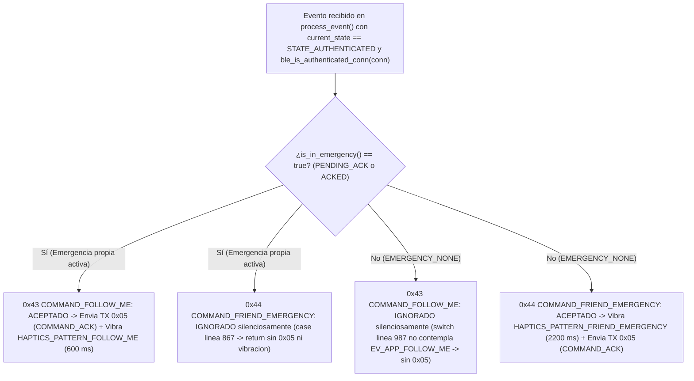
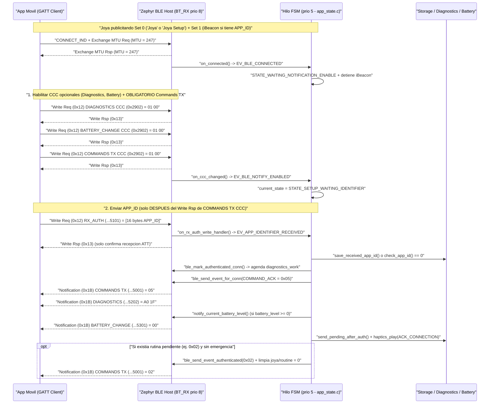

# 9. Especificación Completa del Protocolo de Comunicación GATT

> **Propósito y alcance**: Este capítulo constituye la **especificación normativa y autónoma de interoperabilidad BLE/GATT** entre el firmware de la pulsera Joya (verificado sobre el commit `c1128e5d0c0d6f98be0a580d287c0926ca27f01f`, **Zephyr RTOS 4.2.0**, SoC **nRF52832-QFAA**) y las aplicaciones cliente móviles (iOS / Android) o consolas de diagnóstico/OTA. Documenta todos los servicios estáticos y dinámicos, características, descriptores CCC, códigos de error ATT, formatos binarios, reglas síncronas y asíncronas de validación, semántica de confirmación y garantías de entrega.
>
> Para la arquitectura de radio, intervalos de conexión y conjuntos de publicidad véanse [07_ble_architecture.md](07_ble_architecture.md) y [08_ibeacon.md](08_ibeacon.md); para el ciclo de vida de la credencial `APP_ID` y el control de acceso véase [10_authentication.md](10_authentication.md); para la máquina de fases de emergencia y persistencia de rutinas véase [12_emergency_routines.md](12_emergency_routines.md); y para el protocolo de transferencia de imagen MCUmgr/MCUboot véase [16_ota_mcuboot.md](16_ota_mcuboot.md).

---

## 9.1 Convenciones de Transporte, Encapsulamiento ATT y Negociación de Canal

### 9.1.1 Parámetros Efectivos de Enlace, L2CAP y ATT

**(a) Comportamiento implementado**: El servidor GATT de Joya se compila con los siguientes límites de transporte en [prj.conf](../../prj.conf) (líneas 54–66 y 119–124) y `.config` efectivo:

| Parámetro de pila BLE | Símbolo Kconfig efectivo | Valor | Implicación directa para el cliente móvil |
|---|---|---|---|
| Rol GATT | `CONFIG_BT_PERIPHERAL=y` (`BT_GATT_CLIENT=n`) | Solo `GATT Server` | El teléfono actúa siempre como `GAP Central` y `GATT Client`. |
| Conexiones simultáneas | `CONFIG_BT_MAX_CONN=1` | `1` enlace ACL | Una segunda conexión entrante mientras `current_conn != NULL` es desconectada inmediatamente con `BT_HCI_ERR_REMOTE_USER_TERM_CONN` (`0x13`) en `on_connected()` ([src/ble_driver.c](../../src/ble_driver.c), líneas 224–228). |
| MTU ATT máximo soportado | `CONFIG_BT_L2CAP_TX_MTU=247` | `247` bytes | Tras `ATT_EXCHANGE_MTU_REQ/RSP`, la carga útil máxima de un `Write` o `Notification` (`ATT_MTU - 3`) es de **244 bytes**. Sin negociación MTU, opera al mínimo BLE de `23` bytes (`20` bytes útiles), suficiente para todos los servicios propietarios Joya (`<= 16` B), aunque subóptimo para OTA SMP. |
| Data Length Extension (DLE) | `CONFIG_BT_CTLR_DATA_LENGTH_MAX=251`, `CONFIG_BT_AUTO_DATA_LEN_UPDATE=y` | `251` bytes LL | Un paquete ATT de `247` B (+ `4` B cabecera L2CAP = `251` B) viaja en **una única PDU de capa de enlace** sin fragmentación L2CAP. |
| PHY de radio | `CONFIG_BT_AUTO_PHY_UPDATE=y`, `CONFIG_BT_CTLR_PHY_2M=y` | `1M` / `2M` auto | El Host solicita automáticamente salto a `LE 2M PHY` al conectar. |
| Cola de preparación ATT (Long Writes) | `CONFIG_BT_ATT_PREPARE_COUNT=0` | Deshabilitada (`0`) | **No se admiten escrituras fragmentadas** (`ATT_PREPARE_WRITE_REQ 0x16` / `ATT_EXECUTE_WRITE_REQ 0x18`). Todo comando, `APP_ID`, sufijo de nombre o petición SMP debe caber en una sola operación ATT con `offset == 0`. |
| Reensamblado SMP sobre BLE | `# CONFIG_MCUMGR_TRANSPORT_BT_REASSEMBLY is not set` | Deshabilitado | Cada petición SMP enviada por la app hacia Joya debe tener longitud total `<= ATT_MTU - 3` (máx. `244` B). En sentido inverso (Joya → App), las notificaciones SMP **sí pueden fragmentarse** en múltiples notificaciones ATT y el cliente debe reensamblarlas usando el campo `length` del encabezado SMP de 8 bytes. |
| Seguridad de enlace BLE | `# CONFIG_BT_SMP is not set`, `CONFIG_BT_MAX_PAIRED=0` | Sin pairing/bonding | No existe cifrado AES-CCM de enlace ni persistencia estándar de descriptores CCC entre reconexiones. En **cada nueva conexión BLE**, la app debe volver a escribir `0x0001` en los descriptores CCC deseados y reautenticarse enviando `APP_ID`. |
| Suscripción obligatoria CCC | `CONFIG_BT_GATT_ENFORCE_SUBSCRIPTION=y` | Estricto | Ni el stack Zephyr ni los wrappers de `ble_driver.c` encolan notificaciones si el CCC correspondiente no vale exactamente `0x0001` (`BT_GATT_CCC_NOTIFY`). |
| Caché GATT moderna | `# CONFIG_BT_GATT_CACHING is not set`, `CONFIG_BT_GATT_SERVICE_CHANGED=y` | Solo `0x2A05` | No existen las características `Database Hash (0x2B2A)` ni `Client Supported Features (0x2B29)`. Los cambios dinámicos de la tabla GATT (alta/baja de SMP) se señalizan vía indicación `Service Changed (0x2A05)`. |

### 9.1.2 Orden de Bytes (Endianness) y Codificación de UUIDs

1. **UUIDs propietarios de 128 bits**: Todos los servicios y características propios de Joya comparten el espacio de nombres base `a407e00a-00c1-464d-9173-2cb8be58XXXX`, declarados mediante la macro `BT_UUID_128_ENCODE(...)` en [include/ble_driver.h](../../include/ble_driver.h) (líneas 17–33).
   - En las APIs de alto nivel de **CoreBluetooth (iOS)** y **Android BluetoothGatt**, los UUIDs se especifican en representación canónica textual big-endian (`"a407e00a-00c1-464d-9173-2cb8be585000"`).
   - En las **PDUs ATT en aire** (`ATT_READ_BY_GROUP_TYPE_RSP`, `ATT_FIND_INFO_RSP`), el estándar Bluetooth Core transmite los UUIDs de 128 bits en **little-endian** (orden inverso byte a byte: para `...5000`, en aire viaja `00 50 58 be b8 2c 73 91 4d 46 c1 00 0a e0 07 a4`). Note que esto difiere del payload `Manufacturer Specific Data` del iBeacon (`...6001`), donde los 16 bytes viajan en orden de red big-endian ([include/ble_driver.h](../../include/ble_driver.h), líneas 35–39; véase [08_ibeacon.md](08_ibeacon.md)).
2. **Payloads de datos**:
   - Comandos (`TX ...5001`, `RX ...5002`), cambios de nivel de batería (`...5301`) y errores de diagnóstico en tiempo real (`...5202`): `1` byte sin signo (`uint8_t`), sin ambigüedad de endianness.
   - Resumen de diagnóstico de arranque (`...5202`): secuencia fija de `2` bytes `[0xA0, MM]` (`out[0] = 0xA0`, `out[1] = init_bits` en [src/diagnostics.c](../../src/diagnostics.c), líneas 52–56).
   - Medición de tensión de batería (`BATTERY_MEASUREMENT ...5302`): entero sin signo de 16 bits en **little-endian** (`uint16_t`, milivoltios: `payload[0] = LSB`, `payload[1] = MSB` en [src/ble_driver.c](../../src/ble_driver.c), líneas 709–714).
   - Descriptores `CCC` (`0x2902`): entero sin signo de 16 bits en **little-endian** (`0x0001` → `01 00` en aire para habilitar notificaciones; `0x0002` → `02 00` para habilitar indicaciones en `0x2A05`; `0x0000` → `00 00` para deshabilitar).
   - Identificador `APP_ID` (`RX_AUTH ...5101`): bloque binario opaco de `16` bytes (`uint8_t[16]`), comparado byte a byte mediante `memcmp()` sin interpretación numérica de endianness ([src/app_comm.c](../../src/app_comm.c), líneas 70–72).
   - Sufijo de nombre (`NAME ...5201`): cadena de bytes ASCII/UTF-8 crudos (`1..23` B en escritura, `0..23` B en lectura), **sin terminador `NUL` (`0x00`)** en el transporte GATT ([src/ble_driver.c](../../src/ble_driver.c), líneas 289–304 y 331–345).
   - Encabezado `SMP` (`da2e7828-...` en OTA): `8` bytes con campos de 16 bits (`length`, `group_id`) en **big-endian** (`>BBHHBB`), seguido de mapa CBOR ([ota/joya_console.py](../../ota/joya_console.py), línea 285 y línea 569).

---

## 9.2 Mapa Integral de la Base de Datos GATT y Tabla de Handles

### 9.2.1 Arquitectura de Servicios Estáticos y Dinámicos

**(a) Comportamiento implementado**: Al enlazar el firmware, Zephyr ordena alfabéticamente por nombre de símbolo C las estructuras registradas con `BT_GATT_SERVICE_DEFINE` dentro de la sección de memoria de solo lectura `_bt_gatt_service_static_list_start .. _bt_gatt_service_static_list_end` (verificado sobre `zephyr.elf`). Esto produce **33 atributos estáticos** (`handles 0x0001 .. 0x0021`), a los que se suman dinámicamente **4 atributos en RAM** (`handles 0x0022 .. 0x0025`) cuando `ota_access_enable()` invoca `smp_bt_register()` ([src/ota_access.c](../../src/ota_access.c), líneas 101–105).

> **Regla obligatoria para el equipo móvil**: Los clientes iOS/Android **NUNCA deben codificar handles numéricos fijos** (`0x0018`, `0x001B`, etc.). Deben descubrir servicios y características **siempre por UUID**, porque la inserción/remoción dinámica de SMP y cualquier evolución futura de características (como ocurrió al incorporar `DIAGNOSTICS ...5202`, advertido en [docs/DIAGNOSTICS.md](../../docs/DIAGNOSTICS.md), líneas 58–60) desplazan o invalidan cachés de handles.

### 9.2.2 Tabla Completa de Atributos GATT (`0x0001` – `0x0025`)

| Handle (ref.) | Servicio contenedor | Tipo de atributo | Nombre lógico | UUID completo (16 / 128 bits) | Propiedades GATT | Permisos ATT (Zephyr) | Callback C / Handler |
|---|---|---|---|---|---|---|---|
| `0x0001` | Generic Attribute (`_1_gatt_svc`) | `0x2800` Primary Svc | GATT Service | `0x1801` | — | `PERM_READ` | Zephyr (`gatt.c`) |
| `0x0002` | Generic Attribute | `0x2803` Char Decl | Service Changed Decl | `0x2803` | `INDICATE` (`0x20`) | `PERM_READ` | Zephyr (`gatt.c`) |
| `0x0003` | Generic Attribute | `0x2A05` Char Value | Service Changed | `0x2A05` | `INDICATE` | `PERM_NONE` | Zephyr (`gatt.c`) |
| `0x0004` | Generic Attribute | `0x2902` CCCD | Service Changed CCC | `0x2902` | — | `PERM_READ \| PERM_WRITE` | `sc_ccc_cfg_changed` (Zephyr) |
| `0x0005` | Generic Access (`_2_gap_svc`) | `0x2800` Primary Svc | GAP Service | `0x1800` | — | `PERM_READ` | Zephyr (`gatt.c`) |
| `0x0006` | Generic Access | `0x2803` Char Decl | Device Name Decl | `0x2803` | `READ \| WRITE` (`0x0A`) | `PERM_READ` | Zephyr (`gatt.c`) |
| `0x0007` | Generic Access | `0x2A00` Char Value | GAP Device Name | `0x2A00` | `READ \| WRITE` | `PERM_READ \| PERM_WRITE` | `read_name` / `write_name` (Zephyr) |
| `0x0008` | Generic Access | `0x2803` Char Decl | Appearance Decl | `0x2803` | `READ` (`0x02`) | `PERM_READ` | Zephyr (`gatt.c`) |
| `0x0009` | Generic Access | `0x2A01` Char Value | Appearance | `0x2A01` | `READ` | `PERM_READ` | `read_appearance` (`0x0000`) |
| `0x000A` | Generic Access | `0x2803` Char Decl | PPCP Decl | `0x2803` | `READ` (`0x02`) | `PERM_READ` | Zephyr (`gatt.c`) |
| `0x000B` | Generic Access | `0x2A04` Char Value | Peripheral Pref. Conn. Params | `0x2A04` | `READ` | `PERM_READ` | `read_ppcp` (`45..90 ms, lat 4, 6 s`) |
| `0x000C` | Joya Auth (`joya_auth_svc`) | `0x2800` Primary Svc | Authentication Service | `a407e00a-00c1-464d-9173-2cb8be585100` | — | `PERM_READ` | [src/ble_driver.c](../../src/ble_driver.c):419 |
| `0x000D` | Joya Auth | `0x2803` Char Decl | `RX_AUTH` Decl | `0x2803` | `WRITE \| WRITE_WITHOUT_RESP` (`0x0C`) | `PERM_READ` | [src/ble_driver.c](../../src/ble_driver.c):423 |
| `0x000E` | Joya Auth | `128-bit` Char Value | `RX_AUTH` (`joya_rx_auth_uuid`) | `a407e00a-00c1-464d-9173-2cb8be585101` | `WRITE \| WRITE_WITHOUT_RESP` | `PERM_WRITE` | `on_rx_auth_write` → `on_rx_auth_write_handler` |
| `0x000F` | Joya Battery (`joya_battery_svc`) | `0x2800` Primary Svc | Battery Service | `a407e00a-00c1-464d-9173-2cb8be585300` | — | `PERM_READ` | [src/ble_driver.c](../../src/ble_driver.c):447 |
| `0x0010` | Joya Battery | `0x2803` Char Decl | `BATTERY_CHANGE` Decl | `0x2803` | `NOTIFY` (`0x10`) | `PERM_READ` | [src/ble_driver.c](../../src/ble_driver.c):449 |
| `0x0011` | Joya Battery | `128-bit` Char Value | `BATTERY_CHANGE` | `a407e00a-00c1-464d-9173-2cb8be585301` | `NOTIFY` | `PERM_NONE` | `ble_send_battery_change` |
| `0x0012` | Joya Battery | `0x2902` CCCD | `BATTERY_CHANGE` CCC | `0x2902` | — | `PERM_READ \| PERM_WRITE` | `on_battery_change_ccc_changed` |
| `0x0013` | Joya Battery | `0x2803` Char Decl | `BATTERY_MEASUREMENT` Decl | `0x2803` | `NOTIFY` (`0x10`) | `PERM_READ` | [src/ble_driver.c](../../src/ble_driver.c):454 |
| `0x0014` | Joya Battery | `128-bit` Char Value | `BATTERY_MEASUREMENT` | `a407e00a-00c1-464d-9173-2cb8be585302` | `NOTIFY` | `PERM_NONE` | `ble_send_battery_measurement` |
| `0x0015` | Joya Battery | `0x2902` CCCD | `BATTERY_MEASUREMENT` CCC | `0x2902` | — | `PERM_READ \| PERM_WRITE` | `on_battery_measurement_ccc_changed` |
| `0x0016` | Joya Commands (`joya_commands_svc`) | `0x2800` Primary Svc | Commands Service | `a407e00a-00c1-464d-9173-2cb8be585000` | — | `PERM_READ` | [src/ble_driver.c](../../src/ble_driver.c):398 |
| `0x0017` | Joya Commands | `0x2803` Char Decl | `TX` Decl (`attrs[1]`) | `0x2803` | `NOTIFY` (`0x10`) | `PERM_READ` | [src/ble_driver.c](../../src/ble_driver.c):402 |
| `0x0018` | Joya Commands | `128-bit` Char Value | `TX` (`attrs[2]`, `joya_tx_uuid`) | `a407e00a-00c1-464d-9173-2cb8be585001` | `NOTIFY` | `PERM_NONE` | `ble_send_notify` / `ble_commands_subscribed_for_conn` |
| `0x0019` | Joya Commands | `0x2902` CCCD | `TX` CCC (`attrs[3]`) | `0x2902` | — | `PERM_READ \| PERM_WRITE` | `on_ccc_changed` |
| `0x001A` | Joya Commands | `0x2803` Char Decl | `RX` Decl (`attrs[4]`) | `0x2803` | `WRITE \| WRITE_WITHOUT_RESP` (`0x0C`) | `PERM_READ` | [src/ble_driver.c](../../src/ble_driver.c):411 |
| `0x001B` | Joya Commands | `128-bit` Char Value | `RX` (`attrs[5]`, `joya_rx_uuid`) | `a407e00a-00c1-464d-9173-2cb8be585002` | `WRITE \| WRITE_WITHOUT_RESP` | `PERM_WRITE` | `on_rx_write` → `on_rx_write_handler` |
| `0x001C` | Joya Config (`joya_config_svc`) | `0x2800` Primary Svc | Configuration Service | `a407e00a-00c1-464d-9173-2cb8be585200` | — | `PERM_READ` | [src/ble_driver.c](../../src/ble_driver.c):430 |
| `0x001D` | Joya Config | `0x2803` Char Decl | `NAME` Decl | `0x2803` | `READ \| WRITE` (`0x0A`) | `PERM_READ` | [src/ble_driver.c](../../src/ble_driver.c):434 |
| `0x001E` | Joya Config | `128-bit` Char Value | `NAME` (`joya_name_uuid`) | `a407e00a-00c1-464d-9173-2cb8be585201` | `READ \| WRITE` | `PERM_READ \| PERM_WRITE` | `on_name_read` / `on_name_write` |
| `0x001F` | Joya Config | `0x2803` Char Decl | `DIAGNOSTICS` Decl | `0x2803` | `READ \| NOTIFY` (`0x12`) | `PERM_READ` | [src/ble_driver.c](../../src/ble_driver.c):438 |
| `0x0020` | Joya Config | `128-bit` Char Value | `DIAGNOSTICS` | `a407e00a-00c1-464d-9173-2cb8be585202` | `READ \| NOTIFY` | `PERM_READ` | `on_diagnostics_read` / `ble_diagnostics_notify_for_session` |
| `0x0021` | Joya Config | `0x2902` CCCD | `DIAGNOSTICS` CCC | `0x2902` | — | `PERM_READ \| PERM_WRITE` | `on_diagnostics_ccc_changed` |
| `0x0022`* | Dinámico SMP (`smp_bt_svc`) | `0x2800` Primary Svc | MCUmgr SMP Service | `8d53dc1d-1db7-4cd3-868b-8a527460aa84` | — | `PERM_READ` | `smp_bt_register` / `smp_bt_unregister` |
| `0x0023`* | Dinámico SMP | `0x2803` Char Decl | SMP Char Decl | `0x2803` | `WRITE_WITHOUT_RESP \| NOTIFY` (`0x14`) | `PERM_READ` | Zephyr (`smp_bt.c`) |
| `0x0024`* | Dinámico SMP | `128-bit` Char Value | SMP Characteristic | `da2e7828-fbce-4e01-ae9e-261174997c48` | `WRITE_WITHOUT_RESP \| NOTIFY` | `PERM_WRITE` | `smp_bt_chr_write` / `smp_bt_tx_pkt` |
| `0x0025`* | Dinámico SMP | `0x2902` CCCD | SMP CCC | `0x2902` | — | `PERM_READ \| PERM_WRITE` | `smp_bt_ccc_changed` |

*\*Nota: Los handles `0x0022..0x0025` existen en la base GATT **únicamente** después de que una sesión autenticada envía `COMMAND_OTA_ENABLE (0x70)` y hasta su cierre por `COMMAND_OTA_DISABLE (0x71)`, expiración de `OTA_IDLE_TIMEOUT` (`2 min`) o desconexión.*

---

## 9.3 Especificación Exhaustiva por Servicio y Característica

### 9.3.1 Validación Síncrona ATT vs. Validación Asíncrona en `process_event()`

Un aspecto arquitectónico crítico que el equipo móvil debe comprender es que el firmware emplea **dos niveles de validación distintos** según la característica:

1. **Validación síncrona en el hilo `BT_RX` (dentro del callback GATT)**:
   - Se ejecuta antes de que el servidor ATT envíe `ATT_WRITE_RSP (0x13)` o `ATT_READ_RSP (0x0B)`.
   - Si falla, el stack BLE devuelve inmediatamente un paquete `ATT_ERROR_RSP (0x01)` con el código de error ATT específico (`BT_ATT_ERR_*`), siempre que el cliente haya utilizado un procedimiento con respuesta (`Write Request 0x12` o `Read Request 0x0A`).
   - En `RX (...5002)` y `RX_AUTH (...5101)`, el callback síncrono **solo valida formato (`offset`, `len`) y espacio libre en `event_queue` (`20` slots)**; **NO valida autenticación ni estado de la FSM**. En cambio, en `NAME (...5201)` (escritura) y `DIAGNOSTICS (...5202)` (lectura), **la autorización sí se comprueba síncronamente** en el callback GATT.
2. **Validación asíncrona en el hilo `fsm_thread_id` (`process_event()` en [src/app_state.c](../../src/app_state.c))**:
   - Una vez que `on_rx_write_handler()` o `on_rx_auth_write_handler()` retorna `len`, el cliente móvil recibe `ATT_WRITE_RSP` exitoso, pero el comando recién ha sido encolado en `event_queue`.
   - Cuando `fsm_thread_id` (prioridad `5`) extrae el evento, verifica pertenencia a la conexión actual (`ble_is_current_conn()`), estado de autenticación (`ble_is_authenticated_conn()`, `current_state == STATE_AUTHENTICATED`) y fase de emergencia (`is_in_emergency()`).
   - **Consecuencia para la app móvil**: Obtener un `Write Response` exitoso al escribir en `RX` o `RX_AUTH` **NO significa que el comando haya sido aceptado ni ejecutado por la aplicación**. La confirmación real de nivel de aplicación llega asíncronamente como una notificación `COMMAND_ACK (0x05)` (o `COMMAND_NACK (0x06)` en fallo de `APP_ID`) sobre `TX (...5001)` (o, en el caso de `0x70`, mediante la aparición del servicio SMP).

---

### 9.3.2 Servicio 1: Joya Commands Service (`a407e00a-00c1-464d-9173-2cb8be585000`)

Definido estáticamente mediante `BT_GATT_SERVICE_DEFINE(joya_commands_svc, ...)` en [src/ble_driver.c](../../src/ble_driver.c) (líneas 398–415). Constituye el canal bidireccional primario de señalización de negocio.

#### A. Característica `TX` (`a407e00a-00c1-464d-9173-2cb8be585001`) + Descriptor `CCC` (`0x2902`)

- **Dirección**: Joya → App (notificaciones asíncronas del servidor al cliente).
- **Propiedades GATT / Permisos ATT**:
  - Valor (`joya_tx_uuid`): `BT_GATT_CHRC_NOTIFY` (`0x10`), permisos `BT_GATT_PERM_NONE` (cualquier intento de `Read Request` o `Write Request` sobre el atributo de valor devuelve `BT_ATT_ERR_READ_NOT_PERMITTED = 0x02` o `BT_ATT_ERR_WRITE_NOT_PERMITTED = 0x03`).
  - Descriptor `CCC` (`0x2902`): permisos `BT_GATT_PERM_READ | BT_GATT_PERM_WRITE`.
- **Formato y longitud del payload**: Exactamente `1` byte (`uint8_t`), valores emitidos en la versión actual: `0x02` (`COMMAND_ROUTINE`), `0x03` (`COMMAND_END_ROUTINE`), `0x04` (`COMMAND_EMERGENCY`), `0x05` (`COMMAND_ACK`), `0x06` (`COMMAND_NACK`).
- **Condiciones de disponibilidad y requisitos de autenticación**:
  - El servicio y el descriptor `CCC` están disponibles desde el instante en que se establece la conexión BLE (`STATE_WAITING_NOTIFICATION_ENABLE`), **antes** de autenticar.
  - Es **requisito obligatorio del contrato de protocolo** que la app escriba `0x0001` (`01 00` LE) en este `CCC` antes de enviar `APP_ID` ([src/app_state.c](../../src/app_state.c), líneas 909–920).
  - Para enviar `0x05` (`COMMAND_ACK` de autenticación) o `0x06` (`COMMAND_NACK`), `ble_send_event_for_conn()` ([src/ble_driver.c](../../src/ble_driver.c), líneas 662–679) exige únicamente `conn && current_conn == conn && notify_enabled` (pues `0x06` debe poder enviarse a una sesión cuya autenticación acaba de fallar).
  - Para enviar eventos de negocio (`0x02`, `0x03`, `0x04` y los `0x05` de respuesta a `0x41..0x44`), `ble_send_event_authenticated()` ([src/ble_driver.c](../../src/ble_driver.c), líneas 681–693) exige mediante `get_authenticated_conn_ref()` (líneas 368–377): `current_conn != NULL && current_conn_authenticated == true && notify_enabled == true`.
- **Comportamiento del callback `on_ccc_changed()` ([src/ble_driver.c](../../src/ble_driver.c), líneas 156–172)**:
  - Evalúa estrictamente `bool enabled = (value == BT_GATT_CCC_NOTIFY);` (`0x0001`). Si un cliente escribe `0x0002` (`BT_GATT_CCC_INDICATE`) o `0x0000`, `notify_enabled` pasa a `false`.
  - Si `enabled && current_conn`, toma referencia temporal `bt_conn_ref(current_conn)` bajo `conn_mutex` y encola `EV_BLE_NOTIFY_ENABLED` en `event_queue`.
  - Cuando `process_event()` procesa `EV_BLE_NOTIFY_ENABLED`:
    1. Verifica doblemente `ble_commands_subscribed_for_conn(entry->conn)` ([src/app_state.c](../../src/app_state.c), líneas 392–395 y [src/ble_driver.c](../../src/ble_driver.c), líneas 561–569), que comprueba `notify_enabled` y `bt_gatt_is_subscribed(conn, &joya_commands_svc.attrs[2], BT_GATT_CCC_NOTIFY)`.
    2. Si `current_state == STATE_WAITING_NOTIFICATION_ENABLE`, avanza a `STATE_SETUP_WAITING_IDENTIFIER` ([src/app_state.c](../../src/app_state.c), líneas 916–919).
    3. Si la app deshabilitó y volvió a habilitar `TX` CCC estando ya en `STATE_AUTHENTICATED` ([src/app_state.c](../../src/app_state.c), líneas 488–492), invoca `send_pending_after_auth()` para despachar cualquier emergencia `EMERGENCY_PENDING_ACK` o rutina pendiente en RAM/NVS que no hubiera podido notificarse mientras `notify_enabled == false`.
  - Cualquier fallo negativo devuelto por `bt_gatt_notify()` en `ble_send_notify()` dispara `diagnostics_report_error(DIAG_ERROR_BLE)` (`0xE4`).

#### B. Característica `RX` (`a407e00a-00c1-464d-9173-2cb8be585002`)

- **Dirección**: App → Joya.
- **Propiedades GATT / Permisos ATT**: `BT_GATT_CHRC_WRITE | BT_GATT_CHRC_WRITE_WITHOUT_RESP` (`0x0C`), permisos `BT_GATT_PERM_WRITE`. No posee descriptor `CCC` ni permiso de lectura (`Read Request` devuelve `BT_ATT_ERR_READ_NOT_PERMITTED = 0x02`).
- **Formato y longitud del payload**: Exactamente `1` byte (`uint8_t`) escrito en `offset == 0`.
- **Funciones C responsables**: `on_rx_write()` ([src/ble_driver.c](../../src/ble_driver.c), líneas 205–209) → `on_rx_write_handler()` ([src/app_comm.c](../../src/app_comm.c), líneas 6–41) → `process_event()` ([src/app_state.c](../../src/app_state.c), líneas 396–400, 703–713, 792–844, 867–872, 989–996).
- **Errores ATT síncronos devueltos por `on_rx_write_handler()`**:
  - `offset != 0` → `BT_GATT_ERR(BT_ATT_ERR_INVALID_OFFSET)` (`0x07`).
  - `len != 1` (incluyendo `len == 0` o `len >= 2`) → `BT_GATT_ERR(BT_ATT_ERR_INVALID_ATTRIBUTE_LEN)` (`0x0D`).
  - `add_event_for_conn(ev, conn, NULL) != 0` (`event_queue` llena con 20 eventos sin procesar) → `BT_GATT_ERR(BT_ATT_ERR_INSUFFICIENT_RESOURCES)` (`0x11`) y reporte asíncrono `DIAG_ERROR_EVENT_QUEUE_FULL` (`0xE3`).
- **Manejo de códigos desconocidos, marcadores o no implementados (`else { return len; }`, línea 34)**:
  - Si el byte escrito **no** es ninguno de `{0x41, 0x42, 0x43, 0x44, 0x70, 0x71}`, `on_rx_write_handler()` **devuelve `1` (`len`) sin error ATT** y sin encolar ningún evento en `event_queue`.
- **Requisitos de autenticación (validación asíncrona)**:
  - Para `0x41`, `0x42`, `0x43`, `0x44`: `process_event()` exige `ble_is_authenticated_conn(entry->conn)` (líneas 396–400) y `current_state == STATE_AUTHENTICATED` (líneas 793, 805, 824, 987).
  - Para `0x70`, `0x71`: `process_event()` exige `current_state == STATE_AUTHENTICATED && ble_is_authenticated_conn(entry->conn)` (líneas 704–705) y que el dispositivo no esté en `suspended_idle` (línea 562).

---

### 9.3.3 Servicio 2: Joya Authentication Service (`a407e00a-00c1-464d-9173-2cb8be585100`)

Definido estáticamente mediante `BT_GATT_SERVICE_DEFINE(joya_auth_svc, ...)` en [src/ble_driver.c](../../src/ble_driver.c) (líneas 419–427). Contiene una única característica dedicada exclusivamente a la provisión inicial y verificación posterior del identificador `APP_ID`.

#### Característica `RX_AUTH` (`a407e00a-00c1-464d-9173-2cb8be585101`)

- **Dirección**: App → Joya.
- **Propiedades GATT / Permisos ATT**: `BT_GATT_CHRC_WRITE | BT_GATT_CHRC_WRITE_WITHOUT_RESP` (`0x0C`), permisos `BT_GATT_PERM_WRITE`. Sin lectura (`0x02`) ni `CCC`.
- **Formato y longitud del payload**: Exactamente `SIZE_APP_ID = 16` bytes (`uint8_t[16]`), transmitidos atómicamente en una sola escritura con `offset == 0`.
- **Funciones C responsables**: `on_rx_auth_write()` ([src/ble_driver.c](../../src/ble_driver.c), líneas 211–214) → `on_rx_auth_write_handler()` ([src/app_comm.c](../../src/app_comm.c), líneas 43–58) → `add_event_for_conn(EV_APP_IDENTIFIER_RECEIVED, conn, buf)` ([src/app_state.c](../../src/app_state.c), líneas 340–354) → `process_event()` ([src/app_state.c](../../src/app_state.c), líneas 922–985).
- **Errores ATT síncronos devueltos**:
  - `offset != 0` → `BT_ATT_ERR_INVALID_OFFSET` (`0x07`).
  - `len != 16` → `BT_ATT_ERR_INVALID_ATTRIBUTE_LEN` (`0x0D`).
  - `event_queue` llena → `BT_ATT_ERR_INSUFFICIENT_RESOURCES` (`0x11`) + `0xE3`.
- **Condiciones de procesamiento y respuestas**:
  - **Precondición estricta**: El dispositivo debe haber alcanzado `STATE_SETUP_WAITING_IDENTIFIER`, lo cual requiere haber conectado (`EV_BLE_CONNECTED`) y haber habilitado notificaciones en `COMMANDS TX` (`EV_BLE_NOTIFY_ENABLED`).
  - Si se escribe mientras aún está en `STATE_WAITING_NOTIFICATION_ENABLE` o ya en `STATE_AUTHENTICATED`, la capa ATT responde éxito (`ATT_WRITE_RSP`), pero `process_event()` descarta silenciosamente `EV_APP_IDENTIFIER_RECEIVED`.
  - Si `is_app_id_empty() == true` (provisión inicial): guarda `entry->app_id` (salvo que `entry->app_id` sean 16 bytes `0x00` o que `pending_routine_dirty` falle al limpiar NVS, en cuyo caso `is_app_id_empty()` sigue siendo `true` y retorna sin enviar `0x05` ni `0x06`), marca la conexión autenticada y notifica `COMMAND_ACK (0x05)` en `COMMANDS TX (...5001)`.
  - Si `is_app_id_empty() == false` (reconexión): compara con `check_app_id()`. Si coincide (`0`), pasa a `STATE_AUTHENTICATED` y notifica `COMMAND_ACK (0x05)` en `COMMANDS TX`. Si difiere (`!= 0`), permanece en `STATE_SETUP_WAITING_IDENTIFIER` y notifica `COMMAND_NACK (0x06)` en `COMMANDS TX`. (Véase análisis completo en [10_authentication.md](10_authentication.md)).

---

### 9.3.4 Servicio 3: Joya Configuration Service (`a407e00a-00c1-464d-9173-2cb8be585200`)

Definido estáticamente mediante `BT_GATT_SERVICE_DEFINE(joya_config_svc, ...)` en [src/ble_driver.c](../../src/ble_driver.c) (líneas 430–444). Agrupa la personalización del nombre publicitado y la telemetría de diagnóstico de inicialización y fallos recuperables.

#### A. Característica `NAME` (`a407e00a-00c1-464d-9173-2cb8be585201`)

- **Dirección**: Bidireccional (App ↔ Joya mediante `Read` y `Write Request`).
- **Propiedades GATT / Permisos ATT**: `BT_GATT_CHRC_READ | BT_GATT_CHRC_WRITE` (`0x0A`), permisos `BT_GATT_PERM_READ | BT_GATT_PERM_WRITE`. **Nota crítica para clientes móviles**: a diferencia de `RX` y `RX_AUTH`, esta característica **NO declara `BT_GATT_CHRC_WRITE_WITHOUT_RESP`**; el cliente debe utilizar obligatoriamente **Write Request (`0x12`)** con respuesta.
- **Formato y longitud del payload**:
  - **En Escritura (`on_name_write()`, [src/ble_driver.c](../../src/ble_driver.c), líneas 273–320)**:
    - El cliente envía **únicamente el sufijo personalizado** (p. ej. `"Ana"`), **sin** el prefijo `"Joya de "` y **sin** byte `NUL` (`0x00`).
    - Longitud admitida: `1 <= len <= 23` bytes (`JOYA_SUFFIX_MAX_LEN = 31 - 8 = 23`, definido en [src/ble_driver.c](../../src/ble_driver.c), línea 9 y [include/flash_memory.h](../../include/flash_memory.h), líneas 13–15).
    - El firmware antepone automáticamente `"Joya de "` (`8` B), copia los `len` bytes recibidos, agrega `'\0'` al final (formando una cadena C de `9..31` caracteres útiles, máx. `32` bytes con `\0`), invoca `bt_set_name(name)` y persiste en `joya/name` mediante `storage_save_name(name)`.
    - El nuevo nombre se verá reflejado en el `SCAN_RSP` la próxima vez que Joya inicie publicidad de reconexión (`ble_start_setup_advertising(false)`). En publicidad de provisión virgen (`is_new_connection == true`), siempre se fuerza `"Joya Setup"`.
  - **En Lectura (`on_name_read()`, [src/ble_driver.c](../../src/ble_driver.c), líneas 322–345)**:
    - Si el nombre almacenado en RAM es `"Joya"` (`JOYA_ADV_NAME_DEFAULT`), devuelve **payload vacío de `0` bytes** (`""`).
    - Si comienza con `"Joya de "`, devuelve **únicamente el sufijo** (`strlen(suffix)` bytes, `1..23` B, sin `\0`). Admite lecturas con `offset` mediante `bt_gatt_attr_read()`.
- **Requisitos de autenticación y asimetría de control de acceso**:
  - **Escritura**: Síncrona en `on_name_write()`: exige `get_current_state() == STATE_AUTHENTICATED` (línea 279); de lo contrario rechaza inmediatamente con `BT_ATT_ERR_AUTHORIZATION` (`0x08`).
  - **Lectura**: **(a) Comportamiento implementado**: `on_name_read()` **NO verifica autenticación**. Cualquier central BLE que se conecte puede leer el sufijo antes de autenticarse (véase implicación de privacidad en [10_authentication.md](10_authentication.md) y [17_security_privacy.md](17_security_privacy.md)).
- **Errores ATT síncronos devueltos**:
  - En `on_name_write()`:
    - `get_current_state() != STATE_AUTHENTICATED` → `BT_ATT_ERR_AUTHORIZATION` (`0x08`).
    - `offset != 0` → `BT_ATT_ERR_INVALID_OFFSET` (`0x07`).
    - `len == 0 || len > 23` → `BT_ATT_ERR_INVALID_ATTRIBUTE_LEN` (`0x0D`). *(Consecuencia: no es posible restaurar el nombre por defecto `"Joya"` enviando una cadena vacía de 0 bytes; solo un Factory Reset físico de 15 s restaura `"Joya"`).*
    - Presencia de cualquier byte `0x00` dentro de `buf[0..len-1]` (`memchr(buf, '\0', len) != NULL`) → `BT_ATT_ERR_VALUE_NOT_ALLOWED` (`0x13`).
    - Fallo interno en `bt_set_name(name) != 0` o argumento inválido en `storage_save_name(name) < 0` → `BT_ATT_ERR_UNLIKELY` (`0x0E`). *(Si falla únicamente la escritura NVS en `settings_save_one()`, `storage_save_name()` actualiza RAM, emite `0xE1` en `DIAGNOSTICS` y retorna `+1`, por lo que `on_name_write()` devuelve éxito `len`).*
  - En `on_name_read()`:
    - Si `joya_name` en RAM no es `"Joya"` y tampoco empieza por `"Joya de "` (p. ej. valor heredado/corrupto en NVS) → `BT_ATT_ERR_UNLIKELY` (`0x0E`).
    - `offset > strlen(suffix)` → `BT_ATT_ERR_INVALID_OFFSET` (`0x07`, gestionado por `bt_gatt_attr_read()`).

#### B. Característica `DIAGNOSTICS` (`a407e00a-00c1-464d-9173-2cb8be585202`) + Descriptor `CCC` (`0x2902`)

- **Dirección**: Joya → App (`Read` bajo demanda y `Notify` asíncrono).
- **Propiedades GATT / Permisos ATT**:
  - Valor (`joya_diagnostics_uuid`): `BT_GATT_CHRC_READ | BT_GATT_CHRC_NOTIFY` (`0x12`), permisos `BT_GATT_PERM_READ` (escritura rechazada con `0x03`).
  - Descriptor `CCC` (`0x2902`): `BT_GATT_PERM_READ | BT_GATT_PERM_WRITE`.
- **Funciones C responsables**: `on_diagnostics_read()` ([src/ble_driver.c](../../src/ble_driver.c), líneas 347–358), `on_diagnostics_ccc_changed()` (líneas 194–203), `ble_diagnostics_session()` / `ble_diagnostics_notify_for_session()` (líneas 571–606) y el módulo [src/diagnostics.c](../../src/diagnostics.c) (líneas 1–83). Documentación de diseño original en [docs/DIAGNOSTICS.md](../../docs/DIAGNOSTICS.md).
- **Requisitos de autenticación**:
  - `on_diagnostics_read()` exige síncronamente `ble_is_authenticated_conn(conn)`; si no está autenticada, devuelve `BT_ATT_ERR_AUTHORIZATION` (`0x08`).
  - El descriptor `CCC` puede escribirse antes o después de autenticar, pero ninguna notificación se transmite mientras `ble_diagnostics_session()` devuelva `0` (es decir, exige `current_conn && current_conn_authenticated && diagnostics_notify_enabled`).
- **Dos formatos de mensaje diferenciados por longitud y prefijo**:
  1. **Mensaje de estado de inicialización (`2` bytes: `0xA0 MM`)**:
     - Devuelto siempre en cualquier `Read Request` autenticado y emitido **una vez por sesión autenticada** como notificación cuando se cumplen simultáneamente tres condiciones: `init_complete == 1` (`diagnostics_finish_init()` al final de `main()`), `current_conn_authenticated == true` y `diagnostics_notify_enabled == true` (sin importar si la app habilitó `DIAGNOSTICS` CCC antes o después de enviar `APP_ID`).
     - El byte `0` es la cabecera fija `0xA0`. El byte `1` (`MM`) es una máscara de bits de éxito (`1` = subsistema inicializado con `ret == 0`; `0` = fallo en el arranque):
       - Bit 0 (`0x01`, `DIAG_INIT_BLE`): `ble_driver_init() == 0` (incluye `ota_access_init()`, `bt_enable()` y configuración del advertising set de iBeacon).
       - Bit 1 (`0x02`, `DIAG_INIT_BUTTON`): `button_init() == 0`.
       - Bit 2 (`0x04`, `DIAG_INIT_SETTINGS`): `storage_init() == 0`.
       - Bit 3 (`0x08`, `DIAG_INIT_HAPTIC`): `haptics_init() == 0`.
       - Bit 4 (`0x10`, `DIAG_INIT_BATTERY`): `battery_init() == 0 && battery_monitor_start() == 0`.
       - Bits 5..7 (`0xE0`): siempre `0`. Un arranque nominal completamente sano reporta **`A0 1F`**.
  2. **Mensajes de error recuperable en tiempo de ejecución (`1` byte: `0xE1` .. `0xE5`)**:
     - Emitidos exclusivamente por `Notify` (nunca devueltos por `Read`) en modalidad *best-effort* efímera, vinculados al contador de época `diagnostics_session_epoch`:
       - `0xE1` (`DIAG_ERROR_FLASH_WRITE`): fallo en `settings_save_one()` (`joya/app_id`, `joya/emergency`, `joya/routine`, `joya/name`) o en `storage_factory_reset()`.
       - `0xE2` (`DIAG_ERROR_SETTINGS_LOAD`): fallo en `settings_load()` durante `storage_init()`. *(Nota arquitectónica: dado que `storage_init()` ocurre en `main()` antes de `ble_driver_init()`, en ese instante `ble_diagnostics_session() == 0`, por lo que `0xE2` se descarta en el arranque y su fallo queda representado indirectamente por el bit `0x04 = 0` en `A0 MM`, p. ej. `A0 1B`).*
       - `0xE3` (`DIAG_ERROR_EVENT_QUEUE_FULL`): `k_msgq_put(&event_queue, ...)` falló por cola llena (`20` eventos).
       - `0xE4` (`DIAG_ERROR_BLE`): fallo negativo en `ibeacon_stop()`, `ble_set_ibeacon_mode()`, `ble_start_setup_advertising()`, `ble_stop_advertising()` o `ble_send_notify()`.
       - `0xE5` (`DIAG_ERROR_I2C`): fallo negativo en lectura/escritura I2C del `DRV2605` (`drv2605_write_reg()` / `drv2605_read_reg()`).

---

### 9.3.5 Servicio 4: Joya Battery Service (`a407e00a-00c1-464d-9173-2cb8be585300`)

Definido estáticamente mediante `BT_GATT_SERVICE_DEFINE(joya_battery_svc, ...)` en [src/ble_driver.c](../../src/ble_driver.c) (líneas 447–459). Sustituye a los antiguos códigos de batería del servicio `COMMANDS` (`0x07..0x09`) separando el estado discreto filtrado por histéresis/votación de la telemetría cruda en milivoltios.

#### A. Característica `BATTERY_CHANGE` (`a407e00a-00c1-464d-9173-2cb8be585301`) + `CCC` (`0x2902`)

- **Dirección**: Joya → App (solo `Notify`).
- **Propiedades GATT / Permisos ATT**: Valor `BT_GATT_CHRC_NOTIFY` (`0x10`), `BT_GATT_PERM_NONE` (sin `Read` ni `Write`); `CCC` con `BT_GATT_PERM_READ | BT_GATT_PERM_WRITE`.
- **Formato y longitud del payload**: `1` byte (`uint8_t`):
  - `0x00`: Nivel Normal (`VBAT > 3000 mV`, o `> 3050 mV` al recuperar desde Nivel 1).
  - `0x01`: Nivel 1 — Batería baja (`2900 mV < VBAT <= 3000 mV`, o `<= 3050 mV` con histéresis; háptica deshabilitada, BLE operativo).
  - `0x02`: Nivel 2 — Batería crítica (`VBAT <= 2900 mV`, o `<= 2950 mV` con histéresis; transición inminente a `critical_idle` salvo transferencia OTA activa o ventana crítica de 5 min).
- **Funciones C y sincronización con autenticación**:
  - `on_battery_change_ccc_changed()` ([src/ble_driver.c](../../src/ble_driver.c), líneas 174–184) actualiza `battery_change_notify_enabled` y, al habilitarse (`0x0001`), encola `EV_BLE_BATTERY_NOTIFY_ENABLED`.
  - `ble_send_battery_change()` → `ble_send_battery_value(level, false)` (líneas 695–733) exige `get_current_state() == STATE_AUTHENTICATED`, `current_conn_authenticated == true` y `battery_change_notify_enabled == true`.
  - **Entrega inicial garantizada tras autenticar (si `battery_level >= 0`)**: `notify_current_battery_level()` ([src/app_state.c](../../src/app_state.c), líneas 49–54) se invoca tanto al procesar `EV_BLE_BATTERY_NOTIFY_ENABLED` (línea 484) como inmediatamente después de autenticar en `STATE_SETUP_WAITING_IDENTIFIER` (líneas 948 y 970), y cada vez que cambia el nivel confirmado (línea 452). Por tanto, sin importar el orden en que la app habilite `BATTERY_CHANGE` CCC y se autentique, recibirá de inmediato el nivel confirmado actual (salvo durante los primeros ~60 s tras un arranque en frío mientras `battery_level == -1`, en cuyo caso recibirá la notificación en cuanto finalice la primera ventana de 6 muestras de `battery.c`).

#### B. Característica `BATTERY_MEASUREMENT` (`a407e00a-00c1-464d-9173-2cb8be585302`) + `CCC` (`0x2902`)

- **Dirección**: Joya → App (solo `Notify`).
- **Propiedades GATT / Permisos ATT**: Valor `BT_GATT_CHRC_NOTIFY` (`0x10`), `BT_GATT_PERM_NONE`; `CCC` con `BT_GATT_PERM_READ | BT_GATT_PERM_WRITE`.
- **Formato, longitud y endianness**: `2` bytes `uint16_t` en **little-endian**, representando `VBAT` en milivoltios redondeados al entero más cercano tras compensar el divisor resistivo `120 kOhm / 82 kOhm` ([src/battery.c](../../src/battery.c), líneas 103–105 y [src/ble_driver.c](../../src/ble_driver.c), líneas 709–714).
  - Ejemplo: `3850 mV` = `0x0F0A` → en aire viajan los bytes **`0A 0F`** (`0x0A + (0x0F << 8) = 10 + 3840 = 3850`).
- **Cadencia y condiciones**:
  - `on_battery_measurement_ccc_changed()` ([src/ble_driver.c](../../src/ble_driver.c), líneas 186–192) **no** dispara un envío inmediato en caché; `ble_send_battery_measurement(voltage_mv)` se ejecuta al final de cada ejecución exitosa de `battery_monitor_work_handler()` ([src/battery.c](../../src/battery.c), líneas 300–303), es decir, cada **`60 s`** en régimen estable, cada **`10 s`** durante ventanas de verificación de cambio de umbral, o cada **`1 s`** si hubiera un rechequeo activo, siempre que la sesión esté en `STATE_AUTHENTICATED` y suscripta.

---

### 9.3.6 Servicio 5 (Dinámico): MCUmgr SMP Service (`8d53dc1d-1db7-4cd3-868b-8a527460aa84`)

Gestionado por [src/ota_access.c](../../src/ota_access.c) (líneas 1–148) sobre el transporte `smp_bt` de Zephyr (`CONFIG_MCUMGR_TRANSPORT_BT=y`, `CONFIG_MCUMGR_TRANSPORT_BT_DYNAMIC_SVC_REGISTRATION=y`, `CONFIG_MCUMGR_TRANSPORT_BT_PERM_RW=y`).

- **Característica SMP**: `da2e7828-fbce-4e01-ae9e-261174997c48` + descriptor `CCC` (`0x2902`).
- **Propiedades GATT / Permisos ATT**: `BT_GATT_CHRC_WRITE_WITHOUT_RESP | BT_GATT_CHRC_NOTIFY` (`0x14`), permisos `BT_GATT_PERM_WRITE` en valor y `BT_GATT_PERM_READ | BT_GATT_PERM_WRITE` en `CCC` (gracias a `CONFIG_MCUMGR_TRANSPORT_BT_PERM_RW=y`, que permite operar sin `BT_SMP` cifrado una vez superada la compuerta de aplicación de Joya).
- **Ciclo de vida dinámico**:
  1. **Oculto en reposo y al conectar**: `ble_driver_init()` llama a `ota_access_init()` → `smp_bt_unregister()` antes de `bt_enable(NULL)` ([src/ble_driver.c](../../src/ble_driver.c), líneas 495–499). Una exploración GATT inicial antes de enviar `0x70` **no encontrará** el servicio `8d53dc1d-...`.
  2. **Apertura (`COMMAND_OTA_ENABLE = 0x70`)**: En `STATE_AUTHENTICATED` sobre conexión autenticada, `process_event()` invoca `ota_access_enable()` → `smp_bt_register()` y arma el temporizador `idle_close_work` a `OTA_IDLE_TIMEOUT = 2 minutos` ([src/ota_access.c](../../src/ota_access.c), líneas 8, 96–115). Zephyr emite indicación `Service Changed (0x2A05)` para el rango `0x0022..0x0025` si el cliente suscribió `0x2A05`; aun así, el cliente móvil debe ejecutar redescubrimiento de servicios tras enviar `0x70` (como hace `DISCOVER` en [ota/bridge_ota/bridge_ota.ino](../../ota/bridge_ota/bridge_ota.ino), líneas 226–248). **Nota**: `0x70` **no** genera `COMMAND_ACK (0x05)` en `COMMANDS TX`.
  3. **Protección durante carga activa**: Cuando MCUmgr dispara `MGMT_EVT_OP_IMG_MGMT_DFU_STARTED` o `MGMT_EVT_OP_IMG_MGMT_DFU_CHUNK`, `image_status_handler()` marca `uploading = true` y cancela `idle_close_work` ([src/ota_access.c](../../src/ota_access.c), líneas 49–53). Al marcarse la imagen candidata (`MGMT_EVT_OP_IMG_MGMT_DFU_PENDING`), fija `uploading = false; upload_complete = true;`.
  4. **Cierre o diferimiento (`COMMAND_OTA_DISABLE = 0x71`, timeout o batería Nivel 2)**: Si `uploading || upload_complete`, `ota_access_disable()` **difiere el cierre** (`close_requested = true`, líneas 120–121) para no abortar una transferencia o el comando `TEST`/`RESET` posterior; si la carga se detiene sin quedar pendiente (`MGMT_EVT_OP_IMG_MGMT_DFU_STOPPED`), reprograma el cierre en `1 s` si `close_requested` era `true`, o en `2 min` en caso contrario (líneas 57–66), y emite `EV_OTA_UPDATE_STOPPED`. En cambio, **cualquier desconexión BLE** (`ota_access_on_disconnect()`, líneas 129–138) limpia inmediatamente `uploading`, `upload_complete` y ejecuta `smp_bt_unregister()`.
- **Grupos SMP habilitados**: Grupo `OS` (`0`: `echo`, `reset` con retardo `CONFIG_MCUMGR_GRP_OS_RESET_MS=250` ms) y Grupo `IMAGE` (`1`: lectura de estado de slots `id=0`, subida de bloques `id=1`, marcado Test/Confirm, borrado de slot secundario). Véase detalle de comandos CBOR en [16_ota_mcuboot.md](16_ota_mcuboot.md).

---

### 9.3.7 Servicios Estándar de Zephyr: GAP (`0x1800`) y GATT (`0x1801`)

**(a) Comportamiento implementado**: El Host BLE de Zephyr expone automáticamente dos servicios estándar de la especificación Bluetooth SIG:

1. **Generic Attribute Service (`0x1801`)**:
   - **Service Changed (`0x2A05`)**: Propiedad `INDICATE` (`0x20`), descriptor `CCC` (`0x2902`, `READ | WRITE`, habilitar escribiendo `0x0002` → `02 00` LE). Payload de indicación: `4` bytes (`uint16_t start_handle` LE + `uint16_t end_handle` LE, p. ej. `22 00 25 00` al registrar o desregistrar SMP). Es la **única característica con GATT Indication** de todo el dispositivo.
2. **Generic Access Service (`0x1800`)**:
   - **Device Name (`0x2A00`)**: Propiedades `READ | WRITE`, permisos `PERM_READ | PERM_WRITE` (hasta `CONFIG_BT_DEVICE_NAME_MAX = 32` bytes UTF-8 sin `\0`).
     - **Hallazgo importante de auditoría (a/c)**: Debido a que [prj.conf](../../prj.conf) activa `CONFIG_BT_DEVICE_NAME_DYNAMIC=y` (línea 51) sin desactivar explícitamente `CONFIG_BT_DEVICE_NAME_GATT_WRITABLE` (que por defecto queda en `y` en `.config`), Zephyr permite a cualquier cliente BLE conectado leer **y escribir** `0x2A00` sin autenticación. No obstante, escribir en `0x2A00` solo altera el buffer interno de GAP en RAM (sin tocar `joya_name` en `src/flash_memory.c`) y su valor es pisado en la siguiente llamada a `ble_start_setup_advertising()`. **La app móvil oficial debe ignorar `0x2A00` para escritura y utilizar exclusivamente `NAME (...5201)` en `joya_config_svc`**.
   - **Appearance (`0x2A01`)**: `READ`, `2` bytes LE = `00 00` (`CONFIG_BT_DEVICE_APPEARANCE=0`, Unknown).
   - **Peripheral Preferred Connection Parameters (`0x2A04`)**: `READ`, `8` bytes (`4 × uint16_t` LE):
     - `min_conn_interval = 36` (`0x0024` → `24 00`, `45,0 ms`).
     - `max_conn_interval = 72` (`0x0048` → `48 00`, `90,0 ms`).
     - `slave_latency = 4` (`0x0004` → `04 00`, hasta 4 eventos omitidos).
     - `conn_sup_timeout = 600` (`0x0258` → `58 02`, `6000 ms`).
     - Bytes exactos leídos en `0x2A04`: **`24 00 48 00 04 00 58 02`**. Además, con `CONFIG_BT_GAP_AUTO_UPDATE_CONN_PARAMS=y`, Zephyr solicita automáticamente estos parámetros tras `5 s` (`CONFIG_BT_CONN_PARAM_UPDATE_TIMEOUT=5000`, hasta 3 reintentos).

---

### 9.3.8 Catálogo Consolidado de Códigos de Error ATT

| Constante Zephyr | Código Hex ATT | Nombre estándar BLE | Características donde ocurre | Causa exacta en el firmware de Joya |
|---|---:|---|---|---|
| `BT_ATT_ERR_READ_NOT_PERMITTED` | `0x02` | Read Not Permitted | `TX`, `RX`, `RX_AUTH`, `BATTERY_*`, `SMP`, `0x2A05` | Intento de `ATT_READ_REQ` sobre característica sin `BT_GATT_PERM_READ`. |
| `BT_ATT_ERR_WRITE_NOT_PERMITTED` | `0x03` | Write Not Permitted | `TX`, `DIAGNOSTICS`, `BATTERY_*`, `0x2A01`, `0x2A04`, `0x2A05` | Intento de escritura sobre característica de solo lectura o solo notificación. |
| `BT_ATT_ERR_REQ_NOT_SUPPORTED` / `PREPARE_QUEUE_FULL` | `0x06` / `0x09` | Request Not Supported / Prepare Queue Full | Todas (`CONFIG_BT_ATT_PREPARE_COUNT=0`) | Uso de `ATT_PREPARE_WRITE_REQ` (Long/Queued Write). |
| `BT_ATT_ERR_INVALID_OFFSET` | `0x07` | Invalid Offset | `RX`, `RX_AUTH`, `NAME` (`Write`/`Read`), `DIAGNOSTICS` (`Read`) | `offset != 0` en cualquier escritura Joya, o `offset > longitud` en lecturas. |
| `BT_ATT_ERR_AUTHORIZATION` | `0x08` | Insufficient Authorization | `NAME` (`Write`), `DIAGNOSTICS` (`Read`) | En `NAME Write`: `get_current_state() != STATE_AUTHENTICATED`. En `DIAGNOSTICS Read`: `!ble_is_authenticated_conn(conn)`. |
| `BT_ATT_ERR_INVALID_ATTRIBUTE_LEN` | `0x0D` | Invalid Attribute Value Length | `RX` (`!= 1`), `RX_AUTH` (`!= 16`), `NAME` (`0` o `> 23`), `CCC` (`!= 2`) | Longitud de escritura fuera del contrato exacto del atributo. |
| `BT_ATT_ERR_UNLIKELY` | `0x0E` | Unlikely Error | `NAME` (`Write` y `Read`) | Fallo de `bt_set_name()`, `storage_save_name() < 0`, o `joya_name` corrupto sin prefijo `"Joya de "` al leer. |
| `BT_ATT_ERR_INSUFFICIENT_RESOURCES` | `0x11` | Insufficient Resources | `RX`, `RX_AUTH` | `add_event_for_conn()` falló porque `event_queue` (`20` entradas) está llena (`-ENOMSG`/`-EAGAIN`). |
| `BT_ATT_ERR_VALUE_NOT_ALLOWED` | `0x13` | Value Not Allowed | `NAME` (`Write`), `CCC` (`0x2902`) | En `NAME`: presencia de byte `\0` embebido. En `CCC`: intento de habilitar `INDICATE (0x0002)` en característica que solo soporta `NOTIFY` (rechazado por Zephyr `gatt_ccc_write`). |

---

## 9.4 Clasificación Taxonómica de Códigos y Regla de Exclusión Mutua `0x43` / `0x44`

### 9.4.1 Estado Real de Todos los Enumeradores de `include/app_comm.h`

Al inspeccionar [include/app_comm.h](../../include/app_comm.h) (líneas 64–85) frente a su implementación efectiva en [src/app_comm.c](../../src/app_comm.c) y [src/app_state.c](../../src/app_state.c), los 19 enumeradores se dividen en cuatro categorías estrictas:

1. **Comandos operativos activos (10 códigos)**:
   - **Joya → App (`TX ...5001`)**: `0x02` (`COMMAND_ROUTINE`), `0x03` (`COMMAND_END_ROUTINE`), `0x04` (`COMMAND_EMERGENCY`), `0x05` (`COMMAND_ACK`), `0x06` (`COMMAND_NACK`).
   - **App → Joya (`RX ...5002`)**: `0x41` (`COMMAND_ACK_EMERGENCY`), `0x42` (`COMMAND_STOP_EMERGENCY`), `0x43` (`COMMAND_FOLLOW_ME`), `0x44` (`COMMAND_FRIEND_EMERGENCY`), `0x70` (`COMMAND_OTA_ENABLE`), `0x71` (`COMMAND_OTA_DISABLE`). *(Total: 5 TX + 6 RX = **11 códigos operativos activos**).*
2. **(d) Marcadores centinela de rango / reservados (4 códigos — NUNCA emitidos ni aceptados)**:
   - `0x01` (`INIT_JOYA_COMMAND`) y `0x0A` (`END_JOYA_COMMAND`): delimitadores de rango de la enumeración Joya → App; ninguna función los transmite.
   - `0x40` (`INIT_APP_COMMAND`) y `0x46` (`END_APP_COMMAND`): delimitadores del subrango clásico App → Joya (notar que `0x70` y `0x71` se agregaron posteriormente fuera de `END_APP_COMMAND`). Si la app envía `0x40` o `0x46` en `RX`, `on_rx_write_handler()` cae en el `else` ([src/app_comm.c](../../src/app_comm.c), línea 34) y los ignora silenciosamente devolviendo `len = 1`.
3. **(d) Códigos obsoletos / residuales de batería (3 códigos — NUNCA emitidos en `c1128e5`)**:
   - `0x07` (`LOW_BATTERY_LEVEL_1`), `0x08` (`LOW_BATTERY_LEVEL_2`) y `0x09` (`BATTERY_NORMAL`): pertenecían al protocolo inicial de un único servicio GATT antes de introducir `joya_battery_svc` (`...5300`). En la versión actual, ninguna línea de código los referencia; los cambios de nivel confirmado se notifican exclusivamente en `BATTERY_CHANGE (...5301)` con los valores `0x00`, `0x01` y `0x02`.
4. **(d) Comando declarado pero NO implementado (1 código)**:
   - `0x45` (`COMMAND_FRIEND_STOP_EMERGENCY`): declarado en [include/app_comm.h](../../include/app_comm.h) (línea 81), pero **ausente** en la cadena `if / else if` de `on_rx_write_handler()` ([src/app_comm.c](../../src/app_comm.c), líneas 21–35), **sin** evento `EV_APP_*` asociado en `event_type_t` ([include/app_state.h](../../include/app_state.h)) y **sin** lógica de cancelación en `process_event()`.
   - **Consecuencia práctica**: Si la app envía `0x45` mientras se reproduce el patrón háptico `HAPTICS_PATTERN_FRIEND_EMERGENCY` (6 pulsos de `200 ms`, duración total `2200 ms`, [src/haptics.c](../../src/haptics.c), líneas 97–110), el firmware responde `ATT_WRITE_RSP` exitoso, **no envía `COMMAND_ACK (0x05)`** y **no detiene la vibración**, que finaliza sola al cabo de sus `2,2 s`.

### 9.4.2 Regla Exacta de Exclusión Mutua: `0x43` (`COMMAND_FOLLOW_ME`) vs. `0x44` (`COMMAND_FRIEND_EMERGENCY`)

**(a) Comportamiento implementado**: El despacho de eventos en `process_event()` ([src/app_state.c](../../src/app_state.c), líneas 767–878 frente a 987–997) establece una **partición estricta y mutuamente excluyente** gobernada por `is_in_emergency()` (`joya_emergency_phase != EMERGENCY_NONE`):



- **Por qué `0x43` (`COMMAND_FOLLOW_ME`) exige `is_in_emergency() == true`**: `EV_APP_FOLLOW_ME` está codificado **únicamente** dentro del bloque `if (is_in_emergency())` ([src/app_state.c](../../src/app_state.c), líneas 792–802). Representa retroalimentación táctil de seguimiento (2 pulsos cortos: `200 ms ON, 100 ms OFF, 200 ms ON, 100 ms OFF`) hacia una usuaria que **ya declaró una emergencia propia** (tanto si está en `EMERGENCY_PENDING_ACK` como en `EMERGENCY_ACKED`). Si la app envía `0x43` fuera de emergencia (`EMERGENCY_NONE`), el flujo llega al `switch (current_state)` de la línea 987 donde `case STATE_AUTHENTICATED:` solo maneja `EV_APP_FRIEND_EMERGENCY`; por ende, **`0x43` se descarta sin vibrar y sin emitir `0x05`**.
- **Por qué `0x44` (`COMMAND_FRIEND_EMERGENCY`) exige `is_in_emergency() == false`**: Si la propia usuaria está atravesando una emergencia (`is_in_emergency() == true`), el bloque de las líneas 862–872 intercepta explícitamente `case EV_APP_FRIEND_EMERGENCY: return;` para no confundir a la usuaria en peligro con alertas de terceros ni interferir con sus propios patrones hápticos; tampoco emite `0x05`. Solo cuando `is_in_emergency() == false` el flujo alcanza la línea 989, reproduce `HAPTICS_PATTERN_FRIEND_EMERGENCY` y emite `0x05`.
- **Diferencia sutil en el orden interno de efectos**: En `0x43` (líneas 796–801) primero se envía `ble_send_event_authenticated(COMMAND_ACK)` y luego `haptics_play(HAPTICS_PATTERN_FOLLOW_ME)`; en `0x44` (líneas 991–992) primero se invoca `haptics_play(HAPTICS_PATTERN_FRIEND_EMERGENCY)` (no bloqueante, agenda `haptics_pattern_work` con `K_NO_WAIT`) y enseguida `ble_send_event_authenticated(COMMAND_ACK)`.

---

## 9.5 Tabla Maestra Exhaustiva de Comandos, Operaciones y Mensajes GATT (18 Columnas)

La siguiente tabla maestra documenta **todos los códigos definidos en [include/app_comm.h](../../include/app_comm.h)** más **todas las operaciones sobre `RX_AUTH`, `NAME`, `DIAGNOSTICS` y `BATTERY`** con las 18 dimensiones normativas requeridas por ingeniería de producto:

| Código hex | Nombre | Emisor | Receptor | Payload | Longitud | Significado | Estados válidos | Precondiciones | Respuesta esperada | Efectos secundarios | ACK | Reintentos | Timeout | Persistencia | Comportamiento ante desconexión | Comportamiento ante duplicados | Comportamiento ante inválidos |
|---|---|---|---|---|---|---|---|---|---|---|---|---|---|---|---|---|---|
| `0x01` | `INIT_JOYA_COMMAND` (`TX ...5001`) | Ninguno (reservado) | — | No aplica | — | Marcador centinela de inicio del enum Joya → App | Ninguno | Ninguna (código muerto / delimitador) | Ninguna | Ninguno | No | No | No | No | Sin efecto | Sin efecto | Si un cliente intenta escribirlo en `TX` → ATT `0x03`; si lo escribe en `RX` → ATT éxito silencioso sin efecto |
| `0x02` | `COMMAND_ROUTINE` (`TX ...5001`) | Joya | App | `02` | `1 B` | Inicio de rutina de acompañamiento (1 clic corto `< 500 ms` + ventana `900 ms`) | Disparo local: cualquiera fuera de `suspended_idle` y sin emergencia; envío BLE: `STATE_AUTHENTICATED` | `!is_app_id_empty()` y `!is_in_emergency()`; para envío BLE inmediato requiere `current_conn_authenticated` y `TX` CCC `0x0001` | Ninguna en BLE (la app inicia rutina en servidor/UI) | Vibra `HAPTICS_PATTERN_ROUTINE_START` (`700 ms ON + 100 ms OFF`); si se envía por BLE escribe tombstone `0x00` en `joya/routine`; si no está conectado/autenticado guarda `[0x02, app_id]` en `joya/routine` | **Sin ACK de aplicación** (solo confirmación LL del stack local al aceptar `bt_gatt_notify == 0`) | Sin reintentos periódicos; si no había sesión autenticada al pulsar, se envía 1 vez al completar autenticación futura (`send_pending_after_auth`) | Sin timeout de expiración mientras no ocurra emergencia ni Factory Reset | Sí, `joya/routine` (`17 B` ligado a `owner_app_id`) solo si no pudo notificarse en el acto; se borra a `0x00` (`1 B`) apenas `bt_gatt_notify` retorna `0` | Si ocurre desconexión antes de `bt_gatt_notify`, queda persistido en `joya/routine` y se envía al reconectar y autenticar; si cae el enlace después de `bt_gatt_notify == 0` pero antes de salir por RF, se pierde | En desconectado, múltiples `0x02` consecutivos no encolan ni duplican en Flash (`command == joya_pending_routine` retorna `0` sin reescribir NVS); en conectado cada clic válido emite una notificación `0x02` | Ignorado localmente si `is_app_id_empty()`, `is_in_emergency()` o `suspended_idle` |
| `0x03` | `COMMAND_END_ROUTINE` (`TX ...5001`) | Joya | App | `03` | `1 B` | Fin o cancelación de rutina (pulsación media `500 ms <= t < 5000 ms`) | Disparo local: cualquiera fuera de `suspended_idle` y sin emergencia; envío BLE: `STATE_AUTHENTICATED` | `!is_app_id_empty()` y `!is_in_emergency()`; para envío BLE inmediato requiere `current_conn_authenticated` y `TX` CCC `0x0001` | Ninguna en BLE (la app cancela/cierra rutina) | Vibra `HAPTICS_PATTERN_ROUTINE_CANCEL` (`2×200 ms`, `600 ms`); si se notifica en el acto graba `0x00` en `joya/routine`; si desconectado reemplaza el último pendiente con `[0x03, app_id]` | **Sin ACK de aplicación** | Sin reintentos periódicos; 1 envío diferido tras próxima autenticación si se generó sin sesión activa | Sin timeout de expiración | Sí, `joya/routine` (`17 B`), sobrescribiendo cualquier `0x02` previo pendiente (`pending_routine_next`: solo importa la última rutina) | Si estaba desconectado queda en `joya/routine` (reemplazando `0x02` previo); al notificar tras reconexión se limpia a `0x00` | En desconectado es idempotente en NVS; en conectado cada pulsación `0,5..5 s` envía un `0x03` | Ignorado localmente si `is_app_id_empty()`, `is_in_emergency()` o `suspended_idle` |
| `0x04` | `COMMAND_EMERGENCY` (`TX ...5001`) | Joya | App | `04` | `1 B` | Alerta crítica de emergencia de la usuaria (`>= 3` clics cortos) | Disparo local: cualquiera fuera de `suspended_idle`; envío BLE: `STATE_AUTHENTICATED` | Para persistir y enviar BLE requiere `!is_app_id_empty()` y `joya_emergency_phase == EMERGENCY_PENDING_ACK`, `current_conn_authenticated` y `TX` CCC `0x0001` | App debe enviar `COMMAND_ACK_EMERGENCY (0x41)` para silenciar reintentos, y `COMMAND_STOP_EMERGENCY (0x42)` al cerrar el incidente | Escribe tombstone `0x00` en `joya/routine`, persiste `1` (`EMERGENCY_PENDING_ACK`) en `joya/emergency`, vibra `2000 ms` (`HAPTICS_PATTERN_EMERGENCY_START`); si desconectado inicia advertising | **Sí, exige ACK explícito de aplicación `0x41`** (`COMMAND_ACK_EMERGENCY`) o cierre `0x42` | Sí: envío inmediato + backoff `1 s, 2 s, 5 s, 10 s, 30 s, 30 s...` indefinido mientras siga en `STATE_AUTHENTICATED` y `EMERGENCY_PENDING_ACK` | Sin timeout: nunca caduca por tiempo | Sí, `joya/emergency = 1` en NVS (`1 B`); sobrevive cortes de energía, resets WDT y actualizaciones OTA | Al desconectar se cancela `emergency_retry_work` (`emergency_stop_alerts`) y se reinicia advertising (`schedule_advertising_restart`); al reconectar y autenticar reinicia `0x04` desde índice `0` (`1 s`) y vuelve a vibrar `2000 ms` | La app **recibirá múltiples `0x04`** hasta que su `0x41` sea procesado; la app debe tratar `0x04` de forma **idempotente**. Un nuevo 3-clic local en `EMERGENCY_PENDING_ACK` solo vibra sin reiniciar el backoff | Con `is_app_id_empty()` solo vibra localmente y abre advertising `"Joya Setup"` sin persistir emergencia ni enviar `0x04` |
| `0x05` | `COMMAND_ACK` (`TX ...5001`) | Joya | App | `05` | `1 B` | Confirmación positiva de capa de aplicación desde Joya hacia la App | Emitido al transicionar a `STATE_AUTHENTICATED` o dentro de `STATE_AUTHENTICATED` | `conn == current_conn` y `notify_enabled == true` (y sesión autenticada para `0x41..0x44`) | Ninguna (es mensaje de respuesta) | En falla de `bt_gatt_notify` reporta `DIAG_ERROR_BLE (0xE4)` sin revertir el cambio de estado interno ya aplicado | No (es un ACK en sí mismo) | No: si `bt_gatt_notify` falla (p. ej. cola TX LL llena), no se reintenta automáticamente | No aplica en Joya (en clientes de referencia como `bridge_ota.ino` se esperan `5 s` para `AUTH`) | No (efímero) | Si cae el enlace antes de salir por RF, el estado en Joya ya cambió (p. ej. `EMERGENCY_ACKED` o `EMERGENCY_NONE`), salvo en `AUTH` donde la desconexión limpia `current_conn_authenticated` | La app debe correlacionar cada `0x05` con la operación en vuelo (`RX_AUTH` o `0x41..0x44` serializados por la app) | No aplica |
| `0x06` | `COMMAND_NACK` (`TX ...5001`) | Joya | App | `06` | `1 B` | Rechazo de autenticación por `APP_ID` distinto al almacenado | `STATE_SETUP_WAITING_IDENTIFIER` | `!is_app_id_empty()`, `ble_is_current_conn(conn)`, `notify_enabled == true` y `check_app_id(...) != 0` | La app puede reintentar un `APP_ID` válido o desconectar e informar error de vinculación | Ninguno: no desconecta el enlace, no incrementa contador de fallos y mantiene `STATE_SETUP_WAITING_IDENTIFIER` | No | No | Sin timeout tras conectar (el timer de `90 s` se canceló en `EV_BLE_CONNECTED`) | No | Si se desconecta tras recibir `0x06`, Joya pasa a `STATE_BONDED_DISCONNECTED` y agenda reinicio de advertising en `10 ms` | Cada escritura de 16 B errónea en `RX_AUTH` vuelve a emitir un `0x06` | No aplica |
| `0x07` | `LOW_BATTERY_LEVEL_1` (`TX ...5001`) | Ninguno (**obsoleto**) | — | `07` (histórico) | `1 B` | Código heredado de batería baja Nivel 1 (reemplazado por `...5301` valor `0x01`) | Ninguno en `c1128e5` | Código residual en `include/app_comm.h:71` | Ninguna | Ninguno | No | No | No | No | Sin efecto | Sin efecto | Si se escribe en `RX` → ignorado silenciosamente (`return 1`) |
| `0x08` | `LOW_BATTERY_LEVEL_2` (`TX ...5001`) | Ninguno (**obsoleto**) | — | `08` (histórico) | `1 B` | Código heredado de batería crítica Nivel 2 (reemplazado por `...5301` valor `0x02`) | Ninguno en `c1128e5` | Código residual en `include/app_comm.h:72` | Ninguna | Ninguno | No | No | No | No | Sin efecto | Sin efecto | Si se escribe en `RX` → ignorado silenciosamente (`return 1`) |
| `0x09` | `BATTERY_NORMAL` (`TX ...5001`) | Ninguno (**obsoleto**) | — | `09` (histórico) | `1 B` | Código heredado de batería normal (reemplazado por `...5301` valor `0x00`) | Ninguno en `c1128e5` | Código residual en `include/app_comm.h:73` | Ninguna | Ninguno | No | No | No | No | Sin efecto | Sin efecto | Si se escribe en `RX` → ignorado silenciosamente (`return 1`) |
| `0x0A` | `END_JOYA_COMMAND` (`TX ...5001`) | Ninguno (reservado) | — | No aplica | — | Marcador centinela de fin del enum Joya → App | Ninguno | Delimitador en `include/app_comm.h:74` | Ninguna | Ninguno | No | No | No | No | Sin efecto | Sin efecto | Si se escribe en `RX` → ignorado silenciosamente (`return 1`) |
| `0x40` | `INIT_APP_COMMAND` (`RX ...5002`) | Ninguno (reservado) | Joya | `40` | `1 B` | Marcador centinela de inicio del enum App → Joya | Ninguno | Delimitador en `include/app_comm.h:76` | `ATT_WRITE_RSP` si se usó `Write Request`; **sin notificación** en `TX` | Ninguno: descartado en `on_rx_write_handler` (`return len`) sin encolar evento | No | No | No | No | Sin efecto | Ignorado siempre | Offset `!= 0` → ATT `0x07`; `len != 1` → ATT `0x0D` |
| `0x41` | `COMMAND_ACK_EMERGENCY` (`RX ...5002`) | App | Joya | `41` | `1 B` | Acuse de recibo de emergencia: detiene retransmisiones de `0x04` manteniendo activa la emergencia | `STATE_AUTHENTICATED` con `is_in_emergency() == true` | `ble_is_authenticated_conn(conn)`, `!suspended_idle` y `joya_emergency_phase != EMERGENCY_NONE` | Notificación `COMMAND_ACK (0x05)` en `TX (...5001)` | Detiene `emergency_retry_work`, resetea `current_retry_index = 0`, transiciona `joya/emergency` a `EMERGENCY_ACKED (2)` en RAM y NVS | Sí: Joya responde `0x05` en `TX` | La app debe reintentar `0x41` si sigue recibiendo `0x04` o si no recibe `0x05` | Definido por la app | Sí: actualiza `joya/emergency` a `2` (`1 B` en NVS; si falla Flash mantiene `2` en RAM y reporta `0xE1`) | Si la desconexión ocurre antes de procesar `EV_APP_ACK_EMERGENCY`, el filtro `ble_is_authenticated_conn` lo descarta y la emergencia sigue en `PENDING_ACK (1)` | **Idempotente** mientras `is_in_emergency() == true`: si ya estaba en `EMERGENCY_ACKED (2)`, vuelve a detener alertas y vuelve a responder `0x05` (y `settings_save_one` evita reescritura idéntica en NVS en Zephyr) | Sin autenticar o con `is_in_emergency() == false`: ATT `Write Response` exitoso, pero descartado en FSM **sin enviar `0x05`**; `offset != 0` → `0x07`; `len != 1` → `0x0D`; cola llena → `0x11` |
| `0x42` | `COMMAND_STOP_EMERGENCY` (`RX ...5002`) | App | Joya | `42` | `1 B` | Cierre definitivo de emergencia activa | `STATE_AUTHENTICATED` con `is_in_emergency() == true` (tanto desde `PENDING_ACK` como desde `ACKED`) | `ble_is_authenticated_conn(conn)`, `!suspended_idle` y `is_in_emergency() == true` | Notificación `COMMAND_ACK (0x05)` en `TX (...5001)` | Detiene `emergency_retry_work`, graba tombstone `0x00` en `joya/routine`, pasa `joya/emergency` a `EMERGENCY_NONE (0)` en RAM y NVS (habilitando de nuevo rutinas y `0x44`) | Sí: Joya responde `0x05` en `TX` | La app puede reintentar si no recibe `0x05`; ojo: tras el primer `0x42` exitoso, `is_in_emergency()` pasa a `false` | Definido por la app | Sí: limpia `joya/routine` (`0x00`) y guarda `joya/emergency = 0` en NVS (protegido contra resurrección de rutina vieja si `pending_routine_dirty` falla) | Si se desconecta antes de procesar el evento en FSM, se descarta y la emergencia sigue activa | **No envía `0x05` en el duplicado**: el primer `0x42` pasa a `EMERGENCY_NONE` y responde `0x05`; un segundo `0x42` consecutivo encuentra `is_in_emergency() == false` y se ignora silenciosamente | Sin autenticar o fuera de emergencia: descartado en FSM sin `0x05`; `offset != 0` → `0x07`; `len != 1` → `0x0D`; cola llena → `0x11` |
| `0x43` | `COMMAND_FOLLOW_ME` (`RX ...5002`) | App | Joya | `43` | `1 B` | Pulso háptico de acompañamiento ("seguime / estamos en camino") durante emergencia propia | `STATE_AUTHENTICATED` **exclusivamente con `is_in_emergency() == true`** | `ble_is_authenticated_conn(conn)`, `!suspended_idle` y `is_in_emergency() == true` (en `PENDING_ACK` o `ACKED`) | Notificación `COMMAND_ACK (0x05)` en `TX (...5001)` | Envía `0x05` y reproduce `HAPTICS_PATTERN_FOLLOW_ME` (`200 ms ON, 100 ms OFF, 200 ms ON, 100 ms OFF` = `600 ms`, si `haptics_allowed` es `true`, es decir, `battery_level == 0`) | Sí: Joya responde `0x05` en `TX` | Según política de UI de la app | Sin timeout en firmware | No | Si se desconecta antes de ejecutarse en FSM, se descarta | Cada `0x43` recibido en emergencia reinicia el patrón háptico `FOLLOW_ME` desde el paso 0 y emite `0x05` | **Si `is_in_emergency() == false`, se ignora por completo** (sin `0x05` ni vibración); sin autenticar también se ignora; errores ATT `0x07`/`0x0D`/`0x11` |
| `0x44` | `COMMAND_FRIEND_EMERGENCY` (`RX ...5002`) | App | Joya | `44` | `1 B` | Alerta háptica por emergencia declarada por un contacto/amiga de la red | `STATE_AUTHENTICATED` **exclusivamente con `is_in_emergency() == false`** | `ble_is_authenticated_conn(conn)`, `!suspended_idle` y `is_in_emergency() == false` | Notificación `COMMAND_ACK (0x05)` en `TX (...5001)` | Reproduce `HAPTICS_PATTERN_FRIEND_EMERGENCY` (`6` pulsos de `200 ms` en `3` pares, total `2200 ms`, sujeto a `battery_level == 0`) y envía `0x05` | Sí: Joya responde `0x05` en `TX` | Según política de la app | La vibración dura `2200 ms` y se auto-extingue | No | Si cae el enlace antes de procesarse en FSM, se descarta; si ya comenzó a vibrar, termina los `2200 ms` | Cada `0x44` reinicia la secuencia háptica de `2200 ms` y responde `0x05` | **Si `is_in_emergency() == true`, se ignora silenciosamente** (`src/app_state.c:867`, sin `0x05` ni vibración); sin autenticar se ignora; errores ATT `0x07`/`0x0D`/`0x11` |
| `0x45` | `COMMAND_FRIEND_STOP_EMERGENCY` (`RX ...5002`) | App (**no implementado**) | Joya | `45` | `1 B` | Declarado para detener alerta de amiga, pero **no implementado** en firmware `c1128e5` | Ninguno | Definido en `include/app_comm.h:81`, no mapeado en `on_rx_write_handler` | Solo `ATT_WRITE_RSP` a nivel ATT; **NUNCA emite `0x05`** | **Ninguno**: no detiene `HAPTICS_PATTERN_FRIEND_EMERGENCY` ni encola evento | No | No enviar | No aplica | No | Sin efecto | Ignorado siempre | Offset `!= 0` → `0x07`; `len != 1` → `0x0D` |
| `0x46` | `END_APP_COMMAND` (`RX ...5002`) | Ninguno (reservado) | Joya | `46` | `1 B` | Marcador centinela de fin del subrango clásico App → Joya | Ninguno | Delimitador en `include/app_comm.h:82` | Solo `ATT_WRITE_RSP`; sin notificación `TX` | Ninguno (`return len`) | No | No | No | No | Sin efecto | Ignorado siempre | Offset `!= 0` → `0x07`; `len != 1` → `0x0D` |
| `0x70` | `COMMAND_OTA_ENABLE` (`RX ...5002`) | App | Joya | `70` | `1 B` | Abre dinámicamente el servicio GATT SMP (`8d53dc1d-...`) para actualización OTA MCUmgr | `STATE_AUTHENTICATED` (permitido incluso si `is_in_emergency() == true` o `battery_level == 1`) | `current_state == STATE_AUTHENTICATED`, `ble_is_authenticated_conn(conn)` y `!suspended_idle` | **NO envía `0x05` en `TX`**; emite indicación `Service Changed (0x2A05)` si estaba suscripta, y el servicio SMP pasa a ser descubrible | Ejecuta `smp_bt_register()`, limpia `close_requested = false` y agenda `idle_close_work` a `2 min` (si no hay carga activa) | **Sin `0x05` en `TX`** (confirmar redescubriendo el servicio SMP `8d53dc1d-...`) | Si el redescubrimiento no halla SMP, la app puede reenviar `0x70` | `OTA_IDLE_TIMEOUT = 120 s` sin actividad DFU cierra automáticamente SMP (`smp_bt_unregister`) | No (solo RAM) | `ota_access_on_disconnect()` desregistra inmediatamente SMP y limpia `uploading`/`upload_complete` | **Idempotente**: si `service_enabled == true`, no duplica el registro GATT y renueva el timer de `2 min` (si no está subiendo imagen) | Sin autenticar o en `suspended_idle`: descartado sin abrir SMP; en `battery_level == 2` sin ventana crítica el dispositivo ya habrá desconectado; errores ATT `0x07`/`0x0D`/`0x11` |
| `0x71` | `COMMAND_OTA_DISABLE` (`RX ...5002`) | App | Joya | `71` | `1 B` | Solicita cerrar y desregistrar el servicio GATT SMP | `STATE_AUTHENTICATED` | `current_state == STATE_AUTHENTICATED`, `ble_is_authenticated_conn(conn)` y `!suspended_idle` | **NO envía `0x05` en `TX`**; indicación `Service Changed (0x2A05)` cuando `smp_bt_unregister()` se ejecuta efectivamente | Si `!uploading && !upload_complete`: cancela `idle_close_work` y ejecuta `smp_bt_unregister()` en el acto. Si `uploading \|\| upload_complete`: fija `close_requested = true` y **difiere el cierre** hasta que cese la carga sin quedar pendiente | **Sin `0x05` en `TX`** | Idempotente | Si quedó diferido y `DFU_STOPPED` ocurre sin `DFU_PENDING`, cierra en `1 s` | No | La desconexión fuerza cierre inmediato de SMP | Idempotente (`service_enabled == false` no hace nada) | Sin autenticar: ignorado; errores ATT `0x07`/`0x0D`/`0x11` |
| `APP_ID` (`16 B`) | Provisión / Autenticación (`RX_AUTH ...5101`) | App | Joya | `uint8_t[16]` no nulo (ej. test `00 01 .. 0F`) | `16 B` | Registra el `APP_ID` propietario en dispositivo virgen o autentica la sesión contra el `APP_ID` guardado | **`STATE_SETUP_WAITING_IDENTIFIER`** únicamente | Conexión activa + `TX` CCC (`...5001`) previamente habilitado (`0x0001`). En provisión inicial requiere que `APP_ID` no sea `16` ceros y que no haya `pending_routine_dirty` irrecuperable | `COMMAND_ACK (0x05)` en `TX` si es válido/registrado; `COMMAND_NACK (0x06)` en `TX` si no coincide con el guardado | En éxito: guarda en `joya/app_id` (si era virgen), pasa a `STATE_AUTHENTICATED`, marca `current_conn_authenticated = true`, dispara `A0 MM` en `DIAGNOSTICS` (si suscripto), envía `0x05`, notifica `BATTERY_CHANGE` (si `>=0` y suscripto), vibra `ACK_CONNECTION` (`900 ms`) y despacha emergencia/rutina pendiente | Sí: `0x05` (éxito) o `0x06` (rechazo) en `TX (...5001)` | Tras `0x06` la app puede reenviar sin límite en la misma conexión; si envió antes de habilitar `TX` CCC debe reenviar tras habilitarlo | Sin timeout activo una vez conectado | En provisión inicial persiste `16 B` en `joya/app_id` (NVS); en reconexión solo valida en RAM | Si desconecta antes de completar en FSM, se descarta; si ya guardó en NVS en provisión inicial pero cayó el enlace antes de recibir `0x05`, el `APP_ID` ya quedó persistido y la reconexión autenticará con ese mismo `APP_ID` | Si se reenvía `APP_ID` estando ya en `STATE_AUTHENTICATED`, se ignora silenciosamente (sin `0x05`/`0x06`) | `offset != 0` → ATT `0x07`; `len != 16` → ATT `0x0D`; cola llena → ATT `0x11`; vector nulo `00..00` en virgen → escribe ceros pero aborta transición sin `0x05` ni `0x06` |
| Sufijo UTF-8 (`Write` / `Read`) | Configuración de nombre (`NAME ...5201`) | App (`Write` / `Read`) ↔ Joya | Joya / App | Sufijo UTF-8 sin `\0` (`1..23 B` en `Write`; `0..23 B` en `Read`) | `Write`: `1..23 B`; `Read`: `0..23 B` | Personaliza el nombre BLE a `"Joya de <sufijo>"` o consulta el sufijo actual (`""` si es `"Joya"`) | `Write`: `STATE_AUTHENTICATED`; `Read`: **cualquier estado conectado** | En `Write`: usar `Write Request` (`0x12`), `get_current_state() == STATE_AUTHENTICATED`, `offset == 0`, sin bytes `0x00` | `Write`: `ATT_WRITE_RSP (0x13)`; `Read`: `ATT_READ_RSP (0x0B)` con los bytes del sufijo | En `Write`: construye `"Joya de <sufijo>\0"`, ejecuta `bt_set_name()` y persiste en `joya/name` (surtirá efecto en el próximo advertising de reconexión) | Confirmación síncrona ATT (`ATT_WRITE_RSP`); **no** emite `0x05` en `TX` | El cliente puede reintentar si recibe error ATT | Transacción ATT estándar (`30 s`) | Sí: clave NVS `joya/name` (`10..32 B` incluyendo `"Joya de "` y `\0`) | Operación síncrona en `BT_RX`: si ya retornó `ATT_WRITE_RSP`, ya quedó actualizada en RAM y NVS | Sobrescribe el nombre anterior (Zephyr NVS omite escritura física si el valor es idéntico byte a byte) | `Write` sin autenticar → ATT `0x08`; `offset != 0` → `0x07`; `len == 0` o `> 23` → `0x0D`; contiene `\0` → `0x13`; fallo interno → `0x0E` |
| `0xA0 MM` | Resumen de inicialización (`DIAGNOSTICS ...5202`) | Joya | App | `[0xA0, mask]` (`A0 1F` nominal) | `2 B` | Máscara de éxito de arranque de subsistemas (`0x01` BLE, `0x02` Button, `0x04` Settings, `0x08` Haptic, `0x10` Battery) | `STATE_AUTHENTICATED` (`ble_is_authenticated_conn(conn)`) | `Read`: conexión autenticada; `Notify`: `init_complete == 1`, conexión autenticada y `DIAGNOSTICS` CCC `0x0001` | Ninguna (lectura o notificación informativa) | Al autenticar o suscribir `CCC`, agenda `diagnostics_work` en `sysworkq` para emitir `A0 MM` | En `Read`: `ATT_READ_RSP`; en `Notify`: sin ACK de app | Sin reintentos (si `conn_mutex` está tomado con `K_NO_WAIT` al notificar, el cliente puede leerlo por `Read`) | No aplica | En RAM (`init_bits` atómico durante todo el ciclo de encendido; se recalcula en cada boot) | `diagnostics_session_epoch++` invalida envíos en vuelo de la sesión anterior | Re-suscribir `DIAGNOSTICS` CCC o hacer `Read` vuelve a entregar el mismo `A0 MM` del boot actual | `Read` antes de autenticar → ATT `0x08`; intento de `Write` → ATT `0x03` |
| `0xE1`..`0xE5` | Errores de runtime (`DIAGNOSTICS ...5202`) | Joya | App | `E1` (Flash), `E2` (Load), `E3` (Queue), `E4` (BLE), `E5` (I2C) | `1 B` | Telemetría en tiempo real de fallos recuperables no fatales | Sesión con `ble_diagnostics_session() != 0` (`current_conn_authenticated && diagnostics_notify_enabled`) | Conexión autenticada y suscripta en el instante exacto en que ocurre el error | Ninguna (registro/telemetría en la app) | Sobrescribe `pending_error_code` bajo `pending_lock` y encola `diagnostics_work` | Sin ACK (estrictamente *best-effort*) | **Cero reintentos** | No aplica | **Ninguna** (no se guarda para conexiones futuras) | Descartado si cambia `diagnostics_session_epoch` al desconectar | Ráfagas rápidas antes de que corra `diagnostics_work` conservan solo el **último** código `0xEx` | No aplica |
| `0x00`..`0x02` | Nivel confirmado (`BATTERY_CHANGE ...5301`) | Joya | App | `00` (Normal), `01` (Nivel 1 `<=3000 mV`), `02` (Crítico `<=2900 mV`) | `1 B` | Estado discreto de batería validado por `5/6` muestras + histéresis `+50 mV` | `STATE_AUTHENTICATED` | `current_conn_authenticated`, `BATTERY_CHANGE` CCC `0x0001` y `battery_level >= 0` | Ninguna (actualización de UI / alerta preventiva en la app; en `0x02` anticipa desconexión por ahorro crítico) | En Nivel 1 desactiva háptica; en Nivel 2 cierra OTA inactiva y desconecta hacia `critical_idle` (salvo carga OTA activa o ventana de 5 min) | Sin ACK de aplicación | Se reenvía al suscribir `CCC`, al autenticar y en cada transición confirmada de nivel | Confirmación inicial tarda `~60 s` tras boot (`6 × 10 s`) | En RAM (`battery_level`); se reevalúa desde cero en cada boot | En Nivel 2 la propia transición provoca `ble_disconnect()` inmediatamente después de intentar notificar `0x02` | Solo se emite en cambios de nivel confirmado o al suscribir/autenticar | Intento de `Read` → ATT `0x02`; `Write` → ATT `0x03` |
| `uint16_t` LE (`mV`) | Tensión instantánea (`BATTERY_MEASUREMENT ...5302`) | Joya | App | `2 B` LE en mV (ej. `0A 0F` = `3850 mV`) | `2 B` | Tensión `VBAT` medida por SAADC en cada muestra periódica o de verificación | `STATE_AUTHENTICATED` | `current_conn_authenticated` y `BATTERY_MEASUREMENT` CCC `0x0001` | Ninguna | Ninguno sobre la FSM | Sin ACK de aplicación | Nueva muestra automática cada `60 s` (`10 s` en verificación / `1 s` en recheck) | No aplica | Solo última muestra en `last_voltage_mv` (RAM) | Deja de notificarse al desconectar | Flujo periódico de telemetría | Intento de `Read` → ATT `0x02`; `Write` → ATT `0x03` |

---

## 9.6 Semántica de Primitivas GATT, Confirmaciones y Garantías de Entrega

### 9.6.1 Diferenciación Estricta de Mecanismos de Transporte y Confirmación

Para evitar defectos sutiles de sincronización en los clientes iOS y Android, deben distinguirse cinco conceptos que operan en capas distintas:

| Mecanismo | Capa | PDU ATT / Valor | Dónde se usa en Joya | Qué garantiza exactamente y qué NO garantiza |
|---|---|---|---|---|
| **1. `Write Request` (`Write With Response`)** | ATT (Cliente → Servidor) | `ATT_WRITE_REQ (0x12)` → `ATT_WRITE_RSP (0x13)` o `ATT_ERROR_RSP (0x01)` | Soportado en todos los `CCC (0x2902)`, `NAME (...5201)`, `RX (...5002)` y `RX_AUTH (...5101)`. **Obligatorio en `CCC` y `NAME`**. Recomendado en `RX` y `RX_AUTH`. | Garantiza que el Host BLE de Joya recibió el paquete, ejecutó el callback síncrono (`on_rx_write_handler`, `on_rx_auth_write_handler`, `on_name_write`, `on_ccc_changed`) y, en `RX`/`RX_AUTH`, que el evento entró en `event_queue` (no hubo `0x11`). **NO garantiza** que la FSM haya aceptado el comando ni que la sesión estuviera autenticada. |
| **2. `Write Without Response` (`Write Command`)** | ATT (Cliente → Servidor) | `ATT_WRITE_CMD (0x52)` (sin respuesta ATT) | **Obligatorio en `SMP` (`da2e7828-...`)**. Soportado opcionalmente en `RX (...5002)` y `RX_AUTH (...5101)`. **No soportado en `NAME` ni `CCC`**. | Control de flujo confiable en Link Layer (CRC24 + SN/NESN), pero **si `event_queue` está llena o la longitud es errónea, el servidor descarta la PDU en silencio** sin poder devolver `ATT_ERROR_RSP`. En `SMP`, la fiabilidad la aporta el encabezado de secuencia `seq` y respuesta CBOR de MCUmgr. |
| **3. `GATT Notification`** | ATT (Servidor → Cliente) | `ATT_HANDLE_VALUE_NTF (0x1B)` (sin confirmación ATT) | `COMMANDS TX (...5001)`, `DIAGNOSTICS (...5202)`, `BATTERY_CHANGE (...5301)`, `BATTERY_MEASUREMENT (...5302)` y respuestas `SMP`. | Retransmitida en radio a nivel Link Layer hasta que el controlador BLE del teléfono acusa recibo en banda base o expira el Supervision Timeout (`6 s`), pero **carece de confirmación extremo a extremo hacia la app móvil** (si la app fue suspendida/terminada por el SO o el enlace se corta con paquetes aún en la cola TX local del nRF52, el firmware no recibe NACK). |
| **4. `GATT Indication`** | ATT (Servidor → Cliente) | `ATT_HANDLE_VALUE_IND (0x1D)` → `ATT_HANDLE_VALUE_CFM (0x1E)` | **Únicamente en `Service Changed (0x2A05)`** del servicio estándar `0x1801`. | Posee confirmación transaccional ATT del Host cliente. Ningún servicio propietario de Joya utiliza indicaciones. |
| **5. `COMMAND_ACK (0x05)` vs. `COMMAND_ACK_EMERGENCY (0x41)`** | Aplicación Joya (sobre `TX` / `RX`) | `0x05` (Joya → App en `TX`) vs. `0x41` (App → Joya en `RX`) | `0x05`: confirma `APP_ID` válido y ejecución en FSM de `0x41`, `0x42`, `0x43`, `0x44`. `0x41`: confirma recepción en la app/backend de `0x04`. | **No confundir sus direcciones ni sus efectos**: `0x41` viaja de **App a Joya** para detener los reintentos de `0x04` y pasar `joya/emergency` de `EMERGENCY_PENDING_ACK (1)` a `EMERGENCY_ACKED (2)`; como respuesta al procesar ese `0x41`, **Joya envía `0x05` a la App** para confirmar que la transición a `EMERGENCY_ACKED` fue ejecutada. |

### 9.6.2 Aceptación Local de `bt_gatt_notify()` vs. Recepción Real en la App Móvil

**(a) Comportamiento implementado y (c) Consecuencias inferidas sobre entrega**:
En [prj.conf](../../prj.conf) (línea 123) y `.config`, el pool de transmisión BLE dispone de **3 buffers ACL TX** (`CONFIG_BT_BUF_ACL_TX_COUNT=3`, `CONFIG_BT_CONN_TX_MAX=3`, `CONFIG_BT_ATT_TX_COUNT=3`). Cuando el hilo `fsm_thread_id` llama a `ble_send_notify()` → `bt_gatt_notify(conn, attr, &event_byte, 1)` ([src/ble_driver.c](../../src/ble_driver.c), líneas 473–487):

1. **Qué significa `bt_gatt_notify(...) == 0`**: Significa únicamente que el Host BLE de Zephyr logró reservar un buffer TX local en RAM y encolar la PDU `ATT_HANDLE_VALUE_NTF` hacia el controlador `BT_LL_SW_SPLIT`. **No significa que la PDU ya haya sido radiada ni recibida por el teléfono** (con intervalo de conexión `45..90 ms` y `slave_latency = 4`, la transmisión física ocurre en el próximo evento de conexión).
2. **Qué significa `bt_gatt_notify(...) < 0` (p. ej. `-ENOMEM` o `-ENOTCONN`)**: Los 3 buffers TX están ocupados (por ejemplo, si el enlace está degradándose bajo interferencia RF y el teléfono dejó de confirmar paquetes LL mientras se acumulan notificaciones de batería/diagnóstico/comandos) o la conexión acaba de caer. `ble_send_event_authenticated()` reporta `DIAG_ERROR_BLE (0xE4)` y devuelve el código negativo al llamador.

### 9.6.3 Análisis de Pérdida, Duplicación y Ventanas de Vulnerabilidad por Tipo de Evento

1. **Emergencias (`0x04`) — Modelo *At-Least-Once* (Entrega garantizada con posibles duplicados)**:
   - Persistida en `joya/emergency = 1` (`EMERGENCY_PENDING_ACK`) **antes** del primer `ble_send_event_authenticated(COMMAND_EMERGENCY)` ([src/app_state.c](../../src/app_state.c), líneas 728–742).
   - Incluso si `bt_gatt_notify()` retorna `0` y el enlace se pierde `5 ms` después sin que el paquete llegue al teléfono, o si la app móvil estaba colgada al recibir la notificación GATT, `joya/emergency` permanece en `1`. El calendario de reintentos (`1 s, 2 s, 5 s, 10 s, 30 s, 30 s...`) en la misma sesión y `send_pending_after_auth()` en cualquier sesión futura seguirán retransmitiendo `0x04` hasta que la app procese la emergencia y responda explícitamente `0x41` (`COMMAND_ACK_EMERGENCY`) o `0x42` (`COMMAND_STOP_EMERGENCY`).
   - **Requisito obligatorio para la app móvil**: Debe deduplicar `0x04` mientras ya tenga un incidente abierto para esa pulsera y **siempre volver a enviar `0x41`** ante cualquier `0x04` recibido (por si el `0x41` previo se perdió antes de llegar a la FSM de Joya).

2. **Rutinas (`0x02` / `0x03`) — Modelo *Persist-While-Offline, Clear-On-Enqueue* (Sin duplicados, con ventana estrecha de pérdida en caída abrupta de enlace)**:
   - Examinemos [src/app_state.c](../../src/app_state.c), líneas 231–243 (`send_pending_routine()`) y líneas 255–271 (`handle_routine_button()`):
     ```c
     if (current_state == STATE_AUTHENTICATED &&
         ble_send_event_authenticated(command) == 0) {
         if (storage_save_pending_routine(0) != 0) { ... }
     } else if (storage_save_pending_routine(command) != 0) { ... }
     ```
   - **Fortaleza**: Si la usuaria inicia (`0x02`) o cancela (`0x03`) una rutina sin teléfono cerca, o si `ble_send_event_authenticated()` falla localmente (`!= 0`), el comando se guarda en RAM y en NVS (`joya/routine`, `17 B` con `owner_app_id`). Sobrevive reinicios de batería/watchdog y se despacha automáticamente en `send_pending_after_auth()` tras reconectar y autenticar. Si la usuaria pulsa varias veces desconectada, `pending_routine_next()` conserva **únicamente la última intención** (`0x03` reemplaza a `0x02`; `0x02` reemplaza a `0x03`), evitando ráfagas obsoletas al reconectar.
   - **Ventana de vulnerabilidad conocida (c)**: Como las rutinas carecen de un ACK de aplicación equivalente a `0x41`, el firmware borra `joya/routine` a `0` en cuanto `ble_send_event_authenticated(command)` retorna `0` (encolado local en buffer ACL TX). Si la usuaria se aleja abruptamente y el enlace RF se rompe **exactamente entre el retorno `0` de `bt_gatt_notify()` y la recepción efectiva del paquete LL antes de expirar el Supervision Timeout de `6 s`**, esa notificación en cola TX se descartará al cerrarse el enlace y ya no estará en `joya/routine`. Del mismo modo, en el caso inverso (si `bt_gatt_notify()` tuvo éxito pero `storage_save_pending_routine(0)` fallara en Flash y luego ocurriera un reset de hardware antes de reintentar), `pending_routine_dirty` en RAM solo vive hasta el reset, pudiendo reenviarse esa rutina tras reiniciar.

3. **Transición de nivel crítico de batería (`BATTERY_CHANGE = 0x02`)**:
   - En [src/app_state.c](../../src/app_state.c) (líneas 452–461), al confirmarse Nivel 2 (`<= 2900 mV`), `process_event()` llama primero a `notify_current_battery_level()` (encola `0x02` en `...5301`) e **inmediatamente en la línea 460** invoca `enter_critical_idle()` → `ble_disconnect()` (`bt_conn_disconnect()`). En Zephyr, `bt_conn_disconnect()` envía `LL_TERMINATE_IND` tras drenar o competir con las PDUs ya puestas en cola LL, pero en enlaces con latencia (`latency = 4`) la notificación `0x02` puede o no alcanzar a la app antes del cierre del enlace.

---

## 9.7 Diagramas de Secuencia del Protocolo GATT

### 9.7.1 Conexión, Suscripción Obligatoria, Autenticación y Despacho de Pendientes / Diagnóstico



### 9.7.2 Ciclo Completo de Emergencia (`0x04` → Reintentos → `0x41` → `0x43` → `0x42`)

```mermaid
sequenceDiagram
    participant User as "Usuaria (Boton P0.13)"
    participant FSM as "Hilo FSM (app_state.c)"
    participant ATT as "Servidor GATT (ble_driver.c)"
    participant App as "App Movil Autenticada"

    User->>FSM: "3+ clics cortos -> EV_BTN_EMERGENCY"
    FSM->>FSM: "joya/routine = 0; joya/emergency = 1 (EMERGENCY_PENDING_ACK)"
    FSM->>FSM: "Vibra HAPTICS_PATTERN_EMERGENCY_START (2000 ms)"
    FSM->>ATT: "ble_send_event_authenticated(0x04) + agenda retry idx 0 (1000 ms)"
    ATT-->>App: "Notification COMMANDS TX = 04 (Intento inicial t = 0 s)"

    Note over FSM,App: "Supongamos que la app tarda 1,3 s en responder el ACK"
    FSM->>ATT: "EV_EMERGENCY_RETRY -> envia 0x04 + agenda retry idx 1 (2000 ms)"
    ATT-->>App: "Notification COMMANDS TX = 04 (Reintento #1 t = 1,0 s)"

    App->>ATT: "Write Req COMMANDS RX (...5002) = 41 (COMMAND_ACK_EMERGENCY)"
    ATT->>FSM: "EV_APP_ACK_EMERGENCY"
    ATT-->>App: "Write Rsp (0x13)"
    FSM->>FSM: "Cancela emergency_retry_work; joya/emergency = 2 (EMERGENCY_ACKED)"
    FSM->>ATT: "ble_send_event_authenticated(0x05)"
    ATT-->>App: "Notification COMMANDS TX = 05 (COMMAND_ACK)"

    Note over FSM,App: "Cesan envios de 0x04, pero is_in_emergency() sigue true"
    App->>ATT: "Write Req COMMANDS RX (...5002) = 43 (COMMAND_FOLLOW_ME)"
    ATT->>FSM: "EV_APP_FOLLOW_ME"
    ATT-->>App: "Write Rsp (0x13)"
    FSM->>ATT: "Envia 0x05 + Vibra HAPTICS_PATTERN_FOLLOW_ME (600 ms)"
    ATT-->>App: "Notification COMMANDS TX = 05 (COMMAND_ACK)"

    App->>ATT: "Write Req COMMANDS RX (...5002) = 42 (COMMAND_STOP_EMERGENCY)"
    ATT->>FSM: "EV_APP_STOP_EMERGENCY"
    ATT-->>App: "Write Rsp (0x13)"
    FSM->>FSM: "joya/routine = 0; joya/emergency = 0 (EMERGENCY_NONE)"
    FSM->>ATT: "ble_send_event_authenticated(0x05)"
    ATT-->>App: "Notification COMMANDS TX = 05 (COMMAND_ACK)"
```

### 9.7.3 Apertura Dinámica y Cierre Diferido del Servicio SMP (`0x70` / `0x71`)

```mermaid
sequenceDiagram
    participant App as "App / Cliente OTA"
    participant ATT as "Zephyr GATT + MCUmgr"
    participant FSM as "FSM + ota_access.c"

    Note over App,FSM: "Precondicion: Sesion en STATE_AUTHENTICATED"
    opt "Suscripcion previa a Service Changed"
        App->>ATT: "Write Req Service Changed CCC (0x0004) = 02 00"
        ATT-->>App: "Write Rsp"
    end
    App->>ATT: "Write Req COMMANDS RX (...5002) = 70 (COMMAND_OTA_ENABLE)"
    ATT->>FSM: "EV_APP_OTA_ENABLE"
    ATT-->>App: "Write Rsp (sin COMMAND_ACK 0x05 en TX)"
    FSM->>ATT: "ota_access_enable() -> smp_bt_register() + timer idle 2 min"
    opt "Si cliente suscribio 0x2A05"
        ATT-->>App: "Indication Service Changed (0x2A05) = 22 00 25 00"
        App->>ATT: "Handle Value Confirmation (0x1E)"
    end
    App->>ATT: "Redescubrimiento de servicio 8d53dc1d-1db7-4cd3-868b-8a527460aa84"
    App->>ATT: "Write Req SMP CCC (0x2902) = 01 00"
    ATT-->>App: "Write Rsp"
    App->>ATT: "Write Without Rsp (0x52) SMP Char = [Header 8B BE + CBOR]"
    ATT-->>App: "Notification(s) SMP Char = [Fragmentos respuesta CBOR]"
    App->>ATT: "Write Req COMMANDS RX (...5002) = 71 (COMMAND_OTA_DISABLE)"
    ATT->>FSM: "EV_APP_OTA_DISABLE -> ota_access_disable()"
    ATT-->>App: "Write Rsp"
    Note over FSM,ATT: "Si uploading || upload_complete: difiere cierre; si inactivo: smp_bt_unregister() inmediato"
```

---

## 9.8 Ejemplos Completos a Nivel de Bytes Hexadecimales (Wire Traces)

> **Nota de seguridad**: Todos los valores `APP_ID` empleados a continuación son **vectores sintéticos de prueba** tomados del cliente de ingeniería [ota/bridge_ota/bridge_ota.ino](../../ota/bridge_ota/bridge_ota.ino) (líneas 153–154: `00 01 02 03 04 05 06 07 08 09 0A 0B 0C 0D 0E 0F`). Jamás deben utilizarse credenciales fijas o predecibles en producción.

### 9.8.1 Habilitación de `COMMANDS TX` CCC + Provisión/Autenticación Exitosa vs. Fallida

1. **Habilitar notificaciones en `COMMANDS TX` CCC** (Handle ref. `0x0019`):
   - **Cliente → Joya (`ATT_WRITE_REQ = 0x12`)**:
     `12 19 00 01 00`
     *(Opcode `0x12`, Handle `0x0019` LE = `19 00`, Valor `BT_GATT_CCC_NOTIFY = 0x0001` LE = `01 00`).*
   - **Joya → Cliente (`ATT_WRITE_RSP = 0x13`)**:
     `13`
2. **Enviar `APP_ID` sintético de prueba en `RX_AUTH`** (`...5101`, Handle ref. `0x000E`):
   - **Cliente → Joya (`ATT_WRITE_REQ = 0x12`, 19 bytes ATT totales)**:
     `12 0E 00 00 01 02 03 04 05 06 07 08 09 0A 0B 0C 0D 0E 0F`
   - **Joya → Cliente (`ATT_WRITE_RSP = 0x13`)**:
     `13`
   - **Joya → Cliente (Caso A — Éxito: `ATT_HANDLE_VALUE_NTF = 0x1B` en `COMMANDS TX` Handle `0x0018`)**:
     `1B 18 00 05`
     *(Opcode `0x1B`, Handle `0x0018` LE = `18 00`, Payload = `05` `COMMAND_ACK`).*
   - **Joya → Cliente (Caso B — Credencial incorrecta: `ATT_HANDLE_VALUE_NTF = 0x1B` en `COMMANDS TX`)**:
     `1B 18 00 06`
     *(Payload = `06` `COMMAND_NACK`).*
   - **Caso C — Error de formato (p. ej. envío truncado de 8 bytes)**:
     - Cliente → Joya: `12 0E 00 00 01 02 03 04 05 06 07`
     - Joya → Cliente (`ATT_ERROR_RSP = 0x01`): `01 12 0E 00 0D`
       *(Opcode `0x01`, ReqOpcode `0x12`, Handle `0x000E` LE, Error `0x0D` = `BT_ATT_ERR_INVALID_ATTRIBUTE_LEN`).*

### 9.8.2 Comandos de Rutina y Emergencia en `COMMANDS` (`...5001` / `...5002`)

- **Inicio de rutina notificado por Joya (`COMMAND_ROUTINE = 0x02`)**:
  - Joya → Cliente (`ATT_HANDLE_VALUE_NTF`): `1B 18 00 02`
- **Cancelación de rutina notificada por Joya (`COMMAND_END_ROUTINE = 0x03`)**:
  - Joya → Cliente (`ATT_HANDLE_VALUE_NTF`): `1B 18 00 03`
- **Alerta de emergencia notificada por Joya (`COMMAND_EMERGENCY = 0x04`)**:
  - Joya → Cliente (`ATT_HANDLE_VALUE_NTF`): `1B 18 00 04`
- **Acuse de recibo de emergencia enviado por la App (`COMMAND_ACK_EMERGENCY = 0x41` en Handle `0x001B`)**:
  - Cliente → Joya (`ATT_WRITE_REQ`): `12 1B 00 41`
  - Joya → Cliente (`ATT_WRITE_RSP`): `13`
  - Joya → Cliente (`ATT_HANDLE_VALUE_NTF` con `COMMAND_ACK`): `1B 18 00 05`
- **Pulso "Seguime" durante emergencia (`COMMAND_FOLLOW_ME = 0x43`)**:
  - Cliente → Joya (`ATT_WRITE_REQ`): `12 1B 00 43` → `13` → `1B 18 00 05` (+ vibración `600 ms`).
- **Cierre de emergencia (`COMMAND_STOP_EMERGENCY = 0x42`)**:
  - Cliente → Joya (`ATT_WRITE_REQ`): `12 1B 00 42` → `13` → `1B 18 00 05`.
- **Emergencia de contacto/amiga fuera de emergencia propia (`COMMAND_FRIEND_EMERGENCY = 0x44`)**:
  - Cliente → Joya (`ATT_WRITE_REQ`): `12 1B 00 44` → `13` → `1B 18 00 05` (+ vibración `2200 ms`).

### 9.8.3 Personalización y Lectura de `NAME` (`...5201`, Handle ref. `0x001E`)

1. **Lectura del nombre por defecto (`"Joya"`)**:
   - Cliente → Joya (`ATT_READ_REQ = 0x0A`): `0A 1E 00`
   - Joya → Cliente (`ATT_READ_RSP = 0x0B`, **0 bytes de valor**): `0B`
2. **Escritura del sufijo `"Ana"` (`3` bytes ASCII: `41 6E 61`, sin `\0`)**:
   - Cliente → Joya (`ATT_WRITE_REQ = 0x12`): `12 1E 00 41 6E 61`
   - Joya → Cliente (`ATT_WRITE_RSP = 0x13`): `13`
   - *(Internamente `joya_name` pasa a `"Joya de Ana\0"` = `4A 6F 79 61 20 64 65 20 41 6E 61 00`).*
3. **Lectura posterior de `NAME` (`...5201`)**:
   - Cliente → Joya (`ATT_READ_REQ`): `0A 1E 00`
   - Joya → Cliente (`ATT_READ_RSP` con `"Ana"`): `0B 41 6E 61`
4. **Escritura inválida con `\0` incluido (`"Ana\0"` = `41 6E 61 00`)**:
   - Cliente → Joya: `12 1E 00 41 6E 61 00`
   - Joya → Cliente (`ATT_ERROR_RSP`): `01 12 1E 00 13` (`0x13` = `BT_ATT_ERR_VALUE_NOT_ALLOWED`).

### 9.8.4 Lectura y Notificaciones de `DIAGNOSTICS` (`...5202`, Handle ref. `0x0020`) y `BATTERY` (`...5301`/`...5302`)

- **Intento de lectura de `DIAGNOSTICS` antes de autenticar**:
  - Cliente → Joya: `0A 20 00`
  - Joya → Cliente: `01 0A 20 00 08` (`0x08` = `BT_ATT_ERR_AUTHORIZATION`).
- **Lectura o notificación inicial de `DIAGNOSTICS` en arranque normal exitoso**:
  - Lectura (`ATT_READ_RSP`): `0B A0 1F`
  - Notificación (`ATT_HANDLE_VALUE_NTF`): `1B 20 00 A0 1F`
    *(`0x1F = 0b0001_1111`: BLE `0x01` + Button `0x02` + Settings `0x04` + Haptic `0x08` + Battery `0x10`).*
- **Notificación de fallo I2C en el DRV2605 durante runtime (`DIAG_ERROR_I2C = 0xE5`)**:
  - Joya → Cliente (`ATT_HANDLE_VALUE_NTF`): `1B 20 00 E5`
- **Notificación de nivel de batería (`BATTERY_CHANGE ...5301`, Handle ref. `0x0011`)**:
  - Nivel 1 (`<= 3000 mV`): `1B 11 00 01`
- **Notificación de tensión en mV (`BATTERY_MEASUREMENT ...5302`, Handle ref. `0x0014`)**:
  - Para `VBAT = 3125 mV` (`0x0C35` → LE `35 0C`): `1B 14 00 35 0C`
  - Para `VBAT = 4150 mV` (`0x1036` → LE `36 10`): `1B 14 00 36 10`

### 9.8.5 Habilitación de OTA (`0x70`) y Consulta SMP `IMAGE STATE` (`Group 1, ID 0`)

1. **Abrir servicio dinámico SMP**:
   - Cliente → Joya (`COMMANDS RX`, Handle `0x001B`): `12 1B 00 70` → `13`
2. **Habilitar notificaciones en `SMP CCC`** (Handle ref. `0x0025` tras redescubrir):
   - Cliente → Joya: `12 25 00 01 00` → `13`
3. **Consultar estado de imágenes MCUboot (`Read Request`, `op=0`, `flags=0`, `len=1`, `group=0x0001`, `seq=0x2A`, `id=0x00`, CBOR `{}` = `0xA0`)** sobre `SMP Char` (Handle ref. `0x0024`, usando `ATT_WRITE_CMD = 0x52`):
   - Cliente → Joya:
     `52 24 00 00 00 00 01 00 01 2A 00 A0`
     *(3 B cabecera ATT `52 24 00` + 8 B cabecera SMP `00 00 00 01 00 01 2A 00` + 1 B mapa CBOR vacío `A0` = 12 bytes).*
   - Joya → Cliente: Una o más notificaciones `1B 24 00 ...` comenzando con `01 00 LL LL 00 01 2A 00 BF ...` (`op=1` Read Response, longitud big-endian `LL LL`, mapa CBOR con `"images"`).

---

## 9.9 Lista de Verificación de Integración para el Equipo de Desarrollo Móvil

1. **Secuencia estricta de conexión**: `Connect` → `Exchange MTU (247)` (en Android explícito con `requestMtu(247)`; en iOS automático) → `Discover Services` → escribir `0x0001` en `COMMANDS TX CCC (...5001)` **con `Write Request` y esperar su callback `onDescriptorWrite` / `didWriteValueFor descriptor`** → recién entonces escribir los `16` bytes del `APP_ID` en `RX_AUTH (...5101)` y aguardar notificación `0x05` en `COMMANDS TX`.
2. **Re-suscripción en cada conexión**: Al no existir `BT_SMP` bonding, nunca asumir que los `CCC` siguen activos tras una reconexión automática del SO móvil.
3. **Serialización de comandos con ACK (`0x41..0x44`)**: Dado que `COMMAND_ACK (0x05)` es un byte único sin identificador de correlación ni número de secuencia, la app móvil debe **encolar y serializar** sus envíos sobre `RX (...5002)` esperando el `0x05` correspondiente antes de despachar el siguiente comando.
4. **No usar `0x45` ni `Write Without Response` en `NAME`**: `0x45` no está implementado y `NAME (...5201)` exige `Write Request` con sufijo de `1..23` bytes UTF-8 válidos (cuidando no truncar a mitad un carácter multibyte UTF-8 como `ñ` o tildes al recortar a `23` bytes).
5. **Redescubrimiento e invalidación de caché GATT para OTA**: Tras enviar `0x70`, forzar redescubrimiento de servicios (y suscribirse a `0x2A05` `Service Changed` si la plataforma cachea tablas GATT) antes de buscar `8d53dc1d-1db7-4cd3-868b-8a527460aa84`. Asegurar que ningún paquete SMP saliente supere `MTU - 3` bytes.
