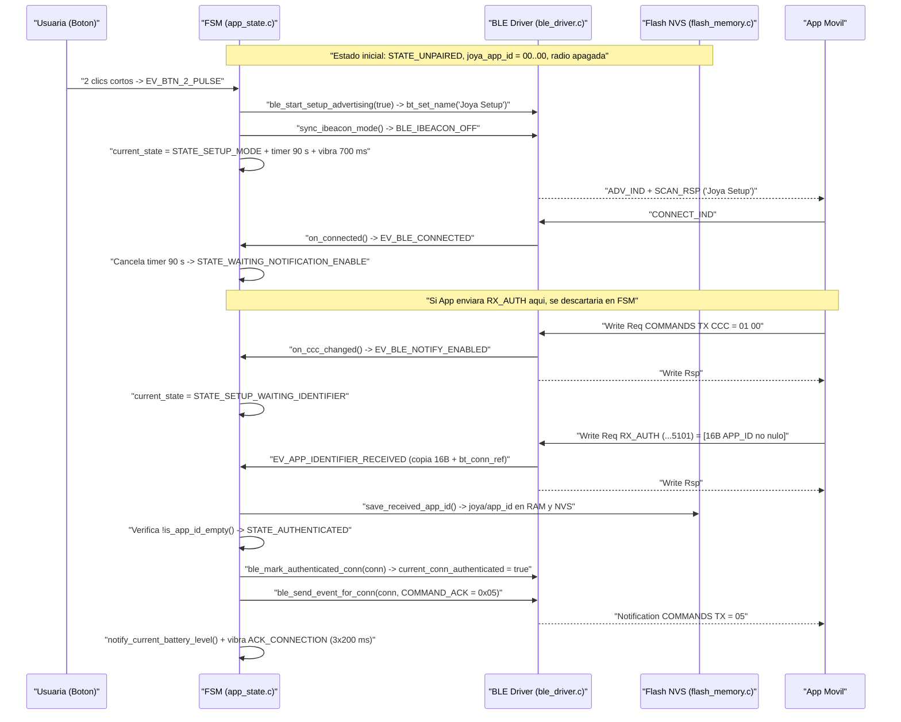
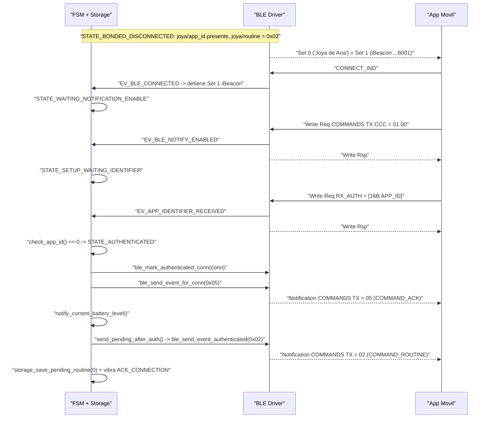
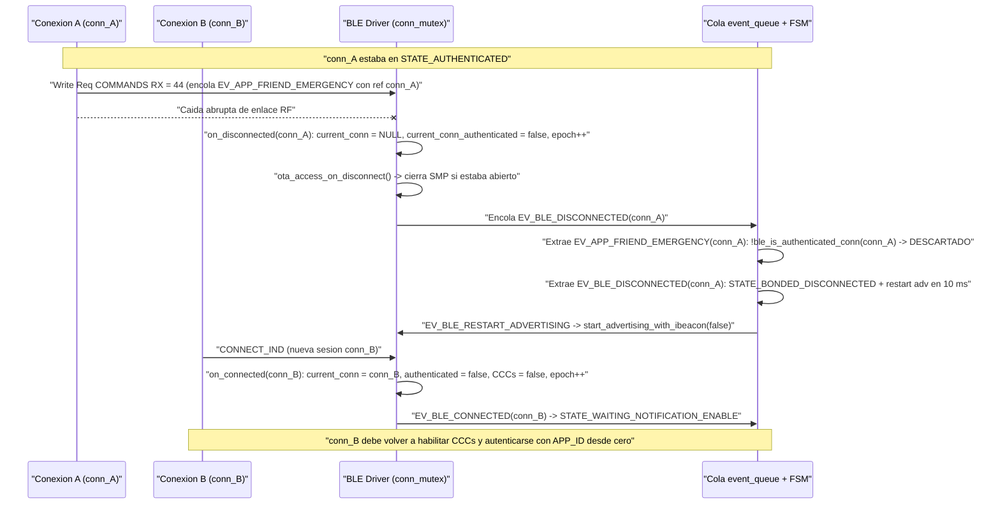

# 10. Autenticación, Configuración Inicial y Control de Acceso

> **Alcance del capítulo**: Este documento describe con rigor de ingeniería el modelo de identidad, provisión inicial (*Setup*), autenticación de sesión en capa de aplicación, control de acceso sobre la superficie GATT y desvinculación física (*Factory Reset*) del firmware de Joya en el commit `c1128e5d0c0d6f98be0a580d287c0926ca27f01f` (**Zephyr RTOS 4.2.0**, **nRF52832-QFAA**).
>
> Véanse como referencias complementarias: [05_state_machine.md](05_state_machine.md) para el autómata global de estados, [06_concurrency.md](06_concurrency.md) para la sincronización entre hilos, [09_gatt_protocol.md](09_gatt_protocol.md) para el formato a nivel de bytes de los atributos GATT, [15_flash_persistence.md](15_flash_persistence.md) para el subsistema `Settings/NVS` y [17_security_privacy.md](17_security_privacy.md) para el modelo integral de amenazas y privacidad.

---

## 10.1 Filosofía Arquitectónica: Identidad de Aplicación sin Pairing BLE (`BT_SMP=n`)

**(a) Comportamiento implementado y (b) Intención de diseño**: El firmware de Joya prescinde deliberadamente del **Security Manager Protocol (SMP)** del estándar Bluetooth Low Energy (`# CONFIG_BT_SMP is not set` y `CONFIG_BT_MAX_PAIRED=0` en `.config` compilado a partir de [prj.conf](../../prj.conf)). En su lugar, implementa un esquema propio de **vinculación y autenticación en capa de aplicación** basado en un secreto compartido estático de 128 bits denominado `APP_ID` (`SIZE_APP_ID = 16` bytes, [include/app_state.h](../../include/app_state.h), línea 4).

Las razones operativas en sistemas *wearables* de emergencia sin pantalla ni teclado (*Just Works* en BLE estándar) que motivan esta arquitectura son:
1. **Eliminación de diálogos y desincronizaciones de bonding del sistema operativo móvil**: En iOS y Android, cuando una pulsera pierde su tabla de claves tras un borrado o reemplazo pero el teléfono conserva el *bond* en ajustes del sistema (o viceversa), el enlace BLE falla silenciosamente hasta que la usuaria entra manualmente a *Ajustes → Bluetooth → Olvidar este dispositivo*, fricción inaceptable en un dispositivo de seguridad personal.
2. **Portabilidad de cuenta gestionada por la aplicación**: La posesión del `APP_ID` de 16 bytes reside bajo control directo del almacenamiento seguro de la aplicación móvil / backend de la usuaria, permitiendo reautenticar desde la app sin depender de claves `LTK` atadas al adaptador Bluetooth físico de un teléfono particular.
3. **Compromiso de seguridad asumido**: Al no habilitar `CONFIG_BT_SMP`, el enlace de radio carece de cifrado `AES-CCM` en la capa de enlace (*Link Layer*); todas las implicaciones criptográficas y de privacidad derivadas se analizan en detalle en las secciones [10.6](#106-limitaciones-y-hallazgos-de-seguridad-en-la-implementación-actual) y [10.7](#107-comparativa-técnica-app_id-vs-pairing-ble-bonding-ble-y-cifrado-de-enlace).

---

## 10.2 Modelo Técnico Completo del `APP_ID` (`16` Bytes)

### 10.2.1 Representación en Memoria, Valor Virgen y Semántica Binaria

- **Tamaño fijo**: `#define SIZE_APP_ID 16` ([include/app_state.h](../../include/app_state.h), línea 4), equivalente a **128 bits**.
- **Naturaleza del dato**: Arreglo binario opaco `uint8_t[16]`. El firmware **no impone formato ASCII, UUID RFC 4122 ni estructura de campos internos**; trata los 16 octetos como una secuencia cruda de bytes. *(En herramientas de banco como [ota/bridge_ota/bridge_ota.ino](../../ota/bridge_ota/bridge_ota.ino), líneas 153–154, se emplea el vector sintético de prueba `00 01 02 03 04 05 06 07 08 09 0A 0B 0C 0D 0E 0F`; en pruebas unitarias de host [tests/test_pending_storage.c](../../tests/test_pending_storage.c), líneas 124 y 175, se usan `{1, 0, ...}` y `{2, 0, ...}`).*
- **Caché en RAM**: Variable global `uint8_t joya_app_id[SIZE_APP_ID] = {0};` en [src/flash_memory.c](../../src/flash_memory.c) (línea 4), expuesta en solo lectura mediante `const uint8_t *storage_get_app_id(void)` (líneas 23–25).
- **Definición de estado virgen / no provisionado (`is_app_id_empty()`)**:
  En [src/flash_memory.c](../../src/flash_memory.c) (líneas 250–253):
  ```c
  bool is_app_id_empty(void) {
      static const uint8_t zeros[SIZE_APP_ID] = {0};
      return (memcmp(joya_app_id, zeros, SIZE_APP_ID) == 0);
  }
  ```
  Un dispositivo se considera **sin `APP_ID` provisionado** si y solo si los **16 bytes de `joya_app_id` valen simultáneamente `0x00`**. En consecuencia, el vector todo-ceros `00 00 00 00 00 00 00 00 00 00 00 00 00 00 00 00` está **reservado como centinela de vacío** y **jamás puede utilizarse como `APP_ID` válido de una usuaria**.

### 10.2.2 Recepción Atómica sobre `RX_AUTH` y Paso por Valor en `event_queue`

El camino completo de un `APP_ID` desde la antena 2,4 GHz hasta su validación en la FSM atraviesa tres etapas desacopladas:

1. **Recepción síncrona en el callback GATT (`BT_RX` thread, prioridad `8`)**:
   Cuando el cliente escribe sobre la característica `RX_AUTH` (`a407e00a-00c1-464d-9173-2cb8be585101`), `on_rx_auth_write()` ([src/ble_driver.c](../../src/ble_driver.c), líneas 211–214) delega en `on_rx_auth_write_handler()` ([src/app_comm.c](../../src/app_comm.c), líneas 43–58):
   - Si `offset != 0` → aborta con `BT_GATT_ERR(BT_ATT_ERR_INVALID_OFFSET)` (`0x07`). No se admiten escrituras parciales ni *Prepare/Execute Write*.
   - Si `len != SIZE_APP_ID` (`16`) → aborta con `BT_GATT_ERR(BT_ATT_ERR_INVALID_ATTRIBUTE_LEN)` (`0x0D`).
   - Invoca `add_event_for_conn(EV_APP_IDENTIFIER_RECEIVED, conn, buf)`. Si `event_queue` está llena (`20` elementos), retorna `BT_GATT_ERR(BT_ATT_ERR_INSUFFICIENT_RESOURCES)` (`0x11`) y reporta `DIAG_ERROR_EVENT_QUEUE_FULL` (`0xE3`).
2. **Encapsulamiento por copia segura en `app_event_t` ([include/app_state.h](../../include/app_state.h), líneas 74–78; [src/app_state.c](../../src/app_state.c), líneas 340–354)**:
   ```c
   typedef struct {
       event_type_t type;
       struct bt_conn *conn;
       uint8_t app_id[SIZE_APP_ID];
   } app_event_t;
   ```
   `add_event_for_conn()` incrementa el contador de referencias de la conexión (`bt_conn_ref(conn)`) y **copia por valor los 16 bytes** desde el buffer efímero de recepción ATT hacia `entry.app_id` mediante `memcpy(entry.app_id, app_id, SIZE_APP_ID)` antes de insertarlo con `k_msgq_put(&event_queue, &entry, K_NO_WAIT)`. Esto elimina cualquier riesgo de puntero colgante (*use-after-free*) cuando el stack BLE recicla el buffer `net_buf` de RX tras retornar `on_rx_auth_write_handler()`. Si `k_msgq_put()` falla, libera inmediatamente `bt_conn_unref(entry.conn)`.
3. **Extracción, validación y liberación en `fsm_thread_loop()` (prioridad `5`, [src/app_state.c](../../src/app_state.c), líneas 362–371)**:
   El hilo de la FSM extrae `entry` por copia en su propio stack, ejecuta `process_event(&entry)` bajo supervisión del watchdog (`wdt_guard_fsm_event_begin()` / `end()`) y, al terminar, ejecuta siempre `bt_conn_unref(entry.conn)`.

### 10.2.3 Comparación (`check_app_id`) y Persistencia (`storage_save_app_id`)

- **Comparación**: `check_app_id(const uint8_t *received_app_id, const uint8_t *app_id)` ([src/app_comm.c](../../src/app_comm.c), líneas 70–72) ejecuta `return memcmp(received_app_id, app_id, SIZE_APP_ID);` (`0` = coincidencia exacta de los 16 bytes; `!= 0` = discrepancia).
- **Persistencia en `Settings/NVS` (`joya/app_id`)**:
  - `save_received_app_id()` ([src/app_comm.c](../../src/app_comm.c), líneas 74–80) envuelve `storage_save_app_id()` ([src/flash_memory.c](../../src/flash_memory.c), líneas 263–289).
  - **Protección previa anti-herencia de rutinas (`pending_routine_dirty`, líneas 267–270)**: Si `is_app_id_empty() && pending_routine_dirty` es verdadero (lo que ocurre si un Factory Reset previo logró borrar RAM pero falló al eliminar `joya/routine` en Flash), `storage_save_app_id()` intenta primero escribir el tombstone `storage_save_pending_routine(0)`. Si ese borrado vuelve a fallar (`!= 0`), **aborta antes de modificar `joya_app_id` y retorna `1`**, impidiendo terminantemente que una rutina vieja quede asociada a un nuevo `APP_ID` propietario (verificado en el test unitario [tests/test_pending_storage.c](../../tests/test_pending_storage.c), líneas 165–172).
  - **Política *RAM-first* resiliente ante fallos de Flash (líneas 272–288)**: Si supera la guarda anterior, `storage_save_app_id()` actualiza **primero** `joya_app_id` en RAM y luego invoca `settings_save_one("joya/app_id", joya_app_id, SIZE_APP_ID)`. Si la partición `storage` (`NVS`) no está disponible o falla la escritura física en Flash, reporta `diagnostics_report_error(DIAG_ERROR_FLASH_WRITE)` (`0xE1`) y devuelve `1`, pero **conserva el `APP_ID` activo en RAM** para no dejar inoperativa la pulsera durante el ciclo de encendido actual.
  - **Carga en el arranque (`app_settings_set()`, líneas 41–58)**: Durante `storage_init()`, la clave `"joya/app_id"` exige exactamente `len == 16` y `read_cb(...) == 16`; cualquier longitud corrupta devuelve `-EINVAL`, lo que hace fallar `settings_load()`, emite `0xE2` y restaura por seguridad todos los valores de RAM a sus valores limpios por defecto (`joya_app_id = {0}`).

---

## 10.3 Flujo Completo de Configuración Inicial (Provisión / Setup Virgen)

### 10.3.1 Condición Inicial tras el Arranque en Virgen (`STATE_UNPAIRED`)

Cuando una pulsera Joya arranca de fábrica o tras un Factory Reset exitoso (`is_app_id_empty() == true`) con una imagen MCUboot ya confirmada (`boot_is_img_confirmed() == true`):
1. `main()` ([src/main.c](../../src/main.c), líneas 16–88) inicializa `storage`, `ble_driver`, `button`, `haptics` y `battery`, dejando `current_state = STATE_UNPAIRED` y **la radio BLE completamente apagada** (ni Set 0 conectable ni Set 1 iBeacon).
2. A los `~60 s`, cuando el monitor de batería confirma el primer nivel (`EV_BATTERY_NORMAL` o `EV_BATTERY_LEVEL_1`, [src/app_state.c](../../src/app_state.c), líneas 429–433), evalúa `boot_reconnect_pending = !is_app_id_empty() && boot_is_img_confirmed()`, que resulta **`false`** porque `is_app_id_empty()` es `true`. Por tanto, **una pulsera virgen nunca inicia advertising por sí sola al encenderse** (salvo en un arranque de prueba OTA `ota_test_boot == true`, donde `app_start_test_setup()` abre una ventana de `5 minutos` para permitir la confirmación de imagen).

### 10.3.2 Entrada a `STATE_SETUP_MODE`, Nombre `"Joya Setup"` y Timeout de `90 s`

Existen tres vías para que un dispositivo sin `APP_ID` entre en `STATE_SETUP_MODE`:

| Vía de entrada | Evento disparador | Función ejecutada en `src/app_state.c` | Vibración | Timeout de publicidad |
|---|---|---|---|---|
| **1. Gesto normal de vinculación (nominal)** | Doble clic corto (`EV_BTN_2_PULSE`) en `STATE_UNPAIRED` | `start_setup_from_idle()` (líneas 165–175, 888–891) | `HAPTICS_PATTERN_SETUP_MODE` (`700 ms ON + 100 ms OFF`) | `BLE_SETUP_TIMEOUT_MS = 90000 ms` (`90 s`, `connection_timeout_work`) |
| **2. Gesto de emergencia en pulsera virgen** | `>= 3` clics (`EV_BTN_EMERGENCY`) en `STATE_UNPAIRED` con `is_app_id_empty()` | `start_advertising_with_ibeacon(true)` (líneas 754–757) | `HAPTICS_PATTERN_EMERGENCY_START` (`2000 ms ON`) | **Sin timeout** (`connection_timeout_work` no se agenda; publicita indefinidamente hasta conexión o suspensión de 5 s) |
| **3. Imagen MCUboot en modo `Test` o ventana crítica Nivel 2** | `EV_BOOT_TEST_SETUP_REQUEST` o `EV_BTN_2_PULSE` en Nivel 2 | `app_start_test_setup()` (líneas 402–422) / `start_critical_window()` (líneas 177–194) | Sin vibración | `CRITICAL_WINDOW_MS = 300000 ms` (`5 min`, `critical_window_work`) |

En el flujo nominal (`start_setup_from_idle()`):
1. Invoca `start_advertising_with_ibeacon(is_app_id_empty() /* true */)` → `ble_start_setup_advertising(true)` ([src/ble_driver.c](../../src/ble_driver.c), líneas 608–647).
2. Como `is_new_connection == true`, llama a **`bt_set_name("Joya Setup")`** (`JOYA_ADV_NAME_SETUP`, línea 7 y línea 623) e inicia el advertising legacy conectable (`100..150 ms`) con `"Joya Setup"` en el `SCAN_RSP`.
3. Acto seguido, `sync_ibeacon_mode()` ([src/app_state.c](../../src/app_state.c), líneas 150–154) consulta `ibeacon_mode_for_state(!is_app_id_empty())`, que devuelve **`BLE_IBEACON_OFF`** ([include/ibeacon_policy.h](../../include/ibeacon_policy.h), línea 13). Así se evita que otros teléfonos que escaneen regiones iBeacon en segundo plano despierten ante una pulsera ajena aún no configurada.
4. Si transcurren los **`90 segundos`** (`BLE_SETUP_TIMEOUT_MS`) sin recibir `CONNECT_IND`, expira `connection_timeout_work` → encola `EV_BLE_TIMEOUT` → `process_event()` ([src/app_state.c](../../src/app_state.c), líneas 901–905) regresa `current_state = STATE_UNPAIRED` e invoca `ble_stop_advertising()`, volviendo a consumo de reposo profundo.

### 10.3.3 Conexión BLE y la Barrera Obligatoria `STATE_WAITING_NOTIFICATION_ENABLE`

Cuando la aplicación móvil descubre `"Joya Setup"` y establece el enlace BLE:
1. `on_connected()` ([src/ble_driver.c](../../src/ble_driver.c), líneas 217–244) guarda `current_conn = bt_conn_ref(conn)`, incrementa `diagnostics_session_epoch++`, limpia `connectable_adv_running`, resetea a `false` **todas** las banderas de sesión (`current_conn_authenticated`, `notify_enabled`, `battery_change_notify_enabled`, `battery_measurement_notify_enabled`, `diagnostics_notify_enabled`), ordena detener el iBeacon por `ibeacon_stop_work` y encola `EV_BLE_CONNECTED`.
2. Al procesar `EV_BLE_CONNECTED` en `STATE_SETUP_MODE` ([src/app_state.c](../../src/app_state.c), líneas 895–900):
   - **Cancela `connection_timeout_work`** (el límite de `90 s` aplica solo al tiempo de espera de conexión en aire, no a la duración de la conexión establecida).
   - Transiciona a **`STATE_WAITING_NOTIFICATION_ENABLE`**.
   - Llama a `ble_stop_advertising()` (asegurando limpieza explícita además de `BT_LE_ADV_OPT_ONE_TIME`).

**¿Por qué existe `STATE_WAITING_NOTIFICATION_ENABLE` y por qué un `APP_ID` prematuro se ignora?**
- **(b) Intención de diseño documentada en código ([src/app_state.c](../../src/app_state.c), líneas 910–915)**: Como la respuesta a la autenticación (`COMMAND_ACK = 0x05` o `COMMAND_NACK = 0x06`) se entrega **exclusivamente mediante notificación GATT** sobre `COMMANDS TX (...5001)`, si el firmware procesara `EV_APP_IDENTIFIER_RECEIVED` antes de que el cliente habilite `COMMANDS TX CCC (0x2902 = 0x0001)`, la llamada `ble_send_event_for_conn(entry->conn, COMMAND_ACK)` fallaría con `-ENOTCONN` (porque `notify_enabled == false`, [src/ble_driver.c](../../src/ble_driver.c), líneas 666–671). En provisión inicial, eso dejaría una inconsistencia grave: la pulsera habría guardado el `APP_ID` y pasado a `STATE_AUTHENTICATED`, pero la app nunca recibiría el `0x05` de confirmación.
- **(a) Comportamiento implementado**: En `case STATE_WAITING_NOTIFICATION_ENABLE:`, el único evento aceptado es `EV_BLE_NOTIFY_ENABLED`, que transiciona a `STATE_SETUP_WAITING_IDENTIFIER` (líneas 916–919). Si la app escribe los `16` bytes en `RX_AUTH` antes de que se procese la escritura `0x0001` en `COMMANDS TX CCC` (por ejemplo, si dispara ambas escrituras en paralelo sin esperar el `Write Response` del descriptor `CCC`), `on_rx_auth_write_handler()` responderá `ATT_WRITE_RSP` exitoso, pero `process_event()` encontrará `current_state == STATE_WAITING_NOTIFICATION_ENABLE` y **descartará silenciosamente `EV_APP_IDENTIFIER_RECEIVED`**. La conexión no se rompe: bastará con que la app reenvíe el `APP_ID` una vez habilitado el `CCC`.

> **Nota sobre código residual (d)**: En [include/app_state.h](../../include/app_state.h) (línea 27) existe el estado `STATE_SETUP_WAITING_NEW_IDENTIFIER`. En el firmware actual **nunca se asigna** (`STATE_SETUP_WAITING_IDENTIFIER` cubre tanto provisión virgen como reconexión autenticada, diferenciando ambas ramas mediante `if (is_app_id_empty())` en [src/app_state.c](../../src/app_state.c), línea 925). Su única aparición en `src/app_state.c` es una guarda defensiva en la línea 543.

### 10.3.4 Registro del `APP_ID` y Secuencia Exacta Post-Autenticación

Una vez en `STATE_SETUP_WAITING_IDENTIFIER`, cuando llega `EV_APP_IDENTIFIER_RECEIVED` con `is_app_id_empty() == true` ([src/app_state.c](../../src/app_state.c), líneas 925–953), se ejecutan secuencialmente estos **9 pasos atómicos respecto de la FSM**:

1. **Verificación de vigencia de conexión (línea 928)**: `if (!ble_is_current_conn(entry->conn)) return;` — descarta el evento si el enlace que envió el `APP_ID` ya se desconectó mientras el evento esperaba en `event_queue`.
2. **Guardado en RAM y NVS (línea 931)**: `ret = save_received_app_id(entry->app_id);` → escribe `joya_app_id` y persiste `joya/app_id` (`16 B`).
3. **Comprobación de no-vacío post-guardado (líneas 932–935)**: `if (is_app_id_empty()) return;` — protege contra dos casos: (a) fallo al limpiar `pending_routine_dirty` en NVS, y (b) envío accidental de `16` bytes `0x00` por parte de la app. En ambos casos permanece en `STATE_SETUP_WAITING_IDENTIFIER` sin enviar `0x05`.
4. **Sincronización de política iBeacon (línea 936)**: `sync_ibeacon_mode();` — ahora `!is_app_id_empty()` es `true`, aunque mientras haya conexión activa `ble_set_ibeacon_mode()` mantiene el transmisor iBeacon apagado (`ble_has_connection() == true`).
5. **Cambio de estado FSM (línea 939)**: `current_state = STATE_AUTHENTICATED;`.
6. **Autorización de la conexión BLE y disparo de diagnóstico (líneas 940–942)**: `ble_mark_authenticated_conn(entry->conn)` ([src/ble_driver.c](../../src/ble_driver.c), líneas 546–559) toma `conn_mutex`, verifica `conn == current_conn`, activa `current_conn_authenticated = true` e invoca `diagnostics_request_init_notification()`. Si la app ya había habilitado `DIAGNOSTICS CCC (...5202)`, se agenda `diagnostics_work` para notificar `A0 MM` (normalmente `A0 1F`).
7. **Envío de confirmación `COMMAND_ACK (0x05)` (línea 944)**: `ble_send_event_for_conn(entry->conn, COMMAND_ACK)` notifica `0x05` sobre `COMMANDS TX (...5001)`.
8. **Notificación del nivel confirmado de batería (línea 948)**: `notify_current_battery_level()` envía `0x00`, `0x01` o `0x02` en `BATTERY_CHANGE (...5301)` si `battery_level >= 0` y la app ya suscribió su `CCC`.
9. **Confirmación háptica y revisión de pendientes (líneas 950–951)**: Reproduce `haptics_play(HAPTICS_PATTERN_ACK_CONNECTION)` (`3` pulsos de `200 ms` separados por `100 ms` = `900 ms` totales, si `haptics_allowed`) e invoca `send_pending_after_auth()` (que en una provisión virgen no encuentra ni emergencia ni rutina pendiente).

---

## 10.4 Reconexiones Posteriores, Rechazo (`NACK`), Desconexiones y Factory Reset

### 10.4.1 Publicidad de Reconexión (`STATE_BONDED_DISCONNECTED`)

Cuando el dispositivo ya posee un `APP_ID` almacenado (`!is_app_id_empty()`):
- **Tras un reinicio normal**: Permanece en `STATE_UNPAIRED` durante los primeros `~60 s` hasta que el monitor SAADC confirma un nivel no crítico (`battery_level != 2`), momento en que `boot_reconnect_pending` transiciona automáticamente a `STATE_BONDED_DISCONNECTED` y arranca `start_advertising_with_ibeacon(false)` ([src/app_state.c](../../src/app_state.c), líneas 462–475). Si la usuaria hace doble clic (`EV_BTN_2_PULSE`) o triple clic (`EV_BTN_EMERGENCY`) antes de esos `60 s`, el advertising se inicia de inmediato.
- **Qué radia en aire**:
  - **Set 0 conectable**: Nombre personalizado `"Joya de <sufijo>"` o nombre base `"Joya"` (`storage_get_name()`) en el `SCAN_RSP`, **sin** timeout de `90 s` (publicita indefinidamente mientras `battery_level != 2` y la usuaria no suspenda con pulsación de `5 s`).
  - **Set 1 no conectable**: Trama Apple iBeacon con UUID `a407e00a-00c1-464d-9173-2cb8be586001` cada `1,0..1,2 s` para despertar a la app móvil en segundo plano (iOS CoreLocation / Android Region Monitoring).

### 10.4.2 Reconexión Exitosa vs. Autenticación Fallida (`COMMAND_NACK = 0x06`)

Al conectar desde `STATE_BONDED_DISCONNECTED`, `EV_BLE_CONNECTED` lleva a `STATE_WAITING_NOTIFICATION_ENABLE` ([src/app_state.c](../../src/app_state.c), línea 1002) y `EV_BLE_NOTIFY_ENABLED` a `STATE_SETUP_WAITING_IDENTIFIER` (línea 918). Al recibir `EV_APP_IDENTIFIER_RECEIVED` en la rama `else` (`!is_app_id_empty()`, líneas 954–984):

1. **Caso coincidente (`check_app_id(entry->app_id, storage_get_app_id()) == 0`, líneas 960–973)**:
   - Pasa a `STATE_AUTHENTICATED`, ejecuta `ble_mark_authenticated_conn(entry->conn)`, envía `COMMAND_ACK (0x05)`, llama a `notify_current_battery_level()`, ejecuta `send_pending_after_auth()` y finalmente `haptics_play(HAPTICS_PATTERN_ACK_CONNECTION)`.
   - **Matiz de interacción háptica en reconexión con emergencia pendiente (a/c)**: Adviértase que en las líneas 971–972 el orden está invertido respecto de la rama de provisión inicial (líneas 950–951): aquí se llama primero a `send_pending_after_auth()` —que si `joya_emergency_phase == EMERGENCY_PENDING_ACK` envía `0x04` e invoca `haptics_play(HAPTICS_PATTERN_EMERGENCY_START)` (`2000 ms`)— e **inmediatamente en la línea siguiente (972)** se invoca `haptics_play(HAPTICS_PATTERN_ACK_CONNECTION)` (`900 ms`). Como `haptics_play()` cancela cualquier patrón en curso para iniciar el nuevo, en la práctica la usuaria siente los `3` pulsos cortos de `ACK_CONNECTION` en lugar del pulso largo de `2000 ms`, mientras que el comando BLE `0x04` y sus reintentos sí se transmiten íntegramente.
2. **Caso discrepante (`check_app_id(...) != 0`, líneas 974–982)**:
   - Envía **`COMMAND_NACK (0x06)`** mediante `ble_send_event_for_conn(entry->conn, COMMAND_NACK)`.
   - **No modifica `current_state`** (permanece en `STATE_SETUP_WAITING_IDENTIFIER`), **no marca `current_conn_authenticated`** (sigue en `false`), **no desconecta el enlace BLE** y **no aplica límite de reintentos ni retardo progresivo** (existe el comentario explícito `// (improvement) max retry attempts? or just wait for the next connection?` en la línea 976).
   - En consecuencia, el mismo cliente puede volver a escribir otro `APP_ID` de 16 bytes en `RX_AUTH` dentro de la misma conexión y autenticarse con éxito si suministra el valor correcto.

### 10.4.3 Desconexiones a Mitad de Handshake y Descarte de Eventos Obsoletos

El comportamiento ante `EV_BLE_DISCONNECTED` ([src/app_state.c](../../src/app_state.c), líneas 598–627) depende críticamente de si el dispositivo ya tenía `APP_ID` guardado o estaba en Setup inicial:

| Situación al desconectar | `is_app_id_empty()` | Estado previo al corte | Estado resultante | ¿Reinicia advertising automáticamente? | Consecuencia práctica |
|---|---|---|---|---|---|
| **Corte a mitad de Setup inicial** (antes de guardar `APP_ID`, sin emergencia ni ventana crítica) | `true` | `STATE_WAITING_NOTIFICATION_ENABLE` o `STATE_SETUP_WAITING_IDENTIFIER` | `STATE_UNPAIRED` | **NO** | **Pérdida del resto de la ventana de 90 s**: como `connection_timeout_work` se canceló al conectar (línea 897), si una conexión espuria o fallida cae a los `5 s` de haber hecho doble clic, Joya vuelve a `STATE_UNPAIRED` en silencio y la usuaria debe repetir el doble clic. |
| **Corte tras haber guardado `APP_ID` en Setup** (p. ej. cayó antes de que la app viera `0x05`) | `false` | `STATE_AUTHENTICATED` | `STATE_BONDED_DISCONNECTED` | **Sí** (`schedule_advertising_restart()` en `10 ms`) | El `APP_ID` ya quedó persistido; al reconectar, la misma app autenticará por la rama de reconexión y recibirá `0x05`. |
| **Corte a mitad de reconexión** (antes de enviar `APP_ID` o tras recibir `0x06` NACK) | `false` | `STATE_WAITING_NOTIFICATION_ENABLE` o `STATE_SETUP_WAITING_IDENTIFIER` | `STATE_BONDED_DISCONNECTED` | **Sí** (`schedule_advertising_restart()` en `10 ms`, hasta 3 intentos cada `5 s`) | Vuelve a publicitar `"Joya"` / `"Joya de ..."` + iBeacon automáticamente para permitir reconexión inmediata. |
| **Corte con emergencia activa (`is_in_emergency()`) o en `critical_window_open`** | `true` o `false` | Cualquiera | `STATE_SETUP_MODE` (si vacío) o `STATE_BONDED_DISCONNECTED` | **Sí** (`schedule_advertising_restart()`) | Prioriza recuperar conectividad para entregar `0x04` o confirmar imagen OTA `Test`. |
| **Corte con batería en Nivel 2 (`<= 2900 mV`)** fuera de ventana crítica y sin OTA activa | `true` o `false` | Cualquiera | `STATE_UNPAIRED` (`critical_idle = true`, `suspended_idle = true`) | **NO** | Entra en hibernación lógica de protección de batería. |

**Protección contra condiciones de carrera entre conexiones sucesivas (*stale events*)**:
Dado que `BT_RX` (prioridad `8`) y `fsm_thread_id` (prioridad `5`) se comunican por cola asíncrona, una conexión `conn_A` podría encolar eventos justo antes de desconectarse e inmediatamente entrar una nueva conexión `conn_B`. El firmware neutraliza esta carrera mediante cinco barreras combinadas:
1. Cada `app_event_t` originado en BLE retiene el puntero exacto `struct bt_conn *conn` con `bt_conn_ref(conn)`.
2. `EV_BLE_CONNECTED` verifica `if (!ble_is_current_conn(entry->conn)) return;` (línea 386).
3. `EV_BLE_DISCONNECTED` verifica `if (ble_has_connection()) return;` (línea 389): si `conn_B` ya ocupó `current_conn` cuando llega el evento diferido de desconexión de `conn_A`, no destruye el estado de `conn_B`.
4. Los eventos `EV_APP_ACK_EMERGENCY`, `EV_APP_STOP_EMERGENCY`, `EV_APP_FOLLOW_ME`, `EV_APP_FRIEND_EMERGENCY`, `EV_APP_OTA_ENABLE` y `EV_APP_OTA_DISABLE` exigen `ble_is_authenticated_conn(entry->conn)` (`conn == current_conn && current_conn_authenticated`, líneas 396–400 y 704–705).
5. En `DIAGNOSTICS`, `diagnostics_session_epoch` se incrementa tanto en `on_connected()` como en `on_disconnected()` ([src/ble_driver.c](../../src/ble_driver.c), líneas 231 y 255), invalidando cualquier `diagnostics_work` pendiente de la sesión anterior.

### 10.4.4 Desvinculación y Restauración de Fábrica (Factory Reset Físico de `15 s`)

No existe ningún comando GATT para borrar el `APP_ID` remotamente: **la desvinculación requiere posesión física de la pulsera** manteniendo presionado el botón durante `BUTTON_FACTORY_RESET_HOLD_MS = 15000 ms` ([include/button.h](../../include/button.h), línea 16). Su ejecución sigue una coreografía segura de tres condiciones ([src/button.c](../../src/button.c), líneas 33–52, 106–114; [src/app_state.c](../../src/app_state.c), líneas 101–120 y 653–701):

1. **Bloqueo durante OTA activa**: Si `ota_access_is_update_active()` es `true` (`uploading || upload_complete`), `EV_BTN_FACTORY_THRESHOLD` marca `hold_blocked = true` e ignora el gesto para evitar corromper una escritura de imagen o estado de swap MCUboot.
2. **Umbral de `15 s` + Liberación física + Fin de vibración**:
   - Al cumplirse `15 s` con el botón presionado, `factory_hold_work` emite `EV_BTN_FACTORY_THRESHOLD`, que detiene cualquier vibración previa y lanza `haptics_play_with_completion(HAPTICS_PATTERN_FACTORY_RESET, factory_pattern_finished)` (`3` pulsos de `200 ms`, `900 ms`). Si la háptica está deshabilitada o falla (`ret != 0`), fija `hold_pattern_done = true` de inmediato.
   - El reinicio `factory_reset_and_reboot()` **solo se ejecuta cuando se cumplen ambas banderas**: `hold_released == true` (la usuaria soltó físicamente el botón → `EV_BTN_FACTORY_RESET`) **y** `hold_pattern_done == true` (`EV_HAPTICS_FACTORY_DONE`). Esperar a que suelte el botón garantiza que al reiniciar con `sys_reboot(SYS_REBOOT_COLD)` el pin `P0.13` no arranque presionado.
3. **Borrado ordenado y prevención de resurrección de `APP_ID` ante fallo de Flash (`factory_reset_and_reboot()`, líneas 101–120, y `storage_factory_reset()`, [src/flash_memory.c](../../src/flash_memory.c), líneas 357–398)**:
   - Limpia primero todas las variables en RAM (`joya_app_id = {0}`, `joya_emergency_phase = EMERGENCY_NONE`, `joya_pending_routine = 0`, `joya_name = "Joya"`), desconecta BLE y detiene alertas.
   - En NVS elimina en orden estricto: **`"joya/routine"` primero** (si falla, levanta `pending_routine_dirty = true`), luego `"joya/app_id"`, `"joya/emergency"` y `"joya/name"`.
   - **Decisión crítica de seguridad (líneas 108–117)**: Si `storage_factory_reset() != 0` (falló el borrado de alguna clave en Flash), emite `DIAG_ERROR_FLASH_WRITE (0xE1)` y **NO ejecuta `sys_reboot(SYS_REBOOT_COLD)`**; en su lugar entra en `suspended_idle = true` manteniendo la RAM limpia. Si reiniciara tras un fallo de `settings_delete("joya/app_id")`, `storage_init()` volvería a cargar desde NVS el `APP_ID` antiguo que la usuaria creyó haber borrado.

---

## 10.5 Matriz Completa de Control de Acceso sobre Servicios y Características

La siguiente tabla resume qué puede hacer un cliente BLE conectado en cada fase de la sesión:

| Servicio / Característica | Operación ATT | Antes de autenticar (`WAITING_NOTIFICATION_ENABLE` / `SETUP_WAITING_IDENTIFIER`) | Después de autenticar (`STATE_AUTHENTICATED` + `current_conn_authenticated`) | Mecanismo de aplicación de la regla |
|---|---|---|---|---|
| **GAP (`0x1800`)** — `Device Name (0x2A00)` | `Read` / `Write` | **Permitido** (lee nombre GAP actual; escribe solo en RAM GAP de Zephyr) | **Permitido** | Estándar Zephyr (`CONFIG_BT_DEVICE_NAME_GATT_WRITABLE=y`, sin `BT_SMP`). *Hallazgo documentado en 10.6.* |
| **GAP (`0x1800`)** — `Appearance (0x2A01)`, `PPCP (0x2A04)` | `Read` | **Permitido** | **Permitido** | Metadatos públicos de enlace BLE. |
| **GATT (`0x1801`)** — `Service Changed (0x2A05)` | `CCC Write` / `Indicate` | **Permitido** (`0x0002`) | **Permitido** (`0x0002`) | Estándar Zephyr (`CONFIG_BT_GATT_SERVICE_CHANGED=y`). |
| **AUTH (`...5100`)** — `RX_AUTH (...5101)` | `Write` (`16 B`) | En `WAITING_NOTIFICATION_ENABLE`: ATT `Write Rsp` OK pero **ignorado en FSM**. En `SETUP_WAITING_IDENTIFIER`: **Permitido** (provisiona o autentica). | ATT `Write Rsp` OK pero **ignorado en FSM** (`EV_APP_IDENTIFIER_RECEIVED` no tiene handler en `STATE_AUTHENTICATED`). | Validación de formato en `on_rx_auth_write_handler`; validación de estado en `process_event()`. |
| **COMMANDS (`...5000`)** — `TX (...5001)` | `CCC Write` (`0x2902`) | **Permitido y obligatorio** (`0x0001` desbloquea paso a `SETUP_WAITING_IDENTIFIER`) | **Permitido** (re-habilitar dispara `send_pending_after_auth()`) | `on_ccc_changed()` + `EV_BLE_NOTIFY_ENABLED`. |
| **COMMANDS (`...5000`)** — `TX (...5001)` | `Notify` (`0x05` / `0x06` vs `0x02..0x04`) | Solo puede emitir `0x05` (en el instante de transición) o `0x06` (`NACK`) | Emite `0x02`, `0x03`, `0x04` y `0x05` (ACK de comandos) | `ble_send_event_for_conn()` vs `ble_send_event_authenticated()`. |
| **COMMANDS (`...5000`)** — `RX (...5002)` | `Write` (`0x41..0x44`, `0x70..0x71`) | **Bloqueado en FSM**: ATT `Write Rsp` OK, pero evento descartado sin efecto ni `0x05` | **Permitido** (sujeto a exclusión mutua `is_in_emergency()` para `0x41..0x44`) | Filtro asíncrono `ble_is_authenticated_conn(entry->conn)` y `current_state == STATE_AUTHENTICATED` en `process_event()`. |
| **CONFIG (`...5200`)** — `NAME (...5201)` | `Read` | **Permitido** (devuelve `""` o sufijo personalizado) | **Permitido** | `on_name_read()` **no** consulta autenticación. |
| **CONFIG (`...5200`)** — `NAME (...5201)` | `Write Request` (`1..23 B`) | **Rechazado síncronamente** con `BT_ATT_ERR_AUTHORIZATION (0x08)` | **Permitido** | `on_name_write()` verifica `get_current_state() == STATE_AUTHENTICATED`. |
| **CONFIG (`...5200`)** — `DIAGNOSTICS (...5202)` | `Read` | **Rechazado síncronamente** con `BT_ATT_ERR_AUTHORIZATION (0x08)` | **Permitido** (devuelve `A0 MM`) | `on_diagnostics_read()` verifica `ble_is_authenticated_conn(conn)`. |
| **CONFIG (`...5200`)** — `DIAGNOSTICS (...5202)` | `CCC Write` / `Notify` | `CCC Write` permitido; **ninguna notificación** sale antes de autenticar | **Permitido** (emite `A0 MM` inicial y errores `0xE1..0xE5`) | `ble_diagnostics_session()` exige `current_conn_authenticated && diagnostics_notify_enabled`. |
| **BATTERY (`...5300`)** — `CHANGE (...5301)` y `MEASUREMENT (...5302)` | `CCC Write` / `Notify` | `CCC Write` permitido; **ninguna notificación** sale antes de autenticar | **Permitido** | `ble_send_battery_value()` exige `get_current_state() == STATE_AUTHENTICATED` y `current_conn_authenticated`. |
| **SMP Dinámico (`8d53dc1d-...`)** | Descubrimiento / `Write` / `Notify` | **Inexistente en la base GATT** (`smp_bt_unregister()` en boot y desconexión) | **Inexistente hasta recibir `0x70`**; luego accesible durante la sesión activa (hasta `0x71`, `2 min` idle o desconexión) | Control dinámico de servicio GATT en `src/ota_access.c`. |

---

## 10.6 Relación entre Identidad Persistente y Sesiones Efímeras, y Limitaciones de Seguridad Actuales

### 10.6.1 Identidad Persistente vs. Sesión BLE Efímera

El firmware separa estrictamente dos planos temporales:
- **Plano persistente (`NVS` + `FICR`)**:
  - Dirección MAC BLE del Set 0 conectable: estática aleatoria grabada en fábrica en `NRF_FICR->DEVICEADDR` (inmutable entre reinicios). *(Nota: el Set 1 de iBeacon usa una dirección privada no resoluble `NRPA` distinta generada en RAM por Zephyr).*
  - Credencial propietaria `joya/app_id` (`16 B`), fase de emergencia `joya/emergency` (`1 B`), rutina pendiente ligada a propietario `joya/routine` (`1` o `17 B`) y nombre `joya/name` (`<= 32 B`).
- **Plano efímero de sesión (solo SRAM, destruido en cada `on_disconnected()`)**:
  - Puntero `current_conn`, booleano `current_conn_authenticated`, época `diagnostics_session_epoch`, las cuatro banderas de suscripción `CCC` (`notify_enabled`, `battery_change_notify_enabled`, `battery_measurement_notify_enabled`, `diagnostics_notify_enabled`) y el registro del servicio dinámico `SMP` (`service_enabled`).
  - **Invariante de seguridad**: Ninguna autorización ni apertura OTA sobrevive jamás a una caída de enlace BLE (`on_disconnected()` limpia las banderas bajo `conn_mutex` e invoca `ota_access_on_disconnect()` síncronamente desde el hilo `BT_RX`).

### 10.6.2 Limitaciones y Hallazgos de Seguridad Verificados en `c1128e5`

Sin modificar el código fuente, se documentan de manera transparente las limitaciones inherentes a la implementación actual (ampliadas en [17_security_privacy.md](17_security_privacy.md) y [23_known_limitations.md](23_known_limitations.md)):

1. **Transmisión de `APP_ID` en texto claro y vulnerabilidad a *sniffing* / *replay* (`# CONFIG_BT_SMP is not set`)**:
   Como `RX_AUTH (...5101)` viaja sobre un enlace BLE sin cifrar y la prueba de identidad consiste en presentar directamente los `16` bytes estáticos del `APP_ID` (en vez de un esquema *challenge-response* como `HMAC-SHA256(APP_ID, nonce_efimero)`), un atacante pasivo con un sniffer BLE en rango de radio durante el Setup inicial o durante cualquier reconexión posterior puede capturar los `16` bytes del `APP_ID`. Con ese valor capturado, podría conectarse cuando el teléfono legítimo no esté conectado, autenticarse, silenciar una emergencia (`0x41`/`0x42`) o habilitar SMP (`0x70`) —si bien **no podría flashear código arbitrario** porque MCUboot exige firma criptográfica `RSA-2048` válida en el arranque (`CONFIG_BOOT_SIGNATURE_TYPE_RSA=y`).
2. **Ausencia de *rate-limiting* o desconexión tras `COMMAND_NACK (0x06)` ([src/app_state.c](../../src/app_state.c), líneas 975–982)**:
   Un cliente conectado puede enviar intentos fallidos de `APP_ID` de manera continua recibiendo `0x06` sin ser desconectado ni penalizado temporalmente. Si la app móvil genera `APP_ID` con `128 bits` de entropía criptográfica uniforme (`CSPRNG`), la búsqueda exhaustiva ($2^{128}$ combinaciones) es computacionalmente inviable; pero si el backend o un entorno de pruebas generara identificadores predecibles o de baja entropía, la ausencia de bloqueo facilitaría ataques de diccionario. Además, `check_app_id()` usa `memcmp()` estándar de C, cuyo tiempo de ejecución puede variar en nanosegundos según el primer byte distinto (aunque el jitter de planificación BLE de `45..90 ms` enmascara en la práctica un ataque de temporización remota por radio).
3. **Comportamiento silencioso ante el vector nulo `00..00` en Setup inicial ([src/flash_memory.c](../../src/flash_memory.c), líneas 250–274 y [src/app_state.c](../../src/app_state.c), líneas 931–935)**:
   `on_rx_auth_write_handler()` no rechaza síncronamente un payload de 16 ceros con `BT_ATT_ERR_VALUE_NOT_ALLOWED`. Si un cliente defectuoso escribe `16` bytes `0x00` en una pulsera virgen, `storage_save_app_id()` guarda esos `16` ceros en `joya/app_id` (gastando una escritura NVS) y acto seguido `if (is_app_id_empty()) return;` aborta la transición sin enviar `0x05` ni `0x06`.
4. **Chequeo de estado global en `on_name_write()` en vez de `ble_is_authenticated_conn(conn)` ([src/ble_driver.c](../../src/ble_driver.c), líneas 279–281)**:
   Mientras `on_diagnostics_read()` comprueba `ble_is_authenticated_conn(conn)` bajo `conn_mutex`, `on_name_write()` ignora el parámetro `conn` (`ARG_UNUSED(conn)`) y evalúa `if (get_current_state() != STATE_AUTHENTICATED)`. Gracias a `CONFIG_BT_MAX_CONN=1` normalmente no coexisten dos conexiones, pero existe una micro-ventana teórica entre `on_disconnected()` de una sesión autenticada + `on_connected()` inmediata de otro central (ambos en `BT_RX`) antes de que `fsm_thread_id` procese `EV_BLE_DISCONNECTED` (aunque `fsm_thread_id` tiene prioridad `5`, superior a `BT_RX` prioridad `8`, lo que en ejecución normal drena el evento inmediatamente al ceder CPU).
5. **Exposición sin autenticar de `on_name_read()` (`...5201`) y escritura abierta en `GAP Device Name (0x2A00)`**:
   - `on_name_read()` ([src/ble_driver.c](../../src/ble_driver.c), líneas 322–345) permite leer el sufijo personal sin autenticar (si bien ese mismo nombre `"Joya de <sufijo>"` ya se emite públicamente en claro dentro del `SCAN_RSP` durante el advertising).
   - `0x2A00` en el servicio GAP estándar queda escribible sin autenticación por el valor por defecto `CONFIG_BT_DEVICE_NAME_GATT_WRITABLE=y` cuando se habilita `CONFIG_BT_DEVICE_NAME_DYNAMIC=y` sin `CONFIG_BT_SMP`.

---

## 10.7 Comparativa Técnica: `APP_ID` vs. Pairing BLE, Bonding BLE y Cifrado de Enlace

| Dimensión técnica | Autenticación `APP_ID` (Implementada en Joya) | Pairing BLE (LE Secure Connections / Legacy) | Bonding BLE (`CONFIG_BT_BONDABLE=y`) | Cifrado de Enlace (`AES-CCM` LL) |
|---|---|---|---|---|
| **Capa donde opera** | Capa de Aplicación (GATT `RX_AUTH ...5101` + `COMMANDS TX ...5001`) | Host BLE (`L2CAP CID 0x0006` — Security Manager Protocol) | Host BLE + Persistencia `bt/keys` en `Settings/NVS` | Controlador BLE (`BT_LL_SW_SPLIT` hardware `CCM` nRF52) |
| **Estado en firmware `c1128e5`** | **Activo y obligatorio** | **Deshabilitado** (`CONFIG_BT_SMP=n`) | **Deshabilitado** (`CONFIG_BT_MAX_PAIRED=0`) | **Soportado en radio (`BT_CTLR_LE_ENC=y`), inactivo sin `BT_SMP`** |
| **Intercambio criptográfico** | Comparación directa de secreto estático de 128 bits (`memcmp`) | Intercambio ECDH P-256 (LE SC) o STK (Legacy) para derivar `LTK` | Almacenamiento de `LTK`, `IRK` (resolución de RPA) y `CSRK` | Cifrado y autenticación por paquete (`MIC` de 4 bytes) con clave de sesión derivada de `LTK` |
| **Confidencialidad e integridad en aire** | **Ninguna** (payloads GATT y `APP_ID` viajan en claro) | Establece las claves para activar cifrado | Reutiliza `LTK` en reconexiones sin repetir ECDH | **Alta**: impide sniffing pasivo, inyección y modificación de paquetes ATT en vuelo |
| **Protección MITM en dispositivo sin pantalla ni teclado** | Depende de mantener privado el momento/entorno de provisión inicial | En *Just Works* (único modo posible sin display/OOB) **tampoco protege contra MITM activo** durante el pairing inicial, aunque ECDH sí protege contra escucha pasiva | Mantiene el nivel de confianza (`BT_SECURITY_L2`) del pairing original | Protege contra terceros una vez establecida la sesión cifrada |
| **Persistencia de descriptores CCC (`0x2902`)** | **No**: se resetean en cada conexión; la app debe re-escribir `CCC` siempre | Solo durante la conexión actual si no hay bonding | **Sí**: Zephyr restaura automáticamente las suscripciones `CCC` del par vinculado al reconectar | Ortogonal (protege la escritura de `CCC` si se exige `PERM_WRITE_ENCRYPT`) |
| **Experiencia de usuario (UX) móvil** | **Sin popups del SO**; reconexión transparente desde la app incluso tras reinstalar SO si la app conserva `APP_ID` | Dispara diálogo nativo del SO (*"¿Desea enlazar con Joya?"*) | Riesgo de bloqueo "fantasma" si se hace Factory Reset en la pulsera y el teléfono aún conserva el bond en Ajustes del SO | Transparente una vez completado el bonding (`LL_ENC_REQ` automático) |
| **Coste en Flash / SRAM** | Mínimo (`~300 B` de código + `16 B` RAM/NVS) | Alto (`+15..28 KiB` Flash por pila SMP + primitivas ECC P-256 / TinyCrypt / PSA) | Consume entradas NVS adicionales por peer + tabla CCC por vínculo | Ya incluido en el controlador `BT_LL_SW_SPLIT` |

---

## 10.8 Diagramas de Secuencia Detallados

### 10.8.1 Configuración Inicial Completa (Setup Virgen Exitoso)



### 10.8.2 Reconexión Posterior con Autenticación Exitosa y Entrega de Rutina Pendiente



### 10.8.3 Autenticación Fallida (`COMMAND_NACK = 0x06`) + Reintento Válido en la Misma Conexión

```mermaid
sequenceDiagram
    participant App as "Cliente BLE"
    participant BLE as "BLE Driver"
    participant FSM as "FSM (STATE_SETUP_WAITING_IDENTIFIER)"

    Note over App,FSM: "Conexion activa con COMMANDS TX CCC ya habilitado (01 00)"
    App->>BLE: "Write Req RX_AUTH = [16B APP_ID INCORRECTO]"
    BLE->>FSM: "EV_APP_IDENTIFIER_RECEIVED"
    BLE-->>App: "Write Rsp (exito solo a nivel ATT)"

    FSM->>FSM: "check_app_id() != 0 (permanece en STATE_SETUP_WAITING_IDENTIFIER)"
    FSM->>BLE: "ble_send_event_for_conn(conn, COMMAND_NACK = 0x06)"
    BLE-->>App: "Notification COMMANDS TX = 06 (COMMAND_NACK)"

    Note over App,FSM: "El enlace NO se desconecta; comandos en RX (ej. 0x44 o 0x70) siguen bloqueados"
    App->>BLE: "Write Req COMMANDS RX = 70 (intento no autorizado de abrir OTA)"
    BLE->>FSM: "EV_APP_OTA_ENABLE"
    BLE-->>App: "Write Rsp"
    FSM->>FSM: "Descartado: current_state != STATE_AUTHENTICATED"

    App->>BLE: "Write Req RX_AUTH = [16B APP_ID CORRECTO]"
    BLE->>FSM: "EV_APP_IDENTIFIER_RECEIVED"
    BLE-->>App: "Write Rsp"
    FSM->>FSM: "check_app_id() == 0 -> STATE_AUTHENTICATED"
    FSM->>BLE: "ble_mark_authenticated_conn(conn) + ble_send_event_for_conn(0x05)"
    BLE-->>App: "Notification COMMANDS TX = 05 (COMMAND_ACK)"
```

### 10.8.4 Desconexión Abrupta y Reconexión con Descarte de Eventos de Conexión Previa


