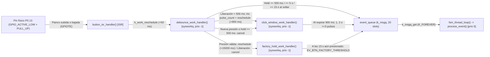
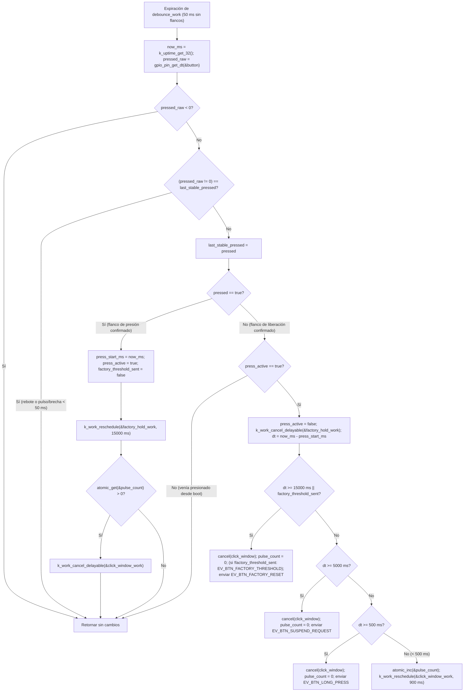
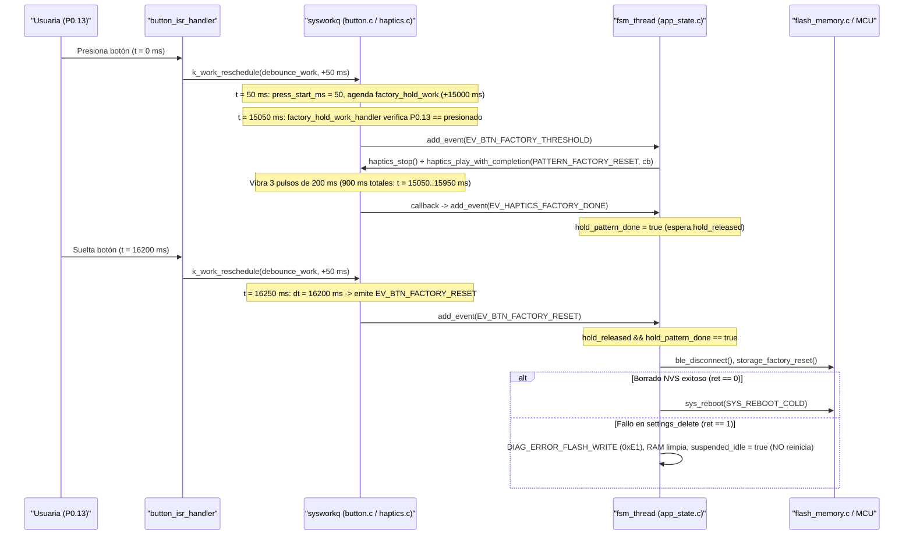

# 11. Botón Físico e Interpretación de Pulsaciones

## 11.1 Visión General y Rol en el Producto

El dispositivo Joya carece de pantalla, indicadores luminosos de usuario y teclado matricial; **un único pulsador mecánico** constituye toda la interfaz física de entrada humano-máquina (HMI). Sobre este único pin GPIO convergen acciones cotidianas (inicio y cancelación de rutinas de acompañamiento), acciones de gestión de conectividad BLE (emparejamiento inicial, reconexión manual y apertura de ventana en batería crítica), acciones de seguridad personal de máxima prioridad (disparo de emergencia por triple clic) y acciones administrativas destructivas o de bajo consumo (suspensión lógica a los 5 s y restauración de fábrica a los 15 s).

El subsistema está dividido arquitectónicamente en dos capas desacopladas:

1. **Capa de captura, filtrado y clasificación temporal** (`[include/button.h](../../include/button.h)`, `[src/button.c](../../src/button.c)`): gestiona la interrupción de hardware en ambos flancos (`GPIO_INT_EDGE_BOTH`), elimina rebotes mecánicos, mide la duración de presión estable, agrupa ráfagas de pulsos cortos dentro de una ventana deslizante y traduce la actividad eléctrica en **7 eventos discretos** (`event_type_t`) publicados de forma no bloqueante en `event_queue`. Esta capa es agnóstica al estado BLE, de batería o de autenticación.
2. **Capa de semántica contextual y coordinación háptica** (`[src/app_state.c](../../src/app_state.c)`, `process_event()`): consume los eventos desde `fsm_thread_id` y decide su efecto según el estado de la máquina de estados finitos (`current_state`), las banderas ortogonales de reposo (`suspended_idle`, `critical_idle`, `critical_window_open`), el nivel de batería (`battery_level`), la fase de emergencia (`joya_emergency_phase`) y la existencia de una transferencia OTA en curso (`ota_access_is_update_active()`).

Para la visión global de concurrencia y colas véase `[01_system_architecture.md](01_system_architecture.md)`; para el detalle de transiciones de `process_event()` véase `[05_state_machine.md](05_state_machine.md)` y `[code_reference/20a_core_fsm_comm.md](code_reference/20a_core_fsm_comm.md)`; para la referencia línea a línea del driver véase `[code_reference/20c_peripherals_storage_wdt.md](code_reference/20c_peripherals_storage_wdt.md)`.

---

## 11.2 Configuración Eléctrica, Devicetree y Arranque

### 11.2.1 Declaración en Devicetree (`joya_nrf52` vs `nrf52dk`)

**(a) Comportamiento implementado**: En la placa objetivo de producción `[boards/joya/joya_nrf52/joya_nrf52_nrf52832.dts](../../boards/joya/joya_nrf52/joya_nrf52_nrf52832.dts)` (líneas 23–32 y 40–43), el botón se define bajo un nodo `gpio-keys` y se expone mediante dos alias:

```dts
joya_buttons {
    compatible = "gpio-keys";

    // 13
    emergency_button: emergency_button {
        gpios = <&gpio0 13 (GPIO_PULL_UP | GPIO_ACTIVE_LOW)>;
        label = "Joya emergency button";
        zephyr,code = <0>;
    };
};

aliases {
    boton-emergencia = &emergency_button;
    sw0 = &emergency_button;
};
```

En el Devicetree final compilado (`build_joya/app/zephyr/zephyr.dts`, líneas 22–25 y 654–663), la tupla `gpios = < &gpio0 0xd 0x11 >` codifica el pin `13` (`0x0D`) del puerto `&gpio0` (`0x50000000`) con banderas `0x11 = GPIO_PULL_UP (0x10) | GPIO_ACTIVE_LOW (0x01)`. El driver en C obtiene esta especificación en tiempo de compilación en `[src/button.c](../../src/button.c)` (líneas 9–10):

```c
static const struct gpio_dt_spec button =
    GPIO_DT_SPEC_GET(DT_ALIAS(boton_emergencia), gpios);
```

> [!WARNING]
> **Inconsistencia documental en el overlay de desarrollo (`nrf52dk_nrf52832.overlay`)**:
> En `[nrf52dk_nrf52832.overlay](../../nrf52dk_nrf52832.overlay)`, el comentario del encabezado (líneas 7–10) afirma textualmente *"This configuration uses the nRF52 DK user button (P0.13)"*, pero la propiedad efectiva en la línea 17 asigna `gpios = <&gpio0 14 (GPIO_PULL_UP | GPIO_ACTIVE_LOW)>` (**Button 2** de la placa nRF52 DK, `P0.14`, no Button 1 `P0.13`). Además, el overlay define el alias `boton-emergencia` (línea 28) pero no redefine `sw0` (por lo que en la DK `sw0` sigue apuntando al Button 1 original de la placa base de Zephyr).

| Parámetro Hardware / DTS | Target Producción (`joya_nrf52/nrf52832`) | Target Banco (`nrf52dk/nrf52832` + overlay) | Fuente verificada |
|---|---|---|---|
| Pin físico SoC `nRF52832` | `P0.13` (`&gpio0 13`) | `P0.14` (`&gpio0 14`, Button 2 en DK) | `[joya_nrf52_nrf52832.dts:28](../../boards/joya/joya_nrf52/joya_nrf52_nrf52832.dts)`, `[nrf52dk_nrf52832.overlay:17](../../nrf52dk_nrf52832.overlay)` |
| Alias consumido por C | `boton-emergencia` (`DT_ALIAS(boton_emergencia)`) | `boton-emergencia` | `[src/button.c:10](../../src/button.c)` |
| Alias secundario `sw0` | Apunta a `&emergency_button` (`P0.13`) | Conserva `button0` del DTS base de DK (`P0.13`) | `[joya_nrf52_nrf52832.dts:42](../../boards/joya/joya_nrf52/joya_nrf52_nrf52832.dts)` |
| Polaridad lógica | `GPIO_ACTIVE_LOW` (`0 V` físico $\rightarrow$ `1` lógico) | `GPIO_ACTIVE_LOW` | `[joya_nrf52_nrf52832.dts:28](../../boards/joya/joya_nrf52/joya_nrf52_nrf52832.dts)` |
| Resistencia interna SoC | `GPIO_PULL_UP` ($R_{PU} \approx 13\text{ k}\Omega$ nominal, rango $11\text{–}16\text{ k}\Omega$) | `GPIO_PULL_UP` | Especificación `nRF52832` + DTS |
| Periférico detector | `&gpiote` (`0x40006000`, `CONFIG_NRFX_GPIOTE_NUM_OF_EVT_HANDLERS=1`) | `&gpiote` | `build_joya/app/zephyr/.config`, `zephyr.dts:213` |
| Modo de interrupción | `GPIO_INT_EDGE_BOTH` (ambos flancos) | `GPIO_INT_EDGE_BOTH` | `[src/button.c:193](../../src/button.c)` |

### 11.2.2 Comportamiento Eléctrico e Impacto Energético del Pin

- **En reposo (botón suelto)**: el interruptor mecánico está abierto y el pull-up interno mantiene `P0.13` a $V_{DD}$. El consumo estático del pin se limita a la corriente de fuga de entrada CMOS del `nRF52832` (orden de nanoamperios), salvo que exista humedad o contaminación resistiva en la PCB (**pendiente de validación sobre hardware ensamblado**, categoría *e*).
- **Durante pulsación sostenida (botón cerrado a `GND`)**: circula corriente continua a través de $R_{PU}$:
  $$I_{\text{hold}} = \frac{V_{DD}}{R_{PU}} \approx \frac{3.0\text{ V}}{13\text{ k}\Omega} \approx 231\text{ }\mu\text{A} \quad (\text{hasta } \approx 308\text{ }\mu\text{A a } 4.0\text{ V si } V_{DD} = V_{BAT})$$
  Para pulsaciones normales ($< 1\text{ s}$) esta carga ($\approx 0.06\text{ }\mu\text{Ah}$) es despreciable; en una pulsación de Factory Reset ($15\text{ s}$) representa $\approx 1\text{ }\mu\text{Ah}$. Sin embargo, si el botón quedara **mecánicamente trabado** en posición presionada dentro de un bolso o carcasa dañada, drenaría ~230–300 µA de forma permanente (~5,5–7,2 mAh/día).
- **Inversión automática de polaridad en software**: dado que `button.dt_flags` contiene `GPIO_ACTIVE_LOW`, todas las llamadas a `gpio_pin_get_dt(&button)` en `[src/button.c](../../src/button.c)` (líneas 37, 71 y 170) devuelven **valores lógicos ya invertidos**: `1` significa botón físicamente presionado (`P0.13` en nivel bajo `0 V`), `0` significa botón físicamente liberado (`P0.13` en nivel alto $V_{DD}$) y un valor `< 0` indica error del driver GPIO. Nota: pese a declararse `compatible = "gpio-keys"`, el firmware **no habilita** el subsistema `CONFIG_INPUT` de Zephyr; utiliza el nodo únicamente como contenedor de propiedades GPIO leídas manualmente por `button.c`.

### 11.2.3 Secuencia de Inicialización y Orden Condicional en `main()`

**(a) Comportamiento implementado**: `button_init()` (`[src/button.c:157-200](../../src/button.c)`) ejecuta secuencialmente:
1. Verifica disponibilidad del controlador `gpio0` con `gpio_is_ready_dt(&button)` (`-ENODEV` si falla, línea 161).
2. Configura `P0.13` como entrada aplicando las banderas DTS (`GPIO_INPUT | GPIO_PULL_UP | GPIO_ACTIVE_LOW`) mediante `gpio_pin_configure_dt(&button, GPIO_INPUT)` (línea 165).
3. Realiza una lectura síncrona inmediata `initial_pressed = gpio_pin_get_dt(&button)` (línea 170) e inicializa las variables de estado internas (líneas 175–178):
   - `last_stable_pressed = initial_pressed != 0;`
   - `press_active = false;`
   - `factory_threshold_sent = false;`
   - `atomic_set(&pulse_count, 0);`
4. Inicializa los tres trabajos diferibles (`debounce_work`, `click_window_work`, `factory_hold_work`, líneas 180–182) **sin encolarlos**.
5. Registra `button_cb_data` apuntando a `button_isr_handler` sobre `BIT(button.pin)` (`gpio_add_callback`, línea 188) y habilita interrupciones en ambos flancos con `gpio_pin_interrupt_configure_dt(&button, GPIO_INT_EDGE_BOTH)` (línea 193; si esta última falla, revierte el registro con `gpio_remove_callback`, línea 195).

El orden e impacto de `button_init()` en `[src/main.c](../../src/main.c)` difiere deliberadamente según el estado MCUboot de la imagen:

- **Arranque de imagen OTA en estado `Test` (`!boot_is_img_confirmed()`, `[src/main.c:22-39](../../src/main.c)`)**: `button_init()` se invoca **antes** de `ble_driver_init()` (línea 25) y un fallo (`ret != 0`) fuerza un `sys_reboot(SYS_REBOOT_COLD)` inmediato (línea 28) para provocar el rollback de MCUboot. **(b) Intención de diseño** (comentario en línea 23): una imagen nueva no confirmada debe demostrar que tanto el botón de recuperación como la publicidad BLE funcionan antes de aceptarse.
- **Arranque normal de imagen confirmada (`boot_is_img_confirmed()`, `[src/main.c:40-58](../../src/main.c)`)**: `ble_driver_init()` se ejecuta primero y `button_init()` después (línea 53). Si `button_init()` falla, se registra la ausencia del bit `DIAG_INIT_BUTTON (0x02)` en `diagnostics_record_init()` (de modo que la trama `DIAGNOSTICS` reportará `A0 1D` en lugar de `A0 1F`), pero **el arranque continúa** (`/* BLE is initialized; continue without button gestures. */`).
  - **Consecuencia operativa en `c1128e5`**: si el dispositivo ya posee un `APP_ID` persistido y batería no crítica, comenzará a publicitar automáticamente a los ~60 s del arranque al confirmarse `EV_BATTERY_NORMAL` / `EV_BATTERY_LEVEL_1` (`[src/app_state.c:462-475](../../src/app_state.c)`), preservando la vía de recuperación OTA por BLE aunque el botón físico falle. En cambio, si `is_app_id_empty() == true`, el equipo quedará indefinidamente en `STATE_UNPAIRED` sin capacidad de iniciar `STATE_SETUP_MODE` (limitación también advertida en `[docs/RECOVERY_VALIDATION.md:62-64](../../docs/RECOVERY_VALIDATION.md)`).

### 11.2.4 Por Qué se Ignora Deliberadamente una Pulsación Mantenida al Arrancar

**(a) Comportamiento implementado y (b) Intención de diseño** (documentada en `[src/app_state.c:374-377](../../src/app_state.c)`): si el botón ya está presionado cuando corre `button_init()` (`initial_pressed == 1`), el driver asigna `last_stable_pressed = true` pero mantiene `press_active = false` y **no agenda `factory_hold_work`**.

Esto produce una inmunidad completa frente a pulsaciones heredadas del arranque:
1. Mientras el botón permanezca presionado (incluso si rebotara y volviera a cerrar en `pressed == true`), cualquier ejecución de `debounce_work_handler` evalúa `if (pressed == last_stable_pressed) return;` (`[src/button.c:78-80](../../src/button.c)`) y aborta sin hacer nada.
2. Como `factory_hold_work` nunca se programó (e incluso si corriera verificaría `!press_active`, línea 38), mantener el botón oprimido durante >15 s desde antes de energizar el MCU **jamás** dispara `EV_BTN_FACTORY_THRESHOLD`.
3. Cuando finalmente la usuaria suelta el botón (`pressed == false`), `debounce_work_handler` actualiza `last_stable_pressed = false` (línea 82), salta `if (pressed)` (línea 84) y encuentra `if (!press_active) return;` (líneas 98–100), descartando silenciosamente el flanco de liberación sin medir `press_time_ms` ni incrementar `pulse_count`.
4. Solo a partir de ese momento (`last_stable_pressed == false`, `press_active == false`), la **siguiente presión nueva** generará una transición limpia `false -> true` válida.

**Justificación de ingeniería (c/b)**:
- Evita que tras un reinicio en frío por `EV_BTN_FACTORY_RESET` (`sys_reboot(SYS_REBOOT_COLD)` en `[src/app_state.c:119](../../src/app_state.c)`), por `WDT0` o por inserción de batería con el dedo apoyado en la carcasa, una liberación tardía sea malinterpretada como clic de rutina (`0x02`), cancelación (`0x03`), suspensión (`5 s`) o un segundo Factory Reset encadenado.
- Impide que un botón en cortocircuito permanente desde el encendido inunde la FSM con eventos espurios o entre en un bucle infinito de Factory Reset.

---

## 11.3 Arquitectura de Interrupción y Trabajos Diferidos en `sysworkq`

### 11.3.1 Estructura de Concurrencia y Sincronización

El módulo `[src/button.c](../../src/button.c)` evita realizar lecturas de GPIO, aritmética de tiempos o encolado de eventos dentro de la rutina de servicio de interrupción (ISR). Toda la lógica reside en tres instancias de `struct k_work_delayable` ejecutadas sobre la cola de trabajo del sistema (`k_sys_work_q`, hilo `sysworkq` con prioridad cooperativa `-1` y stack de `4096` bytes, `CONFIG_SYSTEM_WORKQUEUE_STACK_SIZE=4096`):

| Identificador en `src/button.c` | Macro de retardo (`include/button.h`) | Valor | Handler | Propósito |
|---|---|---:|---|---|
| `debounce_work` | `DEBOUNTE_TIME_MS` *(sic)* | `50 ms` | `debounce_work_handler()` | Filtrar rebotes tras cualquier flanco, validar cambio respecto de `last_stable_pressed` y medir duración al liberar. |
| `click_window_work` | `CLICK_WINDOW_MS` | `900 ms` | `click_window_work_handler()` | Ventana de agrupación post-liberación corta para distinguir `1`, `2` o `>= 3` clics. |
| `factory_hold_work` | `BUTTON_FACTORY_RESET_HOLD_MS` | `15000 ms` | `factory_hold_work_handler()` | Detectar en caliente (sin esperar liberación) que una pulsación continua alcanzó los 15 s para emitir aviso háptico. |

> [!NOTE]
> ** Errata histórica en macro pública (`DEBOUNTE_TIME_MS`)**:
> En `[include/button.h:12](../../include/button.h)` la constante de antirrebote está escrita con `T` en lugar de `C` (`#define DEBOUNTE_TIME_MS 50`) y se consume con ese mismo nombre en `[src/button.c:62](../../src/button.c)`. No afecta al comportamiento compilado, pero debe respetarse literalmente al referenciar el símbolo en código o tests.



### 11.3.2 Garantías de Exclusión Mutua sin Mutex Explícito

**(a) Comportamiento implementado**:
- `button_isr_handler()` (`[src/button.c:54-63](../../src/button.c)`) ignora sus tres parámetros (`dev`, `cb`, `pins`) y únicamente invoca `k_work_reschedule(&debounce_work, K_MSEC(DEBOUNTE_TIME_MS))`, API segura en contexto ISR (`isr-ok` en Zephyr).
- Las variables estáticas no atómicas `press_start_ms`, `last_stable_pressed`, `press_active` y `factory_threshold_sent` solo se escriben en `button_init()` (antes de habilitar la interrupción GPIO en la línea 193) y dentro de `debounce_work_handler()` y `factory_hold_work_handler()`. Como `sysworkq` es un **único hilo cooperativo** (`CONFIG_SYSTEM_WORKQUEUE_PRIORITY=-1`, sin `k_sleep` ni bloqueos dentro de ninguno de los tres handlers de `button.c`), los tres handlers se ejecutan de manera **estrictamente serializada y atómica entre sí**, imposibilitando condiciones de carrera entre `debounce_work`, `click_window_work` y `factory_hold_work`.
- `pulse_count` se manipula mediante primitivas atómicas (`atomic_set`, `atomic_get`, `atomic_inc`), reforzando la atomicidad de la lectura-con-borrado `uint32_t count = atomic_set(&pulse_count, 0);` en `click_window_work_handler()` (`[src/button.c:142](../../src/button.c)`).
- La frontera hacia `fsm_thread_id` (prioridad `5` apropiativa, menor prioridad de planificación que `sysworkq` `-1`) atraviesa exclusivamente `event_queue` (`K_MSGQ_DEFINE(event_queue, sizeof(app_event_t), 20, 4)` en `[src/app_state.c:28](../../src/app_state.c)`). `add_event()` inserta con `K_NO_WAIT`; si la cola de 20 eventos estuviera llena, el evento de botón **se pierde** (`send_button_event()` descarta el código de retorno en `[src/button.c:28-31](../../src/button.c)`), aunque `add_event_for_conn()` invoca `diagnostics_report_error(DIAG_ERROR_EVENT_QUEUE_FULL)` (`0xE3`, `[src/app_state.c:347-349](../../src/app_state.c)`).

---

## 11.4 Algoritmo Exacto de Debouncing, Medición y Clasificación

### 11.4.1 Modelo Matemático de Tiempos y Cancelación del Offset de Debounce

Sea $t_{\text{down,phys}}$ el instante físico en que la usuaria cierra el contacto, con rebotes mecánicos de cierre que cesan en $t_{\text{down,settle}} = t_{\text{down,phys}} + b_{\text{down}}$, y sea $t_{\text{up,phys}}$ el instante físico en que abre el contacto, con rebotes de apertura que cesan en $t_{\text{up,settle}} = t_{\text{up,phys}} + b_{\text{up}}$.

1. **Confirmación de presión (`pressed == true`, `[src/button.c:84-96](../../src/button.c)`)**:
   El último flanco del rebote de cierre reprograma `debounce_work`, que se ejecuta en:
   $$t_{\text{press\_deb}} = t_{\text{down,phys}} + b_{\text{down}} + 50\text{ ms} + \delta_{\text{wq1}}$$
   donde $\delta_{\text{wq1}} \ge 0$ es la latencia de despacho de `sysworkq` (típicamente $< 1\text{ ms}$, salvo que otro ítem de `sysworkq` esté bloqueado, como el `k_msleep(10)` de `drv2605_wake()` o una transacción I2C con fallo de hasta `500 ms`; véase `[13_haptic_system.md](13_haptic_system.md)`).
   En ese instante se registra:
   $$\text{press\_start\_ms} = \text{now\_ms} = \lfloor t_{\text{press\_deb}} \rfloor$$
   Se activa `press_active = true`, `factory_threshold_sent = false`, se programa `factory_hold_work` a `+15000 ms` **desde `t_press_deb`** (es decir, en $t_{\text{down,phys}} + b_{\text{down}} + 15050\text{ ms}$), y si `atomic_get(&pulse_count) > 0` se cancela `click_window_work` para congelar el conteo acumulado mientras dure la nueva presión.

2. **Confirmación de liberación (`pressed == false`, `[src/button.c:98-136](../../src/button.c)`)**:
   El último flanco del rebote de apertura reprograma `debounce_work`, que corre en:
   $$t_{\text{rel\_deb}} = t_{\text{up,phys}} + b_{\text{up}} + 50\text{ ms} + \delta_{\text{wq2}}$$
   La duración medida por software (`[src/button.c:105](../../src/button.c)`) es:
   $$\text{press\_time\_ms} = \text{now\_ms} - \text{press\_start\_ms} = (t_{\text{up,phys}} - t_{\text{down,phys}}) + (b_{\text{up}} - b_{\text{down}}) + (\delta_{\text{wq2}} - \delta_{\text{wq1}})$$

**Propiedades clave de esta formulación**:
- **Simetría de duración**: los dos retardos de `DEBOUNTE_TIME_MS` (`+50 ms` al presionar y `+50 ms` al soltar) **se cancelan algebraicamente** en `press_time_ms`. Si los rebotes de cierre y apertura son similares ($b_{\text{up}} \approx b_{\text{down}} \approx 1\text{–}5\text{ ms}$) y `sysworkq` está libre, `press_time_ms` refleja con exactitud milimétrica el tiempo físico real de presión, siempre que la pulsación supere los $50\text{ ms}$ (véase Sección 11.5.2 para el caso $< 50\text{ ms}$).
- **Inmunidad al desbordamiento de 32 bits**: `k_uptime_get_32()` desborda cada $2^{32}\text{ ms} \approx 49,71\text{ días}$. Como tanto `now_ms` como `press_start_ms` y `elapsed_ms` son `uint32_t` sin signo, la resta en aritmética modular módulo $2^{32}$ es exacta a través del rollover (para cualquier pulsación $< 49,7\text{ días}$).
- **Desplazamiento temporal de la emisión de eventos**: aunque `press_time_ms` no sufre sesgo sistemático, **el instante en que la FSM recibe el evento** sí incluye el retardo de antirrebote (y de ventana en clics cortos):
  - Eventos por liberación media/larga (`EV_BTN_LONG_PRESS`, `EV_BTN_SUSPEND_REQUEST`, `EV_BTN_FACTORY_RESET`): se encolan en $t_{\text{up,settle}} + 50\text{ ms}$.
  - Evento en caliente de umbral de fábrica (`EV_BTN_FACTORY_THRESHOLD`): se encola en $t_{\text{down,settle}} + 50\text{ ms} + 15000\text{ ms} = t_{\text{down,settle}} + 15050\text{ ms}$.
  - Eventos de clics cortos (`EV_BTN_1_PULSE`, `EV_BTN_2_PULSE`, `EV_BTN_EMERGENCY`): se encolan en $t_{\text{up,settle,último}} + 50\text{ ms} + 900\text{ ms} = t_{\text{up,settle,último}} + 950\text{ ms}$.

### 11.4.2 Tabla de Umbrales y Clasificación de Gestos

| Categoría | Condición exacta en `src/button.c` | Momento de emisión | Efecto sobre `click_window_work` y `pulse_count` | Evento(s) emitidos a `event_queue` | Latencia desde acción física |
|---|---|---|---|---|---|
| Rebote / ruido sin cambio neto | `pressed == last_stable_pressed` (línea 78) | Nunca | Ninguno | Ninguno | — |
| Liberación de botón presionado antes del boot | `!pressed && !press_active` (línea 98) | Nunca | Ninguno | Ninguno | — |
| **Pulsación corta** ($< 0,5\text{ s}$) | `press_time_ms < 500` (`BUTTON_ROUTINE_CANCEL_HOLD_MS`, líneas 122–135) | Al expirar `click_window_work` (`+900 ms` sin nueva presión estable) | `atomic_inc(&pulse_count)` y `k_work_reschedule(&click_window_work, K_MSEC(900))` | `count == 1` $\rightarrow$ `EV_BTN_1_PULSE`<br/>`count == 2` $\rightarrow$ `EV_BTN_2_PULSE`<br/>`count >= 3` $\rightarrow$ `EV_BTN_EMERGENCY` | $+950\text{ ms}$ tras soltar el último clic |
| **Pulsación media** ($0,5\text{ s} \dots < 5\text{ s}$) | `500 <= press_time_ms < 5000` (líneas 122–129) | Al confirmar liberación (`+50 ms` tras soltar) | Cancela `click_window_work`; `pulse_count = 0` | `EV_BTN_LONG_PRESS` | $+50\text{ ms}$ tras soltar |
| **Pulsación larga de suspensión** ($5\text{ s} \dots < 15\text{ s}$) | `5000 <= press_time_ms < 15000` (`BUTTON_SUSPEND_HOLD_MS`, líneas 115–120) | Al confirmar liberación (`+50 ms` tras soltar) | Cancela `click_window_work`; `pulse_count = 0` | `EV_BTN_SUSPEND_REQUEST` | $+50\text{ ms}$ tras soltar |
| **Umbral de Factory Reset (mientras sigue presionado)** | En `factory_hold_work_handler`: `pressed > 0 && press_active && !factory_threshold_sent && elapsed_ms >= 15000` (líneas 37–52) | En caliente, antes de soltar | Cancela `click_window_work`; `pulse_count = 0`; `factory_threshold_sent = true` | `EV_BTN_FACTORY_THRESHOLD` | $+15050\text{ ms}$ desde inicio físico de presión |
| **Liberación de Factory Reset** ($\ge 15\text{ s}$) | `press_time_ms >= 15000 \|\| factory_threshold_sent` (líneas 106–114) | Al confirmar liberación (`+50 ms` tras soltar) | Cancela `click_window_work`; `pulse_count = 0` | `(si !factory_threshold_sent: EV_BTN_FACTORY_THRESHOLD)` + `EV_BTN_FACTORY_RESET` | $+50\text{ ms}$ tras soltar |

### 11.4.3 Detalles Defensivos en `factory_hold_work_handler` y `debounce_work_handler`

Dos guardas sutiles en `[src/button.c](../../src/button.c)` merecen atención especial:

1. **Re-planificación ante despertar prematuro por redondeo de ticks (`[src/button.c:41-46](../../src/button.c)`)**:
   El reloj de sistema corre a `32768 Hz` (`CONFIG_SYS_CLOCK_TICKS_PER_SEC=32768`), mientras que `k_uptime_get_32()` trunca ticks a milisegundos enteros ($\lfloor \text{ticks} \times 1000 / 32768 \rfloor$). Puede ocurrir que al dispararse `factory_hold_work` tras `K_MSEC(15000)`, la diferencia entera `elapsed_ms = k_uptime_get_32() - press_start_ms` valga `14999` ms por truncamiento de fracción de milisegundo. En lugar de descartar el umbral o dispararlo antes de `15000 ms`, las líneas 42–45 reprograman `factory_hold_work` exactamente por el remanente `K_MSEC(BUTTON_FACTORY_RESET_HOLD_MS - elapsed_ms)` (`1 ms`).
2. **Doble condición y emisión de respaldo al soltar en el límite exacto de 15 s (`[src/button.c:106-113](../../src/button.c)`)**:
   Al liberar el botón cerca de $t = 15050\text{ ms}$, pueden darse dos carreras benignas en `sysworkq`:
   - *Caso A*: `factory_hold_work_handler` corrió en $t = 15050\text{ ms}$ (`factory_threshold_sent = true`), el usuario soltó inmediatamente y por cuantización `press_time_ms` dio `14999 ms` o `15000 ms`. Como la condición es `press_time_ms >= 15000 || factory_threshold_sent`, se garantiza que una vez emitido el aviso háptico `EV_BTN_FACTORY_THRESHOLD`, la liberación **siempre** se clasifique como `EV_BTN_FACTORY_RESET` y nunca caiga por error en `EV_BTN_SUSPEND_REQUEST`.
   - *Caso B*: El usuario soltó en $t = 15001\text{ ms}$ respecto de `press_start_ms`, pero `debounce_work` se ejecutó en `sysworkq` justo antes de `factory_hold_work` (que es cancelado en la línea 103 con `factory_threshold_sent == false`). La FSM requiere ver **ambos** eventos (`EV_BTN_FACTORY_THRESHOLD` arma `hold_action = HOLD_FACTORY_RESET` y lanza el patrón háptico; `EV_BTN_FACTORY_RESET` marca `hold_released = true`, `[src/app_state.c:653-682](../../src/app_state.c)`). Por ello, las líneas 109–111 inyectan sintéticamente `EV_BTN_FACTORY_THRESHOLD` inmediatamente antes de `EV_BTN_FACTORY_RESET` si aún no se había enviado.

---

## 11.5 Interacciones entre Pulsaciones Consecutivas y Casos Límite Críticos

### 11.5.1 Interacción entre Clics Cortos Acumulados y una Pulsación Media/Larga Posterior

**(a) Comportamiento implementado**: Supóngase que la usuaria ejecuta 1 o 2 clics cortos (`press_time_ms < 500 ms`) y, **antes de que transcurran los `900 ms` de `CLICK_WINDOW_MS`**, vuelve a presionar el botón y esta vez lo mantiene durante $\ge 500\text{ ms}$ (por ejemplo `600 ms`):

1. Tras el segundo clic corto, `pulse_count == 2` y `click_window_work` está programado para expirar en $+900\text{ ms}$.
2. Al confirmarse el inicio de la tercera presión (`+50 ms` tras presionarla), `debounce_work_handler` ve `atomic_get(&pulse_count) > 0` (`[src/button.c:91-93](../../src/button.c)`) y **cancela `click_window_work`**, reteniendo `pulse_count == 2` en espera de saber cuánto durará esta tercera pulsación.
3. Como la tercera pulsación se mantiene `600 ms` ($\ge 500\text{ ms}$), al soltar entra en la rama `press_time_ms >= BUTTON_ROUTINE_CANCEL_HOLD_MS` (`[src/button.c:122-129](../../src/button.c)`): vuelve a cancelar defensivamente `click_window_work`, ejecuta **`atomic_set(&pulse_count, 0)`** y emite **únicamente `EV_BTN_LONG_PRESS`**.

**Consecuencias ergonómicas y de seguridad**:
- Los 1 o 2 clics cortos previos quedan **totalmente anulados**; no se emite `EV_BTN_2_PULSE` seguido de `EV_BTN_LONG_PRESS`, sino solo el gesto largo final (lo mismo aplica si la última pulsación alcanza `5 s` $\rightarrow$ solo `EV_BTN_SUSPEND_REQUEST`, o `15 s` $\rightarrow$ solo `Factory Reset`).
- **Riesgo ergonómico en situación de estrés (c)**: para disparar `EV_BTN_EMERGENCY`, la usuaria debe realizar $\ge 3$ pulsaciones donde **al menos las tres primeras (y la última de la ráfaga)** tengan duración individual estrictamente `< 500 ms`. Si en pánico hace `clic corto` + `clic corto` + `tercer clic sostenido 550 ms` pensando que "apretar fuerte el tercero confirma la emergencia", el sistema descartará los dos primeros clics y emitirá `EV_BTN_LONG_PRESS` (`COMMAND_END_ROUTINE = 0x03`) en vez de `EV_BTN_EMERGENCY` (`COMMAND_EMERGENCY = 0x04`). En cambio, si hace 4 o 5 clics rápidos todos `< 500 ms` separados por brechas de `50..899 ms`, `count >= 3` sí emitirá correctamente `EV_BTN_EMERGENCY`.

### 11.5.2 Caso Límite Crítico: Fusión u Ocultamiento de Clics Rápidos por `k_work_reschedule` (`< 50 ms`)

**(a) Comportamiento implementado — Hallazgo crítico de ingeniería**:
`button_isr_handler()` (`[src/button.c:62](../../src/button.c)`) invoca `k_work_reschedule(&debounce_work, K_MSEC(50))` ante **cualquier** flanco (tanto de bajada como de subida, por `GPIO_INT_EDGE_BOTH`). En Zephyr, `k_work_reschedule()` sobre un trabajo ya pendiente en estado `K_WORK_DELAYED` **reemplaza el plazo anterior** y empuja su ejecución a `now + 50 ms`. Por consiguiente, `debounce_work_handler` **nunca llega a ejecutarse mientras ocurra cualquier transición eléctrica en el pin con separación menor a `50 ms`**.

De ello se desprenden dos fenómenos patológicos verificables matemáticamente sobre el código:

1. **Supresión silenciosa de un toque ultrarrápido (`duración presionado < 50 ms`)**:
   - Estado previo: `last_stable_pressed = false`.
   - En $t = 0\text{ ms}$, la usuaria presiona el botón $\rightarrow$ ISR programa `debounce_work` para $t = 50\text{ ms}$.
   - En $t = 38\text{ ms}$, la usuaria suelta el botón $\rightarrow$ ISR **reprograma** `debounce_work` para $t = 88\text{ ms}$.
   - En $t = 88\text{ ms}$, `debounce_work_handler` lee `gpio_pin_get_dt(&button)` $\rightarrow$ `pressed = false`. Evalúa `if (pressed == last_stable_pressed)` (`false == false`, línea 78) y retorna de inmediato. **El clic desaparece por completo**.

2. **Fusión de múltiples clics rápidos de pánico en una única pulsación larga (`brecha suelto < 50 ms`)**:
   Cuando una persona bajo estrés agudo pulsa frenéticamente un botón táctil de corto recorrido (~5–7 Hz de repetición), el tiempo con el dedo abajo suele rondar `120–180 ms`, pero el tiempo de alivio mecánico con el contacto abierto entre clic y clic puede caer por debajo de `50 ms` (p. ej., `30–45 ms`):
   - **Clic 1 — Presión ($t = 0\text{ ms}$)**: sin otros flancos hasta $t = 50\text{ ms}$. En $t = 50\text{ ms}$ corre `debounce_work_handler`: lee `pressed = true`, fija `last_stable_pressed = true`, `press_active = true`, `press_start_ms = 50`.
   - **Clic 1 — Liberación ($t = 190\text{ ms}$)**: ISR programa `debounce_work` para $t = 240\text{ ms}$.
   - **Clic 2 — Presión ($t = 225\text{ ms}$, brecha abierto $= 35\text{ ms} < 50\text{ ms}$)**: antes de que llegue $t = 240\text{ ms}$, el nuevo flanco de bajada **pisa** `debounce_work` y lo empuja a $t = 275\text{ ms}$.
   - **Evaluación en $t = 275\text{ ms}$**: `debounce_work_handler` lee `gpio_pin_get_dt(&button)` $\rightarrow$ `pressed = true`. Como `last_stable_pressed` **seguía valiendo `true`** desde $t = 50\text{ ms}$, la línea 78 (`if (pressed == last_stable_pressed) return;`) **descarta la transición**: el firmware jamás se enteró de que el botón se soltó en $t = 190\text{ ms}$ ni de que volvió a presionarse en $t = 225\text{ ms}$.
   - **Clic 2 — Liberación ($t = 395\text{ ms}$) y Clic 3 — Presión ($t = 430\text{ ms}$, brecha $= 35\text{ ms}$)**: ocurre exactamente lo mismo; en $t = 480\text{ ms}$ se lee `pressed = true == last_stable_pressed` y se ignora.
   - **Clic 3 — Liberación final ($t = 580\text{ ms}$)**: ya no hay cuarto clic. En $t = 630\text{ ms}$ corre `debounce_work_handler`, lee `pressed = false`, calcula:
     $$\text{press\_time\_ms} = 630 - 50 = 580\text{ ms} \ge 500\text{ ms}$$
     y clasifica toda la ráfaga de **3 clics rápidos de emergencia** como **una única pulsación continua de `580 ms` $\rightarrow$ `EV_BTN_LONG_PRESS` (`COMMAND_END_ROUTINE = 0x03`)**, ¡sin disparar la emergencia! (O, si la suma total quedara en `< 500 ms`, p. ej. 3 toques de `100 ms` con dos brechas de `35 ms` $= 370\text{ ms}$, la colapsaría en **1 solo pulso** `EV_BTN_1_PULSE` $\rightarrow$ `COMMAND_ROUTINE = 0x02`).

> [!IMPORTANT]
> **Condición necesaria para detección fiable de ráfagas multi-clic**:
> Con `DEBOUNTE_TIME_MS = 50`, cada clic individual de una secuencia doble o triple requiere simultáneamente:
> 1. Tiempo estable presionado $T_{\text{on}} > 50\text{ ms}$ y $T_{\text{on}} < 500\text{ ms}$.
> 2. Tiempo estable liberado entre clics consecutivos $T_{\text{off}} > 50\text{ ms}$ y $T_{\text{off}} < 950\text{ ms}$ (dado que `click_window_work` se agenda en $t_{\text{up}} + 50\text{ ms}$ por `+900 ms` y se cancela en $t_{\text{next\_down}} + 50\text{ ms}$, lo que exige $t_{\text{next\_down}} - t_{\text{up}} < 900\text{ ms}$).
> Esto acota la cadencia válida de triple clic a aproximadamente **$1,05\text{ Hz} \dots 9,9\text{ Hz}$** con ciclo de trabajo equilibrado.

### 11.5.3 Ventana Transitoria Durante el Patrón Háptico de Suspensión (`1400 ms`) y Factory Reset (`900 ms`)

**(a) Comportamiento implementado**: Al recibir `EV_BTN_SUSPEND_REQUEST`, `process_event()` (`[src/app_state.c:634-650](../../src/app_state.c)`) **no fija `suspended_idle = true` de inmediato** (salvo que la háptica esté deshabilitada o falle, en cuyo caso `haptics_play_with_completion()` retorna `< 0` y entra instantáneamente en `enter_unpaired_idle()`). Si la háptica está permitida (`battery_level == 0 && !critical_idle`), reproduce `HAPTICS_PATTERN_SUSPEND` (`1400 ms` totales) y espera `EV_HAPTICS_SUSPEND_DONE` para llamar a `enter_unpaired_idle()` (`[src/app_state.c:673-696](../../src/app_state.c)`).

Durante esos `1,4 s`:
- `suspended_idle` sigue siendo `false` y la conexión BLE (si existía) sigue activa hasta que termine la vibración.
- Cualquier solicitud `haptics_play()` sin callback disparada en ese lapso devuelve `-EBUSY` (`[src/haptics.c:628-630](../../src/haptics.c)`), protegiendo `pattern_completion` para no perder `EV_HAPTICS_SUSPEND_DONE` (la única excepción que sí la interrumpe explícitamente es `EV_BTN_FACTORY_THRESHOLD`, que invoca `haptics_stop()` antes de `haptics_play_with_completion`, `[src/app_state.c:664-666](../../src/app_state.c)`).
- Si la usuaria disparara una emergencia antes de que concluyan esos `1,4 s` (difícil físicamente porque requiere ~1,1 s + `950 ms` de ventana, salvo eventos ya encolados), `storage_save_emergency_phase(EMERGENCY_PENDING_ACK)` persistiría la emergencia en NVS antes de que `EV_HAPTICS_SUSPEND_DONE` ejecute `enter_unpaired_idle()`.

---

## 11.6 Diagramas Temporales y Secuencias de Eventos

### 11.6.1 Cronogramas Textuales con Marcas Exactas en Milisegundos

En todos los cronogramas siguientes se asume ausencia de rebotes residuales tras el primer milisegundo ($b_{\text{down}} \approx b_{\text{up}} \approx 0\text{ ms}$) y `sysworkq` desocupada:

```text
CASO 1: 1 Clic Corto -> Inicio de Rutina (EV_BTN_1_PULSE)
Tiempo (ms):   0      50         200    250                                  1150
Pin P0.13:  ───┐                 ┌─────────────────────────────────────────────── (0V = presionado)
               └─────────────────┘
debounce_work: [sched]──►[press] [sched]──►[release: dt=200ms < 500ms, cnt=1]
click_window:                              [sched +900ms]───────────────────►[expira: cnt=1 -> 0]
Evento FSM:                                                                   EV_BTN_1_PULSE
```

```text
CASO 2: 2 Clics Cortos -> Publicidad / Reconexión / Ventana Crítica (EV_BTN_2_PULSE)
Tiempo (ms):   0    50   180  230       450  500   630  680                  1580
Pin P0.13:  ───┐         ┌──────────────┐          ┌─────────────────────────────
               └─────────┘              └──────────┘
debounce_work:      [P1]      [R1:dt=180]    [P2]       [R2:dt=180, cnt=2]
click_window:                 [sched+900]───►[cancel]   [sched +900ms]──────►[expira: cnt=2 -> 0]
Evento FSM:                                                                   EV_BTN_2_PULSE
```

```text
CASO 3: 3 Clics Cortos -> Disparo de Emergencia (EV_BTN_EMERGENCY)
Tiempo (ms):   0   50  150 200   350 400 500 550   700 750 850 900           1800
Pin P0.13:  ───┐       ┌─────────┐       ┌─────────┐       ┌─────────────────────
               └───────┘         └───────┘         └───────┘
debounce_work:     [P1]    [R1]      [P2]    [R2]      [P3]    [R3: cnt=3]
click_window:              [+900]───►[X]     [+900]───►[X]     [sched +900]─►[expira: cnt=3 -> 0]
Evento FSM:                                                                   EV_BTN_EMERGENCY
```

```text
CASO 4: Hold Medio (500..4999 ms, ej. 1200 ms) -> Cancelar Rutina (EV_BTN_LONG_PRESS)
Tiempo (ms):   0      50                                         1200   1250
Pin P0.13:  ───┐                                                 ┌───────────────
               └─────────────────────────────────────────────────┘
debounce_work:        [press_start=50]                                  [release: dt=1200ms]
factory_hold:         [sched +15000ms]─────────────────────────────────►[cancel]
Evento FSM:                                                              EV_BTN_LONG_PRESS
```

```text
CASO 5: Hold de Suspensión (5000..14999 ms, ej. 6000 ms) -> Suspensión Lógica
Tiempo (ms):   0      50                                    6000   6050          7450
Pin P0.13:  ───┐                                            ┌────────────────────────
               └────────────────────────────────────────────┘
debounce_work:        [press_start=50]                             [dt=6000ms]
factory_hold:         [sched +15000ms]────────────────────────────►[cancel]
Evento FSM:                                                         EV_BTN_SUSPEND_REQUEST
Háptica RTP:                                                        [PATTERN_SUSPEND 1400ms]
Transición:                                                                      EV_HAPTICS_SUSPEND_DONE
                                                                                 -> enter_unpaired_idle()
```

```text
CASO 6: Hold Crítico de Factory Reset (>= 15000 ms, ej. soltado a 16200 ms)
Tiempo (ms):   0    50                         15050         15950   16200  16250
Pin P0.13:  ───┐                                                     ┌───────────
               └─────────────────────────────────────────────────────┘
debounce_work:      [press_start=50]                                        [dt=16200ms]
factory_hold:       [sched +15000ms]──────────►[expira: elapsed=15000ms]
Háptica RTP:                                   [PATTERN_FACTORY_RESET 900ms]
Eventos FSM:                                   EV_BTN_FACTORY_THRESHOLD
                                                             EV_HAPTICS_FACTORY_DONE
                                                                            EV_BTN_FACTORY_RESET
Acción final:                                                               -> factory_reset_and_reboot()
                                                                            (cuando hold_released && hold_pattern_done)
```

> [!TIP]
> **Sincronización de dos barreras en Factory Reset (`hold_released && hold_pattern_done`)**:
> En el Caso 6, si la usuaria suelta el botón en $t = 15300\text{ ms}$ (mientras `HAPTICS_PATTERN_FACTORY_RESET` de `900 ms` aún va por el milisegundo `250`), `EV_BTN_FACTORY_RESET` llega primero (`hold_released = true`, `hold_pattern_done = false`) y el MCU **espera a que termine la vibración** en $t = 15950\text{ ms}$ (`EV_HAPTICS_FACTORY_DONE`) antes de borrar Flash y reiniciar (`[src/app_state.c:675-696](../../src/app_state.c)`). A la inversa, si la usuaria sigue apretando hasta $t = 16200\text{ ms}$, `EV_HAPTICS_FACTORY_DONE` llega primero (`hold_pattern_done = true`) y el borrado/reinicio ocurre en cuanto se confirma la liberación (`t = 16250 ms`).

```text
CASO 7 (PATOLÓGICO): 3 Clics de Pánico con Brecha < 50 ms (35 ms suelto) -> Fusión en LONG_PRESS
Tiempo (ms):   0   50      190 225  275     395 430  480     580   630
Pin P0.13:  ───┐           ┌───┐            ┌───┐            ┌───────────────
               └───────────┘   └────────────┘   └────────────┘
               |<--190ms-->|35 |<--170ms--->|35 |<--150ms--->|
debounce_work: [s]─►[P:t=50][s][resched!]─►[lee P=true == last_stable -> IGNORA]
                                            [s][resched!]─►[lee P=true -> IGNORA]
                                                             [s]──►[lee P=false: dt=630-50=580ms!]
Evento FSM:                                                        EV_BTN_LONG_PRESS (¡NO EMERGENCIA!)
```

### 11.6.2 Diagrama de Flujo Completo de `debounce_work_handler` y Trabajos Auxiliares



### 11.6.3 Diagrama de Secuencia del Factory Reset (15 s) y Coordinación con Háptica y NVS



---

## 11.7 Tabla Maestra de Gestos × Estados y Subestados del Dispositivo

La siguiente matriz consolida el comportamiento exacto verificado en `[src/app_state.c](../../src/app_state.c)` (`process_event()`, líneas 378–1017), `[src/haptics.c](../../src/haptics.c)` y `[src/flash_memory.c](../../src/flash_memory.c)` para el commit `c1128e5d0c0d6f98be0a580d287c0926ca27f01f`.

### Convenciones de la Tabla
- **Háptica**: todos los patrones listados se reproducen **únicamente** si `haptics_allowed == 1` (`battery_level == 0 && !critical_idle`, o lectura inicial `> 3000 mV` en `battery_init()` antes de confirmar nivel). En **Batería Nivel 1**, **Batería Crítica Nivel 2** y **Ventana Crítica con `battery_level == 2`**, `haptics_allowed == 0` y **toda vibración queda suprimida** (`-EACCES`).
- **Persistencia en NVS**: las escrituras actualizan primero RAM; si NVS falla retornan `1`, emiten `DIAG_ERROR_FLASH_WRITE (0xE1)` y continúan operando en RAM (excepto Factory Reset, que aborta el reboot si falla el borrado para no resucitar `APP_ID`).

| Contexto / Estado del Dispositivo | `EV_BTN_1_PULSE` (1 clic `<500 ms`) | `EV_BTN_2_PULSE` (2 clics `<500 ms`) | `EV_BTN_LONG_PRESS` (`0,5..4,99 s`) | `EV_BTN_EMERGENCY` (`>=3` clics `<500 ms`) | `EV_BTN_SUSPEND_REQUEST` (`5..14,99 s`) | `EV_BTN_FACTORY_THRESHOLD` (`15 s` sostenido) + `EV_BTN_FACTORY_RESET` (al soltar) |
|---|---|---|---|---|---|---|
| **1. Sin `APP_ID` en reposo** (`STATE_UNPAIRED`, `!suspended_idle`) | **Ignorado**: `pending_routine_next()` devuelve `0` por `!has_app_id`. Sin háptica ni BLE. | Entra a `STATE_SETUP_MODE`, inicia ADV `"Joya Setup"` (sin iBeacon), arma timeout `90 s`, vibra `SETUP_MODE` (`700 ms`). | **Ignorado**: `!has_app_id`. Sin háptica ni BLE. | **No persiste** en NVS (`is_app_id_empty()`), vibra `EMERGENCY_START` (`2000 ms`), pasa a `STATE_SETUP_MODE` e inicia ADV `"Joya Setup"` (**sin** timeout de 90 s reprogramado). | Vibra `SUSPEND` (`1400 ms`), luego `enter_unpaired_idle()` (`suspended_idle = true`, apaga ADV). | A los 15 s vibra `FACTORY_RESET` (`3×200 ms`); al soltar y acabar patrón borra NVS y ejecuta `sys_reboot(SYS_REBOOT_COLD)`. |
| **2. Sin `APP_ID` publicitando** (`STATE_SETUP_MODE`, normal) | **Ignorado** (`!has_app_id`). | **Ignorado** (no hay `case EV_BTN_2_PULSE` en `STATE_SETUP_MODE` fuera de ventana crítica). | **Ignorado** (`!has_app_id`). | No persiste en NVS, vibra `EMERGENCY_START` (`2000 ms`); permanece en `STATE_SETUP_MODE` publicitando. | Vibra `SUSPEND` (`1400 ms`), cancela timeout `90 s`, detiene ADV y entra a `STATE_UNPAIRED` + `suspended_idle = true`. | Igual fila 1: desconecta/apaga ADV, borra NVS y reinicia en frío. |
| **3. Desconectado con `APP_ID`** (`STATE_UNPAIRED` pre-batería o `STATE_BONDED_DISCONNECTED`) | Vibra `ROUTINE_START` (`700 ms`), guarda `[0x02, app_id]` en `joya/routine` (NVS + RAM). No inicia ADV si no estaba activo. | En `STATE_UNPAIRED`: pasa a `STATE_SETUP_MODE`, inicia ADV nombre guardado + iBeacon, timeout `90 s`, vibra `SETUP_MODE`. En `STATE_BONDED_DISCONNECTED`: reintenta ADV + iBeacon, cancela `advertising_restart_work`, vibra `SETUP_MODE` (**sin** timeout de 90 s). | Vibra `ROUTINE_CANCEL` (`2×200 ms`), guarda `[0x03, app_id]` en `joya/routine` (reemplaza rutina previa). | Escribe tombstone `0` en `joya/routine`, guarda `EMERGENCY_PENDING_ACK (1)` en `joya/emergency`, vibra `EMERGENCY_START` (`2000 ms`), pasa a `STATE_BONDED_DISCONNECTED` e inicia ADV + iBeacon. | Cancela `boot_reconnect_pending`, vibra `SUSPEND` (`1400 ms`), detiene ADV + iBeacon y entra a `STATE_UNPAIRED` + `suspended_idle = true`. | Igual fila 1: borra `joya/routine`, `joya/app_id`, `joya/emergency`, `joya/name` y reinicia en frío. |
| **4. Conectado esperando CCC** (`STATE_WAITING_NOTIFICATION_ENABLE`) | Si tiene `APP_ID`: vibra `ROUTINE_START`, guarda `0x02` en `joya/routine` para enviar tras autenticar. Si no tiene `APP_ID`: ignorado. | Si `ble_has_connection() == true`: **ignorado** (línea 516). *(Si enlace cayó y se perdió evento FSM: recupera `current_state` en líneas 540–552)*. | Si tiene `APP_ID`: vibra `ROUTINE_CANCEL`, guarda `0x03` en `joya/routine`. Sin `APP_ID`: ignorado. | Si tiene `APP_ID`: borra rutina, persiste `EMERGENCY_PENDING_ACK`. Siempre vibra `EMERGENCY_START`. Cancela `emergency_retry_work`; enviará `0x04` al completar autenticación. | Vibra `SUSPEND` (`1400 ms`), luego `ble_disconnect()` + `STATE_UNPAIRED` + `suspended_idle = true` (`APP_ID` se conserva en NVS). | Igual fila 1: corta enlace BLE, borra las 4 claves NVS y reinicia en frío. |
| **5. Conectado esperando `APP_ID`** (`STATE_SETUP_WAITING_IDENTIFIER`, CCC activo) | Igual fila 4 (con `APP_ID` persiste `0x02` en `joya/routine` y vibra; sin `APP_ID` se ignora). | Igual fila 4: **ignorado** mientras `ble_has_connection() == true`. | Igual fila 4 (con `APP_ID` persiste `0x03` y vibra; sin `APP_ID` se ignora). | Igual fila 4: persiste `EMERGENCY_PENDING_ACK` (si hay `APP_ID`), vibra `2000 ms` y espera autenticación para transmitir `0x04`. | Igual fila 4: vibra `SUSPEND`, desconecta enlace BLE y pasa a `suspended_idle = true`. | Igual fila 1: desconecta BLE, borra NVS y reinicia en frío. |
| **6. Conectado y autenticado normal** (`STATE_AUTHENTICATED`, sin emergencia) | Vibra `ROUTINE_START` (`700 ms`), envía notificación `TX 0x02` (`COMMAND_ROUTINE`). Si `bt_gatt_notify == 0`, limpia `joya/routine = 0`; si falla (p. ej. CCC deshabilitado luego), persiste `0x02` en `joya/routine`. | **Ignorado** (`ble_has_connection() == true`, línea 516). | Vibra `ROUTINE_CANCEL` (`2×200 ms`), envía `TX 0x03` (`COMMAND_END_ROUTINE`). Si `bt_gatt_notify == 0`, limpia `joya/routine = 0`; si falla, persiste `0x03`. | Escribe `0` en `joya/routine`, persiste `EMERGENCY_PENDING_ACK`, vibra `EMERGENCY_START` (`2000 ms`), envía **inmediatamente** `TX 0x04` (`COMMAND_EMERGENCY`) e inicia reintentos (`1s, 2s, 5s, 10s, 30s...`). | Vibra `SUSPEND` (`1400 ms`), cierra SMP si estaba abierto sin carga, desconecta BLE y entra a `suspended_idle = true`. | Igual fila 1: desconecta BLE, borra NVS y reinicia en frío. |
| **7. En emergencia activa** (`is_in_emergency() == true`: `PENDING_ACK` o `ACKED`) | **Ignorado explícitamente** (`[src/app_state.c:862-872](../../src/app_state.c)`). Sin háptica, sin NVS, sin BLE. | Si conectado: **ignorado**. Si desconectado (`STATE_BONDED_DISCONNECTED`): reintenta ADV + iBeacon y vibra `SETUP_MODE` (permitido intencionalmente para reconectar durante emergencia). | **Ignorado explícitamente** (línea 866). Sin háptica, sin NVS, sin BLE. | - Si ya estaba en `EMERGENCY_PENDING_ACK`: **idempotente** — vibra `EMERGENCY_START` (`2000 ms`), **no** toca NVS ni reinicia índice de backoff (líneas 716–719).<br/>- Si estaba en `EMERGENCY_ACKED`: vuelve a `EMERGENCY_PENDING_ACK`, persiste en NVS, vibra `2000 ms` y reanuda envío/reintentos de `0x04` (o ADV si desconectado). | Vibra `SUSPEND`, detiene timer de reintentos (`emergency_stop_alerts()`), desconecta BLE y entra a `suspended_idle = true` (**ojo**: `joya/emergency` permanece persistido en NVS/RAM). | Igual fila 1: detiene alertas, borra `joya/emergency` junto con todas las claves NVS y reinicia en frío. |
| **8. En suspensión lógica manual** (`suspended_idle == true && !critical_idle`) | **Ignorado** por filtro temprano (`[src/app_state.c:562-567](../../src/app_state.c)`). | **Despierta del reposo**: pasa `suspended_idle = false`, `current_state = STATE_SETUP_MODE`, inicia ADV (`"Joya Setup"` o nombre guardado + iBeacon), arma timeout `90 s` y vibra `SETUP_MODE` (`700 ms`). | **Ignorado** por filtro `suspended_idle` (líneas 562–567). | **Ignorado** por filtro `suspended_idle` (líneas 562–567): ¡el triple clic **no** despierta de suspensión manual! Se requiere `EV_BTN_2_PULSE` primero. | **Ignorado** por filtro `suspended_idle` (líneas 562–567). | **Permitido** en filtro `suspended_idle`: a los 15 s vibra `FACTORY_RESET` (si `battery_level == 0`) y al soltar borra NVS y reinicia en frío. |
| **9. En Batería Baja Nivel 1** (`battery_level == 1`, $\le 3000\text{ mV}$) | Misma lógica de estados 1–8 (envía `0x02` o persiste en `joya/routine`), pero **SIN vibración háptica** (`haptics_allowed == 0`). | Misma lógica de estados 1–8 (inicia ADV / despierta de reposo), pero **SIN vibración háptica**. | Misma lógica de estados 1–8 (envía `0x03` o persiste), **SIN vibración háptica**. | Misma lógica de emergencia (persiste `PENDING_ACK`, envía `0x04` / inicia ADV), pero **SIN vibración háptica**. | Sin vibración (`haptics_play_with_completion` devuelve `-EACCES`), por lo que ejecuta `enter_unpaired_idle()` **inmediatamente** al soltar (`+50 ms`). | Sin vibración (`hold_pattern_done = true` de inmediato a los 15 s); al soltar ejecuta `factory_reset_and_reboot()` sin esperar patrón. |
| **10. En Batería Crítica Nivel 2 — Reposo Crítico** (`battery_level == 2`, `suspended_idle && critical_idle`) | **Ignorado** (`suspended_idle == true`). | **Abre Ventana Crítica de 5 min** (`start_critical_window()`, líneas 527–538): pone `suspended_idle = false`, `critical_window_open = true`, `STATE_SETUP_MODE`, inicia ADV (+ iBeacon si hay `APP_ID`) **sin** timeout de 90 s (plazo 5 min). **Sin háptica**. *(Nota: si `battery_level` ya se hubiera recuperado a 0/1, sale a `start_setup_from_idle()` normal)*. | **Ignorado** (`suspended_idle == true`). | **Ignorado** (`suspended_idle == true`): en reposo crítico el triple clic no actúa hasta abrir la ventana crítica con doble clic (`EV_BTN_2_PULSE`). | **Ignorado** (`suspended_idle == true`). | **Permitido** sin vibración: al superar 15 s (`hold_pattern_done = true`) y soltar, borra NVS y ejecuta `sys_reboot(SYS_REBOOT_COLD)`. |
| **11. En Ventana Crítica Abierta** (`critical_window_open == true`, plazo `5 min`, p. ej. batería crítica tras 2 clics o imagen OTA Test) | Misma lógica funcional que filas 1–7 según conexión/`APP_ID`/emergencia; háptica apagada si `critical_idle == true` (`battery_level == 2`), o activa si es boot Test con `battery_level == 0`. | Si desconectado: reinicia ADV (+ iBeacon si hay `APP_ID`) y ajusta estado a `STATE_SETUP_MODE` o `STATE_BONDED_DISCONNECTED` sin cancelar el plazo de 5 min (líneas 554–560). Si conectado: ignorado. | Misma lógica funcional que filas 1–7 (sin háptica si `critical_idle`). | Dispara emergencia igual que filas 1–7 (persiste `PENDING_ACK`, envía `0x04` si autenticado o asegura ADV dentro de la ventana de 5 min; sin háptica si `critical_idle`). | Entra inmediatamente a `enter_unpaired_idle()`: **cancela `critical_window_work`**, cierra `critical_window_open = false`, desconecta BLE y vuelve a `suspended_idle = true`. | Igual fila 10: corta BLE, borra NVS y ejecuta `sys_reboot(SYS_REBOOT_COLD)`. |
| **12. Durante Transferencia OTA Activa** (`ota_access_is_update_active() == true`, `uploading \|\| upload_complete`) | En `STATE_AUTHENTICATED` (sin emergencia): procesa normalmente (`TX 0x02` + vibración si `battery_level == 0`). | **Ignorado** (`ble_has_connection() == true`). | En `STATE_AUTHENTICATED` (sin emergencia): procesa normalmente (`TX 0x03` + vibración si `battery_level == 0`). | **No está bloqueado por OTA**: persiste emergencia, vibra `2000 ms` y envía/reintenta `TX 0x04` sobre el mismo enlace GATT en paralelo con SMP. | **Bloqueado explícitamente** (`[src/app_state.c:636-638](../../src/app_state.c)`): retorna sin vibrar ni desconectar para no corromper ni abortar la carga del slot 1. | **Bloqueado explícitamente** (`[src/app_state.c:655-659, 629-632, 684-688](../../src/app_state.c)`): a los 15 s activa `hold_blocked = true` sin vibrar, y al soltar consume `EV_BTN_FACTORY_RESET` limpiando `hold_blocked = false` sin borrar NVS ni reiniciar. |

---

## 11.8 Consecuencias de Ingeniería: Memoria, Latencia, Confiabilidad y Seguridad

1. **Huella de RAM y CPU**:
   - El módulo `[src/button.c](../../src/button.c)` utiliza estáticamente tres `struct k_work_delayable`, un `struct gpio_callback`, un `uint32_t`, un `atomic_t` y tres `bool` (~160 bytes totales de `.bss`/`.data`), cero asignaciones dinámicas (`malloc` inexistente) y cero hilos propios.
   - En reposo sin pulsaciones, los tres trabajos diferidos están inactivos: el costo de CPU es **exactamente cero** (no existe *polling* periódico del pin).

2. **Latencia percibida por la usuaria**:
   - **Gestos de clic corto (`1`, `2`, `>= 3` clics)**: la usuaria percibe la vibración de confirmación **950 ms después de soltar el último clic** (`50 ms` de debounce + `900 ms` de ventana de agregación). Este compromiso de casi un segundo es deliberado (**intención de diseño**, categoría *b*): sin esa ventana de `900 ms`, el primer clic de un triple clic de emergencia dispararía prematuramente un inicio de rutina `0x02`, y personas con menor destreza motriz o bajo temblor adrenérgico no lograrían concatenar tres clics dentro de ventanas típicas de ratón de PC (`250–300 ms`).
   - **Gestos por mantenimiento (`0,5 s`, `5 s`)**: la respuesta ocurre apenas **50 ms después de soltar el dedo**, ya que no requieren esperar `click_window_work`.
   - **Factory Reset (`15 s`)**: proporciona retroalimentación háptica **en tiempo real a los 15,05 s mientras el dedo sigue apoyado**, indicando inequívocamente a la usuaria que ya puede soltar el botón sin obligarla a contar mentalmente ni pasarse de largo sin aviso.

3. **Interacción con el Watchdog (`WDT0`)**:
   - Una pulsación mantenida de 15 s (o indefinida) **no bloquea `sysworkq` ni `fsm_thread_id`**, ya que `factory_hold_work` espera de forma asíncrona en la cola de timeouts del kernel de Zephyr. `guard_work` (`[src/wdt_guard.c](../../src/wdt_guard.c)`) continúa alimentando `WDT0` puntualmente cada `10 s` durante toda la pulsación.

4. **Observaciones de Seguridad Funcional y Confiabilidad**:
   - **En suspensión manual (`suspended_idle == true && !critical_idle`) o reposo crítico (`critical_idle == true`), el triple clic `EV_BTN_EMERGENCY` es descartado** (`[src/app_state.c:562-567](../../src/app_state.c)`): la usuaria debe despertar primero el dispositivo con doble clic (`EV_BTN_2_PULSE`) antes de que un triple clic sea aceptado. Esto evita falsos disparos de emergencia con la pulsera guardada y "apagada lógicamente" (tras un hold de 5 s), pero constituye una restricción operativa crítica que debe explicitarse en la guía de uso de la usuaria.
   - **Protección contra corrupción de Factory Reset en Flash**: si durante `factory_reset_and_reboot()` falla alguna eliminación en NVS (`storage_factory_reset() != 0`), el firmware **rehúsa ejecutar `sys_reboot(SYS_REBOOT_COLD)`** (`[src/app_state.c:108-117](../../src/app_state.c)`), limpia todas las estructuras en RAM y deja el dispositivo en `suspended_idle = true` para evitar que un reinicio recargue desde Flash un `APP_ID` cuyo borrado falló.
   - **Validación pendiente en hardware real (categoría *e*)**:
     - Medir con osciloscopio el tiempo real de rebote mecánico ($b_{\text{down}}, b_{\text{up}}$) del microinterruptor montado en la PCB Joya tras ciclos de envejecimiento mecánico, y evaluar experimentalmente con usuarias reales la tasa de ocurrencia del fenómeno de fusión de clics rápidos (`brecha < 50 ms`, Sección 11.5.2).
     - Verificar en banco el consumo en reposo del periférico `GPIOTE` con `GPIO_INT_EDGE_BOTH` en `joya_nrf52/nrf52832` para confirmar si el driver `gpio_nrfx` de Zephyr 4.2 utiliza el mecanismo de bajo consumo `SENSE/PORT` (< 1 µA) o asigna el canal `GPIOTE IN[0]` (`CONFIG_NRFX_GPIOTE_NUM_OF_EVT_HANDLERS=1`, ~15–20 µA adicionales).
