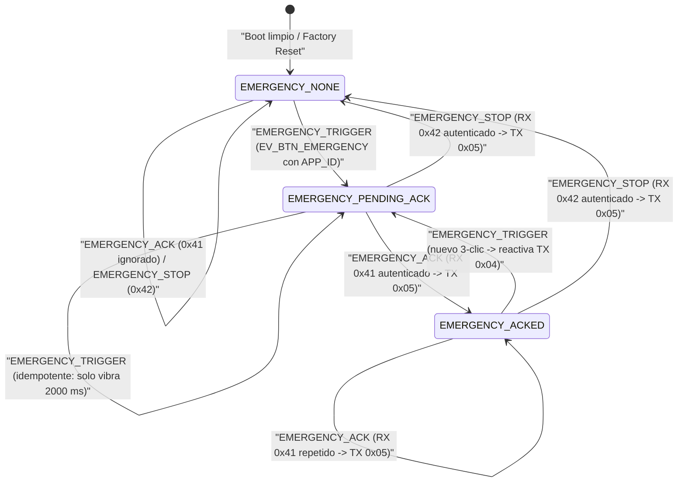

# 12. Gestión de Emergencias y Rutinas

## 12.1 Propósito y Jerarquía Funcional de Negocio

 Las dos funciones primarias de producto de la pulsera Joya hacia la aplicación móvil son:
1. **Alertas de emergencia (`COMMAND_EMERGENCY = 0x04`)**: máxima prioridad funcional del sistema. Cuentan con persistencia dedicada en NVS (`joya/emergency`), acuse de recibo explícito en capa de aplicación (`COMMAND_ACK_EMERGENCY = 0x41`), cierre explícito (`COMMAND_STOP_EMERGENCY = 0x42`), calendario indefinido de retransmisiones con *backoff* progresivo e inhibición automática de funciones ordinarias mientras permanecen activas.
2. **Eventos de rutina de acompañamiento (`COMMAND_ROUTINE = 0x02` y `COMMAND_END_ROUTINE = 0x03`)**: prioridad subordinada a la emergencia. En la versión documentada (`c1128e5d0c0d6f98be0a580d287c0926ca27f01f`), incorporan persistencia de **último comando pendiente** en NVS (`joya/routine`) ligado criptográficamente por identidad al `APP_ID` propietario, pero operan **sin acuse de recibo de capa de aplicación** (entrega confirmada al encolar la notificación GATT local).

La implementación se reparte entre cinco unidades de compilación:
- `[include/emergency_phase.h](../../include/emergency_phase.h)` y `[src/emergency_phase.c](../../src/emergency_phase.c)`: autómata puro de tres fases de emergencia y decodificación retrocompatible desde NVS (validado por prueba unitaria en `[tests/test_emergency_phase.c](../../tests/test_emergency_phase.c)`).
- `[include/pending_routine.h](../../include/pending_routine.h)`: función pura de política de reemplazo y supresión de rutinas (validada en `[tests/test_pending_routine.c](../../tests/test_pending_routine.c)`).
- `[include/flash_memory.h](../../include/flash_memory.h)` y `[src/flash_memory.c](../../src/flash_memory.c)`: caché en RAM, persistencia en `Settings/NVS` (`joya/emergency` y `joya/routine`), validación de propietario `APP_ID` y bandera de protección `pending_routine_dirty` (validada en `[tests/test_pending_storage.c](../../tests/test_pending_storage.c)`).
- `[src/app_state.c](../../src/app_state.c)` y `[include/app_state.h](../../include/app_state.h)`: orquestación con la FSM de conexión BLE, temporizador `emergency_retry_work`, patrones hápticos y publicidad BLE / iBeacon.
- `[src/app_comm.c](../../src/app_comm.c)` y `[src/ble_driver.c](../../src/ble_driver.c)`: transporte GATT sobre el servicio `COMMANDS` (`TX ...5001`, `RX ...5002`).

Véanse también `[05_state_machine.md](05_state_machine.md)` para la máquina general de estados, `[11_button.md](11_button.md)` para la generación de gestos físicos y `[code_reference/20a_core_fsm_comm.md](code_reference/20a_core_fsm_comm.md)` para el análisis función por función.

---

## 12.2 Modelo Conceptual y Máquina de Fases de Emergencia

### 12.2.1 Ortogonalidad respecto de `current_state` y el Enum Residual `STATE_EMERGENCY`

**(a) Comportamiento implementado y (d) Código residual**: En `[include/app_state.h:23-32](../../include/app_state.h)`, `app_state_t` declara el enumerador `STATE_EMERGENCY`. Sin embargo, en ninguna línea del firmware se asigna `current_state = STATE_EMERGENCY;` (su única mención defensiva ocurre en una condición `OR` de recuperación en `[src/app_state.c:545](../../src/app_state.c)`).

En su lugar, **la emergencia es un estado ortogonal a la conectividad BLE**, mantenido en `static emergency_phase_t joya_emergency_phase` (`[src/flash_memory.c:5](../../src/flash_memory.c)`). Esta decisión arquitectónica **(b) Intención de diseño** es indispensable porque una emergencia activa debe sobrevivir intacta mientras `current_state` transita por desconexión (`STATE_BONDED_DISCONNECTED`), reconexión (`STATE_WAITING_NOTIFICATION_ENABLE`), espera de credencial (`STATE_SETUP_WAITING_IDENTIFIER`) y sesión autenticada (`STATE_AUTHENTICATED`), así como a través de reinicios completos del microcontrolador.

### 12.2.2 Definición Formal de `emergency_phase_t` y Compatibilidad Binaria

En `[include/emergency_phase.h:8-18](../../include/emergency_phase.h)` y `[src/emergency_phase.c:4-31](../../src/emergency_phase.c)` se definen:

| Fase (`emergency_phase_t`) | Valor `uint8_t` en `joya/emergency` | `is_in_emergency()` | `emergency_phase_needs_notification()` | Significado exacto en el protocolo y el dispositivo |
|---|---:|---|---|---|
| `EMERGENCY_NONE` | `0` (`0x00`) | `false` | `false` | Sin emergencia registrada. Rutinas (`0x02`/`0x03`) y `COMMAND_FRIEND_EMERGENCY (0x44)` habilitados; `COMMAND_FOLLOW_ME (0x43)` ignorado. |
| `EMERGENCY_PENDING_ACK` | `1` (`0x01`) | `true` | `true` | Emergencia disparada localmente con `APP_ID` válido cuyo acuse `0x41` **aún no fue recibido** desde la app. Exige enviar y reintentar periódicamente `COMMAND_EMERGENCY (0x04)` en `STATE_AUTHENTICATED` (incluyendo tras reconectar o reiniciar). |
| `EMERGENCY_ACKED` | `2` (`0x02`) | `true` | `false` | La app autenticada ya confirmó recepción mediante `COMMAND_ACK_EMERGENCY (0x41)`. **Cesan definitivamente los envíos de `0x04`** (ni siquiera tras reconectar o reiniciar), pero la emergencia sigue activa: bloquea rutinas y `0x44`, y acepta `0x43` (`FOLLOW_ME`) y `0x42` (`STOP`). |

**Compatibilidad retroactiva con firmware `v1.x`–`v2.2.x`**:
Versiones anteriores almacenaban un `bool` de 1 byte (`0` = inactiva, `1` = activa) en la clave NVS `joya/emergency`. Al asignar `EMERGENCY_NONE = 0` y `EMERGENCY_PENDING_ACK = 1`, `emergency_phase_decode(uint8_t stored, emergency_phase_t *phase)` (`[src/emergency_phase.c:24-31](../../src/emergency_phase.c)`) interpreta transparentemente un `1` heredado tras actualización OTA como `EMERGENCY_PENDING_ACK`, garantizando que una alerta previa no reconocida siga notificándose. Cualquier byte corrupto `stored > 2` devuelve `false` (`-EINVAL` en `app_settings_set()`, `[src/flash_memory.c:75](../../src/flash_memory.c)`).



### 12.2.3 Distinción Crucial entre las Cuatro Situaciones de Emergencia

Es fundamental no confundir cuatro escenarios operativos distintos:

1. **Gesto de emergencia local SIN `APP_ID` provisionado (`is_app_id_empty() == true`)**:
   En `[src/app_state.c:721-738](../../src/app_state.c)`, la escritura a `storage_save_emergency_phase()` está protegida por `if (!is_app_id_empty())`. Por tanto, si una pulsera virgen o recién restaurada de fábrica recibe `EV_BTN_EMERGENCY`:
   - Vibra localmente `HAPTICS_PATTERN_EMERGENCY_START` (`2000 ms`) como advertencia táctil a la usuaria.
   - Si estaba en `STATE_UNPAIRED`, pasa a `STATE_SETUP_MODE` e inicia publicidad `"Joya Setup"` (`start_advertising_with_ibeacon(true)`, líneas 754–757, **sin** activar `connection_timeout_work` de 90 s).
   - **`joya_emergency_phase` permanece en `EMERGENCY_NONE (0)`** (`is_in_emergency() == false`). Si posteriormente una app se empareja y registra un `APP_ID`, **no se enviará `0x04` retroactivamente**, porque la alerta carecía de cuenta propietaria cuando ocurrió.
2. **Emergencia pendiente de ACK (`EMERGENCY_PENDING_ACK = 1`)**:
   Generada con `!is_app_id_empty()`. Persistida en RAM y Flash. El protocolo considera que el backend/teléfono **no se ha enterado todavía**; toda conexión autenticada presente o futura (incluso después de múltiples caídas de enlace o cortes de batería) recibirá `0x04` inmediatamente al habilitar `TX` CCC + autenticarse, seguido del calendario de reintentos.
3. **Emergencia reconocida por la app (`EMERGENCY_ACKED = 2`)**:
   El teléfono ya acusó recibo con `0x41` (y Joya respondió `0x05`). El protocolo asume que el protocolo de asistencia ya está en curso en el servidor/app: Joya detiene las retransmisiones de `0x04` para ahorrar radio y evitar alertas duplicadas tras reconexiones, pero **permanece en modo emergencia** para recibir pulsos de acompañamiento `COMMAND_FOLLOW_ME (0x43)` e impedir que pulsaciones accidentales disparen eventos de rutina `0x02`/`0x03`.
4. **Emergencia finalizada (`EMERGENCY_NONE = 0`)**:
   Alcanzada únicamente cuando la app autenticada transmite `COMMAND_STOP_EMERGENCY (0x42)` (o tras un Factory Reset de 15 s). La usuaria **no puede cancelar una emergencia desde el botón físico** (salvo borrando toda la pulsera con Factory Reset de 15 s); una pulsación de 5 s (`EV_BTN_SUSPEND_REQUEST`) desconecta BLE y silencia temporizadores en RAM, pero **conserva `joya/emergency` intacto en RAM y NVS**.

---

## 12.3 Ciclo de Vida Completo de una Emergencia

### 12.3.1 Disparo (`EV_BTN_EMERGENCY`), Idempotencia y Descarte Atómico Previo de Rutinas

Cuando `process_event()` recibe `EV_BTN_EMERGENCY` (`[src/app_state.c:715-760](../../src/app_state.c)`), ejecuta en orden estricto:

1. **Filtro de idempotencia en `EMERGENCY_PENDING_ACK` (líneas 716–719)**:
   ```c
   if (emergency_phase_needs_notification(storage_get_emergency_phase())) {
       haptics_play(HAPTICS_PATTERN_EMERGENCY_START);
       return; /* The same alert is already awaiting its ACK. */
   }
   ```
   - **Si ya estaba en `EMERGENCY_PENDING_ACK`**: reproduce nuevamente la vibración larga de `2000 ms` para dar tranquilidad táctil a la usuaria, pero **no vuelve a escribir en NVS** (evitando desgaste de Flash y picos de corriente de programación), **no reinicia `current_retry_index`** (evitando saturar el canal si la usuaria hace triples clics continuos cada 2 s) y retorna de inmediato.
   - **Matiz operativo importante (a/c)**: debido a este `return` temprano en la línea 718, si el dispositivo ya tenía `EMERGENCY_PENDING_ACK` cargado en RAM (p. ej. durante los primeros ~60 s tras un reinicio antes de que el monitor de batería auto-inicie el advertising, o tras agotar los 3 reintentos de `EV_BLE_RESTART_ADVERTISING`), un nuevo triple clic solo vibrará **sin** invocar `start_advertising_with_ibeacon(false)` en las líneas 749–753; para forzar publicidad inmediatamente en ese subcaso debe usarse doble clic (`EV_BTN_2_PULSE`).
   - **Re-disparo desde `EMERGENCY_ACKED`**: como `emergency_phase_needs_notification(EMERGENCY_ACKED)` es `false`, un nuevo triple clic **no** entra en el `return` temprano; avanza a `emergency_phase_transition(EMERGENCY_ACKED, EMERGENCY_TRIGGER) -> EMERGENCY_PENDING_ACK`, persiste `1` en `joya/emergency`, vibra `2000 ms` y reactiva inmediatamente el envío y reintentos de `COMMAND_EMERGENCY (0x04)`.

2. **Orden atómico de escritura en NVS: Tombstone de rutina ANTES de fase de emergencia (líneas 721–734)**:
   Si `!is_app_id_empty()`:
   - Primero invoca `storage_save_pending_routine(0)` (`joya/routine = 0x00`). Si retorna `!= 0`, reporta `DIAG_ERROR_FLASH_WRITE (0xE1)`.
   - Segundo invoca `storage_save_emergency_phase(EMERGENCY_PENDING_ACK)` (`joya/emergency = 0x01`). Si retorna `!= 0`, reporta `DIAG_ERROR_FLASH_WRITE (0xE1)` (nota: si falla NVS, `storage_save_emergency_phase` ya reporta internamente `0xE1` en `[src/flash_memory.c:312](../../src/flash_memory.c)`, por lo que `app_state.c:732` encola un segundo reporte idéntico `0xE1`).
   - **(b) Intención de diseño verificada** (comentario en líneas 722–724 y `[tests/test_pending_storage.c:138-143](../../tests/test_pending_storage.c)`): grabar primero la lápida `0x00` de `joya/routine` garantiza que, incluso ante un corte de energía intermedio o un posterior *rollback* OTA hacia una versión antigua de firmware, una rutina vieja descartada por esta emergencia jamás pueda resucitarse. Además, si el corte ocurriera justo después de escribir `joya/emergency = 1`, `storage_init()` (`[src/flash_memory.c:241-245](../../src/flash_memory.c)`) limpia al arrancar cualquier rutina residual cuando `joya_emergency_phase != EMERGENCY_NONE`.

3. **Confirmación háptica local (línea 736)**:
   Ejecuta `haptics_play(HAPTICS_PATTERN_EMERGENCY_START)` (`2000 ms` motor encendido a amplitud RTP `100` + `100 ms` en `0`), sujeta únicamente a `haptics_allowed` (`battery_level == 0 && !critical_idle`).

4. **Acción sobre el enlace BLE (líneas 739–759)**:
   - Si `current_state == STATE_AUTHENTICATED`: llama a `emergency_restart_alerts()` $\rightarrow$ transmite el primer `0x04` en el acto y arranca la escalera de reintentos.
   - Si no está autenticado: cancela `emergency_retry_work`, pone `current_retry_index = 0` y asegura la publicidad conectable (+ iBeacon si hay `APP_ID`) pasando de `STATE_UNPAIRED` a `STATE_BONDED_DISCONNECTED` (con `APP_ID`) o `STATE_SETUP_MODE` (sin `APP_ID`), o refrescando `start_advertising_with_ibeacon(false)` si ya estaba en `STATE_BONDED_DISCONNECTED`. Si estaba en tránsito de conexión (`STATE_WAITING_NOTIFICATION_ENABLE` o `STATE_SETUP_WAITING_IDENTIFIER`), aguarda pacientemente a que culmine la autenticación para disparar `send_pending_after_auth()`.

### 12.3.2 Calendario Exacto de Reintentos (`EMERGENCY_RETRY_MS`)

Definido en `[include/app_state.h:15-19](../../include/app_state.h)` y `[src/app_state.c:12-14, 79-99, 201-229](../../src/app_state.c)`:

```c
const uint32_t EMERGENCY_RETRY_MS[] = {
    EMERGENCY_RETRY_INITIAL_MS,   /* 1000 ms  (idx 0) */
    EMERGENCY_RETRY_FAST_MS,      /* 2000 ms  (idx 1) */
    EMERGENCY_RETRY_MEDIUM_MS,    /* 5000 ms  (idx 2) */
    EMERGENCY_RETRY_SLOW_MS,      /* 10000 ms (idx 3) */
    EMERGENCY_RETRY_VERY_SLOW_MS  /* 30000 ms (idx 4, saturación) */
};
```

| N.º de Transmisión `TX 0x04` | Origen de la ejecución | Intervalo previo | Tiempo acumulado desde disparo/auth ($t_0 = 0$) | Valor de `current_retry_index` tras enviar | Próximo intervalo agendado |
|---:|---|---:|---:|---:|---:|
| **#1 (Inicial)** | `emergency_restart_alerts()` | `0 ms` | `0,0 s` | `0 -> 1` | `+1000 ms` (`1 s`) |
| **#2 (Reintento 1)** | `EV_EMERGENCY_RETRY` | `+1000 ms` | `1,0 s` | `1 -> 2` | `+2000 ms` (`2 s`) |
| **#3 (Reintento 2)** | `EV_EMERGENCY_RETRY` | `+2000 ms` | `3,0 s` | `2 -> 3` | `+5000 ms` (`5 s`) |
| **#4 (Reintento 3)** | `EV_EMERGENCY_RETRY` | `+5000 ms` | `8,0 s` | `3 -> 4` | `+10000 ms` (`10 s`) |
| **#5 (Reintento 4)** | `EV_EMERGENCY_RETRY` | `+10000 ms` | `18,0 s` | `4 -> 4` *(tope)* | `+30000 ms` (`30 s`) |
| **#6 (Reintento 5)** | `EV_EMERGENCY_RETRY` | `+30000 ms` | `48,0 s` | `4` | `+30000 ms` (`30 s`) |
| **#$k$ ($k \ge 6$)** | `EV_EMERGENCY_RETRY` | `+30000 ms` | $(18 + 30 \cdot (k - 5))\text{ s}$ | `4` | `+30000 ms` indefinidamente |

**Comportamiento ante fallo de `ble_send_event_authenticated(COMMAND_EMERGENCY)`**:
Si `bt_gatt_notify()` falla transitoriamente (p. ej. falta de buffers ACL TX `-ENOMEM` o CCC de `TX` deshabilitado momentáneamente `-ENOTCONN`), `[src/app_state.c:784-790](../../src/app_state.c)` ignora el error local (mientras `ble_driver.c:689` reporta `DIAG_ERROR_BLE = 0xE4` si el error provino de `bt_gatt_notify`) y **igualmente avanza y reprograma `emergency_schedule_next_retry()`**, manteniendo vivo el lazo de reintentos hasta que la app reconecte/resuscriba o envíe `0x41`/`0x42`.

### 12.3.3 Comandos desde la App Durante Emergencia (`0x41`, `0x42`, `0x43`, `0x44`, `0x45`)

Todos los comandos entrantes por `COMMANDS RX (...5002)` pasan por doble barrera de seguridad: validación de formato en `on_rx_write_handler()` (`offset == 0 && len == 1`, `[src/app_comm.c:10-16](../../src/app_comm.c)`) y validación de sesión autenticada en `process_event()` (`ble_is_authenticated_conn(entry->conn)` + `current_state == STATE_AUTHENTICATED`, `[src/app_state.c:396-400, 793-826](../../src/app_state.c)`).

| Comando RX | Nombre Simbólico | Requisito `is_in_emergency()` | Acción exacta en `process_event()` | Cambio en NVS | Respuesta `TX` | Háptica |
|---|---|---|---|---|---|---|
| `0x41` | `COMMAND_ACK_EMERGENCY` | **Obligatorio `true`** *(ignorado si `false`)* | `emergency_stop_alerts()` (cancela timer, `idx = 0`), transiciona a `EMERGENCY_ACKED (2)`. | `joya/emergency = 0x02` | `0x05` (`COMMAND_ACK`) | Ninguna |
| `0x42` | `COMMAND_STOP_EMERGENCY` | **Obligatorio `true`** *(ignorado si `false`)* | `emergency_stop_alerts()`, limpia `joya/routine = 0`, transiciona a `EMERGENCY_NONE (0)`. | `joya/routine = 0x00`, `joya/emergency = 0x00` | `0x05` (`COMMAND_ACK`) | Ninguna |
| `0x43` | `COMMAND_FOLLOW_ME` | **Obligatorio `true`** *(¡ignorado en `STATE_AUTHENTICATED` normal!)* | Pulso remoto de tranquilidad / seguimiento durante emergencia (`PENDING_ACK` o `ACKED`). | Sin cambios | `0x05` (`COMMAND_ACK`) | `FOLLOW_ME` (`2×200 ms`, `600 ms` total) |
| `0x44` | `COMMAND_FRIEND_EMERGENCY` | **Obligatorio `false`** *(bloqueado en línea 867 si `true`)* | Solo fuera de emergencia propia: alerta por emergencia de contacto. | Sin cambios | `0x05` (`COMMAND_ACK`) *(nada si bloqueado)* | `FRIEND_EMERGENCY` (`6×200 ms`, `2200 ms`) |
| `0x45` | `COMMAND_FRIEND_STOP_EMERGENCY` | **(d) No implementado** | `on_rx_write_handler` retorna `len = 1` sin encolar evento (`[src/app_comm.c:33-35](../../src/app_comm.c)`). | Sin cambios | Ninguna | Ninguna |

```mermaid
sequenceDiagram
    participant U as "Usuaria (Botón)"
    participant FSM as "Joya (FSM + NVS)"
    participant BLE as "GATT Commands (TX/RX)"
    participant APP as "App Móvil"

    U->>FSM: 3 clics cortos -> EV_BTN_EMERGENCY
    FSM->>FSM: joya/routine = 0; joya/emergency = 1 (PENDING_ACK)
    FSM->>FSM: Vibra EMERGENCY_START (2000 ms)
    FSM->>BLE: TX 0x04 (t = 0 s)
    BLE-->>APP: Notify 0x04 (perdido / app aún procesando)
    FSM->>BLE: TX 0x04 (t = 1 s, retry #1)
    BLE-->>APP: Notify 0x04
    APP->>BLE: Write RX 0x41 (COMMAND_ACK_EMERGENCY)
    BLE->>FSM: EV_APP_ACK_EMERGENCY
    FSM->>FSM: emergency_stop_alerts(); joya/emergency = 2 (ACKED)
    FSM->>BLE: TX 0x05 (COMMAND_ACK)
    BLE-->>APP: Notify 0x05
    APP->>BLE: Write RX 0x43 (COMMAND_FOLLOW_ME)
    BLE->>FSM: EV_APP_FOLLOW_ME
    FSM->>BLE: TX 0x05 (COMMAND_ACK)
    FSM->>FSM: Vibra FOLLOW_ME (2x200 ms)
    APP->>BLE: Write RX 0x42 (COMMAND_STOP_EMERGENCY)
    BLE->>FSM: EV_APP_STOP_EMERGENCY
    FSM->>FSM: joya/routine = 0; joya/emergency = 0 (NONE)
    FSM->>BLE: TX 0x05 (COMMAND_ACK)
```

### 12.3.4 Desconexión, Reconexión, iBeacon (`c1128e5`) y Reinicio del MCU Durante Emergencia

1. **Desconexión BLE en curso de emergencia (`EV_BLE_DISCONNECTED`, `[src/app_state.c:598-610](../../src/app_state.c)`)**:
   - En condiciones normales de batería (`!critical_window_open && battery_level != 2`), entra en `else if (is_in_emergency())` (línea 605): ejecuta `emergency_stop_alerts()`, transiciona a `STATE_BONDED_DISCONNECTED` (si tiene `APP_ID`) o `STATE_SETUP_MODE` (sin `APP_ID`), e invoca `schedule_advertising_restart()` (`+10 ms` inicial y hasta 2 reintentos adicionales cada `5 s` ante `-ENOMEM`/`-EBUSY`/`-EAGAIN`, líneas 575–596).
   - *Detalle de código verificado*: si `critical_window_open == true` al desconectar durante una emergencia, se toma la primera rama `if (critical_window_open)` (líneas 599–602), que igualmente pasa a `STATE_BONDED_DISCONNECTED`/`STATE_SETUP_MODE` y llama `schedule_advertising_restart()`, sin invocar `emergency_stop_alerts()` en ese instante; esto es inocuo porque `EV_EMERGENCY_RETRY` comprueba `if (current_state != STATE_AUTHENTICATED) return;` (línea 778) y deja de reprogramarse.
   - Si la batería está en **Nivel 2 crítico** (`battery_level == 2 && !critical_window_open && !ota_access_is_update_active()`), prevalece la protección energética: entra en `enter_critical_idle()` (línea 604), deteniendo publicidad y alertas hasta que la batería se recupere o la usuaria abra una ventana crítica de 5 minutos con doble clic (`EV_BTN_2_PULSE`).

2. **Reconexión posterior (`send_pending_after_auth()`, `[src/app_state.c:245-253, 960-973](../../src/app_state.c)`)**:
   Cuando el teléfono reconecta, habilita notificaciones en `TX` y presenta el `APP_ID` válido:
   - Si la fase persistida es `EMERGENCY_ACKED (2)`: `emergency_phase_needs_notification()` devuelve `false` y `send_pending_routine()` aborta por `is_in_emergency() == true`. **No se reenvía `0x04`**.
   - Si la fase persistida es `EMERGENCY_PENDING_ACK (1)`: `send_pending_after_auth()` invoca `emergency_restart_alerts()` (reinicia `current_retry_index = 0`, transmite `0x04` de inmediato tras el `0x05` de autenticación y agenda `+1000 ms`) y llama a `haptics_play(HAPTICS_PATTERN_EMERGENCY_START)`.

   > [!WARNING]
   > **Inconsistencia sutil de orden háptico al reconectar con `APP_ID` existente (`src/app_state.c:971-972`)**:
   > Al provisionar un `APP_ID` **nuevo** (líneas 950–951), el código llama primero `haptics_play(HAPTICS_PATTERN_ACK_CONNECTION)` y luego `send_pending_after_auth()`. En cambio, al autenticar un `APP_ID` **ya existente** (líneas 971–972), el orden está invertido:
   > ```c
   > send_pending_after_auth();                  /* pide HAPTICS_PATTERN_EMERGENCY_START (2000 ms) */
   > haptics_play(HAPTICS_PATTERN_ACK_CONNECTION); /* ¡cancela y pisa inmediatamente con ACK_CONNECTION (3x200 ms)! */
   > ```
   > Como `haptics_play()` cancela sincrónicamente cualquier patrón sin callback de finalización (`[src/haptics.c:638](../../src/haptics.c)`), en una reconexión con emergencia pendiente **el patrón de 2000 ms es reemplazado microsegundos después por los 3 pulsos de `ACK_CONNECTION`**. En cambio, si el teléfono deshabilita y vuelve a habilitar el CCC de `TX` sin desconectar (`EV_BLE_NOTIFY_ENABLED` en `STATE_AUTHENTICATED`, líneas 488–492), `send_pending_after_auth()` se ejecuta sola y sí reproduce los `2000 ms` completos de `EMERGENCY_START`.

3. **Interacción con iBeacon en `c1128e5`**:
   En el commit documentado `c1128e5` **se eliminó el antiguo iBeacon específico de emergencia** (`...6002` presente en `v2.3.1`). `ibeacon_mode_for_state(!is_app_id_empty())` (`[include/ibeacon_policy.h:11-14](../../include/ibeacon_policy.h)`) emite siempre el único UUID de conexión `a407e00a-00c1-464d-9173-2cb8be586001` (`Major = 1`, `Minor = 1`, `TX Power = -56 dBm` sin calibrar) en paralelo con el advertising conectable siempre que exista `APP_ID` y no haya conexión BLE activa, con total independencia de si `joya_emergency_phase` vale `0`, `1` o `2` (verificado en `[tests/test_emergency_phase.c:57-70](../../tests/test_emergency_phase.c)` y `[docs/IBEACON.md:9-14](../../docs/IBEACON.md)`). Esto permite a iOS/Android despertar la app en segundo plano por monitoreo de región iBeacon y descubrir el estado pendiente sobre GATT tras autenticar.

4. **Reinicio del MCU durante una emergencia (`WDT0`, corte de energía o `sys_reboot`)**:
   - `storage_init()` restaura `joya_emergency_phase` (`1` o `2`) desde `joya/emergency`.
   - En una imagen confirmada (`boot_is_img_confirmed() == true`), `main()` arranca en `STATE_UNPAIRED` con radio en silencio hasta la primera confirmación de batería (~`60 s`: muestra inicial en `t = 0` + 6 muestras de verificación cada `10 s`, `[src/battery.c:248-291](../../src/battery.c)`).
   - Al llegar `EV_BATTERY_NORMAL` o `EV_BATTERY_LEVEL_1` en `t ≈ 60 s`, `boot_reconnect_pending` pasa `current_state` a `STATE_BONDED_DISCONNECTED` e inicia automáticamente `start_advertising_with_ibeacon(false)` (`[src/app_state.c:462-475](../../src/app_state.c)`), permitiendo al teléfono reconectar sin intervención humana y recibir `0x04` si estaba en `EMERGENCY_PENDING_ACK` (o mantener el silencio de `0x04` si ya estaba en `EMERGENCY_ACKED`).

---

## 12.4 Gestión Completa de Rutinas (`0x02` / `0x03`) y Comandos Pendientes

### 12.4.1 Semántica de Eventos y Política *Last-Write-Wins* (`pending_routine_next`)

Los dos comandos de rutina generados por la usuaria son:
- `COMMAND_ROUTINE (0x02)` $\leftarrow$ `EV_BTN_1_PULSE` (1 clic corto `< 500 ms` seguido de `900 ms` de silencio).
- `COMMAND_END_ROUTINE (0x03)` $\leftarrow$ `EV_BTN_LONG_PRESS` (pulsación mantenida entre `500 ms` y `4999 ms`, emitida `+50 ms` tras soltar).

Ambos convergen en `handle_routine_button(uint8_t command)` (`[src/app_state.c:255-271, 880-884](../../src/app_state.c)`), gobernada por la función inline pura de `[include/pending_routine.h:8-15](../../include/pending_routine.h)`:

```c
static inline uint8_t pending_routine_next(uint8_t current, uint8_t generated,
                                            bool has_app_id, bool emergency_active)
{
    if (!has_app_id || emergency_active) {
        return 0;
    }
    return generated != 0 ? generated : current;
}
```

**Reglas de negocio implementadas (a/b)**:
1. **Exigencia de `APP_ID` registrado (`has_app_id == true`)**: sin `APP_ID`, pulsar 1 clic o hold medio retorna `0` de inmediato (no vibra ni guarda nada).
2. **Prioridad absoluta de emergencia (`emergency_active == false`)**: si `is_in_emergency() == true` (`PENDING_ACK` o `ACKED`), toda rutina se rechaza (además del filtro previo en el `switch` de emergencia en `[src/app_state.c:862-872](../../src/app_state.c)`), y el disparo de una nueva emergencia borra cualquier rutina previamente pendiente.
3. **Política de reemplazo sin cola FIFO ni cancelación mutua (`OFF` reemplaza a `ON` y `ON` reemplaza a `OFF`)**:
   - Solo existe **una ranura de 1 comando** (`joya_pending_routine`).
   - Si mientras está desconectada la usuaria pulsa `1 clic` (`0x02`) y luego mantiene `1 s` (`0x03`), el valor almacenado pasa a ser `0x03` (**no** `0x00`!). Esto es deliberado (`[tests/test_pending_routine.c:16](../../tests/test_pending_routine.c)`: `/* OFF replaces ON; no queue or pair cancellation. */`): si ya existía una rutina previa activa en el backend antes de perder cobertura, o por consistencia de estado final, la app debe recibir explícitamente `COMMAND_END_ROUTINE (0x03)` al reconectar.

### 12.4.2 Formato en NVS (`joya/routine`), Propietario `APP_ID` y Bandera `pending_routine_dirty`

En `[src/flash_memory.c:6-8, 78-96, 146-185, 240-302, 377-383](../../src/flash_memory.c)`, la persistencia de rutinas implementa un esquema defensivo de **aislamiento por propietario e integridad ante fallos parciales de Flash**:

| Estado de `joya/routine` | Longitud en NVS | Contenido exacto de bytes | Cuándo se escribe | Optimización anti-desgaste |
|---|---:|---|---|---|
| **Sin rutina pendiente (Tombstone)** | `1` byte | `[0x00]` | Tras `bt_gatt_notify == 0`, al disparar `EV_BTN_EMERGENCY`, al recibir `0x42` (`STOP`), o al limpiar basura en `storage_init()`. *(En `storage_factory_reset()` se usa `settings_delete("joya/routine")`)*. | Si `joya_pending_routine == 0 && !pending_routine_dirty`, `storage_save_pending_routine(0)` **retorna `0` sin escribir en NVS** (líneas 158–160). |
| **Inicio de rutina pendiente** | `17` bytes | `[0x02, owner_app_id[0..15]]` | Al pulsar 1 clic desconectado o cuando `ble_send_event_authenticated(0x02)` falla. | Si ya valía `0x02` y `!pending_routine_dirty`, **no reescribe NVS** (idempotencia en Flash, verificada en `[tests/test_pending_storage.c:128-130](../../tests/test_pending_storage.c)`). |
| **Fin de rutina pendiente** | `17` bytes | `[0x03, owner_app_id[0..15]]` | Al mantener `0,5..5 s` desconectado o cuando `ble_send_event_authenticated(0x03)` falla. | Si ya valía `0x03` y `!pending_routine_dirty`, **no reescribe NVS**. |

**Invariantes de seguridad garantizados por `pending_routine_owner` y `pending_routine_dirty`**:
1. **Verificación de propietario en arranque (`[src/flash_memory.c:241-245](../../src/flash_memory.c)`)**: tras `settings_load()`, si `joya_pending_routine != 0` pero `is_app_id_empty()`, o `joya_emergency_phase != EMERGENCY_NONE`, o `memcmp(pending_routine_owner, joya_app_id, 16) != 0`, el arranque purga inmediatamente la rutina con `storage_save_pending_routine(0)`. Así, si tras un rollback OTA otro firmware registró un `APP_ID` distinto sin conocer la clave `joya/routine`, el nuevo titular jamás recibirá el comando del titular anterior.
2. **Bloqueo de nuevo registro si falló el borrado de rutina (`pending_routine_dirty` en `storage_save_app_id`, líneas 267–270)**: si durante un `storage_factory_reset()` previo falló `settings_delete("joya/routine")`, queda `pending_routine_dirty = true`. Al intentar registrar un nuevo `APP_ID`, `storage_save_app_id()` reintenta `storage_save_pending_routine(0)` **antes** de aceptar el nuevo `APP_ID`; si NVS sigue fallando, **aborta el guardado incluso en RAM** (`is_app_id_empty()` permanece `true`, `[src/app_state.c:932-935](../../src/app_state.c)`) para impedir asociar la rutina vieja en Flash al nuevo usuario.
3. **Bloqueo de persistencia de `EMERGENCY_NONE` si falló el borrado de rutina (`[src/flash_memory.c:298-302](../../src/flash_memory.c)`)**: al recibir `0x42` (`STOP`), si `pending_routine_dirty == true` y `storage_save_pending_routine(0)` vuelve a fallar, `joya_emergency_phase` pasa a `EMERGENCY_NONE` en RAM, pero **no escribe `0` en `joya/emergency` en Flash**; de ese modo, si el MCU se reinicia, `storage_init()` verá `joya/emergency != 0` y suprimirá la rutina huérfana en lugar de enviarla.

### 12.4.3 Garantías Reales de Entrega, Pérdidas Posibles, Duplicados y Confirmación Háptica

| Aspecto | Emergencias (`0x04`) | Rutinas (`0x02` / `0x03`) |
|---|---|---|
| **Modelo de entrega extremo a extremo** | **Al menos una vez (*at-least-once*) hasta ACK de app**: requiere `COMMAND_ACK_EMERGENCY (0x41)` explícito desde la aplicación autenticada. | **Mejor esfuerzo con persistencia previa al encolado BLE (*persisted best-effort*, sin ACK de app)**: se da por entregada en cuanto `bt_gatt_notify()` retorna `0`. |
| **¿Qué confirma la vibración háptica local?** | Confirma que el gesto de 3 clics fue detectado localmente (y persistido en RAM/NVS si hay `APP_ID`). **No** confirma que el teléfono haya recibido `0x04` (tampoco vibra al recibir `0x41`). | `handle_routine_button()` llama a `haptics_play()` **antes** de intentar `ble_send_event_authenticated()` o guardar en NVS (`[src/app_state.c:261-263](../../src/app_state.c)`). La vibración confirma **detección local del gesto**, **no** recepción ni ejecución en la app. |
| **¿Inicia advertising automáticamente al pulsar desconectado?** | **Sí**: `EV_BTN_EMERGENCY` fuerza `start_advertising_with_ibeacon()` si estaba en `STATE_UNPAIRED` o `STATE_BONDED_DISCONNECTED` (salvo idempotencia si ya estaba en `PENDING_ACK`). | **No**: `handle_routine_button()` guarda en `joya/routine` pero **no toca el estado de advertising**. Si ya estaba en `STATE_BONDED_DISCONNECTED` publicitando, el teléfono conectará solo; si estaba en `STATE_UNPAIRED` (p. ej. primeros 60 s post-boot o tras fallar 3 reintentos de ADV), esperará al inicio automático de los 60 s o a un doble clic de la usuaria. |
| **Escenarios de pérdida del comando** | Solo si: (1) no había `APP_ID` al disparar; (2) el usuario hace Factory Reset de 15 s antes de conectar; o (3) falla simultáneamente NVS (`storage_persistent_available == false` o error de escritura) **y** ocurre un reset del MCU antes de conectar. | 1. **Caída abrupta de enlace RF tras `bt_gatt_notify() == 0`**: el paquete entra en la cola ACL TX local (`3` buffers) y se borra `joya/routine = 0`, pero el enlace cae por supervisión (`6 s`) antes de llegar al teléfono o la app móvil muere antes de procesarlo.<br/>2. **Sobrescritura intencional**: un nuevo `0x02`/`0x03` o una emergencia `0x04` reemplaza/borra la rutina anterior.<br/>3. **Fallo NVS + reset MCU** antes de conectar. |
| **Escenarios de duplicación del comando** | **Esperado por diseño**: la app puede recibir múltiples `0x04` (a `0s, 1s, 3s, 8s, 18s, 48s...` o tras reconectar) antes de que su `0x41` llegue a Joya; el backend/app debe ser idempotente ante `0x04`. | 1. **Reset justo entre `bt_gatt_notify() == 0` y `storage_save_pending_routine(0)`** (`[src/app_state.c:238-241, 264-266](../../src/app_state.c)`): ventana de pocos milisegundos durante escritura NVS.<br/>2. **Fallo de escritura NVS al limpiar (`storage_save_pending_routine(0) == 1`) seguido de un reinicio posterior del MCU**: en RAM queda `0`, pero en Flash sigue el registro de 17 bytes, que reaparecerá tras el reboot. |

---

## 12.5 Matriz Exhaustiva de Escenarios Operativos y Casos de Fallo

La siguiente tabla evalúa las garantías y limitaciones verificadas en código (`c1128e5`) para cada combinación de estado de enlace, autenticación, suscripción GATT, energía, estado previo y fallos de subsistema:

| # | Escenario / Condición del Sistema | Comportamiento ante **Emergencia (`EV_BTN_EMERGENCY` / `0x04`)** | Comportamiento ante **Rutina (`0x02` Inicio / `0x03` Fin)** | Garantías Reales y Limitaciones Exactas |
|---:|---|---|---|---|
| **1** | **Conectado y autenticado (`STATE_AUTHENTICATED`), `TX` CCC habilitado, batería normal (`Nivel 0`)** | Borra `joya/routine` (`0`), persiste `EMERGENCY_PENDING_ACK (1)`, vibra `2000 ms`, envía `TX 0x04` en $t=0$ y reintenta a `1s, 2s, 5s, 10s, 30s...` hasta `RX 0x41` o `0x42`. | Vibra (`700 ms` o `2×200 ms`), envía `TX 0x02`/`0x03` inmediatamente y escribe tombstone `0` en `joya/routine` (sin tocar Flash si ya era `0`). | Emergencia garantizada *at-least-once* hasta ACK `0x41`. Rutina entregada en milisegundos (sujeta solo a pérdida de enlace post-`bt_gatt_notify`). |
| **2** | **Conectado sin autenticar (`STATE_WAITING_NOTIFICATION_ENABLE` o `STATE_SETUP_WAITING_IDENTIFIER`) con `APP_ID` guardado** | Borra `joya/routine`, persiste `EMERGENCY_PENDING_ACK (1)`, vibra `2000 ms`, cancela timer de reintentos y aguarda autenticación. Al validar `APP_ID`, envía `0x05` + batería + `0x04` e inicia reintentos *(nota: vibración pisada por `ACK_CONNECTION`)*. | Vibra localmente y **persiste `[0x02/0x03, app_id]` en `joya/routine`** (no transmite aún). En cuanto la app completa autenticación, `send_pending_after_auth()` envía `0x02`/`0x03` tras `0x05` y limpia `joya/routine = 0`. | Ningún dato sensible (`0x02`, `0x03`, `0x04`) sale jamás hacia un cliente que no haya presentado primero el `APP_ID` correcto. Si el intruso falla (`0x06 NACK`) y desconecta, el comando sigue seguro en NVS para el dueño legítimo. |
| **3** | **Desconectado con `APP_ID` (`STATE_BONDED_DISCONNECTED` o `STATE_UNPAIRED` en primeros 60 s post-boot)** | Borra `joya/routine`, persiste `EMERGENCY_PENDING_ACK (1)`, vibra `2000 ms`, pasa a `STATE_BONDED_DISCONNECTED` y arranca inmediatamente advertising conectable + iBeacon `...6001`. | Vibra localmente y persiste `[0x02/0x03, app_id]` en `joya/routine`. Si ya estaba en `STATE_BONDED_DISCONNECTED`, el advertising + iBeacon siguen activos; si estaba en `STATE_UNPAIRED` post-boot, el advertising arrancará al confirmarse batería (~60 s) o con 2 clics. | Al detectar el iBeacon `...6001` y reconectar + autenticar, la app recibe automáticamente la emergencia o la última rutina guardada. |
| **4** | **Desconectado o conectado SIN `APP_ID` (`is_app_id_empty() == true`)** | **No persiste emergencia en RAM ni NVS** (`joya_emergency_phase` queda en `0`). Vibra `2000 ms` y si estaba en `STATE_UNPAIRED` pasa a `STATE_SETUP_MODE` (`"Joya Setup"`, sin iBeacon, sin timeout de 90 s). | **Rechazado por completo** (`pending_routine_next` retorna `0`): ni vibra, ni guarda en RAM/NVS, ni inicia advertising. | Sin emparejamiento previo no existe destinatario válido. Incluso si la usuaria empareja la app minutos después del triple clic, **no** se enviará `0x04` automáticamente; deberá repetir el triple clic tras emparejar. |
| **5** | **Notificaciones `TX` deshabilitadas al conectar, o desuscritas en caliente durante `STATE_AUTHENTICATED`** | - Al conectar sin suscribir `TX`: permanece en `STATE_WAITING_NOTIFICATION_ENABLE` (ignora `APP_ID` hasta suscribir `TX`).<br/>- Desuscrita en caliente en `STATE_AUTHENTICATED`: `ble_send_event_authenticated(0x04)` retorna `-ENOTCONN`, pero `joya/emergency = 1` queda guardado y el timer sigue corriendo; al re-suscribir `TX` (`EV_BLE_NOTIFY_ENABLED`), `send_pending_after_auth()` reenvía `0x04` al instante. | - Sin suscribir `TX` inicial: persiste rutina en `joya/routine` como en fila 2.<br/>- Desuscrita en caliente en `STATE_AUTHENTICATED`: `ble_send_event_authenticated()` falla (`-ENOTCONN`), por lo que `handle_routine_button()` entra al `else` y **persiste `0x02`/`0x03` en `joya/routine`**. Al re-suscribir `TX` en esa misma conexión, `EV_BLE_NOTIFY_ENABLED` llama `send_pending_after_auth()` y entrega la rutina sin perderla. | Resiliencia completa frente a re-suscripciones dinámicas de CCC en `TX` tanto para emergencias como para rutinas. |
| **6** | **Reinicio del MCU (`WDT0`, brownout, reboot OTA confirmado) con evento pendiente en NVS** | Restaura `joya/emergency` (`1` o `2`). Espera confirmación de batería (~60 s) para auto-publicitar con iBeacon. Al reconectar y autenticar: si era `1` (`PENDING_ACK`), envía `0x04` y reintenta; si era `2` (`ACKED`), **no reenvía `0x04`** pero mantiene modo emergencia. | Restaura `joya/routine` (`17` bytes) verificando que `owner_app_id == joya_app_id` y `joya_emergency_phase == 0`. Auto-publicita a los ~60 s; al autenticar envía `0x02`/`0x03` y limpia `joya/routine = 0`. | Persistencia no volátil completa a través de reinicios. **Limitación temporal**: ventana ciega de ~60 s sin advertising inmediatamente después de un reboot hasta completar las 6 muestras de batería (salvo 2 o 3 clics manuales). |
| **7** | **Batería Baja Nivel 1 (`battery_level == 1`, $2900 < V_{BAT} \le 3000\text{ mV}$)** | Exactamente igual que en batería normal (persiste en NVS, inicia ADV + iBeacon, envía y reintenta `0x04`), pero **sin ninguna vibración háptica** (`haptics_allowed == 0`), tampoco en `0x43 FOLLOW_ME`. | Exactamente igual que en batería normal (envía `0x02`/`0x03` o persiste en `joya/routine`), pero **sin confirmación háptica**. | Se sacrifica toda retroalimentación táctil para evitar caídas $I \cdot R$ del motor ERM y preservar energía para el radio BLE y Flash. |
| **8** | **Batería Crítica Nivel 2 (`battery_level == 2`, $\le 2900\text{ mV}$) en `critical_idle` vs en `critical_window_open` (5 min)** | - En `critical_idle` (`suspended_idle == true`): **triple clic ignorado** hasta despertar con doble clic.<br/>- Tras `EV_BTN_2_PULSE` (`critical_window_open`, 5 min): triple clic **sí funciona** (sin háptica), persiste `PENDING_ACK` y transmite `0x04` durante la ventana de 5 min. Al vencer los 5 min, `enter_critical_idle()` corta BLE pero conserva `joya/emergency = 1` en NVS. | - En `critical_idle`: **1 clic y hold medio ignorados**.<br/>- Durante `critical_window_open` (5 min): **sí funcionan** (sin háptica), transmitiendo `0x02`/`0x03` si logra autenticar o persistiendo en `joya/routine` antes de volver a `critical_idle`. | En batería crítica la usuaria debe hacer **2 clics primero** para abrir la ventana de emergencia/recuperación de 5 minutos, y luego **3 clics** (o esperar que la app conecte si ya había emergencia pendiente). |
| **9** | **Suspensión lógica manual (`EV_BTN_SUSPEND_REQUEST`, hold `5..14,99 s`)** | - Si ya estaba en `suspended_idle`: **triple clic ignorado**.<br/>- Si se suspende *durante* una emergencia activa: `enter_unpaired_idle()` detiene reintentos y desconecta BLE, pero **NO borra `joya/emergency`**. Al despertar luego con 2 clics y reconectar, si estaba en `PENDING_ACK` volverá a enviar `0x04`. | - En `suspended_idle`: **1 clic y hold medio ignorados**.<br/>- Si había una rutina pendiente en `joya/routine` y la usuaria suspende con 5 s, la rutina **se conserva en NVS** y se enviará cuando despierte con 2 clics y autentique. | El reposo de 5 s actúa como "modo avión lógico": silencia radio y botones ordinarios/emergencia mientras está dormido, sin destruir el estado persistido de NVS. |
| **10** | **Emergencia previa activa (`PENDING_ACK` vs `ACKED`) cuando ocurre nueva acción** | - Nuevo triple clic en `PENDING_ACK`: solo vibra `2000 ms` (idempotente, no toca Flash ni backoff).<br/>- Nuevo triple clic en `ACKED`: pasa a `PENDING_ACK`, escribe en NVS y **reinicia envíos `0x04`**. | En ambos subestados (`PENDING_ACK` y `ACKED`), `EV_BTN_1_PULSE` y `EV_BTN_LONG_PRESS` son **descartados** sin vibrar ni guardar en NVS; `0x44` (`FRIEND_EMERGENCY`) también se ignora. | Impide contaminar el flujo de una emergencia activa con eventos de rutina o alertas de terceros, permitiendo a la vez re-alertar con 3 clics si la situación empeora tras un `ACK` previo. |
| **11** | **Rutina previa pendiente en `joya/routine` cuando ocurre nueva rutina o emergencia** | Al llegar `EV_BTN_EMERGENCY`: escribe primero tombstone `0` en `joya/routine` y luego `1` en `joya/emergency`, **descartando irreversiblemente la rutina previa**. | Al llegar nueva rutina (`0x02` o `0x03`): sobrescribe la anterior (*last-write-wins*). Si es el mismo código y `!pending_routine_dirty`, evita reescribir NVS. | Sin cola histórica: solo importa la intención más reciente, y cualquier emergencia anula todas las rutinas anteriores. |
| **12** | **Errores de Flash/NVS (`storage_init` fallido o `settings_save_one` / `settings_delete` con error)** | Actualiza siempre `joya_emergency_phase` en RAM primero (`return 1`), emite `DIAG_ERROR_FLASH_WRITE (0xE1)` (o `0xE2` en carga) y **opera normalmente en RAM** mientras no se reinicie el MCU. | Actualiza siempre `joya_pending_routine` en RAM primero, marca `pending_routine_dirty = true`, emite `0xE1` y envía normalmente por BLE al autenticar. Si falla borrar en reset/STOP, `pending_routine_dirty` bloquea fugas tras reinicio. | Degradación elegante (*fail-operational* en RAM): un fallo de memoria Flash nunca impide disparar y transmitir una emergencia o rutina en la sesión viva, aunque se pierda persistencia ante corte eléctrico. |
| **13** | **Errores de envío BLE (`bt_gatt_notify < 0` o fallo al iniciar advertising)** | - Fallo en `bt_gatt_notify`: reporta `DIAG_ERROR_BLE (0xE4)`, conserva `PENDING_ACK` y reintenta en el próximo escalón (`1s..30s`).<br/>- Fallo en ADV tras desconectar: `EV_BLE_RESTART_ADVERTISING` reintenta hasta 3 veces cada `5 s` si el error es `-ENOMEM`, `-EBUSY` o `-EAGAIN`. | - Fallo en `bt_gatt_notify` dentro de `handle_routine_button`: reporta `0xE4` y **cae automáticamente al `else` persistiendo el comando en `joya/routine`**. En `send_pending_routine()`, solo limpia `joya/routine` si `ble_send_event_authenticated() == 0`. | Ningún fallo transitorio de buffers BLE descarta una emergencia ni borra prematuramente una rutina pendiente. *(Limitación: si tras 3 intentos falla el reinicio de ADV, requerirá `EV_BTN_2_PULSE` manual)*. |
