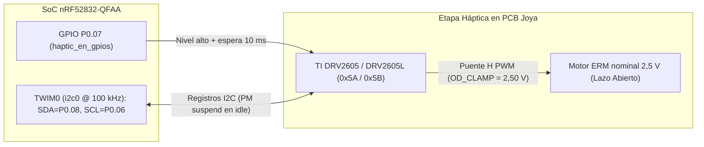
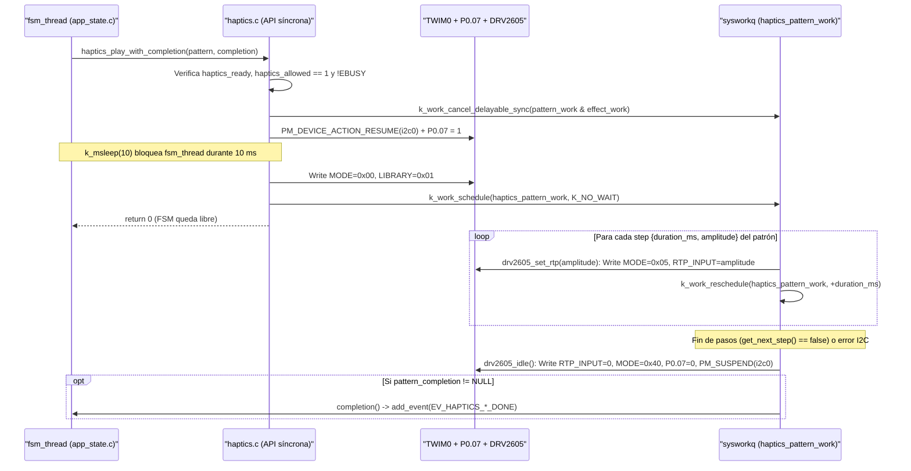

# 13. Sistema Háptico (`DRV2605` y Contexto `NBM5100A`)

## 13.1 Rol del Subsistema y Arquitectura General

Al no incorporar LEDs visibles ni zumbador acústico en la pulsera final (por discreción ante situaciones de riesgo), el subsistema háptico constituye el **único canal de salida sensorial hacia la usuaria**. Mediante un motor vibrador de masa rotatoria excéntrica (**ERM**, *Eccentric Rotating Mass*) gobernado por un circuito integrado Texas Instruments **`DRV2605`**, el firmware comunica confirmaciones de gestos locales, emparejamiento exitoso, alertas remotas (`FOLLOW_ME`, `FRIEND_EMERGENCY`) y advertencias de operaciones críticas (suspensión de 5 s y restauración de fábrica de 15 s).

Los archivos que conforman el subsistema son:
- `[include/haptics.h](../../include/haptics.h)` y `[src/haptics.c](../../src/haptics.c)`: driver I2C del `DRV2605`, control del GPIO de habilitación `P0.07`, administración de energía (`PM_DEVICE`) del periférico `i2c0`, motor asíncrono de patrones RTP (*Real-Time Playback*), soporte secundario de efectos en ROM y compuerta atómica por nivel de batería.
- `[include/haptics_test_indicator.h](../../include/haptics_test_indicator.h)`, `[src/haptics_test_indicator.c](../../src/haptics_test_indicator.c)` y `[Kconfig](../../Kconfig)`: indicador diagnóstico opcional sobre `LED0` exclusivo para ensayos en placa `nrf52dk/nrf52832` sin hardware `DRV2605` conectado.
- `[boards/joya/joya_nrf52/joya_nrf52_nrf52832.dts](../../boards/joya/joya_nrf52/joya_nrf52_nrf52832.dts)` y `[boards/joya/joya_nrf52/joya_nrf52-pinctrl.dtsi](../../boards/joya/joya_nrf52/joya_nrf52-pinctrl.dtsi)`: asignación de pines `P0.07`, `P0.08` (`SDA`) y `P0.06` (`SCL`), velocidad de bus y perfil `sleep` de bajo consumo.

Véanse también `[11_button.md](11_button.md)` para los gestos que disparan cada vibración, `[14_battery_power.md](14_battery_power.md)` para la política energética que inhibe la háptica en batería baja/crítica y `[code_reference/20c_peripherals_storage_wdt.md](code_reference/20c_peripherals_storage_wdt.md)` para la referencia detallada de funciones.

---

## 13.2 Hardware Activo (`DRV2605`) vs Estado Histórico del `NBM5100A`

### 13.2.1 Implementación Efectiva en `c1128e5` (`DRV2605` sobre `TWIM0`)

**(a) Comportamiento implementado**: En el snapshot documentado (`c1128e5d0c0d6f98be0a580d287c0926ca27f01f`), la cadena háptica activa comprende únicamente el `nRF52832`, el controlador `DRV2605` y el actuador ERM:

| Recurso | Configuración en DTS / Kconfig / Código | Detalles técnicos y eléctricos |
|---|---|---|
| Controlador I2C SoC | `&i2c0` (`nordic,nrf-twim` en `0x40003000`, EasyDMA 8 bits) | Driver `CONFIG_I2C_NRFX_TWIM=y`. Timeout por transferencia: `CONFIG_I2C_NRFX_TRANSFER_TIMEOUT=500` ms (`build_joya/app/zephyr/.config`). |
| Pines `SDA` / `SCL` | `SDA = P0.08`, `SCL = P0.06` (`[joya_nrf52-pinctrl.dtsi:4-19](../../boards/joya/joya_nrf52/joya_nrf52-pinctrl.dtsi)`) | Frecuencia `I2C_BITRATE_STANDARD` (`100 kHz`). **Sin pull-up interno del SoC** (comentario explícito `// Remove internal pull-up resistor`; depende de resistencias pull-up externas en la PCB). En perfil `i2c0_sleep` aplica `low-power-enable`. |
| Dirección esclava I2C | Primaria `0x5A` (`DRV2605_I2C_ADDR_LOW`), respaldo `0x5B` (`DRV2605_I2C_ADDR_HIGH`) | `haptics_init()` sondea primero `0x5A` (dirección fija estándar del TI `DRV2605`/`DRV2605L`) y, solo si no responde ACK, intenta `0x5B` (`[src/haptics.c:516-527](../../src/haptics.c)`). |
| Pin `ENABLE` | `P0.07` (`/zephyr,user/haptic_en_gpios = <&gpio0 7 GPIO_ACTIVE_HIGH>`) | Exigido en compilación por directivas `#error` en `[src/haptics.c:9-15](../../src/haptics.c)`. Activo en alto (`1` habilita, `0` deshabilita en reposo). |
| Señal `IN/TRIG` (`START`) | **No conectada / no utilizada por software** | El disparo es 100 % digital por registros I2C (`MODE = 0x05` + `RTP_INPUT` para patrones, o `MODE = 0x00` + `GO = 0x01` para efectos ROM). |



### 13.2.2 Estado Exacto del `NBM5100A` y de las Señales `RDY`, `START` y `ENABLE`

Para evitar confusiones con esquemáticos o ramas tempranas del proyecto, se deja constancia rigurosa de la situación verificada en el repositorio:

1. **Retiro del `NBM5100A` y ausencia de `RDY` y `START` (categorías *a* y *d*)**:
   - En iteraciones tempranas de prototipo (`v1.0`–`v1.2`, rama histórica `develop-nbm`, pensadas para pilas botón de alta impedancia interna asistidas por supercapacitor), existía un módulo `nbm5100.c`/`nbm5100.h` que gestionaba el *booster* de supercapacitor Nexperia **`NBM5100A`** (dirección I2C `0x2E`) junto con una entrada GPIO de estado `RDY` (`nbm_ready` en `P0.11`).
   - **En el commit actual `c1128e5`**:
     - `nbm5100.c` y `nbm5100.h` **no existen en el árbol de archivos** ni en `[CMakeLists.txt](../../CMakeLists.txt)`.
     - **No existe ningún pin `RDY` (`P0.11`) ni ninguna señal `START`** en `[boards/joya/joya_nrf52/joya_nrf52_nrf52832.dts](../../boards/joya/joya_nrf52/joya_nrf52_nrf52832.dts)`, `[nrf52dk_nrf52832.overlay](../../nrf52dk_nrf52832.overlay)` ni en ningún archivo fuente.
     - El **único vestigio en todo el repositorio** es la función estática huérfana `nbm_bypass_init()` en `[src/haptics.c:465-479](../../src/haptics.c)`, la cual **jamás es invocada** por `haptics_init()` ni por ninguna otra función (**código residual no utilizado**, categoría *d*):

```c
static int nbm_bypass_init(void)
{
    uint8_t v;
    int err;

    k_msleep(25);

    err = i2c_write(haptic_i2c, (uint8_t[]){0x08, 0x00}, 2, 0x2E);
    if (err < 0) return err;

    err = i2c_reg_read_byte(haptic_i2c, 0x2E, 0x0A, &v);
    if (err < 0) return err;

    return i2c_reg_write_byte(haptic_i2c, 0x2E, 0x0A, v & ~0x10);
}
```

2. **Qué hacían exactamente las 3 operaciones de `nbm_bypass_init()` sobre el `NBM5100A` (`0x2E`)**:
   De acuerdo con la hoja de datos del Nexperia `NBM5100A`/`NBM5100AB`, esa rutina servía en prototipos de transición (que aún tenían soldado el `NBM5100A` en serie con la alimentación pero ya usaban una batería LiPo capaz de alimentar directamente el motor) para colocar el `NBM5100A` en **modo puente (*bypass*) pasivo**:
   - **`k_msleep(25)`**: aguarda el tiempo de arranque interno de la interfaz I2C del `NBM5100A` tras recibir tensión en `VBT`.
   - **Escritura de `0x00` en el registro `0x08` (`COMMAND`) del esclavo `0x2E`**: pone a `0` los bits `ACT` (*Active cycle*, detiene carga del capacitor y conversión boost), `ECM` (*Energy Conversion Mode*, desactiva modo bajo demanda/continuo) y `EOD` (*End-of-Discharge*).
   - **Lectura-modificación-escritura del registro `0x0A` (`SET2`) limpiando la máscara `0x10` (bit 4, `VDHHIZ`)**: en el `NBM5100A`, cuando `ACT = 0`, el bit `VDHHIZ = 1` deja la salida `VDH` en alta impedancia (*High-Z*), mientras que poner **`VDHHIZ = 0`** cierra el interruptor interno que **conecta directamente la salida `VDH` con la entrada de batería `VBT`**, alimentando al circuito aguas abajo sin elevar tensión ni cargar supercapacitor. *(Nótese que al no invocarse `nbm_bypass_init()` en `c1128e5`, se asume que la PCB actual alimenta la etapa háptica sin `NBM5100A` interpuesto)*.

3. **Frontera Hardware/Firmware sobre la señal `ENABLE` (`P0.07`) — Verificación crítica sobre esquemático (categoría *e*)**:
   El firmware conmuta `P0.07 = 1` antes de vibrar (`drv2605_wake()`) y `P0.07 = 0` al terminar (`drv2605_idle()`). Como el repositorio no incluye el esquemático eléctrico de la PCB Joya, existen dos topologías físicas posibles para `P0.07` cuyas consecuencias sobre los registros del `DRV2605` son radicalmente distintas:

   > [!WARNING]
   > **Dependencia crítica del esquemático en `drv2605_wake()` (`[src/haptics.c:257-296](../../src/haptics.c)`)**:
   > - **Topología A (`P0.07` conectado al pin lógico `EN` del `DRV2605`, con `VDD` permanentemente conectado a `VBAT`)**: Según la hoja de datos del TI `DRV2605`/`DRV2605L`, llevar el pin `EN` a `0` coloca al integrado en *Hardware Shutdown* (~1–2 µA de consumo), pero **retiene intactos todos los registros I2C en memoria interna mientras `VDD` no caiga por debajo del UVLO**. En esta topología, los registros configurados una única vez en `haptics_init()` (`FEEDBACK_CONTROL`, `CONTROL3` y **`OD_CLAMP = 0x72` = 2,50 V**) **se conservan en cada despertar**.
   > - **Topología B (`P0.07` gobierna un MOSFET / llave de carga que corta físicamente `VDD` al `DRV2605`)**: Si `P0.07 = 0` desconecta `VDD` por completo, cada llamada a `drv2605_wake()` provoca un *Power-On Reset* (POR) del `DRV2605`. Sin embargo, **`drv2605_wake()` solo reescribe `REG_MODE (0x01) = 0x00` y `REG_LIBRARY (0x03) = 0x01`** (líneas 283–288), **omitiendo reescribir `REG_FEEDBACK_CONTROL (0x1A)`, `REG_CONTROL3 (0x1D)` y `REG_OD_CLAMP (0x17)`**. Tras un POR del `DRV2605`, aunque los valores de fábrica de `0x1A` (`0x36` $\rightarrow$ ERM) y `0x1D` (`0xA0` $\rightarrow$ `ERM_OPEN_LOOP = 1`, `DATA_FORMAT_RTP = 0`) coinciden por fortuna con lo deseado, **el registro `OD_CLAMP (0x17)` vuelve a su valor de fábrica `0xFF` (~5,6 V)** en vez de `0x72` (`2,50 V`). En lazo abierto ERM, el `DRV2605` escala la salida PWM proporcionalmente a `OD_CLAMP`, por lo que con `OD_CLAMP = 0xFF` aplicaría $(100/127) \times 5,6\text{ V} \approx 4,41\text{ V}$ (recortado únicamente por `VBAT`, hasta `4,2 V` con batería llena, **sobretensionando el motor ERM de 2,5 V**).
   > - Además, si `P0.07` cortara `VDD` y las resistencias pull-up externas de `SDA`/`SCL` colgaran de `VBAT` permanente, la corriente podría fugarse hacia `VDD` apagado a través de los diodos ESD del `DRV2605` salvo que los pull-ups cuelguen del mismo dominio conmutado por `P0.07`. Por todo ello, debe confirmarse en el esquemático de la PCB Joya que `P0.07` ataca el pin lógico `EN` del `DRV2605` (Topología A).

---

## 13.3 Mapa Completo de Registros del `DRV2605` y Escalado de Tensión ERM

Todos los símbolos están definidos en `[include/haptics.h:13-39](../../include/haptics.h)` y operados en `[src/haptics.c](../../src/haptics.c)`:

| Dir. Hex | Macro en `include/haptics.h` | Nombre TI Datasheet | Campos / Bits manipulados por Joya | Valor escrito / leído | Función exacta en el firmware |
|---|---|---|---|---|---|
| `0x00` | `DRV2605_REG_STATUS` | `STATUS` | `DEV_ID[7:5]`, `DIAG_RESULT[3]`, `OVER_TEMP[1]`, `OC_DETECT[0]` | Solo lectura (`probe` e `init`) | Verifica respuesta ACK I2C en `drv2605_probe_addr()` y `haptics_init()`. *(Nota: el código no inspecciona el valor de `status`, ni `OC_DETECT`/`OVER_TEMP`)*. |
| `0x01` | `DRV2605_REG_MODE` | `MODE` | Bit 6 `STANDBY` (`0x40`), Bits `2:0` `MODE` (`0x00` Internal Trigger, `0x05` RTP) | `0x00`, `0x05` o `0x40` | Conmuta entre reposo por software (`0x40` en `drv2605_idle`), disparo interno (`0x00` en `init`/`wake`/`play_effect`) y reproducción en tiempo real (`0x05` en `drv2605_set_rtp`). |
| `0x02` | `DRV2605_REG_RTP_INPUT` | `RTP_INPUT` | `RTP_INPUT[7:0]` (complemento a 2 con signo `-128..+127` cuando `DATA_FORMAT_RTP = 0`) | `0` (`OFF`) o `100` (`HAPTIC_RTP_INTENSITY`) | Define en tiempo real el ciclo de trabajo del puente H en cada escalón de patrón (`0` = apagado, `100` $\approx 78,74\%$ del tope `127`). |
| `0x03` | `DRV2605_REG_LIBRARY` | `LIBRARY_SELECTION` | Bits `2:0` `LIBRARY_SEL` (`0x01` = TS2200 Library A para ERM) | `0x01` (escrito en `drv2605_wake`) | Selecciona la librería ROM A de formas de onda para ERM. *(No afecta al modo RTP puro, solo a `haptics_play_effect`)*. |
| `0x04` | `DRV2605_REG_WAVESEQ1` | `WAVEFORM_SEQUENCER_1` | Bit 7 `WAIT` (`0`), Bits `6:0` ID de efecto (`1..123`) | `effect` (`0x01` o `0x2F`) | Carga el primer slot del secuenciador interno (solo usado en `drv2605_play_effect`, actualmente sin llamadores). |
| `0x05` | `DRV2605_REG_WAVESEQ2` | `WAVEFORM_SEQUENCER_2` | Byte completo = `0x00` (fin de secuencia) | `0x00` | Marca el término de la secuencia tras el primer efecto en `drv2605_play_effect()`. |
| `0x0C` | `DRV2605_REG_GO` | `GO` | Bit 0 `GO` (`1` = iniciar secuencia ROM; el IC lo limpia a `0` al concluir) | Escribe `0x01`; lee bit `0` cada `10 ms` | Dispara y monitorea finalización de efectos de librería en `haptics_effect_work_handler()`. |
| `0x17` | `DRV2605_REG_OD_CLAMP` | `OVERDRIVE_CLAMP_VOLTAGE` | `OD_CLAMP[7:0]` (límite de tensión pico / referencia de escala en lazo abierto) | `0x72` (`114` dec, `DRV2605_OD_CLAMP_2V5`) | Limita la tensión máxima del actuador a $\approx 2,50\text{ V}$ para proteger el motor ERM de `2,5 V` frente a baterías LiPo de hasta `4,2 V`. |
| `0x1A` | `DRV2605_REG_FEEDBACK_CONTROL` | `FEEDBACK_CONTROL` | Bit 7 `N_ERM_LRA` (`BIT(7) = 0x80`): `0` = ERM, `1` = LRA | `reg &= ~0x80` (RMW en `haptics_init`) | Selecciona explícitamente actuador **ERM**, conservando los bits `6:0` por defecto. |
| `0x1D` | `DRV2605_REG_CONTROL3` | `CONTROL3` | Bit 5 `ERM_OPEN_LOOP` (`BIT(5) = 0x20` $\rightarrow$ `1`); Bit 3 `DATA_FORMAT_RTP` (`BIT(3) = 0x08` $\rightarrow$ `0`) | `(reg \| 0x20) & ~0x08` (RMW en `haptics_init`) | Fija operación **ERM en lazo abierto** (sin autocalibración BEMF) y formato RTP **con signo** (`0 = 0%`, `127 = +100%`), preservando el resto de `CONTROL3`. |

### Deducción de la Tensión Aplicada al Motor ERM en Lazo Abierto

De acuerdo con la ecuación documentada en `[include/haptics.h:30-33](../../include/haptics.h)` y la especificación de operación ERM Open-Loop del `DRV2605`:

1. **Tensión de enclavamiento (`OD_CLAMP = 0x72 = 114`)**:
   $$V_{\text{clamp}} \approx \text{OD\_CLAMP} \times 0,02196\text{ V} = 114 \times 0,02196\text{ V} \approx 2,503\text{ V}$$
   *(Nota: según la fórmula exacta de lazo abierto de TI $V_{\text{ERM,OL\_max}} = \text{OD\_CLAMP} \times 21,59\text{ mV}$, equivale a $114 \times 21,59\text{ mV} \approx 2,461\text{ V}$; ambas quedan dentro del margen nominal de un micromotor ERM de $2,5\text{ V}$).*
2. **Tensión efectiva comandada en los patrones (`HAPTIC_RTP_INTENSITY = 100`, `HAPTIC_RTP_MAX = 127`)**:
   Al operar con `ERM_OPEN_LOOP = 1` y `DATA_FORMAT_RTP = 0`, un valor positivo `amplitude` en `RTP_INPUT` modula linealmente la salida PWM respecto de $V_{\text{clamp}}$:
   $$V_{\text{motor}} = V_{\text{clamp}} \times \frac{\text{HAPTIC\_RTP\_INTENSITY}}{127} \approx 2,503\text{ V} \times \frac{100}{127} \approx 1,971\text{ V} \quad (78,74\% \text{ de } V_{\text{clamp}})$$
   siempre que $V_{DD} \ge V_{\text{motor}}$ (lo cual se cumple sobradamente en Nivel 0 de batería, $V_{BAT} > 3,00\text{ V}$). Esta reserva del ~21 % por debajo de $2,5\text{ V}$ reduce el pico de corriente de arranque del rotor excéntrico, modera el ruido acústico y prolonga la vida útil de las escobillas del ERM.

---

## 13.4 Secuencias Operativas Paso a Paso

### 13.4.1 Inicialización en Arranque (`haptics_init()`, `[src/haptics.c:485-580](../../src/haptics.c)`)

Invocada desde `main()` (`[src/main.c:61](../../src/main.c)`) antes de `battery_init()`:
1. Si `haptics_ready == true`, retorna `0` inmediatamente (idempotente).
2. Verifica disponibilidad de `haptic_i2c` (`i2c0`) y `haptic_en` (`gpio0`); retorna `-ENODEV` si alguno no está listo.
3. Configura `P0.07` como salida activa (`GPIO_OUTPUT_ACTIVE`, nivel alto `1`), marca `haptic_enabled = true` y duerme **`k_msleep(10)`** para estabilización del `DRV2605` (el datasheet exige $t_{\text{start}} \le 1\text{ ms}$ tras `EN = 1` para aceptar I2C; `10 ms` brinda margen holgado).
4. Ejecuta `i2c_recover_bus(haptic_i2c)` (emite pulsos de reloj en `SCL` para destrabar el bus si un reinicio en caliente sorprendió al esclavo reteniendo `SDA` en bajo; tolera `-ENOSYS`).
5. Sondea `0x5A` leyendo `REG_STATUS` directamente vía `i2c_reg_read_byte` (sin disparar `DIAG_ERROR_I2C` si `0x5A` no responde) y, si falla, sondea `0x5B`. Si ninguno responde, salta a `fail:` con `-ENODEV`.
6. Lee `REG_STATUS (0x00)`, escribe `REG_MODE = 0x00`, configura ERM (`FEEDBACK_CONTROL &= ~BIT(7)`), configura lazo abierto y RTP con signo (`CONTROL3 = (reg | BIT(5)) & ~BIT(3)`) y fija `OD_CLAMP = 0x72`.
7. Llama a **`drv2605_idle()`** (escribe `RTP_INPUT = 0`, `MODE = 0x40 STANDBY`, baja `P0.07 = 0`, `haptic_enabled = false`, y suspende `i2c0` con `PM_DEVICE_ACTION_SUSPEND`), fija `haptics_ready = true` y retorna `0`.

> [!NOTE]
> **Defecto menor en la ruta de error `fail:` de `haptics_init()` (`[src/haptics.c:576-579](../../src/haptics.c)`)**:
> Cuando `haptics_init()` salta a `fail:` (por ejemplo, si el `DRV2605` no está soldado en una placa de banco o falla I2C), apaga `P0.07 = 0` y limpia `haptic_enabled = false`, **pero omite llamar a `haptics_i2c_suspend()`**. Dado que `# CONFIG_PM_DEVICE_RUNTIME is not set`, el periférico `i2c0` (`TWIM0` con pinctrl `i2c0_default`) queda sin pasar al estado `PM_DEVICE_ACTION_SUSPEND` (`i2c0_sleep`) durante toda la sesión cuando falla la inicialización háptica. Además, si falla `haptics_init()`, `main()` continúa el arranque registrando `0` en el bit `DIAG_INIT_HAPTIC (0x08)` de `DIAGNOSTICS` (`A0 17` en vez de `A0 1F`).

### 13.4.2 Reproducción de Patrones RTP (`haptics_play` / `haptics_play_with_completion`)



**Detalles de implementación relevantes (a)**:
- **Bloqueo breve de `10 ms` en `fsm_thread_id`**: `drv2605_wake()` se invoca desde el hilo llamador (`fsm_thread_id`) e incluye `k_msleep(10)` (`[src/haptics.c:280](../../src/haptics.c)`). A partir de ahí, toda la temporización del patrón (que dura entre `600 ms` y `2300 ms`) corre de forma asíncrona en `sysworkq` mediante `haptics_pattern_work`, dejando libre a la FSM para procesar eventos BLE y alimentar la supervisión del watchdog.
- **Redundancia benigna en `drv2605_set_rtp()`**: en cada escalón del patrón (incluidos los escalones silenciosos con `amplitude = 0`), `drv2605_set_rtp()` (`[src/haptics.c:180-197](../../src/haptics.c)`) realiza **dos transacciones I2C**: escribe `REG_MODE = 0x05` y luego `REG_RTP_INPUT = amplitude` (~0,6 ms totales de bus a `100 kHz`). Todos los patrones terminan explícitamente con un escalón final `{100, 0}` seguido de `drv2605_idle()`, garantizando `100 ms` de frenado/reposo antes de apagar `P0.07`.
- **Ejecución garantizada de `completion()` incluso ante fallo I2C a mitad de patrón (`[src/haptics.c:434-441](../../src/haptics.c)`)**: si `drv2605_set_rtp()` devuelve `< 0` en cualquier paso intermedio, el handler ejecuta `drv2605_idle()`, limpia `pattern_completion = NULL` e **invoca igualmente `completion()`**. Gracias a ello, un fallo eléctrico en el bus I2C a mitad de una suspensión o un Factory Reset jamás deja colgada a la FSM esperando `EV_HAPTICS_SUSPEND_DONE` o `EV_HAPTICS_FACTORY_DONE`.

### 13.4.3 Subsistema Secundario de Efectos de Librería ROM (`haptics_play_effect`)

**(d) Código implementado pero no invocado actualmente**: `[include/haptics.h:54-57, 92](../../include/haptics.h)` y `[src/haptics.c:303-332, 447-459, 586-611](../../src/haptics.c)` implementan soporte completo para formas de onda pregrabadas en la ROM interna del `DRV2605` (Librería A ERM):
- `HAPTICS_EFFECT_AUTH = 0x01` (*Strong Click - 100%*).
- `HAPTICS_EFFECT_RESET = 0x2F` (`47` decimal: *Buzz 1 - 100%*).

Cuando se invoca `haptics_play_effect(effect)`, despierta el `DRV2605`, carga `WAVESEQ1 = effect`, `WAVESEQ2 = 0x00`, `MODE = 0x00` y `GO = 0x01`, y agenda `haptics_effect_work` cada **`10 ms`** para leer por I2C el bit 0 de `REG_GO (0x0C)` hasta que baje a `0`, ocurra un error I2C o el contador `effect_poll_count` alcance **`1000` iteraciones (`10 segundos` máximo)**, momento en que llama a `drv2605_idle()`. En el código actual toda la experiencia háptica se migró a patrones RTP (`haptics_play*`), quedando `haptics_play_effect()` sin referencias en `app_state.c` ni `main.c`.

---

## 13.5 Catálogo Exhaustivo de los 9 Patrones Hápticos

Definidos en `[src/haptics.c:59-129](../../src/haptics.c)`, donde `HAPTIC_RTP_INTENSITY = 100` ($\approx 78,7\%$ de escala, $\approx 1,97\text{ V}$):

| Enum (`enum haptics_pattern`) | Valor | Vector exacto `{duration_ms, amplitude}` | N.º Pasos | Duración Total | Motor ON / OFF | Callback `completion` | Eventos / Funciones que lo Disparan |
|---|---:|---|---:|---:|---:|---|---|
| `HAPTICS_PATTERN_NONE` | `0` | *(Centinela sin pasos)* | `0` | `0 ms` | `0 / 0 ms` | No (`-EINVAL`) | Detiene reproducción activa (`haptics_stop()`). |
| `HAPTICS_PATTERN_SETUP_MODE` | `1` | `{700, 100}, {100, 0}` | `2` | **`800 ms`** | `700 / 100 ms` | `NULL` | `EV_BTN_2_PULSE` al entrar a `STATE_SETUP_MODE` desde reposo (`start_setup_from_idle`) o al reintentar ADV en `STATE_BONDED_DISCONNECTED`. *(En líneas 50–56 hay un bloque comentado histórico de rampa progresiva `55..115`)*. |
| `HAPTICS_PATTERN_ROUTINE_START` | `2` | `{700, 100}, {100, 0}` | `2` | **`800 ms`** | `700 / 100 ms` | `NULL` | `EV_BTN_1_PULSE` en `handle_routine_button(COMMAND_ROUTINE)` cuando hay `APP_ID` y no hay emergencia. *(Idéntica forma de onda que `SETUP_MODE`)*. |
| `HAPTICS_PATTERN_ROUTINE_CANCEL` | `3` | `{200, 100}, {100, 0}, {200, 100}, {100, 0}` | `4` | **`600 ms`** | `400 / 200 ms` (`2×200 ms`) | `NULL` | `EV_BTN_LONG_PRESS` (`0,5..4,99 s`) en `handle_routine_button(COMMAND_END_ROUTINE)` con `APP_ID` y sin emergencia. |
| `HAPTICS_PATTERN_EMERGENCY_START` | `4` | `{2000, 100}, {100, 0}` | `2` | **`2100 ms`** | `2000 / 100 ms` | `NULL` | `EV_BTN_EMERGENCY` (`>= 3` clics, incluso sin `APP_ID` o repetido en `PENDING_ACK`) y `send_pending_after_auth()` si `EMERGENCY_PENDING_ACK`. |
| `HAPTICS_PATTERN_FOLLOW_ME` | `5` | `{200, 100}, {100, 0}, {200, 100}, {100, 0}` | `4` | **`600 ms`** | `400 / 200 ms` (`2×200 ms`) | `NULL` | `EV_APP_FOLLOW_ME` (`RX 0x43`) en `STATE_AUTHENTICATED` **solo mientras `is_in_emergency() == true`**. *(Idéntica forma de onda que `ROUTINE_CANCEL`)*. |
| `HAPTICS_PATTERN_FRIEND_EMERGENCY` | `6` | `{200, 100}, {100, 0}, {200, 100}, {350, 0},` `{200, 100}, {100, 0}, {200, 100}, {350, 0},` `{200, 100}, {100, 0}, {200, 100}, {100, 0}` | `12` | **`2300 ms`** | `1200 / 1100 ms` (3 pares de `200 ms` separados por `350 ms`) | `NULL` | `EV_APP_FRIEND_EMERGENCY` (`RX 0x44`) en `STATE_AUTHENTICATED` cuando `!is_in_emergency()`. |
| `HAPTICS_PATTERN_SUSPEND` | `7` | `{200, 100}, {100, 0}, {700, 100}, {100, 0}, {200, 100}, {100, 0}` | `6` | **`1400 ms`** | `1100 / 300 ms` (`corto-largo-corto`) | **`suspend_pattern_finished`** $\rightarrow$ `EV_HAPTICS_SUSPEND_DONE` | `EV_BTN_SUSPEND_REQUEST` (hold `5..14,99 s` al soltar, si `!ota_access_is_update_active()`). |
| `HAPTICS_PATTERN_FACTORY_RESET` | `8` | `{200, 100}, {100, 0}, {200, 100}, {100, 0}, {200, 100}, {100, 0}` | `6` | **`900 ms`** | `600 / 300 ms` (`3×200 ms`) | **`factory_pattern_finished`** $\rightarrow$ `EV_HAPTICS_FACTORY_DONE` | `EV_BTN_FACTORY_THRESHOLD` (a los `15,05 s` mientras el botón sigue presionado, si `!ota_access_is_update_active()`). |
| `HAPTICS_PATTERN_ACK_CONNECTION` | `9` | `{200, 100}, {100, 0}, {200, 100}, {100, 0}, {200, 100}, {100, 0}` | `6` | **`900 ms`** | `600 / 300 ms` (`3×200 ms`) | `NULL` | Autenticación o provisión exitosa de `APP_ID` en `STATE_SETUP_WAITING_IDENTIFIER`. *(Idéntica forma de onda que `FACTORY_RESET`)*. |

---

## 13.6 Concurrencia, Política de Batería, Errores I2C e Indicador de Prueba

### 13.6.1 Arbitraje ante Solicitudes Simultáneas (`-EBUSY` vs Preempción)

El arbitraje en `haptics_play_with_completion()` (`[src/haptics.c:628-649](../../src/haptics.c)`) distingue entre patrones ordinarios (`completion == NULL`) y patrones críticos con barrera de sincronización (`completion != NULL`, empleados exclusivamente por `SUSPEND` y `FACTORY_RESET`):

1. **Patrón ordinario sobre patrón ordinario (`pattern_completion == NULL`, `completion == NULL`)**: **Preempción inmediata**. Cancela sincrónicamente `haptics_pattern_work` con `k_work_cancel_delayable_sync()` y arranca el nuevo patrón desde el paso `0`. *(Ejemplo documentado en `[12_emergency_routines.md](12_emergency_routines.md)`: en `[src/app_state.c:971-972](../../src/app_state.c)`, `ACK_CONNECTION` reemplaza inmediatamente a `EMERGENCY_START` al reconectar con un `APP_ID` existente)*.
2. **Patrón ordinario mientras corre un patrón crítico (`pattern_completion != NULL && completion == NULL`)**: **Rechazado con `-EBUSY`** (`[src/haptics.c:628-630](../../src/haptics.c)`). Protege el puntero `pattern_completion` para que un evento entrante (p. ej. un comando BLE `0x44` recibido milisegundos antes de desconectar por suspensión) no borre el callback que debe enviar `EV_HAPTICS_SUSPEND_DONE` o `EV_HAPTICS_FACTORY_DONE` a la FSM.
3. **Escalada de Suspensión a Factory Reset**: en `EV_BTN_FACTORY_THRESHOLD`, `process_event()` invoca explícitamente `haptics_stop()` antes de `haptics_play_with_completion(HAPTICS_PATTERN_FACTORY_RESET, factory_pattern_finished)` (`[src/app_state.c:664-666](../../src/app_state.c)`), limpiando cualquier patrón previo de forma segura.
4. **Ausencia de interbloqueo en `k_work_cancel_delayable_sync()`**: `haptics_play*` y `haptics_stop` solo son llamadas desde `fsm_thread_id` (y `main()` al inicio), nunca desde `sysworkq`. Por ello, esperar sincrónicamente a que termine una ejecución en curso de `haptics_pattern_work_handler` sobre `sysworkq` es libre de *deadlock*.

### 13.6.2 Interacción con Niveles de Batería (`haptics_set_allowed`)

El motor ERM es, por un orden de magnitud, el consumidor de corriente pico más alto de toda la pulsera (típicamente `50–100 mA` a `~2 V`, frente a `~5–8 mA` de un pico de radio BLE a `0 dBm`). Accionarlo con batería fría o descargada provocaría una caída instantánea $I \cdot R_{\text{int}}$ capaz de cruzar el umbral de *brownout* del `nRF52832` (`1,7 V`) y reiniciar el MCU en plena emergencia o transferencia OTA.

Por ello, `[src/haptics.c:36, 681-691](../../src/haptics.c)` mantiene `static atomic_t haptics_allowed = ATOMIC_INIT(0);`:
- **Al arrancar**: comienza en `0` (inhibida). En `battery_init()` (`[src/battery.c:67-70](../../src/battery.c)`), una única muestra SAADC inicial `> 3000 mV` (`BATTERY_LEVEL_1_MV`) llama a `haptics_set_allowed(true)` para no dejar sin vibración al usuario durante los primeros 60 s de arranque si la batería está sana. Si esa lectura inicial es `<= 3000 mV`, permanece en `0` hasta que el monitor confirme 5/6 votos en `EV_BATTERY_NORMAL`.
- **En régimen permanente (`[src/app_state.c:451](../../src/app_state.c)`)**: ante cada evento de batería se evalúa `haptics_set_allowed(battery_level == 0 && !critical_idle)`:
  - **Nivel 0 (`> 3000 mV` / recup. `> 3050 mV`, sin `critical_idle`)**: `haptics_allowed = 1` $\rightarrow$ háptica plenamente activa.
  - **Nivel 1 (`<= 3000 mV`) y Nivel 2 (`<= 2900 mV`)**: `haptics_allowed = 0` $\rightarrow$ **inhibición total** (`-EACCES`).
- **Corte limpio a mitad de patrón crítico (`[src/haptics.c:681-691](../../src/haptics.c)`)**: si llega `EV_BATTERY_LEVEL_1` o `EV_BATTERY_LEVEL_2` justo mientras se está reproduciendo `HAPTICS_PATTERN_SUSPEND` o `HAPTICS_PATTERN_FACTORY_RESET`:
  ```c
  void haptics_set_allowed(bool allowed)
  {
      void (*completion)(void) = pattern_completion;
      atomic_set(&haptics_allowed, allowed);
      if (!allowed) {
          haptics_stop();
          if (completion) {
              completion();
          }
      }
  }
  ```
  El driver captura `pattern_completion` antes de `haptics_stop()`, apaga el motor de inmediato e **invoca síncronamente `completion()`**, encolando `EV_HAPTICS_SUSPEND_DONE` / `EV_HAPTICS_FACTORY_DONE` para que la transición de la FSM complete sin bloquearse.

### 13.6.3 Tratamiento de Errores I2C y Latencia de Timeouts

- Cada fallo en `drv2605_write_reg()` o `drv2605_read_reg()` (`[src/haptics.c:137-161](../../src/haptics.c)`) invoca `diagnostics_report_error(DIAG_ERROR_I2C)`, emitiendo en modalidad *best-effort* la notificación `0xE5` sobre la característica `DIAGNOSTICS (...5202)` si existe una sesión autenticada suscripta.
- **Análisis de latencia de peor caso**:
  - Si el `DRV2605` simplemente no responde ACK (p. ej. desenergizado), el periférico `TWIM0` detecta `ERRORSRC.ANACK` en el noveno pulso de reloj (~`100 µs` a `100 kHz`), abortando casi instantáneamente.
  - Si una línea `SCL` o `SDA` quedara cortocircuitada a `GND` provocando *clock stretching* indefinido, cada operación espera hasta `CONFIG_I2C_NRFX_TRANSFER_TIMEOUT = 500 ms`. En el peor caso (`drv2605_set_rtp` + `drv2605_idle` con 2 escrituras fallidas), `sysworkq` o `fsm_thread_id` pueden demorarse entre `500 ms` y `1500 ms`: suficiente para introducir *jitter* momentáneo en `debounce_work` del botón (que comparte `sysworkq`), pero muy por debajo del umbral de `15000 ms` (`FSM_STALL_MS`) del supervisor de watchdog `wdt_guard.c`.

### 13.6.4 Indicador Diagnóstico de Banco (`haptics_test_indicator.c`)

En `[Kconfig:5-11](../../Kconfig)`, `[include/haptics_test_indicator.h](../../include/haptics_test_indicator.h)` y `[src/haptics_test_indicator.c](../../src/haptics_test_indicator.c)`:
- La opción `CONFIG_JOYA_HAPTICS_TEST_INDICATOR` (`default n`) depende estrictamente de `BOARD_NRF52DK_NRF52832 && GPIO`. En compilaciones de producción para `joya_nrf52/nrf52832` no puede activarse y la llamada `haptics_test_indicator_request(...)` se expande a `do { } while (0)` sin costo en Flash ni RAM.
- Cuando se habilita explícitamente sobre una `nRF52 DK`, `haptics_play_with_completion()` y `haptics_play_effect()` la invocan **antes** de verificar `if (!haptics_ready)` (`[src/haptics.c:588, 620-621](../../src/haptics.c)`). Si la política de batería permite vibrar (`battery_allows == true`), enciende el `led0` de la DK durante `200 ms` mediante `test_led_off_work`, permitiendo validar en banco la compuerta energética de Nivel 0 / Nivel 1 / Nivel 2 con el simulador de batería (`[ota/battery_simulation/battery_simulation.ino](../../ota/battery_simulation/battery_simulation.ino)`) sin necesidad de cablear un `DRV2605` físico.
