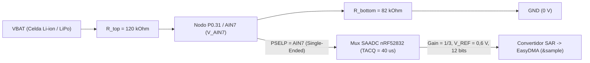
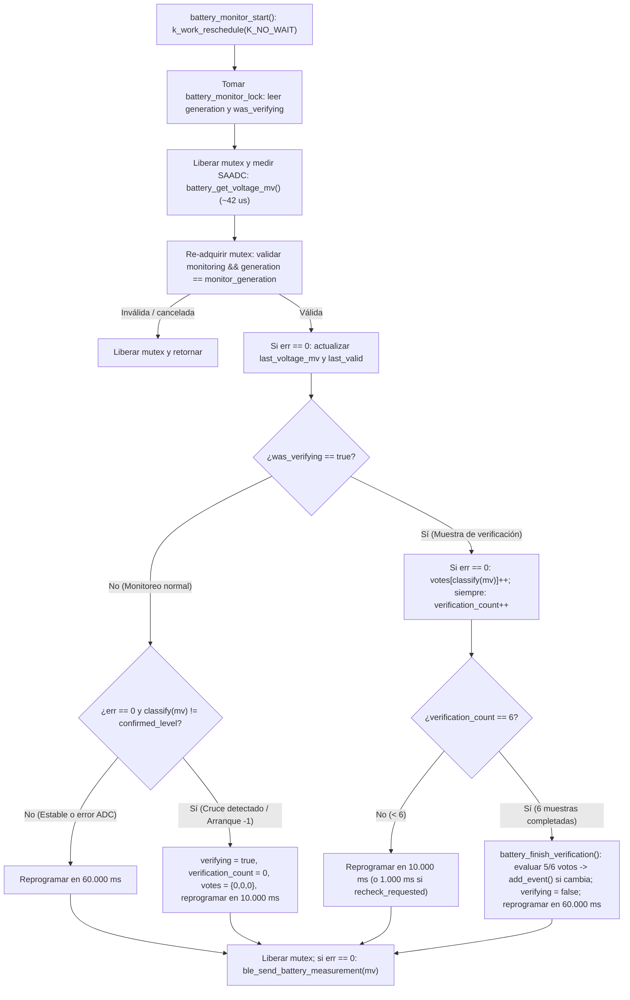
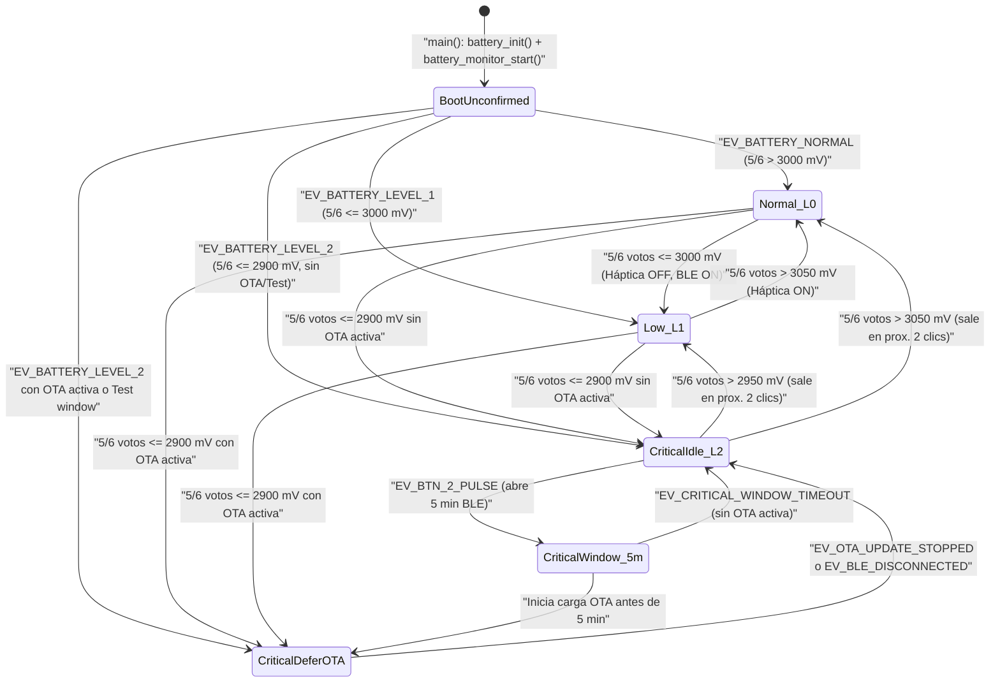

# 14. Batería y Gestión Energética

> **Capítulo del Manual Técnico Integral de Ingeniería del Producto — Firmware Joya**
> Navegación: [Índice General (README.md)](README.md) | Anterior: [13. Sistema Háptico](13_haptic_system.md) | Siguiente: [15. Memoria Flash y Persistencia](15_flash_persistence.md)

---

## 1. Visión General del Subsistema y Criterios Epistemológicos

En una pulsera autónoma de seguridad personal como Joya —carente de pantalla, indicadores luminosos visibles y puerto de alimentación permanente durante su uso cotidiano—, la supervisión de la batería (`VBAT`) y la política de degradación energética cumplen tres funciones críticas de ingeniería:

1. **Protección contra caída súbita de tensión (*brown-out*) bajo carga pulsada**: El motor vibrador ERM gobernado por el `DRV2605` demanda picos de corriente de decenas de miliamperios (~`50–120 mA`) muy superiores al consumo medio de la radio BLE (~`5–10 mA` de pico). Cuando la resistencia interna de la celda aumenta al final de la descarga, activar el motor háptico puede hundir instantáneamente `VBAT` por debajo del umbral de reinicio por *Power-On Reset / Brown-Out* del `nRF52832` (`1,7 V`), abortando una transmisión de emergencia o corrompiendo una operación en curso. Por ello, el firmware sacrifica primero la respuesta háptica (**Nivel 1**) conservando intacta la conectividad BLE y las alertas de emergencia.
2. **Preservación de reserva mínima y protección de integridad OTA en agotamiento crítico**: Al alcanzar el umbral crítico (**Nivel 2**), el dispositivo desconecta enlaces no esenciales y detiene la publicidad indefinida (`critical_idle`), pero **respeta cualquier transferencia OTA activa en Flash** hasta su detención o cierre y permite a la usuaria abrir deliberadamente **ventanas de rescate de 5 minutos** (`CRITICAL_WINDOW_MS`) mediante doble clic.
3. **Coordinación del arranque diferido**: En el commit documentado **`c1128e5d0c0d6f98be0a580d287c0926ca27f01f`**, la primera confirmación del nivel de batería tras un reinicio (`boot_battery_seen`) actúa además como compuerta que dispara automáticamente la publicidad de reconexión (`STATE_BONDED_DISCONNECTED`) cuando existe un `APP_ID` persistido y la batería no está en Nivel 2.

### 1.1. Inventario de Archivos Relacionados

| Archivo | Líneas clave | Rol técnico en el subsistema |
|---|---|---|
| [include/battery.h](../../include/battery.h) | `L1-36` | Constantes temporales (`60000 ms`, `10000 ms`, `1000 ms`), parámetros de votación (`6` muestras, `5` votos), umbrales efectivos (`3000 mV` / `2900 mV`), histéresis (`50 mV`) y contrato público del módulo. |
| [src/battery.c](../../src/battery.c) | `L1-385` | Inicialización SAADC, lectura síncrona y conversión entera con redondeo (`battery_get_voltage_mv`), clasificador con histéresis asimétrica (`battery_classify`), motor de verificación acumulada (`battery_finish_verification`), hilo de trabajo diferido (`battery_monitor_work_handler`) y sincronización por mutex/generación. |
| [boards/joya/joya_nrf52/joya_nrf52_nrf52832.dts](../../boards/joya/joya_nrf52/joya_nrf52_nrf52832.dts) | `L36-37`, `L82-88`, `L106-123` | Canal 0 del `SAADC` sobre `NRF_SAADC_AIN7` (`P0.31`), ganancia `1/3`, referencia interna `0,6 V`, `12` bits, adquisición `40 µs`; definición de `i2c0` con estados `default`/`sleep` y sensor `&temp`. |
| [boards/joya/joya_nrf52/joya_nrf52-pinctrl.dtsi](../../boards/joya/joya_nrf52/joya_nrf52-pinctrl.dtsi) | `L13-19` | Perfil `i2c0_sleep` con directiva `low-power-enable` para `SDA` (`P0.08`) y `SCL` (`P0.06`). |
| [nrf52dk_battery_adc.overlay](../../nrf52dk_battery_adc.overlay) | `L1-27` | Overlay idéntico de canal `SAADC` sobre `P0.31` (`A5`) para ensayos de inyección de batería en placa `nRF52 DK`. |
| [ota/battery_simulation/battery_simulation.ino](../../ota/battery_simulation/battery_simulation.ino) | `L1-81` | Firmware auxiliar sobre `ESP32` (`DAC1` en `GPIO25`, 8 bits, `0..3,3 V`) para emular en banco la salida del divisor `120 kΩ / 82 kΩ` hacia `AIN7`. |
| [src/app_state.c](../../src/app_state.c) | `L20`, `L42-54`, `L135-148`, `L177-194`, `L425-567`, `L598-605` | Reacción de la máquina de estados ante `EV_BATTERY_NORMAL`, `EV_BATTERY_LEVEL_1`, `EV_BATTERY_LEVEL_2`, `EV_CRITICAL_WINDOW_TIMEOUT`, `EV_OTA_UPDATE_STOPPED` y `EV_BLE_BATTERY_NOTIFY_ENABLED`. |
| [src/ble_driver.c](../../src/ble_driver.c) | `L28-30`, `L174-192`, `L379-391`, `L446-459`, `L695-738` | Definición GATT de `joya_battery_svc` (`...5300`), características `BATTERY_CHANGE` (`...5301`) y `BATTERY_MEASUREMENT` (`...5302`), descriptores CCC y serialización de payloads. |
| [src/haptics.c](../../src/haptics.c) | `L36`, `L201-255`, `L257-296`, `L681-691` | Compuerta atómica `haptics_allowed`, corte inmediato en `haptics_set_allowed(false)` y suspensión/reanudación `PM_DEVICE` sobre `i2c0`. |

> [!IMPORTANT]
> **Rigor epistemológico en este capítulo**:
> Se distingue de forma explícita entre: **(a) Comportamiento implementado** en el commit `c1128e5`, **(b) Intención de diseño** documentada en código/auditorías, **(c) Comportamiento inferido** matemáticamente o desde las hojas de datos del `nRF52832` y `DRV2605`, **(d) Código residual o no invocado en producción**, y **(e) Parámetros dependientes del esquemático físico de la PCB Joya o pendientes de perfilado experimental de corriente** (dado que el repositorio no contiene esquemáticos eléctricos ni capturas de analizador de potencia).

---

## 2. Circuito de Medición Analógica y Configuración del `SAADC`

### 2.1. Topología del Divisor Resistivo y Cadena de Señal

**(a) Comportamiento implementado / (b) Evidencia en código y herramientas de banco**: Tanto las constantes `BATTERY_R_TOP_KOHM = 120` y `BATTERY_R_BOTTOM_KOHM = 82` en [src/battery.c](../../src/battery.c) (`L15-16`), como el comentario de [nrf52dk_battery_adc.overlay](../../nrf52dk_battery_adc.overlay) (`L2`) y el simulador [ota/battery_simulation/battery_simulation.ino](../../ota/battery_simulation/battery_simulation.ino) (`L9-15`), confirman una red divisora resistiva pasiva conectada directamente entre el nodo positivo de la batería (`VBAT`), el pin analógico `P0.31` (`AIN7`) y masa (`GND`):



La relación de atenuación estática ideal del divisor resistivo es:

$$k_{\text{div}} = \frac{R_{\text{bottom}}}{R_{\text{top}} + R_{\text{bottom}}} = \frac{82\,\text{k}\Omega}{120\,\text{k}\Omega + 82\,\text{k}\Omega} = \frac{82}{202} = \frac{41}{101} \approx 0{,}40594059$$

Y su factor inverso de reconstrucción hacia `VBAT` es:

$$\frac{1}{k_{\text{div}}} = \frac{R_{\text{top}} + R_{\text{bottom}}}{R_{\text{bottom}}} = \frac{202}{82} = \frac{101}{41} \approx 2{,}46341463$$

### 2.2. Configuración Exacta del Periférico `SAADC` en Devicetree

En [boards/joya/joya_nrf52/joya_nrf52_nrf52832.dts](../../boards/joya/joya_nrf52/joya_nrf52_nrf52832.dts) (`L36-37`, `L106-119`) —resuelto en `build_joya/app/zephyr/zephyr.dts` (`L223-243`, `L668-669`) y replicado idénticamente en [nrf52dk_battery_adc.overlay](../../nrf52dk_battery_adc.overlay) (`L8-26`)—, el canal `0` del convertidor de aproximaciones sucesivas `SAADC` (`0x40007000`) se parametriza del siguiente modo:

| Propiedad Devicetree (`channel@0`) | Valor simbólico / binario en `zephyr.dts` | Registro hardware `NRF_SAADC->CH[0]` | Efecto eléctrico exacto |
|---|---|---|---|
| `io-channels = <&adc 0>` (`"battery"`) | `&adc 0x0` | Canal lógico `0` (`ADC_DT_SPEC_GET_BY_NAME`) | Vincula `battery_adc` en [src/battery.c](../../src/battery.c) (`L18-19`). |
| `zephyr,input-positive` | `NRF_SAADC_AIN7` (`<0x8>`) | `PSELP = 8` (`AIN7` $\rightarrow$ pin físico **`P0.31`**) | Conecta el terminal positivo del muestreador a `P0.31` (con el buffer digital GPIO desconectado). |
| *(Ausencia de `zephyr,input-negative`)* | Omitido (modo *single-ended*) | `PSELN = 0` (`NC`) y `CONFIG.MODE = 0` (`SE`) | Referencia internamente el terminal negativo del convertidor a `GND` del SoC. |
| `zephyr,reference` | `"ADC_REF_INTERNAL"` | `CONFIG.REFSEL = 0` (`Internal`) | Selecciona la referencia bandgap interna del `nRF52832`: $V_{\text{REF}} = \mathbf{0{,}6\,\text{V}}$ (`600 mV`). |
| `zephyr,gain` | `"ADC_GAIN_1_3"` | `CONFIG.GAIN = 1` (`Gain1_3`) | Atenúa la entrada por factor $G = \mathbf{1/3}$, fijando el fondo de escala en el pin `AIN7` en $V_{\text{FS,pin}} = \frac{0{,}6\,\text{V}}{1/3} = \mathbf{1{,}8\,\text{V}}$ (`1800 mV`). |
| `zephyr,resolution` | `<12>` (`<0xc>`) | `RESOLUTION = 2` (`12bit`) | Cuantización de **12 bits** ($2^{12} = 4096$ escalones sobre el rango positivo `0..1,8 V`). |
| `zephyr,acquisition-time` | `ADC_ACQ_TIME(ADC_ACQ_TIME_MICROSECONDS, 40)` (`<0x4028>`) | `CONFIG.TACQ = 5` (`40us`) | Tiempo de cierre del interruptor de muestreo $t_{\text{ACQ}} = \mathbf{40\,\mu\text{s}}$ (el máximo admitido por el silicio `nRF52832`). |
| *(Ausencia de `zephyr,oversampling`)* | Omitido (`0`) | `OVERSAMPLE = 0` (`Bypass`), `CONFIG.BURST = 0` | Una única conversión física por llamada a `adc_read_dt()` ($t_{\text{total}} \approx 40\,\mu\text{s} + 2\,\mu\text{s} = \mathbf{42\,\mu\text{s}}$). |

#### Verificación de márgenes eléctricos de entrada

- **Fondo de escala equivalente en `VBAT`**:
  $$V_{\text{FS,VBAT}} = V_{\text{FS,pin}} \cdot \frac{202}{82} = 1800\,\text{mV} \times \frac{202}{82} = \frac{363\,600}{82}\,\text{mV} \approx \mathbf{4434{,}15\,\text{mV}} \approx 4{,}434\,\text{V}$$
- **Tensión máxima en `P0.31` a plena carga LiPo ($V_{\text{BAT}} = 4{,}20\,\text{V}$)**:
  $$V_{\text{AIN7}}(4{,}20\,\text{V}) = 4200\,\text{mV} \times \frac{82}{202} \approx \mathbf{1704{,}95\,\text{mV}} < 1800\,\text{mV}$$
  Esto deja un margen seguro de `~95 mV` en el pin (`~234 mV` en `VBAT`) antes de saturar el convertidor en `4095` cuentas, y cumple simultáneamente la restricción absoluta de entradas analógicas del `nRF52832` ($V_{\text{AIN7}} \le V_{\text{DD}} + 0{,}3\,\text{V}$ y $V_{\text{AIN7}} \le V_{\text{DD}}$ para linealidad nominal SAADC), ya que cuando `VDD` es alimentado directamente por `VBAT` (o regulado por encima de `1,8 V`), $0{,}4059 \cdot V_{\text{BAT}} \ll V_{\text{DD}}$ en todo el rango operativo.

---

## 3. Deducción Matemática Paso a Paso de `battery_get_voltage_mv()`

La función `battery_get_voltage_mv(int32_t *voltage_mv)` en [src/battery.c](../../src/battery.c) (`L74-107`) realiza la adquisición síncrona y transforma la cuenta digital en milivoltios de batería mediante aritmética entera pura:

```c
int16_t sample;
int32_t adc_mv;
struct adc_sequence sequence = {
	.buffer = &sample,
	.buffer_size = sizeof(sample),
};
/* ... validaciones ... */
adc_sequence_init_dt(&battery_adc, &sequence);
err = adc_read_dt(&battery_adc, &sequence);
/* ... */
adc_mv = sample;
err = adc_raw_to_millivolts_dt(&battery_adc, &adc_mv);
/* ... */
*voltage_mv = (adc_mv * (BATTERY_R_TOP_KOHM + BATTERY_R_BOTTOM_KOHM) +
	       BATTERY_R_BOTTOM_KOHM / 2) / BATTERY_R_BOTTOM_KOHM;
```

### 3.1. Etapa 1: De Cuenta Cruda `sample` (`int16_t`) a `adc_mv` (`int32_t`) en el Pin `AIN7`

1. **Formato de salida del hardware `SAADC`**: EasyDMA escribe un entero con signo en complemento a dos de 16 bits (`int16_t sample`, `2 bytes`). Para una tensión ideal $V_{\text{AIN7}} \in [0,\, 1800\,\text{mV})$, el convertidor SAR produce:
   $$\text{sample} \approx \left\lfloor \frac{V_{\text{AIN7}}}{V_{\text{REF}} / G} \cdot 2^{12} \right\rfloor = \left\lfloor \frac{V_{\text{AIN7}}\text{ [mV]}}{1800} \times 4096 \right\rfloor$$

2. **Transformación dentro de `adc_raw_to_millivolts_dt(&battery_adc, &adc_mv)`**:
   En Zephyr `4.2.0` (`include/zephyr/drivers/adc.h`), `adc_sequence_init_dt` y `adc_raw_to_millivolts_dt` toman `vref_mv = 600` (`adc_ref_internal`), aplican la inversión de `ADC_GAIN_1_3` multiplicando `*valp` (`adc_mv`) por `3`, y dividen por $2^{\text{resolution}} = 2^{12} = 4096$ (ya que el canal es *single-ended*, `differential == false`):
   $$\texttt{adc\_mv} = \text{trunc}\left( \frac{\texttt{sample} \times 600 \times 3}{4096} \right) = \text{trunc}\left( \frac{1800 \cdot \texttt{sample}}{4096} \right) = \text{trunc}\left( \frac{225 \cdot \texttt{sample}}{512} \right)\;\text{[mV]}$$

3. **Resoluciones unitarias (peso del LSB)**:
   - **En el pin `AIN7`**:
     $$\Delta V_{\text{pin}} = \frac{1800\,\text{mV}}{4096\,\text{LSB}} = \frac{225}{512}\,\text{mV/LSB} \approx \mathbf{0{,}439453\,\text{mV/LSB}}$$
   - **Referida a `VBAT` (antes de redondeo entero)**:
     $$\Delta V_{\text{VBAT}} = \Delta V_{\text{pin}} \cdot \frac{202}{82} = \frac{1800}{4096} \cdot \frac{202}{82} = \frac{363\,600}{335\,872}\,\text{mV/LSB} \approx \mathbf{1{,}082555\,\text{mV/LSB}}$$

4. **Caso borde crítico: cuentas crudas negativas (`sample < 0`) en modo *single-ended*** (**categoría (a), hallazgo `N-14` en [docs/auditorias/Avances.md](../../docs/auditorias/Avances.md)**):
   Aunque el canal esté configurado en modo *single-ended* (`PSELN = NC`), el núcleo interno del `SAADC` del `nRF52832` es diferencial y compara `AIN7` contra la referencia interna de masa. Cuando la entrada se sitúa muy próxima a `0 V` (p. ej., durante ensayos de banco en `nRF52 DK` con la entrada puesta a masa o desconectada), el *offset* del comparador genera legítimamente cuentas negativas pequeñas (p. ej., `sample = -1` a `-15`).
   - `adc_raw_to_millivolts_dt()` acepta valores negativos en `int32_t` y devuelve `0` (éxito); para `sample = -3`, calcula `adc_mv = (-3 * 1800) / 4096 = -1` mV (y para `sample = -10`, `adc_mv = -4` mV).
   - Al no saturar `if (sample < 0) sample = 0;` ni `if (adc_mv < 0) adc_mv = 0;`, se producen **dos efectos anómalos**:
     1. **Sesgo de redondeo invertido en la Etapa 2**: sumar `+ 41` a un numerador negativo en división truncada hacia cero redondea en dirección equivocada (`(-1 * 202 + 41) / 82 = -161 / 82 = -1` mV en vez de `-2` mV).
     2. **Supresión silenciosa de notificaciones GATT `BATTERY_MEASUREMENT`**: `voltage_mv < 0` se almacena en `last_voltage_mv` y `battery_classify()` lo clasifica correctamente como `BATTERY_STATE_LEVEL_2` (`-1 <= 2900`), pero al invocar `ble_send_battery_measurement(voltage_mv)` en [src/ble_driver.c](../../src/ble_driver.c) (`L705-708`), la guarda `if (value < 0 || value > UINT16_MAX) return -EINVAL;` **descarta la muestra sin notificar `0 mV` a la aplicación**. *(En una pulsera real alimentada desde `VBAT`, el propio `nRF52832` se apaga por debajo de `1,7 V` $\leftrightarrow$ `sample` $\approx 1570$, por lo que este borde solo se manifiesta en simulaciones de laboratorio o si se abriese la soldadura de `R_top` hacia `VBAT` alimentando el SoC por otra vía).*

### 3.2. Etapa 2: Inversión Entera del Divisor con Redondeo Simétrico al Milivoltio

Partiendo de `adc_mv` $\ge 0$, se desea calcular:

$$V_{\text{BAT}} = \text{adc\_mv} \cdot \frac{R_{\text{top}} + R_{\text{bottom}}}{R_{\text{bottom}}} = \frac{202 \cdot \text{adc\_mv}}{82}$$

En lenguaje C (estándar C99, `CONFIG_STD_C99=y`), el operador `/` entre enteros positivos trunca la parte fraccionaria ($\lfloor N / D \rfloor$), lo cual introduciría un error sistemático de hasta $-\frac{81}{82}\,\text{mV} \approx -0{,}988\,\text{mV}$. Para obtener el **entero más cercano** (*round half up* para $N \ge 0$ y divisor positivo par $D = 2k$):

$$\text{round}\left(\frac{N}{D}\right) = \left\lfloor \frac{N}{D} + \frac{1}{2} \right\rfloor = \left\lfloor \frac{N + D/2}{D} \right\rfloor$$

Como `BATTERY_R_BOTTOM_KOHM = 82` es **exactamente par**, `BATTERY_R_BOTTOM_KOHM / 2 = 41` no sufre truncamiento entero y la expresión de [src/battery.c](../../src/battery.c) (`L104-105`) resulta algebraicamente exacta:

$$\texttt{*voltage\_mv} = \left\lfloor \frac{202 \cdot \texttt{adc\_mv} + 41}{82} \right\rfloor$$

- **Ausencia total de desbordamiento (`int32_t`)**: Incluso para la cuenta positiva máxima teórica de 12 bits (`sample = 4095` $\rightarrow$ `adc_mv = 1799` mV; o incluso `int16_t` máximo `32767` $\rightarrow$ `adc_mv = 14399` mV), el numerador alcanza $202 \times 1799 + 41 = 363\,439 \ll 2^{31} - 1$ (`2.147.483.647`), descartando cualquier riesgo de *signed integer overflow*.
- **Cuantización en cascada (truncamiento en Etapa 1 + redondeo en Etapa 2)**: Dado que Zephyr trunca `adc_mv` a milivoltios enteros antes de multiplicar por `202 / 82` ($\approx 2{,}4634$), los escalones de salida `voltage_mv` avanzan de a `+2 mV` o `+3 mV` por cada `+1 mV` de `adc_mv`, con un sesgo medio de cuantización de $\approx -0{,}5\,\text{mV} \times 2{,}4634 \approx \mathbf{-1{,}2\,\text{mV}}$ respecto de una conversión unificada en un solo paso desde `sample`.

#### Tabla de verificación numérica punto a punto

| Punto operativo | $V_{\text{BAT}}$ real | $V_{\text{AIN7}}$ ideal | `sample` ideal (`12 b`) | `adc_mv` (`trunc`) | `(202 * adc_mv + 41) / 82` | Error de cuantización digital |
|---|---:|---:|---:|---:|---:|---:|
| Plena carga LiPo | `4200 mV` | `1704,95 mV` | `3879` | `1704 mV` | **`4198 mV`** | `-2 mV` |
| Tensión nominal LiPo | `3700 mV` | `1501,98 mV` | `3417` | `1501 mV` | **`3698 mV`** | `-2 mV` |
| Umbral histéresis Niv. 1 | `3050 mV` | `1238,12 mV` | `2817` | `1237 mV` | **`3047 mV`** (`sample=2819` $\to$ `3050 mV`) | `-3 mV` |
| **Umbral Nivel 1 (`BATTERY_LEVEL_1_MV`)** | **`3000 mV`** | `1217,82 mV` | `2771` | `1217 mV` | **`2998 mV`** (`sample=2773` $\to$ `3000 mV`) | `-2 mV` |
| Umbral histéresis Niv. 2 | `2950 mV` | `1197,52 mV` | `2725` | `1197 mV` | **`2949 mV`** (`sample=2726` $\to$ `2951 mV`) | `-1 mV` |
| **Umbral Nivel 2 (`BATTERY_LEVEL_2_MV`)** | **`2900 mV`** | `1177,23 mV` | `2678` | `1176 mV` | **`2897 mV`** (`sample=2681` $\to$ `2902 mV`) | `-3 mV` |
| Entrada `0 V` sin offset | `0 mV` | `0,00 mV` | `0` | `0 mV` | **`0 mV`** | `0 mV` |
| Entrada `0 V` con offset negativo | `0 mV` | `-2,20 mV` | `-5` | `-2 mV` | **`-4 mV`** *(falla envío GATT)* | Sesgo `+41` / sin *clamp* |

### 3.3. Presupuesto de Incertidumbre, Calibración e Impedancia de Fuente

**(a, c, e) Análisis metrológico del canal de medición**:

1. **Tolerancia de la referencia interna `0,6 V` (`ADC_REF_INTERNAL`)**: Según la *Product Specification* del `nRF52832`, la referencia interna tiene una tolerancia de **$\pm 1{,}5\,\%$** ($\approx \pm 45\,\text{mV}$ referidos a `VBAT = 3000 mV`).
2. **Error de ganancia (`ADC_GAIN_1_3`) y no linealidad integral (`INL`)**: El atenuador capacitivo interno `1/3` presenta un error de ganancia típico dentro de $\pm 0{,}5\,\%$ a $25\,^\circ\text{C}$ y hasta $\pm 2\,\% \dots \pm 3\,\%$ en todo el rango térmico industrial, con $\text{INL} \approx \pm 2\text{ a }\pm 3\,\text{LSB}$ (`~3 mV`).
3. **Ausencia de calibración de *offset* por software (`TASKS_CALIBRATEOFFSET`)**: Ni `battery_init()` ni `battery_get_voltage_mv()` activan `sequence.calibrate = true` ([src/battery.c](../../src/battery.c) `L78-92`). En el `nRF52832`, el *offset* residual sin calibrar del `SAADC` puede alcanzar varios LSB y derivar con la temperatura ($\approx 0{,}2\,\text{LSB}/^\circ\text{C}$), aportando típicamente $\pm 5\text{ a }\pm 15\,\text{mV}$ en `VBAT`.
4. **Tolerancia de las resistencias externas `120 kΩ` y `82 kΩ` (categoría *e*, dependiente del BOM)**: El repositorio no incluye lista de materiales. Si las resistencias son de precisión estándar **$\pm 1\,\%$**, el peor caso diferencial ($R_{\text{top}}$ en $+1\,\%$ y $R_{\text{bottom}}$ en $-1\,\%$, o viceversa) desvía la ganancia del divisor en $\approx \pm 1{,}19\,\%$ ($\mathbf{\pm 35{,}7\,\text{mV}}$ a `3000 mV`). Con resistencias de **$\pm 0{,}1\,\%$**, este término cae a $\pm 3{,}6\,\text{mV}$.
5. **Impedancia equivalente de Thévenin frente al tiempo de adquisición `TACQ = 40 µs`**:
   La impedancia vista por el pin `AIN7` hacia el divisor resistivo es el paralelo de ambas ramas:
   $$R_{\text{Th}} = R_{\text{top}} \parallel R_{\text{bottom}} = \frac{120\,\text{k}\Omega \times 82\,\text{k}\Omega}{120\,\text{k}\Omega + 82\,\text{k}\Omega} = \frac{9840}{202}\,\text{k}\Omega \approx \mathbf{48{,}713\,\text{k}\Omega}$$
   En la hoja de datos del `nRF52832` (*SAADC electrical specification*), Nordic especifica una resistencia máxima de fuente recomendada de **$R_{\text{source,max}} = 40\,\text{k}\Omega$ para `TACQ = 40 µs`** (`10 kΩ` para `10 µs`, `20 kΩ` para `15 µs`). Con $48{,}71\,\text{k}\Omega$, el circuito supera en un `21,8 %` el tope tabulado sin condensador externo:
   - **Si la PCB Joya incorpora un capacitor cerámico $C_{\text{filt}}$ (p. ej. `10 nF`–`100 nF`) entre `P0.31` y `GND` (categoría *e*)**: $C_{\text{filt}} \gg 4096 \cdot C_{\text{sample}}$ actúa como reservorio de baja impedancia instantánea, anulando por completo el error de carga de `TACQ` y filtrando el rizado de conmutación de radio/motor (con constante de tiempo $\tau = R_{\text{Th}} C_{\text{filt}} \approx 4{,}9\,\text{ms}$ para `100 nF`).
   - **Si no existe $C_{\text{filt}}$ externo**: El asentamiento RC durante `40 µs` sigue alcanzando $> 8$ constantes de tiempo del capacitor interno de muestreo ($\sim 2{,}5\,\text{pF}$), pero la fuga finita de los conmutadores CMOS del multiplexor en alta impedancia puede provocar una leve subestimación adicional de pocos milivoltios.
6. **Nota sobre la herramienta de banco [ota/battery_simulation/battery_simulation.ino](../../ota/battery_simulation/battery_simulation.ino)**: El simulador sobre `ESP32` utiliza un DAC de **8 bits** (`0..255` sobre `3,3 V`), cuyo escalón mínimo es $\Delta V_{\text{DAC}} = 3300 / 255 \approx 12{,}94\,\text{mV}$ en `AIN7`, lo que equivale a saltos gruesos de **`~31,88 mV` en `VBAT` simulada** (más la no linealidad propia del DAC del ESP32 cerca de los extremos). Esto debe tenerse presente al ensayar la banda de histéresis de `50 mV` (`< 2` escalones del DAC del ESP32).

---

## 4. Algoritmo de Monitoreo, Histéresis Asimétrica, Votación y Concurrencia

### 4.1. Umbrales Efectivos en `c1128e5` vs. Valores Comentados y Documentación Previa

**(a) Comportamiento implementado vs. (d) Comentarios residuales y docs antiguos**: En [include/battery.h](../../include/battery.h) (`L12-16`), las macros compiladas en el firmware son:

```c
#define BATTERY_LEVEL_1_MV              3000//3500
#define BATTERY_LEVEL_2_MV              2900//3400
#define BATTERY_HYSTERESIS_MV           50
```

> [!WARNING]
> **Discrepancia documental verificada**: Documentos históricos del repositorio como [otros/docs/otros/MANUAL_FIRMWARE.md](../../otros/docs/otros/MANUAL_FIRMWARE.md) (`L225, L347`) aún citan `3500 mV` y `3400 mV` (conservados como comentarios en línea `//3500` y `//3400` en `include/battery.h`). **En el binario real de `c1128e5`, los umbrales activos son `3000 mV` (`3,00 V`) para Nivel 1 y `2900 mV` (`2,90 V`) para Nivel 2.** Desde el punto de vista electroquímico de una celda secundaria LiPo de `3,7 V` nominales (`4,20 V` llena), `3,50 V` correspondía aún a ~`15–25 %` de carga remanente, mientras que `3,00 V` y `2,90 V` se ubican ya en la rodilla final de descarga rápida (`< 3–5 %` de capacidad útil).

### 4.2. Clasificador con Histéresis Asimétrica (`battery_classify()`)

La función `battery_classify(int32_t voltage_mv)` en [src/battery.c](../../src/battery.c) (`L110-130`) clasifica cada muestra individual aplicando el margen `BATTERY_HYSTERESIS_MV` (`+50 mV`) **únicamente en dirección ascendente respecto de los umbrales ya alcanzados por `confirmed_level`**:

```c
if (voltage_mv <= BATTERY_LEVEL_2_MV +
	(confirmed_level >= BATTERY_STATE_LEVEL_2 ? BATTERY_HYSTERESIS_MV : 0)) {
	return BATTERY_STATE_LEVEL_2;
}
if (voltage_mv <= BATTERY_LEVEL_1_MV +
	(confirmed_level >= BATTERY_STATE_LEVEL_1 ? BATTERY_HYSTERESIS_MV : 0)) {
	return BATTERY_STATE_LEVEL_1;
}
return BATTERY_STATE_NORMAL;
```

Obsérvese un detalle matemático fundamental de la condición `confirmed_level >= BATTERY_STATE_LEVEL_1`: cuando el sistema está en `BATTERY_STATE_LEVEL_2` (`2`), **ambas desigualdades `confirmed_level >= 2` y `confirmed_level >= 1` son verdaderas simultáneamente**. Por lo tanto, los intervalos exactos de clasificación de cada muestra según el estado confirmado actual son:

| `confirmed_level` actual | Rango que vota `BATTERY_STATE_LEVEL_2` (`2`) | Rango que vota `BATTERY_STATE_LEVEL_1` (`1`) | Rango que vota `BATTERY_STATE_NORMAL` (`0`) |
|---|---|---|---|
| `BATTERY_STATE_UNKNOWN` (`-1`, arranque) | `voltage_mv <= 2900 mV` | `2901 mV .. 3000 mV` | `voltage_mv >= 3001 mV` |
| `BATTERY_STATE_NORMAL` (`0`) | `voltage_mv <= 2900 mV` | `2901 mV .. 3000 mV` | `voltage_mv >= 3001 mV` |
| `BATTERY_STATE_LEVEL_1` (`1`) | `voltage_mv <= 2900 mV` *(sin histéresis hacia abajo)* | `2901 mV .. 3050 mV` *(retiene Nivel 1 hasta superar `3050 mV`)* | `voltage_mv >= 3051 mV` |
| `BATTERY_STATE_LEVEL_2` (`2`) | `voltage_mv <= 2950 mV` *(retiene Nivel 2 hasta superar `2950 mV`)* | `2951 mV .. 3050 mV` *(sube a Nivel 1, aún exige `> 3050 mV` para Normal)* | `voltage_mv >= 3051 mV` |

### 4.3. Máquina de Monitoreo Periódico y Ventana de Votación Acumulada (`5` de `6` Muestras)

Para inmunizar a la FSM contra caídas transitorias $I \cdot R_{\text{int}}$ producidas por una ráfaga de radio o una vibración puntual del motor ERM, ninguna muestra aislada modifica `confirmed_level`. El manejador `battery_monitor_work_handler()` ([src/battery.c](../../src/battery.c) `L210-304`) opera en dos regímenes sobre `sysworkq`:



#### Reglas exactas de acumulación de votos en `battery_finish_verification()` ([src/battery.c](../../src/battery.c) `L132-208`)

Al completarse `verification_count == BATTERY_VERIFY_SAMPLES` (`6`), el vector `votes[3]` (`{votes_normal, votes_level1, votes_level2}`, cuya suma es `<= 6` porque una lectura SAADC fallida `err < 0` incrementa `verification_count` sin sumar voto) se evalúa en tres etapas estrictamente ordenadas:

1. **Evaluación de caída hacia niveles más severos (`level > confirmed_level`)** mediante `votes_at_or_below(level)`:
   - Primero comprueba el peor caso `BATTERY_STATE_LEVEL_2`: exige `votes[2] >= 5`.
   - Si no alcanza, y `confirmed_level < BATTERY_STATE_LEVEL_1`, comprueba `BATTERY_STATE_LEVEL_1`: exige **`votes[1] + votes[2] >= 5`**.
   - *Razonamiento de ingeniería*: una muestra que cayó hasta Nivel 2 (`<= 2900 mV`) ciertamente también está por debajo del umbral de Nivel 1 (`<= 3000 mV`). Así, si durante una descarga rápida se obtienen `3` muestras en Nivel 1 y `2` muestras en Nivel 2 (`votes = {1, 3, 2}`), aunque Nivel 2 no reúne 5 votos (`2 < 5`), la suma acumulada hacia abajo es `3 + 2 = 5 >= 5`, confirmando inmediatamente **`EV_BATTERY_LEVEL_1`** en lugar de descartar la ventana por fragmentación de votos.

2. **Evaluación de recuperación hacia niveles superiores (`level < confirmed_level`)** mediante `votes_at_or_above(level)`:
   - Solo se ejecuta si la etapa anterior no seleccionó transición (`next == BATTERY_STATE_UNKNOWN`) y `confirmed_level > 0`.
   - Comprueba primero recuperación total a `BATTERY_STATE_NORMAL` (`0`): exige `votes[0] >= 5` (`> 3050 mV`).
   - Si no alcanza y `confirmed_level == BATTERY_STATE_LEVEL_2` (`2`), comprueba subida parcial a `BATTERY_STATE_LEVEL_1` (`1`): exige **`votes[0] + votes[1] >= 5`** (`> 2950 mV`). De este modo, si una batería crítica sube a ~`3040..3060 mV` repartiendo votos `{3, 3, 0}`, logra al menos salir de `LEVEL_2` hacia `LEVEL_1` (`3 + 3 = 6 >= 5`).

3. **Caso especial de arranque inicial (`confirmed_level == BATTERY_STATE_UNKNOWN = -1`)**:
   - Si las etapas 1 y 2 no asignaron `next` (porque en el arranque la etapa 1 solo inspecciona `LEVEL_2` y `LEVEL_1`, y la etapa 2 no entra porque `0 < -1` es falso), la línea `192-195` evalúa `votes[BATTERY_STATE_NORMAL] >= 5` para confirmar el `EV_BATTERY_NORMAL` inicial.
   - **Persistencia ante cola llena (`L205-207`)**: `confirmed_level` solo se actualiza a `next` si `add_event(battery_event_for_level(next)) == 0`. Si `event_queue` estuviese llena (`-ENOMSG`), `confirmed_level` conserva el valor anterior para que el siguiente ciclo de `60 s` vuelva a detectar discrepancia y reintente publicar el evento.

#### Cronograma exacto tras el arranque y caso borde de votación inicial inconclusa

**(a) Comportamiento implementado**: Cuando `main()` invoca `battery_monitor_start()` ([src/main.c](../../src/main.c) `L78`), la primera ejecución en `t = 0 s` **no** pertenece aún a una ventana de verificación (`was_verifying == false`), sino que actúa únicamente como **muestra disparadora**:

```text
t =  0,0 s : Muestra #0 (disparadora). confirmed_level == -1 != classify(mv).
             Activa verifying = true, verification_count = 0, votes = {0,0,0}. (NO suma voto).
t = 10,0 s : Muestra #1 de verificación (verification_count = 1).
t = 20,0 s : Muestra #2 de verificación (verification_count = 2).
t = 30,0 s : Muestra #3 de verificación (verification_count = 3).
t = 40,0 s : Muestra #4 de verificación (verification_count = 4).
t = 50,0 s : Muestra #5 de verificación (verification_count = 5).
t = 60,0 s : Muestra #6 de verificación (verification_count = 6) -> battery_finish_verification()
             -> Encola primer EV_BATTERY_* -> FSM activa boot_battery_seen e inicia advertising!
```

> [!IMPORTANT]
> **Consecuencia temporal sobre la reconexión post-reset y frontera inconclusa (`N-14` en [docs/auditorias/Avances.md](../../docs/auditorias/Avances.md))**:
> 1. En condiciones normales de batería estable, **transcurren ~`60 segundos` desde cada arranque o reinicio por Watchdog hasta que la FSM recibe el primer evento confirmado de batería** y arranca automáticamente la publicidad BLE de reconexión (`boot_reconnect_pending` en [src/app_state.c](../../src/app_state.c) `L429-475`).
> 2. **Frontera inconclusa entre Normal y Nivel 1 en el arranque**: Si durante esos primeros `60 s` la tensión de la celda oscila justo sobre `3000 mV` produciendo, por ejemplo, `4` muestras de `3002 mV` (`NORMAL`) y `2` muestras de `2998 mV` (`LEVEL_1`) $\rightarrow$ `votes = {4, 2, 0}`:
>    - `votes_at_or_below(LEVEL_2)` = `0 < 5`.
>    - `votes_at_or_below(LEVEL_1)` = `2 + 0 = 2 < 5`.
>    - Caso inicial `votes[NORMAL]` = `4 < 5` (*aquí los votos `NORMAL` no se acumulan con `LEVEL_1`*).
>    Resultado: `next` permanece en `BATTERY_STATE_UNKNOWN (-1)`, `verifying` pasa a `false` y el monitor espera **`60 s` completos** hasta `t = 120 s` (nueva muestra disparadora sin voto) más otros `60 s` (`t = 130..180 s`), demorando el primer evento de batería y el auto-advertising al menos hasta **`t = 180 s`** (`3 minutos`).

### 4.4. Sincronización, Orden de Locks y `monitor_generation`

El diseño concurrente de [src/battery.c](../../src/battery.c) evita condiciones de carrera e inversiones de prioridad mediante tres mecanismos coordinados (véase [06_concurrency.md](06_concurrency.md)):

1. **Liberación del mutex durante la conversión SAADC y contador `monitor_generation`** (`L219-239`):
   `battery_monitor_work_handler` toma `battery_monitor_lock`, captura copias locales de `generation = monitor_generation` y `was_verifying = verifying`, y **suelta el mutex antes de llamar `battery_get_voltage_mv()`**. Si otro hilo invocase `battery_monitor_stop()`, `battery_monitor_start()` o `battery_request_recheck()` justo mientras `sysworkq` esperaba al `SAADC`, dicho hilo incrementaría `monitor_generation++` sin bloquearse en el ADC; al retomar `battery_monitor_work_handler` el mutex en `L235`, detecta `!monitoring || generation != monitor_generation` y descarta limpiamente la medición obsoleta sin corromper `votes[]` ni reprogramar un timer cancelado.
2. **Prevención de interbloqueo (*deadlock*) con `conn_mutex`** (`L298-303`):
   `ble_send_battery_measurement(voltage_mv)` adquiere internamente `conn_mutex` en [src/ble_driver.c](../../src/ble_driver.c) (`L383`). Por ello, `battery_monitor_work_handler` **libera primero `battery_monitor_lock` en `L298`** antes de notificar por BLE, garantizando que nunca se aniden `battery_monitor_lock` y `conn_mutex`.
3. **Variables atómicas sin lock para consultas rápidas** (`L21-23`): `initialized`, `last_valid` y `last_voltage_mv` emplean `atomic_t` (`atomic_get` / `atomic_set`).

### 4.5. Funciones y Eventos Implementados pero No Invocados en Producción (Categoría *d*)

En el corte `c1128e5`, cuatro funciones públicas de [src/battery.c](../../src/battery.c) y un evento de la FSM existen completos y funcionales en el binario, pero carecen de llamadores activos en producción:

| Símbolo | Ubicación | Comportamiento implementado y propósito previsto |
|---|---|---|
| `battery_request_recheck()` | [src/battery.c](../../src/battery.c) `L357-375` | Incrementa `monitor_generation`, activa `verifying = true` y `recheck_requested = true`, limpia `votes` y reprograma `battery_monitor_work` con `K_NO_WAIT` para tomar `6` muestras rápidas espaciadas **`1000 ms`** (`BATTERY_RECHECK_INTERVAL_MS`, total `~5 s`), publicando al terminar `EV_BATTERY_RECHECK_DONE`. Diseñada como infraestructura para validar tensión fresca antes de despertar desde suspensión crítica, pero no invocada actualmente por `app_state.c`. |
| `battery_get_recheck_level()` | [src/battery.c](../../src/battery.c) `L377-385` | Devuelve el resultado fresco `recheck_level` (`0`, `1`, `2`, o `-ENODATA` si no hubo mayoría `5/6`). Sin llamadores en `src/`. |
| `EV_BATTERY_RECHECK_DONE` | [src/app_state.c](../../src/app_state.c) `L479-481` | En `process_event()` ejecuta únicamente `if (event == EV_BATTERY_RECHECK_DONE) { return; }`. |
| `battery_monitor_stop()` | [src/battery.c](../../src/battery.c) `L328-341` | Detiene el monitoreo y cancela `battery_monitor_work`. Nunca se invoca (el monitor corre ininterrumpidamente desde `main()` incluso durante `suspended_idle` y `critical_idle`, lo cual es necesario para detectar recuperación de carga). |
| `battery_get_last_voltage_mv()` | [src/battery.c](../../src/battery.c) `L344-355` | Lee `last_voltage_mv` si `last_valid == 1` (`-ENODATA` antes de `t = 0`). Nunca es llamada fuera de pruebas potenciales. |

---

## 5. Políticas Funcionales, Transiciones FSM y Notificaciones GATT por Nivel

### 5.1. Matriz Completa de Comportamiento por Estado Energético

| Fase / Nivel confirmado | Condición de entrada / salida (`VBAT`) | Háptica (`DRV2605` / `ERM`) | Publicidad y Conexión BLE | Rutinas y Emergencias | Acceso y Carga OTA (`SMP`) |
|---|---|---|---|---|---|
| **Fase de Arranque (Sin confirmar, `t = 0..60 s`)** | `battery_level == -1` (`boot_battery_seen == false`) | **Pre-habilitación condicional en `battery_init()`** ([src/battery.c](../../src/battery.c) `L67-70`): 1 lectura puntual habilita `haptics_set_allowed(true)` **solo si `> 3000 mV`**. | En imagen confirmada permanece en `STATE_UNPAIRED` sin publicitar salvo gesto manual (2 o 3 clics); en imagen Test publicita de inmediato. | Gestos manuales operativos si la usuaria interactúa antes de los `60 s`. | Permitido si la usuaria conecta y autentica manualmente (o en arranque Test). |
| **Nivel 0 — Normal (`EV_BATTERY_NORMAL`)** | Entrada inicial: `>= 5/6` muestras `> 3000 mV`. Recuperación desde Niv. 1 o 2: `>= 5/6` muestras **`> 3050 mV`**. | **Habilitada** (`haptics_set_allowed(true)` si `!critical_idle`). | Operación plena. Si `boot_reconnect_pending == true`, pasa automáticamente a `STATE_BONDED_DISCONNECTED` e inicia advertising + iBeacon ([src/app_state.c](../../src/app_state.c) `L462-475`). | Operación plena (`1 clic`, `0,5..5 s`, `3+ clics`, comandos remotos). | Habilitación dinámica normal vía `0x70` / `0x71`. |
| **Nivel 1 — Batería Baja (`EV_BATTERY_LEVEL_1`)** | Caída desde Normal: `>= 5/6` muestras `<= 3000 mV` (con `< 5` en `<= 2900 mV`). Subida desde Niv. 2: `>= 5/6` muestras **`> 2950 mV`** (con `< 5` en `> 3050 mV`). | **Deshabilitada por completo** (`haptics_set_allowed(false)`): detiene en el acto cualquier patrón activo y ejecuta su callback `completion` para no bloquear cierres de gestos ([src/haptics.c](../../src/haptics.c) `L681-691`). | **100 % operativa** (mantiene conexión, reconexión automática post-boot e iBeacon). | **100 % operativas** por BLE/NVS (los gestos se procesan y transmiten aunque no vibre el motor). | **Permitido** (el protocolo firmware no bloquea `0x70` en Nivel 1). |
| **Nivel 2 — Batería Crítica en Reposo (`EV_BATTERY_LEVEL_2` $\to$ `critical_idle`)** | Caída: `>= 5/6` muestras **`<= 2900 mV`** (permanece mientras no reúna `5/6` `> 2950 mV`). | **Deshabilitada** (`haptics_set_allowed(false)`). | `enter_critical_idle()` ([src/app_state.c](../../src/app_state.c) `L135-148`): activa `critical_idle = true` y `suspended_idle = true`, pasa a `STATE_UNPAIRED`, **desconecta BLE y apaga advertising + iBeacon**. | **Restricción severa (`N-02`)**: mientras `suspended_idle == true`, la guarda de `L562-567` **ignora `EV_BTN_1_PULSE`, `EV_BTN_LONG_PRESS` y `EV_BTN_EMERGENCY` (3 clics)**; solo admite `EV_BTN_2_PULSE` y `FACTORY_RESET` (`15 s`). | Si **ya había una carga OTA activa** (`uploading \|\| upload_complete`), **no desconecta**: difiere `enter_critical_idle()` hasta `EV_OTA_UPDATE_STOPPED` o `EV_BLE_DISCONNECTED` (`L453-461, 506-514, 603-604`). |
| **Nivel 2 — Ventana Crítica Activa (`critical_window_open == true`)** | Doble clic (`EV_BTN_2_PULSE`) estando en Nivel 2 desconectado ([src/app_state.c](../../src/app_state.c) `L520-538`) o arranque de imagen Test (`L413-418`). Dura **`5 minutos`** (`CRITICAL_WINDOW_MS = 300.000 ms`). | **Deshabilitada** (`critical_idle` sigue `true`, `L448-451`, por lo que `haptics_set_allowed` recibe `false`). | Abre advertising + iBeacon sin el corte de `90 s` (`L185, 846, 901`); si se desconecta antes de los `5 min`, **reabre advertising automáticamente** (`L599-602`). Al expirar `EV_CRITICAL_WINDOW_TIMEOUT`, vuelve a `enter_critical_idle()` salvo OTA en curso (`L494-503`). | Con `suspended_idle == false` durante esos `5 min`, vuelven a procesarse emergencias, rutinas y autenticación completa. | Permite abrir `SMP` (`0x70`) e iniciar/confirmar OTA dentro de los `5 min`; una vez iniciada la subida, `ota_access_is_update_active()` impide el corte aunque venzan los `5 min`. |



> [!NOTE]
> **Detalle importante de salida desde `critical_idle` tras recargar la batería (`L444-446` y `L527-533`)**: Si la pulsera ya había entrado en `enter_critical_idle()` (`suspended_idle == true` y `critical_idle == true`) y posteriormente se recarga superando `2950 mV` o `3050 mV` (con `boot_reconnect_pending == false`), el evento `EV_BATTERY_NORMAL` / `EV_BATTERY_LEVEL_1` actualiza `battery_level = 0` o `1`, pero la condición `if (!suspended_idle) { critical_idle = false; }` (`L444`) **mantiene el dispositivo en reposo silencioso (`suspended_idle = true`)** en vez de encender sorpresivamente la radio mientras está en el cargador; recién cuando la usuaria pulsa **doble clic** (`EV_BTN_2_PULSE`, `L527-533`), la FSM detecta `battery_level == 0 || 1` e invoca `start_setup_from_idle()` limpiando `critical_idle = false` y restaurando la háptica si corresponde.

### 5.2. Servicio GATT de Batería (`...5300`) y Notificaciones BLE

Definido en [include/ble_driver.h](../../include/ble_driver.h) (`L30-33`) y [src/ble_driver.c](../../src/ble_driver.c) (`L446-459, 695-738`) (véase [09_gatt_protocol.md](09_gatt_protocol.md)):

| Característica | UUID 128-bit | Propiedades / Permisos | Formato de Payload | Cuándo se transmite y condiciones exigidas |
|---|---|---|---|---|
| **`BATTERY_CHANGE`** | `a407e00a-00c1-464d-9173-2cb8be585301` | `NOTIFY` (`PERM_NONE`) + `CCC` (`READ \| WRITE`) | `1 byte` `uint8_t`: `0x00` (Normal), `0x01` (Nivel 1), `0x02` (Nivel 2). | Se envía en **tres momentos** vía `notify_current_battery_level()` ([src/app_state.c](../../src/app_state.c) `L49-54`): (1) al confirmarse un `EV_BATTERY_*` (`L452`, justo *antes* de que `enter_critical_idle()` desconecte en Nivel 2, dando oportunidad a encolar la alerta final), (2) inmediatamente después de autenticar el `APP_ID` si el CCC ya estaba habilitado (`L948, 970`), y (3) en cuanto la app habilita el CCC de `BATTERY_CHANGE` estando ya autenticada (`EV_BLE_BATTERY_NOTIFY_ENABLED`, `L483-485`). Exige `battery_level >= 0`, `STATE_AUTHENTICATED`, `current_conn_authenticated` y `battery_change_notify_enabled`. |
| **`BATTERY_MEASUREMENT`** | `a407e00a-00c1-464d-9173-2cb8be585302` | `NOTIFY` (`PERM_NONE`) + `CCC` (`READ \| WRITE`) | `2 bytes` `uint16_t` **little-endian** en `mV` (`payload[0] = mv & 0xFF`, `payload[1] = mv >> 8`; ej. `3700 mV` = `0x0E74` $\to$ `74 0E`). | Emitida directamente desde `battery_monitor_work_handler` ([src/battery.c](../../src/battery.c) `L301-303`) tras **cada conversión SAADC válida** (`0 <= mv <= 65535`), tanto en el ciclo normal de `60 s` como cada `10 s` durante ventanas de verificación. Exige `STATE_AUTHENTICATED`, `current_conn_authenticated` y `battery_measurement_notify_enabled`. *(Al habilitar este CCC no se envía una lectura inmediata en caché; llega en el próximo tick del monitor).* |

*(Recordatorio histórico — categoría **d**)*: Los códigos `LOW_BATTERY_LEVEL_1 = 0x07`, `LOW_BATTERY_LEVEL_2 = 0x08` y `BATTERY_NORMAL = 0x09` en [include/app_comm.h](../../include/app_comm.h) (`L71-73`) son vestigios obsoletos de una versión anterior que multiplexaba batería sobre `COMMANDS TX`; ningún código los referencia en `c1128e5`.

---

## 6. Análisis Integral de Consumo y Gestión Energética del Sistema

> [!IMPORTANT]
> **Distinción entre arquitectura verificada en código y estimaciones teóricas de corriente**:
> El repositorio no incluye mediciones experimentales de corriente ni la capacidad nominal en `mAh` de la celda ni el esquemático eléctrico completo de la PCB Joya. Por consiguiente, los mecanismos de control energético descritos a continuación son **hechos verificados en el firmware y `.config` (categoría *a*)**, mientras que las magnitudes en `µA` / `mA` corresponden a **cálculos teóricos de ingeniería basados en las hojas de datos oficiales del Nordic `nRF52832` (PS v1.8/v1.9) y TI `DRV2605` (categorías *c* y *e*)**, pendientes de validación instrumental con analizador de consumo (p. ej. Nordic Power Profiler Kit II).

### 6.1. Arquitectura de Reposo: `System ON Idle` (`__WFE()`) y Ausencia de `System OFF`

1. **`System ON` con Kernel Tickless (`CONFIG_TICKLESS_KERNEL=y` sobre `RTC1`)**:
   Cuando ningún hilo (`fsm_thread_id` bloqueado en `k_msgq_get(..., K_FOREVER)`, `main` en `k_sleep(K_FOREVER)`, `sysworkq`, `mcumgr_wq` e hilos BLE vacíos) tiene trabajo listo, el hilo `idle` de Zephyr ejecuta la instrucción ARM `__WFE()` (*Wait For Event*). El núcleo `Cortex-M4` detiene su reloj de `64 MHz`, el árbol `HFCLK` se apaga automáticamente si ningún periférico con DMA activo lo solicita, y el regulador interno pasa a modo de refresco de ultra-bajo consumo manteniendo energizados los `64 KiB` de SRAM (`~2,0–3,0 µA` base del SoC con retención completa de RAM + `RTC1` + `WDT0`).
2. **Por qué el firmware NUNCA entra en `System OFF` (`# CONFIG_POWEROFF is not set`)**:
   - **Incompatibilidad hardware con Watchdog activo**: En el `nRF52832`, si el periférico `WDT0` está en marcha (`NRF_WDT->RUNSTATUS = 1`), solicitar entrada en `System OFF` (`NRF_POWER->SYSTEMOFF = 1`) está bloqueado o fuerza que permanezcan encendidos los dominios requeridos hasta provocar un reset por expiración a los `30 s`.
   - **Continuidad de supervisión**: Incluso en `suspended_idle` (pulsación de `5..15 s`) y en `critical_idle` (Nivel 2), el firmware necesita mantener vivos `guard_work` (cada `10 s`), `battery_monitor_work` (cada `60 s` para detectar recarga) y la máquina de antirrebote/duración de pulsaciones (`button.c`) sin sufrir un reset frío al pulsar el botón. Por lo tanto, la "suspensión" en Joya es un **modo de silencio radioeléctrico y háptico en `System ON Idle`**, nunca un corte físico de alimentación.

### 6.2. Gestión Energética de Periféricos Individuales

- **Controlador I2C `TWIM0` (`&i2c0`) y `DRV2605`**:
  - Gracias a `CONFIG_PM_DEVICE=y`, al finalizar `haptics_init()` y al concluir cualquier patrón en `drv2605_idle()` ([src/haptics.c](../../src/haptics.c) `L234-255`), el firmware: (1) escribe `RTP_INPUT = 0` y `MODE = STANDBY (0x40)`, (2) baja `P0.07` (`haptic_en_gpios = 0`, llevando el `DRV2605` a *Hardware Shutdown* de **`~1–2 µA`** o cortando su llave de carga según PCB), y (3) ejecuta `pm_device_action_run(haptic_i2c, PM_DEVICE_ACTION_SUSPEND)`, que escribe `NRF_TWIM0->ENABLE = 0` y conmuta `P0.08`/`P0.06` al estado `i2c0_sleep` (`low-power-enable`, desconectando buffers de entrada). Esto evita una fuga estática de `~200–400 µA` que tendría `TWIM0` si quedase habilitado en reposo.
  - **Observación en ruta de fallo de `haptics_init()` (categoría *a/d*)**: Si `haptics_init()` falla en el sondeo I2C (`goto fail;` en [src/haptics.c](../../src/haptics.c) `L513, 526, 576-579`), pone `P0.07 = 0` pero **omite llamar `haptics_i2c_suspend()`**, dejando `i2c0` sin suspender durante toda esa sesión de arranque (relevante al probar en una `nRF52 DK` sin `DRV2605` conectado).
- **Convertidor `SAADC` (`&adc`)**:
  - El driver `adc_nrfx_saadc` de Zephyr habilita `NRF_SAADC->ENABLE = 1` únicamente al iniciar `adc_read_dt()` y vuelve a poner `ENABLE = 0` en el ISR de fin de conversión ~`42 µs` después. Su ciclo de trabajo en reposo es $\frac{42\,\mu\text{s}}{60\,\text{s}} = \mathbf{0{,}00007\,\%}$, por lo que el consumo promedio del periférico `SAADC` es **inferior a `0,01 µA`**.
- **Botón `P0.13` (`GPIOTE`)**:
  - Configurado con `GPIO_PULL_UP` (~`13 kΩ`). En reposo (contacto abierto), la corriente por el *pull-up* es **`0 µA`**. Al usar un canal de evento `IN` de `GPIOTE` (`GPIO_INT_EDGE_BOTH` en `gpio_nrfx`, `CONFIG_GPIO_NRFX_INTERRUPT=y`), en el `nRF52832` el bloque `GPIOTE IN` mantiene despierto un reloj interno de detección que añade **`~15–22 µA`** frente al modo `PORT` (`sense` de bajo consumo, `< 0,5 µA`). *(Mientras el dedo presiona el botón, fluyen además $V_{\text{DD}} / 13\,\text{k}\Omega \approx 230\text{–}285\,\mu\text{A}$ durante los milisegundos de la pulsación).*

### 6.3. Desglose Cuantitativo Teórico por Fuente de Consumo

| Subsistema / Fenómeno físico | Parámetro real en `c1128e5` | Impacto energético teórico sobre `VBAT` (LDO activo) | Clasificación e implicaciones de diseño |
|---|---|---|---|
| **1. Fuga resistiva continua del divisor `VBAT`** | $R_{\text{top}} + R_{\text{bottom}} = 120\,\text{k}\Omega + 82\,\text{k}\Omega = \mathbf{202\,\text{k}\Omega}$ permanentes sin MOSFET de corte | $I_{\text{div}} = \frac{V_{\text{BAT}}}{202\,\text{k}\Omega}$: **`20,8 µA`** a `4,20 V`; **`18,3 µA`** a `3,70 V`; **`14,9 µA`** a `3,00 V` ($\approx 0{,}44\,\text{mAh/día}$) | **(a/c) Consumo parásito fijo dominante en reposo**: drena por sí solo `~6–8x` más que el núcleo dormido del `nRF52832`, incluso en `critical_idle`. |
| **2. Núcleo `nRF52832` en `System ON Idle` + `WDT0` + `RTC1` + `GPIOTE IN`** | `64 KiB` SRAM retenida, `WDT0` activo en sleep, `GPIOTE` flanco dual en `P0.13` | Base SoC + SRAM + RTC + WDT: **`~2,5–3,5 µA`**; canal `GPIOTE IN`: **`~15–22 µA`** | **(a/c)** Piso de consumo interno del microcontrolador en silencio BLE. |
| **3. Oscilador `LFRC` (`32,768 kHz`) + calibración térmica** | `K32SRC_RC=y`, `500 ppm`, `PERIOD=4000 ms`, `MAX_SKIP=1`, `TEMP_DIFF=2` (`&temp`) | Corriente continua `LFRC` (`~0,6 µA` vs `~0,25 µA` `LFXO`) + ráfaga `HFXO` cada `4–8 s`: **`+1,0 a +2,0 µA`** promedio; ensancha ventanas RX BLE en conexión (`500 ppm`) | **(a/c)** Ahorra área y costo de cristal de `32 kHz` en PCB a costa de ~`2–5 µA` extra totales. |
| **4. Regulador interno en modo `LDO` vs `DC/DC`** | `# CONFIG_REGULATOR is not set` $\rightarrow$ `NRF_POWER->DCDCEN = 0` (**LDO lineal**) | En LDO, $I_{\text{VBAT}} \approx I_{\text{VDD}}$: pico Radio TX `0 dBm` **`~7,5 mA`** y RX `1M` **`~5,4 mA`** (frente a **`~3,7–4,6 mA`** TX y **`~2,7–3,3 mA`** RX con `DC/DC` a `3,7 V`) | **(a/e) Penalización de ~`35–45 %` en corriente activa RF/CPU**: solo optimizable si el esquemático confirma inductores LC en el pin `DCC` (`N-11` en [docs/auditorias/Avances.md](../../docs/auditorias/Avances.md)). |
| **5. Advertising conectable rápido (`joya_adv_param`)** | `BT_GAP_ADV_FAST_INT_MIN_2`..`MAX_2` = **`100..150 ms`** (`160..240 × 0,625 ms`), 3 canales, `0 dBm`, escaneable + conectable | Con LDO activo: **`~85 a 140 µA`** promedio continuo ($\approx 2{,}0\text{–}3{,}4\,\text{mAh/día}$) | **(a/c) Principal drenaje de batería fuera de conexión (`N-11`)**: en `STATE_SETUP_MODE` se corta a los `90 s`, pero **en `STATE_BONDED_DISCONNECTED` permanece encendido indefinidamente** mientras el teléfono esté fuera de alcance. |
| **6. iBeacon simultáneo de conexión (`ibeacon_adv_param`)** | `BT_GAP_ADV_SLOW_INT_MIN`..`MAX` = **`1000..1200 ms`**, `31 B`, no conectable / no escaneable (`options = 0`) | Solo TX sin escucha RX posterior: **`~8 a 14 µA`** promedio adicionales (activo únicamente junto al advertising conectable cuando hay `APP_ID`) | **(a/c)** Sobrecosto energético muy bajo (`< 12 %` respecto del anuncio conectable rápido). |
| **7. Conexión BLE establecida en reposo** | PPCP negociados: `45..90 ms`, `latency = 4` (evento efectivo cada **`225..450 ms`**), `timeout = 6 s`, `2M PHY` | Con LDO y `500 ppm` SCA: **`~30 a 65 µA`** promedio manteniendo el enlace sin tráfico GATT | **(a/c)** **Estar conectada al teléfono consume menos de la mitad que estar desconectada publicitando en `STATE_BONDED_DISCONNECTED`** (`~45 µA` vs `~115 µA`). |
| **8. Timers periódicos de fondo (`guard_work` y `battery_monitor_work`)** | `guard_work` cada `10 s` (`< 20 µs` CPU); `battery_monitor_work` cada `60 s` o `10 s` (`~60 µs` CPU + SAADC) | **`< 0,3 µA`** promedio combinado | **(a/c)** Despreciable frente al divisor de `202 kΩ` y `GPIOTE`. |
| **9. Actuador Háptico (`DRV2605` + motor `ERM`)** | `RTP_INPUT = 100` (`~78,7 %` de `OD_CLAMP = 2,50 V`), pulsos de `200 ms` a `2000 ms` | Pico instantáneo: **`50 a 120 mA`** (dependiente del motor ERM físico, **categoría *e***). Una alerta de emergencia (`2,0 s`) consume $\approx 0{,}03\text{–}0{,}07\,\text{mAh}$ en un solo evento | **(a/e)** Mayor pico de corriente del sistema (`~1000x` el reposo); justifica plenamente su corte estricto en Nivel 1 (`<= 3000 mV`). |
| **10. Operaciones `NVMC` Flash y Carga OTA** | Escritura `Settings` (`~41 µs`/palabra); borrado página `4 KiB` (`<= 85 ms`); subida OTA ~`165 KiB` (`42` págs. + ~`700` paquetes BLE) | Escritura/borrado + radio BLE intensa durante `20–60 s`: **`~2,5 a 6,0 mA`** sostenidos ($\approx 0{,}03\text{–}0{,}08\,\text{mAh}$ por OTA completa) | **(a/c)** Consumo puntual moderado en energía total (`mAh`), pero sensible a caídas de tensión durante el borrado de páginas Flash. |

### 6.4. Perfil Energético Consolidado por Estado Operativo del Sistema

La siguiente tabla resume qué bloques de hardware se encuentran energizados simultáneamente en cada estado funcional de Joya y el orden de magnitud teórico de la corriente total drenada desde `VBAT` (asumiendo $V_{\text{BAT}} \approx 3{,}7\,\text{V}$ en modo LDO):

| Estado operativo del firmware | CPU `64 MHz` | Radio BLE `2,4 GHz` | `TWIM0` + `DRV2605` + `ERM` | `SAADC` + `WDT0` + `RTC1` + `LFRC` + Divisor `202 kΩ` | Corriente media estimada (teórica, LDO @ `3,7 V`) | Duración típica del régimen |
|---|---|---|---|---|---|---|
| **Reposo Suspendido (`suspended_idle` / `critical_idle` Niv. 2)** | Dormida (`__WFE`, despertares `< 0,01 %`) | **Apagada** | **Suspendidos** (`P0.07 = 0`, `i2c0_sleep`) | Activos (divisor `~18 µA` + SoC/GPIOTE/LFRC `~20–26 µA`) | **`~38 – 45 µA`** | Horas / días (hasta `2 clics` o recarga) |
| **Arranque sin `APP_ID` tras boot (`STATE_UNPAIRED` normal)** | Dormida (`__WFE`) | **Apagada** (pila inicializada pero sin advertising) | **Suspendidos** | Activos | **`~38 – 45 µA`** | Indefinida hasta `2 clics` de emparejamiento |
| **Modo Emparejamiento (`STATE_SETUP_MODE`, sin `APP_ID`)** | Despierta en eventos RF | **Advertising conectable** (`100..150 ms`, sin iBeacon) | Pulso inicial `700 ms`, luego **suspendidos** | Activos | **`~125 – 180 µA`** (tras el pulso háptico inicial) | Acotada a **`90 s`** (`BLE_SETUP_TIMEOUT_MS`, o `5 min` en ventana crítica/Test) |
| **Desconectada con `APP_ID` (`STATE_BONDED_DISCONNECTED`)** | Despierta en eventos RF | **Advertising conectable (`100..150 ms`) + iBeacon (`1,0..1,2 s`)** | **Suspendidos** | Activos | **`~135 – 195 µA`** | **Indefinida** hasta reconectar con el teléfono o caer a Nivel 2 |
| **Conectada y Autenticada en Reposo (`STATE_AUTHENTICATED`)** | Despierta en eventos de conexión | **Enlace esclavo** (`45..90 ms`, `latency = 4` $\to$ hasta `450 ms`) | **Suspendidos** (salvo comandos) | Activos (+ envío `BATTERY_MEASUREMENT` cada `60 s`) | **`~70 – 110 µA`** | Mientras la usuaria permanece dentro de alcance BLE del teléfono |
| **Ejecución de Patrón Háptico (`haptics_play`)** | Despierta en transiciones de escalón | Según estado BLE actual | **Activos** (`P0.07 = 1`, `TWIM0` a `100 kHz`, puente H ERM al `78,7 %` de `2,5 V`) | Activos | **`50 – 120 mA`** *(pico transitorio)* | `400 ms` (`ROUTINE_CANCEL`) a `2100 ms` (`EMERGENCY_START`) |
| **Transferencia OTA en Curso (`uploading == true`)** | Activa en `BT_RX` y `mcumgr_wq` | **Ráfagas DLE (`251 B`)** con intervalos cortos | **Suspendidos** (gestos de suspensión/reset bloqueados) | Activos + borrado/escritura `NVMC` en `slot1_partition` | **`2,5 – 6,0 mA`** | `~15 – 60 s` por actualización de firmware |

---

## 7. Síntesis de Riesgos Abiertos y Cuestiones Pendientes de Validación

1. **Validación experimental del perfil de descarga y umbrales `3000 / 2900 mV` (categoría *e*)**: Verificar sobre unidades ensambladas reales con su batería definitiva cuánta autonomía útil resta entre `3000 mV` (corte háptico) y `2900 mV` (corte BLE `critical_idle`), y confirmar que a `2901..2950 mV` la impedancia interna de la celda envejecida o a baja temperatura soporta una actualización BLE OTA completa (~`42` borrados de página Flash) sin caer bajo `1,7 V`.
2. **Inhibición de emergencias en `critical_idle` (`N-02` en [docs/auditorias/Avances.md](../../docs/auditorias/Avances.md))**: En el código actual (`c1128e5`), si la pulsera ya entró en `critical_idle`, presionar **triple clic** (`EV_BTN_EMERGENCY`) es descartado silenciosamente porque la usuaria debe primero pulsar **doble clic** para abrir la ventana de `5 minutos` y recién después pulsar **triple clic**.
3. **Saturación de cuentas negativas SAADC y votación inicial empatada (`N-14`)**: Saturar `sample < 0` a `0` antes de convertir y resolver empates `NORMAL + LEVEL_1 >= 5` durante el arranque (`confirmed_level == BATTERY_STATE_UNKNOWN`) evitaría tanto el error `-EINVAL` en `BATTERY_MEASUREMENT` cerca de `0 V` como la demora de `60 s` a `180 s` en el inicio automático de advertising si la batería arranca justo en `3,00 V`.
4. **Oportunidades de optimización de autonomía (`N-11`)**: Evaluar escalonamiento progresivo del intervalo de advertising en `STATE_BONDED_DISCONNECTED` (p. ej. pasar de `100..150 ms` a `500..1000 ms` tras los primeros minutos sin teléfono cercano), confirmar en esquemático si están montados los componentes LC del pin `DCC` para habilitar el regulador `DC/DC` y verificar presencia de capacitor de filtro en `P0.31` (`AIN7`).

---

## 8. Referencias Cruzadas del Manual

- Asignación física de `P0.31` (`AIN7`), `P0.07`, `i2c0` y nodo `regulator`: [02_hardware_devicetree.md](02_hardware_devicetree.md).
- Opciones Kconfig `CONFIG_ADC`, `CONFIG_PM_DEVICE`, `CONFIG_REGULATOR=n` y `LFRC`: [03_firmware_configuration.md](03_firmware_configuration.md).
- Orden de `battery_init()` y `battery_monitor_start()` en `main()` y demora de ~`60 s` del auto-advertising: [04_boot_initialization.md](04_boot_initialization.md) y [05_state_machine.md](05_state_machine.md).
- Exclusión mutua de `battery_monitor_lock`, `monitor_generation` y `sysworkq`: [06_concurrency.md](06_concurrency.md).
- Especificación GATT de `joya_battery_svc` (`...5300`): [09_gatt_protocol.md](09_gatt_protocol.md).
- Compuerta `haptics_allowed` e interacción con el controlador `DRV2605`: [13_haptic_system.md](13_haptic_system.md).
- Protección de cargas OTA activas frente a Nivel 2 y ventana de imagen Test: [16_ota_mcuboot.md](16_ota_mcuboot.md).
- Consolidado de todos los temporizadores y constantes numéricas del sistema: [19_timers_parameters.md](19_timers_parameters.md).
- Referencia línea por línea de funciones de `src/battery.c`: [code_reference/20c_peripherals_storage_wdt.md](code_reference/20c_peripherals_storage_wdt.md).
