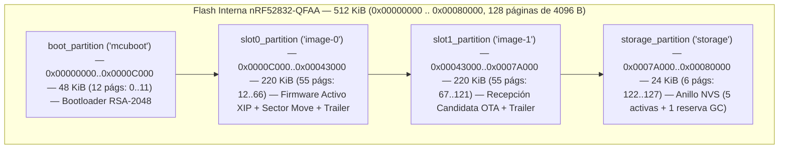
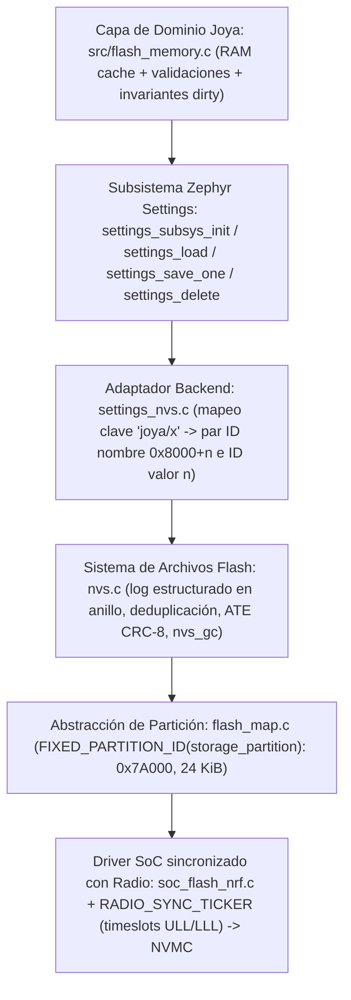
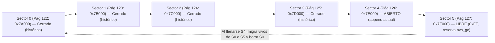

# 15. Almacenamiento Persistente y Memoria Flash (`Settings` / `NVS`)

> **Capítulo del Manual Técnico Integral de Ingeniería del Producto — Firmware Joya**
> Navegación: [Índice General (README.md)](README.md) | Anterior: [14. Batería y Gestión de Energía](14_battery_power.md) | Siguiente: [16. Actualización OTA y Bootloader](16_ota_mcuboot.md) | Véase también: [02. Hardware y Devicetree](02_hardware_devicetree.md), [03. Configuración del Firmware](03_firmware_configuration.md), [04. Arranque e Inicialización](04_boot_initialization.md), [06. Concurrencia](06_concurrency.md), [12. Emergencias y Rutinas](12_emergency_routines.md), [17. Seguridad y Privacidad](17_security_privacy.md), [Referencia 20c](code_reference/20c_peripherals_storage_wdt.md)

---

## 15.1. Propósito Arquitectónico y Criterios Epistemológicos

El subsistema de almacenamiento persistente del firmware Joya custodia en la memoria Flash interna del SoC `nRF52832-QFAA` el estado mínimo indispensable que debe sobrevivir a cortes de batería, reinicios por *watchdog* (`WDT0`), reinicios de software (`sys_reboot` / `NVIC_SystemReset`) y actualizaciones inalámbricas de firmware (`OTA`).

A diferencia de registradores de datos (*dataloggers*), Joya **no almacena series temporales de telemetría, historiales de pulsaciones ni trazas de error en Flash**. Toda su huella persistente de aplicación se reduce exactamente a **cuatro claves** bajo el árbol `"joya/*"` del subsistema `Zephyr Settings`, respaldadas por el sistema de archivos en anillo `NVS` (*Non-Volatile Storage*) sobre una partición dedicada de `24 KiB` (`storage_partition`).

A lo largo de este capítulo se distingue explícitamente cada afirmación según su categoría de evidencia sobre el commit `c1128e5d0c0d6f98be0a580d287c0926ca27f01f`:
- **(a) Comportamiento implementado**: verificado línea por línea en el código fuente C, Devicetree, `.config` y binarios ELF compilados en `build_joya/`.
- **(b) Intención de diseño**: documentada en comentarios del código, mensajes de commit o pruebas unitarias del repositorio (`tests/`).
- **(c) Comportamiento inferido**: consecuencia lógica o física directa de la interacción entre el código de Joya, el kernel `Zephyr 4.2.0` y el silicio `nRF52832`.
- **(d) Código experimental / residual / no utilizado**: definiciones o configuraciones sin efecto operativo real.
- **(e) Pendiente de validación experimental / dependiente de hardware externo**: parámetros sujetos a tolerancias de silicio, temperatura o aprovisionamiento en línea de fábrica.

---

## 15.2. Arquitectura Física de la Memoria Flash Interna del `nRF52832-QFAA`

### 15.2.1. Geometría del arreglo Flash y física de celdas NOR (`NVMC`)

*(a) Comportamiento implementado en [boards/joya/joya_nrf52/joya_nrf52_nrf52832.dts](../../boards/joya/joya_nrf52/joya_nrf52_nrf52832.dts#L18-L20) y `build_joya/app/zephyr/zephyr.dts`, combinado con (c) especificaciones físicas del controlador `NVMC` del `nRF52832-QFAA`*:

El microcontrolador `Nordic nRF52832-QFAA` integra un único banco monolítico de memoria **NOR Flash** gobernado por el periférico hardware **NVMC** (*Non-Volatile Memory Controller*, mapeado en `0x4001E000`, nodo Devicetree `flash-controller@4001e000` / `flash0: flash@0`):

| Parámetro físico / Devicetree | Valor exacto | Fuente / Implicación directa |
|---|---|---|
| Capacidad total de código/datos (`flash0`) | `524.288 B` (`512 KiB`) | `reg = <0x0 0x80000>` en `nrf52832_qfaa.dtsi` (`CONFIG_FLASH_SIZE=512`). |
| Rango de direcciones físicas | `0x00000000` .. `0x0007FFFF` | Límite exclusivo `0x00080000`. |
| Cantidad total de páginas físicas | `128` páginas (`0` .. `127`) | Numeradas linealmente: $\text{página } p \mapsto p \times \text{0x1000}$. |
| Unidad mínima de borrado (`erase-block-size`) | `4.096 B` (`0x1000`, `4 KiB`) | Registro `NVMC->ERASEPAGE`. Imposible borrar bytes o palabras aisladas. |
| Unidad mínima de escritura (`write-block-size`) | `4 B` (`32 bits`, alineada a 4 B) | `# CONFIG_SOC_FLASH_NRF_EMULATE_ONE_BYTE_WRITE_ACCESS is not set`. |
| Valor lógico de celda borrada (virgen) | `0xFF` por byte (`0xFFFFFFFF` / palabra) | Todos los bits físicos en estado lógico `1`. |
| Transición permitida en escritura (`CONFIG.WEN = 1`) | Únicamente bits `1 -> 0` | Una palabra `0xFFFFFFFF` puede programarse a `0x00000001`, pero jamás volver a `0xFFFFFFFF` sin borrar la página entera. |
| Límite de escrituras parciales por palabra (`n_write`) | Máx. `2` escrituras entre borrados | Especificación eléctrica `nRF52832`: acumular > 2 escrituras sobre una misma palabra de 32 bits (o exceder el presupuesto por bloque) antes de un borrado degrada la retención por estrés de puerta flotante. |
| Transición de borrado (`CONFIG.WEN = 2`) | Página completa (`4.096 B`) `0 -> 1` | Restaura los `32.768` bits de la página a `1` (`0xFF`). |
| Latencia eléctrica típica/máxima de escritura | $\sim 41\ \mu\text{s}$ máx. por palabra (`4 B`) | Especificación `t_WRITE` de `NVMC` en `nRF52832` (~`338` ciclos de reloj de `64 MHz` + overhead). |
| Latencia eléctrica típica/máxima de borrado | $\sim 85\text{ ms}$ máx. por página (`4 KiB`) | Especificación `t_ERASEPAGE` en `nRF52832` (típico ~`20..85 ms` según envejecimiento y temperatura). |
| Comportamiento del bus AHB / CPU durante `NVMC` | *CPU Stall* en accesos a Flash | Al existir un único banco físico de lectura/escritura, cualquier búsqueda de instrucciones XIP (*Execute-In-Place*) o lectura de constantes en Flash detiene el *pipeline* `Cortex-M4` hasta que `NVMC->READY == 1`. |
| Región `UICR` (*User Information Configuration*) | `0x10001000` (`4 KiB` fuera del array) | `# CONFIG_SOC_FLASH_NRF_UICR is not set`; `P0.21` **no** usa `PSELRESET` ([boards/joya/joya_nrf52/joya_nrf52_nrf52832_defconfig](../../boards/joya/joya_nrf52/joya_nrf52_nrf52832_defconfig#L3-L4)). |

> [!IMPORTANT]
> **Asimetría fundamental de la tecnología NOR Flash**: Cambiar un único bit de `0` a `1` dentro de una variable almacenada en una dirección fija obligaría a: (1) copiar `4.096 B` a RAM, (2) borrar la página completa durante ~`85 ms` consumiendo `1` ciclo completo de desgaste de los `10.000` disponibles en la vida del chip y abriendo una ventana crítica ante cortes de energía, y (3) reprogramar `1.024` palabras (~`42 ms`). El uso combinado de `Zephyr Settings` y `NVS` evita por completo este antipatrón convirtiendo toda mutación de estado en una escritura secuencial (*append-only*) de unos pocos bytes sobre celdas vírgenes `0xFF`.

---

### 15.2.2. Mapa completo de particiones Flash (`fixed-partitions`)

*(a) Comportamiento implementado en [boards/joya/joya_nrf52/joya_nrf52_nrf52832.dts](../../boards/joya/joya_nrf52/joya_nrf52_nrf52832.dts#L16-L21) y [boards/joya/joya_nrf52/joya_nrf52_nrf52832.dts](../../boards/joya/joya_nrf52/joya_nrf52_nrf52832.dts#L46-L72)*:

Los `512 KiB` (`128` páginas de `4 KiB`) se dividen de forma contigua, sin huecos ni solapamientos ($12 + 55 + 55 + 6 = 128$ páginas; $49.152 + 225.280 + 225.280 + 24.576 = 524.288\text{ B}$), en cuatro particiones estáticas:

| Nodo Devicetree | `label` | Inicio (Hex) | Fin excl. (Hex) | Tamaño Hex | Tamaño Bytes (`KiB`) | Páginas (`4 KiB`) | Rol en `chosen` / Subsistema propietario | Régimen de escritura en campo |
|---|---|---|---:|---:|---:|---|---|---|
| `boot_partition` (`partition@0`) | `"mcuboot"` | `0x00000000` | `0x0000C000` | `0x0C000` | `49.152 B` (`48 KiB`) | `12` (`pág. 0..11`) | Bootloader `MCUboot` (ocupa ~`30,4 KiB` en `build_joya`). | **Inmutable en campo** (solo programado por SWD en fábrica). |
| `slot0_partition` (`partition@c000`) | `"image-0"` | `0x0000C000` | `0x00043000` | `0x37000` | `225.280 B` (`220 KiB`) | `55` (`pág. 12..66`) | `zephyr,code-partition`: imagen activa ejecutada en XIP (`VTOR = 0x0000C200`). | Escrita por `MCUboot` durante *swap/revert* y en el byte `image_ok` del trailer al confirmar OTA (`boot_write_img_confirmed()`). |
| `slot1_partition` (`partition@43000`) | `"image-1"` | `0x00043000` | `0x0007A000` | `0x37000` | `225.280 B` (`220 KiB`) | `55` (`pág. 67..121`) | Slot secundario de recepción OTA (`MCUmgr` + `stream_flash`). | Borrada y escrita página a página durante `IMG UPLOAD`, en el trailer al pedir `TEST`, y por `MCUboot` durante *swap*. |
| `storage_partition` (`partition@7a000`) | `"storage"` | `0x0007A000` | `0x00080000` | `0x06000` | `24.576 B` (`24 KiB`) | `6` (`pág. 122..127`) | `zephyr,settings-partition`: backend `NVS` para `Zephyr Settings` (`"joya/*"`). | Escritura incremental *append-only* en operación normal; borrado circular de 1 página solo en compactación `nvs_gc`. |



#### Protección hardware de escritura (`MPU` y `NVMC`)
- **(a) En la aplicación principal**: en [prj.conf](../../prj.conf#L79-L80) la línea `#CONFIG_ARM_MPU=y` está comentada y `CONFIG_MPU_ALLOW_FLASH_WRITE=y` está presente (residual sin efecto cuando `# CONFIG_MPU is not set` en `build_joya/app/zephyr/.config`). Por tanto, no existe barrera MPU que restrinja qué regiones de Flash podría direccionar el driver `NVMC`; el aislamiento de `storage_partition` frente a `slot0`/`boot_partition` recae íntegramente en las cotas de desplazamiento verificadas por `flash_area_write()` / `flash_area_erase()` dentro de `CONFIG_FLASH_MAP=y`.
- **(a) En `MCUboot`**: [sysbuild/mcuboot.conf](../../sysbuild/mcuboot.conf#L1-L2) habilita `CONFIG_ARM_MPU=y` junto con `CONFIG_MPU_ALLOW_FLASH_WRITE=y` para permitir las operaciones de *swap* manteniendo regiones `XN` (*Execute-Never*) en SRAM.

---

## 15.3. Arquitectura Profunda de `Zephyr Settings` y `NVS`

### 15.3.1. Pila de capas y configuración Kconfig efectiva

*(a) Comportamiento verificado en [prj.conf](../../prj.conf#L71-L78), [src/flash_memory.c](../../src/flash_memory.c#L191) y `build_joya/app/zephyr/.config`*:



| Símbolo Kconfig efectivo (`build_joya/app/zephyr/.config`) | Valor | Impacto arquitectónico, en memoria y en confiabilidad |
|---|---|---|
| `CONFIG_FLASH=y`, `CONFIG_SOC_FLASH_NRF=y` | Activo | Habilita el driver del controlador interno `NVMC`. |
| `CONFIG_SOC_FLASH_NRF_RADIO_SYNC_TICKER=y` | Activo | **Crítico**: serializa las escrituras y borrados de Flash dentro de ranuras de tiempo libres del planificador radio `BT_LL_SW_SPLIT`, evitando colisiones de tiempo real con eventos BLE. |
| `CONFIG_SOC_FLASH_NRF_TIMEOUT_MULTIPLIER=10` | `10` | Multiplica la espera máxima de concesión de *timeslot* de radio antes de abortar una operación Flash con `-ETIMEDOUT`. |
| `CONFIG_FLASH_MAP=y`, `CONFIG_FLASH_PAGE_LAYOUT=y` | Activo | Expone `storage_partition` con cotas verificadas y geometría de páginas de `4.096 B`. |
| `CONFIG_NVS=y` | Activo | Monta el almacén *append-only* estructurado por registros (`id`, `data`, `nvs_ate`). |
| `CONFIG_NVS_LOOKUP_CACHE` | No activo (`n`) | Ahorra SRAM (sin tabla hash en RAM); cada búsqueda recorre en reversa los metadatos `nvs_ate` de `8 B`. Dado que Joya solo usa 9 IDs NVS totales, la latencia de búsqueda es despreciable (< `100 us`). |
| `CONFIG_NVS_DATA_CRC` | No activo (`n`) | No agrega `4 B` extra de CRC-32 al final de cada bloque de datos; la integridad estructural depende del `crc8` de cada `nvs_ate` de `8 B`. |
| `CONFIG_SETTINGS=y`, `CONFIG_SETTINGS_NVS=y` | Activo | Conecta el árbol jerárquico `"joya/*"` al almacén NVS `default_settings_nvs` (`64 B` en `.bss`). |
| `CONFIG_SETTINGS_NVS_NAME_CACHE` | No activo (`n`) | Ahorra SRAM al no cachear pares `nombre -> ID`; `settings_nvs_save()` compara nombres leyendo entradas `>= 0x8001` en Flash. |
| `CONFIG_SETTINGS_NVS_SECTOR_SIZE_MULT=1` | `1` | Tamaño de sector NVS = $1 \times 4.096\text{ B} = 4.096\text{ B}$ (`1` página física por sector lógico). |
| `CONFIG_SETTINGS_NVS_SECTOR_COUNT=8` | `8` *(acotado a `6`)* | Valor por defecto de Zephyr (`32 KiB`), reducido dinámicamente en arranque a **`6` sectores** (`24 KiB`) por `settings_nvs_backend_init()` (véase §15.3.4). |

---

### 15.3.2. Estructura interna de un sector `NVS` de `4.096` bytes

*(a) Comportamiento implementado del subsistema `subsys/fs/nvs/` de `Zephyr 4.2.0` enlazado en `zephyr.elf` (`nvs_mount`, `nvs_write`, `nvs_ate_crc8_update`, `nvs_add_gc_done_ate`, `nvs_sector_close`)*:

Cada una de las 6 páginas físicas de `storage_partition` (`0x0007A000`, `0x0007B000`, `0x0007C000`, `0x0007D000`, `0x0007E000`, `0x0007F000`) constituye un **sector NVS** autónomo de `4.096` bytes (`0x000..0xFFF`). Dentro de un sector abierto, la memoria se consume desde ambos extremos hacia el centro sin sobreescribir jamás palabras previamente escritas:

1. **Área de Datos (*Data Region*, crecimiento ascendente desde `0x000` hacia arriba)**:
   - El puntero `data_wra` indica el próximo desplazamiento libre alineado a `4 bytes`.
   - Todo bloque de datos de longitud lógica $L$ bytes se escribe mediante `nvs_flash_al_wrt()` ocupando:
     $$\text{aligned\_len}(L) = \left\lceil \frac{L}{4} \right\rceil \times 4 \text{ bytes}$$
   - Si $L$ no es múltiplo de `4`, la última palabra de `32 bits` se arma en un buffer temporal en pila rellenando los $4 - (L \bmod 4)$ bytes finales con `0xFF`, y se programa de una sola vez. De este modo, **cada palabra física de 32 bits en Flash recibe exactamente `1` operación de escritura entre borrados de página**, cumpliendo con holgura la restricción eléctrica `n_write <= 2` del `nRF52832`.
2. **Tabla de Asignación (*Allocation Table*, entradas `struct nvs_ate` de `8 bytes`, crecimiento descendente desde el final del sector hacia abajo)**:
   - Como `8 bytes` es múltiplo exacto de `write-block-size = 4 B`, cada metadato ocupa exactamente **dos palabras de 32 bits** y nunca comparte palabra física con entradas vecinas.
   - Formato binario exacto (*little-endian*) de `struct nvs_ate` (`8 bytes`):

| Desplazamiento en ATE | Campo C | Tipo | Tamaño | Función exacta |
|---:|---|---|---:|---|
| `+0` | `id` | `uint16_t` | `2 B` | Identificador NVS de la entrada (`0xFFFF` reservado para ATEs especiales de control o espacio virgen). |
| `+2` | `offset` | `uint16_t` | `2 B` | Desplazamiento (`0..4079`) dentro del mismo sector donde inicia el bloque de datos asociado. |
| `+4` | `len` | `uint16_t` | `2 B` | Longitud lógica exacta $L$ del dato útil (sin el relleno `0xFF` de alineación). **`len = 0` representa un borrado lógico (*tombstone* NVS)**. |
| `+6` | `part` | `uint8_t` | `1 B` | Campo reservado de partición (`0xFF`). |
| `+7` | `crc8` | `uint8_t` | `1 B` | Suma `CRC-8-CCITT` (`polinomio 0x07`, semilla `0xFF`) sobre los primeros `7 bytes` (`id`, `offset`, `len`, `part`). Un ATE solo se considera válido (`nvs_ate_valid`) si su `crc8` coincide. |

3. **Entradas `nvs_ate` especiales fijas al final de cada sector (`16 bytes` reservados de control)**:
   - **`close_ate` (`offset 0xFF8..0xFFF`, últimos `8 B` del sector)**: Mientras el sector está abierto recibiendo escrituras, estos `8 B` permanecen vírgenes (`0xFF..FF`). Cuando el sector se agota y no admite el siguiente par `(datos + ATE)`, `nvs_sector_close()` escribe aquí un ATE con `id = 0xFFFF`, `len = 0` y `offset` apuntando al último ATE escrito en el sector. Permite a `nvs_mount()` saltar directamente al último ATE válido al escanear sectores cerrados.
   - **`gc_done_ate` (`offset 0xFF0..0xFF7`, penúltimos `8 B` del sector)**: Al inicializar o compactar hacia un sector limpio, `nvs_add_gc_done_ate()` escribe en `0xFF0` una marca con `id = 0xFFFF`, `len = 0`, `offset = 0` y `crc8` válido. Si ocurre un corte de alimentación en medio de una recolección de basura (`nvs_gc`), la ausencia de `gc_done_ate` en el sector destino permite a `nvs_mount()` detectar la compactación incompleta, borrar el sector a medio migrar y reejecutar `nvs_gc` limpiamente desde el sector origen intacto.
   - **Capacidad útil neta por sector activo**:
     $$\text{Capacidad útil por sector} = 4.096\text{ B} - 8\text{ B }(\text{close\_ate}) - 8\text{ B }(\text{gc\_done\_ate}) = 4.080\text{ B}$$
     Las entradas de usuario colocan su primer `nvs_ate` en `0xFE8` (`4072`) y descienden (`0xFE0`, `0xFD8`, ...) mientras sus datos ascienden desde `0x000` hasta que `ate_wra - data_wra < aligned_len(L) + 8`.

```text
Sector NVS de 4.096 bytes (ej. página física 122 en 0x0007A000..0x0007AFFF)
┌──────────────────────┬───────────────────────┬──────────────────┬──────────────────┬──────────────────┐
│ 0x000 .. data_wra    │ Espacio virgen (0xFF) │ ate_wra .. 0xFE8 │ 0xFF0 .. 0xFF7   │ 0xFF8 .. 0xFFF   │
│ Bloques de datos     │ --->  crece data_wra  │ Entradas nvs_ate │   gc_done_ate    │    close_ate     │
│ alineados a 4 B      │  crece ate_wra  <---  │ de 8 B c/u       │ (8 B, id=0xFFFF) │ (8 B, id=0xFFFF) │
└──────────────────────┴───────────────────────┴──────────────────┴──────────────────┴──────────────────┘
|<--------------------------- 4.080 bytes compartidos dinámicamente --------------------------->|<-- 16 B -->|
```

---

### 15.3.3. Mapeo `Settings` → `NVS` y demostración paso a paso: por qué actualizar una variable NO borra una página de Flash

*(a) Comportamiento implementado en `settings_nvs.c` y `nvs.c`*:

#### Mapeo de claves de texto a pares de IDs numéricos `NVS`
`NVS` no conoce cadenas de texto como `"joya/emergency"`; indexa todo con enteros de 16 bits (`uint16_t id`). El adaptador `settings_nvs` establece un espacio de nombres dividido por el bit `15` (`0x8000`, `NVS_NAMECNT_ID`):
- **`id = 0x8000` (`NVS_NAMECNT_ID`)**: almacena un `uint16_t` (`2 B` lógicos → `4 B` alineados + `8 B` ATE = **`12 B`**) con el mayor índice correlativo asignado hasta el momento (p. ej. `0x8004` cuando las 4 claves de Joya han sido creadas).
- **`id = 0x8000 + n` (`n >= 1`, ej. `0x8001`..`0x8004`)**: almacena la cadena ASCII del nombre de la clave (sin terminador `\0` en el almacenamiento interno de `settings_nvs`, p. ej. `"joya/emergency"` = `14 B` → `16 B` alineados + `8 B` ATE = **`24 B`**). **Se escribe una única vez** cuando la clave se guarda por primera vez desde fábrica (o tras un `settings_delete()`).
- **`id = 0x0000 + n` (`n >= 1`, ej. `0x0001`..`0x0004`)**: almacena el **valor binario** actual asociado a esa clave.

#### Traza exacta de actualización en tiempo de ejecución (ejemplo: `storage_save_emergency_phase(EMERGENCY_PENDING_ACK)`)
Supóngase que `"joya/emergency"` ya existe en NVS con `id_name = 0x8002`, `id_val = 0x0002` y valor previo `0x00`, y que el sector abierto tiene `2.000 B` libres:

1. **Actualización en RAM ([src/flash_memory.c](../../src/flash_memory.c#L303))**: `joya_emergency_phase = EMERGENCY_PENDING_ACK` (`1`) se escribe instantáneamente en `.bss` (`0x200042d7`).
2. **Resolución de clave en `settings_nvs_save()`**:
   - Invoca `settings_save_one("joya/emergency", &stored, 1)`.
   - Recorre las entradas de nombre (`0x8001..0x8000+cnt`) leyendo Flash (operación puramente de lectura CPU, **0 escrituras, 0 borrados**). Encuentra `"joya/emergency"` en `0x8002`, deduciendo `id_val = 0x0002`.
3. **Filtro de deduplicación en `nvs_write(fs, 0x0002, &stored, 1)`**:
   - `nvs_write()` localiza el `nvs_ate` más reciente con `id == 0x0002`.
   - **Si `stored` fuera `0x00` (idéntico al byte ya residente en Flash)**: `nvs_flash_cmp_const` comprueba la igualdad exacta de longitud y contenido y **`nvs_write()` retorna `0` inmediatamente**. No se invoca `NVMC`, no se consume ni un solo byte del sector y el desgaste es estrictamente **cero**.
4. **Escritura *append-only* cuando el valor cambió (`0x00` → `0x01`)**:
   - `nvs_write()` calcula el requerimiento de espacio: $\text{aligned\_len}(1) + 8 = 4 + 8 = 12\text{ B}$.
   - Como `12 B <= 2.000 B` libres en el sector activo:
     1. Programa **1 palabra (`4 B`)** `[0x01, 0xFF, 0xFF, 0xFF]` en `data_wra` (celda virgen `0xFFFFFFFF` → solo conmuta bits `1 -> 0`, latencia ~`41 us`). Avanza `data_wra += 4`.
     2. Retrocede `ate_wra -= 8` y programa **2 palabras (`8 B`)** con `nvs_ate = { .id = 0x0002, .offset = data_wra_prev, .len = 1, .part = 0xFF, .crc8 = valid }` sobre celdas vírgenes `0xFFFFFFFF` (~`82 us`).
   - **Resultado físico**: El dato antiguo (`0x00`) y su `nvs_ate` viejo **no se tocan ni se borran**; permanecen físicamente en direcciones anteriores del sector, pero quedan lógicamente invalidados (*shadowed*) porque toda lectura posterior (`nvs_read` / `settings_load`) escanea la tabla de asignación desde `ate_wra` hacia arriba y toma la primera aparición válida de `id == 0x0002`. **Páginas borradas = `0`**.

#### Diferencia crítica entre Borrado Lógico (`settings_delete` vs *tombstone* de aplicación) y Borrado Físico (`nvs_gc`)

| Mecanismo | Cuándo ocurre en Joya | Qué escribe físicamente en Flash | ¿Borra página de `4 KiB`? | ¿Destruye bytes previos en Flash? |
|---|---|---|---|---|
| **Tombstone de aplicación** (`storage_save_pending_routine(0)`) | Al enviar rutina por BLE, al iniciar/parar emergencia o sanear arranque | `settings_save_one("joya/routine", {0x00}, 1)`: escribe `4 B` de datos (`00 FF FF FF`) + `8 B` ATE (`len = 1`) = **`12 B`**. Conserva vivos `0x8003` (nombre) y `0x8000`. | **No (`0` borrados)** | **No** (los `17 B` previos siguen en Flash hasta `nvs_gc`). |
| **Borrado lógico NVS** (`settings_delete("joya/...")`) | Únicamente en `storage_factory_reset()` (gesto de `15 s`) | Invoca `nvs_delete()` sobre el ID de valor (`len = 0` → `8 B` ATE) **y** sobre el ID de nombre (`len = 0` → `8 B` ATE) = **`16 B`** por clave existente (`0 B` si ya estaba borrada). Al recrear la clave más adelante requerirá reescribir nombre (`20..24 B`) + contador `0x8000` (`12 B`). | **No (`0` borrados)** | **No** (remanencia física en Flash hasta que la rotación alcance el sector; véase §15.6.3). |
| **Compactación / *Garbage Collection*** (`nvs_gc()`) | Automáticamente dentro de `nvs_write()` **solo cuando** el sector activo se queda sin espacio (`< aligned_len + 8 B` libres) | 1) Escribe `close_ate` (`8 B`) en el sector lleno.<br/>2) Avanza al sector reservado libre.<br/>3) Copia del sector más antiguo de la cola circular **únicamente** la versión más reciente y no borrada (`len > 0`) de cada `id` aún vigente.<br/>4) Escribe `gc_done_ate` (`8 B`).<br/>5) Ejecuta `flash_erase()` sobre el sector antiguo evacuado. | **Sí: exactamente `1` página de `4.096 B`** (~`85 ms`) cada ~`3.924 B` escritos | **Sí**, únicamente sobre las celdas del sector más antiguo que acaba de ser borrado a `0xFF`. |

---

### 15.3.4. Análisis de `CONFIG_SETTINGS_NVS_SECTOR_COUNT=8` frente a los `6` sectores reales de `storage_partition`

*(a) Comportamiento implementado verificado en `build_joya/app/zephyr/.config`, `build_joya/app/zephyr/zephyr.dts` y binario compilado de `settings_nvs_backend_init()` (`0x0002da0d` en `zephyr.elf`)*:

Existe una discrepancia de configuración entre el valor por defecto heredado de Kconfig y el tamaño de partición definido en Devicetree:
1. En [prj.conf](../../prj.conf#L74-L77) se habilitan `CONFIG_NVS=y`, `CONFIG_SETTINGS=y` y `CONFIG_SETTINGS_NVS=y` sin especificar `CONFIG_SETTINGS_NVS_SECTOR_COUNT`. Zephyr aplica su valor por defecto `CONFIG_SETTINGS_NVS_SECTOR_COUNT=8` con `CONFIG_SETTINGS_NVS_SECTOR_SIZE_MULT=1`, lo que equivale nominalmente a $8 \times 4.096\text{ B} = 32.768\text{ B}$ (`32 KiB`).
2. En [boards/joya/joya_nrf52/joya_nrf52_nrf52832.dts](../../boards/joya/joya_nrf52/joya_nrf52_nrf52832.dts#L67-L70), `storage_partition` declara `reg = <0x0007a000 0x00006000>`, es decir, **`24.576 B` (`24 KiB` = `6` páginas físicas de `4.096 B`)**.
3. **Resolución efectiva en tiempo de ejecución**: Cuando `storage_init()` llama a `settings_subsys_init()` → `settings_backend_init()` → `settings_nvs_backend_init()`, Zephyr consulta el mapa físico de páginas del `flash_area` de `storage_partition` iterando mientras `cnt < CONFIG_SETTINGS_NVS_SECTOR_COUNT` **y** el desplazamiento acumulado no supere `fa->fa_size` (`24.576 B`). Al llegar a `24.576 B` en la sexta iteración, el bucle termina limpiamente fijando `cf_nvs.sector_count = 6` y `cf_nvs.sector_size = 4096`, y monta `nvs_mount()` sin error (pues `NVS` exige únicamente `sector_count >= 2`).

**Geometría operativa resultante del anillo NVS en Joya**:

| Magnitud efectiva del anillo `NVS` | Valor exacto | Explicación técnica |
|---|---:|---|
| Páginas físicas asignadas | `6` (`pág. 122..127`) | Direcciones `0x0007A000` .. `0x0007FFFF`. |
| Sectores activos de datos simultáneos | `5` sectores | NVS mantiene siempre `1` sector completamente borrado (`0xFF`) para poder ejecutar `nvs_gc()` sin perder atomicidad ante apagones. |
| Sector libre de compactación (rotativo) | `1` sector (`4.096 B`) | Rota secuencialmente `122 -> 123 -> 124 -> 125 -> 126 -> 127 -> 122`, proporcionando **nivelación de desgaste (*wear leveling*) uniforme** sobre las 6 páginas. |
| Capacidad bruta de los 5 sectores activos | `20.480 B` | $5 \times 4.096\text{ B}$. |
| Capacidad neta útil (descontando `close_ate` + `gc_done_ate`) | `20.400 B` | $5 \times 4.080\text{ B}$ disponibles para datos alineados + entradas `nvs_ate` de `8 B`. |
| Tamaño máximo del *live set* completo de Joya | `136 .. 156 B` | Suma total en NVS de `0x8000` (`12 B`) + los 4 nombres `0x8001..0x8004` (`84 B`) + los 4 valores vivos `0x0001..0x0004` (`24 + 12 + 28 + 40 = 104 B` máx., o `0 B` si alguna clave no fue creada aún → máx. absoluto `200 B`). |
| Espacio libre recuperado en cada `nvs_gc` | $\ge 3.880\text{ B}$ / sector (`> 95 %`) | Incluso con las 4 claves vivas en su tamaño máximo (`200 B` totales repartidos en el anillo), un sector compactado migra a lo sumo `<= 200 B` y libera `>= 3.880 B` de los `4.080 B` del nuevo sector. |
| Factor de amplificación de escritura (*WAF*) de NVS | $\approx 1,01 .. 1,05\times$ | Al ser el *live set* $\le 1\ \%$ de la capacidad activa (`200 B / 20.400 B`), casi la totalidad de las entradas de un sector antiguo son versiones históricas obsoletas que **no se copian** durante `nvs_gc()`. |



---

## 15.4. Política Global del Módulo `flash_memory`: *RAM-First*, Arranque y Códigos de Retorno

*(a) Comportamiento implementado en [src/flash_memory.c](../../src/flash_memory.c#L1-L398) e [include/flash_memory.h](../../include/flash_memory.h#L1-L65)*:

### 15.4.1. Filosofía *RAM-First* y semántica tripartita de retorno
El módulo `flash_memory` desacopla la disponibilidad operativa inmediata de la pulsera respecto de la salud física de la memoria Flash:
1. **Fuente única de verdad en ejecución**: Todas las funciones de consulta (`storage_get_app_id()`, `is_app_id_empty()`, `storage_get_emergency_phase()`, `is_in_emergency()`, `storage_get_pending_routine()`, `storage_get_name()`) leen exclusivamente variables estáticas en SRAM en tiempo $\mathcal{O}(1)$, sin tocar `Settings`, `NVS` ni mutexes.
2. **Escritura *RAM-first* (con dos guardas de seguridad previas)**: Tras superar las validaciones de argumentos y las guardas de aislamiento `pending_routine_dirty`, las funciones `storage_save_*` y `storage_factory_reset()` **actualizan primero la copia en SRAM** y recién después intentan persistir en `NVS` si `storage_persistent_available == true`.
3. **Convención estricta de códigos de retorno**:
   - **`0`**: Éxito completo (RAM actualizada y cambio persistido en NVS, o no-op deduplicado sin necesidad de escribir en Flash).
   - **`1` (positivo, error no crítico de persistencia)**: La operación fue válida lógicamente, pero `storage_persistent_available == false` o la operación `settings_save_one()` / `settings_delete()` falló en Flash (emitiéndose `diagnostics_report_error(DIAG_ERROR_FLASH_WRITE)` = `0xE1` en las funciones `storage_save_*`). En los casos ordinarios la RAM ya quedó actualizada y el firmware sigue operando en sesión; en los dos casos protegidos por `pending_routine_dirty` (véase §15.5.3), `storage_save_app_id()` aborta **antes** de copiar el nuevo `APP_ID` a RAM para impedir filtración de estado entre usuarias.
   - **`< 0` (negativo, rechazo de precondición)**: Argumento inválido (`-EINVAL`), falta de `APP_ID` registrado (`-EACCES`) o emergencia activa (`-EBUSY`). No modifica ni RAM ni Flash y no emite `0xE1`.

### 15.4.2. Secuencia de inicialización y recuperación en `storage_init()`

Invocada desde `main()` ([src/main.c](../../src/main.c#L16-L20)) antes de iniciar BLE, botón, háptica y batería:

1. **Restablecimiento preventivo de RAM ([src/flash_memory.c](../../src/flash_memory.c#L204-L211))**: Fija `storage_persistent_available = false`, limpia `joya_app_id` (`16` ceros), `joya_emergency_phase = EMERGENCY_NONE`, `joya_pending_routine = 0`, `pending_routine_owner` (`16` ceros), `pending_routine_dirty = false` y copia `"Joya"` en `joya_name`.
2. **Montaje del subsistema (`settings_subsys_init()`, líneas 213–219)**: Inicializa `default_settings_nvs` y monta los `6` sectores de `storage_partition`. Si falla, retorna el código negativo dejando `storage_persistent_available = false` (modo degradado solo-RAM; el bit `DIAG_INIT_SETTINGS = 0x04` quedará en `0` dentro del mensaje diagnóstico `A0 MM`).
3. **Carga transaccional en memoria (`settings_load()`, líneas 221–236)**: Invoca `app_settings_set()` para cada clave viva bajo `"joya/*"`.
   - **Todo-o-nada en RAM**: Si `settings_load()` devuelve cualquier valor distinto de `0` (por ejemplo, corrupción de longitud/contenido que dispare `-EINVAL` en una clave), `storage_init()` emite `diagnostics_report_error(DIAG_ERROR_SETTINGS_LOAD)` (`0xE2` — nota: en `main()` aún no hay sesión BLE conectada, por lo que `ble_diagnostics_session() == 0` descarta la notificación en tiempo real, quedando reflejado el fallo en la ausencia del bit `0x04` en `A0 MM` al leer `DIAGNOSTICS`), **borra todas las variables de RAM que hubieran llegado a cargarse parcialmente** devolviéndolas a sus valores seguros de fábrica y mantiene `storage_persistent_available = false`.
4. **Saneamiento post-carga de `joya/routine` (líneas 240–245)**: Tras marcar `storage_persistent_available = true`, si `joya_pending_routine != 0` pero ocurre cualquiera de las tres condiciones de invalidez cruzada:
   - `is_app_id_empty()` (no hay propietario registrado), o
   - `joya_emergency_phase != EMERGENCY_NONE` (hay una emergencia activa pendiente o reconocida que tiene prioridad absoluta sobre cualquier rutina), o
   - `memcmp(pending_routine_owner, joya_app_id, SIZE_APP_ID) != 0` (la rutina pertenecía a otro `APP_ID`),
   entonces ejecuta inmediatamente `(void)storage_save_pending_routine(0)` para anularla en RAM y grabar el *tombstone* `0x00` en Flash.

---

## 15.5. Inventario Exhaustivo de las Cuatro Claves Persistentes

### 15.5.1. Tabla comparativa maestra

| Clave `Settings` | Variable(s) en SRAM (`src/flash_memory.c`) | Tamaño RAM | Payload lógico en Flash | Coste NVS (1ª creación: nombre + `0x8000` + valor) | Coste NVS por actualización posterior | Coste NVS en `storage_factory_reset()` | Valor por defecto |
|---|---|---:|---|---:|---:|---:|---|
| `"joya/app_id"` | `uint8_t joya_app_id[16]` (global, `.bss`) | `16 B` | `16 B` binarios crudos (`SIZE_APP_ID`) | `20 B` (nombre) + `12 B` (`0x8000`) + `24 B` (valor) = **`56 B`** | `16 B` dato + `8 B` ATE = **`24 B`** | `16 B` (2 ATEs `len=0`) | `16` bytes `0x00` |
| `"joya/emergency"` | `static emergency_phase_t joya_emergency_phase` (`.bss`) | `1 B` | `1 B` (`uint8_t`: `0`, `1` o `2`) | `24 B` (nombre) + `12 B` (`0x8000`) + `12 B` (valor) = **`48 B`** | `4 B` dato alineado + `8 B` ATE = **`12 B`** | `16 B` (2 ATEs `len=0`) | `EMERGENCY_NONE` (`0`) |
| `"joya/routine"` | `static uint8_t joya_pending_routine` (`1 B`) + `pending_routine_owner[16]` (`16 B`) + `pending_routine_dirty` (`1 B`) | `18 B` | `17 B` (`[cmd, owner[16]]`) activa, o `1 B` (`[0x00]`) *tombstone* | `20 B` (nombre) + `12 B` (`0x8000`) + `28 B` o `12 B` = **`60 B` / `44 B`** | Activa: `20 B` + `8 B` = **`28 B`**<br/>Tombstone `0`: `4 B` + `8 B` = **`12 B`** | `16 B` (2 ATEs `len=0`) | `0` (sin rutina) |
| `"joya/name"` | `static char joya_name[32]` (`.data`) | `32 B` | `1..32 B` (`strlen + 1`, incluye `\0`; vía GATT: `10..32 B`) | `20 B` (nombre) + `12 B` (`0x8000`) + `20..40 B` = **`52..72 B`** | `12..32 B` dato alineado + `8 B` ATE = **`20..40 B`** | `16 B` (2 ATEs `len=0`) | `"Joya\0"` (`5 B`) |

A continuación se documentan exhaustivamente los **18 atributos de ingeniería** para cada una de las cuatro claves.

---

### 15.5.2. Clave 1: `"joya/app_id"` — Identificador de Emparejamiento de Aplicación

1. **Nombre exacto de la clave**: `"joya/app_id"` (subclave `"app_id"` despachada por `SETTINGS_STATIC_HANDLER_DEFINE(joya, "joya", ...)` en [src/flash_memory.c](../../src/flash_memory.c#L42-L58) y [src/flash_memory.c](../../src/flash_memory.c#L191)).
2. **Tipo y declaración en C**: `uint8_t joya_app_id[SIZE_APP_ID] = {0};` ([src/flash_memory.c](../../src/flash_memory.c#L4)), donde `SIZE_APP_ID = 16` ([include/app_state.h](../../include/app_state.h#L4)). Nota arquitectónica: carece del calificador `static` (símbolo global en `.bss` en `0x200042d8`), aunque ningún otro módulo la referencia directamente gracias al uso disciplinado de `storage_get_app_id()` e `is_app_id_empty()`.
3. **Tamaño en RAM y coste real en NVS**:
   - **RAM**: `16 bytes` fijos en `.bss` (+ `16 bytes` constantes en `.rodata` para `static const uint8_t zeros[SIZE_APP_ID]` dentro de `is_app_id_empty()`).
   - **NVS**: El nombre `"joya/app_id"` (`11 B`) se alinea a `12 B` + `8 B` ATE = `20 B` (escrito una sola vez junto con `12 B` de `0x8000`). Cada escritura de valor consume exactamente `16 B` de datos (múltiplo exacto de `4 B`, `0 B` de relleno) + `8 B` de `nvs_ate` = **`24 bytes` por actualización**.
4. **Formato binario en Flash**: Vector crudo de `16` octetos sin cabeceras ni terminador nulo. Vector sintético de prueba usado en herramientas del repositorio ([ota/bridge_ota/bridge_ota.ino](../../ota/bridge_ota/bridge_ota.ino#L153-L154), [otros/test/OTA_BLE.md](../../otros/test/OTA_BLE.md#L5)): `00 01 02 03 04 05 06 07 08 09 0A 0B 0C 0D 0E 0F`. En `app_settings_set()` ([src/flash_memory.c](../../src/flash_memory.c#L44-L55)) se exige estrictamente `len == 16` y `read_cb(...) == 16`. *(Observación de borde)*: un vector de `16` bytes `0x00` enviado por GATT sería aceptado en escritura, pero al evaluarse `is_app_id_empty()` ([src/flash_memory.c](../../src/flash_memory.c#L250-L253)) equivaldría a dispositivo **no emparejado** (`STATE_SETUP_WAITING_IDENTIFIER` aborta en [src/app_state.c](../../src/app_state.c#L932-L934)).
5. **Valor por defecto**: `16` bytes en `0x00` (`is_app_id_empty() == true`).
6. **Módulo propietario**: [src/flash_memory.c](../../src/flash_memory.c), con envoltorio de protocolo en [src/app_comm.c](../../src/app_comm.c#L70-L80) (`check_app_id()`, `save_received_app_id()`).
7. **Funciones de lectura, escritura y borrado**:
   - Lectura: `storage_get_app_id()` ([src/flash_memory.c](../../src/flash_memory.c#L23-L25)) e `is_app_id_empty()` ([src/flash_memory.c](../../src/flash_memory.c#L250-L253)).
   - Carga inicial: rama `"app_id"` en `app_settings_set()` ([src/flash_memory.c](../../src/flash_memory.c#L42-L58)).
   - Escritura: `storage_save_app_id(const uint8_t *new_app_id)` ([src/flash_memory.c](../../src/flash_memory.c#L263-L289)), invocada vía `save_received_app_id()` ([src/app_comm.c](../../src/app_comm.c#L74-L80)).
   - Borrado: `settings_delete("joya/app_id")` dentro de `storage_factory_reset()` ([src/flash_memory.c](../../src/flash_memory.c#L385-L387)).
8. **Eventos que disparan su modificación**:
   - **Escritura**: Únicamente el evento `EV_APP_IDENTIFIER_RECEIVED` en `STATE_SETUP_WAITING_IDENTIFIER` cuando `is_app_id_empty() == true` y `ble_is_current_conn(entry->conn)` es verdadero ([src/app_state.c](../../src/app_state.c#L923-L936)), originado por una escritura GATT de `16 B` en la característica `RX_AUTH` (`...5101`).
   - **Borrado**: Únicamente `factory_reset_and_reboot()` tras completar la pulsación de `15 s` y el patrón háptico `HAPTICS_PATTERN_FACTORY_RESET` ([src/app_state.c](../../src/app_state.c#L108), [src/app_state.c](../../src/app_state.c#L689-L690)).
9. **Frecuencia esperada de actualización**: **Ultra-baja** (típicamente `1` sola vez en toda la vida útil o `1` vez tras cada Factory Reset). Una vez que `is_app_id_empty()` es `false`, el firmware jamás sobrescribe `"joya/app_id"` sin pasar antes por un Factory Reset físico de `15 s`.
10. **Política *RAM-first* y códigos de retorno**:
    - **Excepción de seguridad previa a RAM ([src/flash_memory.c](../../src/flash_memory.c#L267-L270))**: Si `is_app_id_empty() && pending_routine_dirty` es verdadero (un Factory Reset previo no pudo borrar `"joya/routine"` en Flash), reintenta `storage_save_pending_routine(0)`. Si vuelve a fallar, **retorna `1` sin copiar `new_app_id` a `joya_app_id`**, dejando `is_app_id_empty() == true` para que [src/app_state.c](../../src/app_state.c#L932-L935) aborte la vinculación y un nuevo propietario jamás herede una rutina ajena.
    - Superada esa guarda, copia `new_app_id` a `joya_app_id` en RAM (`L272-L273`) y ejecuta `settings_save_one("joya/app_id", joya_app_id, 16)`. Retorna `0` si persiste OK, o `1` (reportando `DIAG_ERROR_FLASH_WRITE = 0xE1`) si falla Flash (permitiendo operar autenticado mientras no se reinicie). No devuelve códigos negativos (ojo: asume `new_app_id != NULL`).
11. **Valores repetidos**: En operación normal nunca se llama dos veces seguidas con el mismo `APP_ID` porque al guardarse el primero `is_app_id_empty()` pasa a `false` y las reconexiones posteriores solo ejecutan `check_app_id()` (`memcmp`). Si ocurriese (p. ej. tras reinicio con fallo parcial), `nvs_write()` deduplica sin escribir en Flash.
12. **Manejo de errores**:
    - En carga (`app_settings_set`): si `len != 16` o fallo de lectura, devuelve `-EINVAL` / `rc < 0`, provocando que `storage_init()` limpie toda la RAM a estado no vinculado y desactive persistencia (`storage_persistent_available = false`).
    - En escritura (`save_received_app_id`): si retorna `1` pero `joya_app_id` sí se copió a RAM (p. ej. Flash llena/dañada sin `pending_routine_dirty`), [src/app_state.c](../../src/app_state.c#L931-L952) permite completar la sesión autenticada en RAM, aunque tras un reinicio volverá a estar no vinculada.
13. **Comportamiento tras reinicio**: Se restaura en `storage_init()` antes de `ble_driver_init()`. Con `APP_ID` válido e imagen confirmada (`boot_is_img_confirmed()`), cuando el monitor de batería confirma el primer nivel apto (`0` o `1`, a los ~`60 s` del arranque), la FSM activa `boot_reconnect_pending`, pasa a `STATE_BONDED_DISCONNECTED` y arranca publicidad de reconexión + `iBeacon` ([src/app_state.c](../../src/app_state.c#L429-L433), [src/app_state.c](../../src/app_state.c#L462-L475)).
14. **Comportamiento durante y después de OTA**: Intacto en `storage_partition` tanto al confirmar una nueva imagen (`Test` → `Confirmed`) como tras un *rollback* automático de `5 min`. Durante el arranque `Test` (`!boot_is_img_confirmed()`), la pulsera anuncia `"Joya Setup"` para permitir reconexión inmediata de la herramienta/app OTA, pero **exige autenticarse con este mismo `joya/app_id` ya guardado** antes de aceptar `0x70` (`COMMAND_OTA_ENABLE`) y `CONFIRM`.
15. **Comportamiento en Factory Reset**: `storage_factory_reset()` pone `joya_app_id` en ceros en RAM y ejecuta `settings_delete("joya/app_id")` **después** de borrar `"joya/routine"` ([src/flash_memory.c](../../src/flash_memory.c#L362), [src/flash_memory.c](../../src/flash_memory.c#L378-L387)). Si `storage_factory_reset()` retorna `1`, `factory_reset_and_reboot()` **no reinicia** el MCU ([src/app_state.c](../../src/app_state.c#L108-L117)) para evitar recargar desde Flash un `APP_ID` cuyo `settings_delete` hubiese fallado.
16. **Compatibilidad entre versiones**: 100 % compatible en formato (`16 B`) con todas las versiones históricas `v1.x` y `v2.x` del firmware Joya (salvo el matiz de carga global si `"joya/routine"` queda viva al hacer *downgrade* a firmwares pre-`c1128e5`; véase §15.6.2).
17. **Seguridad y privacidad**: Actúa como credencial simétrica maestra (*bearer token* de 128 bits) sobre un enlace BLE sin cifrado de capa de enlace (`# CONFIG_BT_SMP is not set`). Se almacena en texto plano en Flash interna; su confidencialidad física depende del bloqueo del puerto SWD (`APPROTECT`) en unidades de producción, y persiste físicamente en páginas antiguas tras `settings_delete()` hasta ser sobreescrito por `nvs_gc()`.
18. **Pruebas unitarias**: Verificada en [tests/test_pending_storage.c](../../tests/test_pending_storage.c#L124-L180) (guardado inicial, bloqueo ante `pending_routine_dirty` y cambio de propietario simulado).

---

### 15.5.3. Clave 2: `"joya/emergency"` — Fase Persistente de Alerta de Emergencia

1. **Nombre exacto de la clave**: `"joya/emergency"` (subclave `"emergency"` en [src/flash_memory.c](../../src/flash_memory.c#L61-L76)).
2. **Tipo y declaración en C**: `static emergency_phase_t joya_emergency_phase = EMERGENCY_NONE;` ([src/flash_memory.c](../../src/flash_memory.c#L5)), definido en [include/emergency_phase.h](../../include/emergency_phase.h#L8-L12) (`EMERGENCY_NONE = 0`, `EMERGENCY_PENDING_ACK = 1`, `EMERGENCY_ACKED = 2`).
3. **Tamaño en RAM y coste real en NVS**:
   - **RAM**: `1 byte` en `.bss` (`0x200042d7` en `zephyr.elf`, compilado como *short-enum*).
   - **NVS**: Creación inicial del nombre `"joya/emergency"` (`14 B` → `16 B` alineados + `8 B` ATE = `24 B`) + `12 B` de `0x8000` + `12 B` de valor = `48 B`. Cada transición posterior escribe `1 B` lógico redondeado a `4 B` (`[phase, 0xFF, 0xFF, 0xFF]`) + `8 B` ATE = **`12 bytes` por cambio de fase**.
4. **Formato binario en Flash**: `1` byte sin signo (`uint8_t`):
   - `0x00` (`EMERGENCY_NONE`): sin emergencia activa (`is_in_emergency() == false`, `needs_notification == false`).
   - `0x01` (`EMERGENCY_PENDING_ACK`): emergencia disparada pendiente de `0x41` (`COMMAND_ACK_EMERGENCY`) de la app (`is_in_emergency() == true`, `needs_notification == true` → activa reintentos `0x04` a `1, 2, 5, 10, 30 s...`).
   - `0x02` (`EMERGENCY_ACKED`): emergencia ya acusada por la app pero aún no cerrada con `0x42` (`COMMAND_STOP_EMERGENCY`) (`is_in_emergency() == true`, `needs_notification == false` → suprime reenvíos de `0x04` tras reconexiones o reinicios, pero sigue habilitando `0x43` `COMMAND_FOLLOW_ME` y bloqueando rutinas/`0x44`).
   - Cualquier byte `>= 0x03` o `len != 1` es rechazado por `emergency_phase_decode()` ([src/emergency_phase.c](../../src/emergency_phase.c#L24-L31)) y `app_settings_set()` con `-EINVAL`.
5. **Valor por defecto**: `EMERGENCY_NONE` (`0`).
6. **Módulo propietario**: [src/flash_memory.c](../../src/flash_memory.c) apoyado en la lógica pura de estados de [src/emergency_phase.c](../../src/emergency_phase.c#L1-L31).
7. **Funciones de lectura, escritura y borrado**:
   - Lectura: `storage_get_emergency_phase()` ([src/flash_memory.c](../../src/flash_memory.c#L137-L139)) e `is_in_emergency()` ([src/flash_memory.c](../../src/flash_memory.c#L133-L135)).
   - Carga inicial: rama `"emergency"` en `app_settings_set()` ([src/flash_memory.c](../../src/flash_memory.c#L61-L76)).
   - Escritura: `storage_save_emergency_phase(emergency_phase_t phase)` ([src/flash_memory.c](../../src/flash_memory.c#L291-L320)).
   - Borrado: `settings_delete("joya/emergency")` en `storage_factory_reset()` ([src/flash_memory.c](../../src/flash_memory.c#L389-L391)).
8. **Eventos que disparan su modificación**:
   - `EV_BTN_EMERGENCY` (`>= 3` clics cortos) cuando `!is_app_id_empty()` y la fase actual no era ya `EMERGENCY_PENDING_ACK` ([src/app_state.c](../../src/app_state.c#L715-L734)): persiste `EMERGENCY_PENDING_ACK (1)`. *(Nota importante)*: si `is_app_id_empty() == true`, `EV_BTN_EMERGENCY` reproduce la vibración y abre publicidad Setup, pero **no** cambia ni persiste `joya_emergency_phase`.
   - `EV_APP_ACK_EMERGENCY` (`0x41` en `RX`) en `STATE_AUTHENTICATED` con `is_in_emergency() == true` ([src/app_state.c](../../src/app_state.c#L804-L816)): persiste `EMERGENCY_ACKED (2)`.
   - `EV_APP_STOP_EMERGENCY` (`0x42` en `RX`) en `STATE_AUTHENTICATED` con `is_in_emergency() == true` ([src/app_state.c](../../src/app_state.c#L823-L838)): persiste `EMERGENCY_NONE (0)`.
   - Gesto de `15 s` (`storage_factory_reset()`): limpia a `EMERGENCY_NONE` en RAM y ejecuta `settings_delete("joya/emergency")`.
9. **Frecuencia esperada de actualización**: **Baja** (`3` escrituras por ciclo completo de emergencia real o de prueba: `0 -> 1 -> 2 -> 0`, totalizando `36 bytes` en NVS).
10. **Política *RAM-first* y códigos de retorno**:
    - Si `phase` no es `0`, `1` ni `2`, retorna `-EINVAL` sin tocar RAM ([src/flash_memory.c](../../src/flash_memory.c#L293-L296)).
    - **Guarda de `pending_routine_dirty` al salir de emergencia (`L298-L302`)**: Si `phase == EMERGENCY_NONE && pending_routine_dirty` y falla el reintento `storage_save_pending_routine(0)`, actualiza `joya_emergency_phase = EMERGENCY_NONE` en RAM (para permitir salir de emergencia en la sesión actual) pero **retorna `1` sin escribir `0` en `"joya/emergency"` en Flash**. Así, si ocurre un reinicio antes de lograr limpiar `"joya/routine"` en Flash, `"joya/emergency"` seguirá valiendo `1` o `2` en Flash y `storage_init()` (`L241-L245`) suprimirá la rutina obsoleta impidiendo su resurrección.
    - En caso normal, fija `joya_emergency_phase = phase` en RAM (`L303`) y llama a `settings_save_one("joya/emergency", &stored, 1)` (`L310`), retornando `0` en éxito o `1` (+ `DIAG_ERROR_FLASH_WRITE`) en fallo.
11. **Valores repetidos**:
    - Si la usuaria vuelve a hacer triple clic estando ya en `EMERGENCY_PENDING_ACK`, [src/app_state.c](../../src/app_state.c#L716-L719) vibra pero retorna antes de llamar a `storage_save_emergency_phase()`.
    - Si la app envía múltiples `0x41` (`COMMAND_ACK_EMERGENCY`) estando ya en `EMERGENCY_ACKED`, `storage_save_emergency_phase(2)` invoca `settings_save_one`, y `nvs_write()` deduplica el byte `0x02` sin escribir en Flash (`0 B`).
12. **Manejo de errores**:
    - Pequeña asimetría en [src/app_state.c](../../src/app_state.c): en `EV_BTN_EMERGENCY` (`L731-L733`), cuando `storage_save_emergency_phase()` retorna `!= 0`, `app_state.c` vuelve a invocar `diagnostics_report_error(DIAG_ERROR_FLASH_WRITE)` además de la invocación ya hecha dentro de `storage_save_emergency_phase()` (`L312`), mientras que en `EV_APP_ACK_EMERGENCY` (`L814`) y `EV_APP_STOP_EMERGENCY` (`L836`) no duplica el reporte. Dado que `diagnostics.c` coalesciona errores pendientes en una sola ranura `pending_error_code`, esta duplicación es inocua.
13. **Comportamiento tras reinicio**: Se restaura en `storage_init()`. Si vale `1` (`EMERGENCY_PENDING_ACK`), tan pronto la app reconecta, habilita `CCC` en `TX` y se autentica (`send_pending_after_auth()` en [src/app_state.c](../../src/app_state.c#L245-L253)), Joya vibra `HAPTICS_PATTERN_EMERGENCY_START` y dispara `COMMAND_EMERGENCY (0x04)` iniciando la escalera de reintentos. Si vale `2` (`EMERGENCY_ACKED`), `is_in_emergency()` es `true` pero **no** reenvía `0x04` ni vibra al reconectar.
14. **Comportamiento durante y después de OTA**: Se preserva íntegro en `storage_partition`. Si una OTA ocurre con `joya/emergency != 0`, el estado se conserva al arrancar la nueva imagen.
15. **Comportamiento en Factory Reset**: Pasa a `EMERGENCY_NONE` en RAM, detiene alertas activas (`emergency_stop_alerts()`) y borra `"joya/emergency"` en NVS.
16. **Compatibilidad entre versiones**:
    - **Upgrade hacia `HEAD`**: *(b) Intención de diseño explícita en [include/emergency_phase.h](../../include/emergency_phase.h#L7)*: firmwares anteriores guardaban un `bool` (`0` o `1`) de `1 B` en `"joya/emergency"`. `emergency_phase_decode()` mapea `0 -> EMERGENCY_NONE` y `1 -> EMERGENCY_PENDING_ACK`, garantizando compatibilidad ascendente transparente.
    - **Downgrade / Rollback desde `HEAD`**: Si `"joya/emergency"` contiene `0` o `1`, es binario-compatible con firmwares previos. Si contiene `2` (`EMERGENCY_ACKED`) y se revierte a un firmware anterior a la introducción de `emergency_phase_t` que solo admita `0`/`1`, `app_settings_set` del firmware viejo devolverá `-EINVAL` (o interpretará `!= 0` como `true` en versiones `v1.x`/`v2.1` que leían un `bool` crudo sin validar `<= 1`).
17. **Seguridad y privacidad**: No contiene identificadores personales, pero revela localmente si la portadora activó recientemente una alerta.
18. **Pruebas unitarias**: Cubierta exhaustivamente en [tests/test_emergency_phase.c](../../tests/test_emergency_phase.c#L1-L72) y en interacción con rutinas en [tests/test_pending_storage.c](../../tests/test_pending_storage.c#L138-L163).

---

### 15.5.4. Clave 3: `"joya/routine"` — Última Acción de Rutina Pendiente y Propietario

1. **Nombre exacto de la clave**: `"joya/routine"` (subclave `"routine"` introducida en `HEAD` `c1128e5`, [src/flash_memory.c](../../src/flash_memory.c#L78-L96)).
2. **Tipo y declaración en C**: Tres variables estáticas acopladas en `.bss` ([src/flash_memory.c](../../src/flash_memory.c#L6-L8)):
   - `static uint8_t joya_pending_routine;` (`0`, `COMMAND_ROUTINE = 0x02` o `COMMAND_END_ROUTINE = 0x03`).
   - `static uint8_t pending_routine_owner[SIZE_APP_ID];` (`16 B`, copia del `joya_app_id` vigente al momento de encolar la rutina).
   - `static bool pending_routine_dirty;` (`1 B`, bandera de seguridad que recuerda si una limpieza o borrado en Flash quedó inconcluso).
3. **Tamaño en RAM y coste real en NVS**:
   - **RAM**: `1 + 16 + 1 = 18 bytes` en `.bss`.
   - **NVS**:
     - Creación inicial del nombre `"joya/routine"` (`12 B` exactos → `12 B` alineados + `8 B` ATE = `20 B`) + `12 B` de `0x8000` = `32 B` fijos una única vez.
     - **Al persistir rutina activa (`0x02` o `0x03`)**: `17 B` lógicos (`record[17]`) → `20 B` alineados (`3 B` padding `0xFF`) + `8 B` ATE = **`28 bytes`**.
     - **Al limpiar rutina (`command == 0`, *tombstone* de aplicación)**: `1 B` lógico (`0x00`) → `4 B` alineados + `8 B` ATE = **`12 bytes`**. Un ciclo completo desconectado (guardar al pulsar + limpiar al entregar tras reconectar) consume exactamente **`40 bytes`** en NVS (frente a `80 bytes` si se hubiera usado `settings_delete()`).
4. **Formato binario en Flash**: Formato bimodal autodescriptivo por longitud validado estrictamente en `app_settings_set()` ([src/flash_memory.c](../../src/flash_memory.c#L78-L96)):
   - **Formato Tombstone (`len == 1`)**: `[0x00]`. Cualquier `len == 1` con `stored[0] != 0x00` se rechaza con `-EINVAL`.
   - **Formato Activo (`len == 17`)**:
     - Byte `0`: `command` $\in \{\text{0x02 } (\text{COMMAND\_ROUTINE}), \text{0x03 } (\text{COMMAND\_END\_ROUTINE})\}$.
     - Bytes `1..16`: `owner_app_id[0..15]` (`16 B`, p. ej. sintético `00 01 ... 0F`).
     - Nota: un registro de `17 B` cuyo byte `0` sea `0x00` también sería aceptado en carga (`L84-L87`), dejando `joya_pending_routine = 0`, aunque `storage_save_pending_routine(0)` siempre escribe `len = 1`. Cualquier otra longitud (`len != 1 && len != 17`) devuelve `-EINVAL`.
5. **Valor por defecto**: `joya_pending_routine = 0`, `pending_routine_owner = {0}`, `pending_routine_dirty = false`.
6. **Módulo propietario**: [src/flash_memory.c](../../src/flash_memory.c) junto con la política funcional pura `pending_routine_next()` en [include/pending_routine.h](../../include/pending_routine.h#L8-L15).
7. **Funciones de lectura, escritura y borrado**:
   - Lectura: `storage_get_pending_routine()` ([src/flash_memory.c](../../src/flash_memory.c#L141-L144)).
   - Carga inicial: rama `"routine"` en `app_settings_set()` ([src/flash_memory.c](../../src/flash_memory.c#L78-L96)) + saneamiento cruzado en `storage_init()` ([src/flash_memory.c](../../src/flash_memory.c#L240-L245)).
   - Escritura y limpieza ordinaria: `storage_save_pending_routine(uint8_t command)` ([src/flash_memory.c](../../src/flash_memory.c#L146-L185)).
   - Borrado en reset de fábrica: `settings_delete("joya/routine")` en `storage_factory_reset()` ([src/flash_memory.c](../../src/flash_memory.c#L378-L383)).
8. **Eventos que disparan su modificación**:
   - **Pulsación de rutina (`EV_BTN_1_PULSE` → `0x02` o `EV_BTN_LONG_PRESS` `0,5..5 s` → `0x03`)** en `handle_routine_button()` ([src/app_state.c](../../src/app_state.c#L255-L271)):
     - Si `is_app_id_empty()` o `is_in_emergency()`, `pending_routine_next()` devuelve `0` != `command` y se ignora sin tocar RAM ni Flash.
     - **Si `current_state == STATE_AUTHENTICATED` y `ble_send_event_authenticated(command) == 0`**: el comando se entrega en vivo por BLE y llama a `storage_save_pending_routine(0)` (que, si no había rutina pendiente previa y `!pending_routine_dirty`, retorna `0` en `L158-L160` **sin tocar Flash**; y si había una rutina previa guardada, escribe el tombstone de `12 B`).
     - **Si NO está autenticado (desconectado o fallo de envío BLE)**: llama a `storage_save_pending_routine(command)`, sobrescribiendo cualquier rutina previa (solo importa la última intención: `0x03` reemplaza a `0x02` y viceversa, sin cola ni anulación mutua; [tests/test_pending_routine.c](../../tests/test_pending_routine.c#L15-L18)).
   - **Entrega diferida tras autenticar (`send_pending_routine()` en [src/app_state.c](../../src/app_state.c#L231-L243))**: invocada al completar autenticación (`L951`, `L971`) o al habilitar notificaciones `CCC` estando ya autenticado (`L490`); tras enviar `command` con éxito por `TX`, ejecuta `storage_save_pending_routine(0)`.
   - **Disparo de emergencia (`EV_BTN_EMERGENCY`, [src/app_state.c](../../src/app_state.c#L721-L727))** y **cierre de emergencia (`EV_APP_STOP_EMERGENCY`, [src/app_state.c](../../src/app_state.c#L830-L832))**: ejecutan `storage_save_pending_routine(0)` **antes** de actualizar `"joya/emergency"`.
   - **Factory Reset**: `settings_delete("joya/routine")` ejecutado en primer lugar dentro de `storage_factory_reset()`.
9. **Frecuencia esperada de actualización**:
   - **Con teléfono conectado en alcance**: **`0` escrituras en Flash** (envío directo por GATT + cortocircuito en RAM en `L158`).
   - **Fuera de alcance BLE**: `1` escritura de `28 B` por gesto desconectado (con cambio de tipo `0x02` ↔ `0x03`) + `1` escritura de `12 B` al reconectar con la app.
10. **Política *RAM-first*, invariante `pending_routine_dirty` y códigos de retorno**:
    - Precondiciones (`L148-L157`): devuelve `-EINVAL` si `command` $\notin \{0, 2, 3\}$; `-EACCES` si `command != 0 && is_app_id_empty()`; `-EBUSY` si `command != 0 && is_in_emergency()`.
    - Cortocircuito en RAM (`L158-L160`): `if (command == joya_pending_routine && !pending_routine_dirty) return 0;` — evita invocar siquiera a `Settings` cuando no hay cambio pendiente.
    - Actualiza `joya_pending_routine` y `pending_routine_owner` en RAM (`L162-L167`), y luego llama a `settings_save_one("joya/routine", record, command == 0 ? 1 : 17)` (`L177-L178`).
    - Si `storage_persistent_available == false` o `settings_save_one` falla, activa **`pending_routine_dirty = true`** y retorna `1` (+ `DIAG_ERROR_FLASH_WRITE` si Flash estaba disponible). Como se vio en §§15.5.2–15.5.3, `pending_routine_dirty == true` actúa como cerrojo transaccional que bloquea registrar un nuevo `APP_ID` (`storage_save_app_id`) o persistir `EMERGENCY_NONE` (`storage_save_emergency_phase`) mientras no se consiga grabar el tombstone `0` en Flash.
11. **Valores repetidos**: Si la usuaria pulsa `1 clic` repetidas veces estando desconectada (`command == COMMAND_ROUTINE` reiterado), la segunda y sucesivas llamadas retornan `0` en la línea `159` en RAM en menos de `1 us` (`0` accesos a Flash, verificado en [tests/test_pending_storage.c](../../tests/test_pending_storage.c#L128-L130)).
12. **Manejo de errores**: Todo fallo de escritura activa `DIAG_ERROR_FLASH_WRITE` (`0xE1`) y levanta `pending_routine_dirty = true`.*(Nota sutil)*: igual que en `EV_BTN_EMERGENCY`, los llamadores en [src/app_state.c](../../src/app_state.c#L239-L241), `L265-L270`, `L724-L726` y `L830-L832` vuelven a llamar a `diagnostics_report_error(DIAG_ERROR_FLASH_WRITE)` al recibir retorno `!= 0`, duplicación benigna absorbida por `diagnostics.c`.
13. **Comportamiento tras reinicio**: Si la usuaria inició o canceló una rutina sin teléfono cerca y la batería se agotó o hubo reinicio antes de reconectar, `storage_init()` recupera `joya_pending_routine` y verifica que `pending_routine_owner == joya_app_id` y `!is_in_emergency()`. A los ~`60 s` del arranque se anuncia automáticamente y, en cuanto el teléfono se reconecta y autentica, `send_pending_after_auth()` entrega la rutina pendiente y graba el tombstone `0`.
14. **Comportamiento durante y después de OTA**: Se conserva en `storage_partition`. Si durante una actualización OTA no hubo emergencia ni cambio de `APP_ID`, una rutina pendiente sobrevivirá a la actualización.
15. **Comportamiento en Factory Reset**: Se elimina en primer lugar (`settings_delete("joya/routine")`, `L378`); si ese borrado falla, fija `pending_routine_dirty = true` y aborta el reinicio en `factory_reset_and_reboot()`.
16. **Compatibilidad entre versiones**:
    - **Upgrade desde firmwares anteriores (`<= v2.3.2` / `b48aa45`) hacia `HEAD` (`c1128e5`)**: `"joya/routine"` no existe en NVS → `storage_init()` mantiene el default `0` sin errores.
    - **Re-upgrade tras paso por firmware antiguo (`owner_app_id` embebido)**: *(b) Intención de diseño probada en [tests/test_pending_storage.c](../../tests/test_pending_storage.c#L174-L180)*: si un firmware antiguo hubiese cambiado `"joya/app_id"` sin conocer `"joya/routine"`, al volver a `c1128e5` la comparación `memcmp(pending_routine_owner, joya_app_id, 16) != 0` en `storage_init()` (`L243`) detecta la discrepancia de dueño y purga la rutina automáticamente.
    - **Advertencia crítica en Rollback / Downgrade desde `c1128e5` hacia `b48aa45` o anteriores**: véase análisis detallado del comportamiento real de `settings_nvs_load()` ante `-ENOENT` en §15.6.2.
17. **Seguridad y privacidad**: Embebe una copia completa de los `16 B` de `owner_app_id` mientras hay una rutina activa (`len = 17`), con las mismas consideraciones de texto plano y remanencia en NVS que `"joya/app_id"`.
18. **Pruebas unitarias**: Cubierta exhaustivamente en [tests/test_pending_routine.c](../../tests/test_pending_routine.c#L1-L23) y [tests/test_pending_storage.c](../../tests/test_pending_storage.c#L122-L181).

---

### 15.5.5. Clave 4: `"joya/name"` — Nombre Personalizado de Publicidad BLE

1. **Nombre exacto de la clave**: `"joya/name"` (subclave `"name"` en [src/flash_memory.c](../../src/flash_memory.c#L99-L123)).
2. **Tipo y declaración en C**: `static char joya_name[JOYA_NAME_MAX_LEN + 1] = JOYA_ADV_NAME_DEFAULT;` ([src/flash_memory.c](../../src/flash_memory.c#L12)), en sección `.data` (`0x200008dc` en `zephyr.elf`), donde `JOYA_NAME_MAX_LEN = 31`, `JOYA_ADV_NAME_DEFAULT = "Joya"` y `JOYA_NAME_PREFIX = "Joya de "` ([include/flash_memory.h](../../include/flash_memory.h#L13-L15)).
3. **Tamaño en RAM y coste real en NVS**:
   - **RAM**: `32 bytes` fijos en `.data` (+ copia interna de hasta `33 B` mantenida por el stack Bluetooth de Zephyr para `CONFIG_BT_DEVICE_NAME_DYNAMIC=y`, `CONFIG_BT_DEVICE_NAME_MAX=32`).
   - **NVS**:
     - Creación inicial del nombre `"joya/name"` (`9 B` → `12 B` alineados + `8 B` ATE = `20 B`) + `12 B` de `0x8000` = `32 B` una sola vez.
     - Por cada escritura de `storage_save_name(name)` con `S = strlen(suffix)` $\in [1..23]$ (prefijo `"Joya de "` de `8 B` + sufijo `1..23 B` + `\0` de `1 B` → longitud guardada $L = 9 + S \in [10..32]\text{ B}$): consume $\lceil L/4 \rceil \times 4 \in [12..32]\text{ B}$ de datos + `8 B` ATE = **`20 .. 40 bytes` por cambio de nombre** (ej.: `"Joya de Ana\0"` = `12 B` + `8 B` ATE = `20 B`; nombre máximo de `31` caracteres + `\0` = `32 B` + `8 B` ATE = `40 B`).
4. **Formato binario en Flash**: Cadena ASCII/UTF-8 terminada obligatoriamente en un único byte nulo `\0` final (`len = strlen + 1`, rango admitido por `app_settings_set()`: `1 .. 32` bytes). `app_settings_set()` ([src/flash_memory.c](../../src/flash_memory.c#L101-L119)) verifica tres invariantes: `1 <= len <= 32`, `temp[len - 1] == '\0'` y `strlen(temp) == len - 1` (rechazando cadenas truncadas o con `\0` intermedios con `-EINVAL`).
5. **Valor por defecto**: `"Joya"` (`5 B` incluyendo `\0`). Mientras vale `"Joya"`, la característica GATT `NAME` (`...5201`) devuelve cadena vacía `""` (`0 bytes`) al ser leída ([src/ble_driver.c](../../src/ble_driver.c#L332-L334)).
6. **Módulo propietario**: Almacenamiento en [src/flash_memory.c](../../src/flash_memory.c) y validación de formato con prefijo `"Joya de "` en [src/ble_driver.c](../../src/ble_driver.c#L273-L345).
7. **Funciones de lectura, escritura y borrado**:
   - Lectura: `storage_get_name()` ([src/flash_memory.c](../../src/flash_memory.c#L15-L17)).
   - Carga inicial: rama `"name"` en `app_settings_set()` ([src/flash_memory.c](../../src/flash_memory.c#L99-L123)).
   - Escritura: `storage_save_name(const char *name)` ([src/flash_memory.c](../../src/flash_memory.c#L322-L351)).
   - Borrado: `settings_delete("joya/name")` en `storage_factory_reset()` ([src/flash_memory.c](../../src/flash_memory.c#L393-L395)).
8. **Eventos que disparan su modificación**:
   - **Escritura GATT síncrona** sobre la característica `NAME` (`a407e00a-00c1-464d-9173-2cb8be585201`): el callback `on_name_write()` ([src/ble_driver.c](../../src/ble_driver.c#L273-L320)) exige `get_current_state() == STATE_AUTHENTICATED`, `offset == 0`, `1 <= len <= 23` (`JOYA_SUFFIX_MAX_LEN = 31 - 8 = 23`), ausencia de `\0` embebidos, construye `"Joya de <sufijo>\0"`, invoca `bt_set_name(name)` y acto seguido `storage_save_name(name)` **directamente desde el hilo `BT_RX`** sin pasar por `event_queue`.
   - **Factory Reset**: `storage_factory_reset()` restaura `"Joya"` en RAM y ejecuta `settings_delete("joya/name")`.
9. **Frecuencia esperada de actualización**: **Muy baja** (configuración cosmética en el alta de la usuaria o ajustes ocasionales).
10. **Política *RAM-first* y códigos de retorno**:
    - Si `name == NULL`, `len == 0` o `len > 31`, retorna `-EINVAL` sin tocar RAM (`L324-L332`), traducido por `on_name_write()` a `BT_ATT_ERR_UNLIKELY`.
    - Copia `name` (`len + 1` bytes) a `joya_name` en RAM (`L335`) y ejecuta `settings_save_one("joya/name", joya_name, len + 1)` (`L341-L343`). Si falla Flash, reporta `DIAG_ERROR_FLASH_WRITE` (`0xE1`) y retorna `1`, pero `on_name_write()` solo trata como error ATT valores `< 0` (`L314-L319`), devolviendo `len` (éxito GATT) porque el nombre ya quedó activo en RAM y en `bt_set_name()`.
11. **Valores repetidos**: Si la app reescribe exactamente el mismo sufijo que ya estaba guardado, `joya_name` y `bt_set_name()` se actualizan en RAM pero `nvs_write()` detecta la igualdad byte a byte y **no escribe nada en Flash (`0 B`)**.
12. **Manejo de errores y matiz de multi-byte UTF-8**:
    - `on_name_write()` valida longitud en bytes (`1..23`) y ausencia de `\0`, sin validar fronteras de secuencias UTF-8 multibyte (si la app móvil truncase un emoji o carácter acentuado a 23 bytes dejando una secuencia UTF-8 incompleta, el firmware lo almacenará tal cual como bytes opacos y lo anunciará en `Scan Response` / `Advertising Data`).
13. **Comportamiento tras reinicio y sincronización con `GAP Device Name` (`0x2A00`)**:
    - *(a) Matiz implementado verificado*: `storage_init()` carga `joya_name` en RAM antes de `ble_driver_init()`, pero `ble_driver_init()` no llama a `bt_set_name(storage_get_name())`. Por ello, recién ejecutado `bt_enable(NULL)`, el atributo GAP interno de Zephyr vale `"Joya"` (`CONFIG_BT_DEVICE_NAME="Joya"`). Se sincroniza automáticamente en cuanto `ble_start_setup_advertising(is_new_connection)` se invoca ([src/ble_driver.c](../../src/ble_driver.c#L622-L626)): si `is_new_connection == false` (reconexión con `APP_ID`), llama a `bt_set_name(storage_get_name())`; si `is_new_connection == true` (modo Setup o imagen `Test` OTA), llama a `bt_set_name("Joya Setup")` **sin modificar `joya_name` en RAM ni en Flash**.
    - *(a) Divergencia potencial vía `0x2A00`*: Como `CONFIG_BT_DEVICE_NAME_DYNAMIC=y` activa por defecto `CONFIG_BT_DEVICE_NAME_GATT_WRITABLE=y` en `.config` sin cifrado SMP, una escritura externa sobre la característica estándar GAP `0x2A00` cambiaría el nombre interno de Zephyr en RAM hasta la próxima llamada a `ble_start_setup_advertising()`, sin alterar `joya_name` ni `"joya/name"` en NVS (véase [17_security_privacy.md](17_security_privacy.md) y [23_known_limitations.md](23_known_limitations.md)).
14. **Comportamiento durante y después de OTA**: `"joya/name"` permanece intacto en `storage_partition`. Durante el arranque `Test` posterior al *swap* OTA, Joya anuncia temporalmente `"Joya Setup"` (`app_start_test_setup()` → `start_advertising_with_ibeacon(true)`), pero `storage_get_name()` conserva `"Joya de <Nombre>"` y vuelve a anunciarlo automáticamente tras confirmar la imagen y reconectar en modo ordinario.
15. **Comportamiento en Factory Reset**: Restaura `"Joya"` en `joya_name` y ejecuta `settings_delete("joya/name")`.
16. **Compatibilidad entre versiones**: 100 % compatible con `v1.4+` y `v2.x`. Si en alguna herramienta externa se hubiese guardado en `"joya/name"` una cadena distinta de `"Joya"` que no comience por `"Joya de "`, `storage_init()` la aceptaría pero `on_name_read()` devolvería `BT_ATT_ERR_UNLIKELY` (`0x0E`) ([src/ble_driver.c](../../src/ble_driver.c#L337-L339)).
17. **Seguridad y privacidad**: **Única clave que puede contener Datos Personales (PII)** (el nombre o apodo de la usuaria en `"Joya de <Nombre>"`). Además de radiarse en texto claro en los paquetes BLE conectables cuando hay `APP_ID` registrado, `on_name_read()` ([src/ble_driver.c](../../src/ble_driver.c#L322-L345)) **no verifica autenticación** antes de retornar el sufijo, y en Flash permanece sin cifrar incluso tras Factory Reset hasta que `nvs_gc` recicle la página.
18. **Pruebas unitarias**: `tests/test_pending_storage.c` declara `"joya/name"` en su tabla simulada `settings[]` y verifica su reinicialización por defecto, aunque no ejercita `storage_save_name()` ni `on_name_write()`.

---

## 15.6. Consistencia RAM↔Flash, Cortes de Alimentación y Remanencia Física

### 15.6.1. Atomicidad ante cortes súbitos de energía (*Brownout* / desconexión de batería)

*(a) Comportamiento implementado combinado con (c) análisis de fallos por interrupción asíncrona de energía*:

`NVS` garantiza **atomicidad a nivel de una clave individual**, pero **no ofrece transacciones multi-clave**. Se analizan los cuatro puntos de corte posibles:

| Punto exacto del corte de energía | Estado físico resultante en Flash (`NVS`) | Reconstrucción determinista en el siguiente `storage_init()` |
|---|---|---|
| **1. En mitad de `nvs_write()` de una clave** (datos parciales escritos, o primeros 4 B del ATE escritos sin la segunda palabra que contiene `crc8`) | La versión anterior de la clave y su ATE previo siguen intactos. El nuevo bloque de datos queda huérfano o el nuevo ATE tiene `crc8` inválido (`0xFF` o truncado). | `nvs_mount()` / `nvs_recover_last_ate()` descarta el ATE inválido por fallo de `CRC-8`, ajusta `data_wra` saltando la zona sucia y conserva **íntegramente el valor anterior** de la clave sin corromper `settings_load()`. |
| **2. En mitad de `nvs_gc()`** (durante copia de entradas vivas al sector libre o en pleno `flash_erase()` de ~`85 ms` del sector viejo) | Si cae antes de `gc_done_ate`: el sector origen aún existe íntegro (con `close_ate`) y el sector destino carece de `gc_done_ate`. Si cae durante `flash_erase()` del origen: el sector destino ya tiene `gc_done_ate` y todos los datos vivos migrados. | En el primer caso, `nvs_mount()` borra el sector destino incompleto y repite `nvs_gc()` desde el origen; en el segundo, re-borra el sector origen parcialmente borrado. **Cero pérdida de datos**. |
| **3. Entre las dos escrituras acopladas de emergencia** (`EV_BTN_EMERGENCY` L724→L728 o `EV_APP_STOP_EMERGENCY` L830→L833) | El código escribe **primero** el tombstone `0` en `"joya/routine"` y **segundo** la nueva fase en `"joya/emergency"`.<ul><li>En `TRIGGER`: si cae tras limpiar `routine` y antes de grabar `emergency=1`, se pierden tanto la rutina como la emergencia recién pulsada. Si por fallo parcial quedasen ambas en Flash, `storage_init()` (`L241-L245`) da prioridad a `emergency != 0` y purga `routine`.</li><li>En `STOP`: al limpiar `routine` primero, es imposible que un corte resucite una rutina vieja al pasar `emergency` a `0`.</li></ul> | Estado internamente consistente en todos los subcasos (nunca coexisten rutina pendiente y emergencia activa tras `storage_init()`). |
| **4. En mitad de las 4 llamadas `settings_delete()` de `storage_factory_reset()`** ([src/flash_memory.c](../../src/flash_memory.c#L378-L395)) | Orden fijo de borrado: `1) joya/routine` → `2) joya/app_id` → `3) joya/emergency` → `4) joya/name`.<br/><ul><li>**Corte entre (1) y (2)**: se borró `routine`, siguen vivos `app_id`, `emergency` y `name` → la pulsera sigue vinculada a su dueña sin rutina pendiente.</li><li>**Corte entre (2) y (3) o entre (3) y (4)**: `joya/app_id` **ya fue borrado**, pero `joya/emergency` y/o `joya/name` siguen vivos en NVS.</li></ul> | Al arrancar tras un corte entre (2) y (4):<br/>- `is_app_id_empty()` es `true`, pero **`joya_emergency_phase` podría cargarse como `1`/`2` sin `APP_ID`**, o **`joya_name` conservar `"Joya de <Nombre>"`** (aunque al no tener `APP_ID`, anunciará `"Joya Setup"` hasta que una nueva usuaria se vincule, momento en el cual anunciaría el nombre residual de la usuaria anterior hasta que la nueva escriba `NAME` o repita el Factory Reset!). |

> [!WARNING]
> **Hallazgo de consistencia parcial tras apagón en pleno Factory Reset**: En [src/flash_memory.c](../../src/flash_memory.c#L240-L245), `storage_init()` sanea `joya_pending_routine` cuando `is_app_id_empty()` es verdadero, pero **no** sanea `joya_emergency_phase` ni `joya_name` cuando `is_app_id_empty()` es verdadero. Si la alimentación se cortara exactamente en los escasos cientos de microsegundos entre `settings_delete("joya/app_id")` (`L385`) y `settings_delete("joya/name")` (`L393`), el dispositivo arrancaría sin `APP_ID` pero con `joya_emergency_phase != EMERGENCY_NONE` y/o `joya_name` personalizado heredados en RAM. Un nuevo Factory Reset completo limpia ambas claves.

---

### 15.6.2. Interacción crítica de compatibilidad en *Rollback* / *Downgrade* con `"joya/routine"`

*(a) Comportamiento efectivo verificado en el binario compilado `build_joya/app/zephyr/zephyr.bin` (`settings_nvs_load` en `0x00012035` y `settings_call_set_handler` en `0x0002d86f`) frente a (b) intención de diseño*:

Al analizar en ensamblador `settings_nvs_load()` de `Zephyr 4.2.0` junto con `app_settings_set()` ([src/flash_memory.c](../../src/flash_memory.c#L36-L126)) emerge una interacción sutil de ingeniería:
1. En `app_settings_set()`, toda subclave bajo `"joya/*"` no reconocida alcanza la línea `125`: `return -ENOENT;`.
2. En `Zephyr 4.2.0`, `settings_call_set_handler()` ignora claves cuyo prefijo raíz no tenga manejador registrado (`ch == NULL` retorna `0`), pero cuando el manejador raíz `"joya"` **sí existe**, propaga directamente el valor de retorno de `ch->h_set` (`app_settings_set`). Acto seguido, `settings_nvs_load()` evalúa `if (rc != 0) return rc;` — abortando `settings_load()` ante cualquier retorno no nulo, **incluido `-ENOENT` (`-2`)**.
3. En `HEAD` (`c1128e5`), `storage_save_pending_routine(0)` limpia la rutina escribiendo un registro de `1 byte` (`0x00`) con `settings_save_one("joya/routine", ...)` en vez de `settings_delete("joya/routine")`. Esto deja la entrada `"joya/routine"` **activa en NVS (`len = 1`)**.
4. **Consecuencia exacta ante un *rollback* OTA desde `c1128e5` hacia un firmware anterior (`<= v2.3.2` / `b48aa45`)**:
   - Si mientras corría `c1128e5` nunca se escribió `"joya/routine"`, el *rollback* carga las 3 claves clásicas sin inconveniente.
   - Si `c1128e5` llegó a escribir `"joya/routine"` (incluso el tombstone `0`), al revertir a `b48aa45` `settings_nvs_load()` invocará el `app_settings_set("routine", ...)` antiguo, que devolverá `-ENOENT`. El `storage_init()` antiguo recibirá `err = -ENOENT`, emitirá `DIAG_ERROR_SETTINGS_LOAD (0xE2)`, **limpiará la RAM a valores de fábrica (`joya_app_id` vacío)** y dejará `storage_persistent_available = false` mientras corra el firmware antiguo (sin borrar la Flash; al volver a actualizar a `c1128e5+` recuperará todas sus claves intactas, o al hacer Factory Reset en `c1128e5` se eliminará con `settings_delete`).
   - En cambio, entre dos versiones que **ambas** incluyan soporte para `"joya/routine"` (`>= c1128e5`), el tombstone `0` y la validación de `owner_app_id` funcionan exactamente según la intención de diseño verificada en [tests/test_pending_storage.c](../../tests/test_pending_storage.c).

---

### 15.6.3. Remanencia física de datos en Flash tras Factory Reset

*(a) Comportamiento implementado*:
Cuando la usuaria ejecuta el gesto de `15 s`, `storage_factory_reset()` escribe a lo sumo `4` pares de tombstones ATE (`len = 0`), es decir, **`64 bytes` de metadatos** en el sector NVS abierto, sin invocar `flash_erase()` sobre `storage_partition`.
- Para el software (`Settings` / `NVS` / GATT), las claves desaparecen de inmediato.
- Físicamente en las celdas NOR de las páginas `122..127` (`0x0007A000..0x0007FFFF`), **todas las copias históricas de `joya_app_id` (`16 B`), `pending_routine_owner` (`16 B`) y `joya_name` (`"Joya de ..."`) permanecen intactas** hasta que futuras escrituras llenen sucesivamente los `5` sectores activos (~`20 KiB` de nuevas escrituras) y obliguen a `nvs_gc()` a borrar físicamente cada página antigua. Un atacante con acceso físico SWD no bloqueado podría volcar `0x0007A000..0x00080000` y extraer los `APP_ID` y nombres previos (véase [17_security_privacy.md](17_security_privacy.md)).

---

## 15.7. Contextos de Ejecución, Presupuesto de Pila, Sincronización Radio BLE y Watchdog

### 15.7.1. Hilos que acceden al subsistema de persistencia y riesgo en `BT_RX`

*(a) Comportamiento implementado verificado en [src/main.c](../../src/main.c#L16), [src/app_state.c](../../src/app_state.c#L36), [src/ble_driver.c](../../src/ble_driver.c#L273-L320) y `build_joya/app/zephyr/.config`*:

| Contexto / Hilo Zephyr | Prioridad | Stack asignado | Funciones de `flash_memory` invocadas | Primitivas de bloqueo subyacentes | Evaluación de margen de pila y concurrencia |
|---|---:|---:|---|---|---|
| `main` (`z_main_thread`) | `0` (preemptiva) | `4.096 B` (`CONFIG_MAIN_STACK_SIZE`) | `storage_init()` → `settings_subsys_init()`, `settings_load()`, `storage_save_pending_routine(0)` | `settings_lock` (`k_mutex`) + `nvs_lock` (`k_mutex`) + semáforo de sync `flash_nrf` | **Holgado** (~`4 KiB` libres; corre antes de `ble_driver_init()`). |
| `fsm_thread_id` | `5` (preemptiva) | `4.098 B` (`K_THREAD_DEFINE` en `app_state.c:36`) | `storage_save_app_id()`, `storage_save_emergency_phase()`, `storage_save_pending_routine()`, `storage_factory_reset()`, `storage_get_*()` | `settings_lock` + `nvs_lock` + *timeslot* `RADIO_SYNC_TICKER` | **Holgado** (`4.098 B` absorben cómodamente `process_event` + `Settings` + `NVS` + `nvs_gc`). |
| **`BT_RX`** (`rx_workq` / hilo receptor Host BLE) | **`8` (cooperativa, `-8`)** | **`1.200 B`** (`CONFIG_BT_RX_STACK_SIZE=1200`) | **`on_name_write()` → `bt_set_name()` + `storage_save_name()`** y `on_name_read()` → `storage_get_name()` | **`settings_lock` + `nvs_lock` + escritura/GC Flash síncrona dentro del callback ATT!** | **Margen ajustado y bloqueo de recepción BLE** (véase análisis debajo). |

#### Análisis específico de `on_name_write()` sobre el hilo `BT_RX` (`1.200 B`)
A diferencia de `on_rx_write_handler()` y `on_rx_auth_write_handler()` —que solo encolan un evento de `24 B` en `event_queue` con `K_NO_WAIT` y delegan toda escritura Flash a `fsm_thread_id`—, el callback GATT `on_name_write()` ([src/ble_driver.c](../../src/ble_driver.c#L273-L320)) ejecuta **síncronamente en el contexto del hilo cooperativo `BT_RX`**:
1. Reserva `char name[32]` en pila (`L298`), llama a `bt_set_name(name)` (`L306`) y luego a `storage_save_name(name)` (`L312`) → `settings_save_one()` → `settings_nvs_save()` (que aloja buffers de nombre en pila) → `nvs_write()` → y, si el sector NVS justo se llena en esa escritura, **`nvs_gc()`** (con buffers locales de lectura/escritura de `32 B` + llamada al driver `flash_nrf`).
2. **Impacto en pila**: Con `CONFIG_BT_RX_STACK_SIZE=1200` y `# CONFIG_ARM_MPU is not set` (sin guarda hardware de desbordamiento de pila), la cadena `ATT write -> on_name_write -> settings_save_one -> nvs_write -> nvs_gc -> flash_nrf` consume del orden de `700..950 B` de pila. Aunque cabe nominalmente en `1.200 B`, deja un margen estrecho (~`250..500 B`).
3. **Impacto en latencia BLE y concurrencia**:
   - Mientras `storage_save_name()` espera ranuras de radio de `soc_flash_nrf` (especialmente si coincide con un `nvs_gc` de ~`85..150 ms`), el hilo `BT_RX` permanece bloqueado sin drenar nuevos paquetes entrantes ACL (aunque el Link Layer de radio en ISR sigue manteniendo vivo el enlace físico y enviando PDUs vacíos de conexión). Como el timeout del protocolo ATT para un *Write Request* es de `30 s`, una pausa de ~`150 ms` no rompe la transacción GATT.
   - `settings_lock` (mutex interno de `Zephyr Settings`, símbolo `0x200009f4` en `zephyr.elf`) serializa de forma segura cualquier colisión entre `BT_RX` (`storage_save_name`) y `fsm_thread_id` (`storage_save_emergency_phase` / `storage_save_pending_routine` / `storage_factory_reset`).
   - *(Observación menor de carrera benigna en RAM)*: Las variables estáticas `joya_name` y `joya_app_id` se leen/escriben en RAM **antes** de adquirir `settings_lock`. En la práctica, `on_name_read()` y `on_name_write()` corren ambos en `BT_RX` (mutuamente excluyentes), y solo podrían solaparse con `storage_factory_reset()` en `fsm_thread_id` justo cuando la conexión está siendo cerrada (`ble_disconnect()` se invoca en [src/app_state.c](../../src/app_state.c#L106) dos líneas antes de `storage_factory_reset()`).

---

### 15.7.2. Sincronización con el Radio BLE (`CONFIG_SOC_FLASH_NRF_RADIO_SYNC_TICKER=y`) e Interacción con `WDT0`

*(a) Comportamiento implementado en `build_joya/app/zephyr/.config` y [src/wdt_guard.c](../../src/wdt_guard.c#L10-L82)*:

1. **Por qué es indispensable el sincronizador con Radio en `nRF52832`**:
   - Como se estableció en §15.2.1, una operación `NVMC` bloquea la CPU (*CPU stall*) ante cualquier fetch de instrucciones en Flash: ~`41 us` al escribir una palabra y hasta **`85 ms`** al borrar una página de `4 KiB`.
   - El controlador BLE por software de Zephyr (`BT_LL_SW_SPLIT`) atiende ventanas estrictas de microsegundos en interrupción de alta prioridad para conmutar RX/TX a `2,4 GHz` (`T_IFS = 150 us`). Un bloqueo ciego de CPU de `85 ms` destruiría la temporización del Link Layer y dispararía `bt_ctlr_assert_handle()` → `NVIC_SystemReset()` ([src/fatal_recovery.c](../../src/fatal_recovery.c#L13-L19)).
2. **Mecanismo `RADIO_SYNC_TICKER`**:
   - El driver `soc_flash_nrf.c` no toca `NVMC` directamente desde el hilo llamador; registra una tarea *ticker* en el planificador `ULL` (*Upper Link Layer*) del controlador BLE solicitando ventanas temporales libres entre eventos de radio, y duerme al hilo llamador sobre un semáforo hasta completar la operación.
   - Con los parámetros preferidos de conexión de Joya (`interval = 45..90 ms`, `Peripheral Latency = 4`, `Supervision Timeout = 6.000 ms` en [prj.conf](../../prj.conf#L59-L66)):
     - Una **escritura ordinaria NVS** (`3..10` palabras = `12..40 B` → `123..410 us` totales de `NVMC`) cabe holgadamente en el hueco inmediatamente posterior a cualquier evento BLE, completándose en **`< 5..20 ms`** de tiempo real.
     - Un **borrado de página `nvs_gc`** (`~85 ms` continuos de `NVMC`) requiere una ventana continua de ~`85..90 ms`. Incluso con `Conn_Interval = 45 ms`, el periférico puede saltar hasta `4` eventos consecutivos gracias a `Peripheral Latency = 4` (ventana sin transmitir de hasta $5 \times 45\text{ ms} = 225\text{ ms} \ll 6.000\text{ ms}$ de *Supervision Timeout*), o bien el *ticker* negocia la ranura entre eventos sin tumbar la conexión BLE. Con `CONFIG_SOC_FLASH_NRF_TIMEOUT_MULTIPLIER=10`, el driver dispone de varios segundos de margen para encontrar hueco incluso si coincide con tráfico GATT/SMP intenso.
3. **Compatibilidad con el Watchdog Hardware (`WDT0`)**:
   - `wdt_guard.c` configura `WDT0` a **`30.000 ms`** y ejecuta `guard_work` en `k_sys_work_q` (prioridad cooperativa `-1`) cada **`10.000 ms`**, declarando bloqueo de la FSM (`healthy = false`) solo si un evento en `fsm_thread_id` tarda **`> 15.000 ms`** (`FSM_STALL_MS = 15000U`, [src/wdt_guard.c](../../src/wdt_guard.c#L10-L12), `L61-L73`).
   - Peor caso absoluto en `fsm_thread_id`: `storage_factory_reset()` ejecutando `4` llamadas `settings_delete()` (`64 B` totales) que justo disparen `1` compactación `nvs_gc()` bajo tráfico BLE activo → latencia total estimada **`~100 .. 350 ms`**, lo que representa **menos del `2,5 %` del umbral de `15.000 ms`** de `FSM_STALL_MS` y **menos del `1,2 %` de los `30.000 ms`** de `WDT0`. Además, mientras `fsm_thread_id` duerme esperando el semáforo del *ticker* de Flash, `k_sys_work_q` (prioridad `-1`, mayor prioridad que `fsm_thread_id` prio `5` y que `smp_work_queue` prio `3`) puede ejecutarse puntualmente para alimentar `WDT0`.

---

## 15.8. Modelado Cuantitativo de Desgaste (*Flash Wear*) y Vida Útil Estimada

> [!NOTE]
> **Declaración explícita de hipótesis y alcance ingenieril**: Los cálculos siguientes son **estimaciones analíticas de ingeniería** basadas en el parámetro nominal mínimo garantizado por Nordic Semiconductor en la hoja de datos del `nRF52832` ($N_{\text{P/E}} = 10.000$ ciclos de escritura/borrado por página física de `4 KiB`, retención mínima de datos de `10 años` a $\le 85\ ^\circ\text{C}$ tras `1.000` ciclos y sujeto a degradación a mayores ciclos/temperaturas). **No constituyen garantías contractuales absolutas**, ya que la vida real de una celda Flash depende también de temperatura ambiente, perfil de tensión de batería y dispersión estadística entre obleas.

### 15.8.1. Ecuaciones gobernantes del anillo `NVS` en `storage_partition`

Con `6` páginas físicas (`pág. 122..127`) en rotación circular uniforme:
1. **Presupuesto total de borrados del anillo `storage_partition` hasta especificación nominal**:
   $$E_{\text{total}} = 6\text{ páginas} \times 10.000\text{ borrados/página} = 60.000\text{ compactaciones } \mathtt{nvs\_gc}$$
2. **Bytes nuevos de aplicación admitidos por cada borrado de página ($B_{\text{por\_GC}}$)**:
   En régimen estacionario con las 4 claves ya creadas:
   - `0x8000` (`12 B`) + 4 nombres `0x8001..0x8004` (`20 + 24 + 20 + 20 = 84 B`) + 4 valores vivos (`24 + 12 + 28 + 32 = 96 B` típico) $\approx \mathbf{192\text{ B}}$ de *live set* total en todo el anillo de 5 sectores activos (`~38 B` en promedio residentes en el sector más antiguo al momento de compactarlo; `192 B` en el peor caso si todas las claves vivas cayeran en ese mismo sector).
   - Descontando `close_ate` + `gc_done_ate` (`16 B` por sector), cada compactación `nvs_gc` libera de forma conservadora:
     $$B_{\text{por\_GC}} \approx 4.080\text{ B} - 192\text{ B} = \mathbf{3.888\text{ B}}\text{ de escrituras nuevas por cada página borrada}$$
3. **Volumen total acumulable de escrituras `NVS` antes de alcanzar `10.000` ciclos/página**:
   $$V_{\text{vida}} = 60.000 \times 3.888\text{ B} \approx \mathbf{233.280.000\text{ B}} \approx \mathbf{222,5\text{ MiB}}\text{ de transacciones NVS}$$

---

### 15.8.2. Evaluación numérica bajo cuatro escenarios explícitos

| Escenario modelado | Perfil detallado de operaciones | Bytes escritos en NVS por período | Frecuencia de `nvs_gc` (`1` página borrada) | Tiempo estimado hasta `10.000` ciclos/página (`60.000` GCs) | Factor limitante real en producto |
|---|---|---:|---|---|---|
| **1. Uso cotidiano normal** | - 70 % de rutinas con teléfono conectado (`0 B`) y **4 ciclos/día** desconectados (`4 × (28 + 12) = 160 B/día`).<br/>- **2 emergencias/mes** (`2 × 36 B = 72 B/mes`).<br/>- **4 cambios de nombre/año** (`4 × 28 B = 112 B/año`).<br/>- **1 Factory Reset/año** (`64 B` delete + `180 B` recreación = `244 B/año`). | `~163 B/día` (`~59,5 KiB/año`) | `1` página borrada cada **`~23,8 días`** (`~15,3` borrados/año en todo el anillo = **`~2,55` ciclos/año por página física**) | **`> 3.900 años`** (en 10 años de producto cada página acumula apenas **`~26` ciclos** = `0,26 %` de su vida nominal) | **Retención física del óxido** (`10..20 años` térmicos) y vida de batería/mecánica, jamás desgaste Flash. |
| **2. Uso intensivo severo (siempre desconectado)** | - **50 ciclos completos/día** de rutina desconectada (`50 × 40 B = 2.000 B/día`).<br/>- **5 ciclos completos/día** de emergencia (`5 × (12 + 36 + 12) = 300 B/día`).<br/>- **5 cambios de nombre/día** (`5 × 32 B = 160 B/día`).<br/>- **1 Factory Reset/semana** (`~35 B/día`). | `~2.495 B/día` (`~890 KiB/año`) | `1` página borrada cada **`~1,56 días`** (`~234` borrados/año = **`~39` ciclos/año por página física**) | **`~256 años`** (en 10 años acumula **`~390` ciclos/página** = `3,9 %` del límite nominal) | Holgura `> 25×` sobre cualquier horizonte realista de vida útil del hardware. |
| **3A. Patológico — Repetición idéntica** | Bucle enviando `10 veces/s` el mismo `COMMAND_ROUTINE` desconectado o el mismo nombre `"Ana"` por GATT. | **`0 B/s`** (`0 B/día`) | **Nunca (`0` borrados)** | **Infinito** (cortocircuito RAM en `L158` y deduplicación en `nvs_write()`) | Inmune por diseño. |
| **3B. Patológico — Abuso GATT alternante sobre `NAME` (`...5201`)** | Cliente BLE autenticado defectuoso o malicioso escribiendo alternadamente `"A"` y `"B"` en cada intervalo de conexión (`90 ms` → `11,1 escrituras/s` × `20 B` = `222 B/s`; o con nombres largos de `40 B` a `45 ms` → `22,2 × 40 = 888 B/s`). | `222 .. 888 B/s` (`19,2 .. 76,7 MB/día`) | `1` página borrada cada **`4,4 .. 17,5 segundos`** | **`3,0 .. 12,1 días` continuos** hasta superar `10.000` ciclos/página | **Único vector real de agotamiento acelerado de `storage_partition`** por ausencia de *rate-limiting* en `on_name_write()` (exige sesión previamente autenticada con `APP_ID`). |

---

### 15.8.3. Desgaste de Flash en `slot0_partition` y `slot1_partition` por ciclos de actualización OTA

*(c) Comportamiento inferido a partir de `CONFIG_BOOT_SWAP_USING_MOVE=y` (`build_joya/mcuboot/zephyr/.config`) y `CONFIG_STREAM_FLASH=y`*:

Las particiones de código `slot0` (`pág. 12..66`) y `slot1` (`pág. 67..121`) **no cuentan con un anillo de *wear leveling***; una imagen de `~165 KiB` (`42` páginas, tamaño de `build_joya/app/zephyr/zephyr.signed.bin`) borra siempre las mismas páginas iniciales del slot más la última página (`pág. 66` y `pág. 121`) donde residen los *trailers* `MCUboot`:

1. **Subida OTA + Confirmación exitosa (`UPLOAD` → `TEST` → `RESET` → `CONFIRM`)**:
   - En `slot1`: `img_mgmt` / `stream_flash` borra y programa las `42` páginas de la candidata + la página del trailer (`1` ciclo P/E), y durante el *swap* `MCUboot` vuelve a borrar y escribir esas páginas al intercambiar la imagen vieja hacia `slot1` (**`2` ciclos P/E por actualización en `slot1`**).
   - En `slot0`: durante `SWAP_USING_MOVE`, `MCUboot` desplaza primeramente cada sector de `slot0` una página hacia arriba (hacia el sector de movimiento) y luego escribe encima el sector correspondiente traído desde `slot1`, además de actualizar progresivamente los `165` registros del *trailer* en la página `66` (**`2` ciclos P/E por actualización en las páginas ocupadas de `slot0`**; `1` escritura adicional de palabra sin borrado en `image_ok` al recibir `CONFIRM`).
   - **Capacidad nominal de actualizaciones OTA confirmadas**:
     $$\text{Ciclos OTA confirmados nominales} \approx \frac{10.000\text{ ciclos/página}}{2\text{ borrados/OTA}} = \mathbf{5.000\text{ actualizaciones OTA completas}}$$
     (equivalente a **1 actualización OTA diaria todos los días durante > 13,6 años**, o 1 actualización semanal durante > 96 años).
2. **Subida OTA seguida de *Rollback* automático (`UPLOAD` → `TEST` → `RESET` → sin `CONFIRM` → `Revert`)**:
   - Añade un segundo *swap* completo en sentido inverso (`slot1` → `slot0`), elevando el coste a **`~3..4` ciclos P/E por intento fallido** (~`2.500..3.300` ciclos fallidos con *rollback* antes de alcanzar los `10.000` ciclos nominales por página).

---

## 15.9. Síntesis de Garantías, Riesgos y Referencias Cruzadas

| Aspecto | Estado en `c1128e5d0c0d6f98be0a580d287c0926ca27f01f` | Referencia cruzada |
|---|---|---|
| **Cero borrados en escrituras ordinarias** | Garantizado por `NVS` (*append-only*) + deduplicación de valores idénticos + *tombstone* de `1 B` en `joya/routine`. | §15.3.3 |
| **Ajuste de sectores NVS (`8` vs `6`)** | Operativo en `6` sectores (`5` activos + `1` GC) gracias al recorte dinámico de `settings_nvs_backend_init()`; discrepancia documental con `CONFIG_SETTINGS_NVS_SECTOR_COUNT=8`. | §15.3.4, [03_firmware_configuration.md](03_firmware_configuration.md), [23_known_limitations.md](23_known_limitations.md) |
| **Aislamiento de rutinas entre propietarios** | Garantizado por tupla `[cmd, owner_app_id[16]]` + bandera `pending_routine_dirty` + orden de borrado en `storage_factory_reset()`. | §15.5.4, [12_emergency_routines.md](12_emergency_routines.md) |
| **Escritura síncrona en `BT_RX` (`on_name_write`)** | Funcional, pero ejecuta `NVS` sobre stack de `1.200 B` y carece de *rate-limiting* frente a un cliente autenticado que alterne nombres continuamente. | §15.7.1, §15.8.2, [06_concurrency.md](06_concurrency.md), [09_gatt_protocol.md](09_gatt_protocol.md) |
| **Confidencialidad y remanencia post-reset** | Claves en texto plano y remanentes físicamente tras `settings_delete()` hasta rotación de `nvs_gc`; requiere `APPROTECT` activo en producción. | §15.6.3, [17_security_privacy.md](17_security_privacy.md) |
| **Preservación de datos durante OTA** | `storage_partition` aislada de `slot0`/`slot1`; advertencia de `-ENOENT` si se hace *downgrade* a firmware pre-`c1128e5` habiendo escrito `"joya/routine"`. | §15.6.2, [16_ota_mcuboot.md](16_ota_mcuboot.md) |
