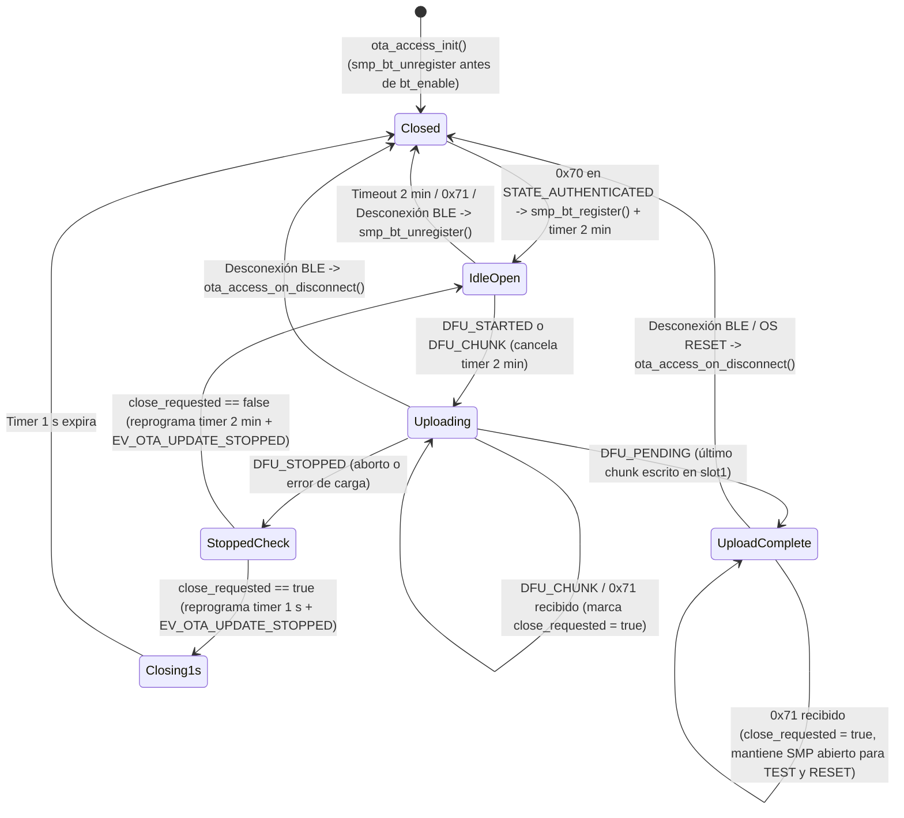
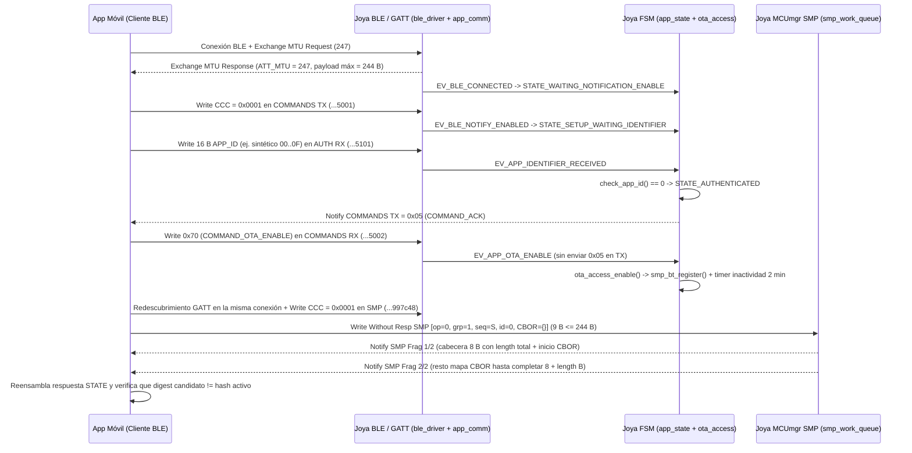
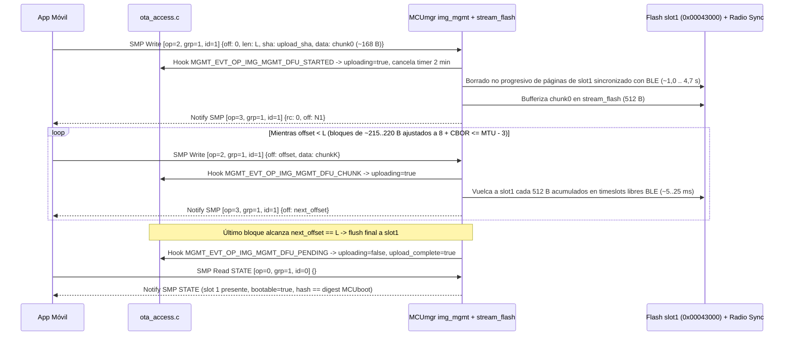
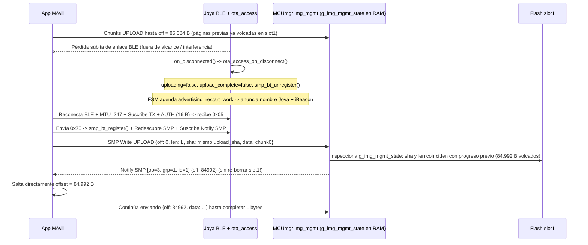
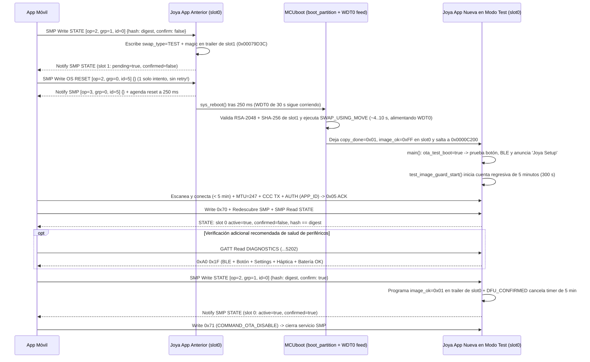
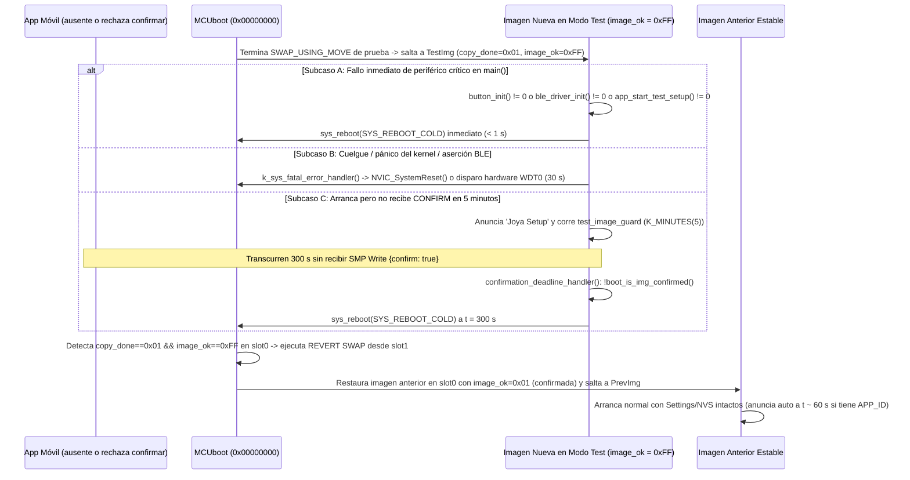
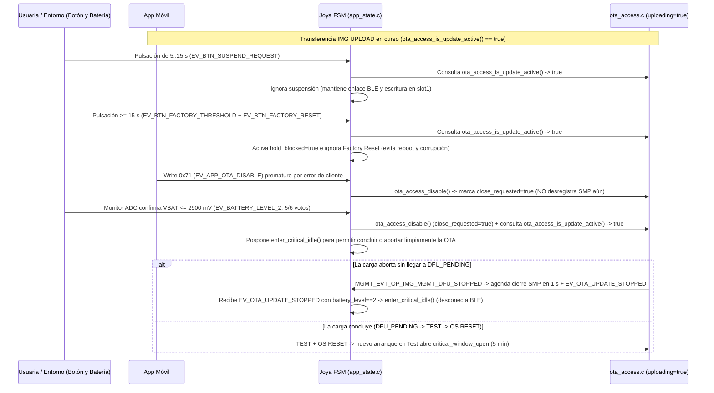
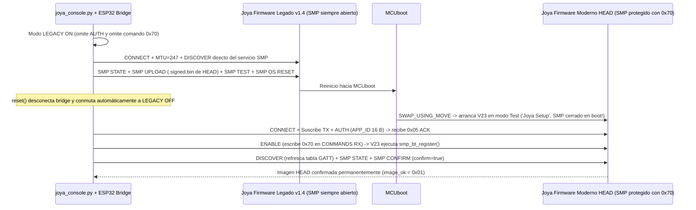

# 16. Actualización OTA y Bootloader (`MCUboot` + `MCUmgr` / `SMP`)

> **Capítulo del Manual Técnico Integral de Ingeniería del Producto — Firmware Joya**
> Navegación: [Índice General (README.md)](README.md) | Anterior: [15. Almacenamiento Persistente y Memoria Flash](15_flash_persistence.md) | Siguiente: [17. Seguridad y Privacidad](17_security_privacy.md) | Véase también: [03. Configuración del Firmware](03_firmware_configuration.md), [04. Arranque e Inicialización](04_boot_initialization.md), [05. Máquina de Estados](05_state_machine.md), [07. Arquitectura BLE](07_ble_architecture.md), [09. Protocolo GATT](09_gatt_protocol.md), [10. Autenticación](10_authentication.md), [18. Manejo de Errores y Watchdog](18_error_handling.md), [Referencia 20b](code_reference/20b_ble_ota.md)

---

## 16.1. Visión General de la Arquitectura de Actualización Inalámbrica (OTA)

El mecanismo de actualización de firmware en campo (*Over-The-Air Device Firmware Update*, **OTA DFU**) de Joya combina tres componentes cooperativos:

1. **Bootloader inmutable de raíz de confianza (`MCUboot`)**: compilado e integrado mediante `Zephyr sysbuild` ([sysbuild.conf](../../sysbuild.conf#L1), [sysbuild/mcuboot.conf](../../sysbuild/mcuboot.conf#L1-L6)) en los primeros `48 KiB` de Flash (`boot_partition`, `0x00000000..0x0000C000`). Verifica firmas criptográficas `RSA-2048` + `SHA-256` sobre la imagen primaria en cada arranque, ejecuta intercambios transaccionales (*swap-using-move*) entre `slot0` y `slot1` alimentando el watchdog hardware `WDT0`, y revierte automáticamente (*rollback*) cualquier imagen de prueba no confirmada.
2. **Servidor de transporte y gestión en tiempo de ejecución (`MCUmgr` / `SMP` sobre BLE)**: integrado dentro de la propia aplicación Zephyr ([prj.conf](../../prj.conf#L90-L123)), recibe bloques codificados en `CBOR` sobre una característica GATT dedicada y los vuelca en `slot1_partition` (`0x00043000..0x0007A000`) mediante `stream_flash`.
3. **Capa propietaria de control de acceso, protección operativa y guarda anti-bloqueo de Joya**: implementada en [src/ota_access.c](../../src/ota_access.c), [src/test_image_guard.c](../../src/test_image_guard.c), [src/main.c](../../src/main.c) y [src/app_state.c](../../src/app_state.c). Mantiene oculto el servicio GATT `SMP` hasta superar la autenticación por `APP_ID` y recibir el comando explícito `0x70`, impide suspensiones manuales, resets de fábrica o apagados por batería crítica en mitad de una transferencia, e impone una ventana máxima inapelable de **`5 minutos`** para que una imagen recién instalada en modo `Test` demuestre conectividad BLE funcional y reciba `CONFIRM` antes de revertir automáticamente a la versión anterior.

Al igual que en el resto del manual, se distingue rigurosamente entre **(a) Comportamiento implementado** en el commit `c1128e5d0c0d6f98be0a580d287c0926ca27f01f`, **(b) Intención de diseño**, **(c) Comportamiento inferido**, **(d) Código o artefactos residuales/truncados** y **(e) Aspectos dependientes de aprovisionamiento externo o validación en banco**.

---

## 16.2. Arquitectura Completa del Bootloader (`MCUboot`)

### 16.2.1. Configuración efectiva `sysbuild` y huella del bootloader

*(a) Comportamiento implementado verificado en [sysbuild.conf](../../sysbuild.conf#L1), [sysbuild/mcuboot.conf](../../sysbuild/mcuboot.conf#L1-L6), `build_joya/mcuboot/zephyr/.config` y `build_joya/mcuboot/zephyr/zephyr.elf`*:

| Parámetro / Símbolo Kconfig en `MCUboot` | Valor efectivo | Consecuencia técnica en arranque, seguridad y memoria |
|---|---|---|
| `SB_CONFIG_BOOTLOADER_MCUBOOT` | `y` (`sysbuild.conf`) | Genera dos dominios coordinados (`mcuboot` + aplicación firmada `zephyr.signed.bin`). |
| Partición `boot_partition` (`"mcuboot"`) | `0x00000000 .. 0x0000C000` (`49.152 B` = `48 KiB`, `12` páginas) | Huella compilada en `build_joya`: `text = 30.204 B` + `data = 168 B` = **`30.372 B` (`61,8 %` de ocupación)**; holgura libre de `18.780 B` (`~18,3 KiB`). `bss = 21.055 B` en SRAM. |
| `CONFIG_MAIN_STACK_SIZE` (MCUboot) | `10.240 B` (`10 KiB`) | Dimensionado para soportar la aritmética multiprecisión en pila de `mbedTLS` durante verificación `RSA-2048` (`CONFIG_MBEDTLS_ENABLE_HEAP=n`). |
| `CONFIG_ARM_MPU` + `CONFIG_MPU_ALLOW_FLASH_WRITE` | `y` + `y` (`sysbuild/mcuboot.conf`) | Activa protección MPU (`XN` en RAM) permitiendo simultáneamente escrituras `NVMC` de *swap* sobre `slot0` y `slot1`. Antes de saltar a la app (`CONFIG_MCUBOOT_CLEANUP_ARM_CORE=y`), desactiva la MPU. |
| `CONFIG_CLOCK_CONTROL_NRF_K32SRC_RC` | `y` (`XTAL=n`, `500PPM=y`) | Sincronizado con `prj.conf`: arranca el oscilador RC interno de `32,768 kHz`, indispensable porque la PCB Joya carece de cristal externo de `32,768 kHz`. |
| `CONFIG_BOOT_SWAP_USING_MOVE` | `y` (`CONFIG_SWAP_NONATOMIC=y`) | Algoritmo de intercambio página a página usando `1` sector interno de `slot0` como colchón de movimiento, sin partición `scratch` externa. |
| `CONFIG_BOOT_MAX_IMG_SECTORS_AUTO` | `y` (`55` sectores por slot) | Calcula automáticamente `55` sectores de `4.096 B` a partir de `0x37000 / 0x1000`. |
| `CONFIG_BOOT_SIGNATURE_TYPE_RSA` | `y` (`LEN = 2048`, `CONFIG_BOOT_USE_MBEDTLS=y`) | Exige firma digital `RSASSA-PSS` de `2.048 bits` (`CONFIG_MBEDTLS_PKCS1_V21=y`) verificada contra la clave pública compilada dentro de `boot_partition`. |
| `CONFIG_BOOT_IMG_HASH_ALG_SHA256` | `y` (`CONFIG_MBEDTLS_SHA256_SMALLER=y`) | Resumen criptográfico `SHA-256` (`32 B`) compacto en ROM. |
| `CONFIG_BOOT_VALIDATE_SLOT0` | `y` | **Re-verifica hash `SHA-256` y firma `RSA-2048` de `slot0` en cada reinicio**, no solo durante actualizaciones. |
| `CONFIG_BOOT_WATCHDOG_FEED` + `CONFIG_BOOT_WATCHDOG_FEED_NRFX_WDT` | `y` + `y` | Alimenta automáticamente los canales `RR` activos de `NRF_WDT` durante validación criptográfica y copias/borrados de páginas entre slots. |
| `CONFIG_BOOT_ENCRYPT_IMAGE` | No activo (`n`) | Las imágenes OTA viajan y se almacenan **sin cifrar** (firmadas pero legibles). |
| `CONFIG_BOOT_UPGRADE_ONLY` / Anti-downgrade | No activo (`n`) | Permite instalar versiones iguales o anteriores siempre que estén firmadas con la clave privada autorizada (véase §16.2.4). |
| `CONFIG_MCUBOOT_SERIAL` / `CONFIG_BOOT_USB_DFU_NO` | `n` / `y` | Sin modo de recuperación serie ni USB en el bootloader (`uart0` deshabilitado en DTS). |

> [!CAUTION]
> **Gestión de la clave de firma `RSA-2048`**: En `build_joya/mcuboot/zephyr/.config` se observa que el binario de referencia fue firmado inyectando `-DSB_CONFIG_BOOT_SIGNATURE_KEY_FILE="/workspace/keys/joya_dev-private.pem"` (procedimiento documentado en [otros/docs/ota.md](../../otros/docs/ota.md#L40-L43)). Si se ejecutase `west build --sysbuild` sin pasar `SB_CONFIG_BOOT_SIGNATURE_KEY_FILE`, `MCUboot` incrustaría la clave pública de demostración pública de `MCUboot` (`root-rsa-2048.pem`), rechazando toda imagen firmada con la clave de Joya (y viceversa). **Jamás debe incluirse el archivo `.pem` privado dentro del repositorio Git ni en artefactos distribuidos**.

---

### 16.2.2. Algoritmo `SWAP_USING_MOVE`, geometría del *Trailer* y capacidad máxima real de imagen

*(a) Comportamiento implementado verificado desensamblando `boot_trailer_sz()` (`0x00004b2d`) y `boot_img_magic` (`0x00006e86`) en `build_joya/mcuboot/zephyr/zephyr.bin`*:

#### Cómo funciona `CONFIG_BOOT_SWAP_USING_MOVE=y`
Sin partición `scratch` dedicada, `MCUboot` intercambia `slot0` (`55` páginas: `0..54`) y `slot1` (`55` páginas: `0..54`) en dos fases reanudables ante apagones:
1. **Fase 1 — Desplazamiento ascendente en `slot0` (*Move up*)**: Reserva la última página útil de imagen en `slot0` como hueco inicial y desplaza secuencialmente cada página $k$ de `slot0` hacia la página $k + 1$ (de arriba hacia abajo: `52 -> 53`, ..., `0 -> 1`), registrando cada paso de `4 B` en el área `swap_status` del trailer para que un corte eléctrico a mitad de copia pueda retomarse exactamente en el sector interrumpido.
2. **Fase 2 — Permutación cruzada (*Swap sectors*)**: Para cada índice $k = 0, 1, \dots$:
   - Copia el sector $k$ de la candidata desde `slot1[k]` hacia `slot0[k]`.
   - Copia el sector antiguo desplazado desde `slot0[k + 1]` hacia `slot1[k]`.
   - Graba el paso completado en `swap_status`. Al terminar todos los sectores ocupados, escribe el nuevo trailer en `slot0` con `copy_done = 0x01` e `image_ok = 0xFF` (si fue `TEST`) o `image_ok = 0x01` (si fue `PERM` o `REVERT`).

#### Tamaño exacto del *Image Trailer* en Joya (`708 bytes`)
La función `boot_trailer_sz(uint32_t min_write_sz)` compilada en el `MCUboot` de Joya ejecuta exactamente `return min_write_sz * 165 + 48;`. Con `write-block-size = 4 B` en `nRF52832`:
$$\text{Tamaño del Trailer MCUboot} = (55\text{ sectores} \times 3\text{ pasos/sector}) \times 4\text{ B} + 48\text{ B} = 660\text{ B} + 48\text{ B} = \mathbf{708\text{ bytes}}\ (\text{0x02C4})$$

#### Capacidad máxima real de `zephyr.signed.bin` vs riesgo de `CONFIG_MCUMGR_GRP_IMG_TOO_LARGE_DISABLED=y`

| Magnitud de capacidad del slot | Bytes exactos (`KiB`) | Cálculo y justificación |
|---|---:|---|
| Tamaño físico bruto de `slot0` / `slot1` | `225.280 B` (`220,00 KiB`) | `55 × 4.096 B` (`0x37000` en Devicetree). |
| Menos `1` sector obligatorio de movimiento (`SWAP_USING_MOVE`) | `- 4.096 B` (`- 4,00 KiB`) | Quedan `54` páginas (`221.184 B` = `216,00 KiB`). |
| Menos el *Image Trailer* (`boot_trailer_sz(4)`) | `- 708 B` (`- 0,69 KiB`) | El trailer ocupa los últimos `708 B` del slot (`0x36D3C..0x37000`). |
| **Techo máximo absoluto admisible por `MCUboot`** | **`220.476 B` (`~215,31 KiB`)** | Cota teórica exacta (`225.280 - 4.096 - 708`); cota conservadora alineada a página entera sin compartir sector con el trailer: **`53` páginas = `217.088 B` (`212,00 KiB`)**. |
| Tamaño real actual (`build_joya/.../zephyr.signed.bin`) | **`165.056 B` (`~161,19 KiB`)** | Ocupa `41` páginas (`74,9 %` del techo útil); margen libre de **`55.420 B` (`~54,1 KiB`)**. |

> [!WARNING]
> **Riesgo latente en Kconfig (`CONFIG_MCUMGR_GRP_IMG_TOO_LARGE_DISABLED=y`)**: En `build_joya/app/zephyr/.config`, `Zephyr` compiló con `CONFIG_MCUMGR_GRP_IMG_TOO_LARGE_DISABLED=y` (`# CONFIG_MCUMGR_GRP_IMG_TOO_LARGE_SYSBUILD is not set`). En consecuencia, `img_mgmt_upload()` solo rechaza archivos con `len > 225.280 B` (tamaño bruto de `slot1_partition`), **sin restar los `4.804 B` reservados por `SWAP_USING_MOVE` + trailer**. Si en el futuro el firmware creciera hasta situarse entre `220.477 B` y `225.280 B`, la carga BLE `IMG UPLOAD` reportaría éxito (`rc = 0`), pero al reiniciar `MCUboot` **se negaría a ejecutar el swap** por exceso de sectores (`app_max_sectors`), dejando inoperativa la actualización. Se recomienda imponer en CI una verificación estática `sizeof(zephyr.signed.bin) <= 217088` (`212 KiB`).

---

### 16.2.3. Alimentación de `WDT0` durante operaciones de `MCUboot`

*(a) Comportamiento implementado*:
- Un *swap* completo de `~165 KiB` (`41` páginas movidas + intercambiadas $\approx 123$ borrados de página × `20..85 ms` + escrituras + dos verificaciones SHA-256/RSA-2048) consume entre **`3,5` y `11 segundos`** de tiempo real.
- Si el reinicio provino de la aplicación Joya (donde `wdt_guard_init()` ya arrancó `NRF_WDT` con ventana de `30.000 ms` y canal `RR[0]`), el periférico hardware `WDT0` **permanece activo e indetenible durante un `sys_reboot(SYS_REBOOT_COLD)`** (`NVIC_SystemReset`).
- Gracias a `CONFIG_BOOT_WATCHDOG_FEED=y` y `CONFIG_BOOT_WATCHDOG_FEED_NRFX_WDT=y` en `MCUboot`, cada iteración de copia de sector y validación criptográfica escribe `0x6E524635` en los registros `NRF_WDT->RR[i]` habilitados en `RREN`, garantizando que ni siquiera un *swap* seguido de un *revert* agote los `30 s` de `WDT0`.

---

### 16.2.4. Ausencia de protección Anti-Downgrade y discrepancias de versión

*(a) Comportamiento implementado*:
1. En `MCUboot` no están habilitados `CONFIG_BOOT_UPGRADE_ONLY` ni contadores monótonos hardware de seguridad (`security_counter`). `MCUboot` acepta permutar hacia `slot0` cualquier imagen válidamente firmada con la clave RSA-2048 confiable, con independencia de si su `ih_ver` es mayor, igual o menor que la activa.
2. En el repositorio actual ([VERSION](../../VERSION#L1-L4)), el archivo `VERSION` continúa fijado en `2.3.1+0`, por lo que compilaciones de `v2.3.1`, `v2.3.2` y `HEAD` (`c1128e5`) muestran todas `"version": "2.3.1"` en respuestas `SMP IMG STATE`. La identificación inequívoca de una versión en la app móvil y en `joya_console.py` se realiza exclusivamente mediante los **`32 bytes` del hash `SHA-256` (`IMAGE_TLV_SHA256`)** de cada slot ([ota/joya_console.py](../../ota/joya_console.py#L628-L630)).

---

## 16.3. Formato Binario Exacto de `zephyr.signed.bin` y del *Trailer* `MCUboot`

### 16.3.1. Anatomía de `zephyr.signed.bin` y dualidad crítica de hashes `SHA-256`

*(a) Comportamiento verificado contra `verify_image()` en [ota/joya_console.py](../../ota/joya_console.py#L82-L126) y la inspección binaria directa de `build_joya/app/zephyr/zephyr.signed.bin` (`165.056 B`)*:

```text
Archivo zephyr.signed.bin (ej. build_joya: 165.056 bytes totales)
┌──────────────────────────────────────────────────────────────────────────────────────────┐
│ 1. Cabecera MCUboot (image_header + padding VTOR): 0x000000 .. 0x0001FF (512 bytes)      │
│    - ih_magic            = 0x96F3B83D (bytes 0..3, LE: 3D B8 F3 96)                      │
│    - ih_load_addr        = 0x00000000 (bytes 4..7)                                       │
│    - ih_hdr_size         = 0x0200     (bytes 8..9  -> 512 B; alinea VTOR en 0x0000C200)  │
│    - ih_protect_tlv_size = 0x0000     (bytes 10..11 -> 0 B en Joya)                      │
│    - ih_img_size         = 164.208 B  (bytes 12..15, LE)                                 │
│    - ih_flags            = 0x00000000 (bytes 16..19)                                     │
│    - ih_ver              = 2.3.1+0    (bytes 20..27: maj=2, min=3, rev=1 LE, build=0 LE) │
│    - reservado + padding = 0xFF/0x00  (bytes 28..511)                                    │
├──────────────────────────────────────────────────────────────────────────────────────────┤
│ 2. Cuerpo Ejecutable ARM Cortex-M4: 0x000200 .. 0x02836F (ih_img_size = 164.208 bytes)   │
│    - Tabla de vectores en +0x200 (MSP inicial + Reset_Handler 0x00012461) + .text + .data│
├──────────────────────────────────────────────────────────────────────────────────────────┤
│ 3. Área TLV Protegida opcional (magic 0x6908): 0 bytes (ausente cuando prot_tlv == 0)    │
├═════════════════════════════ FIN DE ZONA CUBIERTA POR IMAGE_TLV_SHA256 ══════════════════┤
│ 4. Área TLV No Protegida (image_tlv_info): 0x028370 .. 0x0284BF (336 bytes exactos)      │
│    - Cabecera TLV (4 B): it_magic = 0x6907, it_tlv_tot = 336 (0x0150)                    │
│    - TLV #1 (36 B): type = 0x10 (IMAGE_TLV_SHA256),      len = 32  -> digest MCUboot     │
│    - TLV #2 (36 B): type = 0x01 (IMAGE_TLV_KEYHASH),     len = 32  -> SHA-256 pubkey RSA │
│    - TLV #3 (260 B): type = 0x20 (IMAGE_TLV_RSA2048_PSS), len = 256 -> Firma RSA-2048    │
└──────────────────────────────────────────────────────────────────────────────────────────┘
```

> [!IMPORTANT]
> **Regla crítica para clientes OTA — Dos hashes `SHA-256` distintos sobre el mismo archivo**:
> 1. **`digest` de imagen `MCUboot` (`IMAGE_TLV_SHA256`, `32 B`)**: Es `SHA256(data[0 : ih_hdr_size + ih_img_size + ih_protect_tlv_size])` —**excluye** los `336 B` del bloque TLV no protegido `0x6907` porque dicho bloque contiene al propio hash y a la firma RSA. Este es el hash devuelto por Joya en `IMG STATE` (`images[i]["hash"]`) y el **único válido para invocar `TEST` (`confirm: false`) y `CONFIRM` (`confirm: true`)**.
> 2. **`upload_sha` de sesión `MCUmgr` (`32 B`)**: Es `SHA256(data[0 : len(data)])` sobre **el archivo `.signed.bin` completo** (incluidos los `336 B` finales de TLVs). Se envía en el campo `"sha"` del paquete inicial `off = 0` de `IMG UPLOAD`. `img_mgmt` lo conserva en RAM (`g_img_mgmt_state`) para verificar que un reintento tras desconexión corresponde exactamente al mismo binario antes de permitir reanudar en `off > 0` ([ota/joya_console.py](../../ota/joya_console.py#L624-L625), [ota/joya_console.py](../../ota/joya_console.py#L881-L882)).

---

### 16.3.2. Estructura del *Trailer* `MCUboot` al final de `slot0` y `slot1`

Ubicado en los últimos `708 B` de `slot0` (`0x00042D3C..0x00042FFF`) y de `slot1` (`0x00079D3C..0x00079FFF`), creciendo hacia el final de la partición con alineación de campo `BOOT_MAX_ALIGN = 8 B`:

| Desplazamiento desde el final del slot | Campo del Trailer | Tamaño | Valores significativos en `nRF52832` | Significado en el ciclo de vida OTA |
|---:|---|---:|---|---|
| `-708 .. -49` (`-0x2C4 .. -0x31`) | `swap_status` | `660 B` | `165` palabras de `4 B` (`0xFFFFFFFF` virgen; `1`, `2`, `3` progreso) | Bitácora de progreso sector a sector de `SWAP_USING_MOVE` ante cortes eléctricos. |
| `-48 .. -41` (`-0x30 .. -0x29`) | `swap_size` | `8 B` | `uint32_t` tamaño a intercambiar + `4 B` `0xFF` | Total de bytes de imagen + TLVs involucrados en el *swap* en curso. |
| `-40 .. -33` (`-0x28 .. -0x21`) | `swap_info` | `8 B` | Byte `0`: `swap_type` (`0x02` `TEST`, `0x03` `PERM`, `0x04` `REVERT`, `0xFF` unset) | Escrito en `slot1` cuando el cliente envía `TEST` (`confirm=false` → `0x02`). |
| `-32 .. -25` (`-0x20 .. -0x19`) | `copy_done` | `8 B` | Byte `0`: `0x01` = completado, `0xFF` = pendiente | Escrito por `MCUboot` en `slot0` al concluir el *swap*. Si `copy_done == 0x01` e `image_ok == 0xFF` en el siguiente reinicio, dispara **Rollback**. |
| `-24 .. -17` (`-0x18 .. -0x11`) | `image_ok` | `8 B` | Byte `0`: `0x01` = confirmada, `0xFF` = en prueba (`Test`) | Escrito en vivo desde la aplicación (`0xFF -> 0x01`, transición `1 -> 0` sin borrar página) cuando llega el comando SMP **`CONFIRM`** (`boot_write_img_confirmed()`). |
| `-16 .. -1` (`-0x10 .. -0x01`) | `magic` | `16 B` | `77 C2 95 F3 60 D2 EF 7F 35 52 50 0F 2C B6 79 80` | Firma mágica que habilita la lectura del trailer por `MCUboot` e `img_mgmt`. |

---

## 16.4. Protocolo `SMP` / `MCUmgr` sobre BLE y Asimetría de Fragmentación

### 16.4.1. Perfil GATT, cola de trabajo y cabecera `SMP` de 8 bytes

*(a) Comportamiento implementado en `build_joya/app/zephyr/.config`*:

- **Servicio Primario SMP**: UUID `8d53dc1d-1db7-4cd3-868b-8a527460aa84` (registrado dinámicamente vía `CONFIG_MCUMGR_TRANSPORT_BT_DYNAMIC_SVC_REGISTRATION=y` y `CONFIG_BT_GATT_DYNAMIC_DB=y`).
- **Característica SMP única**: UUID `da2e7828-fbce-4e01-ae9e-261174997c48`
  - Propiedades: `BT_GATT_CHRC_WRITE_WITHOUT_RESP | BT_GATT_CHRC_NOTIFY` + descriptor `CCC` (`0x2902`).
  - Permisos ATT: `CONFIG_MCUMGR_TRANSPORT_BT_PERM_RW=y` (lectura/escritura abierta a nivel de enlace BLE; la autorización la ejerce Joya registrando el servicio solo tras autenticar `APP_ID` + recibir `0x70`).
- **Recursos dedicados en RAM de Joya**:
  - Hilo de procesamiento `smp_work_queue`: prioridad preemptiva **`3`** (`CONFIG_MCUMGR_TRANSPORT_WORKQUEUE_THREAD_PRIO=3`, mayor prioridad que `fsm_thread_id` que corre en prioridad `5`), stack de **`2.048 B`** (`CONFIG_MCUMGR_TRANSPORT_WORKQUEUE_STACK_SIZE=2048`).
  - Pool de buffers SMP (`bt_smp_pool`): **`4` buffers de `384 B`** cada uno (`CONFIG_MCUMGR_TRANSPORT_NETBUF_COUNT=4`, `CONFIG_MCUMGR_TRANSPORT_NETBUF_SIZE=384`).
  - Buffer de escritura paginada (`stream_flash` / `img_mgmt`): **`512 B`** (`CONFIG_IMG_BLOCK_BUF_SIZE=512`).

#### Formato de la cabecera `SMP` (`8 bytes` en orden *big-endian*, `struct smp_hdr`)

| Bytes | Campo | Tipo | Valores en Joya | Descripción |
|---:|---|---|---|---|
| `0` | `op` (+ `ver`) | `uint8_t` | Bits `0..2`: `0` Read Req, `1` Read Rsp, `2` Write Req, `3` Write Rsp.<br/>Bits `3..4`: versión `0` (SMP v1) o `1` (SMP v2). | Joya soporta tanto SMP v1 (`op = 0/2`) como SMP v2 gracias a `CONFIG_MCUMGR_SMP_SUPPORT_ORIGINAL_PROTOCOL=y`. Las herramientas del repositorio usan SMP v1 (`0x00` / `0x02`). |
| `1` | `flags` | `uint8_t` | `0x00` | Reservado / banderas SMP. |
| `2..3` | `length` | `uint16_t` BE | `0 .. 376` | Longitud exacta en bytes del mapa **CBOR** que sigue inmediatamente al byte `7`. |
| `4..5` | `group` | `uint16_t` BE | `0x0000` (`OS`), `0x0001` (`IMG`) | Únicos dos grupos compilados en Joya (`CONFIG_MCUMGR_GRP_OS=y`, `CONFIG_MCUMGR_GRP_IMG=y`). |
| `6` | `seq` | `uint8_t` | `0x00 .. 0xFF` | Número de secuencia elegido por el cliente y reflejado idéntico en la respuesta (`op + 1`). Crítico para descartar respuestas tardías retransmitidas. |
| `7` | `id` | `uint8_t` | Grupo `1`: `0` (`STATE`), `1` (`UPLOAD`), `5` (`ERASE`), `6` (`SLOT_INFO`).<br/>Grupo `0`: `0` (`ECHO`), `5` (`RESET`). | Identificador del comando dentro del grupo. |

---

### 16.4.2. Catálogo exacto de comandos `SMP` utilizados en el flujo OTA

| Operación lógica | Cabecera (`op`, `group`, `id`) | Cuerpo CBOR de petición | Cuerpo CBOR de respuesta (`op + 1`) | Comportamiento interno y latencia en Joya |
|---|---|---|---|---|
| **Consultar estado de slots (`STATE`)** | `op = 0`, `grp = 1`, `id = 0` | `{}` (`0xA0`, `length = 1`) | `{"images": [{"image": 0, "slot": 0, "version": "2.3.1", "hash": <32B>, "bootable": true, "pending": false, "confirmed": true, "active": true, "permanent": false}, {"image": 0, "slot": 1, ...}], "splitStatus": 0}` | Inspecciona cabeceras y trailers de `slot0` y `slot1`. Cuando ambos slots tienen imagen, la respuesta mide **`~260..320 B`** y se divide en `2` notificaciones BLE. |
| **Cargar bloque (`UPLOAD`, inicio `off == 0`)** | `op = 2`, `grp = 1`, `id = 1` | `{"off": 0, "len": <int>, "sha": <32B upload_sha>, "data": <bytes>}` | `{"rc": 0, "off": <next_offset>}` (en SMP v2 sin error puede omitir `"rc": 0` y enviar `{"off": N}`) | **¡Atención latencia!**: Como `# CONFIG_IMG_ERASE_PROGRESSIVELY is not set`, si no hay una sesión reanudable previa con el mismo `upload_sha`, **borra todas las páginas necesarias de `slot1` en `off == 0`**, tardando **`1,0 .. 4,7 s`** antes de responder. Si ya tenía `N` bytes del mismo `sha`, salta directo devolviendo `{"off": N}`! |
| **Cargar bloque (`UPLOAD`, continuación `off > 0`)** | `op = 2`, `grp = 1`, `id = 1` | `{"off": <offset>, "data": <bytes>}` | `{"off": <next_offset>}` | Acumula en el buffer `stream_flash` de `512 B` y vuelca a `slot1` sincronizado con radio BLE (~`5..25 ms`). Al completar `next_offset == len`, dispara el hook `MGMT_EVT_OP_IMG_MGMT_DFU_PENDING`. |
| **Marcar candidata para prueba (`TEST`)** | `op = 2`, `grp = 1`, `id = 0` | `{"hash": <32B digest>, "confirm": false}` | Mapa idéntico a `STATE` donde `slot 1` muestra `"pending": true, "permanent": false` | Verifica que el `digest` coincida con `slot1` y escribe `swap_info = TEST` + `magic` en el trailer de `slot1`. |
| **Reiniciar al bootloader (`RESET`)** | `op = 2`, `grp = 0`, `id = 5` | `{}` (`0xA0`) | `{}` (`0xA0`) | Envía inmediatamente la notificación de respuesta SMP y agenda un trabajo diferido de **`250 ms`** (`CONFIG_MCUMGR_GRP_OS_RESET_MS=250`) que invoca `sys_reboot(SYS_REBOOT_WARM)` → `MCUboot`. |
| **Confirmar imagen en prueba (`CONFIRM`)** | `op = 2`, `grp = 1`, `id = 0` | `{"hash": <32B active_digest>, "confirm": true}` | Mapa `STATE` donde `slot 0` pasa a `"confirmed": true, "active": true` | Escribe `image_ok = 0x01` en el trailer de `slot0` (`boot_write_img_confirmed()`) y dispara `MGMT_EVT_OP_IMG_MGMT_DFU_CONFIRMED`, desarmando el timer de rollback de `5 min` en `test_image_guard.c`. |

*(Nota sobre capacidad secundaria compilada)*: En `build_joya/app/zephyr/.config` figura `CONFIG_MCUMGR_GRP_IMG_ALLOW_CONFIRM_NON_ACTIVE_IMAGE_SECONDARY=y`, lo que técnicamente permitiría a un cliente pedir un *swap permanente* directo (`confirm: true` sobre el hash de `slot1` antes de reiniciar). **La arquitectura de producto de Joya prohíbe usar `confirm: true` antes del reinicio**, porque anularía la auto-prueba de botón y BLE en `main()` y el salvavidas de `5 minutos` de `test_image_guard.c`, exponiendo la pulsera a bloqueo permanente (*brick*) si la nueva imagen fallara al inicializar hardware.

---

### 16.4.3. Asimetría crítica de fragmentación BLE (`RX` sin reensamblado vs `TX` fragmentado)

*(a) Comportamiento implementado verificado en `build_joya/app/zephyr/.config` y en el desensamblado de `smp_bt_chr_write()` (`0x00013e0d`) y `smp_bt_tx_pkt()` (`0x00013d05`) en `zephyr.elf`*:

| Dirección del tráfico SMP | Mecanismo GATT | Configuración en Joya | Límite máximo por trama y obligación del cliente móvil |
|---|---|---|---|
| **Cliente → Joya (Peticiones SMP)** | `Write Without Response` (`ATT OpCode 0x52`) | **`# CONFIG_MCUMGR_TRANSPORT_BT_REASSEMBLY is not set`** (`NETBUF_SIZE = 384 B`, `BT_L2CAP_TX_MTU = 247`, `BT_BUF_ACL_RX_SIZE = 251`) | **CERO reensamblado en recepción**: `smp_bt_chr_write()` entrega cada paquete ATT individual como una petición SMP completa al parser CBOR. Por tanto, **`8 + len(CBOR)` debe ser estrictamente `<= ATT_MTU - 3`**.<ul><li>Con `ATT_MTU = 247` negociado: máx. **`244 bytes`** por escritura ATT (`236 B` de CBOR → ~`168 B` de `data` en `off == 0` y ~`215..220 B` de `data` en `off > 0`).</li><li>Si un cliente dividiera un paquete SMP de `300 B` en dos escrituras ATT de `244 B` + `56 B`, Joya rechazará la primera por CBOR truncado y descartará la segunda por cabecera SMP inválida.</li><li>Si el cliente **no negocia MTU** y queda en `ATT_MTU = 23` (`20 B` útiles), ni `UPLOAD` (`off=0` requiere `> 45 B` solo para `sha`) ni `TEST`/`CONFIRM` (`> 48 B`) caben en una escritura: **la OTA es inviable sin negociar `ATT_MTU` ampliado** (mínimo recomendado `>= 128`, óptimo `247`).</li></ul> |
| **Joya → Cliente (Respuestas SMP)** | `Handle Value Notification` (`ATT OpCode 0x1B`) | `smp_bt_tx_pkt()` trocea el `net_buf` de salida (hasta `384 B`) en trozos de `bt_gatt_get_mtu(conn) - 3` bytes | **SÍ fragmenta en transmisión**: Una respuesta `IMG STATE` con dos slots (~`280..320 B`) supera los `244 B` de una notificación con `MTU = 247` y llega dividida en **`2` (o más) notificaciones consecutivas**.<ul><li>La primera notificación contiene la cabecera SMP de `8 B`, cuyos bytes `2..3` (*big-endian*) indican `length`.</li><li>El cliente **está obligado** a concatenar las notificaciones entrantes en un buffer hasta acumular exactamente `total = 8 + length` bytes antes de decodificar el mapa CBOR.</li></ul> |

---

## 16.5. Control de Acceso, Ciclo de Vida OTA y Salvaguardas en el Firmware Joya

### 16.5.1. Ocultamiento en arranque y registro dinámico del servicio `SMP` (`src/ota_access.c`)

*(a) Comportamiento implementado en [src/ota_access.c](../../src/ota_access.c#L1-L148), [src/ble_driver.c](../../src/ble_driver.c#L494-L502) y [src/app_state.c](../../src/app_state.c#L703-L713)*:

1. **Clausura preventiva antes de encender el radio (`ota_access_init()`)**:
   - Durante la inicialización `APPLICATION` previa a `main()`, el módulo `smp_bt` de Zephyr registra automáticamente el servicio GATT `SMP`.
   - Para impedir cualquier ventana de exposición no autenticada, `ble_driver_init()` invoca `ota_access_init()` **antes** de `bt_enable(NULL)` ([src/ble_driver.c](../../src/ble_driver.c#L495-L499)). `ota_access_init()` inicializa `idle_close_work`, ejecuta `smp_bt_unregister()` y suscribe `image_status_callback` a los 4 eventos `MGMT_EVT_OP_IMG_MGMT_DFU_*`. Si `smp_bt_unregister()` fallara, `ble_driver_init()` aborta antes de habilitar Bluetooth.
2. **Apertura autenticada (`0x70` `COMMAND_OTA_ENABLE`)**:
   - El cliente escribe `0x70` (`1 B`) en `COMMANDS RX` (`...5002`) → `on_rx_write_handler()` encola `EV_APP_OTA_ENABLE` asociado a `conn` ([src/app_comm.c](../../src/app_comm.c#L29-L36)).
   - En `process_event()` ([src/app_state.c](../../src/app_state.c#L703-L713)), solo si **`current_state == STATE_AUTHENTICATED && ble_is_authenticated_conn(entry->conn)`**, se invoca `ota_access_enable()`. *(Nota de protocolo)*: a diferencia de `0x41..0x44`, los comandos `0x70` y `0x71` **no emiten `COMMAND_ACK (0x05)`** por `COMMANDS TX`.
   - `ota_access_enable()` toma `ota_mutex`, llama a `smp_bt_register()`, marca `service_enabled = true`, limpia `close_requested = false` y, si no hay carga activa (`!uploading && !upload_complete`), programa el temporizador de inactividad `idle_close_work` a **`2 minutos`** (`OTA_IDLE_TIMEOUT = K_MINUTES(2)`, [src/ota_access.c](../../src/ota_access.c#L8), `L96-L115`).
3. **Máquina interna de estados de `ota_access.c` y cierre diferido**:



- **Por qué `upload_complete` retiene abierto el servicio `SMP`**: Cuando termina `IMG UPLOAD`, Zephyr dispara `MGMT_EVT_OP_IMG_MGMT_DFU_PENDING` (`uploading = false`, `upload_complete = true`). En ese estado el cliente aún necesita enviar por SMP `TEST` (`IMG STATE write`) y `OS RESET`. Por ello, mientras `uploading || upload_complete` sea verdadero:
  - El timeout de inactividad de `2 min` permanece cancelado.
  - Si llega `0x71` (`ota_access_disable()`), **no desmonta el servicio GATT en caliente** (lo que cortaría una transacción SMP en vuelo), sino que levanta `close_requested = true` ([src/ota_access.c](../../src/ota_access.c#L120-L121)). Si la carga se detiene sin completarse (`DFU_STOPPED` con `!upload_complete`), cierra el servicio `1 s` después (`L61-L62`) y envía `EV_OTA_UPDATE_STOPPED` a la FSM (`L69-L71`). Al completarse y ejecutarse `RESET` (o desconectar el enlace BLE), `ota_access_on_disconnect()` limpia todas las banderas y desregistra SMP (`L129-L138`).

---

### 16.5.2. Bloqueo de gestos destructivos y diferimiento de batería crítica durante OTA activa

*(a) Comportamiento implementado en [src/app_state.c](../../src/app_state.c) consultando `ota_access_is_update_active()` (`uploading || upload_complete`)*:

Mientras una transferencia OTA ha comenzado (`DFU_STARTED`/`DFU_CHUNK`) o ha terminado quedando lista para `TEST`+`RESET` (`DFU_PENDING`), el predicado `ota_access_is_update_active()` devuelve `true` y activa **tres blindajes concurrentes** en la FSM:

1. **Bloqueo de suspensión manual (`5..15 s`, `EV_BTN_SUSPEND_REQUEST`)**: En [src/app_state.c](../../src/app_state.c#L636-L638) (y de nuevo al terminar la vibración en `L684-L688` por si la OTA empezó durante el patrón háptico), el evento se descarta silenciosamente para no desconectar BLE a mitad de escritura de `slot1`.
2. **Bloqueo de Factory Reset (`>= 15 s`, `EV_BTN_FACTORY_THRESHOLD` / `EV_BTN_FACTORY_RESET`)**: En [src/app_state.c](../../src/app_state.c#L655-L659) activa `hold_blocked = true` y descarta la pulsación sin vibrar ni invocar `factory_reset_and_reboot()`, evitando un `sys_reboot` forzado y escrituras concurrentes en Flash.
3. **Diferimiento de hibernación por Batería Crítica Nivel 2 (`<= 2900 mV`)**:
   - Si antes de iniciar el primer chunk (`ota_access_is_update_active() == false`) la batería cae a Nivel 2 (fuera de ventana crítica de 5 min), `EV_BATTERY_LEVEL_2` llama a `ota_access_disable()` y `enter_critical_idle()`, cerrando SMP y desconectando BLE ([src/app_state.c](../../src/app_state.c#L453-L461)).
   - **Si la descarga OTA ya estaba activa (`updating == true`)** cuando se confirma Nivel 2: `EV_BATTERY_LEVEL_2` marca `close_requested = true` en `ota_access_disable()`, pero **omite `enter_critical_idle()`** permitiendo terminar `UPLOAD` → `TEST` → `RESET`. Si en cambio la descarga aborta (`DFU_STOPPED`), `image_status_handler` encola `EV_OTA_UPDATE_STOPPED` y la FSM ejecuta inmediatamente `ota_access_disable()` + `enter_critical_idle()` ([src/app_state.c](../../src/app_state.c#L506-L514)).

*(Nota sobre emergencias durante OTA)*: Un gesto de emergencia (`EV_BTN_EMERGENCY`, `3+` clics) **no** es bloqueado por `ota_access_is_update_active()`; mantiene viva la conexión `STATE_AUTHENTICATED` y notifica `0x04` sobre `COMMANDS TX` sin cerrar `SMP`.

---

### 16.5.3. Arranque de imagen en prueba (`Test`), deadline de `5 minutos` e interacción con el monitor de batería

*(a) Comportamiento implementado en [src/main.c](../../src/main.c#L13-L58), [src/test_image_guard.c](../../src/test_image_guard.c#L1-L61) y [src/app_state.c](../../src/app_state.c#L402-L476)*:

Cuando `MCUboot` completa el *swap* de prueba (`swap_type = TEST`), la nueva imagen arranca en `slot0` con `image_ok = 0xFF`, por lo que `boot_is_img_confirmed()` devuelve `false` (`ota_test_boot = true` en [src/main.c](../../src/main.c#L13)).

#### 1. Auto-prueba obligatoria de subsistemas vitales en `main()`
A diferencia de un arranque normal confirmado (donde un fallo de botón se tolera y un fallo de BLE espera `30 s`), en `ota_test_boot == true` cualquier fallo en la ruta de recuperación o conectividad fuerza un **`sys_reboot(SYS_REBOOT_COLD)` inmediato**, haciendo que `MCUboot` revierta la imagen vieja en cuestión de segundos:

| Paso en `main()` (`ota_test_boot == true`) | Condición de éxito | Reacción implementada si falla | Justificación de seguridad anti-*brick* |
|---|---|---|---|
| `storage_init()` (`L16`) | `0` | Continúa con defaults en RAM; apaga bit `0x04` en `DIAGNOSTICS`. | Permite diagnosticar o revertir vía timeout de `5 min` (o no autenticar si perdió `APP_ID` en RAM). |
| `test_image_guard_init()` (`L24`) | Siempre OK | — | Registra `image_confirmed_callback` **antes** de encender BLE. |
| `button_init()` (`L25-L29`) | `0` | **`sys_reboot(SYS_REBOOT_COLD)` inmediato -> Rollback** | Una imagen que rompa el botón dejaría a la usuaria sin emergencias, sin despertar BLE y sin Factory Reset de `15 s`. |
| `ble_driver_init()` (`L30-L34`) | `0` | **`sys_reboot(SYS_REBOOT_COLD)` inmediato -> Rollback** | Sin radio BLE operativo nunca podría recibir futuras actualizaciones OTA. |
| `app_start_test_setup()` (`L35-L38`) | `0` en `<= 10 s` | **`sys_reboot(SYS_REBOOT_COLD)` inmediato -> Rollback** | Verifica que `fsm_thread_id` despacha `event_queue` y arranca efectivamente el advertising conectable `"Joya Setup"`. |
| `test_image_guard_start()` (`L39`) | `>= 0` | **`sys_reboot(SYS_REBOOT_COLD)` inmediato -> Rollback** | Arma `confirmation_deadline_work` a **`K_MINUTES(5)` (`300.000 ms`)**. |
| `haptics_init()` (`L61`) y `battery_init()` (`L76`) | `0` | Continúa ejecución; registra estado en bits `0x08` y `0x10` de `DIAGNOSTICS` (`A0 MM`). | La app móvil puede leer `DIAGNOSTICS` (`...5202`) tras autenticar y decidir no confirmar si falta un periférico requerido. |

#### 2. Nombre anunciado en modo `Test` y requisito de autenticación
`app_start_test_setup()` ejecuta `start_advertising_with_ibeacon(true)` ([src/app_state.c](../../src/app_state.c#L407)):
- Fuerza el nombre BLE anunciado a **`"Joya Setup"`** (`is_new_connection = true` en [src/ble_driver.c](../../src/ble_driver.c#L622-L623)), incluso aunque la pulsera ya tenga `joya/app_id` y `joya/name` (`"Joya de ..."`) guardados en `NVS`. Al mismo tiempo, si `!is_app_id_empty()`, enciende el conjunto secundario `iBeacon` de conexión.
- **No omite autenticación**: Al conectarse a esa imagen `Test`, `joya/app_id` ya fue cargado desde `storage_partition`, por lo que la app móvil **debe suscribirse a `COMMANDS TX`, enviar los `16 B` del `APP_ID` propietario en `RX_AUTH`, recibir `0x05` (`ACK`) y enviar `0x70`** exactamente igual que en operación normal antes de poder ejecutar `STATE` y `CONFIRM`.

#### 3. Interacción temporal exacta a los `~60 s` entre `critical_window_open` y el monitor de batería
Este comportamiento surge de la interacción directa entre `EV_BOOT_TEST_SETUP_REQUEST` ([src/app_state.c](../../src/app_state.c#L402-L421)) y el primer evento confirmado del monitor de batería a `t ≈ 60 s` (`L425-L476`):

- **`t = 0 s`**: `EV_BOOT_TEST_SETUP_REQUEST` pone `current_state = STATE_SETUP_MODE`, anuncia `"Joya Setup"`, abre `critical_window_open = true` por `5 min` (`CRITICAL_WINDOW_MS = 300.000 ms`) y **no** activa `connection_timeout_work` (`90 s`). Paralelamente, `test_image_guard_start()` inicia su cuenta atrás independiente e inapelable de **`5 minutos` (`300 s`)**.
- **`t ≈ 60 s`** (tras `1` muestra inicial en `t = 0` + `6` muestras de verificación cada `10 s`):
  - **Caso Batería Crítica (`EV_BATTERY_LEVEL_2`, `<= 2900 mV`)**: Gracias a `critical_window_open == true` (`L448-L460`), la FSM **no** entra en `critical_idle` ni apaga el advertising ni bloquea SMP durante los `5 minutos`, garantizando que una caída de tensión del ADC no impida confirmar una actualización recién instalada.
  - **Caso Batería Normal o Nivel 1 (`EV_BATTERY_NORMAL` / `EV_BATTERY_LEVEL_1`, `> 2900 mV`)**: En las líneas `435–442`, la FSM cancela `critical_window_work` y pone **`critical_window_open = false`**. Como `!boot_is_img_confirmed()`, la condición `if (... && boot_is_img_confirmed())` en `L439` impide activar `connection_timeout_work` (`90 s`), de modo que **si ningún teléfono se conectó aún, `"Joya Setup"` continúa anunciándose ininterrumpidamente durante los `5 minutos` completos** hasta que la app conecte o `test_image_guard` reinicie al minuto `5`.
  - **Matiz importante si ocurre una conexión fallida y desconexión después de `t = 60 s`**: Como `critical_window_open` ya quedó en `false` en `t = 60 s`, si el teléfono se conecta en `t = 75 s` y se desconecta antes de enviar `CONFIRM` (`EV_BLE_DISCONNECTED`, `L598-L626`):
    - Si la desconexión ocurrió antes de habilitar notificaciones (`current_state == STATE_SETUP_MODE` no aplica porque `EV_BLE_CONNECTED` pasó a `STATE_WAITING_NOTIFICATION_ENABLE`): si hay `APP_ID` guardado (`L617-L624`), pasa a `STATE_BONDED_DISCONNECTED` y **reanuda advertising automáticamente pero ahora con el nombre habitual (`"Joya"` o `"Joya de ..."`) en lugar de `"Joya Setup"`**; si no había `APP_ID` guardado, pasa a `STATE_UNPAIRED` sin anunciar hasta `2 clics` o hasta el rollback automático en `t = 300 s`.
    - **Implicación para la app móvil**: Al escanear para confirmar una imagen `Test`, la app debe buscar la pulsera por su dirección BLE / `iBeacon` o aceptar **tanto `"Joya Setup"` como `"Joya"` / `"Joya de <Nombre>"`**, en lugar de filtrar rígidamente solo por el string `"Joya Setup"`.

---

### 16.5.4. Transición del Watchdog Hardware (`WDT0`) entre versiones de firmware

*(a) Comportamiento implementado en [src/wdt_guard.c](../../src/wdt_guard.c#L25-L47), `L84-L107` y `MCUboot`*:

Dado que `NRF_WDT` en el `nRF52832` no se detiene ante un reset por software (`NVIC_SystemReset` / `sys_reboot`) y solo se reinicia ante un *Power-On Reset*, *Brownout* o un *Watchdog Reset* generado por el propio `WDT0`, la matriz completa de transiciones OTA es:

| Imagen origen → Imagen destino | Estado de `NRF_WDT` al entrar en `MCUboot` | Comportamiento durante `MCUboot` y en el primer arranque de la imagen destino |
|---|---|---|
| **Sin WDT (`<= v2.3.1`) → Con WDT (`HEAD`)** | Detenido (`RUNSTATUS = 0`) | `MCUboot` ejecuta el *swap* normalmente; `wdt_guard_init()` configura `CRV = 983040` (`30 s`), `RREN = 1`, `CONFIG = 0x01` y lo arranca sin fricción. |
| **Con WDT (`30 s`) → Con WDT (`30 s`)** | Activo (`CRV = 983040`, `CONFIG = 0x01`) | `MCUboot` alimenta `RR[0]` durante todo el *swap*; al entrar en `wdt_guard_init()`, `nrf_wdt_started_check()` es `true` **y** `wdt_registers_match()` es `true` (`L93`), por lo que reinstala el canal `0` y continúa alimentando sin reinicios adicionales. |
| **Con WDT (`30 s`) → Con WDT de distinta configuración** | Activo con `CRV` o `CONFIG` distinto | `wdt_registers_match()` devuelve `false` (`L93`) → `wdt_init_failed()` ejecuta un bucle despierto `for (;;) { __NOP(); }` (`L39-L41`) hasta que el `WDT` heredado dispare un **reset hardware limpio**, tras el cual el segundo arranque ya encuentra `NRF_WDT` virgen y aplica la nueva configuración (consumiendo `<= 30 s` de los `5 min` de `test_image_guard`). |
| **Con WDT (`30 s`) → Rollback/Downgrade a imagen antigua sin WDT** | Activo (`30 s`) | `MCUboot` alimenta `RR[0]` durante el *swap/revert* y salta a la imagen antigua. Como la imagen antigua no alimenta `WDT0`, a los **`30 s`** se produce **un único reset hardware de `WDT0`** que limpia los registros de `NRF_WDT`; en el re-arranque inmediato la imagen antigua ya estaba confirmada (o si era `Test` sin WDT ni `CONFIRM` haría rollback; si fue un *Revert* hacia una imagen antigua ya confirmada en `slot0`, en ese segundo arranque corre establemente sin `WDT0`). |

---

## 16.6. Análisis de las Herramientas OTA del Repositorio

*(a) Comportamiento verificado en [ota/bridge_ota/bridge_ota.ino](../../ota/bridge_ota/bridge_ota.ino#L1-L412), [ota/joya_console.py](../../ota/joya_console.py#L1-L1057), [otros/test/ota_ble.py](../../otros/test/ota_ble.py#L1-L104) y [otros/test/OTA_BLE.md](../../otros/test/OTA_BLE.md#L1-L56)*:

### 16.6.1. Arquitectura `joya_console.py` + `bridge_ota.ino` (PC Serial ↔ ESP32 NimBLE ↔ Joya)
Para aislar las pruebas de escritorio de las peculiaridades de caché GATT del stack Bluetooth del sistema operativo anfitrión (como `BlueZ` en Linux), el repositorio incluye una arquitectura dividida en dos piezas operativas completas:

1. **Puente BLE en `ESP32` ([ota/bridge_ota/bridge_ota.ino](../../ota/bridge_ota/bridge_ota.ino))**:
   - Inicializa `NimBLE-Arduino 2.x` fijando `NimBLEDevice::setMTU(247)` (`L396`) y expone un protocolo ASCII por USB-CDC a `115200 baudios` (`MAC`, `SCAN`, `CONNECT`, `AUTH`, `ENABLE`, `DISABLE`, `LEGACY ON/OFF`, `DISCOVER`, `STATE`, `SMP <HEX>`, `STATUS`, `DISCONNECT`).
   - En `authenticate()` (`L122-L163`) se suscribe a `COMMANDS_TX` (`...5001`), escribe el vector de prueba sintético `00 01 02 ... 0F` (`16 B`) en `AUTH_RX` (`...5101`) y espera hasta `5.000 ms` la notificación `0x05` (`AUTH_OK`).
   - En `enableSmp()` (`L165-L192`) escribe `0x70` con respuesta (`writeValue(&command, 1, true)`) en `COMMANDS_RX` (`...5002`), y en `discoverSmp()` (`L226-L260`) invoca `client->getServices(true)` forzando a `NimBLE` a refrescar la tabla GATT dinámica en la misma conexión sin desconectar, suscribiéndose luego a las notificaciones de `SMP_CHARACTERISTIC`.
   - **Modo `LEGACY ON` (`L345-L363`)**: Diseñado para actualizar unidades con firmware legado **`Joya v1.4`**, donde el servicio `SMP` estaba registrado permanentemente desde el arranque sin requerir autenticación ni `0x70`. Con `LEGACY ON`, `ready()` salta `AUTH` y `ENABLE`; tras enviar `RESET`, `joya_console.py` conmuta automáticamente a `LEGACY OFF` ([ota/joya_console.py](../../ota/joya_console.py#L710-L711)) porque la nueva imagen en modo `Test` ya exigirá el flujo moderno autenticado.
   - *(Observación importante en `sendSmp()`, `L277-L287`)*: El código C++ del bridge posee un bucle `for (size_t off = 0; off < length; off += fragment)` con `MAX_SMP_PACKET = 512`. Sin embargo, dado que Joya tiene `# CONFIG_MCUMGR_TRANSPORT_BT_REASSEMBLY is not set`, `joya_console.py` restringe deliberadamente cada trama desde Python a `len(packet) <= min(512, mtu - 3)` (`<= 244 B`, `L570`, `L644`), garantizando que ese bucle de `bridge_ota.ino` ejecute siempre **una sola escritura ATT por paquete SMP**.

2. **Cliente orquestador y validador en Python ([ota/joya_console.py](../../ota/joya_console.py))**:
   - **Pre-validación criptográfica estructural (`verify_image()`, `L82-L126`)**: Antes de abrir tráfico BLE, verifica extensión `.signed.bin`, magia `0x96F3B83D`, `header_size`, bloque `0x6908` opcional, bloque `0x6907`, ausencia de basura distinta de `0xFF` al final, coincidencia exacta del `IMAGE_TLV_SHA256` (`0x10`) con `SHA256(data[:unprotected_start])` y presencia de TLV de firma (`0x20..0x24`).
   - **Dimensionamiento adaptativo de chunk CBOR (`upload()`, `L637-L648`)**: Para cada desplazamiento `offset`, prueba decrementalmente desde `min(remaining, 512)` hasta hallar el mayor `ceiling` tal que `8 + len(encode_cbor(fields)) <= min(512, mtu - 3)`. Así aprovecha al máximo cada paquete de `244 B` tanto en `off == 0` (donde viajan además `len` y `sha` de `32 B`) como en `off > 0`.
   - **Reanudación guiada por el servidor y defensas anti-bucle (`L650-L671`)**: Avanza siempre `offset = response["off"]`. Si Joya ya tenía parte de ese mismo `upload_sha` en `slot1`, salta instantáneamente hacia adelante (`next_offset > offset + ceiling`). Si recibe `3` respuestas seguidas estancadas (`next_offset == offset` o `0`) o `3` retrocesos (`next_offset < offset`), aborta con error explícito.
   - **Prohibición estricta de reintentar `OS RESET` (`L572`, `L598-L599`, `L700-L713`)**: Todos los comandos ordinarios tienen `RETRIES = 3` con `RESPONSE_TIMEOUT = 8 s` y correlación exacta `(op + 1, group, seq, command_id)`. En cambio, `RESET` (`reset=True`) se transmite **una única vez**: si se perdiera la notificación de respuesta justo al desconectarse el radio, reintentar ciegamente un `RESET` tras reconectar podría reiniciar por sorpresa la imagen `Test` recién arrancada y provocar un **Rollback involuntario**! Por ello, tras `RESET` cierra el estado local del bridge y delega en `STATE` comprobar qué imagen arrancó realmente.

### 16.6.2. Estado de `otros/test/ota_ble.py` *(d) Artefacto auxiliar parcialmente truncado*
En el árbol actual del repositorio, [otros/test/ota_ble.py](../../otros/test/ota_ble.py#L1-L104) comienza abruptamente en `await link.close()` (faltan sus definiciones iniciales de clase `Bleak`/transporte), conservándose íntegra la corrutina `exercise()` (`L7-L63`) y `main()` (`L65-L104`) junto con su guía [otros/test/OTA_BLE.md](../../otros/test/OTA_BLE.md). Su valor documental reside en mostrar la verificación automatizada de extremo a extremo de los dos caminos (`--mode confirm` con segundo reboot de persistencia y `--mode no-confirm` durmiendo `315 s` para comprobar el rollback de `5 minutos` de `test_image_guard.c`). Para operaciones reales de banco debe emplearse [ota/joya_console.py](../../ota/joya_console.py).

---

## 16.7. Especificación Técnica Normativa para la Aplicación Móvil (iOS / Android)

### 16.7.1. Separación entre estándar `MCUmgr` y reglas propietarias de Joya

Las librerías móviles estándar de código abierto (p. ej. *Nordic Android-nRF-Connect-Device-Manager* o *iOS-nRF-Connect-Device-Manager*) implementan la capa estándar `SMP/CBOR`, pero **fallarán contra Joya si se invocan directamente tras conectar**, porque desconocen la puerta de autenticación y apertura dinámica del servicio GATT.

| Fase / Requisito | ¿Estándar `MCUmgr` o Regla propia de Joya? | Obligación exacta de implementación en la App Móvil |
|---|---|---|
| **1. Pre-validación local del paquete** | Estándar `MCUboot` | Verificar cabecera `0x96F3B83D` y extraer los dos hashes distintos: `digest` (`TLV 0x10` sobre `hdr+img+prot_tlv`) y `upload_sha` (`SHA-256` del archivo completo). Comprobar `len(file) <= 217088 B`. |
| **2. Autenticación previa en cada conexión** | **Propio de Joya** | En **ambas** conexiones (la previa a cargar y la posterior al `RESET` en modo `Test`):<br/>1) Habilitar `CCC Notify` en `COMMANDS TX` (`...5001`).<br/>2) Escribir los `16 B` del `APP_ID` en `AUTH RX` (`...5101`).<br/>3) Esperar notificación `0x05` (`COMMAND_ACK`) en `COMMANDS TX`. |
| **3. Verificación previa de batería** | **Propio de Joya** | Suscribirse a `BATTERY_CHANGE` (`...5301`) o `BATTERY_MEASUREMENT` (`...5302`) y no iniciar una OTA nueva si el nivel confirmado es `2` (`<= 2900 mV`), ya que Joya cerrará SMP si aún no comenzó `UPLOAD`. |
| **4. Apertura dinámica del servicio SMP** | **Propio de Joya** | Escribir `0x70` (`1 B`) en `COMMANDS RX` (`...5002`). **No esperar `0x05` en `TX`** (no se emite). |
| **5. Refresco de caché GATT sin desconectar** | **Propio de Joya + OS BLE** | Como `0x70` registra dinámicamente el servicio `8d53dc1d-...` sobre la conexión ya abierta y una desconexión cerraría inmediatamente SMP (`ota_access_on_disconnect()`), la app **no debe desconectar**: debe redescubrir servicios en vivo (`discoverServices()` en CoreBluetooth / espera de `onServiceChanged` o redescubrimiento en Android) y habilitar `CCC Notify` en `da2e7828-...`. Debe iniciar el primer comando SMP **antes de `2 minutos`** (`OTA_IDLE_TIMEOUT`). |
| **6. Negociación de `ATT_MTU` y tamaño de escritura** | **Restricción crítica de Joya sobre `MCUmgr`** | Solicitar `MTU = 247` (mínimo operativo `>= 128`). **Desactivar en la librería `MCUmgr` móvil la fragmentación de peticiones SMP (`SMP Packet Reassembly` / `McuMgrScheme` multi-frame TX = `1` frame por paquete ATT)**: toda escritura `Write Without Response` debe cumplir `8 + len(CBOR) <= ATT_MTU - 3` (`<= 244 B`). En recepción (`Notify`), **mantener activo** el reensamblado de respuestas hasta `8 + length` bytes. |
| **7. Timeouts diferenciados en `IMG UPLOAD`** | Estándar `MCUmgr` adaptado a `nRF52832` | Configurar timeout `>= 12..15 s` para el primer paquete `off = 0` (borrado síncrono de `slot1` sin `IMG_ERASE_PROGRESSIVELY`), y `>= 5..8 s` para paquetes `off > 0`, con hasta `3` reintentos correlacionados por `seq`. Enviar `"sha": upload_sha` y `"len": total` en `off = 0` para habilitar reanudación automática tras caídas de enlace. |
| **8. Prohibición de confirmación prematura** | **Política de seguridad Joya** | Usar siempre `TEST` (`{"hash": digest, "confirm": false}`) antes de `OS RESET`. **Nunca** enviar `confirm: true` antes de reiniciar y verificar la nueva imagen ejecutándose en `slot0`. |
| **9. Manejo de `OS RESET` y reconexión en ventana de `5 min`** | **Mixto (`MCUmgr` + `test_image_guard`)** | Enviar `OS RESET` (`grp=0, id=5`) **sin reintentos automáticos**. Esperar desconexión BLE + `4..12 s` de *swap* en `MCUboot`. Escanear el dispositivo (aceptando nombre `"Joya Setup"` o el nombre habitual `"Joya"` / `"Joya de ..."` / `iBeacon`), reconectar, **repetir pasos 2, 4 y 5**, consultar `IMG STATE` verificando `active == true && confirmed == false && hash == digest` (opcionalmente leer `DIAGNOSTICS` `...5202` comprobando `A0 1F`), y enviar **`CONFIRM` (`{"hash": digest, "confirm": true}`)** **antes de que se cumplan `5 minutos`** desde el arranque de la imagen `Test`. |
| **10. Cierre limpio de sesión OTA** | **Propio de Joya** | Tras verificar `"confirmed": true` en la respuesta de `CONFIRM`, escribir `0x71` (`COMMAND_OTA_DISABLE`) en `COMMANDS RX` (`...5002`) si la conexión permanecerá abierta para uso normal (o dejar que `OTA_IDLE_TIMEOUT` lo cierre a los `2 min`). |

---

## 16.8. Los Siete Diagramas de Secuencia Completos del Ciclo de Vida OTA

### Diagrama 1: Autenticación, apertura dinámica de `SMP` (`0x70`) y consulta inicial `IMG STATE`



---

### Diagrama 2: Transferencia completa `IMG UPLOAD` (`off = 0` hasta `DFU_PENDING`)



---

### Diagrama 3: Caída del enlace BLE en mitad de `UPLOAD` y reanudación desde `next_offset`



---

### Diagrama 4: Promoción a `TEST`, `OS RESET`, *Swap* en `MCUboot` y `CONFIRM` permanente



---

### Diagrama 5: Fallo de auto-prueba o expiración de los `5 minutos` → *Rollback* automático



---

### Diagrama 6: Protección frente a gestos de usuario, `0x71` y batería Nivel 2 durante OTA activa



---

### Diagrama 7: Migración desde firmware legado (`Joya v1.4`) hacia arquitectura moderna (`HEAD`)



---

## 16.9. Resumen de Fortalezas y Limitaciones Conocidas del Subsistema OTA

| Dimensión | Garantía implementada / Limitación identificada | Referencias |
|---|---|---|
| **Autenticidad e integridad de imagen** | Garantizadas por `RSA-2048` (`RSASSA-PSS`) + `SHA-256` validados por `MCUboot` tanto en *swap* como en cada arranque (`CONFIG_BOOT_VALIDATE_SLOT0=y`). | §16.2.1, [17_security_privacy.md](17_security_privacy.md) |
| **Recuperación ante imagen defectuosa** | Auto-prueba estricta en `main()` + temporizador autónomo de `5 min` en `test_image_guard.c` + *Revert swap* automático en `MCUboot` alimentando `WDT0`. | §16.5.3, [18_error_handling.md](18_error_handling.md) |
| **Confidencialidad de la imagen y anti-downgrade** | Imágenes no cifradas (`CONFIG_BOOT_ENCRYPT_IMAGE=n`) y sin contador anti-downgrade (`CONFIG_BOOT_UPGRADE_ONLY=n`). [VERSION](../../VERSION) desactualizado (`2.3.1+0`). | §16.2.4, [01_system_architecture.md](01_system_architecture.md), [23_known_limitations.md](23_known_limitations.md) |
| **Cota de tamaño en `UPLOAD` vs `MCUboot`** | `CONFIG_MCUMGR_GRP_IMG_TOO_LARGE_DISABLED=y` no descuenta en `UPLOAD` los `4.804 B` del sector de movimiento + trailer; toda imagen debe mantenerse `<= 217.088 B` (`212 KiB`). | §16.2.2, [22_resources_performance.md](22_resources_performance.md) |
| **Restricción de transporte BLE SMP** | `# CONFIG_MCUMGR_TRANSPORT_BT_REASSEMBLY is not set` obliga al cliente a negociar `ATT_MTU` ampliado (`247`) y no superar `MTU - 3` bytes por petición SMP, mientras reensambla notificaciones salientes. | §16.4.3, §16.7.1 |
