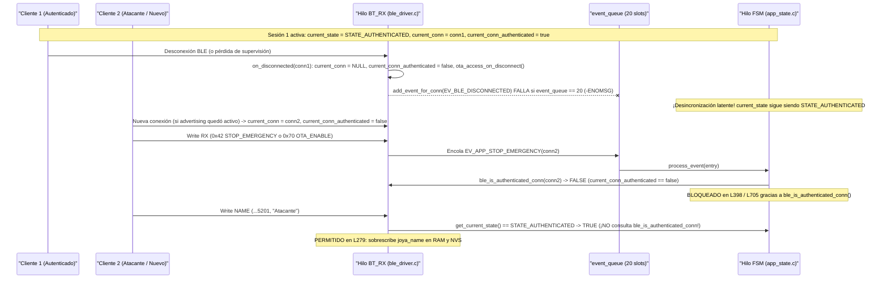
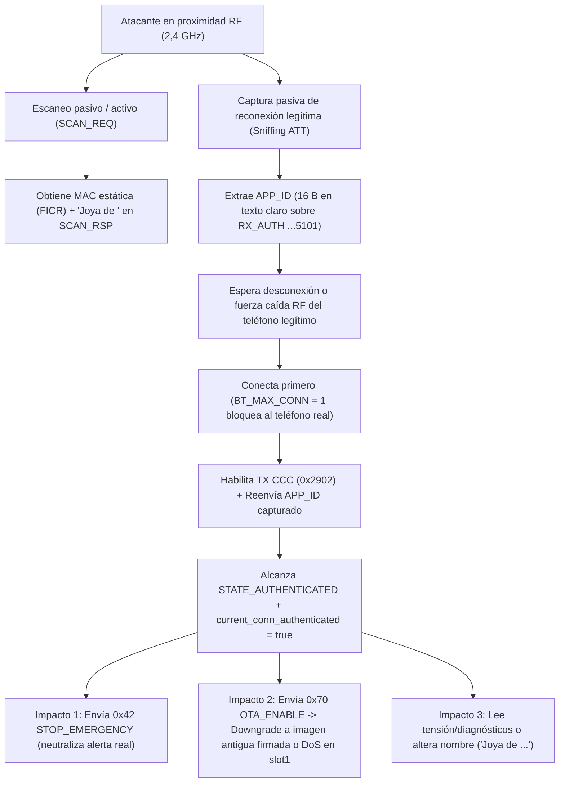

# 17. Seguridad y Privacidad

> **Alcance y versión verificada**: Este capítulo documenta de forma exhaustiva la arquitectura de seguridad, el control de acceso sobre la superficie Bluetooth Low Energy (BLE), la exposición de metadatos e identificadores por radiofrecuencia, la cadena de confianza del arranque y actualización OTA (`MCUboot` + `MCUmgr/SMP`), la remanencia de datos en memoria volátil y no volátil, el estado de las interfaces físicas de depuración y el catálogo estructurado de amenazas del firmware de Joya en el commit `c1128e5d0c0d6f98be0a580d287c0926ca27f01f` (`Zephyr RTOS 4.2.0`, SoC `nRF52832-QFAA`).
>
> **Referencias cruzadas**: Para el detalle del flujo de vinculación véase [10_authentication.md](10_authentication.md); para la especificación binaria de tramas GATT véase [09_gatt_protocol.md](09_gatt_protocol.md); para la arquitectura de anuncios e iBeacon véanse [07_ble_architecture.md](07_ble_architecture.md) y [08_ibeacon.md](08_ibeacon.md); para la organización de `Settings/NVS` véase [15_flash_persistence.md](15_flash_persistence.md); y para el flujo de actualización y arranque véase [16_ota_mcuboot.md](16_ota_mcuboot.md).

---

## 17.1. Modelo de Seguridad y Privacidad del Sistema

### 17.1.1. Contexto de criticidad del producto

Joya es un dispositivo vestible (*wearable*) de seguridad personal y asistencia ante situaciones de emergencia. A diferencia de un periférico BLE de propósito general, sus fallos de seguridad o privacidad tienen impacto directo sobre la integridad física de la usuaria:

1. **Integridad de las alertas de auxilio**: Un adversario capaz de suplantar a la aplicación móvil legítima durante una emergencia activa podría enviar `COMMAND_STOP_EMERGENCY` (`0x42`) o `COMMAND_ACK_EMERGENCY` (`0x41`) para detener los reintentos de alerta desde la pulsera.
2. **Disponibilidad del canal de emergencia**: Un adversario cercano capaz de acaparar la única conexión BLE (`CONFIG_BT_MAX_CONN=1`) o saturar la cola de eventos (`event_queue`) podría impedir que el teléfono de la usuaria se conecte y reciba `COMMAND_EMERGENCY` (`0x04`).
3. **Privacidad frente a entorno hostil**: En contextos de violencia doméstica, acoso o seguimiento físico, cualquier identificador estático radiado en aire o cualquier indicador RF que delate que la usuaria acaba de presionar el botón de pánico constituye un riesgo operacional severo.

### 17.1.2. Evaluación por propiedad de seguridad en el snapshot `c1128e5`

Siguiendo la distinción estricta entre **(a) comportamiento implementado**, **(b) intención de diseño**, **(c) comportamiento inferido**, **(d) código residual** y **(e) aspectos dependientes de hardware/proceso externo**, la postura efectiva del firmware en `c1128e5d0c0d6f98be0a580d287c0926ca27f01f` se descompone en cinco pilares:

| Propiedad | Enlace RF / Capa BLE (`Link Layer` + `ATT/GATT`) | Capa de Aplicación Joya (`FSM` + `GATT Custom`) | Arranque y Actualización (`MCUboot` + `SMP`) | Almacenamiento Local (`SRAM` + `NVS`) y Hardware |
|---|---|---|---|---|
| **Autenticación** | **(a) Inexistente a nivel BLE**: `# CONFIG_BT_SMP is not set`, `CONFIG_BT_MAX_PAIRED=0` en `.config` compilado desde [prj.conf](../../prj.conf). No hay *pairing*, *bonding* ni claves `LTK`/`IRK`/`CSRK`. | **(a) Secreto simétrico estático `APP_ID` de `16 B`** ([include/app_state.h](../../include/app_state.h#L4)): validado por igualdad exacta (`memcmp`) en `check_app_id()` ([src/app_comm.c](../../src/app_comm.c#L70-L72)) en cada conexión, sin *nonce* ni *challenge-response*. | **(a) Firma asimétrica `RSA-2048`** verificada por `MCUboot` (`CONFIG_BOOT_SIGNATURE_TYPE_RSA=y`, `LEN=2048`) contra clave pública embebida en Flash antes de ejecutar o intercambiar cualquier imagen. | **(a)/(e) Sin autenticación en bus `I2C` ni puerto `SWD`**: `# CONFIG_NRF_APPROTECT_LOCK is not set` en firmware; depende del sellado mecánico y programación de `UICR` en fábrica. |
| **Autorización** | **(a) Permisos ATT abiertos sin cifrado**: `BT_GATT_PERM_READ` / `BT_GATT_PERM_WRITE` (y `CONFIG_BT_DEVICE_NAME_GATT_WRITABLE=y` en `0x2A00`). | **(a) Control de acceso híbrido en dos niveles**: estado global `current_state == STATE_AUTHENTICATED` ([src/app_state.c](../../src/app_state.c#L26)) reforzado con vínculo de objeto de conexión `ble_is_authenticated_conn(conn)` ([src/ble_driver.c](../../src/ble_driver.c#L537-L544)), con asimetrías puntuales en `on_name_write()`, `on_name_read()` y `0x2A00`. | **(a) Compuerta dinámica de servicio `SMP`**: desregistrado al arrancar en `ota_access_init()` ([src/ota_access.c](../../src/ota_access.c#L83-L94)); solo se registra tras `0x70` en sesión autenticada y se cierra al desconectar o tras `2 min` de inactividad. | **(a) Aislamiento lógico de rutinas por propietario**: `joya/routine` almacena `pending_routine_owner[16]` ([src/flash_memory.c](../../src/flash_memory.c#L7)) e impide heredar rutinas tras cambio de `APP_ID`. |
| **Confidencialidad** | **(a) Nula frente a observador RF**: todas las PDUs de advertising, `SCAN_RSP` y datos `ATT` viajan en texto claro (solo *whitening* LFSR estándar de capa física BLE). | **(a) Exposición del `APP_ID` en texto claro** en cada provisión y reconexión sobre `RX_AUTH` (`...5101`), junto con comandos `0x02..0x06`, `0x41..0x44`, nombre, tensión de batería y diagnósticos. **Mejora en `c1128e5`**: iBeacon ya no revela estado de emergencia. | **(a) Imágenes OTA sin cifrar**: `# CONFIG_BOOT_ENCRYPT_IMAGE is not set`; el binario `.signed.bin` se transmite por `SMP` y se almacena en `slot1`/`slot0` en claro. Consola/logs desactivados (`CONFIG_LOG=n`, `CONFIG_USE_SEGGER_RTT=n`). | **(a) Almacenamiento en claro en `storage_partition`**: `joya/app_id` y `joya/name` residen sin cifrar en `NVS`, con remanencia física tras `settings_delete()`. |
| **Integridad** | **(a) Solo `CRC-24` de capa física BLE**: detecta errores de transmisión por ruido RF, pero carece de `MIC` criptográfico (`AES-CCM` de 32 bits) contra modificación o inyección activa de paquetes en una conexión abierta. | **(a) Validaciones estructurales estrictas**: longitud exacta (`1 B` en `RX`, `16 B` en `RX_AUTH`, `1..23 B` sin `\0` en `NAME`), `offset == 0`, y validación de rangos al cargar `Settings` en `app_settings_set()` ([src/flash_memory.c](../../src/flash_memory.c#L36-L126)). | **(a) Hash `SHA-256` + firma `RSA-2048` en `MCUboot`** (`CONFIG_BOOT_VALIDATE_SLOT0=y` en cada arranque). Sin embargo, **carece de protección anti-downgrade** (`# CONFIG_BOOT_UPGRADE_ONLY is not set`). | **(a) Sin `MPU` en aplicación** (`# CONFIG_ARM_MPU is not set` en [prj.conf](../../prj.conf#L79), activa en `MCUboot`). `NVS` verifica `CRC-8` de cabeceras `ATE`, pero `# CONFIG_NVS_DATA_CRC is not set`. |
| **Disponibilidad** | **(a) Única conexión simultánea** (`CONFIG_BT_MAX_CONN=1`, [prj.conf](../../prj.conf#L54)) sin lista blanca (`Filter Accept List`). Ventana Setup acotada a `90 s` (`BLE_SETUP_TIMEOUT_MS`) para ahorrar energía y exposición. | **(a) Cola no bloqueante `event_queue` (`20` eventos)** ([src/app_state.c](../../src/app_state.c#L28)): protege contra bloqueos de hilos, aunque escrituras GATT no autenticadas en `RX` y `RX_AUTH` consumen slots antes del filtrado FSM. | **(a) Guarda antirrollback de `5 min`** en imágenes `Test` (`test_image_guard_start()`, [src/test_image_guard.c](../../src/test_image_guard.c#L46-L61)) + reinicio inmediato si fallan `button_init()` o `ble_driver_init()` en modo `Test` ([src/main.c](../../src/main.c#L22-L40)). | **(a) Watchdog hardware `WDT0` (`30 s`) + `wdt_guard`** ([src/wdt_guard.c](../../src/wdt_guard.c)) + `NVIC_SystemReset()` en errores fatales ([src/fatal_recovery.c](../../src/fatal_recovery.c)) + degradación *RAM-first* si falla Flash. |

---

## 17.2. Modelo de Autenticación y Autorización por `APP_ID`

### 17.2.1. Propiedades criptográficas y operativas del `APP_ID` (`16` bytes)

**(a) Comportamiento implementado**:
- El identificador de aplicación es un vector binario opaco de `SIZE_APP_ID = 16` octetos (`128 bits`, [include/app_state.h](../../include/app_state.h#L4)), almacenado en RAM en el arreglo global `uint8_t joya_app_id[SIZE_APP_ID]` ([src/flash_memory.c](../../src/flash_memory.c#L4)) y persistido bajo la clave `joya/app_id` en `Settings/NVS`. *(Nota de seguridad documental: en todo este manual se emplea únicamente el vector sintético de banco `00 01 02 03 04 05 06 07 08 09 0A 0B 0C 0D 0E 0F` tomado de [ota/bridge_ota/bridge_ota.ino](../../ota/bridge_ota/bridge_ota.ino#L153-L154), nunca identificadores reales).*
- **Reserva del valor todo-ceros (`00..00`)**: La función `is_app_id_empty()` ([src/flash_memory.c](../../src/flash_memory.c#L250-L253)) define el estado «no provisionado» comparando los 16 bytes contra cero:
  ```c
  bool is_app_id_empty(void) {
      static const uint8_t zeros[SIZE_APP_ID] = {0};
      return (memcmp(joya_app_id, zeros, SIZE_APP_ID) == 0);
  }
  ```
  Durante la provisión inicial en `STATE_SETUP_WAITING_IDENTIFIER` ([src/app_state.c](../../src/app_state.c#L931-L935)), tras ejecutar `save_received_app_id(entry->app_id)`, la FSM comprueba inmediatamente `if (is_app_id_empty()) { return; }`. En consecuencia, **si un cliente envía `16` bytes `0x00` a una pulsera virgen**, `storage_save_app_id()` escribe los `16` ceros en NVS (si difieren), pero la FSM aborta la transición a `STATE_AUTHENTICATED`, no emite `COMMAND_ACK (0x05)` y el dispositivo continúa comportándose como no vinculado.
- **Ausencia de validación de entropía en el firmware**: Salvo el rechazo implícito de `00..00`, el firmware acepta cualquier otro valor de 16 bytes (por ejemplo, `01 00 ... 00` usado en [tests/test_pending_storage.c](../../tests/test_pending_storage.c#L124) o `FF FF ... FF`). La resistencia frente a adivinación depende íntegramente de que la aplicación móvil genere el `APP_ID` mediante un generador pseudoaleatorio criptográficamente seguro (`CSPRNG`, $2^{128} \approx 3{,}4 \times 10^{38}$ combinaciones).
- **Comparación mediante `memcmp` estándar y análisis de canal lateral temporal**: `check_app_id()` ([src/app_comm.c](../../src/app_comm.c#L70-L72)) invoca `memcmp(received_app_id, app_id, SIZE_APP_ID)`, cuya ejecución en `newlib`/`picolibc` para ARM Cortex-M4 finaliza en el primer byte discrepante (no es de tiempo constante).
  - **(c) Comportamiento inferido sobre explotabilidad práctica**: A `64 MHz` (`15,625 ns` por ciclo de reloj), la diferencia máxima entre fallar en el byte `0` y fallar en el byte `15` es inferior a `~500 ns`. Dado que el evento atraviesa primero `event_queue`, despierta `fsm_thread_id` (prioridad `5`), encola la notificación `COMMAND_NACK (0x06)` en el Host BLE y espera al siguiente evento de conexión BLE (`45..90 ms` con cuantización de ticks de `30,5 us` e incertidumbre del RC interno de `500 ppm`), el *jitter* de transporte supera la señal temporal de `memcmp` en más de cuatro órdenes de magnitud. No obstante, reemplazarlo en el futuro por una comparación acumulada con `XOR` (`diff |= a[i] ^ b[i]`) eliminaría la primitiva no constante de raíz sin coste medible.
- **Ausencia de límite de intentos fallidos (*rate limiting*)**: En [src/app_state.c](../../src/app_state.c#L975-L982), cuando `check_app_id(...) != 0`, el firmware envía `COMMAND_NACK` (`0x06`) y permanece indefinidamente en `STATE_SETUP_WAITING_IDENTIFIER` sin incrementar contador de fallos, sin insertar retardo progresivo y sin cerrar la conexión BLE (observado en el propio comentario de código `// (improvement) max retry attempts?`). Con un `APP_ID` aleatorio uniforme de 128 bits la fuerza bruta ciega sigue siendo inviable, pero permitiría probar diccionarios pequeños a razón de ~10–22 intentos por segundo si una app defectuosa generase identificadores de baja entropía.

### 17.2.2. Dualidad entre `current_state == STATE_AUTHENTICATED` y `current_conn_authenticated`

Uno de los aspectos arquitectónicos más importantes del commit `c1128e5` es la coexistencia de **dos mecanismos de seguimiento de sesión autenticada**:

1. **Estado global de la FSM (`current_state`)**: Variable `static volatile app_state_t current_state` en [src/app_state.c](../../src/app_state.c#L26), actualizada exclusivamente por `fsm_thread_id` dentro de `process_event()` al consumir mensajes de `event_queue`.
2. **Vínculo explícito al objeto de conexión BLE (`current_conn` + `current_conn_authenticated`)**: Variables estáticas protegidas por `conn_mutex` en [src/ble_driver.c](../../src/ble_driver.c#L142-L150), actualizadas **síncronamente en el hilo cooperativo `BT_RX`** durante `on_connected()` (`L230-L237`, donde `current_conn_authenticated = false`) y `on_disconnected()` (`L251-L256`, donde `current_conn = NULL; current_conn_authenticated = false`), y promovidas a `true` únicamente por `ble_mark_authenticated_conn(entry->conn)` (`L546-L559`) cuando la FSM valida el `APP_ID` comprobando que `entry->conn == current_conn`.



**(b) Intención de diseño e implicaciones de seguridad**:
- El paso de `entry->conn` dentro de `app_event_t` ([include/app_state.h](../../include/app_state.h#L74-L78)) y la guarda `ble_is_authenticated_conn(entry->conn)` impiden dos condiciones de carrera clásicas en pilas BLE orientadas a colas de eventos:
  1. **Eventos en tránsito de una conexión ya cerrada**: Si el Cliente 1 encoló comandos o un `APP_ID` justo antes de desconectarse y el Cliente 2 se conectó antes de que la FSM drenara la cola, `entry->conn != current_conn` hace que `ble_is_authenticated_conn(entry->conn)` y `ble_is_current_conn(entry->conn)` devuelvan `false` ([src/app_state.c](../../src/app_state.c#L386-L400), `L704-L705`, `L928`, `L957`).
  2. **Pérdida de `EV_BLE_DISCONNECTED` por cola llena**: Como `on_disconnected()` limpia `current_conn_authenticated = false` y cierra `SMP` (`ota_access_on_disconnect()`) **directamente en `BT_RX` sin depender de `event_queue`** ([src/ble_driver.c](../../src/ble_driver.c#L251-L267)), ninguna conexión ulterior puede heredar permisos sobre comandos críticos (`0x41..0x44`, `0x70..0x71`), lectura de `DIAGNOSTICS` ni notificaciones `TX`/`BATTERY_*`/`DIAGNOSTICS`, aunque `current_state` hubiera quedado desfasado en `STATE_AUTHENTICATED`.
- **Inconsistencia remanente verificada en `c1128e5`**: La función `on_name_write()` ([src/ble_driver.c](../../src/ble_driver.c#L273-L281)) marca `ARG_UNUSED(conn);` y evalúa únicamente `if (get_current_state() != STATE_AUTHENTICATED)` en vez de `if (!ble_is_authenticated_conn(conn))`. Además, `ble_send_battery_value()` (`L715-L718`) exige correctamente la conjunción de ambos predicados (`get_current_state() == STATE_AUTHENTICATED` **y** `current_conn_authenticated`).

### 17.2.3. Matriz exhaustiva de control de acceso GATT y GAP

La siguiente tabla detalla el control de acceso real verificado línea por línea para **todos** los servicios, características, descriptores `CCC` y comandos del dispositivo antes y después de completar la autenticación por `APP_ID`:

| Servicio / UUID | Característica / Comando | Propiedades y Permisos ATT | Acceso **ANTES** de autenticar (`current_conn_authenticated == false`) | Acceso **DESPUÉS** de autenticar (`STATE_AUTHENTICATED` + `current_conn_authenticated == true`) | Función y mecanismo exacto de validación | Observaciones de seguridad |
|---|---|---|---|---|---|---|
| **GAP Estándar** (`0x1800`, Zephyr) | `Device Name` (`0x2A00`) | `READ \| WRITE`, `PERM_READ \| PERM_WRITE` (implícito por `CONFIG_BT_DEVICE_NAME_GATT_WRITABLE=y`) | **PERMITIDO (Lectura y Escritura)** | **PERMITIDO (Lectura y Escritura)** | Manejador interno GAP de Zephyr (`subsys/bluetooth/host/gatt.c`); sin `BT_SMP`, no exige cifrado ni consulta estado Joya. | **Brecha de superficie**: cualquier cliente conectado sin autenticar puede leer y alterar el nombre GAP en RAM (`bt_set_name` interno) hasta la siguiente llamada a `ble_start_setup_advertising()` o `on_name_write()`. No altera `joya/name` en NVS. |
| **GAP Estándar** (`0x1800`) | `Appearance` (`0x2A01`), `PPCP` (`0x2A04`) | `READ`, `PERM_READ` | **PERMITIDO (Lectura)** | **PERMITIDO (Lectura)** | Manejador interno GAP de Zephyr (`0x0000` y `36/72/4/600`). | Metadatos estándar necesarios para negociación BLE en iOS/Android. |
| **GATT Estándar** (`0x1801`) | `Service Changed` (`0x2A05`) + `CCC` | `INDICATE`, `CCC: READ \| WRITE` (`BT_GATT_DYNAMIC_DB=y`) | **PERMITIDO (Suscripción CCC)** | **PERMITIDO (Suscripción CCC)** | Manejador GATT de Zephyr; notifica altas/bajas dinámicas del servicio `SMP`. | Requerido para invalidar caché GATT del teléfono al ejecutar `0x70`/`0x71`. |
| **Commands** (`...5000`) | `TX` (`...5001`) — Valor | `NOTIFY`, `BT_GATT_PERM_NONE` | **BLOQUEADO** (no admite `READ`/`WRITE`; no emite notificaciones salvo `0x05`/`0x06` al procesar `RX_AUTH`) | **PERMITIDO** (`0x02`, `0x03`, `0x04`, `0x05` si `notify_enabled == true`) | `ble_send_event_authenticated()` ([src/ble_driver.c](../../src/ble_driver.c#L681-L693)) exige `current_conn && current_conn_authenticated && notify_enabled`. | Durante provisión/login, `ble_send_event_for_conn()` (`L662-L679`) envía `0x05` tras autenticar o `0x06` (`NACK`) sin autenticar si `conn == current_conn && notify_enabled`. |
| **Commands** (`...5000`) | `TX CCC` (`0x2902`) | `BT_GATT_PERM_READ \| BT_GATT_PERM_WRITE` | **PERMITIDO** (y **obligatorio** antes de autenticar) | **PERMITIDO** | `on_ccc_changed()` ([src/ble_driver.c](../../src/ble_driver.c#L156-L172)) actualiza `notify_enabled` y encola `EV_BLE_NOTIFY_ENABLED` si `value == 0x0001`. | Requisito del protocolo (`STATE_WAITING_NOTIFICATION_ENABLE`). Notar que escribir `0x0000` desactiva `notify_enabled` pero **no** revoca `STATE_AUTHENTICATED`. |
| **Commands** (`...5000`) | `RX` (`...5002`) — Comandos `0x41` (`ACK_EMERG`), `0x42` (`STOP_EMERG`), `0x43` (`FOLLOW_ME`) | `WRITE \| WRITE_WITHOUT_RESP`, `BT_GATT_PERM_WRITE` | **ACEPTADO EN ATT, DESCARTADO EN FSM** (encola evento en `event_queue`, luego `process_event` lo ignora) | **PERMITIDO SOLO SI `is_in_emergency() == true`** (en otro caso se ignora en FSM) | `on_rx_write_handler()` ([src/app_comm.c](../../src/app_comm.c#L6-L41)) encola sin filtrar auth; `process_event()` ([src/app_state.c](../../src/app_state.c#L396-L400), `L792-L843`) exige `ble_is_authenticated_conn(entry->conn)` y `current_state == STATE_AUTHENTICATED`. | Un atacante conectado no autenticado no puede ejecutar los comandos, pero **sí recibe `ATT_WRITE_RSP` exitoso y ocupa slots de `event_queue`**. |
| **Commands** (`...5000`) | `RX` (`...5002`) — Comando `0x44` (`FRIEND_EMERG`) | `WRITE \| WRITE_WITHOUT_RESP`, `BT_GATT_PERM_WRITE` | **ACEPTADO EN ATT, DESCARTADO EN FSM** | **PERMITIDO SOLO SI `is_in_emergency() == false`** | `process_event()` ([src/app_state.c](../../src/app_state.c#L396-L400), `L867`, `L989-L996`) exige `ble_is_authenticated_conn` + `!is_in_emergency()` + `STATE_AUTHENTICATED`. | Misma observación de encolado previo en `event_queue`. |
| **Commands** (`...5000`) | `RX` (`...5002`) — Comandos `0x70` (`OTA_ENABLE`), `0x71` (`OTA_DISABLE`) | `WRITE \| WRITE_WITHOUT_RESP`, `BT_GATT_PERM_WRITE` | **ACEPTADO EN ATT, DESCARTADO EN FSM** | **PERMITIDO** (incluso si `is_in_emergency() == true`) | `process_event()` ([src/app_state.c](../../src/app_state.c#L703-L713)) exige `current_state == STATE_AUTHENTICATED && ble_is_authenticated_conn(entry->conn)`. | `L703` se evalúa **antes** del bloque `if (is_in_emergency())` (`L767`), por lo que OTA puede abrirse/cerrarse también con emergencia activa. |
| **Commands** (`...5000`) | `RX` (`...5002`) — Resto de bytes (`0x40`, `0x45`, `0x46`, otros) | `WRITE \| WRITE_WITHOUT_RESP`, `BT_GATT_PERM_WRITE` | **IGNORADO EN `BT_RX`** (`return len` sin encolar) | **IGNORADO EN `BT_RX`** (`return len` sin encolar) | `on_rx_write_handler()` ([src/app_comm.c](../../src/app_comm.c#L33-L35)). | `0x45` (`COMMAND_FRIEND_STOP_EMERGENCY`) es código residual en el `enum` no conectado a la FSM. No consume `event_queue`. |
| **Authentication** (`...5100`) | `RX_AUTH` (`...5101`) | `WRITE \| WRITE_WITHOUT_RESP`, `BT_GATT_PERM_WRITE` (`16 B`) | **PERMITIDO** (solo surte efecto en `STATE_SETUP_WAITING_IDENTIFIER`; en otros estados encola y se ignora) | **ACEPTADO EN ATT, IGNORADO EN FSM** (consume 1 slot de `event_queue` con copia de `16 B` y se descarta en `switch`) | `on_rx_auth_write_handler()` ([src/app_comm.c](../../src/app_comm.c#L43-L58)) → `process_event()` ([src/app_state.c](../../src/app_state.c#L922-L985)). | Una vez provisionado (`!is_app_id_empty()`), **no es posible sobrescribir el `APP_ID` por BLE** sin ejecutar antes un Factory Reset físico (`15 s`). |
| **Configuration** (`...5200`) | `NAME` (`...5201`) — `READ` | `READ`, `BT_GATT_PERM_READ` | **PERMITIDO (Abierto sin autenticar)** | **PERMITIDO** | `on_name_read()` ([src/ble_driver.c](../../src/ble_driver.c#L322-L345)): no contiene ninguna verificación de estado ni de conexión autenticada. | Devuelve `""` si el nombre es `"Joya"`, o el sufijo personal tras `"Joya de "` (`1..23 B`). |
| **Configuration** (`...5200`) | `NAME` (`...5201`) — `WRITE` | `WRITE`, `BT_GATT_PERM_WRITE` | **RECHAZADO** con `BT_ATT_ERR_AUTHORIZATION (0x08)` *(salvo desincronización de `current_state`)* | **PERMITIDO** (`1..23 B` sin `\0`) | `on_name_write()` ([src/ble_driver.c](../../src/ble_driver.c#L278-L281)): comprueba **únicamente** `get_current_state() != STATE_AUTHENTICATED` (**no** llama a `ble_is_authenticated_conn(conn)`). | Ejecuta `bt_set_name()` y `storage_save_name()` directamente en el hilo cooperativo `BT_RX`. |
| **Configuration** (`...5200`) | `DIAGNOSTICS` (`...5202`) — `READ` | `READ`, `BT_GATT_PERM_READ` | **RECHAZADO** con `BT_ATT_ERR_AUTHORIZATION (0x08)` | **PERMITIDO** (devuelve `2 B`: `A0 MM`) | `on_diagnostics_read()` ([src/ble_driver.c](../../src/ble_driver.c#L352-L354)): exige `ble_is_authenticated_conn(conn)`. | Protegido por conexión autenticada efectiva. |
| **Configuration** (`...5200`) | `DIAGNOSTICS CCC` (`0x2902`) + `NOTIFY` | `CCC: READ \| WRITE`; `NOTIFY` | **CCC PERMITIDO; NOTIFY BLOQUEADO** (`ble_diagnostics_session() == 0`) | **PERMITIDO** (emite `A0 MM` al confluir auth + CCC + boot completo, y `0xE1..0xE5` en vivo) | `ble_diagnostics_session()` y `ble_diagnostics_notify_for_session()` ([src/ble_driver.c](../../src/ble_driver.c#L571-L606)) exigen `current_conn_authenticated && diagnostics_notify_enabled` y coincidencia de `diagnostics_session_epoch`. | Aislamiento estricto entre sesiones: un error ocurrido antes de autenticar o en una sesión previa nunca se reenvía. |
| **Battery** (`...5300`) | `BATTERY_CHANGE` (`...5301`) y `BATTERY_MEASUREMENT` (`...5302`) + `CCC` | `CCC: READ \| WRITE`; `NOTIFY`, `PERM_NONE` | **CCC PERMITIDO; NOTIFY BLOQUEADO** (`-EACCES` / `-ENOTCONN`) | **PERMITIDO** (`1 B` nivel `0..2` y `2 B` mV LE si el respectivo `CCC` está activo) | `ble_send_battery_value()` ([src/ble_driver.c](../../src/ble_driver.c#L715-L721)) exige `get_current_state() == STATE_AUTHENTICATED` **y** `get_battery_conn_ref()` (`current_conn_authenticated`). | Doble guarda coherente de estado y conexión. |
| **SMP Dinámico** (`8d53dc1d-...`) | `SMP Characteristic` (`da2e7828-...`) + `CCC` | `WRITE_WITHOUT_RESP \| NOTIFY`, `PERM_READ \| PERM_WRITE` (`MCUMGR_TRANSPORT_BT_PERM_RW=y`) | **INEXISTENTE EN TABLA GATT** (desregistrado en `ota_access_init()` y al desconectar) | **AUSENTE HASTA ENVIAR `0x70`**; una vez registrado, acepta comandos `IMG` (`list`, `upload`, `test`, `confirm`, `erase`) y `OS` (`echo`, `reset`) sin autenticación adicional por paquete | `ota_access_enable()` ([src/ota_access.c](../../src/ota_access.c#L96-L115)) registra el servicio; `on_disconnected()` invoca `ota_access_on_disconnect()` (`L129-L138`) e `idle_close_work` lo cierra tras `2 min` sin carga activa. | Al existir `CONFIG_BT_MAX_CONN=1`, ningún segundo cliente puede acceder al servicio mientras el cliente autenticado mantiene el enlace. |

---

## 17.3. Ausencia de Criptografía de Enlace BLE y Rastreabilidad RF

### 17.3.1. Configuración efectiva del stack BLE (`prj.conf` y `.config`)

**(a) Comportamiento implementado**: La inspección de [prj.conf](../../prj.conf#L44-L67) y `build_joya/app/zephyr/.config` confirma la desactivación completa de los subsistemas de seguridad y privacidad del Host y Controlador BLE de Zephyr:

- `# CONFIG_BT_SMP is not set` y `CONFIG_BT_MAX_PAIRED=0`: El protocolo *Security Manager* (emparejamiento *Just Works*, *Passkey Entry*, *Numeric Comparison*, *LE Secure Connections* ECDH P-256) no está compilado en el binario.
- `# CONFIG_BT_HOST_CRYPTO is not set` y `# CONFIG_BT_HOST_CCM is not set`: Sin primitivas criptográficas en el Host BLE. *(Nota: en el controlador `BT_LL_SW_SPLIT` sí figuran habilitados por defecto los bloques hardware del SoC `CONFIG_BT_CTLR_CRYPTO=y` y `CONFIG_BT_CTLR_LE_ENC=y` sobre los periféricos `ECB`/`CCM`/`RNG`, pero al no existir `BT_SMP` en el Host para acordar una clave `LTK` o responder `LL_ENC_REQ` con clave válida, ninguna conexión entra jamás en modo cifrado).*
- `# CONFIG_BT_SETTINGS is not set`: El stack BLE no almacena identidades locales rotativas, claves `IRK` ni vínculos de pares en `Settings/NVS`.
- `# CONFIG_BT_PRIVACY is not set` y `# CONFIG_BT_CTLR_PRIVACY is not set`: Deshabilitada la generación y resolución de direcciones privadas resolubles (*Resolvable Private Addresses*, `RPA`).

### 17.3.2. Implicaciones técnicas sobre el enlace inalámbrico

1. **Ausencia de confidencialidad de enlace**: Las tramas `ADV_IND`, `SCAN_RSP`, `CONNECT_IND` y todas las PDUs de datos `LL Data PDU` (`L2CAP` / `ATT`) se modulan en GFSK a `1 Mbps` o `2 Mbps` únicamente con el blanqueo espectral (*whitening*) determinista dependiente del índice de canal BLE (`0..39`). Cualquier sniffer pasivo de bajo coste (p. ej. un dongle `nRF52840` con Wireshark/btlejack o Ubertooth) sintonizado en los canales primarios `37, 38, 39` que siga el `CONNECT_IND` captura íntegramente la sesión sin necesidad de clave alguna.
2. **Ausencia de autenticidad e integridad criptográfica por paquete (sin `MIC`)**: En una conexión BLE cifrada con `AES-CCM`, cada paquete de datos incorpora un *Message Integrity Check* (`MIC`) de `4 bytes` vinculado a un contador de paquetes de `39 bits` por dirección, lo que impide tanto la inyección de paquetes por terceros como la repetición. Sin cifrado, el Link Layer solo valida el `CRC-24` polinómico de detección de errores de bit: un atacante activo sincronizado con el `Access Address` (`4 B`), el `CRCInit` (`3 B`) y el mapa de salto de canales (*Channel Selection Algorithm #2*, `CONFIG_BT_CTLR_CHAN_SEL_2=y`) puede inyectar tramas `ATT` válidas o provocar la caída unilateral de la conexión de la usuaria (*jamming* selectivo o inyección de `LL_TERMINATE_IND`).
3. **Rastreabilidad permanente por dirección MAC estática en `FICR`**:
   - Al ejecutarse `bt_enable(NULL)` ([src/ble_driver.c](../../src/ble_driver.c#L499)) sin `CONFIG_BT_PRIVACY=y` ni `CONFIG_BT_SETTINGS=y`, el controlador `BT_LL_SW_SPLIT` en `nRF52832` carga automáticamente la dirección *Static Random* única de 48 bits grabada en fábrica por Nordic Semiconductor en los registros de solo lectura `NRF_FICR->DEVICEADDR[0]` y `NRF_FICR->DEVICEADDR[1]` (`0x100000A4..0x100000A8`, forzando los dos bits más significativos `47:46` a `11`).
   - **Consecuencia de privacidad**: Esta dirección MAC de 48 bits **no cambia jamás** a lo largo de toda la vida útil del hardware: sobrevive a reinicios, actualizaciones OTA y ejecuciones de `storage_factory_reset()` (incluso si la pulsera cambia de propietaria). Tanto el set conectable (`joya_adv_param`) como el set iBeacon (`ibeacon_adv_param`) comparten `id = 0` (`BT_ID_DEFAULT`, `CONFIG_BT_ID_MAX=1`), por lo que ambos anuncios radian exactamente la misma MAC estática.

---

## 17.4. Superficie de Exposición de Datos por Radiofrecuencia (RF)

### 17.4.1. Exposición durante Advertising Conectable y `SCAN_RSP`

Cuando `ble_start_setup_advertising(bool is_new_connection)` ([src/ble_driver.c](../../src/ble_driver.c#L608-L647)) activa el anunciador conectable legacy (`100..150 ms`):

| Escenario | Parámetro `is_new_connection` | Contenido de `ADV_IND` (`ad[]`) | Contenido de `SCAN_RSP` (`BT_LE_ADV_OPT_USE_NAME`) | Información revelada a cualquier observador pasivo/activo en alcance RF |
|---|---|---|---|---|
| Pulsera virgen tras doble clic (`90 s`), triple clic virgen (indefinido) o arranque de imagen `Test` (`5 min`) | `true` | Flags `0x06` (`General Discoverable`, `BR/EDR Not Supported`) + MAC `FICR` | Nombre completo `"Joya Setup"` (`10 B` ASCII) | Revela que existe una pulsera Joya **sin propietaria vinculada** (o ejecutando una imagen OTA `Test` sin `APP_ID`) lista para aceptar provisión del primer cliente que se conecte. |
| Reconexión automática tras reinicio (`~60 s`), tras desconexión BLE o doble clic con `APP_ID` guardado | `false` | Flags `0x06` + MAC `FICR` | `"Joya"` (por defecto) o **`"Joya de <Sufijo>"`** (`9..31 B`, p. ej. `"Joya de Lucía"`) | Revela que la usuaria se encuentra físicamente presente en el recinto **y que su teléfono no está actualmente conectado** a la pulsera (pues al conectar se detiene el advertising). Si configuró su nombre, **vincula directamente su identidad civil con la MAC estática de `FICR`**. |

> [!WARNING]
> **Riesgo de privacidad del nombre personalizado (`joya/name`)**: Un escáner BLE estándar (como `nRF Connect` en cualquier smartphone) emite `SCAN_REQ` sin establecer conexión ni dejar rastro en la FSM de Joya, obteniendo `"Joya de <Nombre>"` en el `SCAN_RSP`. Durante desconexiones (por ejemplo, si el teléfono de la usuaria se quedó sin batería o fuera de alcance), la pulsera permanece en `STATE_BONDED_DISCONNECTED` radiando indefinidamente su MAC e identidad en `SCAN_RSP` cada `100..150 ms`.

### 17.4.2. Exposición en iBeacon y Mejora Crítica de Privacidad en `c1128e5`

Cuando el dispositivo posee un `APP_ID` registrado (`!is_app_id_empty()`), está desconectado (`!ble_has_connection()`) y tiene activo el advertising conectable (`connectable_adv_running == 1`), `ble_set_ibeacon_mode()` ([src/ble_driver.c](../../src/ble_driver.c#L85-L120)) transmite cada `1,0..1,2 s` una trama `ADV_NONCONN_IND` con los siguientes 30 bytes de payload `AD`:

- `02 01 04` (`BT_LE_AD_NO_BREDR`)
- `1A FF 4C 00 02 15` (Manufacturer Specific Data Apple iBeacon, `26 B` totales)
- `A4 07 E0 0A 00 C1 46 4D 91 73 2C B8 BE 58 60 01` (`JOYA_IBEACON_CONNECTION_UUID_BYTES`, [include/ble_driver.h](../../include/ble_driver.h#L37-L39))
- `00 01` (`Major = 1`), `00 01` (`Minor = 1`), `C8` (`Measured Power = -56 dBm`)

**(a) Comportamiento implementado y (b) intención de diseño en `c1128e5`**:
- En versiones previas del firmware (hasta `v2.3.1`), activar una emergencia conmutaba el iBeacon a un segundo UUID dedicado (`...6002`). Esto permitía que cualquier receptor pasivo cercano supiera instantáneamente que la usuaria acababa de pedir auxilio, incluso antes de que su propio teléfono recibiera la alerta.
- **En el commit `c1128e5` ese canal lateral fue eliminado por diseño** ([include/ibeacon_policy.h](../../include/ibeacon_policy.h#L6-L14), [docs/IBEACON.md](../../docs/IBEACON.md#L9-L10), verificado por aserciones en [tests/test_emergency_phase.c](../../tests/test_emergency_phase.c#L57-L70)): `ibeacon_mode_for_state(bool has_app_id)` depende **exclusivamente** de `has_app_id`. Ni disparar una emergencia (`EV_BTN_EMERGENCY`), ni confirmarla (`0x41`), ni detenerla (`0x42`), ni guardar una rutina pendiente (`0x02`/`0x03`) alteran un solo bit ni la cadencia del iBeacon ni del advertising conectable.
- **Exposición residual del iBeacon**: El UUID `a407e00a-00c1-464d-9173-2cb8be586001` es fijo y común a todas las unidades Joya configuradas; por tanto, permite identificar la marca/modelo del dispositivo vestible cuando está desconectado de su teléfono, pero no distingue entre usuarias por su payload (solo por la MAC estática de cabecera) ni filtra eventos operativos.

### 17.4.3. Exposición de datos en Tráfico GATT Conectado

Dado que el enlace carece de cifrado `LL Encryption`, un observador pasivo que capture la conexión BLE observa en texto claro:

1. **Credencial maestra `APP_ID` (`16 B`) en cada reconexión**: A diferencia de BLE Bonding (donde `LTK` nunca se transmite por aire tras el emparejamiento inicial y cada reconexión negocia una clave de sesión derivada con números aleatorios `SKDm`/`SKDs`), en Joya el teléfono **transmite literalmente los 16 bytes del `APP_ID` en claro sobre `RX_AUTH` (`...5101`) cada vez que reconecta**. Capturar una sola reconexión legítima compromete permanentemente el secreto `APP_ID` hasta que la usuaria realice un Factory Reset físico de `15 s`.
2. **Eventos de seguridad personal en tiempo real**: Notificaciones de `1 byte` en `TX` (`...5001`) revelando inicio/fin de rutina de acompañamiento (`0x02`/`0x03`) y disparo/reintentos de emergencia (`0x04`), así como comandos desde la app en `RX` (`...5002`) (`0x41` ACK, `0x42` STOP, `0x43` Follow Me, `0x44` emergencia de amiga, `0x70`/`0x71` control OTA).
3. **Telemetría e identidad**: Sufijo del nombre en `NAME` (`...5201`), tensión exacta de batería en milivoltios cada `60 s` (o `10 s` en verificación) en `BATTERY_MEASUREMENT` (`...5302`), nivel `0/1/2` en `BATTERY_CHANGE` (`...5301`) y máscara de fallos de hardware/subsistemas (`A0 MM`, `0xE1..0xE5`) en `DIAGNOSTICS` (`...5202`).

---

## 17.5. Seguridad de Arranque Seguro (`MCUboot`), OTA, Memoria y Depuración Física

### 17.5.1. Cadena de confianza en el arranque y actualización OTA (`MCUboot` + `SMP`)

**(a) Comportamiento implementado** (verificado en [sysbuild.conf](../../sysbuild.conf), [sysbuild/mcuboot.conf](../../sysbuild/mcuboot.conf) y `build_joya/mcuboot/zephyr/.config`):

1. **Verificación criptográfica `RSA-2048` + `SHA-256`**:
   - `MCUboot` reside en `boot_partition` (`0x00000000..0x0000C000`, `48 KiB`) e incorpora en su sección `.rodata` la estructura `rsa_pub_key` (`270 B` ASN.1 DER, símbolo en `0x0000735a` apuntado por `bootutil_keys`).
   - En **cada arranque en frío o reinicio por software** (`CONFIG_BOOT_VALIDATE_SLOT0=y`), `MCUboot` calcula con `mbedTLS` (`CONFIG_BOOT_USE_MBEDTLS=y`) el digest `SHA-256` (`CONFIG_BOOT_IMG_HASH_ALG_SHA256=y`) sobre la cabecera, el código ejecutable y los TLVs protegidos de `slot0_partition` (`0x0000C000..0x00043000`), y verifica la firma `RSA-2048` (`CONFIG_BOOT_SIGNATURE_TYPE_RSA=y`, `CONFIG_BOOT_SIGNATURE_TYPE_RSA_LEN=2048`) presente en la sección TLV `IMAGE_TLV_RSA2048_PSS` de la imagen.
   - Antes de realizar un intercambio desde `slot1_partition` (`0x00043000..0x0007A000`) mediante `CONFIG_BOOT_SWAP_USING_MOVE=y`, `MCUboot` ejecuta la misma validación `SHA-256` + `RSA-2048` sobre la imagen candidata depositada por `MCUmgr/SMP`. **Es criptográficamente inviable ejecutar código arbitrario mediante BLE OTA sin poseer la clave privada RSA-2048 correspondiente a `rsa_pub_key`**.
2. **Gestión de claves de firma (arquitectura y riesgos)**:
   - El repositorio **no almacena ninguna clave privada**. Los scripts de compilación ([compile.sh](../../compile.sh#L2) y [compile_test.sh](../../compile_test.sh#L6)) inyectan en tiempo de *sysbuild* la propiedad `SB_CONFIG_BOOT_SIGNATURE_KEY_FILE="/workspace/keys/joya_dev-private.pem"` montada externamente fuera del árbol de código.
   - **Advertencia crítica sobre claves de desarrollo vs producción**: El propio nombre del archivo referenciado en los scripts (`joya_dev-private.pem`) indica una clave de entorno de desarrollo. Dado que las unidades ensambladas carecen de acceso `SWD` y `MCUboot` no es actualizable por OTA, **toda unidad sellada queda atada de por vida a la clave pública grabada en `0x0000735a`**:
     - Si la clave privada se filtra o se comparte en entornos inseguros, un atacante puede firmar imágenes maliciosas indistinguibles de las oficiales para todas las unidades desplegadas.
     - Si la clave privada se pierde sin respaldo custodiado (HSM / bóveda offline), ningún dispositivo en campo podrá volver a actualizarse jamás.
3. **Ausencia de cifrado de imagen OTA (`CONFIG_BOOT_ENCRYPT_IMAGE=n`)**:
   - En `build_joya/mcuboot/zephyr/.config`, `# CONFIG_BOOT_ENCRYPT_IMAGE is not set`. Aunque `MCUboot` garantiza **integridad y autenticidad** de origen, **no proporciona confidencialidad del binario**: el archivo `zephyr.signed.bin` contiene las instrucciones máquina Thumb-2, tablas de constantes, UUIDs y cadenas en texto claro.
4. **Ausencia de protección anti-downgrade (`CONFIG_BOOT_UPGRADE_ONLY=n`)**:
   - En `build_joya/mcuboot/zephyr/.config`, `# CONFIG_BOOT_UPGRADE_ONLY is not set` y en la aplicación `# CONFIG_MCUMGR_GRP_IMG_VERSION_CMP_USE_BUILD_NUMBER is not set`. Tampoco existen contadores monotónicos en hardware/OTP (el `nRF52832` carece de fusibles OTP multi-etapa dedicados para anti-rollback sin bloqueo de páginas `BPROT`/`UICR`).
   - En consecuencia, un atacante que alcance el servicio `SMP` (p. ej. tras capturar el `APP_ID` en aire y enviar `0x70`) puede cargar una **versión antigua legítima firmada con la misma clave `RSA-2048`** (ataque de *downgrade*), reintroduciendo vulnerabilidades ya corregidas (como el iBeacon de emergencia `...6002` previo a `c1128e5`, la ausencia de `wdt_guard` previa a `b48aa45`, o el servicio `SMP` permanentemente abierto de `v1.4`).
5. **Endurecimiento físico de `MCUboot` y transición a la aplicación**:
   - `CONFIG_MCUBOOT_CLEANUP_ARM_CORE=y` limpia registros del procesador e interrupciones antes de saltar al vector de reset de `slot0`.
   - `# CONFIG_MCUBOOT_CLEANUP_RAM is not set` y `CONFIG_BOOT_FIH_PROFILE_OFF=y` (sin retardos aleatorios ni duplicación de comprobaciones contra ataques físicos de *voltage/clock glitching*).
   - `MCUboot` compila con `CONFIG_ARM_MPU=y` y `CONFIG_MPU_ALLOW_FLASH_WRITE=y` ([sysbuild/mcuboot.conf](../../sysbuild/mcuboot.conf#L1-L2)), impidiendo ejecución de código desde SRAM (`XN`) durante el arranque.

### 17.5.2. Persistencia, Borrado (`storage_factory_reset`) y Remanencia Física en Flash y SRAM

**(a) Comportamiento implementado** en [src/flash_memory.c](../../src/flash_memory.c#L357-L398):

Cuando la usuaria completa el gesto deliberado de Factory Reset (`15 s` de pulsación sostenida → `EV_BTN_FACTORY_THRESHOLD` + vibración + liberación `EV_BTN_FACTORY_RESET` → `factory_reset_and_reboot()` en [src/app_state.c](../../src/app_state.c#L101-L120)):

1. **Limpieza inmediata en SRAM de cachés de aplicación**:
   `storage_factory_reset()` borra primero en RAM `memset(joya_app_id, 0, 16)`, `joya_emergency_phase = EMERGENCY_NONE`, `joya_pending_routine = 0`, `memset(pending_routine_owner, 0, 16)` y restaura `strcpy(joya_name, "Joya")`.
2. **Orden seguro de borrado lógico en `Settings/NVS` y guarda `pending_routine_dirty`**:
   Elimina secuencialmente `"joya/routine"`, `"joya/app_id"`, `"joya/emergency"` y `"joya/name"`.
   - **Detalle de diseño defensivo (`c1128e5`)**: `"joya/routine"` se borra **antes** que `"joya/app_id"` (`L377-L387`). Además, si `storage_factory_reset()` devuelve `!= 0` (fallo de escritura en Flash), `factory_reset_and_reboot()` ([src/app_state.c](../../src/app_state.c#L108-L117)) **cancela el `sys_reboot(SYS_REBOOT_COLD)`** y deja el dispositivo en `suspended_idle = true` con la RAM limpia: si reiniciara tras fallar `settings_delete("joya/app_id")`, el próximo `settings_load()` resucitaría el `APP_ID` antiguo desde Flash. Y si solo falló el borrado de `"joya/routine"`, `pending_routine_dirty = true` impide registrar un nuevo `APP_ID` en `storage_save_app_id()` (`L267-L270`) hasta lograr escribir el tombstone `0`, evitando filtración cruzada de estado entre distintas propietarias.
3. **Remanencia física real en memoria NOR Flash (`storage_partition`, `0x0007A000..0x00080000`)**:
   - El backend `NVS` de Zephyr (`subsys/fs/nvs/nvs.c`) opera como un registro secuencial (*append-only*) sobre sectores de borrado de `4096 B` (`6` sectores físicos efectivos en los `24 KiB` de `storage_partition`).
   - Invocar `settings_delete("joya/app_id")` o `settings_delete("joya/name")` **NO ejecuta borrado de página ni sobrescribe con ceros los datos previos**: únicamente añade al sector activo una nueva entrada `nvs_ate` con `len = 0`.
   - En consecuencia, **los 16 bytes históricos de `joya/app_id`, las copias de `pending_routine_owner` (`16 B`) dentro de registros previos de `joya/routine` y la cadena `"Joya de <Nombre>"` permanecen físicamente intactos en la matriz NOR Flash** hasta que el recolector de basura (*garbage collector*) de NVS rote todos los sectores de datos y ejecute `flash_erase()` sobre la página correspondiente. Frente al software normal son inaccesibles, pero frente a una lectura física de Flash (`SWD` o desoldado de chip) son trivialmente recuperables.
4. **Remanencia en SRAM (`0x20000000..0x20010000`)**:
   - Ni `storage_factory_reset()` ni `MCUboot` (`# CONFIG_MCUBOOT_CLEANUP_RAM is not set`) limpian la totalidad de los `64 KiB` de SRAM. Tras un `sys_reboot(SYS_REBOOT_COLD)` (`NVIC_SystemReset()`), las celdas SRAM del `nRF52832` conservan su carga eléctrica; el código de inicio C (`z_bss_zero`) pone a cero `.bss` (lo que limpia `_k_fifo_buf_event_queue` y buffers `net_buf` en `.bss`), pero **no limpia las regiones `.noinit`** donde residen las pilas de hilos (`_k_thread_stack_fsm_thread_id`, `rx_thread_stack`, `z_main_stack`), donde pueden quedar marcos de pila residuales con copias temporales de `entry.app_id` o `name[]`.

### 17.5.3. Interfaces físicas de depuración, logs y protección de memoria

| Superficie / Mecanismo | Estado verificado en `c1128e5` | Evidencia en repositorio / artefactos | Impacto de seguridad |
|---|---|---|---|
| **Consola serie (`UART0`)** | **Deshabilitada en hardware y software** | `uart0 { status = "disabled"; }` en [boards/joya/joya_nrf52/joya_nrf52_nrf52832.dts](../../boards/joya/joya_nrf52/joya_nrf52_nrf52832.dts#L94-L96); `CONFIG_CONSOLE=n`, `CONFIG_UART_CONSOLE=n`, `CONFIG_PRINTK=n`, `CONFIG_LOG=n` en [prj.conf](../../prj.conf#L15-L26). | Elimina fugas de información por pines externos y ahorra corriente de `UARTE0`. *(En `MCUboot`, aunque `CONFIG_MCUBOOT_LOG_LEVEL_INF=y` está activo en su `.config`, `uart0` sigue deshabilitado en el DTS de la placa).* |
| **SEGGER RTT (Debug en RAM)** | **Deshabilitado en producción** | `CONFIG_USE_SEGGER_RTT=n`, `CONFIG_RTT_CONSOLE=n`, `CONFIG_LOG_BACKEND_RTT=n` en [prj.conf](../../prj.conf#L22-L32). | No existe bloque de control `_SEGGER_RTT` en SRAM ni volcado de trazas en buffers circulares. |
| **Puerto `SWD` (`SWDIO` / `SWDCLK`) y `UICR.APPROTECT`** | **No bloqueado por firmware (`# CONFIG_NRF_APPROTECT_LOCK is not set`)** | `CONFIG_NRF_APPROTECT_USE_UICR=y` y `# CONFIG_NRF_APPROTECT_LOCK is not set` tanto en `app/.config` como en `mcuboot/.config`. | **(e) Dependiente de proceso de fábrica y revisión de silicio**: Las unidades finales selladas no exponen conector `SWD` externo ([docs/auditorias/Avances.md](../../docs/auditorias/Avances.md#L27)). Sin embargo, si en producción no se graba `UICR->APPROTECT = 0x00` con `nrfjprog --rbp ALL`, un atacante con acceso físico que abra la carcasa puede leer los `512 KiB` de Flash y `64 KiB` de SRAM vía `SWD`. *(Nota adicional de silicio: en variantes `nRF52832` anteriores a la revisión `Engineering D / Rev 3` [`AAB0`/`Bxx`], el bloqueo `APPROTECT` clásico solo por `UICR` es vulnerable a ataques conocidos de inyección de fallos en el arranque si el firmware no refuerza el bloqueo por registro en variantes modernas).* |
| **Pin `P0.21` (`nRESET`)** | **Deshabilitado como reset hardware** | Comentario explícito en [boards/joya/joya_nrf52/joya_nrf52_nrf52832_defconfig](../../boards/joya/joya_nrf52/joya_nrf52_nrf52832_defconfig#L3-L4): sin pull-up externo en PCB Joya; no habilitar `CONFIG_GPIO_AS_PINRESET`. | Evita reinicios espurios por ruido electromagnético acoplado en `P0.21` flotante (protección de disponibilidad). |
| **Watchdog y depurador** | **Pausado durante halt por depurador** | `wdt_setup(wdt, WDT_OPT_PAUSE_HALTED_BY_DBG)` en [src/wdt_guard.c](../../src/wdt_guard.c#L99) (`NRF_WDT->CONFIG == 0x01`). | Permite depuración en banco sobre `nRF52 DK`, pero si un atacante logra adjuntar un depurador `SWD` a una unidad abierta sin `APPROTECT`, puede detener la CPU indefinidamente sin que `WDT0` reinicie el SoC. |
| **MPU y guardas hardware de pila en aplicación** | **Deshabilitadas en aplicación; activas en `MCUboot`** | `# CONFIG_ARM_MPU=y` comentado en [prj.conf](../../prj.conf#L79) (`# CONFIG_ARM_MPU is not set`, `# CONFIG_STACK_SENTINEL is not set` en `app/.config`). | Postergado preventivamente hasta medir márgenes reales de pila bajo carga NVS/OTA ([docs/RECOVERY_VALIDATION.md](../../docs/RECOVERY_VALIDATION.md#L79-L83)). Un desbordamiento de pila en `BT_RX` (`1200 B`) o `smp_work_queue` (`2048 B`) corrompería la pila contigua en SRAM antes de disparar un `UsageFault`/`HardFault`. |

---

## 17.6. Catálogo Estructurado de Amenazas

El siguiente flujo resume la cadena de ataque principal sobre el plano inalámbrico y cómo interactúa con las defensas hoy implementadas:



### 17.6.1. Matriz maestra de amenazas, controles existentes y mitigaciones futuras

En cumplimiento estricto de las reglas de este manual, la columna **Controles hoy existentes en `c1128e5`** describe únicamente defensas verificadas en el código compilado actual, mientras que **Recomendaciones futuras** recoge líneas de endurecimiento arquitectónico no implementadas en `c1128e5`.

| ID | Amenaza y vector de ataque | Activo afectado / Impacto | Precondiciones del atacante | Controles hoy existentes en `c1128e5` *(implementados)* | Recomendaciones futuras *(no implementadas hoy)* |
|---|---|---|---|---|---|
| **T-01** | **Captura pasiva por RF (*Eavesdropping*) del `APP_ID`** durante provisión inicial (`Joya Setup`) o en cualquier reconexión posterior sobre `RX_AUTH` (`...5101`). | **Crítico** (Confidencialidad y Autenticación): compromiso total y permanente de la credencial `APP_ID` de la pulsera. | Estar en alcance de radio (`~10..50 m` con antena directiva) en el instante en que el teléfono se vincula o reconecta con Joya. | 1. La ventana de provisión inicial está acotada a `90 s` (`BLE_SETUP_TIMEOUT_MS`, [src/app_state.c](../../src/app_state.c#L172-L173)) y solo se abre por gesto físico de doble clic.<br>2. Mientras el teléfono permanece conectado, no se reenvía el `APP_ID` ni se emite advertising. | 1. Sustituir el envío de `APP_ID` en claro por autenticación *challenge-response* (`HMAC-SHA256(key=APP_ID, msg=nonce_16B_Joya)`), usando `APP_ID` como clave derivada/provisionada una sola vez o mediante `LE Secure Connections` (`CONFIG_BT_SMP=y`). |
| **T-02** | **Suplantación activa (*Spoofing*) del teléfono para cancelar una emergencia real** enviando `0x42` (`COMMAND_STOP_EMERGENCY`) o silenciar reintentos con `0x41` (`COMMAND_ACK_EMERGENCY`). | **Crítico** (Integridad física de la usuaria): detiene reintentos de `0x04` y borra `joya/emergency` en RAM/Flash sin que la central/contactos hayan recibido auxilio. | Haber obtenido previamente el `APP_ID` (vía **T-01** o compromiso del teléfono) y conectarse antes que el teléfono legítimo. | 1. `process_event()` ([src/app_state.c](../../src/app_state.c#L396-L400), `L804-L843`) exige simultáneamente `ble_is_authenticated_conn(entry->conn)` **y** `current_state == STATE_AUTHENTICATED`, bloqueando a cualquier atacante que no conozca el `APP_ID`.<br>2. Con `CONFIG_BT_MAX_CONN=1`, mientras el teléfono legítimo mantenga la conexión abierta, el periférico no emite advertising ni acepta una segunda conexión. | 1. Autenticación mutua con sesión cifrada (`AES-CCM`) o MAC criptográfico por comando con contador monotónico.<br>2. Confirmación criptográfica firmada extremo a extremo desde el backend de emergencias para autorizar `0x42 STOP_EMERGENCY`. |
| **T-03** | **Abuso de la superficie `SMP` / OTA (`0x70`)**: *downgrade* a versión antigua firmada, desgaste/corrupción de `slot1_partition`, o bloqueo de suspensión/Factory Reset dejando una carga inconclusa o `upload_complete = true`. | **Alto** (Integridad y Disponibilidad): reversión a firmware vulnerable o bloqueo temporal del gesto de `15 s` (`ota_access_is_update_active()`). | Poseer `APP_ID` válido para abrir `0x70` (o aprovechar una sesión autenticada secuestrada). Para instalar firmware se requiere además imagen firmada con la clave privada de `MCUboot`. | 1. `SMP` está desregistrado al arrancar (`ota_access_init()`, [src/ota_access.c](../../src/ota_access.c#L88)) y exige `0x70` sobre conexión autenticada (`L704-L707`).<br>2. `MCUboot` rechaza cualquier imagen sin firma `RSA-2048` válida (`CONFIG_BOOT_VALIDATE_SLOT0=y`).<br>3. Cierre automático de `SMP` al desconectar (`ota_access_on_disconnect()`, limpiando `uploading = false` y `upload_complete = false`) y tras `2 min` de inactividad (`OTA_IDLE_TIMEOUT`).<br>4. Rollback automático a los `5 min` (`test_image_guard.c`) si una imagen `Test` no se confirma. | 1. Habilitar prevención de *downgrade* (`CONFIG_BOOT_UPGRADE_ONLY=y` o `security_counter` en TLV protegido tras validar estabilidad).<br>2. Añadir timeout máximo absoluto también para el estado `upload_complete` sin `RESET`, evitando bloquear `EV_BTN_FACTORY_THRESHOLD` indefinidamente mientras la conexión siga abierta ([src/app_state.c](../../src/app_state.c#L655-L659)).<br>3. Cifrar imágenes OTA con `CONFIG_BOOT_ENCRYPT_IMAGE=y` (`RSA-OAEP` / `AES-CTR`). |
| **T-04** | **Inyección de tramas en enlace no cifrado (*Connection Hijacking*) y bypass de autorización en `on_name_write()` y `GAP 0x2A00`**. | **Medio / Alto** (Integridad): alteración del nombre publicitado sin estar autenticado (`0x2A00` siempre; `...5201` si se perdió `EV_BLE_DISCONNECTED`), o inyección de comandos en una conexión autenticada existente por falta de `MIC`. | Para `0x2A00`: basta conectarse mientras Joya anuncia. Para `...5201`: desincronización previa de `event_queue`. Para inyección activa: radio SDR/transceptor sincronizado al salto de canales BLE. | 1. Comandos críticos (`0x41..0x44`, `0x70/0x71`), `DIAGNOSTICS` y notificaciones `TX`/`BATTERY_*` validan `ble_is_authenticated_conn(conn)`.<br>2. `on_name_write()` valida longitud `1..23 B` y ausencia de `\0` embebido ([src/ble_driver.c](../../src/ble_driver.c#L289-L295)). | 1. Desactivar `CONFIG_BT_DEVICE_NAME_GATT_WRITABLE=n` en `prj.conf`.<br>2. Cambiar `get_current_state() != STATE_AUTHENTICATED` por `!ble_is_authenticated_conn(conn)` en `on_name_write()` y exigirla también en `on_name_read()`.<br>3. Habilitar cifrado de enlace `AES-CCM` para contar con `MIC` hardware por paquete. |
| **T-05** | **Reproducción (*Replay*) de tramas GATT**: reenvío idéntico de un `APP_ID` capturado o de comandos de `1 byte` (`0x41..0x44`, `0x70`). | **Alto** (Autenticación e Integridad): el protocolo carece de frescura temporal (*freshness*); toda trama válida en el pasado vuelve a ser válida en futuras sesiones. | Haber capturado previamente una sesión RF (derivado de **T-01**). | 1. Máquina de estados secuencial: `RX_AUTH` solo se acepta en `STATE_SETUP_WAITING_IDENTIFIER`; `0x41..0x43` solo surten efecto si `is_in_emergency() == true`; `0x44` solo si `is_in_emergency() == false`. | 1. Incorporar *nonce* aleatorio de 128 bits generado con el periférico hardware `RNG` (`&rng` activo en DTS) en cada conexión para autenticar la sesión y derivar contadores de secuencia por sesión. |
| **T-06** | **Provisión ilegítima de unidad virgen, `APP_ID` predecible/nulo (`00..00`) o fuerza bruta sobre `RX_AUTH`**. | **Medio** (Autenticación): secuestro de una pulsera recién sacada de caja o adivinación si la app generase claves débiles. | Conectarse durante los `90 s` de `STATE_SETUP_MODE` antes que la usuaria, o enviar ráfagas de `16 B` a `RX_AUTH` recibiendo `0x06 NACK`. | 1. Una pulsera virgen arranca silenciosa (`STATE_UNPAIRED` sin RF) y exige doble clic físico para abrir `Joya Setup` durante `90 s`.<br>2. Una vez provisionado un `APP_ID` no nulo, `RX_AUTH` nunca permite sobrescribirlo sin un Factory Reset físico de `15 s`.<br>3. El valor nulo `00..00` es bloqueado por `if (is_app_id_empty()) return;` ([src/app_state.c](../../src/app_state.c#L932-L935)). | 1. Rechazar explícitamente `00..00` (y opcionalmente `FF..FF`) dentro de `storage_save_app_id()` devolviendo `-EINVAL` antes de tocar NVS.<br>2. Limitar a `3` intentos `NACK` por conexión tras los cuales se ejecute `ble_disconnect()` y un retardo de enfriamiento (*backoff*). |
| **T-07** | **Denegación de servicio (*DoS*) inalámbrica**: (a) acaparamiento de la única conexión BLE (`BT_MAX_CONN=1`) sin completar autenticación, o (b) inundación de `event_queue` (`20` mensajes) escribiendo en ráfaga sobre `RX` (`0x41..0x44, 0x70, 0x71`) o `RX_AUTH` sin estar autenticado. | **Alto** (Disponibilidad en emergencia): (a) impide que el teléfono real se conecte mientras el atacante mantenga abierto el enlace L2CAP; (b) puede causar descarte (`-ENOMSG`, error `0xE3`) de un evento legítimo concurrente de botón (`EV_BTN_EMERGENCY`) o de batería. | Estar en alcance RF mientras Joya emite advertising (p. ej. tras reinicio o desconexión del teléfono legítimo) y conocer la MAC pública/estática de la pulsera. | 1. Si `event_queue` se llena, `add_event_for_conn()` no bloquea a `BT_RX`, libera `bt_conn_unref()` sin fugas de memoria ([src/app_state.c](../../src/app_state.c#L350-L352)) y devuelve `BT_ATT_ERR_INSUFFICIENT_RESOURCES (0x11)` al cliente.<br>2. `fsm_thread_id` drena eventos descartados en pocos microsegundos.<br>3. El botón de `5 s` (suspensión) o `2 clics` permite intervención manual local (salvo cuando `ble_has_connection()` bloquea `2 clics`). | 1. **Añadir un timeout de autenticación post-conexión** (p. ej. `10..15 s` desde `EV_BLE_CONNECTED` para alcanzar `STATE_AUTHENTICATED`; actualmente `connection_timeout_work` se cancela al conectar en `L897` y un cliente conectado sin autenticar puede retener el enlace indefinidamente!).<br>2. Filtrar `!ble_is_authenticated_conn(conn)` directamente en `on_rx_write_handler()` y validar `get_current_state() == STATE_SETUP_WAITING_IDENTIFIER` en `on_rx_auth_write_handler()` **antes** de llamar a `add_event_for_conn()`, impidiendo que un par no autenticado toque `event_queue`. |
| **T-08** | **Rastreo de ubicación y perfilado personal de la usuaria** mediante la dirección MAC estática de `FICR`, el nombre `"Joya de <Nombre>"` en `SCAN_RSP` / `on_name_read()` y el iBeacon fijo `...6001`. | **Alto** (Privacidad): permite detectar presencia, horarios de llegada/salida y asociar nombre de pila a un identificador de radio inmutable cuando la pulsera está desconectada del móvil. | Cualquier receptor BLE pasivo o smartphone estándar en las inmediaciones, sin necesidad de autenticarse ni explotar fallos. | 1. **Eliminación en `c1128e5` del iBeacon de emergencia (`...6002`)**: la radio ya no delata estados de pánico ni rutinas.<br>2. Cuando la pulsera está conectada al teléfono, **ambos anunciadores (`joya_adv` e `ibeacon_adv`) permanecen totalmente apagados**.<br>3. En suspensión manual (`5 s`) o reposo crítico (`Nivel 2`), toda emisión RF cesa. | 1. Evitar exponer el nombre personal en `SCAN_RSP` (conservar el alias solo en la app móvil o publicitar siempre `"Joya"` genérico) y exigir `ble_is_authenticated_conn(conn)` en `on_name_read()`.<br>2. Evaluar privacidad BLE (`CONFIG_BT_PRIVACY=y` con `IRK`) si resulta compatible con el despertar por iBeacon en segundo plano en iOS/Android. |
| **T-09** | **Extracción física por `SWD` y análisis forense de remanencia en `NVS` / `SRAM`** en una pulsera extraviada, confiscada o robada. | **Medio / Alto** (Confidencialidad de `APP_ID` e historial de propietarias): lectura directa de `joya/app_id`, `joya/name` y registros antiguos no borrados físicamente tras `storage_factory_reset()`. | Acceso físico directo al dispositivo, apertura destructiva del encapsulado y conexión a pads `SWDIO`/`SWDCLK`. | 1. Consola UART y SEGGER RTT desactivados en compilación (`prj.conf`).<br>2. Gesto de Factory Reset (`15 s`) limpia variables activas en SRAM e invalida claves en NVS.<br>3. Ausencia de conector SWD externo en unidades ensambladas. | 1. Verificar y exigir en el procedimiento de flasheo de fábrica la activación de protección de lectura (`APPROTECT`) acorde a la revisión de silicio `nRF52832` empleada.<br>2. Al ejecutar `storage_factory_reset()`, realizar borrado físico completo de los `24 KiB` de `storage_partition` (`flash_area_erase`) y reinicializar NVS para eliminar toda remanencia histórica de `APP_ID` y nombres previos. |
| **T-10** | **Compromiso o pérdida de la clave privada `RSA-2048` de `MCUboot` e ingeniería inversa del firmware sin cifrar**. | **Crítico** (Cadena de suministro / Flota completa): compromiso de clave permite OTA malicioso universal; pérdida de clave impide futuras actualizaciones; lectura de `.signed.bin` facilita búsqueda de vulnerabilidades. | Acceso al archivo `.pem` de firma en la estación de compilación, o captura/descarga de un paquete `zephyr.signed.bin`. | 1. La clave privada está excluida del repositorio Git (`/workspace/keys/...`).<br>2. Verificación obligatoria `RSA-2048` + `SHA-256` en `MCUboot` con `MPU` activa durante el bootloader. | 1. Separar estrictamente claves de desarrollo (`joya_dev-private.pem`) y claves de producción custodiadas en HSM/entorno aislado de releases.<br>2. Activar cifrado de imágenes OTA (`CONFIG_BOOT_ENCRYPT_IMAGE=y`) en futuras líneas de hardware/bootloader. |

---

## 17.7. Síntesis de Hallazgos e Inconsistencias de Seguridad Documentadas en `c1128e5`

Sin modificar el código fuente, se dejan registradas para trazabilidad de ingeniería las cinco asimetrías de seguridad verificadas directamente en el árbol actual (complementadas en [23_known_limitations.md](23_known_limitations.md)):

1. **Ausencia de timeout de sesión conectada sin autenticar** ([src/app_state.c](../../src/app_state.c#L895-L900) y `L1000-L1003`): Al recibir `EV_BLE_CONNECTED`, se cancela `connection_timeout_work` (`90 s`) y no se inicia ningún temporizador que exija alcanzar `STATE_AUTHENTICATED` en un plazo acotado. Un cliente malicioso o un teléfono ajeno que se conecte y no envíe `APP_ID` retiene indefinidamente el único slot `CONFIG_BT_MAX_CONN=1`, bloqueando reconexiones del teléfono legítimo hasta que el par remoto cierre el enlace o expire el *supervision timeout* de `6 s` por pérdida física de cobertura.
2. **Encolado en `event_queue` previo a verificar autorización** ([src/app_comm.c](../../src/app_comm.c#L20-L58)): `on_rx_write_handler()` y `on_rx_auth_write_handler()` insertan eventos en `event_queue` desde `BT_RX` antes de comprobar si la conexión está autenticada o en el estado FSM apropiado, abriendo un vector innecesario de contención sobre los `20` slots de `event_queue`.
3. **Asimetría de guarda en `on_name_write()` y apertura de `on_name_read()`** ([src/ble_driver.c](../../src/ble_driver.c#L278-L281), `L322-L345`): `on_name_write()` consulta `get_current_state()` en lugar de `ble_is_authenticated_conn(conn)`, y `on_name_read()` carece por completo de control de autorización.
4. **Exposición involuntaria de escritura en `GAP Device Name (0x2A00)`**: La combinación `CONFIG_BT_DEVICE_NAME_DYNAMIC=y` sin `CONFIG_BT_DEVICE_NAME_GATT_WRITABLE=n` en [prj.conf](../../prj.conf#L51) deja escribible el atributo estándar `0x2A00` para cualquier cliente BLE conectado.
5. **Desuscripción de `COMMANDS TX CCC` (`0x0000`) tras autenticar** ([src/ble_driver.c](../../src/ble_driver.c#L156-L172)): Si un cliente ya autenticado escribe `0x0000` en `TX CCC`, `notify_enabled` pasa a `false` (impidiendo enviar notificaciones `0x04`/`0x05`), pero `current_state` y `current_conn_authenticated` permanecen activos, permitiendo seguir enviando comandos unidireccionales `RX` (`0x41..0x44`, `0x70`, `0x71`).
