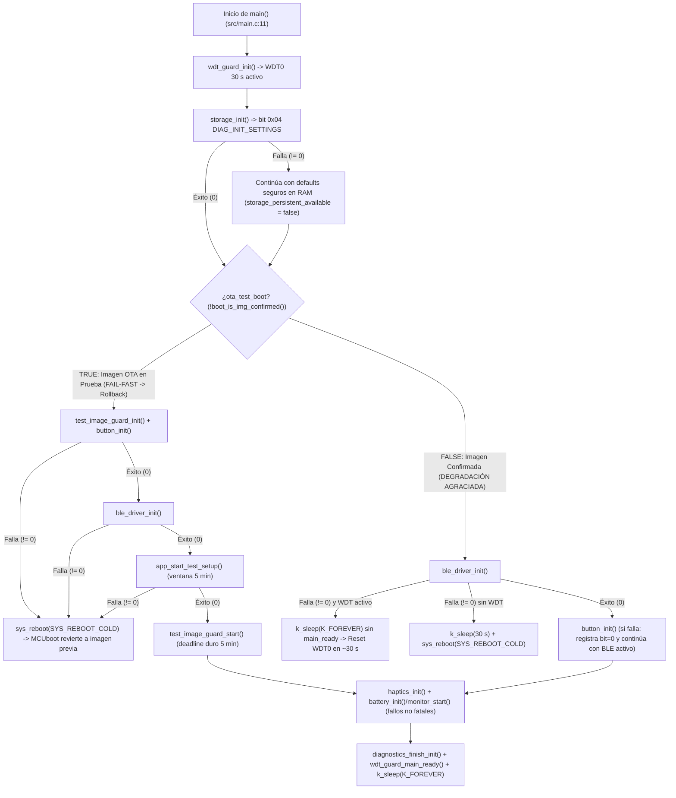

# 18. Manejo de Errores, Diagnóstico y Recuperación ante Fallos

> **Alcance y versión verificada**: Este capítulo especifica la arquitectura integral de tolerancia a fallos, degradación controlada, telemetría de diagnóstico GATT (`0xA0 MM` y `0xE1..0xE5`), catálogo exhaustivo de errores (internos, ATT/BLE, CBOR/SMP, persistencia y excepciones fatales) y supervisión hardware mediante Watchdog (`WDT0`) del firmware de Joya en el commit `c1128e5d0c0d6f98be0a580d287c0926ca27f01f` (`Zephyr RTOS 4.2.0`, SoC `nRF52832-QFAA`).
>
> **Referencias cruzadas**: Para la secuencia de inicialización véase [04_boot_initialization.md](04_boot_initialization.md); para las transiciones de la máquina de estados véase [05_state_machine.md](05_state_machine.md); para los contextos de ejecución y bloqueos véase [06_concurrency.md](06_concurrency.md); para la persistencia `Settings/NVS` véase [15_flash_persistence.md](15_flash_persistence.md); para el flujo de rollback en `MCUboot` véase [16_ota_mcuboot.md](16_ota_mcuboot.md); y para las cadenas temporales del Watchdog véase [19_timers_parameters.md](19_timers_parameters.md).

---

## 18.1. Filosofía y Arquitectura General de Manejo de Fallos

### 18.1.1. Restricciones físicas que gobiernan la estrategia de recuperación

El diseño de recuperación del firmware está condicionado por dos restricciones estructurales del producto ([docs/auditorias/Avances.md](../../docs/auditorias/Avances.md#L27-L40), [docs/RECOVERY_VALIDATION.md](../../docs/RECOVERY_VALIDATION.md)):

1. **Unidades selladas sin acceso físico `SWD` ni botón de reset (`P0.21`)**: Una vez ensamblada la pulsera, no existe conector de programación accesible ni pin `nRESET` externo ([boards/joya/joya_nrf52/joya_nrf52_nrf52832_defconfig](../../boards/joya/joya_nrf52/joya_nrf52_nrf52832_defconfig#L3-L4)). Si el firmware entrara en un lazo infinito, en un `k_panic()` que detenga la CPU o en una imagen OTA defectuosa que inutilice BLE, el dispositivo quedaría irrecuperable hasta agotar físicamente su celda de batería.
2. **Prioridad de disponibilidad ante emergencias**: Un fallo en un subsistema secundario (como el actuador háptico `DRV2605`, el canal `SAADC` de batería o el desgaste/corrupción de la partición `storage_partition` en Flash) **no debe impedir** que la usuaria dispare una alerta de emergencia (`COMMAND_EMERGENCY = 0x04`) ni que se recupere el dispositivo vía BLE OTA.

### 18.1.2. Bifurcación estratégica según el estado de confirmación de la imagen (`main.c`)

**(a) Comportamiento implementado y (b) intención de diseño**: En [src/main.c](../../src/main.c#L12-L89), el firmware aplica políticas opuestas según si la imagen ejecutada en `slot0_partition` ya está confirmada o se encuentra en su primer arranque de prueba OTA (`ota_test_boot = !boot_is_img_confirmed()`):

1. **En imagen confirmada (`ota_test_boot == false`) — Degradación agraciada y *RAM-first***:
   - `storage_init()`, `button_init()`, `haptics_init()` y `battery_init()`/`battery_monitor_start()` son **no fatales**: si fallan, registran su bit en `0` dentro de `init_bits` y permiten continuar el arranque.
   - Toda escritura en persistencia (`storage_save_app_id`, `storage_save_emergency_phase`, `storage_save_pending_routine`, `storage_save_name` y `storage_factory_reset` en [src/flash_memory.c](../../src/flash_memory.c#L146-L398)) actualiza **primero el estado en SRAM** y devuelve `+1` (error no crítico) si falla `Settings/NVS`, manteniendo operativa la sesión actual.
   - Únicamente si falla `ble_driver_init()` ([src/main.c](../../src/main.c#L41-L52)) carece de sentido continuar porque Joya es intrínsecamente un periférico BLE: el hilo `main` **no invoca `wdt_guard_main_ready()`** y duerme hasta que `WDT0` reinicia el SoC a los `~30 s` (o espera `K_SECONDS(30)` antes de `sys_reboot(SYS_REBOOT_COLD)` si `WDT0` no pudo activarse), evitando bucles de reinicio de alta frecuencia que drenarían la batería o desgastarían Flash.
2. **En imagen OTA `Test` (`ota_test_boot == true`) — *Fail-fast* hacia Rollback**:
   - Una actualización recién instalada debe demostrar empíricamente que puede inicializar el botón de recuperación (`button_init()`), levantar el stack BLE (`ble_driver_init()`), abrir advertising en `STATE_SETUP_MODE` (`app_start_test_setup()`) y ser confirmada por un cliente autenticado mediante `SMP` en menos de `5 minutos` (`test_image_guard_start()`, [src/test_image_guard.c](../../src/test_image_guard.c#L46-L61)).
   - Cualquier fallo en esos pasos dispara `sys_reboot(SYS_REBOOT_COLD)` inmediato; al no haberse escrito `image_ok` en el *trailer* de `slot0`, `MCUboot` revierte automáticamente a la versión anterior funcional almacenada en `slot1`.

### 18.1.3. Red de contención multicapa en tiempo de ejecución (`fatal_recovery` + `wdt_guard`)

Una vez completado `main()`, cuatro barreras independientes protegen contra fallos de ejecución:

1. **Excepciones del procesador y pánicos del kernel (`k_sys_fatal_error_handler`, [src/fatal_recovery.c](../../src/fatal_recovery.c#L5-L11))**: Sobrescribe el manejador débil de Zephyr (que por defecto detendría el hilo o el sistema). Ante cualquier `HardFault`, `BusFault`, `UsageFault`, `MemManage` o `k_panic()`/`k_oops()` (incluidos `BT_ASSERT` del Host BLE, activos con `CONFIG_BT_ASSERT=y`), ejecuta de inmediato `NVIC_SystemReset()`.
2. **Aserciones en tiempo real duro del controlador BLE (`bt_ctlr_assert_handle`, [src/fatal_recovery.c](../../src/fatal_recovery.c#L13-L19))**: Habilitado mediante `CONFIG_BT_CTLR_ASSERT_HANDLER=y` ([prj.conf](../../prj.conf#L87)). Si el Link Layer (`LLL`/`ULL`) detecta una violación interna de temporización o estado de radio, invoca `NVIC_SystemReset()` sin pasar por consola.
3. **Supervisión lógica de progreso de `main`, `FSM` y `event_queue` (`guard_work_handler`, [src/wdt_guard.c](../../src/wdt_guard.c#L52-L82))**: Ejecutada cada `10 s` en `k_sys_work_q`, deja de alimentar `WDT0` (`30 s`) si un evento en `process_event()` tarda más de `15 s` o si `event_queue` acumula eventos sin que `fsm_progress` avance durante más de `15 s`, distinguiendo correctamente un bloqueo real de una espera ociosa legítima en `k_msgq_get(..., K_FOREVER)`.
4. **Supervisión implícita de `k_sys_work_q` e interrupciones por hardware `WDT0`**: Dado que `guard_work` corre sobre la propia `k_sys_work_q` (prioridad cooperativa `-1`), cualquier bloqueo infinito en un handler de `sysworkq` o tormenta de interrupciones impide ejecutar `wdt_feed()` y provoca un **Watchdog Reset hardware** a los `30,0 s` desde el último *feed* (reinicio que en el `nRF52832` equivale a un reinicio completo de periféricos y registros `WDT`, dejando el bit `DOG` en `NRF_POWER->RESETREAS`).

> **Compatibilidad con `WDT0` heredado tras soft-reset ([src/wdt_guard.c](../../src/wdt_guard.c#L25-L47))**: En el `nRF52832`, una vez iniciado `NRF_WDT->TASKS_START = 1`, los registros `CRV`, `RREN` y `CONFIG` quedan bloqueados en hardware hasta un *Watchdog Reset* o *Power-On Reset* (un `NVIC_SystemReset()` **no** detiene ni desbloquea `WDT0`). Por ello, `wdt_guard_init()` comprueba `wdt_registers_match()` (`CRV == 983040`, `RREN == 1`, `CONFIG == 0x01`). Si hereda los mismos parámetros (p. ej. tras `SMP Reset` o `Factory Reset`), reutiliza el canal `0` transparentemente; si hereda un `WDT` incompatible, ejecuta un lazo activo `for (;;) { __NOP(); }` manteniendo la CPU despierta hasta que el propio `WDT` reinicie el chip limpiando sus registros; y si `WDT0` no está en marcha pero su driver falla al instalarlo, retorna `false` y continúa sin watchdog para preservar la vía de actualización OTA.

---

## 18.2. Subsistema de Diagnóstico GATT (`diagnostics.h` / `diagnostics.c`)

### 18.2.1. Motivación: observabilidad en producción con `CONFIG_LOG=n`

En el binario de producción ([prj.conf](../../prj.conf#L15-L33)), todos los subsistemas de trazas textuales están desactivados (`CONFIG_LOG=n`, `CONFIG_PRINTK=n`, `CONFIG_CONSOLE=n`, `CONFIG_UART_CONSOLE=n`, `CONFIG_USE_SEGGER_RTT=n`). Esta decisión ahorra decenas de kilobytes de Flash/SRAM, elimina consumo de `UARTE0` y evita exponer el `APP_ID` en memoria de trazas, pero suprime toda salida serie. *(Los comentarios `// LOG: ...` visibles en `src/main.c` y `src/app_state.c` son anotaciones documentales inactivas).*

Para dotar al sistema de observabilidad en unidades selladas sin introducir escrituras adicionales en Flash ni bloquear hilos críticos, los módulos [include/diagnostics.h](../../include/diagnostics.h), [src/diagnostics.c](../../src/diagnostics.c) y la característica `DIAGNOSTICS` (`a407e00a-00c1-464d-9173-2cb8be585202`) en [src/ble_driver.c](../../src/ble_driver.c#L26), `L194-L203`, `L347-L358`, `L438-L443` y `L571-L606` implementan un canal binario minimalista sobre GATT.

### 18.2.2. Formato de mensajes: Reporte de inicialización (`0xA0 MM`) y Errores en vivo (`0xE1..0xE5`)

#### A. Mensaje de estado de inicialización (`2 bytes`: `0xA0 MM`)

Construido por `diagnostics_get_init_message(uint8_t out[2])` ([src/diagnostics.c](../../src/diagnostics.c#L52-L56)), donde `out[0] = 0xA0` (prefijo fijo) y `out[1]` contiene la máscara atómica `init_bits`. Cada bit en `1` certifica que el subsistema correspondiente devolvió `0` en `main()`; un bit en `0` indica fallo (o subsistema aún no inicializado). **Un arranque normal exitoso de los cinco subsistemas produce `A0 1F`**.

| Bit | Máscara | Constante (`include/diagnostics.h`) | Subsistema evaluado | Punto exacto de registro en `src/main.c` | Condición exacta para bit = `1` |
|---:|---|---|---|---|:---|
| `0` | `0x01` | `DIAG_INIT_BLE` | Stack BLE + `ota_access_init()` + creación set iBeacon | `L31` (rama `Test`) o `L42` (rama confirmada) | `ble_driver_init() == 0` ([src/ble_driver.c](../../src/ble_driver.c#L494-L517)) |
| `1` | `0x02` | `DIAG_INIT_BUTTON` | GPIO e interrupción `GPIOTE` del botón (`P0.13`) | `L26` (rama `Test`) o `L54` (rama confirmada) | `button_init() == 0` ([src/button.c](../../src/button.c#L157-L200)) |
| `2` | `0x04` | `DIAG_INIT_SETTINGS` | Subsistema `Settings/NVS` y carga de claves | `L17` (común a ambas ramas) | `storage_init() == 0` ([src/flash_memory.c](../../src/flash_memory.c#L197-L248)) |
| `3` | `0x08` | `DIAG_INIT_HAPTIC` | Pin `P0.07`, bus `i2c0` y driver `DRV2605` | `L62` (común a ambas ramas) | `haptics_init() == 0` ([src/haptics.c](../../src/haptics.c#L485-L580)) |
| `4` | `0x10` | `DIAG_INIT_BATTERY` | Canal `SAADC` `AIN7` y arranque del monitor periódico | `L80` (común a ambas ramas) | `battery_init() == 0` **y** `battery_monitor_start() == 0` ([src/main.c](../../src/main.c#L76-L80)) |
| `5..7` | `0xE0` | *(Reservados)* | Sin asignar | — | Siempre `0` en `c1128e5` |

Formas de entrega de `0xA0 MM`:
1. **Bajo demanda (`GATT READ`)**: `on_diagnostics_read()` ([src/ble_driver.c](../../src/ble_driver.c#L347-L358)) exige `ble_is_authenticated_conn(conn)` (de lo contrario rechaza con `BT_ATT_ERR_AUTHORIZATION = 0x08`) y retorna inmediatamente los 2 bytes actuales de `init_bits` (incluso si se consultase antes de terminar `main()`, aunque en la práctica la autenticación ocurre después).
2. **Automática (`GATT NOTIFY`)**: `diagnostics_request_init_notification()` ([src/diagnostics.c](../../src/diagnostics.c#L58-L70)) se invoca desde **tres puntos de confluencia**:
   - `diagnostics_finish_init()` al concluir `main()` ([src/main.c](../../src/main.c#L81)),
   - `ble_mark_authenticated_conn()` al autenticar el `APP_ID` ([src/ble_driver.c](../../src/ble_driver.c#L556)), y
   - `on_diagnostics_ccc_changed()` al suscribir `DIAGNOSTICS CCC = 0x0001` ([src/ble_driver.c](../../src/ble_driver.c#L201)).
   Esto garantiza que **sin importar en qué orden el cliente habilite `DIAGNOSTICS CCC` respecto al envío del `APP_ID`**, tan pronto como concurran las tres condiciones (`init_complete == 1`, `current_conn_authenticated == true` y `diagnostics_notify_enabled == true`), se encolará `diagnostics_work` para emitir `0xA0 MM` una vez.

#### B. Códigos de error en tiempo de ejecución (`1 byte`: `0xE1..0xE5`)

Emitidos exclusivamente por `NOTIFY` en tiempo real mediante `diagnostics_report_error(diagnostics_error_t error)` ([src/diagnostics.c](../../src/diagnostics.c#L72-L83)), **sin persistencia en RAM ni en Flash para futuras conexiones**:

| Byte | Símbolo (`diagnostics_error_t`) | Puntos exactos de disparo en el código fuente | Particularidades de emisión verificadas en `c1128e5` |
|---|---|---|:---|
| `0xE1` | `DIAG_ERROR_FLASH_WRITE` | • [src/flash_memory.c](../../src/flash_memory.c): `L181` (`storage_save_pending_routine`), `L281` (`storage_save_app_id`), `L312` (`storage_save_emergency_phase`), `L346` (`storage_save_name`). • [src/app_state.c](../../src/app_state.c): `L109` (`factory_reset_and_reboot`), `L240` (`send_pending_routine`), `L266` y `L269` (`handle_routine_button`), `L726` y `L732` (`EV_BTN_EMERGENCY`), `L831` (`EV_APP_STOP_EMERGENCY`). | **Doble disparo benigno**: cuando `storage_save_pending_routine()` falla en `settings_save_one()` (`L177-L182`), reporta `0xE1` internamente y retorna `1`, tras lo cual su llamador en `app_state.c` (`L240`, `L266`, `L269`, `L726`, `L831`) vuelve a llamar a `diagnostics_report_error(0xE1)`. Además, si `!storage_persistent_available`, `storage_save_app_id` y `storage_save_name` retornan `1` antes de `settings_save_one` sin emitir `0xE1`, mientras que los llamadores de `storage_save_pending_routine` en `app_state.c` sí emiten `0xE1` al ver retorno `!= 0`. |
| `0xE2` | `DIAG_ERROR_SETTINGS_LOAD` | • [src/flash_memory.c](../../src/flash_memory.c#L223) (`storage_init()` cuando `settings_load() != 0`). | **Normalmente no transmisible en vivo**: `storage_init()` se ejecuta únicamente en [src/main.c](../../src/main.c#L16) **antes de `ble_driver_init()`**, instante en que no puede existir conexión autenticada (`ble_diagnostics_session() == 0`), por lo que el evento se descarta en `L75-L76`. El fallo queda igualmente visible al leer `0xA0 MM` con el bit `0x04` apagado (p. ej. `A0 1B`). |
| `0xE3` | `DIAG_ERROR_EVENT_QUEUE_FULL` | • [src/app_state.c](../../src/app_state.c#L348) (`add_event_for_conn()` cuando `k_msgq_put(&event_queue, ..., K_NO_WAIT)` falla). | Cubre cualquier saturación de los `20` slots de `event_queue`, provenga de botón, batería, timers, OTA o GATT. |
| `0xE4` | `DIAG_ERROR_BLE` | • [src/ble_driver.c](../../src/ble_driver.c): `L80` (`ibeacon_stop`), `L117` (`ble_set_ibeacon_mode`), `L133` (`ibeacon_stop_on_connection`), `L615`, `L629`, `L638` (`ble_start_setup_advertising`), `L656` (`ble_stop_advertising`), `L675` (`ble_send_event_for_conn`), `L689` (`ble_send_event_authenticated`). | No se dispara en `ble_send_battery_value()` ni en fallos de la propia notificación `DIAGNOSTICS` (evitando recursión infinita si falla el canal BLE). Obviamente, los errores de advertising ocurridos mientras el dispositivo está desconectado se descartan porque `session == 0`. |
| `0xE5` | `DIAG_ERROR_I2C` | • [src/haptics.c](../../src/haptics.c): `L143` (`drv2605_write_reg`) y `L158` (`drv2605_read_reg`). | Notar que `drv2605_probe_addr()` (`L168-L173`) usa `i2c_reg_read_byte()` directamente sin reportar `0xE5`, evitando falsos errores al tantear `0x5A` y `0x5B` en el arranque. |

### 18.2.3. Control de concurrencia, épocas de sesión (`diagnostics_session_epoch`) y cola de 1 slot

El transporte de diagnóstico está diseñado para **no bloquear jamás al hilo que reporta un fallo** (que puede sostener un mutex de subsistema o estar en ruta crítica):

1. **Época monotónica por sesión (`diagnostics_session_epoch`, [src/ble_driver.c](../../src/ble_driver.c#L148))**: Inicializada en `1`, se incrementa bajo `conn_mutex` tanto en `on_connected()` (`L231`) como en `on_disconnected()` (`L255`). El valor `0` representa ausencia de sesión diagnóstica válida.
2. **Consulta y envío no bloqueantes (`K_NO_WAIT`)**: Tanto `ble_diagnostics_session()` (`L571-L582`) como `ble_diagnostics_notify_for_session()` (`L584-L606`) intentan adquirir `conn_mutex` con **`K_NO_WAIT`**.
   - **Por qué `K_NO_WAIT`**: Por ejemplo, `ble_send_event_authenticated()` o callbacks en `BT_RX` interactúan con `conn_mutex` y `event_queue`; usar `K_FOREVER` dentro de `diagnostics_report_error()` introduciría riesgos de inversión de prioridad o interbloqueo cruzado.
   - **Compromiso (*best-effort*)**: Si otro hilo mantiene `conn_mutex` bloqueado durante los breves microsegundos en que ocurre `diagnostics_report_error()` o `diagnostics_work_handler()`, la función retorna `0` / aborta silenciosamente y esa notificación puntual se descarta (para el mensaje `0xA0 MM`, la app siempre puede recuperarlo mediante `GATT READ`).
3. **Buffer estático de un único slot bajo `k_spinlock pending_lock` ([src/diagnostics.c](../../src/diagnostics.c#L9-L35))**:
   - Existen exactamente dos slots independientes: `pending_init_session` (para `0xA0 MM`) y el par `(pending_error_session, pending_error_code)` (para `0xE1..0xE5`).
   - Si ocurren dos errores `0xEx` consecutivos antes de que `k_sys_work_q` ejecute `diagnostics_work_handler()`, **el segundo sobrescribe a `pending_error_code`** (`L79-L80`). Al ejecutarse `diagnostics_work_handler()`, copia y limpia ambos slots bajo `k_spin_lock(&pending_lock)` y verifica que `session == diagnostics_session_epoch` antes de llamar a `bt_gatt_notify()`, garantizando que un error generado justo antes de una desconexión nunca se entregue a una conexión posterior.

---

## 18.3. Catálogo Exhaustivo de Errores del Firmware (Matriz de 12 Atributos)

A continuación se documentan **todos** los códigos de error, fallos de subsistema, rechazos de protocolo y condiciones fatales presentes en el firmware de Joya, especificando para cada uno los **12 atributos normativos** exigidos por la ingeniería del producto.

### 18.3.1. Errores internos POSIX / Zephyr y códigos de persistencia no crítica

| 1. Código / Valor | 2. Origen | 3. Condiciones que lo producen | 4. Función responsable (`archivo:línea`) | 5. Propagación | 6. Respuesta del sistema | 7. Reintentos | 8. Posibilidad de recuperación | 9. Cambio de estado | 10. Info enviada a la app | 11. Respuesta háptica | 12. Consecuencias para la usuaria |
|---|---|---|---|---|---|---|---|---|---|---|---|
| **`+1`** (Persistencia degradada) | Capa `flash_memory` (`Settings/NVS`) | Partición `storage` no inicializada (`!storage_persistent_available`), fallo de `settings_save_one()` / `settings_delete()`, o imposible limpiar `pending_routine_dirty` antes de guardar `APP_ID` o limpiar emergencia. | `storage_save_pending_routine` ([src/flash_memory.c](../../src/flash_memory.c#L168-L183)); `storage_save_app_id` (`L267-L286`); `storage_save_emergency_phase` (`L298-L317`); `storage_save_name` (`L337-L348`); `storage_factory_reset` (`L368-L397`). | Retorna `1` hacia `app_comm.c`, `app_state.c` o `ble_driver.c`. | **Política *RAM-first***: conserva el nuevo valor en SRAM para la sesión activa (salvo en `storage_save_app_id` con `pending_routine_dirty`, que aborta sin guardar para proteger aislamiento; y en `factory_reset_and_reboot`, que cancela el reboot en `app_state.c:108-117` para no recargar el `APP_ID` viejo desde Flash). | Sin reintento automático inmediato; `pending_routine_dirty` fuerza nuevo intento de limpieza en la próxima transición. | En sesión actual opera en RAM; en Factory Reset fallido la usuaria puede repetir el gesto de `15 s`. | Normal en `save_*`; en `factory_reset_and_reboot` queda en `STATE_UNPAIRED` con `suspended_idle = true`; en `save_app_id` sucio permanece en `STATE_SETUP_WAITING_IDENTIFIER`. | `0xE1` (`DIAG_ERROR_FLASH_WRITE`) en `DIAGNOSTICS` si hay sesión suscrita. En `on_name_write` devuelve éxito ATT (`len`). | Sin cambio (reproduce el patrón normal de la acción en curso). | La pulsera sigue funcionando mientras tenga energía, pero **perderá el cambio si se reinicia** (o exigirá repetir provisión / Factory Reset). |
| **`-ENODEV` (`-19`)** — Botón | Driver GPIO (`button`) | El controlador `&gpio0` del alias `boton-emergencia` (`P0.13`) no está listo (`!gpio_is_ready_dt(&button)`). | `button_init()` ([src/button.c](../../src/button.c#L161-L163)). | Retorna a `main()` ([src/main.c](../../src/main.c#L25) o `L53`). | Limpia bit `DIAG_INIT_BUTTON (0x02)`. En imagen `Test` ejecuta `sys_reboot(SYS_REBOOT_COLD)`. En imagen confirmada continúa el arranque sin interrupciones de botón. | En `Test`: 1 reboot → rollback. En confirmada: sin reintentos hasta próximo reinicio. | Automática por rollback en `Test`; en imagen confirmada solo conectándose por BLE si tenía `APP_ID` (auto-adv a los `~60 s`). | En confirmada sigue en `STATE_UNPAIRED` (y pasa a `STATE_BONDED_DISCONNECTED` a los `~60 s` si hay `APP_ID`). | `0xA0 MM` con bit `0x02 = 0` (ej. `A0 1D`) tras autenticar. | Ninguna. | **Severa si ocurre en imagen confirmada**: los gestos físicos (`1/2/3 clics`, `5 s`, `15 s`) quedan inoperativos. |
| **`-ENODEV` (`-19`)** — Háptica | Subsistema `haptics` (`i2c0` / `DRV2605`) | `&i2c0` o `haptic_en` (`P0.07`) no listos, o el `DRV2605` no responde (`NACK`) ni en `0x5A` ni en `0x5B`, o se invoca `haptics_play_with_completion()` con `haptics_ready == false`. | `haptics_init()` ([src/haptics.c](../../src/haptics.c#L495-L527)); `haptics_play_with_completion()` (`L622-L624`). | En boot retorna a `main()` (`L61`); en runtime retorna a `app_state.c` (`L643`, `L665`) o se ignora en `haptics_play()`. | En `haptics_init()`: apaga `P0.07 = 0`, deja `haptics_ready = false` y bit `0x08 = 0`. En `app_state.c`: si era `SUSPEND` entra directo a `enter_unpaired_idle()`; si era `FACTORY_RESET` marca `hold_pattern_done = true` para no bloquear el reset al soltar el botón. | Sin reintentos (`haptics_init` corre solo en boot). | El sistema opera normalmente sin motor háptico; si el fallo fue transitorio se recupera en el próximo reinicio. | No impide ninguna transición (incluidos `SUSPEND` y `FACTORY_RESET`). | `0xA0 MM` con bit `0x08 = 0` (ej. `A0 17`). | **Suprimida** (motor apagado). | La pulsera mantiene todas sus funciones de emergencia, rutinas y BLE, pero **sin confirmación vibratoria táctil**. |
| **`-ENODEV` (`-19`)** — Batería | Subsistema `battery` (`SAADC`) | Periférico `&adc` no listo (`!device_is_ready(battery_adc.dev)`). | `battery_init()` ([src/battery.c](../../src/battery.c#L54-L56)). | Retorna a `main()` ([src/main.c](../../src/main.c#L76)), que omite `battery_monitor_start()`. | Registra bit `DIAG_INIT_BATTERY (0x10) = 0`; `haptics_allowed` queda en su valor inicial `0` (`false`) y `boot_battery_seen` permanece `false`. | Sin reintentos hasta reinicio. | Manual: la usuaria debe pulsar `2 clics` o `3 clics` para iniciar advertising, pues nunca llegará `EV_BATTERY_*` para el auto-advertising de `60 s`. | Permanece en `STATE_UNPAIRED` tras boot hasta gesto de botón; `battery_level = -1`. | `0xA0 MM` con bit `0x10 = 0` (ej. `A0 0F`); sin notificaciones en servicio `...5300`. | **Deshabilitada** (`haptics_allowed` nunca pasa a `1` sin `EV_BATTERY_NORMAL`). | Sin telemetría de batería, sin vibración y sin auto-reconexión de arranque tras reboot (requiere doble/triple clic manual). |
| **`-EINVAL` (`-22`)** | Validación interna (`flash_memory`, `ble_driver`, `haptics`, `battery`) | Argumentos fuera de dominio: clave corrupta en `app_settings_set()`, comando inválido en `storage_save_pending_routine()`, fase inválida en `storage_save_emergency_phase()`, nombre nulo/vacío/`>31 B` en `storage_save_name()`, modo iBeacon inválido, atributo GATT no hallado o valor fuera de rango en `ble_send_battery_value()`, `HAPTICS_PATTERN_NONE`, o puntero `NULL` en `battery_get_*`. | [src/flash_memory.c](../../src/flash_memory.c#L45-L122), `L150`, `L295`, `L325-L331`; [src/ble_driver.c](../../src/ble_driver.c#L89), `L481`, `L707`, `L725`; [src/haptics.c](../../src/haptics.c#L634); [src/battery.c](../../src/battery.c#L85), `L347`. | Retorna al llamador directo (`storage_init`, `on_name_write`, `app_state`, etc.). | Si ocurre en `app_settings_set()` durante `settings_load()`, aborta la carga, emite `0xE2` y **restaura defaults limpios en RAM** (`L228-L234`). En los demás puntos aborta la operación puntual sin alterar estado global. | Sin reintentos. | Total e inmediata; si proviene de corrupción en NVS se limpia con una nueva escritura o `Factory Reset`. | Ninguno (si ocurre en `settings_load`, garantiza arranque limpio como `STATE_UNPAIRED`). | En `on_name_write` se traduce a `BT_ATT_ERR_UNLIKELY (0x0E)`; en `ble_send_event_*` emite `0xE4`. | En `HAPTICS_PATTERN_NONE` detiene vibración activa (`haptics_stop()`). | Protege la integridad interna; si NVS estaba corrupta, la usuaria deberá volver a vincular la pulsera. |
| **`-EACCES` (`-13`)** | Guardas de permiso interno (`flash_memory`, `ble_driver`, `haptics`, `battery`) | Guardar rutina sin `APP_ID` (`storage_save_pending_routine`), enviar telemetría de batería fuera de `STATE_AUTHENTICATED` (`ble_send_battery_value`), despertar `DRV2605` o reproducir patrón con `haptics_allowed == 0` (`battery_level != 0` o `critical_idle`), o leer/iniciar ADC sin `battery_init()` / `monitoring`. | [src/flash_memory.c](../../src/flash_memory.c#L153); [src/ble_driver.c](../../src/ble_driver.c#L716); [src/haptics.c](../../src/haptics.c#L262), `L626`; [src/battery.c](../../src/battery.c#L88), `L309`, `L364`. | Retorna al llamador (`battery_monitor_work_handler`, `app_state.c`). | Cancela limpiamente la acción prohibida (no toca `I2C`, no escribe NVS, no notifica GATT). En `SUSPEND`/`FACTORY_RESET` con batería baja (`haptics_allowed == 0`), `app_state.c:645` / `L667` ejecuta la transición directamente sin esperar vibración. | Sin reintentos (se rehabilita automáticamente cuando cambia la condición, p. ej. al autenticar o recuperar `EV_BATTERY_NORMAL`). | Automática al cumplirse la precondición de estado o nivel de batería. | Ninguno inesperado; preserva transiciones de `SUSPEND` y `FACTORY_RESET` en batería baja. | Silencio (no envía notificaciones de batería antes de autenticar). | **Suprimida deliberadamente** cuando `battery_level >= 1` para ahorrar energía y evitar caída de tensión `VBAT`. | En batería baja (`<= 3000 mV`), la usuaria percibe ausencia de vibración por diseño de ahorro energético, conservando emergencias y BLE. |
| **`-EBUSY` (`-16`)** | Concurrencia / Estado ocupado (`flash_memory`, `haptics`, `app_state`, stack BLE) | (1) Intentar guardar rutina con emergencia activa (`storage_save_pending_routine`); (2) pedir patrón háptico normal mientras corre un patrón con `completion` (`SUSPEND`/`FACTORY_RESET`); (3) `EV_BOOT_TEST_SETUP_REQUEST` fuera de `STATE_UNPAIRED`; (4) controlador BLE ocupado al iniciar advertising (`bt_le_adv_start`). | [src/flash_memory.c](../../src/flash_memory.c#L156); [src/haptics.c](../../src/haptics.c#L629); [src/app_state.c](../../src/app_state.c#L404), `L587`. | Retorna a `app_state.c` o `main()`. | (1) Prioriza la emergencia sobre rutinas; (2) protege el callback de cierre de `SUSPEND`/`FACTORY`; (3) en `Test` provoca reboot/rollback; (4) en `EV_BLE_RESTART_ADVERTISING` agenda reintento. | Para advertising BLE (`L586-L590`): hasta **`3` intentos** (`10 ms`, `+5 s`, `+5 s`). En los demás casos, sin reintento. | Automática en advertising (o manual con `2 clics` en `STATE_BONDED_DISCONNECTED`, `L1003-L1009`). | Sin cambio espurio. | Si falla `ble_start_setup_advertising`, reporta `0xE4` (si hubiera sesión, normalmente `0`). | Conserva el patrón crítico (`SUSPEND`/`FACTORY`) en curso sin cortarlo. | Evita que pulsaciones accidentales aborten la secuencia háptica de apagado/reset o pisen una emergencia. |
| **`-ENOMSG` (`-35`) / `-ENOMEM` (`-12`) / `-EAGAIN` (`-11`)** | Colas y pools (`event_queue`, `net_buf` BLE, HCI) | (1) `k_msgq_put(&event_queue, ..., K_NO_WAIT)` con los `20` slots llenos devuelve `-ENOMSG`; (2) agotamiento transitorio de buffers `net_buf` ACL TX (`3`) / ATT (`3`) o recursos HCI al notificar o iniciar advertising (`-ENOMEM` / `-EAGAIN`). | `add_event_for_conn()` ([src/app_state.c](../../src/app_state.c#L346-L353)); `ble_start_setup_advertising()` / `ble_send_notify()` ([src/ble_driver.c](../../src/ble_driver.c#L484), `L633`). | Hacia productores de eventos (`app_comm.c`, `battery.c`, `button.c`, `app_state.c`) o hacia `EV_BLE_RESTART_ADVERTISING`. | En `add_event_for_conn`: emite `0xE3` y ejecuta `bt_conn_unref(entry.conn)` evitando fuga de conexión. En `battery_finish_verification` (`battery.c:205`): **no actualiza `confirmed_level`** si `add_event != 0`. En `critical_window_work_handler` (`app_state.c:300`): reprograma a `1 s`. | • `critical_window_work`: reintento cada `1 s`. • `COMMAND_EMERGENCY`: backoff `1, 2, 5, 10, 30 s...`. • `advertising_restart`: `3` intentos cada `5 s`. • Rutinas/botón: sin reintento automático de cola. | Alta en temporizadores críticos y emergencias; un gesto puntual de botón ocurrido durante saturación extrema se descarta y requiere repetir pulsación. | Preserva coherencia de referencias `bt_conn`; si se perdió `EV_BLE_DISCONNECTED`, `EV_BTN_2_PULSE` (`L540-L552`) sanea `current_state`. | `BT_ATT_ERR_INSUFFICIENT_RESOURCES (0x11)` si vino de escritura GATT `RX`/`RX_AUTH`, más `0xE3` o `0xE4` en `DIAGNOSTICS`. | Ninguna directa. | En condiciones nominales la FSM drena eventos en `< 2 ms`; bajo inundación GATT hostil protege al sistema contra bloqueos o fugas de conexión. |
| **`-ENOTCONN` (`-128`)** | Transporte GATT (`ble_driver`) | Intento de enviar notificación `TX` (`ble_send_event_for_conn` / `ble_send_event_authenticated`) o de batería (`ble_send_battery_value`) cuando no hay enlace activo, la sesión no está autenticada o el cliente no habilitó el respectivo descriptor `CCC`. | [src/ble_driver.c](../../src/ble_driver.c#L671), `L685`, `L720`. | Retorna a `app_state.c` o `battery.c`. | **No reporta `0xE4`** (es una condición operativa normal de desconexión o `CCC` inactivo). Para rutinas (`handle_routine_button`, `L263-L270`), al fallar el envío en vivo guarda automáticamente el comando en `joya/routine` (NVS). Para emergencias (`L784`), mantiene `EMERGENCY_PENDING_ACK`. | • Emergencias: reenvío automático al reconectar/autenticar (`send_pending_after_auth`) y cada `1..30 s`. • Rutinas: persiste la última en `joya/routine` y la envía al autenticar. | Totalmente automática al reconectar el teléfono, habilitar `TX CCC` y autenticar `APP_ID`. | Ninguno. | Se pospone la entrega de `0x02`/`0x03`/`0x04` hasta reconexión autenticada. | Las rutinas y emergencias vibran localmente aunque no haya conexión activa. | Continuidad total sin cobertura BLE: ni la emergencia ni la última rutina pulsada se pierden mientras el teléfono está lejos. |
| **`-EALREADY` (`-120`)** | Controlador BLE Advertising (`ble_driver`) | Llamada a `bt_le_adv_stop()` o `bt_le_ext_adv_stop(ibeacon_adv)` cuando el conjunto de advertising ya se había detenido (p. ej. automáticamente al conectarse por `BT_LE_ADV_OPT_ONE_TIME`). | `ibeacon_stop` ([src/ble_driver.c](../../src/ble_driver.c#L73)), `ble_set_ibeacon_mode` (`L97`), `ibeacon_stop_on_connection` (`L130`), `ble_start_setup_advertising` (`L614`), `ble_stop_advertising` (`L653`), `ble_disconnect` (`L770`). | Normalizado localmente a `0` (salvo retorno directo en `ble_stop_advertising`, que igualmente limpia `connectable_adv_running` sin emitir `0xE4`). | Se trata como éxito idempotente; actualiza `ibeacon_running = false` y `connectable_adv_running = 0` sin disparar `DIAG_ERROR_BLE`. | No requiere reintentos (estado deseado ya alcanzado). | Inmediata y transparente. | Ninguno adverso. | Ninguna (no emite `0xE4`). | Ninguna. | Ninguna; operación interna limpia. |
| **`-ENODATA` (`-61`)** | Subsistema `battery` *(API auxiliar)* | Consulta de `battery_get_last_voltage_mv()` antes de la primera muestra válida (`!last_valid`) o de `battery_get_recheck_level()` cuando el recheck no alcanzó 5 votos consistentes (`recheck_level == BATTERY_STATE_UNKNOWN`). | [src/battery.c](../../src/battery.c#L350), `L384`. | **(d) Funciones públicas actualmente no invocadas por ningún otro archivo `.c`** del árbol `c1128e5`. | Retorna `-ENODATA` sin modificar `confirmed_level`. | N/A (API disponible para extensiones futuras). | Se resuelve tras completarse una medición periódica válida. | Ninguno. | Ninguna. | Ninguna. | Sin efecto en `c1128e5` (código de API preparado no consumido por `app_state.c`). |
| **`-ENOENT` (`-2`)** | Subsistema `Settings/NVS` (`flash_memory`) | `settings_load()` encuentra en `storage_partition` una clave bajo el prefijo `"joya/"` distinta de `"app_id"`, `"emergency"`, `"routine"` y `"name"` (p. ej. clave obsoleta de otro firmware). | `app_settings_set()` ([src/flash_memory.c](../../src/flash_memory.c#L125)). | Retorna a `settings_load()` en `storage_init()` (`L221`). | **Atención**: En Zephyr, si un handler `h_set` retorna un error distinto de `0` (incluido `-ENOENT`), `settings_load_subtree()` propaga el código de error hacia `settings_load()`, haciendo que `storage_init()` entre en la rama `if (err)` (`L222-L236`), emita `0xE2`, deje `storage_persistent_available = false` y **borre a defaults en RAM todos los valores ya cargados**. | Sin reintentos hasta que se formatee la partición; mientras `storage_persistent_available == false`, ni siquiera `storage_factory_reset()` borra NVS (`L368`). | Si existiera una clave desconocida `"joya/<otra>"` en Flash, requeriría limpieza de partición o firmware compatible. | Arranca como virgen en RAM (`STATE_UNPAIRED`, `joya_app_id = {0}`). | `0xA0 MM` con bit `0x04 = 0` (`DIAG_INIT_SETTINGS` fallido). | Normal según batería. | Cualquier nueva clave futura bajo `"joya/"` debe contemplar retrocompatibilidad si se hace rollback a `c1128e5`. |
| **`-EIO` (`-5`) / Timeout `TWIM` (`500 ms`)** | Drivers Flash (`NVS`/`stream_flash`), `TWIM0` (`i2c0`), `SAADC` o planificación de `k_work` | Fallo eléctrico en bus `I2C` (`SDA`/`SCL` a tierra, `NACK` de `DRV2605` o timeout `CONFIG_I2C_NRFX_TRANSFER_TIMEOUT=500` ms), error de controlador `NVMC` en Flash, fallo al encolar `haptics_pattern_work` (`haptics.c:653`) o fallo al programar `critical_window_work` (`app_state.c:417`). | `drv2605_write_reg` / `read_reg` ([src/haptics.c](../../src/haptics.c#L141), `L156`), `haptics_play_with_completion` (`L653`), `process_event` (`L417`). | Hacia `haptics.c`, `flash_memory.c` o `app_state.c`. | • En `haptics`: aborta el patrón, ejecuta `drv2605_idle()` (`P0.07 = 0` + suspende `i2c0`), emite `0xE5` e **invoca igualmente `pattern_completion()`** (`L438`) para no dejar colgados `SUSPEND` ni `FACTORY_RESET`. • En `EV_BOOT_TEST_SETUP_REQUEST`: retorna `-EIO` a `main()` → reboot/rollback. | En `haptics_init()` ejecuta `i2c_recover_bus()` al arrancar; en runtime apaga y reenciende `P0.07` en el siguiente `drv2605_wake()`. | Alta en fallos transitorios de `DRV2605` gracias al ciclo de potencia por `P0.07`. *(Ojo: fallos sostenidos de bus I2C retienen `sysworkq` hasta `500 ms` por transferencia).* | No bloquea `HOLD_SUSPEND` ni `HOLD_FACTORY_RESET`. | `0xE5` (`DIAG_ERROR_I2C`) o `0xE1` (`DIAG_ERROR_FLASH_WRITE`) en `DIAGNOSTICS`. | El patrón en curso se interrumpe prematuramente. | Vibración cortada o ausente en ese evento, sin comprometer la máquina de estados ni la alerta BLE. |
| **`-ENOSYS` (`-38`)** | Recuperación de bus `I2C` (`haptics`) | `i2c_recover_bus(haptic_i2c)` no soportado por la configuración del driver subyacente. | `haptics_init()` ([src/haptics.c](../../src/haptics.c#L511-L514)). | Capturado y **absorbido explícitamente** (`if (err < 0 && err != -ENOSYS) goto fail;`). | Ignora `-ENOSYS` y prosigue normalmente con el sondeo de `0x5A` / `0x5B`. *(En `nRF52 TWIM` de Zephyr 4.2 sí existe implementación de `recover_bus`, pero la guarda garantiza portabilidad).* | No requiere. | Transparente (`100 %`). | Ninguno. | Ninguna. | Normal. | Ninguna. |
| **`-EAGAIN` (`-11`) por timeout de semáforo `10 s`** | Arranque de imagen `Test` (`app_start_test_setup`) | `k_sem_take(&test_setup_sem, K_SECONDS(10))` expira sin que `fsm_thread_id` procese `EV_BOOT_TEST_SETUP_REQUEST` y libere el semáforo. | `app_start_test_setup()` ([src/app_state.c](../../src/app_state.c#L330-L331)). | Retorna `-EAGAIN` a `main()` ([src/main.c](../../src/main.c#L35-L38)). | *(Nota de concurrencia: como `main` corre a prioridad preemptiva `0` y `fsm_thread_id` a `5`, al bloquearse `main` en `k_sem_take`, `fsm_thread_id` toma inmediatamente la CPU).* Si aun así vencieran los `10 s`, `main` ejecuta `sys_reboot(SYS_REBOOT_COLD)`. | Sin reintento en la imagen `Test` defectuosa. | Automática mediante rollback de `MCUboot` a la imagen confirmada anterior. | Reinicio completo del SoC. | Ninguna (aún sin conexión). | Ninguna. | Si una nueva imagen OTA bloqueara la FSM al arrancar, en `10 s` vuelve sola al firmware anterior sano. |

---

### 18.3.2. Errores de protocolo GATT / ATT, Aplicación (`COMMAND_NACK`) y Diagnóstico (`0xE1..0xE5`)

| 1. Código / Valor | 2. Origen | 3. Condiciones que lo producen | 4. Función responsable (`archivo:línea`) | 5. Propagación | 6. Respuesta del sistema | 7. Reintentos | 8. Posibilidad de recuperación | 9. Cambio de estado | 10. Info enviada a la app | 11. Respuesta háptica | 12. Consecuencias para la usuaria |
|---|---|---|---|---|---|---|---|---|---|---|---|
| **`BT_ATT_ERR_INVALID_OFFSET` (`0x07`)** | Callbacks GATT (`RX`, `RX_AUTH`, `NAME`) | Escritura ATT con `offset != 0` (p. ej. *Prepare Write* / escritura fragmentada). | `on_rx_write_handler` ([src/app_comm.c](../../src/app_comm.c#L10-L12)); `on_rx_auth_write_handler` (`L46-L48`); `on_name_write` ([src/ble_driver.c](../../src/ble_driver.c#L284-L286)). | Retornado como negativo `BT_GATT_ERR(0x07)` al Host BLE en `BT_RX`. | Descarta la escritura inmediatamente sin encolar eventos ni tocar RAM/Flash. | Ninguno en Joya (responsabilidad del cliente GATT). | Inmediata enviando una escritura atómica con `offset == 0` (con `MTU = 247` caben holgadamente `1 B`, `16 B` y `23 B`). | Ninguno. | `ATT_ERROR_RSP` con código `0x07` (si fue *Write With Response*). | Ninguna. | Ninguna con la app oficial; rechaza clientes mal configurados con `MTU` fragmentado. |
| **`BT_ATT_ERR_AUTHORIZATION` (`0x08`)** | Callbacks GATT (`NAME`, `DIAGNOSTICS`) | (1) `WRITE` en `NAME (...5201)` cuando `get_current_state() != STATE_AUTHENTICATED`; (2) `READ` en `DIAGNOSTICS (...5202)` cuando `!ble_is_authenticated_conn(conn)`. | `on_name_write` ([src/ble_driver.c](../../src/ble_driver.c#L279-L281)); `on_diagnostics_read` (`L352-L354`). | Retornado al Host BLE en `BT_RX`. | Rechaza el acceso sin leer `init_bits` ni modificar `joya_name`. | Ninguno en Joya. | Inmediata tras completar el flujo de autenticación (`TX CCC` → `RX_AUTH` → `0x05 ACK`). | Ninguno (mantiene la conexión abierta). | `ATT_ERROR_RSP` con código `0x08` (*Insufficient Authorization*). | Ninguna. | Impide cambiar el nombre o leer diagnósticos antes de autenticar la app. |
| **`BT_ATT_ERR_INVALID_ATTRIBUTE_LEN` (`0x0D`)** | Callbacks GATT (`RX`, `RX_AUTH`, `NAME`) | Longitud inválida: `len != 1` en `RX (...5002)`, `len != 16` en `RX_AUTH (...5101)`, o `len == 0 || len > 23` (`JOYA_SUFFIX_MAX_LEN`) en `NAME (...5201)`. | `on_rx_write_handler` ([src/app_comm.c](../../src/app_comm.c#L14-L16)); `on_rx_auth_write_handler` (`L49-L51`); `on_name_write` ([src/ble_driver.c](../../src/ble_driver.c#L289-L291)). | Retornado al Host BLE en `BT_RX`. | Descarta el payload sin procesar ni truncar cadenas. | Ninguno. | Inmediata ajustando la longitud en la app (p. ej. recortando el alias de usuaria a `<= 23` bytes UTF-8). | Ninguno. | `ATT_ERROR_RSP` con código `0x0D`. | Ninguna. | Si la usuaria escribe un nombre con tildes/emojis que supere `23 bytes` UTF-8, la app recibe `0x0D` y el nombre anterior se conserva intacto. |
| **`BT_ATT_ERR_UNLIKELY` (`0x0E`)** | Callback GATT `NAME` (`ble_driver`) | (1) `bt_set_name(name)` retorna error o `storage_save_name(name) < 0` en `on_name_write()`; (2) en `on_name_read()`, `joya_name` en RAM no es `"Joya"` y tampoco empieza por `"Joya de "`. | `on_name_write` ([src/ble_driver.c](../../src/ble_driver.c#L307-L316)); `on_name_read` (`L337-L339`). | Retornado al Host BLE en `BT_RX`. | Aborta la lectura o el guardado en NVS. *(Notar que si falla `settings_save_one`, `storage_save_name` devuelve `+1`, que es `>= 0`, por lo que un fallo físico de Flash **no** devuelve `0x0E` sino éxito ATT)*. | Ninguno. | Si provino de un nombre antiguo en NVS sin prefijo `"Joya de "`, basta escribir un nuevo nombre por `NAME` para normalizarlo. | Ninguno. | `ATT_ERROR_RSP` con código `0x0E`. | Ninguna. | Evita leer fuera de límites si existía un nombre legado sin prefijo `"Joya de "`. |
| **`BT_ATT_ERR_INSUFFICIENT_RESOURCES` (`0x11`)** | Callbacks GATT (`RX`, `RX_AUTH`) | `add_event_for_conn()` falla (`!= 0`) porque `event_queue` ya contiene `20` eventos sin procesar. | `on_rx_write_handler` ([src/app_comm.c](../../src/app_comm.c#L36-L38)); `on_rx_auth_write_handler` (`L53-L55`). | `add_event_for_conn` → `on_rx_*` → Host BLE. | Libera `bt_conn_unref()`, reporta `0xE3` y rechaza la escritura ATT. *(Si el cliente usó `Write Without Response`, el código ATT no viaja por aire y el comando se pierde silenciosamente)*. | El cliente debe reintentar si usó `Write With Response` y recibió `0x11`. | Automática en milisegundos una vez que `fsm_thread_id` consume la cola. | Ninguno. | `ATT_ERROR_RSP (0x11)` (en `Write With Response`) + `0xE3` en `DIAGNOSTICS`. | Ninguna. | Recomienda que la app móvil envíe comandos críticos (`0x41`, `0x42`, `RX_AUTH`) usando **Write With Response** para detectar `0x11`. |
| **`BT_ATT_ERR_VALUE_NOT_ALLOWED` (`0x13`)** | Callback GATT `NAME` (`ble_driver`) | El sufijo escrito en `NAME (...5201)` contiene al menos un byte nulo `'\0'` embebido (`memchr(buf, '\0', len) != NULL`). | `on_name_write` ([src/ble_driver.c](../../src/ble_driver.c#L293-L295)). | Retornado al Host BLE en `BT_RX`. | Rechaza el sufijo antes de construir `name[]`, garantizando la invariante `strlen(temp) == len - 1` exigida luego por `app_settings_set()` (`flash_memory.c:116`) al reiniciar. | Ninguno. | Inmediata enviando caracteres UTF-8 sin terminador `\0` incluido. | Ninguno. | `ATT_ERROR_RSP` con código `0x13`. | Ninguna. | Evita guardar un registro inválido en NVS que haría fallar `settings_load()` en el siguiente arranque. |
| **`COMMAND_NACK` (`0x06`)** | Autenticación FSM (`app_state`) | En `STATE_SETUP_WAITING_IDENTIFIER` con `!is_app_id_empty()`, los 16 bytes recibidos en `RX_AUTH` no coinciden con `joya_app_id` (`check_app_id != 0`). | `process_event()` ([src/app_state.c](../../src/app_state.c#L975-L982)). | `fsm_thread_id` → `ble_send_event_for_conn(entry->conn, COMMAND_NACK)` → `COMMANDS TX (...5001)`. | No marca `current_conn_authenticated`, no desconecta el enlace y no altera el `APP_ID` guardado. | El firmware acepta reintentos ilimitados desde el cliente en la misma sesión. | Si el teléfono tiene el `APP_ID` correcto puede reenviarlo; si la usuaria cambió de teléfono/cuenta sin conservar el `APP_ID`, requiere **Factory Reset físico (`15 s`)**. | Permanece en `STATE_SETUP_WAITING_IDENTIFIER`. | Notificación `0x06` (`1 B`) en `COMMANDS TX (...5001)`. | Ninguna (no reproduce `ACK_CONNECTION`). | La app detecta de inmediato que la pulsera está vinculada a otro identificador/cuenta. |
| **`0xE1..0xE5`** (`diagnostics_error_t`) | Subsistema `diagnostics` | Fallo puntual en escritura NVS (`0xE1`), carga inicial NVS (`0xE2`), cola FSM llena (`0xE3`), operación HCI/GATT BLE (`0xE4`) o registro I2C `DRV2605` (`0xE5`). | `diagnostics_report_error()` ([src/diagnostics.c](../../src/diagnostics.c#L72-L83)) → `diagnostics_work_handler()`. | Cualquier hilo → spinlock `pending_lock` → `k_sys_work_q` → `ble_diagnostics_notify_for_session()`. | Envío asíncrono *best-effort* de `1 byte` sin reintento ni almacenamiento persistente; si falla `bt_gatt_notify` o `conn_mutex` está ocupado, se descarta sin cascada de errores. | Sin reintentos (por diseño). | No afecta al flujo principal. | Ninguno. | Notificación de `1 B` (`0xE1..0xE5`) en `DIAGNOSTICS (...5202)` si está autenticado y suscrito. | Ninguna. | Invisible para la usuaria; permite telemetría técnica desde la app o consola de banco. |

---

### 18.3.3. Errores del subsistema OTA (`MCUmgr / SMP`, `stream_flash`, `MCUboot`, `test_image_guard`)

| 1. Código / Valor | 2. Origen | 3. Condiciones que lo producen | 4. Función responsable (`archivo:línea`) | 5. Propagación | 6. Respuesta del sistema | 7. Reintentos | 8. Posibilidad de recuperación | 9. Cambio de estado | 10. Info enviada a la app | 11. Respuesta háptica | 12. Consecuencias para la usuaria |
|---|---|---|---|---|---|---|---|---|---|---|---|
| **Descarte / Rechazo de trama `SMP` fragmentada en RX (`> ATT_MTU - 3`)** | Transporte BLE `MCUmgr` (`smp_bt`) | Como `# CONFIG_MCUMGR_TRANSPORT_BT_REASSEMBLY is not set` en `.config`, cualquier comando `SMP` entrante mayor que `ATT_MTU - 3` (`244 B` con `MTU=247`) o dividido en varios paquetes `Write Without Response` llega con longitud CBOR truncada respecto al header SMP de 8 bytes. | Transporte `smp_bt` de Zephyr → `smp_work_queue` (`zcbor`). | Falla al validar longitud / mapa CBOR o nunca completa el paquete esperado. | Descarta el buffer `net_buf` de `384 B` (`CONFIG_MCUMGR_TRANSPORT_NETBUF_SIZE=384`, `COUNT=4`) o devuelve error SMP `MGMT_ERR_EINVAL (3)`. No escribe en `slot1_partition`. | El cliente OTA (ej. `joya_console.py:644`, `RETRIES=3`, timeout `8 s`) ajusta `ceiling` para que `8 + len(CBOR) <= mtu - 3`. | Total ajustando el tamaño de chunk en el cliente móvil. | `uploading` no avanza de offset. | Respuesta SMP con `rc = 3` (`EINVAL`) o ausencia de respuesta (timeout en cliente). | Ninguna. | **Requisito mandatorio para la app móvil**: todo comando `SMP` hacia Joya debe caber en una sola escritura ATT (`<= 244 B`). |
| **Interrupción o fallo de carga DFU (`MGMT_EVT_OP_IMG_MGMT_DFU_STOPPED` / `MGMT_ERR_*`)** | Grupo `IMG` de `MCUmgr` + `ota_access` | Imagen inválida (sin magic `0x96F3B83D`), fallo de `stream_flash` sobre `slot1_partition`, comando `image erase`, o desconexión BLE a mitad de transferencia. | `image_status_handler()` ([src/ota_access.c](../../src/ota_access.c#L57-L71)) y `ota_access_on_disconnect()` (`L129-L138`). | En `DFU_STOPPED`: limpia `uploading = false`, reprograma `idle_close_work` (`1 s` si `close_requested`, o `2 min` `OTA_IDLE_TIMEOUT`) y encola `EV_OTA_UPDATE_STOPPED` hacia `process_event()` ([src/app_state.c](../../src/app_state.c#L506-L514)). | `slot0_partition` permanece intacto. Si `battery_level == 2` y la actualización se detuvo sin quedar `upload_complete`, `process_event()` cierra `SMP` e ingresa de inmediato en `enter_critical_idle()`. Al desconectar, `ota_access_on_disconnect()` limpia `uploading` y `upload_complete` y desregistra `SMP`. | `MCUmgr` conserva el progreso en `stream_flash` permitiendo reanudar desde el último `off` válido si se reconecta con el mismo `sha` ([ota/joya_console.py](../../ota/joya_console.py#L668-L670)). | Total (`100 %`, validado en [docs/auditorias/pruebas.md](../../docs/auditorias/pruebas.md#L36-L53)): la imagen activa no sufre daño y el acceso BLE se conserva. | Si `battery_level == 2`, pasa a `STATE_UNPAIRED` (`critical_idle = true`); en otro caso sigue en `STATE_AUTHENTICATED` (o `STATE_BONDED_DISCONNECTED` si cayó el enlace). | Mapa CBOR con `rc != 0` (si el enlace sigue vivo) o cierre de conexión. | Ninguna. | Una actualización interrumpida por alejar el teléfono nunca inutiliza la pulsera. |
| **Expiración del deadline de `5 min` en imagen `Test` sin confirmar** | Guarda de imagen de prueba (`test_image_guard`) | Una nueva imagen arrancó en modo `Test` (`!boot_is_img_confirmed()`), transcurrieron `5 minutos` (`K_MINUTES(5)`) y ningún cliente autenticado completó `IMG Confirm` sobre `SMP`. | `confirmation_deadline_handler()` ([src/test_image_guard.c](../../src/test_image_guard.c#L11-L18)). | Corre en `k_sys_work_q`; si `test_image_active == 1 && !boot_is_img_confirmed()`, invoca directamente `sys_reboot(SYS_REBOOT_COLD)`. | Reinicia el SoC en frío; `MCUboot` detecta `copy_done == 1` con `image_ok == 0xFF` en el trailer de `slot0` y ejecuta **swap de reversión** (`MOVE`), restaurando la imagen confirmada previa de `slot1` a `slot0`. | 1 único plazo improrrogable de `300 s` por arranque `Test`. | **Automática por diseño** (validado en [docs/auditorias/pruebas.md](../../docs/auditorias/pruebas.md#L21-L34)). | Reinicio completo hacia el firmware anterior confirmado. | Desconexión abrupta si había enlace abierto sin haber enviado `CONFIRM`. | Ninguna. | Si una actualización OTA rompe la comunicación con la app o el teléfono se apaga antes de confirmar, a los `5 min` la pulsera vuelve sola a su versión estable anterior. |
| **Fallo de validación `SHA-256` o firma `RSA-2048` en `MCUboot`** | Bootloader `MCUboot` (`boot_partition`) | Imagen en `slot1` con firma inválida o truncada al pedir `swap`, o corrupción física de bits en `slot0` detectada por `CONFIG_BOOT_VALIDATE_SLOT0=y`. | `boot_go()` en `MCUboot` (`build_joya/mcuboot`). | Interno al bootloader antes de saltar a `0x0000C2E0` (`rom_start` / `Entry point 0x12461`). | Si `slot1` es inválida: `MCUboot` la descarta/no intercambia y arranca la imagen íntegra de `slot0`. Si **ambos** slots estuvieran corruptos sin imagen válida: `MCUboot` aborta el arranque (`FIH_PANIC`). | En cada reset reevalúa `slot0` y `slot1` alimentando `NRF_WDT` (`CONFIG_BOOT_WATCHDOG_FEED_NRFX_WDT=y`). | Total si el fallo está en la candidata `slot1`; irrecuperable sin `SWD` únicamente si se corrompieran físicamente `slot0` y `slot1` a la vez. | Si `slot1` falla, arranca normalmente la imagen previa de `slot0`. | En `SMP STATE` posterior, la candidata rechazada ya no figura como activa. | Ninguna durante el bootloader. | Impide ejecutar cualquier firmware corrupto o no firmado oficialmente. |

---

### 18.3.4. Bloqueos de ejecución, fallos críticos de arranque y excepciones hardware (`wdt_guard` + `fatal_recovery`)

| 1. Código / Valor | 2. Origen | 3. Condiciones que lo producen | 4. Función responsable (`archivo:línea`) | 5. Propagación | 6. Respuesta del sistema | 7. Reintentos | 8. Posibilidad de recuperación | 9. Cambio de estado | 10. Info enviada a la app | 11. Respuesta háptica | 12. Consecuencias para la usuaria |
|---|---|---|---|---|---|---|---|---|---|---|---|
| **Registros `WDT0` heredados incompatibles al arrancar** | Supervisor `wdt_guard` | Tras un soft-reset desde otra versión de firmware, `NRF_WDT` ya está en marcha (`RUNSTATUS != 0`) pero `CRV != 983040`, `RREN != 1` o `CONFIG != 0x01`. | `wdt_guard_init()` → `wdt_init_failed()` ([src/wdt_guard.c](../../src/wdt_guard.c#L25-L47), `L92-L95`). | Bloquea intencionalmente `main()` en `for (;;) { __NOP(); }`. | Permanece en espera activa con CPU encendida (por si el `CONFIG` heredado pausaba el `WDT` en `SLEEP`) sin tocar `RR`, forzando un **reset hardware de Watchdog** que desbloquea y borra `CRV`/`RREN`/`CONFIG` para el siguiente arranque limpio. | 1 ciclo de expiración del `WDT` heredado. | Automática tras expirar el timeout heredado. | Reinicio hardware del SoC (`RESETREAS.DOG = 1`). | Ninguna durante la espera. | Ninguna. | Pausa única al migrar desde un firmware con distinta configuración de `WDT`, seguida de arranque limpio normal. |
| **Fallo de instalación de `WDT0` sin `WDT` activo** | Driver `nrfx_wdt` / `wdt_guard` | `!device_is_ready(wdt)` o fallo en `wdt_install_timeout()` / `wdt_setup()` cuando `nrf_wdt_started_check(NRF_WDT) == false`. | `wdt_guard_init()` → `wdt_init_failed()` ([src/wdt_guard.c](../../src/wdt_guard.c#L32-L47), `L97-L102`). | Retorna `false` a `main()` (`watchdog_active = false`). | Deja `watchdog_ready = false` y **continúa el arranque normal sin supervisión hardware** para evitar un bucle perpetuo o espera infinita y mantener disponible BLE OTA. | Se reintentará configurar en el próximo reinicio. | Operación normal disponible; actualización OTA disponible. | Ninguno (arranca normal con `watchdog_active = false`). | Sin código específico en `DIAGNOSTICS` (diseño intencional para no alterar máscara `0x1F`). | Normal. | Funcionamiento normal, aunque esa sesión carece de red de rescate ante un hipotético cuelgue posterior. |
| **Fallo de `ble_driver_init()` en imagen confirmada** | Inicialización BLE (`main` + `ble_driver`) | Fallo en `ota_access_init()`, `bt_enable(NULL)`, `bt_le_ext_adv_create()` o `bt_le_ext_adv_set_data()` al arrancar una imagen ya confirmada. | `main()` ([src/main.c](../../src/main.c#L41-L52)). | `ble_driver_init()` retorna `< 0` a `main()`. | Registra `DIAG_INIT_BLE = 0` y **omite `wdt_guard_main_ready()`**. Si `watchdog_active == true`, ejecuta `k_sleep(K_FOREVER)` dejando que `WDT0` reinicie el chip en `~30 s`; si `watchdog_active == false`, ejecuta `k_sleep(K_SECONDS(30))` seguido de `sys_reboot(SYS_REBOOT_COLD)`. | Reintento espaciado cada **`30 s`** indefinidamente hasta que `ble_driver_init()` tenga éxito. | Automática si el fallo de radio/reloj fue transitorio; si fuera daño permanente de silicio RF no habrá vía BLE. | Reinicio periódico controlado cada `30 s` en bajo consumo (`k_sleep`). | Imposible transmitir mientras BLE no inicialice. | Ninguna (`main` se detiene antes de `haptics_init()`). | Evita drenar abruptamente la batería con miles de reinicios por segundo si falla el subsistema de radio. |
| **Bloqueo de evento en `FSM` (`> 15 s`) o inanición de `event_queue` (`> 15 s`)** | Hilo `fsm_thread_id` supervisado por `wdt_guard` | (1) `process_event()` queda atrapado `> 15000 ms` (`fsm_processing == 1`); o (2) `event_queue` tiene mensajes pendientes (`> 0`) sin incremento de `fsm_progress` durante `> 15000 ms` desde su primera observación (p. ej. `fsm_thread_id` bloqueado eternamente por un hilo de mayor prioridad). | `guard_work_handler()` ([src/wdt_guard.c](../../src/wdt_guard.c#L61-L79)). | `healthy = false` → suprime `wdt_feed(wdt, 0)` mientras sigue reprogramando `guard_work` cada `10 s` (permitiendo recuperar el *feed* si el bloqueo se destraba antes de que venza `WDT0`). | Si el bloqueo persiste hasta cumplir `30 s` desde el último `wdt_feed`, `WDT0` ejecuta un **reset hardware completo del SoC** (tiempo total desde el inicio del cuelgue: **`30..45 s`**, verificado en `45 s` en [docs/auditorias/pruebas.md](../../docs/auditorias/pruebas.md#L60)). | Reinicio limpio automático; tras `~60 s` del nuevo arranque restaura advertising (`if !is_app_id_empty()`) y reenvía emergencias/rutinas persistidas en NVS. | **Automática (`100 %`)**, conservando estado persistido (`joya/app_id`, `joya/emergency`, `joya/routine`, `joya/name`). | Reset total → `STATE_UNPAIRED` → `STATE_BONDED_DISCONNECTED` (a los `~60 s` con `APP_ID`). | Si había conexión abierta, el teléfono detecta desconexión por *supervision timeout* (`6 s`) o caída del radio en el reset, y reconecta después. | Se corta cualquier vibración en el reset; tras reconectar con emergencia pendiente vuelve a vibrar `EMERGENCY_START`. | Autocuración sin intervención humana en menos de `45 s` ante cualquier *deadlock* o bloqueo de software en la máquina de estados. |
| **Bloqueo de `k_sys_work_q` (`> 30 s`) o fallo de `wdt_feed()`** | `System Workqueue` / Hardware `WDT0` | Un work item cooperativo (prio `-1`) entra en bucle infinito o bloqueo indefinido impidiendo ejecutar `guard_work_handler()`, o `wdt_feed()` retorna `!= 0` (`wdt_guard.c:75`). | Hardware `NRF_WDT` (`0x40010000`) y [src/wdt_guard.c](../../src/wdt_guard.c#L75-L78). | Al no escribirse `0x6E524635` en `NRF_WDT->RR[0]` durante `30,00003 s`, el hardware dispara reset de sistema. | Reinicio hardware completo del SoC en **`20..30 s`** desde el inicio del bloqueo de `sysworkq`. | Reinicio automático gobernado por silicio. | **Automática (`100 %`)**, independiente del estado del kernel Zephyr. | Reset total hacia arranque limpio. | Caída de enlace y posterior reconexión automática. | Pin `P0.07` vuelve a alta impedancia / bajo al resetearse `GPIO0`, apagando el motor si había quedado encendido. | Impide tanto que la pulsera quede colgada en silencio como que el motor vibrador quede encendido indefinidamente drenando la batería. |
| **Excepción fatal de CPU / Kernel o Aserción del Controlador BLE** | Núcleo `ARM Cortex-M4` / Zephyr / `BT_LL_SW_SPLIT` | Instrucción ilegal, acceso a memoria inválida (`HardFault`/`BusFault`/`UsageFault`), `k_panic()`/`k_oops()`, `BT_ASSERT` en Host BLE o `LL_ASSERT` en el controlador de radio. | `k_sys_fatal_error_handler()` y `bt_ctlr_assert_handle()` ([src/fatal_recovery.c](../../src/fatal_recovery.c#L5-L19)). | Invocan `NVIC_SystemReset()` de forma síncrona e inmediata (`< 1 ms`) sin desenrollar pilas ni escribir Flash. | Reinicio por software (`AIRCR.SYSRESETREQ`, bit `SREQ` en `RESETREAS`). `WDT0` permanece activo con la misma configuración (`wdt_registers_match() == true`) y es adoptado transparentemente en el nuevo `main()`. | Inmediato al producirse la falta. *(Si una imagen `Test` provocase un fallo recurrente en el arranque, `MCUboot` hará rollback al no confirmarse)*. | **Automática e instantánea** para fallos transitorios (ej. aserción puntual de temporización de radio BLE). | Reset inmediato → restaura `joya/emergency` y `joya/routine` desde NVS en `storage_init()`. | Caída del enlace actual (`supervision timeout = 6 s` en el móvil) y reconexión posterior. | Se detiene de inmediato al resetear periféricos. | Minimiza el tiempo fuera de línea (`~150 ms` de reboot + validación de batería o gesto manual) frente a los `30 s` que tardaría esperar al Watchdog. |

---

## 18.4. Auditoría de Valores de Retorno Ignorados en el Código Fuente

En el código actual existen llamadas cuyo valor de retorno se descarta explícitamente con `(void)` o implícitamente sin asignación. La siguiente tabla clasifica cada caso distinguido entre descartes **seguros por diseño** y descartes con **efectos colaterales documentables**:

| Ubicación exacta | Llamada cuyo retorno se ignora | Clasificación de impacto y justificación técnica |
|---|---|---|
| [src/app_comm.c](../../src/app_comm.c#L62), `L67` | `add_event_for_conn(EV_BLE_CONNECTED / DISCONNECTED, conn, NULL)` | **Mitigado parcialmente en `c1128e5`**: Si `event_queue` está llena (`-ENOMSG`), el evento FSM se pierde (emitiendo `0xE3`). Para `DISCONNECTED`, `on_disconnected()` ya limpió `current_conn`, `current_conn_authenticated` y `SMP` en `BT_RX`, y `EV_BTN_2_PULSE` (`app_state.c:540-552`) repara `current_state` desincronizado. Para `CONNECTED`, la sesión quedaría sin avanzar a `WAITING_NOTIFICATION_ENABLE` hasta desconectar y reconectar. |
| [src/ble_driver.c](../../src/ble_driver.c#L169), `L182` | `(void)add_event_for_conn(EV_BLE_NOTIFY_ENABLED, ...)` y `(void)add_event(EV_BLE_BATTERY_NOTIFY_ENABLED)` | **Bajo riesgo**: Si `event_queue` estuviera llena al suscribir `TX CCC`, la app no recibiría respuesta al enviar `APP_ID` y debería reescribir `CCC` o reconectar. Si ocurre en `BATTERY_CHANGE CCC`, el nivel se notificará en el siguiente cambio de batería. |
| [src/button.c](../../src/button.c#L30) (`send_button_event`) | `add_event(event)` (`1/2/3 clics`, `LONG_PRESS`, `SUSPEND`, `FACTORY_*`) | **Riesgo acotado a saturación simultánea de `20` eventos**: No bloquea `sysworkq`, pero si la cola estuviera llena se descarta el gesto (reportando `0xE3`). En un gesto de `15 s`, si se perdiera `EV_BTN_FACTORY_RESET` al soltar tras haberse procesado `EV_BTN_FACTORY_THRESHOLD`, `hold_action` quedaría en `HOLD_FACTORY_RESET` hasta una nueva pulsación de `15 s` o reinicio. |
| [src/app_state.c](../../src/app_state.c#L67), `L72` | `(void)add_event(EV_HAPTICS_SUSPEND_DONE / FACTORY_DONE)` | **Riesgo bajo**: Si la cola estuviera llena exactamente en el milisegundo en que termina la vibración de `SUSPEND` (`1,4 s`) o `FACTORY_RESET` (`0,9 s`), `hold_pattern_done` quedaría en `false` y la acción diferida no se completaría hasta repetir el gesto. |
| [src/app_state.c](../../src/app_state.c#L277), `L285`, `L291` | `add_event(EV_EMERGENCY_RETRY / EV_BLE_TIMEOUT / EV_BLE_RESTART_ADVERTISING)` | **Impacto acotado**: Si `EV_EMERGENCY_RETRY` se pierde por cola llena, el timer de reintentos deja de re-agendarse hasta una reconexión o nuevo triple clic; si se pierde `EV_BLE_TIMEOUT`, el advertising de `STATE_SETUP_MODE` continuaría activo más allá de los `90 s` hasta conexión o suspensión manual. |
| [src/app_state.c](../../src/app_state.c#L227) (`emergency_restart_alerts`) | `ble_send_event_authenticated(COMMAND_EMERGENCY)` | **Benigno por diseño**: Inmediatamente en la línea siguiente (`L228`) invoca `emergency_schedule_next_retry()`, que reintentará enviar `0x04` a `1 s, 2 s, 5 s, 10 s, 30 s...` mientras `joya_emergency_phase == EMERGENCY_PENDING_ACK`. |
| [src/app_state.c](../../src/app_state.c#L707) | `(void)ota_access_enable()` al recibir `0x70` | **Benigno / Recuperable**: Si `smp_bt_register()` fallase transitoriamente, el cliente OTA (ej. `joya_console.py:536`) detecta en `DISCOVER` la ausencia del servicio `SMP` y reintenta `ENABLE` (`0x70`). |
| [src/app_state.c](../../src/app_state.c#L750), `L753`, `L756`, `L853`, `L857`, `L899`, `L904` | `start_advertising_with_ibeacon(...)` y `ble_stop_advertising()` en rutas de emergencia/timeout | **Riesgo menor**: A diferencia de `EV_BLE_DISCONNECTED` y el arranque diferido (que sí llaman a `schedule_advertising_restart()` con 3 reintentos), en `EV_BTN_EMERGENCY` y `EV_BLE_TIMEOUT` no se invoca `schedule_advertising_restart()` si `bt_le_adv_start` retorna ocupado; la usuaria puede forzar reintento con `2 clics` o nuevo `3 clics`. |
| [src/ble_driver.c](../../src/ble_driver.c#L603) y [src/battery.c](../../src/battery.c#L302) | `(void)bt_gatt_notify(...)` en `DIAGNOSTICS` y `(void)ble_send_battery_measurement(...)` | **Benigno por diseño (*best-effort*)**: La telemetría diagnóstica y el voltaje instantáneo cada `60 s` son informativos; no deben encolar reintentos ni generar cascadas de error `0xE4`. |
| [src/haptics.c](../../src/haptics.c#L660) (`haptics_play`) | `(void)haptics_play_with_completion(pattern, NULL)` | **Benigno por diseño**: Las vibraciones informativas (`SETUP_MODE`, `ROUTINE_*`, `EMERGENCY_START`, `FOLLOW_ME`, `FRIEND_EMERGENCY`, `ACK_CONNECTION`) son secundarias; si `haptics` no está disponible o la batería está en Nivel 1/2, la lógica funcional continúa sin alteración. |

---

## 18.5. Modos de Operación Degradados y Guía de Diagnóstico Sistémico

### 18.5.1. Matriz de modos operativos degradados en imagen confirmada

| Modo degradado | Causa raíz | Capacidades que **SE CONSERVAN** | Capacidades que **SE PIERDEN o LIMITAN** | Indicador observable en `DIAGNOSTICS` / GATT |
|---|---|---|---|---|
| **1. Operación *RAM-only*** | Fallo de `storage_init()` o desgaste/error en `storage_partition` | Vinculación, autenticación, emergencias (`0x04`), rutinas en vivo, cambio de nombre en sesión, batería, háptica y **BLE OTA completo** (`slot1` es independiente de `storage_partition`). | Al reiniciar se pierden `APP_ID`, nombre, fase de emergencia y rutina pendiente. Un Factory Reset que falle en Flash deja el equipo en `suspended_idle` sin reiniciar. | Lectura `0xA0 MM` con bit `0x04 = 0` (ej. `A0 1B`) y/o notificaciones `0xE1` en vivo. |
| **2. Operación sin Háptica** | Fallo en `DRV2605`, bus `i2c0` o `P0.07` | **100 % de funciones lógicas y RF**: emergencias, rutinas, suspensión (`5 s`), Factory Reset (`15 s`), batería y BLE OTA. | Ausencia total de retroalimentación vibratoria táctil. | `0xA0 MM` con bit `0x08 = 0` (ej. `A0 17`) y/o `0xE5` en tiempo de ejecución. |
| **3. Operación en Batería Nivel 1 (`2901..3000 mV`)** | Descarga moderada de batería confirmada (`5/6` votos) | Advertising, conexión BLE, emergencias, rutinas, persistencia NVS y BLE OTA. | `haptics_set_allowed(false)`: se suprimen todas las vibraciones para evitar picos de corriente del motor ERM (`OD_CLAMP = 2,5 V`) que provoquen caída por subtensión (*brownout*). | `BATTERY_CHANGE (...5301) = 0x01` y mV en `...5302` (`<= 3000 mV`). |
| **4. Reposo Crítico Batería Nivel 2 (`<= 2900 mV`)** | Descarga crítica confirmada (`5/6` votos) | Conteo de gestos de botón (`GPIOTE`), monitoreo de batería cada `60 s` (recuperación automática al superar `> 2950 mV`), ventana crítica de emergencia/OTA de `5 min` al pulsar `2 clics`, y respeto a una carga OTA activa en curso (`ota_access_is_update_active()`). | Desconexión BLE y apagado de advertising/iBeacon (`critical_idle = true`, `suspended_idle = true`); háptica apagada; ignora `1 clic`, pulsación de `0,5..5 s` y `3 clics` mientras `suspended_idle == true` (requiere despertar ventana de `5 min` con `2 clics` o recargar batería). | Antes de desconectar notifica `BATTERY_CHANGE = 0x02` (`<= 2900 mV`). |
| **5. Operación sin Monitor de Batería** | Fallo de `SAADC` en `battery_init()` | Gestos manuales de botón (`2 clics` para conectar, `3 clics` emergencia, `15 s` reset), BLE, NVS y OTA. | Sin auto-advertising a los `60 s` de un reinicio (exige `2` o `3 clics`), sin vibración (`haptics_allowed` queda en `0`) y sin notificaciones `...5301`/`...5302`. | `0xA0 MM` con bit `0x10 = 0` (ej. `A0 0F`). |
| **6. Operación sin Botón (en imagen confirmada)** | Fallo eléctrico/driver en `P0.13` (`button_init() != 0`) | Si ya poseía `APP_ID` y batería apta (`Nivel 0/1`), a los `~60 s` del arranque inicia advertising automáticamente, permitiendo conectar, autenticar y **actualizar por BLE OTA**. | Imposible disparar rutinas/emergencias por botón, imposible iniciar `Joya Setup` si estaba virgen, e imposible ejecutar `SUSPEND` o `Factory Reset`. | `0xA0 MM` con bit `0x02 = 0` (ej. `A0 1D`). |
| **7. Operación sin Watchdog Hardware** | Fallo al configurar `WDT0` sin `WDT` heredado activo | **100 % de funcionalidades de aplicación y BLE OTA**, más reinicio inmediato ante excepciones/asserts (`fatal_recovery.c`). | Sin recuperación hardware automática si `fsm_thread_id` o `k_sys_work_q` sufrieran un bloqueo lógico no fatal. | No altera `0xA0 1F` (verificable en banco leyendo `NRF_WDT->RUNSTATUS == 0`). |

### 18.5.2. Guía sistemática de diagnóstico ante síntomas en campo o banco

1. **La pulsera no anuncia por BLE recién encendida / reiniciada**:
   - Verificar si transcurrieron al menos **`60 segundos`** desde el reinicio (tiempo requerido por las `6 × 10 s` muestras iniciales de `battery.c` antes de emitir el primer `EV_BATTERY_NORMAL`/`LEVEL_1` que activa `boot_reconnect_pending`, véase [19_timers_parameters.md](19_timers_parameters.md)).
   - Si sigue sin anunciar tras `65 s`: presionar **`2 clics`**. Si anuncia `"Joya Setup"`, la pulsera estaba virgen (`is_app_id_empty() == true`). Si anuncia `"Joya"` / `"Joya de ..."` solo durante `5 minutos` y vuelve a apagarse, está en `Nivel 2` de batería (`<= 2900 mV`).
2. **La pulsera conecta y recibe eventos, pero nunca vibra**:
   - Autenticar y leer `DIAGNOSTICS` (`...5202`) + suscribir `BATTERY_CHANGE` (`...5301`):
     - Si `BATTERY_CHANGE` reporta `0x01` o `0x02` (o aún no pasaron `60 s` desde boot y `VBAT_init <= 3000 mV`): comportamiento **normal por política de batería** (`haptics_allowed == 0`).
     - Si `DIAGNOSTICS` devuelve bit `0x08 == 0` (ej. `A0 17`): fallo de detección inicial de `DRV2605` o `P0.07` / `i2c0`.
     - Si `DIAGNOSTICS` devuelve `A0 1F` con batería `0x00`, pero al comandar `0x44` (`FRIEND_EMERGENCY`) llega notificación `0xE5`: fallo eléctrico intermitente en `SDA`/`SCL` o caída de alimentación en `DRV2605` al conmutar el motor.
3. **Pérdida de configuración (`APP_ID` o nombre) tras reiniciar**:
   - Leer `DIAGNOSTICS`: si el bit `0x04 == 0` (`A0 1B`), `storage_init()` falló al montar o validar `storage_partition` y el sistema está corriendo en modo *RAM-only*. Si devuelve `A0 1F` pero al cambiar nombre llega `0xE1`, `settings_save_one()` está fallando en escritura.
4. **Reinicio inesperado tras una actualización OTA**:
   - Consultar `STATE` mediante `SMP` (`joya_console.py`): si la imagen activa volvió a la versión anterior con `confirmed = true`, operó correctamente el rollback de `MCUboot` (ya sea por fallo temprano en `button_init`/`ble_driver_init`/`app_start_test_setup` o por vencer los `5 minutos` de `test_image_guard` sin enviar `CONFIRM`).
   - En banco con DK (`SWD`), leer `NRF_POWER->RESETREAS` (`0x40000400`): bit `0x00000002` (`DOG`) confirma disparo de `WDT0` (`wdt_guard`), mientras que bit `0x00000004` (`SREQ`) indica `NVIC_SystemReset()` (`fatal_recovery`, `test_image_guard`, `Factory Reset` o `SMP Reset`).
