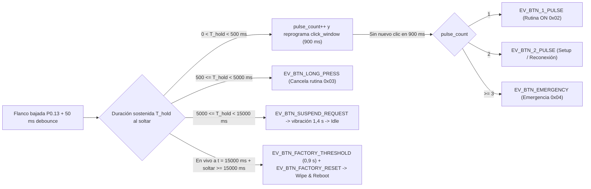

# 19. Referencia Centralizada de Temporizadores, Constantes y Parámetros de Funcionamiento

> **Alcance y versión verificada**: Este capítulo constituye la fuente única de verdad (*Single Source of Truth*) cuantitativa del firmware de Joya en el commit `c1128e5d0c0d6f98be0a580d287c0926ca27f01f` (`Zephyr RTOS 4.2.0`, `nRF52832-QFAA`). Consolida **todos** los temporizadores, plazos, ventanas, intervalos RF, umbrales analógicos, cadencias de reintento, secuencias hápticas, constantes de Watchdog, geometrías de particiones, tamaños de colas/buffers/pilas y prioridades efectivas verificadas sobre el código fuente, Devicetree y artefactos compilados (`build_joya/app/zephyr/.config`, `zephyr.dts`, `zephyr.elf` y `build_joya/mcuboot/zephyr/.config`).
>
> **Referencias cruzadas**: Para la configuración global de compilación véase [03_firmware_configuration.md](03_firmware_configuration.md); para la planificación de hilos y colas véase [06_concurrency.md](06_concurrency.md); para BLE e iBeacon véanse [07_ble_architecture.md](07_ble_architecture.md) y [08_ibeacon.md](08_ibeacon.md); para botón, emergencias, háptica y batería véanse [11_button.md](11_button.md), [12_emergency_routines.md](12_emergency_routines.md), [13_haptic_system.md](13_haptic_system.md) y [14_battery_power.md](14_battery_power.md); y para el presupuesto global de memoria y consumo véase [22_resources_performance.md](22_resources_performance.md).

---

## 19.1. Relojes Base, Ticks del Sistema y Calibración Hardware

Todos los temporizadores software del kernel (`k_work_delayable`, `k_sleep`, `k_sem_take`) y el Watchdog hardware (`WDT0`) derivan del dominio de reloj de baja frecuencia (`LFCLK`) a **`32.768 Hz`** (`1 tick = 30,517578125 us`).

| 1. Nombre | 2. Valor | 3. Unidad | 4. Ubicación (`archivo:línea`) | 5. Funcionalidad asociada | 6. Propósito | 7. Consecuencias de aumentarlo | 8. Consecuencias de reducirlo | 9. Interacciones con otros parámetros |
|---|---|---|---|---|---|---|---|---|
| `hfxo / clock-frequency` | `64000000` (`0x3d09000`) | `Hz` | `zephyr.dts:647` (`nrf52832.dtsi`) | Reloj maestro CPU Cortex-M4 y sintetizador RF `2,4 GHz` | Proveer frecuencia exacta para modulación GFSK BLE y ejecución de instrucciones | Fijo en silicio `nRF52832` (no configurable) | Fijo en silicio `nRF52832` | Activado bajo demanda por `BT_LL_SW_SPLIT` antes de cada ventana de radio según `startup-time-us`. |
| `hfxo / startup-time-us` y `CONFIG_BT_CTLR_XTAL_THRESHOLD` | `1400` (`0x578`) / `1500` | `us` | `zephyr.dts:648` y `app/.config:165` | Pre-encendido y retención del cristal `HFXO` (`32 MHz` doblado a `64 MHz`) | Asegurar estabilización de fase del cristal antes de transmitir/recibir paquetes BLE | Despierta el cristal antes de cada evento RF, incrementando el consumo medio en µA | Riesgo de deriva de portadora o pérdida del inicio de ventana `RX` si el cristal físico aún no estabilizó | Se suma al ensanchamiento de ventana (*window widening*) gobernado por `500 ppm` del `LFCLK`. |
| `CONFIG_SYS_CLOCK_TICKS_PER_SEC` (`CONFIG_CLOCK_CONTROL_NRF_K32SRC_FREQUENCY`) | `32768` | `Hz` (`ticks/s`) | `app/.config:286,392` (`RTC1` prescaler `0`) | Resolución temporal del planificador *tickless* de Zephyr | Cuantizar retardos `K_MSEC()` / `K_SECONDS()` con resolución de `30,52 us` | Imposible superar `32768 Hz` en `RTC1` | Reducir Ticks/s agranda el cuanto mínimo de sueño pero reduce desbordamientos de `RTC1` | Gobierna la conversión de todos los macros `K_MSEC(...)` y el cálculo `WDT_CRV_TICKS`. |
| `CONFIG_CLOCK_CONTROL_NRF_K32SRC_RC` + `CONFIG_CLOCK_CONTROL_NRF_K32SRC_500PPM` | `y` (`500`) | `ppm` | [prj.conf](../../prj.conf#L126-L128) y [sysbuild/mcuboot.conf](../../sysbuild/mcuboot.conf#L4-L6) | Fuente `LFCLK` mediante oscilador RC interno `LFRC` (sin cristal externo de `32,768 kHz`) | Permitir operar en la PCB Joya sin cristal `LFXO` externo declarando precisión de `±500 ppm` al stack BLE | Declarar más ppm ensancha la ventana de escucha `RX` del periférico en cada *connection event* (mayor corriente media en conexión) | Declarar menos ppm que la deriva real del `LFRC` provoca pérdida de paquetes y caídas por *supervision timeout* (`0x08`) | Exige mantener activa la calibración periódica `RC_CALIBRATION` cada `4000 ms` y se acopla con `LATENCY=4` (`450 ms` sin escuchar). |
| `CONFIG_CLOCK_CONTROL_NRF_CALIBRATION_PERIOD` | `4000` | `ms` | `app/.config:273` y `mcuboot/.config:471` | Intervalo del lazo de calibración de `LFRC` contra `HFXO` | Mantener la deriva del oscilador RC dentro de `±500 ppm` frente a envejecimiento y tensión | Menor consumo de calibración, pero riesgo de deriva `> 500 ppm` durante cambios térmicos rápidos (p. ej. pasar de ambiente a contacto corporal en muñeca) | Incrementa despertares periódicos del `HFXO` y sensor `&temp` cada pocos segundos, elevando corriente de reposo | Trabaja junto con `CALIBRATION_MAX_SKIP=1` y `CALIBRATION_TEMP_DIFF=2` (`0,5 °C` en unidades de `0,25 °C` del periférico `TEMP`). |
| `CONFIG_CLOCK_CONTROL_NRF_CALIBRATION_TEMP_DIFF` y `MAX_SKIP` | `2` (`0,5 °C`) / `1` | `0,25 °C` / `ciclos` | `app/.config:272,274` | Umbral térmico para recalibrar `LFRC` u omitir a lo sumo `1` ciclo si la temperatura es estable | Ahorrar energía cuando la temperatura del dado varía `< 0,5 °C` sin dejar pasar más de `8 s` sin calibrar | Aumentar `MAX_SKIP` o `TEMP_DIFF` ahorra µA en reposo pero degrada estabilidad de ventana BLE | `MAX_SKIP=0` fuerza calibración incondicional cada `4 s` | Requiere `&temp { status = "okay"; }` en [boards/joya/joya_nrf52/joya_nrf52_nrf52832.dts](../../boards/joya/joya_nrf52/joya_nrf52_nrf52832.dts#L121-L123). |

---

## 19.2. Parámetros de Botón Físico y Detección de Gestos (`button.h` / `button.c`)

| 1. Nombre | 2. Valor | 3. Unidad | 4. Ubicación (`archivo:línea`) | 5. Funcionalidad asociada | 6. Propósito | 7. Consecuencias de aumentarlo | 8. Consecuencias de reducirlo | 9. Interacciones con otros parámetros |
|---|---|---|---|---|---|---|---|---|
| `DEBOUNTE_TIME_MS` *(sic: typo en código)* | `50` | `ms` | [include/button.h](../../include/button.h#L12), usado en [src/button.c](../../src/button.c#L62) | Retardo de asentamiento tras cualquier flanco `GPIO_INT_EDGE_BOTH` en `P0.13` (`debounce_work`) | Filtrar rebotes mecánicos del pulsador antes de muestrear el nivel estable | **Fusiona clics rápidos de pánico**: si la usuaria suelta o vuelve a presionar en `< DEBOUNTE_TIME_MS`, `debounce_work` se reprograma y pierde la transición intermedia (hallazgo `N-05`) | Si baja de `~15..20 ms`, un rebote mecánico al soltar puede contarse como un clic falso adicional (convirtiendo `1 clic` en `2 clics` o `2` en emergencia `3`) | Se suma directamente a la latencia de todo evento de botón; acota la cadencia máxima humana de clic a `< 10 Hz` (`> 50 ms` presionado y `> 50 ms` suelto). |
| `BUTTON_ROUTINE_CANCEL_HOLD_MS` | `500` | `ms` | [include/button.h](../../include/button.h#L14), usado en [src/button.c](../../src/button.c#L122) | Umbral inferior de pulsación media (`500..4999 ms`) al soltar para emitir `EV_BTN_LONG_PRESS` (`COMMAND_END_ROUTINE = 0x03`) | Distinguir un clic corto (`< 500 ms`, que incrementa `pulse_count`) de la cancelación deliberada de rutina | Exige sostener más tiempo para cancelar rutina; pulsaciones lentas se interpretarían como `1 clic` (`COMMAND_ROUTINE = 0x02`) | Pulsaciones normales un poco lentas (`250..400 ms`) dejarían de contarse como clics y cancelarían accidentalmente rutinas o impedirían armar `3 clics` de emergencia | Define la frontera superior de un clic corto (`press_time_ms < 500 ms`) e inferior de cancelación (`500 <= press_time_ms < 5000 ms`). Cancela `click_window_work` y borra `pulse_count`. |
| `CLICK_WINDOW_MS` | `900` | `ms` | [include/button.h](../../include/button.h#L13), usado en [src/button.c](../../src/button.c#L135) | Ventana de silencio post-liberación (`click_window_work`) para clasificar secuencias multiclic (`1`, `2` o `>= 3` pulsos) | Esperar un posible clic subsiguiente antes de decidir entre `EV_BTN_1_PULSE`, `EV_BTN_2_PULSE` o `EV_BTN_EMERGENCY` | Aumenta la latencia percibida tras `1 clic`, `2 clics` y `3 clics` en la misma magnitud, pero tolera usuarias con motricidad más lenta | Respuesta más rápida, pero si una usuaria tarda `> CLICK_WINDOW_MS` entre el 2.º y 3.er clic de emergencia, dispararía `EV_BTN_2_PULSE` + `EV_BTN_1_PULSE` en vez de `EV_BTN_EMERGENCY` | Se cancela al detectar una nueva bajada estable en `debounce_work_handler` (`button.c:91-93`) o al vencer `factory_hold_work`. Latencia total desde soltar el último clic = `50 + 900 = 950 ms`. |
| `BUTTON_SUSPEND_HOLD_MS` | `5000` | `ms` | [include/button.h](../../include/button.h#L15), usado en [src/button.c](../../src/button.c#L115) | Umbral de pulsación larga (`5000..14999 ms`), evaluado **al soltar**, para emitir `EV_BTN_SUSPEND_REQUEST` | Permitir apagar lógicamente la radio y entrar en `suspended_idle` sin borrar la vinculación | Obliga a sostener más tiempo para suspender; acerca demasiado la ventana a los `15 s` de Factory Reset | Riesgo de apagar la pulsera accidentalmente al apoyarse sobre el botón en cartera/ropa o al intentar cancelar una rutina (`0,5 s`) | Debe mantenerse estrictamente entre `BUTTON_ROUTINE_CANCEL_HOLD_MS (500)` y `BUTTON_FACTORY_RESET_HOLD_MS (15000)`. Al activarse reproduce `pattern_suspend` (`1400 ms`) antes de `enter_unpaired_idle()`. |
| `BUTTON_FACTORY_RESET_HOLD_MS` | `15000` | `ms` | [include/button.h](../../include/button.h#L16), usado en [src/button.c](../../src/button.c#L42), `L89`, `L106` | Umbral de pulsación muy larga (`factory_hold_work`) que emite `EV_BTN_FACTORY_THRESHOLD` en vivo a los `15 s` y `EV_BTN_FACTORY_RESET` al soltar | Exigir un gesto intencional inequívoco antes de borrar `APP_ID`, nombre, rutinas y fase de emergencia | Mayor incomodidad ergonómica durante soporte técnico; riesgo de rebotes de dedo durante la espera | Peligro crítico de desvinculación accidental en bolsillo/mochila o confusión con la suspensión de `5 s` | A los `15 s` dispara `pattern_factory_reset` (`900 ms`) mientras el dedo sigue apoyado; `factory_reset_and_reboot()` solo se ejecuta cuando **ambos** (`hold_released && hold_pattern_done`) son verdaderos (`app_state.c:683`). |

---

## 19.3. Parámetros de Radio BLE, Advertising, Conexión, GATT e iBeacon

| 1. Nombre | 2. Valor | 3. Unidad | 4. Ubicación (`archivo:línea`) | 5. Funcionalidad asociada | 6. Propósito | 7. Consecuencias de aumentarlo | 8. Consecuencias de reducirlo | 9. Interacciones con otros parámetros |
|---|---|---|---|---|---|---|---|---|
| `CONFIG_BT_MAX_CONN` | `1` | `conexiones` | [prj.conf](../../prj.conf#L54) (`app/.config:230`) | Número máximo de enlaces BLE simultáneos en rol periférico | Garantizar relación 1:1 exclusiva con la app móvil y minimizar huella de SRAM en buffers LL/ATT | Sube linealmente la SRAM de `bt_conn`, contextos LLCP y `CCC`, y rompería la suposición de exclusividad de `current_conn` y `SMP` en `ble_driver.c` | `0` deshabilitaría conexiones (solo broadcaster) | Determina la contabilidad crítica de `bt_conn_ref`/`unref` y motiva el retardo de `10 ms` en `schedule_advertising_restart()`. |
| `CONFIG_BT_EXT_ADV_MAX_ADV_SET` (`CONFIG_BT_CTLR_ADV_SET`) | `2` | `sets adv` | [prj.conf](../../prj.conf#L135) (`app/.config:69,186`) | Cantidad de conjuntos de advertising coexistentes en el controlador Split LL | Soportar en paralelo el Set 0 conectable legacy (`bt_le_adv_start`) y el Set 1 iBeacon (`ibeacon_adv`) | Consume más SRAM y contextos `ticker` en el controlador sin uso alguno | Con `1`, `bt_le_ext_adv_create(&ibeacon_adv_param, ...)` fallaría en `ble_driver_init()` dejando BLE inoperativo | Ambos sets comparten identidad `BT_ID_DEFAULT (0)` (`CONFIG_BT_ID_MAX=1`). |
| `CONFIG_BT_CTLR_TX_PWR_DBM` | `0` | `dBm` | `app/.config:150` (`CONFIG_BT_CTLR_TX_PWR_0=y`) | Potencia de salida del amplificador RF del `nRF52832` (rango soportado `-40..+4 dBm`) | Equilibrar alcance en interiores (`~10..30 m`) y pico de corriente de radio (`~5,3 mA` en LDO / `~7,1 mA` pico sin DCDC) | Subir a `+4 dBm` (`CONFIG_BT_CTLR_TX_PWR_PLUS_4=y`) mejora penetración a través del cuerpo/paredes en emergencias, elevando corriente pico RF ~30–40 % | Reducir a `-4` o `-8 dBm` ahorra batería pero incrementa desconexiones y fallos de entrega de `0x04` con el móvil en otra habitación | Afecta la calibración real del byte `Measured Power` (`0xC8`) del iBeacon. |
| `joya_adv_param.interval_min` / `interval_max` (`BT_GAP_ADV_FAST_INT_MIN_2` / `MAX_2`) | `160` / `240` (`100` / `150`) | `slots 0,625 ms` (`ms`) | [src/ble_driver.c](../../src/ble_driver.c#L37-L38) (`0x00A0` / `0x00F0` en `.rodata`) | Intervalo del advertising conectable legacy (`"Joya Setup"` / `"Joya"` / `"Joya de ..."`) | Lograr descubrimiento y reconexión muy rápidos (`< 0,5 s` típico) en iOS y Android | Aumentarlo (p. ej. a `500..1000 ms` tras los primeros `30 s` de desconexión) reduciría drásticamente el consumo en `STATE_BONDED_DISCONNECTED`, a costa de mayor latencia de reconexión | Reducirlo a `20..30 ms` multiplica por 4× el gasto energético en desconexión sin beneficio práctico para escaneo móvil en segundo plano | **Impacto energético dominante**: mientras el teléfono está fuera de alcance, Joya permanece indefinidamente en `STATE_BONDED_DISCONNECTED` transmitiendo en 3 canales cada `100..150 ms` (hallazgo `N-11`). |
| `ibeacon_adv_param.interval_min` / `interval_max` (`BT_GAP_ADV_SLOW_INT_MIN` / `MAX`) | `1600` / `1920` (`1000` / `1200`) | `slots 0,625 ms` (`ms`) | [src/ble_driver.c](../../src/ble_driver.c#L47-L48) (`0x0640` / `0x0780` en `.rodata`) | Intervalo de emisión de la trama no conectable Apple iBeacon (`...6001`) | Despertar el monitoreo de región CoreLocation (iOS) / Geofencing BLE (Android) con bajo ciclo de trabajo adicional (~1 Hz) | Superar `1,2 s` puede degradar el tiempo de detección de entrada en región (`didEnterRegion`) en iOS con pantalla apagada | Bajarlo a `100 ms` (estándar iBeacon de posicionamiento indoor) multiplicaría por 10× su consumo RF sin necesidad, pues aquí solo actúa como *wake-up trigger* | Solo corre cuando `connectable_adv_running == 1`, `!ble_has_connection()` y `!is_app_id_empty()`. |
| `Measured Power` iBeacon (literal `0xc8`) | `-56` (`0xC8`) | `dBm a 1 m` | [src/ble_driver.c](../../src/ble_driver.c#L57) | Calibración RSSI a `1 metro` dentro del payload Apple iBeacon | Permitir a iOS/Android estimar proximidad (`Immediate`/`Near`/`Far`) | Un valor menos negativo hace creer al SO que la pulsera está más lejos de lo real | Un valor más negativo hace creer que está más cerca | Comentario explícito en `ble_driver.c:42-44`: valor *placeholder* pendiente de calibración radiada sobre carcasa final. |
| `BLE_SETUP_TIMEOUT_MS` | `90000` (`90`) | `ms` (`s`) | [include/app_state.h](../../include/app_state.h#L21), usado en [src/app_state.c](../../src/app_state.c#L173), `L441` | Ventana máxima de publicidad en `STATE_SETUP_MODE` (`connection_timeout_work`) cuando `is_app_id_empty() == true` | Evitar agotar batería y acotar la ventana de exposición RF de `"Joya Setup"` si la usuaria no completa la vinculación | Mayor margen para que una usuaria abra la app por primera vez, pero prolonga exposición RF y consumo | Si baja de `30..45 s`, la usuaria puede no llegar a descargar/abrir la pantalla de vinculación antes de que se apague la radio | Se cancela al recibir `EV_BLE_CONNECTED` (`L897`) o mientras `critical_window_open == true` (`L185`). No aplica a `STATE_BONDED_DISCONNECTED` (que anuncia sin timeout). |
| Literal retardo inicial en `schedule_advertising_restart` | `10` | `ms` | [src/app_state.c](../../src/app_state.c#L309) | Espera diferida (`advertising_restart_work`) tras `EV_BLE_DISCONNECTED` o arranque | Permitir que `fsm_thread_loop()` ejecute `bt_conn_unref(entry.conn)` (`L369`) liberando el único objeto `bt_conn` antes de llamar a `bt_le_adv_start()` | Retrasa imperceptiblemente la vuelta al aire | Con `0 ms` (`K_NO_WAIT`), `sysworkq` (prio `-1`) preemtaría a `fsm_thread_id` (prio `5`) **antes** de `L369`, encontrando aún retenida la referencia de `conn` y provocando `-ENOMEM` en `bt_le_adv_start` | Acoplado directamente a `CONFIG_BT_MAX_CONN=1` y a las prioridades `-1` (`sysworkq`) vs `5` (`fsm_thread_id`). |
| Literales de reintento de advertising (`3` intentos, `5 s`) | `3` / `5000` | `intentos` / `ms` | [src/app_state.c](../../src/app_state.c#L576), `L586`, `L589` | Reintentos automáticos en `EV_BLE_RESTART_ADVERTISING` ante `-ENOMEM`, `-EBUSY` o `-EAGAIN` | Recuperar el advertising si el controlador BLE seguía liberando recursos al primer intento (`10 ms`) | Más intentos mejoran resiliencia ante contención prolongada | Sin reintentos, un `-EBUSY` puntual dejaría la pulsera muda tras desconectarse hasta pulsar `2 clics` | Tras `3` fallos (`10 ms`, `5,01 s`, `10,01 s`), desiste hasta intervención manual (`EV_BTN_2_PULSE` en `L1003`). |
| `CONFIG_BT_PERIPHERAL_PREF_MIN_INT` / `MAX_INT` | `36` / `72` (`45` / `90`) | `unidades 1,25 ms` (`ms`) | [prj.conf](../../prj.conf#L59-L62) (`app/.config:239-240`) | Intervalo de conexión preferido (`PPCP`) solicitado automáticamente al Central (`BT_GAP_AUTO_UPDATE_CONN_PARAMS=y`) | Cumplir las *Apple Accessory Design Guidelines* (`>= 15 ms`, intervalo máx `>= min + 15 ms`) equilibrando latencia de comandos (`< 90 ms`) y consumo | Aumentarlo (`150..300 ms`) reduce consumo conectado pero ralentiza drásticamente la velocidad de subida OTA (`SMP` requiere ida y vuelta por chunk) | Reducirlo (`15..30 ms`) acelera OTA (~2–3×) pero incrementa el consumo permanente mientras la pulsera está conectada al móvil todo el día | Multiplicado por `(1 + LATENCY)` determina el intervalo efectivo de sueño del esclavo (`5 × 90 ms = 450 ms`). |
| `CONFIG_BT_PERIPHERAL_PREF_LATENCY` | `4` | `eventos omitibles` | [prj.conf](../../prj.conf#L63) (`app/.config:238`) | *Peripheral Latency* negociada con el teléfono | Permitir a Joya saltar hasta `4` eventos consecutivos vacíos despertando radio solo cada `225..450 ms` cuando no hay datos, pero respondiendo en `45..90 ms` al presionar el botón | Mayor ahorro en conexión ociosa, pero exige que `(1 + latency) * max_int * 2 < timeout` y aumenta el *window widening* acumulado a `500 ppm` | `0` obliga a encender el receptor RF cada `45..90 ms` las 24 horas, multiplicando el consumo en reposo conectado | Cumple holgadamente la inecuación BLE y de Apple: $(1 + 4) \times 90\,\text{ms} = 450\,\text{ms} \ll 6000\,\text{ms}$ (`TIMEOUT`). |
| `CONFIG_BT_PERIPHERAL_PREF_TIMEOUT` | `600` (`6,0`) | `unidades 10 ms` (`s`) | [prj.conf](../../prj.conf#L65) (`app/.config:241`) | *Connection Supervision Timeout* del enlace BLE | Tolerar desvanecimientos breves por obstrucción corporal sin desconectar, cumpliendo el rango `6..18 s` exigido por Apple | Tarda más en detectar que la usuaria se alejó del teléfono para pasar a `STATE_BONDED_DISCONNECTED` y encender el iBeacon | Valores `< 2..4 s` producen desconexiones constantes al cruzar brazos o guardar el móvil en el bolsillo trasero (e incumplen guías iOS) | Define cuánto tarda Joya en enterarse de que el enlace cayó durante una emergencia para reanudar advertising. |
| `CONFIG_BT_CONN_PARAM_UPDATE_TIMEOUT` / `RETRY_TIMEOUT` / `RETRY_COUNT` | `5000` / `5000` / `3` | `ms` / `ms` / `reintentos` | `app/.config:48-50` | Retardo tras conectar antes de enviar solicitud `PPCP` y cadencia de reintentos si el Central la difiere | No interferir con el descubrimiento GATT inicial ni con la autenticación `RX_AUTH` recién establecido el enlace | Retrasa la entrada en ahorro por `LATENCY=4` | Solicitarlo en `0 ms` puede chocar con procedimientos iniciales de iOS/Android | Durante los primeros `5 s` de conexión suele operar al intervalo rápido inicial impuesto por el teléfono (`~30..50 ms`, acelerando el handshake `APP_ID`), pasando luego a `45..90 ms` con `latency 4`. |
| `CONFIG_BT_L2CAP_TX_MTU` / `ACL_RX_SIZE` / `ACL_TX_SIZE` / `DATA_LENGTH_MAX` | `247` / `251` / `251` / `251` | `bytes` | [prj.conf](../../prj.conf#L119-L122) | Negociación automática de *Data Length Extension* (`DLE = 251 B`) y `ATT_MTU = 247 B` | Maximizar el payload útil por paquete de aire para actualizaciones OTA `SMP` | `251 B` es el máximo físico permitido por la especificación Bluetooth Core 5.x para PDU LL | Con el mínimo clásico (`MTU = 23 B`, `20 B` ATT), `SMP` sin reensamblado sería inviable o extremadamente lento | Como `# CONFIG_MCUMGR_TRANSPORT_BT_REASSEMBLY is not set`, `ATT_MTU - 3 = 244 B` fija el techo estricto de cada escritura `SMP` entrante. |
| `CONFIG_BT_DEVICE_NAME_MAX` vs `JOYA_NAME_MAX_LEN` y `JOYA_SUFFIX_MAX_LEN` | `32` vs `31` y `23` | `bytes` | [prj.conf](../../prj.conf#L52), [include/flash_memory.h](../../include/flash_memory.h#L15), [src/ble_driver.c](../../src/ble_driver.c#L9) | Longitud máxima del nombre dinámico `"Joya de "` (`8 B`) + sufijo UTF-8 (`1..23 B`) = `31 B` útiles + `\0` (`32 B`) | Garantizar que el nombre completo quepa íntegro dentro de los `31 bytes` máximos de un `SCAN_RSP` BLE legacy (`29 B` disponibles tras `len + type 0x09` si no se trunca; Zephyr trunca a `29 B` en `SCAN_RSP` y expone hasta `31/32 B` en `0x2A00`) | Superar `31 B` desbordaría `joya_name[32]`; notar que un sufijo de `22..23 B` produce `30..31 B` de cadena, de los cuales el `SCAN_RSP` legacy (`31 B` totales − `2 B` cabecera AD `0x09` = `29 B`) truncará los últimos `1..2` caracteres con tipo `0x08` (*Shortened Local Name*) | Reducirlo recorta nombres compuestos de usuarias | Ver Sección 19.10 sobre la diferencia `32` vs `31`. |
| `SIZE_APP_ID` | `16` (`128`) | `bytes` (`bits`) | [include/app_state.h](../../include/app_state.h#L4) | Tamaño fijo del secreto de autenticación `APP_ID` en `RX_AUTH`, `app_event_t`, `joya/app_id` y `joya/routine` | Proveer espacio de claves de `128 bits` compatible con un UUID binario en una sola escritura ATT | Agranda `sizeof(app_event_t)` (`24 B` actuales → más RAM en `event_queue`) y rompe compatibilidad con formato de `17 B` de `joya/routine` en NVS | Menos de `16 B` debilita el margen de entropía criptográfica | Incrustado directamente en `app_event_t` (`20 × 16 = 320 B` de `event_queue`) y en el registro `joya/routine` (`1 + 16 = 17 B`). |

---

## 19.4. Parámetros de Emergencia (`app_state.h` / `app_state.c`)

| 1. Nombre | 2. Valor | 3. Unidad | 4. Ubicación (`archivo:línea`) | 5. Funcionalidad asociada | 6. Propósito | 7. Consecuencias de aumentarlo | 8. Consecuencias de reducirlo | 9. Interacciones con otros parámetros |
|---|---|---|---|---|---|---|---|---|
| `EMERGENCY_RETRY_INITIAL_MS` (`EMERGENCY_RETRY_MS[0]`) | `1000` (`1`) | `ms` (`s`) | [include/app_state.h](../../include/app_state.h#L15), [src/app_state.c](../../src/app_state.c#L12) | Primer reintento de notificación `COMMAND_EMERGENCY (0x04)` tras el envío inicial en `t = 0` | Recuperación casi instantánea si la primera notificación `0x04` se perdió en la pila de la app o el teléfono aún procesaba la transición post-auth | Retrasa innecesariamente el primer reenvío ante un fallo puntual en el primer segundo | Con `< 200..500 ms` puede dispararse antes de que el teléfono procese el primer `0x04` y envíe `0x41 ACK` (en un enlace con intervalo `90 ms` + procesamiento UI/red en el móvil), generando duplicados constantes | `reset_emergency_retry_index()` reinicia siempre el índice a `0` al disparar emergencia o al reconectar/autenticar con `EMERGENCY_PENDING_ACK`. |
| `EMERGENCY_RETRY_FAST_MS` (`[1]`) | `2000` (`2`) | `ms` (`s`) | [include/app_state.h](../../include/app_state.h#L16) | Segundo reintento de `0x04` (acumulado `t = 3 s`) | Segundo escalón de *backoff* rápido | Mayor demora ante bloqueos breves de segundo plano en el SO móvil | Mayor tráfico GATT redundante | Precede a `MEDIUM_MS`. |
| `EMERGENCY_RETRY_MEDIUM_MS` (`[2]`) | `5000` (`5`) | `ms` (`s`) | [include/app_state.h](../../include/app_state.h#L17) | Tercer reintento de `0x04` (acumulado `t = 8 s`) | Cubrir el tiempo típico en que una app recién despertada en background levanta sus servicios internos | Mayor latencia si la app tardó ~4 s en suscribir su manejador interno | Más paquetes innecesarios | Coincide con el orden de magnitud del `SUPERVISION_TIMEOUT (6 s)`. |
| `EMERGENCY_RETRY_SLOW_MS` (`[3]`) | `10000` (`10`) | `ms` (`s`) | [include/app_state.h](../../include/app_state.h#L18) | Cuarto reintento de `0x04` (acumulado `t = 18 s`) | Transición hacia régimen estacionario si el teléfono está conectado pero sin confirmar `0x41` | Menor insistencia en el primer medio minuto | Más consumo RF/CPU en el móvil | Precede al techo estacionario `VERY_SLOW_MS`. |
| `EMERGENCY_RETRY_VERY_SLOW_MS` (`[4]`) | `30000` (`30`) | `ms` (`s`) | [include/app_state.h](../../include/app_state.h#L19), saturado en [src/app_state.c](../../src/app_state.c#L81) | Intervalo estacionario indefinido a partir del quinto reintento (`t = 48 s, 78 s, 108 s...`) mientras `EMERGENCY_PENDING_ACK` siga activa | Garantizar entrega eventual si la app recuperó conectividad con su servidor o salió de un estado congelado sin inundar el enlace BLE | Si sube a minutos, una app que no envió `0x41` tardaría demasiado en volver a recibir `0x04` | Si se mantuviera en `1 s`, drenaría batería innecesariamente durante emergencias prolongadas sin red celular | Se detiene inmediatamente al recibir `0x41` (`EMERGENCY_ACKED`) o `0x42` (`EMERGENCY_NONE`), o al desconectarse BLE (`EV_BLE_DISCONNECTED` llama a `emergency_stop_alerts()`, reanudando desde `idx = 0` al reconectar). |

---

## 19.5. Parámetros de Monitoreo de Batería y Gestión Energética (`battery.h` / `battery.c` / `app_state.c`)

| 1. Nombre | 2. Valor | 3. Unidad | 4. Ubicación (`archivo:línea`) | 5. Funcionalidad asociada | 6. Propósito | 7. Consecuencias de aumentarlo | 8. Consecuencias de reducirlo | 9. Interacciones con otros parámetros |
|---|---|---|---|---|---|---|---|---|
| `BATTERY_R_TOP_KOHM` / `BATTERY_R_BOTTOM_KOHM` | `120` / `82` | `kOhm` | [src/battery.c](../../src/battery.c#L15-L16) | Constantes del divisor resistivo externo de `VBAT` hacia `AIN7` (`P0.31`), factor $\frac{120+82}{82} = \frac{202}{82} \approx 2{,}4634$ | Reconstruir `VBAT` en mV con redondeo entero a partir de `adc_mv` (`0..1800 mV` para `VBAT` hasta `4434 mV`) | **Acoplado al hardware físico**: alterarlo en código sin cambiar resistencias en la PCB falsea linealmente todas las lecturas y umbrales | Igual: descalibra la medición respecto a la PCB real | Nota hardware: el divisor `120 kΩ + 82 kΩ = 202 kΩ` conectado permanentemente a `VBAT` drena una corriente estática continua $I_{\text{div}} = \frac{3{,}7\,\text{V}}{202\,\text{k}\Omega} \approx 18{,}3\,\mu\text{A}$ las 24 horas. |
| Parámetros `SAADC channel@0` (`gain`, `ref`, `acq-time`, `resolution`) | `1/3`, `0,6 V`, `40`, `12` | `ganancia`, `V`, `us`, `bits` | [boards/joya/joya_nrf52/joya_nrf52_nrf52832.dts](../../boards/joya/joya_nrf52/joya_nrf52_nrf52832.dts#L111-L118) | Rango de fondo de escala `0,6 V / (1/3) = 1,8 V` (`1 LSB ≈ 0,439 mV` en pin ≈ `1,08 mV` en `VBAT`) y tiempo de adquisición `TACQ = 40 us` | Adecuar la alta impedancia equivalente Thevenin del divisor ($120 \parallel 82 \approx 48{,}7\,\text{k}\Omega$), que en el `nRF52832` exige `TACQ = 40 us` para cargar el capacitor de muestreo sin error de ganancia | `40 us` ya es el máximo `TACQ` soportado por el `SAADC` del `nRF52832` | Reducir `TACQ` a `10 us` o `3 us` con fuente de `48,7 kΩ` introduce sublectura sistemática por carga incompleta del `C_hold` | Conversión síncrona rápida (`~50 us` totales) dentro de `battery_monitor_work_handler` en `sysworkq`. |
| `BATTERY_MONITOR_INTERVAL_MS` | `60000` (`60`) | `ms` (`s`) | [include/battery.h](../../include/battery.h#L6) | Período nominal de muestreo de `VBAT` y emisión de `BATTERY_MEASUREMENT (...5302)` en régimen estable | Vigilar la curva de descarga con impacto despreciable de energía (< `0,1 µA` promedio de SAADC) | Mayor demora en detectar que la tensión cruzó un umbral (`3000` o `2900 mV`) para iniciar verificación | Muestrear cada pocos segundos genera notificaciones GATT frecuentes en `...5302` (si está suscrita), despertando radio y móvil | Al detectar 1 muestra fuera del nivel actual, conmuta inmediatamente al intervalo rápido `BATTERY_VERIFY_INTERVAL_MS`. |
| `BATTERY_VERIFY_INTERVAL_MS` | `10000` (`10`) | `ms` (`s`) | [include/battery.h](../../include/battery.h#L7) | Intervalo entre las `6` muestras de confirmación de cambio de nivel (y del arranque inicial) | Filtrar caídas transitorias de tensión (*voltage sag*) causadas por una vibración de `2 s` del motor ERM o una ráfaga RF | **Retrasa directamente el inicio automático de advertising tras un reboot**: $T_{\text{boot\_adv}} = 6 \times \text{VERIFY\_INTERVAL}$ | Si baja a `< 1..2 s`, una sola vibración larga (`pattern_emergency_start = 2 s` o `pattern_friend_emergency = 2,2 s`) abarcaría varias muestras seguidas causando falsos disparos de Nivel 1/2 | Multiplicado por `BATTERY_VERIFY_SAMPLES (6)` produce exactamente los **`60 s`** que tarda en confirmarse la batería al encenderse (Sección 19.9.2). |
| `BATTERY_VERIFY_SAMPLES` y `BATTERY_VERIFY_MIN_VOTES` | `6` y `5` | `muestras` / `votos` | [include/battery.h](../../include/battery.h#L8-L9) | Mayoría calificada (`5 de 6`, `83,3 %`) con votación acumulada (`votes_at_or_below` / `votes_at_or_above`) | Exigir persistencia real del nuevo nivel de tensión pero tolerar 1 muestra espuria ruidosa | Exigir `6/6` haría abortar toda la ronda de `60 s` por un único pico de ruido ADC; más muestras alargan `T_boot_adv` | Bajar votos facilita oscilaciones entre niveles cerca de los umbrales | Si en el arranque la tensión justo oscila en `3000 mV` o `2900 mV` dando p. ej. `3` votos `NORMAL` y `3` votos `LEVEL_1`, `votes_at_or_below(LEVEL_1) = 3 < 5` y `votes[NORMAL] = 3 < 5` → **ningún nivel se confirma**, volviendo a `60 s` + nueva ronda de `60 s` (`N-14`). |
| `BATTERY_RECHECK_INTERVAL_MS` | `1000` (`1`) | `ms` (`s`) | [include/battery.h](../../include/battery.h#L10), usado en [src/battery.c](../../src/battery.c#L279) | Intervalo acelerado de `6` muestras (`6 s` totales) cuando se invoca `battery_request_recheck()` | Evaluar rápidamente si la batería ya se recuperó al intentar despertar desde reposo crítico | Tardaría demasiado en responder a un gesto de despertar | Menor filtrado ante caídas breves | **(d) Código preparado no invocado actualmente**: `battery_request_recheck()` no se llama en `src/app_state.c` (que abre directamente `start_critical_window()` o usa `battery_level` cacheado en `L527-L537`), y `EV_BATTERY_RECHECK_DONE` hace `return;` vacío en `L479-L481`. |
| `BATTERY_LEVEL_1_MV` | `3000` *(comentario al lado: `//3500`)* | `mV` | [include/battery.h](../../include/battery.h#L12) | Umbral de entrada en **Batería Baja (`Nivel 1`)**: `VBAT <= 3000 mV` | Suprimir preventivamente el motor háptico (`haptics_set_allowed(false)`) conservando todas las funciones BLE y de emergencia | Aumentarlo (p. ej. a `3500 mV` para LiPo estándar) apaga la vibración con mucho más margen de carga restante (~15–20 % SoC LiPo), evitando *brownouts* con celdas de alta resistencia interna a baja temperatura |En una celda LiPo `3,7 V`, `3000 mV` corresponde al **0–2 % final de descarga** (rodilla abrupta de corte del PCM); puede ser demasiado bajo si el motor vibra justo a `3010 mV` antes de entrar en Nivel 1 | Separado `100 mV` por encima de `BATTERY_LEVEL_2_MV (2900)` y `50 mV` por debajo de su umbral de recuperación (`> 3050 mV`). |
| `BATTERY_LEVEL_2_MV` | `2900` *(comentario al lado: `//3400`)* | `mV` | [include/battery.h](../../include/battery.h#L13) | Umbral de entrada en **Batería Crítica (`Nivel 2`)**: `VBAT <= 2900 mV` | Desconectar BLE, detener advertising y entrar en reposo profundo (`enter_critical_idle()`) antes del corte abrupto del circuito de protección de batería (PCM, típicamente `2,75..2,80 V`) | Con `3400 mV` protege generosamente celdas pequeñas envejecidas pero apaga la pulsera dejando aún ~5–10 % de capacidad | Con `2900 mV`, en la pendiente vertical final de una LiPo el tiempo remanente entre `2900 mV` y el apagado hardware del PCM puede ser muy corto | Respeta `ota_access_is_update_active()` y `critical_window_open` para no abortar una OTA en curso ni una imagen `Test`. |
| `BATTERY_HYSTERESIS_MV` | `50` | `mV` | [include/battery.h](../../include/battery.h#L16), usado en [src/battery.c](../../src/battery.c#L116), `L123` | Margen unidireccional ascendente para salir de un nivel de alerta (`> 2950 mV` para salir de Nivel 2; `> 3050 mV` para volver a Normal) | Impedir *chattering* (rebotes continuos Nivel 2 ↔ Nivel 1 ↔ Normal) cuando cesa el consumo RF/háptico y la tensión en reposo de la batería se relaja unos milivoltios hacia arriba | Exige conectar efectivamente el cargador para recuperar funciones normales | Con `< 20 mV`, al apagar BLE en `2900 mV` la relajación óhmica de la celda subiría sola a `2925 mV`, reencendiendo advertising a los `2 min` y ciclando hasta agotar la celda | Debe cumplir `BATTERY_LEVEL_2_MV + BATTERY_HYSTERESIS_MV (2950) < BATTERY_LEVEL_1_MV (3000)` para que no se solapen las bandas de transición (margen libre = `50 mV`). |
| `CRITICAL_WINDOW_MS` | `300000` (`5`) | `ms` (`min`) | [src/app_state.c](../../src/app_state.c#L20) (`5 * 60 * 1000`), usado en `L189-L191`, `L414-L416` | Duración de la ventana temporal de conectividad (`critical_window_work`) en Nivel 2 tras `2 clics` y durante el arranque de una imagen `Test` | Permitir una operación de rescate/OTA de emergencia en Nivel 2 o garantizar `5 minutos` inmunes a Nivel 2 para confirmar una imagen `Test` | En Nivel 2 real puede agotar por completo la reserva remanente antes del corte del PCM | Si fuera menor que los `5 min` de `test_image_guard`, una imagen `Test` con batería baja o ADC fallido cortaría BLE antes de agotarse su plazo de confirmación | Sincronizado deliberadamente con el `K_MINUTES(5)` de `test_image_guard_start()` ([src/test_image_guard.c](../../src/test_image_guard.c#L55)). |

---

## 19.6. Parámetros del Subsistema Háptico y Bus I2C (`haptics.h` / `haptics.c`)

| 1. Nombre | 2. Valor | 3. Unidad | 4. Ubicación (`archivo:línea`) | 5. Funcionalidad asociada | 6. Propósito | 7. Consecuencias de aumentarlo | 8. Consecuencias de reducirlo | 9. Interacciones con otros parámetros |
|---|---|---|---|---|---|---|---|---|
| `clock-frequency` (`&i2c0`) | `100000` (`I2C_BITRATE_STANDARD`) | `Hz` | [boards/joya/joya_nrf52/joya_nrf52_nrf52832.dts](../../boards/joya/joya_nrf52/joya_nrf52_nrf52832.dts#L84) | Velocidad de reloj `TWIM0` en `P0.08` (`SDA`) y `P0.06` (`SCL`) | Comunicación robusta con `DRV2605` (~`0,3 ms` por registro de 2 bytes) con márgenes holgados de tiempo de subida sobre resistencias pull-up externas de bajo consumo | Pasar a `400 kHz` (`FAST`) reduce el tiempo de transferencia a `< 100 us`, pero puede fallar si las resistencias pull-up externas en PCB son altas (p. ej. `>= 10 kΩ`) | Ralentiza innecesariamente la retención de `sysworkq` | Opera sin pull-up interno del SoC (`joya_nrf52-pinctrl.dtsi:9`). |
| `CONFIG_I2C_NRFX_TRANSFER_TIMEOUT` | `500` | `ms` | `app/.config:299` | Timeout máximo por transacción `TWIM` antes de abortar y devolver `-EIO`/`-ETIMEDOUT` | Evitar bloqueo perpetuo de `k_sys_work_q` si `SDA` o `SCL` quedan retenidos en bajo (*clock stretching* infinito o fallo eléctrico) | Bloqueos más largos de `sysworkq` durante averías del `DRV2605` (p. ej. `drv2605_init` hace múltiples lecturas/escrituras seguidas) | Ninguna desventaja hasta `~20..50 ms` (una trama de 3 bytes a `100 kHz` tarda `< 0,4 ms`) | En caso de cortocircuito en `I2C`, `drv2605_set_rtp` + `drv2605_idle` pueden encadenar hasta `3` timeouts (`1,5 s`), muy por debajo de los `30 s` de `WDT0` pero retrasando otros work items en `sysworkq`. |
| `DRV2605_I2C_ADDR_LOW` / `HIGH` | `0x5A` / `0x5B` | `dir. I2C 7-bit` | [include/haptics.h](../../include/haptics.h#L10-L11) | Direcciones esclavas tanteadas secuencialmente en `haptics_init()` | Soportar variantes/revisiones de circuito del controlador háptico TI `DRV2605`/`DRV2605L` | N/A (dirección fija de hardware) | N/A | `0x2E` aparece únicamente en la función huérfana no invocada `nbm_bypass_init()` (`src/haptics.c:472`). |
| Literal estabilización encendido `k_msleep(10)` | `10` | `ms` | [src/haptics.c](../../src/haptics.c#L280), `L509` | Pausa tras poner `P0.07` (`haptic_en`) en `1` en `haptics_init()` y `drv2605_wake()` | Respetar el tiempo de encendido (`t_start` ~1 ms del `DRV2605` más carga de capacitores de desacoplo tras llave de alimentación en PCB) antes de hablar por `I2C` | Añade latencia directa en el hilo llamador (`fsm_thread_id` al iniciar un patrón) antes del primer pulso | Si es menor al tiempo de rampa de `VDD` de la llave en PCB, la escritura de configuración `DRV2605_REG_MODE` fallará con `NACK` (`0xE5`) | Ejecutado dentro de `fsm_thread_id` (`haptics_play_with_completion` → `drv2605_wake`), no en `sysworkq`. |
| `DRV2605_OD_CLAMP_2V5` (`DRV2605_REG_OD_CLAMP = 0x17`) | `0x72` (`114`, $\approx 2{,}50\,\text{V}$) | `cuentas` (`V`) | [include/haptics.h](../../include/haptics.h#L29-L31), escrito en [src/haptics.c](../../src/haptics.c#L563-L564) | Tensión máxima de recorte (*overdrive clamp*) para motor ERM en lazo abierto ($V = \text{OD\_CLAMP} \times 0{,}02196\,\text{V}$) | Proteger el motor ERM nominal de `2,5 V` frente a sobretensión cuando `VBAT` está a plena carga (`4,2 V`) | Superar la tensión nominal del motor acelera desgaste de escobillas y dispara picos de corriente que hunden `VBAT` | Reducirlo debilita la fuerza centrífuga percibida en la muñeca | **Observación**: `OD_CLAMP` se escribe en `haptics_init()`, pero si `P0.07` corta totalmente la alimentación `VDD` del `DRV2605` en `drv2605_idle()` (dependiente del esquemático PCB, tipo **(e)**), `drv2605_wake()` (`L283-L288`) restaura `MODE` y `LIBRARY` sin reescribir `FEEDBACK_CONTROL`, `CONTROL3` ni `OD_CLAMP` (hallazgo `N-07`). |
| `HAPTIC_RTP_INTENSITY` / `HAPTIC_RTP_MAX` | `100` / `127` (`78,7 %`) | `cuentas RTP con signo 7-bit` | [include/haptics.h](../../include/haptics.h#L26), `L33` | Amplitud de ciclo útil PWM aplicada en modo *Real-Time Playback* (`DRV2605_MODE_RTP = 0x05`) en todos los pasos activos | Producir vibración firme (~79 % de escala completa) sin saturar al 100 % el consumo del actuador | Hasta `127` incrementa intensidad mecánica y consumo de corriente (`> 127` en formato signed RTP `DATA_FORMAT_RTP=0` se interpretaría como negativo/frenado inverso!) | Por debajo de `~40..50` el rotor excéntrico ERM puede no vencer su fricción estática de arranque en pasos cortos de `200 ms` | Todos los patrones usan `100` para encendido y `0` (`HAPTIC_RTP_OFF`) para pausa. |
| Literales de sondeo en `haptics_effect_work_handler` (`10 ms`, `1000` iteraciones) | `10` / `1000` (`10`) | `ms` / `iteraciones` (`s`) | [src/haptics.c](../../src/haptics.c#L454), `L458`, `L610` | Período de lectura del bit `GO` (`0x0C`) y cota máxima de seguridad (`10 s`) para efectos de librería ROM (`haptics_play_effect`) | Apagar el driver (`drv2605_idle()`) tan pronto termine el efecto ROM o forzar apagado si el chip se bloquea | Mayor latencia hasta cortar `P0.07` tras concluir el efecto | Más lecturas I2C por segundo | **(d) API pública no invocada actualmente**: `haptics_play_effect()` (`HAPTICS_EFFECT_AUTH = 0x01`, `RESET = 0x2F`) no tiene llamadores en `c1128e5` (toda la UI usa patrones RTP). |

### 19.6.1. Tabla completa de secuencias temporales de los 9 patrones hápticos (`src/haptics.c:59-128`)

Todos los patrones activos utilizan amplitud `HAPTIC_RTP_INTENSITY = 100` en los tramos `ON` y `0` en los tramos `OFF`:

| Enumerador (`enum haptics_pattern`) | Arreglo y líneas en `src/haptics.c` | Secuencia exacta `(duración_ms, amplitud)` | Duración total (`ms`) | Tiempo activo motor (`ms`) | Evento / Acción asociada e interacciones críticas |
|---|---|---|---:|---:|---|
| `HAPTICS_PATTERN_SETUP_MODE` (`1`) | `pattern_setup_mode` ([src/haptics.c](../../src/haptics.c#L59-L62)) | `(700, 100) → (100, 0)` | **`800 ms`** | `700 ms` | Entrada manual por `2 clics` a `STATE_SETUP_MODE` o reintento de advertising en `STATE_BONDED_DISCONNECTED`. *(En `L49-57` permanece comentado un patrón rampa antiguo de `540 ms`)*. |
| `HAPTICS_PATTERN_ROUTINE_START` (`2`) | `pattern_routine_start` ([src/haptics.c](../../src/haptics.c#L73-L76)) | `(700, 100) → (100, 0)` | **`800 ms`** | `700 ms` | Inicio de rutina (`1 clic` corto, `COMMAND_ROUTINE = 0x02`). Idéntica cadencia física a `SETUP_MODE`. |
| `HAPTICS_PATTERN_ROUTINE_CANCEL` (`3`) | `pattern_routine_cancel` ([src/haptics.c](../../src/haptics.c#L78-L83)) | `(200, 100) → (100, 0) → (200, 100) → (100, 0)` | **`600 ms`** | `400 ms` | Fin/cancelación de rutina (pulsación `0,5..5 s`, `COMMAND_END_ROUTINE = 0x03`). `2` pulsos cortos. |
| `HAPTICS_PATTERN_EMERGENCY_START` (`4`) | `pattern_emergency_start` ([src/haptics.c](../../src/haptics.c#L85-L88)) | `(2000, 100) → (100, 0)` | **`2100 ms`** | `2000 ms` | Disparo local de emergencia (`>= 3 clics`) y reanudación post-autenticación si sigue `EMERGENCY_PENDING_ACK`. Es el mayor pulso continuo de corriente del motor (`2,0 s`). |
| `HAPTICS_PATTERN_FOLLOW_ME` (`5`) | `pattern_follow_me` ([src/haptics.c](../../src/haptics.c#L90-L95)) | `(200, 100) → (100, 0) → (200, 100) → (100, 0)` | **`600 ms`** | `400 ms` | Recepción de `COMMAND_FOLLOW_ME (0x43)` durante una emergencia activa. `2` pulsos cortos (igual a `ROUTINE_CANCEL`). |
| `HAPTICS_PATTERN_FRIEND_EMERGENCY` (`6`) | `pattern_friend_emergency` ([src/haptics.c](../../src/haptics.c#L97-L110)) | `3` grupos dobles: `[(200,100),(100,0),(200,100),(350,0)] × 2 + [(200,100),(100,0),(200,100),(100,0)]` | **`2200 ms`** | `1200 ms` | Recepción de `COMMAND_FRIEND_EMERGENCY (0x44)` sin emergencia propia activa (`6` pulsos agrupados de a pares). Patrón más largo en duración total (`2,2 s`). |
| `HAPTICS_PATTERN_SUSPEND` (`7`) | `pattern_suspend` ([src/haptics.c](../../src/haptics.c#L121-L128)) | `(200, 100) → (100, 0) → (700, 100) → (100, 0) → (200, 100) → (100, 0)` (corta-larga-corta) | **`1400 ms`** | `1100 ms` | **Sincronizado con `completion`**: al soltar una pulsación de `5..15 s`, retrasa exactamente `1400 ms` la llamada a `enter_unpaired_idle()` y `ble_disconnect()` hasta emitir `EV_HAPTICS_SUSPEND_DONE`. |
| `HAPTICS_PATTERN_FACTORY_RESET` (`8`) | `pattern_factory_reset` ([src/haptics.c](../../src/haptics.c#L112-L119)) | `3 × [(200, 100) → (100, 0)]` | **`900 ms`** | `600 ms` | **Sincronizado con `completion`**: comienza exactamente al cumplirse los `15000 ms` con el botón aún presionado; si la usuaria suelta en `15,2 s`, el reboot espera hasta los `15,9 s` (`EV_HAPTICS_FACTORY_DONE`) para no cortar la confirmación táctil. |
| `HAPTICS_PATTERN_ACK_CONNECTION` (`9`) | `pattern_ack_connection` ([src/haptics.c](../../src/haptics.c#L64-L71)) | `3 × [(200, 100) → (100, 0)]` | **`900 ms`** | `600 ms` | Autenticación exitosa de `APP_ID` (`STATE_AUTHENTICATED`). *(Nota: si había emergencia pendiente en reconexión, `L971-972` llama primero a `send_pending_after_auth()` que lanza `EMERGENCY_START` e inmediatamente `haptics_play(ACK_CONNECTION)` la cancela y sobrescribe; en cambio en provisión virgen `L950-951` el orden está invertido).* |

---

## 19.7. Parámetros de Watchdog Hardware (`wdt_guard`), Bootloader (`MCUboot`) y OTA (`SMP`)

| 1. Nombre | 2. Valor | 3. Unidad | 4. Ubicación (`archivo:línea`) | 5. Funcionalidad asociada | 6. Propósito | 7. Consecuencias de aumentarlo | 8. Consecuencias de reducirlo | 9. Interacciones con otros parámetros |
|---|---|---|---|---|---|---|---|---|
| `WDT_TIMEOUT_MS` y `WDT_CRV_TICKS` | `30000` / `983040` ($\approx 30{,}00003\,\text{s}$) | `ms` / `ticks 32768 Hz` | [src/wdt_guard.c](../../src/wdt_guard.c#L10), `L13` | Registro `NRF_WDT->CRV` de expiración hardware de `WDT0` ($T = \frac{\text{CRV}+1}{32768}$) | Reiniciar el SoC ante bloqueo de `sysworkq`, fallo de `ble_driver_init()` o supresión deliberada de *feed* por estancamiento de `FSM` | Incrementa el tiempo que la pulsera permanece inoperativa ante un cuelgue real | **Crítico no modificar sin plan de migración**: al quedar `CRV` bloqueado tras un soft-reset, cambiar `WDT_TIMEOUT_MS` en una futura OTA hará que `wdt_registers_match()` falle en el primer arranque forzando un reset extra por `for(;;) __NOP()`. Además, debe ser `>= 3 × GUARD_INTERVAL_MS`. | Durante el *swap* `MOVE` en el arranque, `MCUboot` alimenta este mismo `WDT0` gracias a `CONFIG_BOOT_WATCHDOG_FEED_NRFX_WDT=y` (`mcuboot/.config:456`). |
| `GUARD_INTERVAL_MS` | `10000` (`10`) | `ms` (`s`) | [src/wdt_guard.c](../../src/wdt_guard.c#L11) | Período de muestreo y alimentación en `guard_work_handler()` sobre `k_sys_work_q` | Alimentar `WDT0` con un factor de seguridad `3×` (`30 s / 10 s`) despertando la CPU solo `0,1 Hz` en reposo | Si se acerca a `30 s` (p. ej. `>= 15..20 s`), un retraso legítimo en `sysworkq` (varios timeouts `I2C` o borrado Flash) agotaría el margen provocando falsos resets | Despierta más seguido `sysworkq` incrementando levemente el consumo de reposo (de por sí ínfimo: `< 30 us` cada `10 s`) | Determina la incertidumbre de muestreo `(0..10 s]` en el tiempo total hasta reset (Sección 19.9.1). |
| `FSM_STALL_MS` | `15000` (`15`) | `ms` (`s`) | [src/wdt_guard.c](../../src/wdt_guard.c#L12) | Umbral máximo permitido para `process_event()` o para `event_queue` no vacía sin avance de `fsm_progress` | Detectar *deadlocks* o lazos infinitos en `fsm_thread_id` tolerando escrituras lentas puntuales en `Settings/NVS` | Alarga el tiempo total de recuperación ante cuelgues de la FSM | Si baja de `~3..5 s`, una compactación pesada de sector NVS (`~85 ms/página` × varias operaciones + contención con radio BLE/OTA) o esperas síncronas podrían causar un falso positivo | Debe ser mayor que `app_start_test_setup` (`10 s`) y que cualquier secuencia síncrona dentro de `process_event()`. |
| `OTA_IDLE_TIMEOUT` | `120000` (`2`) | `ms` (`min`) | [src/ota_access.c](../../src/ota_access.c#L8) (`K_MINUTES(2)`) | Cierre automático (`idle_close_work`) del servicio GATT `SMP` si no hay transferencia activa (`!uploading && !upload_complete`) | Reducir el tiempo en que la superficie `MCUmgr` permanece expuesta si el cliente abrió `0x70` y abandonó el proceso | Mantiene el servicio `SMP` registrado más tiempo innecesariamente | Si baja de `15..30 s`, un cliente lento en descubrir servicios GATT (`DISCOVER`) o consultar `STATE` antes de iniciar `UPLOAD` encontraría `SMP` cerrado prematuramente | Se cancela al recibir el primer chunk `DFU_STARTED`/`DFU_CHUNK` y se reprograma en `DFU_STOPPED` (`1 s` si `close_requested`, `2 min` en caso contrario). |
| Plazo de confirmación `test_image_guard` (`K_MINUTES(5)`) | `300000` (`5`) | `ms` (`min`) | [src/test_image_guard.c](../../src/test_image_guard.c#L55) | Plazo fatal (`confirmation_deadline_work`) desde el arranque de una imagen no confirmada hasta ejecutar `sys_reboot(SYS_REBOOT_COLD)` | Garantizar rollback automático mediante `MCUboot` si la nueva imagen no logra reconectar, autenticar, abrir `0x70` y recibir `SMP Confirm` | Si una imagen `Test` defectuosa deja inoperativa la pulsera en una situación real, tardaría más de `5 min` en volver a la versión estable | Con `< 90..120 s`, reintentos de reconexión BLE del sistema operativo móvil tras el `SMP Reset` podrían no alcanzar a completar `AUTH → ENABLE → DISCOVER → STATE → CONFIRM` | Exactamente igualado a `CRITICAL_WINDOW_MS = 300000` (`app_state.c:20`) para que Nivel 2 de batería nunca corte la radio antes del plazo de rollback. |
| `CONFIG_MCUMGR_GRP_OS_RESET_MS` | `250` | `ms` | `app/.config:334` | Retardo (`os_mgmt_reset_work`) entre enviar la respuesta SMP al comando `OS Reset` y ejecutar `sys_reboot()` | Dar tiempo a que la notificación GATT de confirmación del `RESET` salga efectivamente por radio (`2..5` intervalos de conexión) antes de apagar el transceptor | Añade `> 250 ms` de espera al comando `RESET` OTA | Con `< 90..150 ms` (dado `MAX_INT = 90 ms`), el SoC se reiniciaría antes del siguiente evento de conexión BLE, dejando al cliente OTA en incertidumbre por timeout (`joya_console.py:599`) | Debe ser al menos `2..3 × CONFIG_BT_PERIPHERAL_PREF_MAX_INT (90 ms)`. |
| `CONFIG_IMG_BLOCK_BUF_SIZE` y `CONFIG_MCUMGR_TRANSPORT_NETBUF_SIZE` / `COUNT` | `512` y `384` × `4` | `bytes` / `buffers` | `app/.config:303,354-356` | Buffer de escritura diferida `stream_flash` hacia `slot1_partition` (`512 B`) y pool de tramas `SMP` (`4 × 384 B = 1536 B`) | Amortizar escrituras a NOR Flash en bloques alineados de `512 B` y sostener hasta `4` paquetes SMP concurrentes | Aumenta directamente el consumo fijo de `.bss` en SRAM | Si `NETBUF_SIZE < 244 B`, truncaría los paquetes `ATT` de `MTU = 247`; reducir `BLOCK_BUF_SIZE` multiplica llamadas al controlador `NVMC` | Con `MTU = 247` y sin reensamblado BT, los `140 B` superiores de cada `net_buf` de `384 B` quedan holgados en RX (pero se aprovechan al serializar respuestas CBOR `STATE` multi-fragmento en TX). |

---

## 19.8. Mapa de Particiones Flash, NVS, Colas, Buffers, Pilas y Prioridades

### 19.8.1. Geometría de Flash y `Settings/NVS` (`512 KiB` totales, página física = `4096 B`)

| 1. Nombre | 2. Valor | 3. Unidad | 4. Ubicación (`archivo:línea`) | 5. Funcionalidad asociada | 6. Propósito | 7. Consecuencias de aumentarlo | 8. Consecuencias de reducirlo | 9. Interacciones con otros parámetros |
|---|---|---|---|---|---|---|---|---|
| `boot_partition` (`mcuboot`) | `49152` (`48` / `0x0C000`) | `bytes` (`KiB`) | [boards/joya/joya_nrf52/joya_nrf52_nrf52832.dts](../../boards/joya/joya_nrf52/joya_nrf52_nrf52832.dts#L52-L55) | Partición del bootloader `MCUboot` (`0x00000000..0x0000C000`, `12` páginas; uso actual `~30,2 KiB`) | Alojar `MCUboot` con `mbedTLS RSA-2048` + `SHA-256` | **Inmutable en unidades selladas** (desplaza la base `0x0C000` de `slot0_partition`, rompiendo compatibilidad binaria OTA) | Ídem: inmutable sin reprogramación completa por `SWD` | Limita con el inicio de `slot0_partition`. |
| `slot0_partition` / `slot1_partition` (`image-0` / `image-1`) | `225280` (`220` / `0x37000`) c/u | `bytes` (`KiB`) | [boards/joya/joya_nrf52/joya_nrf52_nrf52832.dts](../../boards/joya/joya_nrf52/joya_nrf52_nrf52832.dts#L57-L65) | Slots primario (`0x0C000..0x43000`) y secundario (`0x43000..0x7A000`), `55` páginas c/u (uso actual app `~163 KiB`) | Ejecución XIP de la aplicación activa y recepción/intercambio `SWAP_USING_MOVE` de imágenes OTA | **Inmutable en campo**; `SWAP_USING_MOVE` reserva 1 sector adicional interno de movimiento dentro del slot primario, dejando `54 × 4096 = 221.184 B` máximos para imagen firmada + trailer | Reducirlos disminuiría el margen de crecimiento futuro de código (~57 KiB libres hoy) | Simétricos (`0x37000 == 0x37000`) como exige `MCUboot` para swap con reversión. |
| `storage_partition` (`storage`) vs `CONFIG_SETTINGS_NVS_SECTOR_COUNT` | `24576` (`6` páginas) vs `8` en Kconfig | `bytes` / `sectores de 4 KiB` | [boards/joya/joya_nrf52/joya_nrf52_nrf52832.dts](../../boards/joya/joya_nrf52/joya_nrf52_nrf52832.dts#L67-L70) vs `app/.config:374` | Almacenamiento persistente `Settings/NVS` (`0x07A000..0x080000`) para las 4 claves `joya/*` | Soportar *wear leveling* sobre 5 sectores útiles (`20 KiB`) + 1 sector de compactación (`4 KiB`) para registros diminutos (`<= 33 B`) | No queda Flash libre por encima de `0x080000` (`512 KiB`) | Con menos de `2..3` sectores aumenta el desgaste por borrado en ciclos intensivos de rutinas/emergencias | Ver Sección 19.10: `settings_nvs_backend_init()` recorta automáticamente `8` a los `6` sectores físicos disponibles en `storage_partition`. |

### 19.8.2. Colas, Pilas de Hilos/ISRs y Prioridades en SRAM (`64 KiB` totales)

| 1. Nombre | 2. Valor | 3. Unidad | 4. Ubicación (`archivo:línea`) | 5. Funcionalidad asociada | 6. Propósito | 7. Consecuencias de aumentarlo | 8. Consecuencias de reducirlo | 9. Interacciones con otros parámetros |
|---|---|---|---|---|---|---|---|---|
| `event_queue` (`max_msgs`, `sizeof(app_event_t)`) | `20` × `24` = `480` | `mensajes` × `B` = `bytes` | [src/app_state.c](../../src/app_state.c#L28) (`_k_fifo_buf_event_queue` en `.bss`) | Cola central asíncrona hacia `fsm_thread_id` | Absorber picos concurrentes de eventos de botón, batería, BLE y OTA con inserción `K_NO_WAIT` | Cada slot extra cuesta solo `24 B` de SRAM y eleva la resistencia frente a ráfagas GATT sobre `RX`/`RX_AUTH` | Con `< 8..10` slots aumenta el riesgo de descarte (`-ENOMSG` / `0xE3`) si coinciden conexión, suscripciones `CCC`, autenticación y batería | `on_rx_write_handler` y `on_rx_auth_write_handler` encolan antes de validar auth (véase [17_security_privacy.md](17_security_privacy.md)). |
| `CONFIG_ISR_STACK_SIZE` (`z_interrupt_stacks`) | `2048` | `bytes` | `app/.config:390` y `mcuboot/.config` | Pila única compartida por todas las interrupciones anidadas (`LLL` prio `0` sobre periféricos/`ULL` prio `1`) | Soportar la cadena máxima de anidamiento de ISRs del Link Layer BLE + `GPIOTE`/`TWIM`/`SAADC` | Reduce SRAM libre (~20 KiB restantes hoy) | Riesgo crítico de corrupción silenciosa de memoria adyacente (`z_idle_stacks` / `.bss`) en picos de radio | Sin `CONFIG_ARM_MPU` activo en la aplicación, no hay página guarda hardware al pie de la pila. |
| `CONFIG_MAIN_STACK_SIZE` (`app` / `mcuboot`) y `MAIN_THREAD_PRIORITY` | `4096` (`app`), `10240` (`mcuboot`) / prio `0` | `bytes` / `prio preempt` | [prj.conf](../../prj.conf#L37), `mcuboot/.config:510` | Pila de `main()`: en `app` ejecuta inicialización y duerme en `K_FOREVER`; en `mcuboot` ejecuta verificación `mbedTLS RSA-2048` y `boot_go()` | Cubrir marcos de pila profundos de `bt_enable()` / `settings_load()` en `app` y aritmética modular `RSA-2048` en `mcuboot` | En `app` desperdicia SRAM permanente tras los primeros `150 ms` de boot | En `mcuboot`, bajar de `8..10 KiB` desborda la pila durante la verificación `mbedTLS RSA`; en `app`, tras medir *high-water mark*, podría reducirse a `~2048 B` | Al dormir en `k_sleep(K_FOREVER)` tras `main.c:88`, los `4096 B` de `z_main_stack` quedan inactivos durante toda la operación. |
| `CONFIG_SYSTEM_WORKQUEUE_STACK_SIZE` y `PRIORITY` | `4096` / `-1` | `bytes` / `prio coop` | [prj.conf](../../prj.conf#L38), `app/.config:406` | Hilo cooperativo `k_sys_work_q` que ejecuta los `15` work items de Joya + `tx_work` BLE + calibración RC | Evitar desbordamiento al ejecutar drivers `SAADC`, `TWIM0`, HCI `bt_le_ext_adv_stop` y notificaciones GATT | Consume SRAM | Bajar de `2048 B` arriesga *stack overflow* al anidar `battery_monitor_work` → `ble_send_battery_measurement` → `bt_gatt_notify` | Al tener prioridad cooperativa `-1`, **preempta a `fsm_thread_id` (`5`) y `smp_work_queue` (`3`)** sin poder ser desalojado por ellos. |
| `fsm_thread_id` (`stack_size`, `prio`) | `4098` declarado → **`4104`** real / prio `5` | `bytes` / `prio preempt` | [src/app_state.c](../../src/app_state.c#L36) (`_k_thread_stack_fsm_thread_id`) | Hilo principal de negocio (`process_event()`, `storage_save_*`, `ble_start_setup_advertising`, `ota_access_*`) | Ejecutar toda la lógica de estados, escrituras NVS y comandos HCI sin bloquear `BT_RX` ni `sysworkq` | Más margen para habilitar `CONFIG_MPU_STACK_GUARD` en el futuro | Bajar de `2560 B` arriesga desbordamiento durante `settings_save_one()` → `nvs_write()` + compactación de sector | Ver Sección 19.10 sobre `4098` → `4104 B`. Prioridad `5` inferior a `smp_work_queue` (`3`), `main` (`0`), `sysworkq` (`-1`) y `BT_RX` (`-8`). |
| `CONFIG_BT_RX_STACK_SIZE` y `CONFIG_BT_RX_PRIO` | `1200` / `-8` (`BT_RX_PRIO=8`) | `bytes` / `prio coop` | `app/.config:247-248` (`rx_thread_stack`) | Hilo cooperativo `BT_RX` (`bt_workq`) donde corren todos los callbacks GATT y de conexión | Despachar con baja latencia eventos ATT/L2CAP/Conn | **Muy recomendable subir a `2048..2560 B`** antes de activar `MPU`: `on_name_write()` invoca `bt_set_name()` + `storage_save_name()` → `settings_save_one()` → `nvs_write()` directamente sobre esta pila acotada de **`1200 B`**! (hallazgos `N-08` y `R-01`) | Reducir por debajo de `1200 B` provocaría desbordamiento casi seguro al escribir el nombre en NVS | Es el punto de margen de pila más estrecho de toda la aplicación. |
| `CONFIG_MCUMGR_TRANSPORT_WORKQUEUE_STACK_SIZE` y `THREAD_PRIO` | `2048` / `3` | `bytes` / `prio preempt` | `app/.config:358-359` (`smp_work_queue_stack`) | Cola dedicada `smp_work_queue` para decodificación `zcbor`, `img_mgmt`, `stream_flash` y borrado/escritura en `slot1` | Aislar las operaciones pesadas de Flash OTA respecto de `BT_RX` y `sysworkq` | Subir a `2560..3072 B` ampliaría margen si se habilita `MPU` (`MPU_REQUIRES_POWER_OF_TWO_ALIGNMENT=y` en Cortex-M4 sin subregiones adecuadas consumiría potencias de 2) | Bajar de `2048 B` arriesga desbordamiento en `zcbor` + `boot_write_img_confirmed()` / `stream_flash_buffered_write()` | Prioridad `3`: preempta a `fsm_thread_id` (`5`), pero cede ante `sysworkq` (`-1`, garantizando que `guard_work` alimente `WDT0` durante toda una OTA larga!). |
| Pools `net_buf` BLE (`ACL_TX_COUNT`, `ATT_TX_COUNT`, `L2CAP_TX_BUF_COUNT`, `EVT_RX_COUNT`) | `3`, `3`, `3`, `10` | `buffers` | [prj.conf](../../prj.conf#L123) y `app/.config:23,33,39,222` | Colas de transmisión GATT/L2CAP/ACL y eventos HCI entrantes del controlador | Soportar notificaciones simultáneas (`ACK 0x05` + `BATTERY_CHANGE` + `DIAGNOSTICS A0 1F` + `0x04`/`0x02` al autenticar) | Más buffers eliminan `-ENOMEM` cuando confluyen 4 notificaciones en el mismo milisegundo de autenticación, a ~260 B de RAM por buffer | Con `< 3` buffers, en el instante exacto de autenticar (`app_state.c:940-952`: `A0 1F` + `0x05` + `battery` + `pending_routine/emergency`), la 3.ª o 4.ª llamada a `bt_gatt_notify` puede agotar `ATT_TX_COUNT=3` | Justamente al autenticar pueden coincidir hasta **4 notificaciones seguidas** (`diagnostics`, `COMMAND_ACK`, `BATTERY_CHANGE` y `COMMAND_EMERGENCY`/`ROUTINE`), haciendo relevante la capacidad `3` de `ATT_TX_COUNT`. |

---

## 19.9. Análisis Matemático de las Cadenas Temporales Acopladas

### 19.9.1. Cadena 1: Supervisión Watchdog (`10 s` guard ↔ `15 s` stall ↔ `30 s` WDT → reset en `35..45 s` o `20..30 s`)

Sea $t_0$ el instante exacto en que se inicia un bloqueo permanente y sea $t_g = t_0 + \delta$, con $\delta \in (0,\, 10]\,\text{s}$, la primera ejecución posterior de `guard_work_handler()` ([src/wdt_guard.c](../../src/wdt_guard.c#L52-L82)):

1. **Caso A — Hilo `fsm_thread_id` bloqueado dentro de `process_event()` (`fsm_processing == 1`, `fsm_started_ms = t_0`)**:
   - En $t_g = t_0 + \delta$: el tiempo transcurrido es $\delta \le 10\,\text{s} \le 15\,\text{s}$ (`FSM_STALL_MS`). Como aún no supera `15.000 ms`, `healthy == true` y **se ejecuta `wdt_feed()` en $t_g$**.
   - En $t_g + 10\,\text{s} = t_0 + \delta + 10\,\text{s}$:
     - **Subcaso A1 ($\delta \in (5,\, 10]\,\text{s}$)**: $\delta + 10\,\text{s} \in (15,\, 20]\,\text{s} > 15\,\text{s}$ → `healthy = false`, se suprime `wdt_feed()`. El último *feed* ocurrió en $t_g$, por lo que `WDT0` expira en:
       $$T_{\text{reset}} = (t_g + 30\,\text{s}) - t_0 = \delta + 30\,\text{s} \in (35\,\text{s},\, 40\,\text{s}]$$
     - **Subcaso A2 ($\delta \in (0,\, 5]\,\text{s}$)**: $\delta + 10\,\text{s} \in (10,\, 15]\,\text{s} \le 15\,\text{s}$ → `healthy == true` y **se ejecuta un segundo `wdt_feed()` en $t_g + 10\,\text{s}$**. Recién en $t_g + 20\,\text{s}$ ($\delta + 20 > 15\,\text{s}$) se suprime el *feed*, expirando `WDT0` a los `30 s` de ese último *feed*:
       $$T_{\text{reset}} = (t_g + 10\,\text{s} + 30\,\text{s}) - t_0 = \delta + 40\,\text{s} \in (40\,\text{s},\, 45\,\text{s}]$$
   - **Resultado exacto Caso A**: $T_{\text{reset, FSM}} \in (35\,\text{s},\, 45\,\text{s}]$ *(coincidente al segundo con los `45 s` medidos en banco sobre la `nRF52 DK` en [docs/auditorias/pruebas.md](../../docs/auditorias/pruebas.md#L60))*.

2. **Caso B — Inanición de `event_queue` (`fsm_processing == 0`, `app_state_pending_events() > 0` sin avance de `fsm_progress`)**:
   - En $t_g = t_0 + \delta$, `guard_work` observa por primera vez la cola no vacía, fija `pending_since_ms = t_g` (`L68-L69`) y alimenta `WDT0`.
   - En $t_g + 10\,\text{s}$, $(t_g + 10) - t_g = 10\,\text{s} \le 15\,\text{s}$ → vuelve a alimentar `WDT0` en $t_g + 10\,\text{s}$.
   - En $t_g + 20\,\text{s}$, $(t_g + 20) - t_g = 20\,\text{s} > 15\,\text{s}$ → suprime `wdt_feed()`, expirando en $t_g + 10\,\text{s} + 30\,\text{s}$:
     $$T_{\text{reset, queue}} = \delta + 40\,\text{s} \in (40\,\text{s},\, 50\,\text{s}]$$

3. **Caso C — Bloqueo directo de `k_sys_work_q`**:
   - El último `wdt_feed()` ocurrió en $t_{\text{last}} = t_0 - \tau$ con $\tau \in [0,\, 10)\,\text{s}$. Como `guard_work` nunca vuelve a ejecutarse:
     $$T_{\text{reset, syswq}} = 30\,\text{s} - \tau \in (20\,\text{s},\, 30\,\text{s}]$$

*(A todas las cotas se aplica la tolerancia de frecuencia del `LFRC` calibrado: $\pm 500\,\text{ppm} = \pm 0{,}015\,\text{s}$ en `30 s`).*

---

### 19.9.2. Cadena 2: Arranque, Confirmación de Batería (`60 s`), Auto-Advertising y Ventana OTA `Test` (`300 s`)

Cronograma determinista tras cualquier reset (`POR`, `WDT`, `NVIC_SystemReset`) en [src/main.c](../../src/main.c), [src/battery.c](../../src/battery.c) y [src/app_state.c](../../src/app_state.c):

```text
t = 0,00 s : main() -> wdt_guard_init() -> storage_init() -> ble_driver_init() -> button_init() -> haptics_init()
t ≈ 0,12 s : battery_init() lee 1 muestra SAADC síncrona:
               • Si VBAT > 3000 mV -> haptics_set_allowed(true) inmediato (permite vibrar antes de t = 60 s).
               • confirmed_level permanece en BATTERY_STATE_UNKNOWN (-1).
t ≈ 0,13 s : battery_monitor_start() agenda battery_monitor_work(K_NO_WAIT).
             Muestra #0 (disparadora): confirmed_level == -1 != battery_classify(VBAT)
               -> verifying = true, verification_count = 0, reprograma a +10 s (¡Muestra #0 NO suma voto!).
t = 10,1 s : Muestra de verificación #1/6 -> votes[...]++, reprograma +10 s.
t = 20,1 s : Muestra de verificación #2/6 -> votes[...]++, reprograma +10 s.
t = 30,1 s : Muestra de verificación #3/6 -> votes[...]++, reprograma +10 s.
t = 40,1 s : Muestra de verificación #4/6 -> votes[...]++, reprograma +10 s.
t = 50,1 s : Muestra de verificación #5/6 -> votes[...]++, reprograma +10 s.
t = 60,1 s : Muestra de verificación #6/6 -> battery_finish_verification():
               • Si >= 5 votos consistentes -> encola EV_BATTERY_NORMAL / LEVEL_1 / LEVEL_2 y pasa a período 60 s.
               • En imagen CONFIRMADA con APP_ID y nivel != 2:
                   boot_reconnect_pending == true -> STATE_BONDED_DISCONNECTED + start_advertising_with_ibeacon(false)!
               • En imagen OTA TEST (que ya anunciaba "Joya Setup" desde t ≈ 0,10 s con critical_window_open = true):
                   - Si Nivel 0/1: cierra critical_window_open, pero como !boot_is_img_confirmed() NO arma timeout de 90 s.
                   - Si Nivel 2: conserva critical_window_open hasta t = 300 s para no impedir SMP CONFIRM.
t = 300,1 s: En imagen OTA TEST sin confirmar -> confirmation_deadline_handler() ejecuta sys_reboot(SYS_REBOOT_COLD)
             -> MCUboot revierte a la imagen previa confirmada.
```

---

### 19.9.3. Cadena 3: Clasificación Temporal de Pulsaciones del Botón Único (`P0.13`)

Sea $T_{\text{hold}} = t_{\text{release\_debounced}} - t_{\text{press\_debounced}}$ el tiempo medido entre el vencimiento de `debounce_work` (`+50 ms`) al presionar y al soltar ([src/button.c](../../src/button.c#L65-L155)):



- **Nota de precisión sobre `T_hold`**: Como tanto `press_start_ms` como el instante de liberación se estampan tras vencer idénticos retardos de `DEBOUNTE_TIME_MS = 50 ms` (suponiendo ausencia de rebotes adicionales), los dos desplazamientos de `+50 ms` se cancelan algebraicamente: $T_{\text{hold}} \approx T_{\text{físico}} + (\tau_{\text{rebote, up}} - \tau_{\text{rebote, down}})$.

---

### 19.9.4. Cadena 4: Presupuesto de Bytes en la Pila de Transporte BLE / SMP OTA

Con `CONFIG_MCUMGR_TRANSPORT_BT_REASSEMBLY` desactivado, las capacidades de capa física, L2CAP, ATT y `MCUmgr` forman una desigualdad estricta:

$$\underbrace{251\,\text{B}}_{\text{LL Data PDU}} - \underbrace{4\,\text{B}}_{\text{L2CAP Hdr}} = \underbrace{247\,\text{B}}_{\text{ATT\_MTU}} \implies \underbrace{247 - 3 = 244\,\text{B}}_{\text{Máx ATT Write SMP}} = \underbrace{8\,\text{B}}_{\text{SMP Hdr}} + \underbrace{236\,\text{B}}_{\text{Máx CBOR map}} \le \underbrace{384\,\text{B}}_{\text{NETBUF\_SIZE}} < \underbrace{512\,\text{B}}_{\text{IMG\_BLOCK\_BUF}}$$

Al descontar la codificación CBOR de `{"off": uint, "data": bstr, ("len": uint, "sha": bstr32 en off=0)}`, cada paquete ATT de subida transporta típicamente **`~215..225 bytes` útiles de firmware** en bloques intermedios (y `~170 bytes` en el paquete inicial `off = 0`), requiriendo unas `~740` escrituras ATT (~35–70 segundos según el intervalo de conexión acordado por el teléfono) para transferir una imagen firmada de `~163 KiB`.

---

## 19.10. Inventario de Literales Mágicos, Constantes Comentadas/Duplicadas e Inconsistencias

### 19.10.1. Literales numéricos hardcodeados (*magic numbers*) sin macro simbólica

| Archivo y línea | Literal exacto en código | Significado e impacto de mantenimiento |
|---|---|---|
| [src/app_state.c](../../src/app_state.c#L28) | `20`, `4` en `K_MSGQ_DEFINE(event_queue, ..., 20, 4)` | Capacidad máxima de `event_queue` (`20` eventos) y alineación en bytes (`4`). |
| [src/app_state.c](../../src/app_state.c#L36) | `4098`, `5` en `K_THREAD_DEFINE(fsm_thread_id, 4098, ..., 5, 0, 0)` | Tamaño de pila no múltiplo de 8 (`4098 B`) y prioridad preemptiva (`5`) del hilo FSM. |
| [src/app_state.c](../../src/app_state.c#L301) | `K_SECONDS(1)` | Período de reintento de `critical_window_work` si `event_queue` está llena. |
| [src/app_state.c](../../src/app_state.c#L309) | `K_MSEC(10)` | Retardo crítico post-desconexión antes de reiniciar advertising para liberar `bt_conn`. |
| [src/app_state.c](../../src/app_state.c#L330) | `K_SECONDS(10)` | Timeout de espera del semáforo `test_setup_sem` en arranque de imagen `Test`. |
| [src/app_state.c](../../src/app_state.c#L576), `L586`, `L589` | `3` y `K_SECONDS(5)` | Límite de `3` intentos y separación de `5 s` al reintentar `start_advertising_with_ibeacon`. |
| [src/ble_driver.c](../../src/ble_driver.c#L55-L57) | `0x4c, 0x00, 0x02, 0x15, ..., 0x00, 0x01, 0x00, 0x01, 0xc8` | Company ID Apple (`0x004C`), subtipo/largo iBeacon (`0x02, 0x15`), Major (`1`), Minor (`1`) y TxPower sin calibrar (`-56 dBm`). |
| [src/ble_driver.c](../../src/ble_driver.c#L567) | `&joya_commands_svc.attrs[2]` | Índice posicional hardcodeado del atributo valor `TX` dentro de `joya_commands_svc` (frágil si se reordenan características en el macro `BT_GATT_SERVICE_DEFINE`). |
| [src/diagnostics.c](../../src/diagnostics.c#L54) | `0xA0` | Prefijo identificador del mensaje de diagnóstico de inicialización (`0xA0 MM`). |
| [src/ota_access.c](../../src/ota_access.c#L62) | `K_SECONDS(1)` | Retardo para cerrar `SMP` tras `DFU_STOPPED` cuando existía `close_requested == true`. |
| [src/test_image_guard.c](../../src/test_image_guard.c#L55) | `K_MINUTES(5)` | Plazo de rollback de imagen `Test` (acoplado manualmente con `CRITICAL_WINDOW_MS` en `app_state.c:20`). |
| [src/main.c](../../src/main.c#L48) | `K_SECONDS(30)` | Retardo antes de `sys_reboot` cuando falla `ble_driver_init()` sin `WDT0` activo (espeja manualmente `WDT_TIMEOUT_MS`). |
| [src/haptics.c](../../src/haptics.c#L280), `L509`, `L287` | `10` (`k_msleep(10)`), `0x01` (`REG_LIBRARY`) | Espera de encendido del `DRV2605` (`10 ms`) y selección de librería ERM `A` (`0x01`). |
| [src/haptics.c](../../src/haptics.c#L454), `L458`, `L610` | `1000` y `K_MSEC(10)` | Límite de iteraciones y período de polling del registro `GO` en `haptics_effect_work`. |
| [src/haptics.c](../../src/haptics.c#L470-L478) *(huérfana)* | `25`, `0x2E`, `0x08`, `0x0A`, `0x10` | Código muerto `nbm_bypass_init()` remanente del supercapacitor booster `NBM5100A`. |
| [src/haptics_test_indicator.c](../../src/haptics_test_indicator.c#L38) | `K_MSEC(200)` | Duración del destello diagnóstico de `LED0` en la placa `nRF52 DK`. |

### 19.10.2. Constantes comentadas, residuales o duplicadas

1. **Umbrales previos comentados en línea ([include/battery.h](../../include/battery.h#L12-L13))**:
   `#define BATTERY_LEVEL_1_MV 3000//3500` y `#define BATTERY_LEVEL_2_MV 2900//3400`. El preprocesador compila **`3000 mV`** y **`2900 mV`**, dejando como comentario los umbrales antiguos `3500`/`3400 mV`.
2. **Patrón háptico escalonado comentado ([src/haptics.c](../../src/haptics.c#L49-L57))**:
   Permanece comentado un arreglo `pattern_setup_mode[]` de 5 pasos en rampa creciente (`55 → 75 → 95 → 115 → 0`, `540 ms`), sustituido en `L59-62` por el pulso único de `700 ms`.
3. **Bloque de vibración de arranque comentado ([src/main.c](../../src/main.c#L68-L74))**:
   `haptics_play(HAPTICS_PATTERN_ACK_CONNECTION)` al finalizar `haptics_init()` está comentado (además, en ese punto `haptics_allowed` aún valía `0` porque `battery_init()` recién corre en `L76`).
4. **Opciones duplicadas y comentadas en [prj.conf](../../prj.conf)**:
   `CONFIG_FLASH=y` y `CONFIG_FLASH_MAP=y` aparecen duplicadas exactamente en `L71-72` y `L94-95`; mientras que `#CONFIG_ARM_MPU=y` (`L79`) y `#CONFIG_LOG=y` / `#CONFIG_USE_SEGGER_RTT=y` (`L113-117`) permanecen comentadas para sesiones puntuales de depuración.
5. **Constantes redefinidas manualmente en tests unitarios ([tests/test_pending_storage.c](../../tests/test_pending_storage.c#L11-L15))**:
   Redefine localmente `SIZE_APP_ID 16`, `JOYA_NAME_MAX_LEN 31`, `JOYA_ADV_NAME_DEFAULT "Joya"`, `COMMAND_ROUTINE 2` y `COMMAND_END_ROUTINE 3` al suprimir `#define FLASH_MEMORY_H` para aislar dependencias de Zephyr; cualquier cambio en los headers reales debe replicarse en el test.
6. **Símbolos declarados pero no utilizados en `c1128e5`**:
   - Prototipo sin cuerpo `int ble_start_setup_advertising_backup(void);` en [include/ble_driver.h](../../include/ble_driver.h#L90).
   - Comandos `LOW_BATTERY_LEVEL_1 (0x07)`, `LOW_BATTERY_LEVEL_2 (0x08)`, `BATTERY_NORMAL (0x09)` y `COMMAND_FRIEND_STOP_EMERGENCY (0x45)` en [include/app_comm.h](../../include/app_comm.h#L71-L81).
   - Estado `STATE_SETUP_WAITING_NEW_IDENTIFIER` y `STATE_EMERGENCY` (nunca asignados a `current_state`) en [include/app_state.h](../../include/app_state.h#L27), `L31`.

### 19.10.3. Inconsistencias verificadas entre parámetros del sistema

| Parámetro A | Parámetro B | Naturaleza exacta de la inconsistencia y comportamiento real resultante |
|---|---|---|
| `CONFIG_SETTINGS_NVS_SECTOR_COUNT=8` (`app/.config:374`, valor por defecto de Zephyr = `32 KiB`) | `storage_partition = 0x6000` (`24 KiB` = **`6` sectores** de `4096 B` en [joya_nrf52_nrf52832.dts](../../boards/joya/joya_nrf52/joya_nrf52_nrf52832.dts#L69)) | **Solicita más sectores de los que existen físicamente en la partición**. No falla en tiempo de ejecución porque `settings_nvs_backend_init()` en Zephyr 4.2 trunca silenciosamente `nvs_sector_cnt` a `flash_area_size / sector_size = 6` (`5` sectores de datos + `1` de GC), pero induce a error al auditar `.config`. |
| `K_THREAD_DEFINE(fsm_thread_id, 4098, ...)` ([src/app_state.c](../../src/app_state.c#L36)) | `CONFIG_STACK_ALIGN_DOUBLE_WORD=y` (`8 B`) → símbolo ELF `_k_thread_stack_fsm_thread_id` = **`4104 B`** (`0x1008`) | `4098` (`0x1002`) es casi con certeza una errata tipográfica por `4096` (`0x1000`). El kernel redondea hacia arriba al múltiplo de 8 bytes (`4104 B`). Si en el futuro se activa `CONFIG_ARM_MPU=y` con regiones MPU potencia de 2 en Cortex-M4 (`CONFIG_MPU_REQUIRES_POWER_OF_TWO_ALIGNMENT=y`), `4098 B` podría forzar alineación/redondeo a `8192 B` desperdiciando `4 KiB` de SRAM! |
| `CONFIG_BT_DEVICE_NAME_MAX=32` ([prj.conf](../../prj.conf#L52)) | `JOYA_NAME_MAX_LEN=31` y `char joya_name[JOYA_NAME_MAX_LEN + 1]` (`32 B` con `\0`, [include/flash_memory.h](../../include/flash_memory.h#L15)) | En Zephyr, `CONFIG_BT_DEVICE_NAME_MAX` representa el **tamaño total del buffer interno incluyendo el terminador `\0`** (`char name[CONFIG_BT_DEVICE_NAME_MAX]`, máx `31` caracteres útiles). Ambos coinciden por tanto en `31` caracteres útiles + `1` NUL (`32 B`), pero el nombre de las constantes usa convenciones distintas (`MAX=32` con NUL vs `MAX_LEN=31` sin NUL). Además, en `SCAN_RSP` legacy caben `29` caracteres de nombre (`31 B` PDU − `1 B` len − `1 B` tipo `0x09`), por lo que sufijos de `22` o `23 B` (`"Joya de "` + `22..23 B` = `30..31 B`) se anuncian truncados a `29 B` en `SCAN_RSP` y completos en `0x2A00`/`...5201`. |
| Comentario `(P0.13)` en [nrf52dk_nrf52832.overlay](../../nrf52dk_nrf52832.overlay#L8) | Propiedad `gpios = <&gpio0 14 ...>` en [nrf52dk_nrf52832.overlay](../../nrf52dk_nrf52832.overlay#L17) | En la placa `nRF52 DK`, `Button 1` (`sw0`) es `P0.13` y `Button 2` (`sw1`) es `P0.14`. El comentario afirma usar `P0.13`, pero el Devicetree del overlay enlaza físicamente el botón de emergencia de Joya a **`P0.14` (`Button 2`)**. (En la PCB real `joya_nrf52_nrf52832.dts:28` sí es `P0.13`). |
| `VERSION` (`2.3.1+0`) | `CMakeLists.txt:10` (`VERSION 2.0`) y tag Git previo (`v2.3.2`) | El archivo `VERSION` en la raíz (usado por `sysbuild`/`imgtool` para estampar la cabecera `image_version` de `MCUboot` que reporta `SMP STATE`) declara `2.3.1+0`, ignorando el `VERSION 2.0` de `CMakeLists.txt` y quedando desfasado respecto al tag `v2.3.2`. |
| `CONFIG_BT_HCI_TX_STACK_SIZE=768` y `PRIO=7` (`app/.config:206-207`) | Ausencia de `tx_thread_stack` en `.bss` de `zephyr.elf` (`tx_work` en `0x200004e4`) | En Zephyr 4.2 con esta arquitectura de driver HCI Split, los símbolos Kconfig heredados siguen presentes en `.config`, pero el envío HCI TX se despacha como `struct k_work tx_work` sobre `sys_work_q_stack` (`4096 B`, prio `-1`). |
