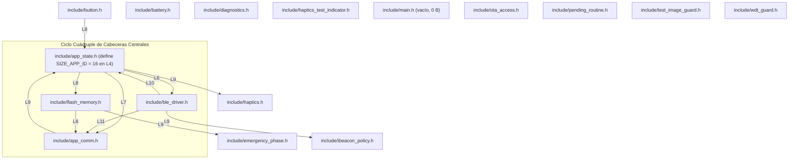
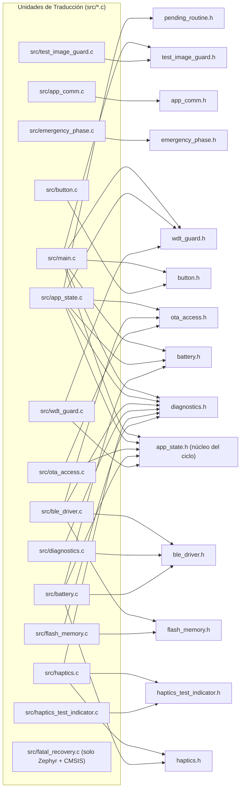
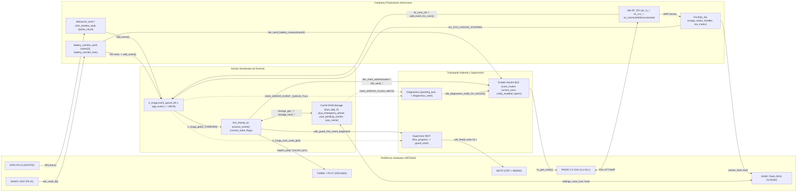

# 20. Referencia Maestra del Código Fuente e Inventarios Globales

> **Alcance y corte documental**: Esta sección constituye el mapa maestro navegable y el catálogo exhaustivo del **100 % de los archivos, dependencias de preprocesador, macros, enumeraciones, estructuras, callbacks, funciones públicas/internas y variables de estado** del firmware de Joya en el commit exacto `c1128e5d0c0d6f98be0a580d287c0926ca27f01f` sobre **Zephyr RTOS 4.2.0** (`nRF52832-QFAA`). La referencia línea por línea y función por función bajo la plantilla de 22 puntos de ingeniería se organiza en tres volúmenes modulares dentro de `docs/technical/code_reference/`:
> - [`code_reference/20a_core_fsm_comm.md`](code_reference/20a_core_fsm_comm.md): Núcleo de arranque, máquina de estados finitos (FSM), protocolo de aplicación y políticas puras de dominio.
> - [`code_reference/20b_ble_ota.md`](code_reference/20b_ble_ota.md): Controlador/fachada BLE GATT e iBeacon, control dinámico de acceso OTA SMP, guarda de rollback de imagen de prueba y telemetría de diagnóstico.
> - [`code_reference/20c_peripherals_storage_wdt.md`](code_reference/20c_peripherals_storage_wdt.md): Periféricos físicos (pulsador GPIO, háptica I2C `DRV2605`, monitor SAADC de batería), persistencia `Settings`/`NVS`, supervisor de watchdog `WDT0` y manejadores de fallos fatales.

---

## 20.1. Organización Modular de la Referencia y Mapeo Completo de Archivos

### 20.1.1. Estructura de los tres subdocumentos de referencia detallada

| Subdocumento | Dominio arquitectónico | Cabeceras cubiertas (`include/*.h`) | Fuentes cubiertos (`src/*.c`) | Capítulos transversales relacionados |
|---|---|---|---|---|
| [`code_reference/20a_core_fsm_comm.md`](code_reference/20a_core_fsm_comm.md) | Arranque, orquestación central FSM, despacho de comandos GATT y modelos puros de dominio (fases de emergencia y rutina pendiente) | [`include/main.h`](../../include/main.h), [`include/app_state.h`](../../include/app_state.h), [`include/app_comm.h`](../../include/app_comm.h), [`include/emergency_phase.h`](../../include/emergency_phase.h), [`include/pending_routine.h`](../../include/pending_routine.h) | [`src/main.c`](../../src/main.c), [`src/app_state.c`](../../src/app_state.c), [`src/app_comm.c`](../../src/app_comm.c), [`src/emergency_phase.c`](../../src/emergency_phase.c) | [`01_system_architecture.md`](01_system_architecture.md), [`04_boot_initialization.md`](04_boot_initialization.md), [`05_state_machine.md`](05_state_machine.md), [`06_concurrency.md`](06_concurrency.md), [`10_authentication.md`](10_authentication.md), [`12_emergency_routines.md`](12_emergency_routines.md) |
| [`code_reference/20b_ble_ota.md`](code_reference/20b_ble_ota.md) | Pila BLE GAP/GATT, doble advertising (`ADV_IND` + `iBeacon`), apertura/cierre dinámico de SMP MCUmgr, guarda de confirmación MCUboot y canal de diagnóstico `0xA0`/`0xEx` | [`include/ble_driver.h`](../../include/ble_driver.h), [`include/ibeacon_policy.h`](../../include/ibeacon_policy.h), [`include/ota_access.h`](../../include/ota_access.h), [`include/test_image_guard.h`](../../include/test_image_guard.h), [`include/diagnostics.h`](../../include/diagnostics.h) | [`src/ble_driver.c`](../../src/ble_driver.c), [`src/ota_access.c`](../../src/ota_access.c), [`src/test_image_guard.c`](../../src/test_image_guard.c), [`src/diagnostics.c`](../../src/diagnostics.c) | [`07_ble_architecture.md`](07_ble_architecture.md), [`08_ibeacon.md`](08_ibeacon.md), [`09_gatt_protocol.md`](09_gatt_protocol.md), [`16_ota_mcuboot.md`](16_ota_mcuboot.md), [`17_security_privacy.md`](17_security_privacy.md), [`18_error_handling.md`](18_error_handling.md) |
| [`code_reference/20c_peripherals_storage_wdt.md`](code_reference/20c_peripherals_storage_wdt.md) | Interfaz física humana (botón y motor ERM vía `DRV2605`), telemetría energética SAADC, almacenamiento en Flash `NVS`, supervisión `NRF_WDT` y reinicio ante pánico | [`include/button.h`](../../include/button.h), [`include/haptics.h`](../../include/haptics.h), [`include/haptics_test_indicator.h`](../../include/haptics_test_indicator.h), [`include/battery.h`](../../include/battery.h), [`include/flash_memory.h`](../../include/flash_memory.h), [`include/wdt_guard.h`](../../include/wdt_guard.h) | [`src/button.c`](../../src/button.c), [`src/haptics.c`](../../src/haptics.c), [`src/haptics_test_indicator.c`](../../src/haptics_test_indicator.c), [`src/battery.c`](../../src/battery.c), [`src/flash_memory.c`](../../src/flash_memory.c), [`src/wdt_guard.c`](../../src/wdt_guard.c), [`src/fatal_recovery.c`](../../src/fatal_recovery.c) | [`02_hardware_devicetree.md`](02_hardware_devicetree.md), [`11_button.md`](11_button.md), [`13_haptic_system.md`](13_haptic_system.md), [`14_battery_power.md`](14_battery_power.md), [`15_flash_persistence.md`](15_flash_persistence.md), [`18_error_handling.md`](18_error_handling.md), [`19_timers_parameters.md`](19_timers_parameters.md) |

### 20.1.2. Mapeo completo de los 16 encabezados (`include/*.h`)

| # | Archivo encabezado | Líneas / Bytes | Guarda de inclusión | Responsabilidad principal | Estado epistemológico | Referencia detallada |
|---:|---|---:|---|---|---|---|
| 1 | [`include/app_comm.h`](../../include/app_comm.h) | 87 L / 2.785 B | `APP_COMM_H` | Callbacks de traducción BLE→FSM, validación/persistencia de `APP_ID` y enumeración de comandos de protocolo (`0x01..0x71`) | **(a)** Implementado activo (con marcadores y 4 códigos obsoletos/no implementados **(d)**) | [`code_reference/20a_core_fsm_comm.md`](code_reference/20a_core_fsm_comm.md) |
| 2 | [`include/app_state.h`](../../include/app_state.h) | 112 L / 2.721 B | `APP_STATE_H` | Definición de `SIZE_APP_ID`, constantes de temporización FSM, `app_state_t`, `event_type_t`, `app_event_t` y API de cola/hilo FSM | **(a)** Implementado activo (incluye 2 estados residuales **(d)**: `STATE_SETUP_WAITING_NEW_IDENTIFIER`, `STATE_EMERGENCY`) | [`code_reference/20a_core_fsm_comm.md`](code_reference/20a_core_fsm_comm.md) |
| 3 | [`include/battery.h`](../../include/battery.h) | 36 L / 1.277 B | `JOYA_BATTERY_H_` | Umbrales SAADC (`3000`/`2900` mV, histéresis `50` mV), cadencias de muestreo/votación 5 de 6 y API del monitor de batería | **(a)** Implementado activo (4 funciones auxiliares exportadas sin llamador en `HEAD` **(d)**) | [`code_reference/20c_peripherals_storage_wdt.md`](code_reference/20c_peripherals_storage_wdt.md) |
| 4 | [`include/ble_driver.h`](../../include/ble_driver.h) | 92 L / 4.107 B | `BLE_DRIVER_H` | UUIDs de 128 bits de los 4 servicios GATT de Joya, bytes de iBeacon y API de publicidad, sesión autenticada y notificaciones | **(a)** Implementado activo (contiene 1 prototipo huérfano sin definición **(d)**: `ble_start_setup_advertising_backup`) | [`code_reference/20b_ble_ota.md`](code_reference/20b_ble_ota.md) |
| 5 | [`include/button.h`](../../include/button.h) | 32 L / 889 B | `BUTTON_H` | Constantes temporales de antirrebote (`50 ms`), ventana multiclic (`900 ms`) y pulsaciones largas (`0,5`/`5`/`15 s`), API GPIO | **(a)** Implementado activo (`extern struct k_msgq event_queue` no consumida directamente por `button.c` **(d)**) | [`code_reference/20c_peripherals_storage_wdt.md`](code_reference/20c_peripherals_storage_wdt.md) |
| 6 | [`include/diagnostics.h`](../../include/diagnostics.h) | 26 L / 720 B | `DIAGNOSTICS_H` | Bits de autodiagnóstico de arranque (`DIAG_INIT_*`) y códigos de error asíncronos (`0xE1..0xE5`) | **(a)** Implementado activo | [`code_reference/20b_ble_ota.md`](code_reference/20b_ble_ota.md) |
| 7 | [`include/emergency_phase.h`](../../include/emergency_phase.h) | 25 L / 662 B | `EMERGENCY_PHASE_H` | Máquina pura de 3 fases de emergencia (`EMERGENCY_NONE`, `EMERGENCY_PENDING_ACK`, `EMERGENCY_ACKED`) y decodificación segura desde Flash | **(a)** Implementado activo y cubierto por test unitario en host | [`code_reference/20a_core_fsm_comm.md`](code_reference/20a_core_fsm_comm.md) |
| 8 | [`include/flash_memory.h`](../../include/flash_memory.h) | 65 L / 1.791 B | `FLASH_MEMORY_H` | Constantes de nombre BLE (`"Joya"`, `"Joya de "`, máx. `31` B) y API de caché RAM + persistencia `Settings`/`NVS` | **(a)** Implementado activo | [`code_reference/20c_peripherals_storage_wdt.md`](code_reference/20c_peripherals_storage_wdt.md) |
| 9 | [`include/haptics.h`](../../include/haptics.h) | 94 L / 2.506 B | `HAPTICS_H` | Registros y máscaras I2C del `DRV2605`, enumeraciones `haptics_pattern` y `haptics_effect`, API de reproducción y bloqueo energético | **(a)** Implementado activo (`enum haptics_effect`, `haptics_play_effect` y `haptics_is_ready` sin llamadores externos en `HEAD` **(d)**) | [`code_reference/20c_peripherals_storage_wdt.md`](code_reference/20c_peripherals_storage_wdt.md) |
| 10 | [`include/haptics_test_indicator.h`](../../include/haptics_test_indicator.h) | 11 L / 336 B | `JOYA_HAPTICS_TEST_INDICATOR_H_` | Fachada condicional (`CONFIG_JOYA_HAPTICS_TEST_INDICATOR`) hacia LED0 de placa de desarrollo `nrf52dk` | **(a)** Macro vacía `do { } while (0)` en producción; **(d)** diagnóstico opcional de banco | [`code_reference/20c_peripherals_storage_wdt.md`](code_reference/20c_peripherals_storage_wdt.md) |
| 11 | [`include/ibeacon_policy.h`](../../include/ibeacon_policy.h) | 16 L / 311 B | `IBEACON_POLICY_H` | `ble_ibeacon_mode_t` y función pura `static inline ibeacon_mode_for_state(bool has_app_id)` sin dependencias de Zephyr | **(a)** Implementado activo y cubierto por test unitario en host | [`code_reference/20b_ble_ota.md`](code_reference/20b_ble_ota.md) |
| 12 | [`include/main.h`](../../include/main.h) | 0 L / 0 B | *(ninguna)* | Archivo completamente vacío, no incluido por ninguna unidad de traducción | **(d)** Artefacto residual histórico | [`code_reference/20a_core_fsm_comm.md`](code_reference/20a_core_fsm_comm.md) |
| 13 | [`include/ota_access.h`](../../include/ota_access.h) | 13 L / 315 B | `OTA_ACCESS_H` | Interfaz de control dinámico del servicio GATT `SMP` (`MCUmgr`) y consulta de transferencia DFU activa | **(a)** Implementado activo | [`code_reference/20b_ble_ota.md`](code_reference/20b_ble_ota.md) |
| 14 | [`include/pending_routine.h`](../../include/pending_routine.h) | 17 L / 461 B | `PENDING_ROUTINE_H` | Regla pura `static inline pending_routine_next(...)` de precedencia y sobrescritura de la última rutina offline | **(a)** Implementado activo y cubierto por test unitario en host | [`code_reference/20a_core_fsm_comm.md`](code_reference/20a_core_fsm_comm.md) |
| 15 | [`include/test_image_guard.h`](../../include/test_image_guard.h) | 10 L / 297 B | `TEST_IMAGE_GUARD_H` | Interfaz del temporizador autónomo de 5 minutos para reversión automática (`rollback`) de imágenes MCUboot en modo `Test` | **(a)** Implementado activo | [`code_reference/20b_ble_ota.md`](code_reference/20b_ble_ota.md) |
| 16 | [`include/wdt_guard.h`](../../include/wdt_guard.h) | 14 L / 357 B | `WDT_GUARD_H` | API de inicialización de `WDT0`, señalización de fin de arranque (`main_ready`) e instrumentación de progreso de la FSM | **(a)** Implementado activo | [`code_reference/20c_peripherals_storage_wdt.md`](code_reference/20c_peripherals_storage_wdt.md) |

### 20.1.3. Mapeo completo de los 15 archivos fuente (`src/*.c`)

Todos los archivos fuente se enlazan en el binario de aplicación mediante [`CMakeLists.txt`](../../CMakeLists.txt) (líneas 16–35): 14 de forma incondicional en `target_sources(app PRIVATE ...)` y 1 de forma condicional mediante `target_sources_ifdef(CONFIG_JOYA_HAPTICS_TEST_INDICATOR ...)`.

| # | Archivo fuente | Líneas / Bytes | Inclusión CMake | Contextos de ejecución que tocan su código | Referencia detallada |
|---:|---|---:|---|---|---|
| 1 | [`src/main.c`](../../src/main.c) | 89 L / 2.662 B | Siempre (`CMakeLists.txt:17`) | Hilo `main` (prioridad `0`, stack `4096 B`), queda dormido en `k_sleep(K_FOREVER)` tras arranque | [`code_reference/20a_core_fsm_comm.md`](code_reference/20a_core_fsm_comm.md) |
| 2 | [`src/app_comm.c`](../../src/app_comm.c) | 80 L / 2.450 B | Siempre (`CMakeLists.txt:18`) | Hilo receptor BLE Host (`BT_RX`, prioridad coop `-9` / `CONFIG_BT_RX_PRIO=8`) y `fsm_thread_id` (prio `5`) | [`code_reference/20a_core_fsm_comm.md`](code_reference/20a_core_fsm_comm.md) |
| 3 | [`src/app_state.c`](../../src/app_state.c) | 1.017 L / 35.248 B | Siempre (`CMakeLists.txt:19`) | `fsm_thread_id` (prio `5`, stack `4098 B`), `sysworkq` (prio coop `-1`), `main`, `BT_RX`, ISR `GPIOTE` (`add_event*`) | [`code_reference/20a_core_fsm_comm.md`](code_reference/20a_core_fsm_comm.md) |
| 4 | [`src/ble_driver.c`](../../src/ble_driver.c) | 778 L / 22.880 B | Siempre (`CMakeLists.txt:20`) | `main`, `fsm_thread_id`, `BT_RX` (callbacks GAP/GATT/CCC), `sysworkq` (`ibeacon_stop_work`, `diagnostics_work`, `battery_monitor_work`) | [`code_reference/20b_ble_ota.md`](code_reference/20b_ble_ota.md) |
| 5 | [`src/ota_access.c`](../../src/ota_access.c) | 148 L / 4.061 B | Siempre (`CMakeLists.txt:21`) | `main`, `fsm_thread_id`, `BT_RX` (`on_disconnected`), `mcumgr_wq` (prio `3`, hooks DFU), `sysworkq` (`idle_close_work`) | [`code_reference/20b_ble_ota.md`](code_reference/20b_ble_ota.md) |
| 6 | [`src/test_image_guard.c`](../../src/test_image_guard.c) | 61 L / 1.643 B | Siempre (`CMakeLists.txt:22`) | `main` (solo en boot `Test`), `mcumgr_wq` (hook `DFU_CONFIRMED`), `sysworkq` (`confirmation_deadline_work`) | [`code_reference/20b_ble_ota.md`](code_reference/20b_ble_ota.md) |
| 7 | [`src/button.c`](../../src/button.c) | 200 L / 4.520 B | Siempre (`CMakeLists.txt:23`) | `main` (`button_init`), ISR `GPIOTE` (`button_isr_handler`), `sysworkq` (`debounce_work`, `click_window_work`, `factory_hold_work`) | [`code_reference/20c_peripherals_storage_wdt.md`](code_reference/20c_peripherals_storage_wdt.md) |
| 8 | [`src/haptics.c`](../../src/haptics.c) | 700 L / 16.462 B | Siempre (`CMakeLists.txt:24`) | `main`, `fsm_thread_id`, `sysworkq` (`haptics_pattern_work`, `haptics_effect_work`) | [`code_reference/20c_peripherals_storage_wdt.md`](code_reference/20c_peripherals_storage_wdt.md) |
| 9 | [`src/flash_memory.c`](../../src/flash_memory.c) | 398 L / 10.506 B | Siempre (`CMakeLists.txt:25`) | `main` (`storage_init` + callback `app_settings_set`), `fsm_thread_id`, `BT_RX` (`on_name_write`, `on_name_read`) | [`code_reference/20c_peripherals_storage_wdt.md`](code_reference/20c_peripherals_storage_wdt.md) |
| 10 | [`src/emergency_phase.c`](../../src/emergency_phase.c) | 31 L / 806 B | Siempre (`CMakeLists.txt:26`) | Funciones puras sin estado invocadas desde `main` (`settings_load`) y `fsm_thread_id` | [`code_reference/20a_core_fsm_comm.md`](code_reference/20a_core_fsm_comm.md) |
| 11 | [`src/diagnostics.c`](../../src/diagnostics.c) | 83 L / 2.325 B | Siempre (`CMakeLists.txt:27`) | `main`, `fsm_thread_id`, `BT_RX`, `sysworkq` (`diagnostics_work`), potencialmente ISR (`k_spin_lock`) | [`code_reference/20b_ble_ota.md`](code_reference/20b_ble_ota.md) |
| 12 | [`src/battery.c`](../../src/battery.c) | 385 L / 11.150 B | Siempre (`CMakeLists.txt:28`) | `main` (`battery_init`, `battery_monitor_start`), `sysworkq` (`battery_monitor_work`) | [`code_reference/20c_peripherals_storage_wdt.md`](code_reference/20c_peripherals_storage_wdt.md) |
| 13 | [`src/wdt_guard.c`](../../src/wdt_guard.c) | 128 L / 3.636 B | Siempre (`CMakeLists.txt:29`) | `main`, `fsm_thread_id` (marcas atómicas de inicio/fin de evento), `sysworkq` (`guard_work`) | [`code_reference/20c_peripherals_storage_wdt.md`](code_reference/20c_peripherals_storage_wdt.md) |
| 14 | [`src/fatal_recovery.c`](../../src/fatal_recovery.c) | 19 L / 402 B | Siempre (`CMakeLists.txt:30`) | Excepciones ARM Cortex-M4 (`HardFault`, `BusFault`, `UsageFault`, kernel oops) e ISR del controlador BLE (`LLL`/`ULL`) | [`code_reference/20c_peripherals_storage_wdt.md`](code_reference/20c_peripherals_storage_wdt.md) |
| 15 | [`src/haptics_test_indicator.c`](../../src/haptics_test_indicator.c) | 42 L / 996 B | Condicional `CONFIG_JOYA_HAPTICS_TEST_INDICATOR=y` (`CMakeLists.txt:33-35`; **excluido** en `joya_nrf52`) | `fsm_thread_id` y `sysworkq` (`test_led_off_work`) solo sobre `nrf52dk_nrf52832` | [`code_reference/20c_peripherals_storage_wdt.md`](code_reference/20c_peripherals_storage_wdt.md) |

### 20.1.4. Mapeo de las 3 pruebas unitarias de host (`tests/*.c` y `tests/*.sh`)

El repositorio incluye tres pruebas unitarias autónomas escritas en C11 estándar que se compilan y ejecutan nativamente en el host POSIX mediante `cc -std=c11 -Wall -Wextra -Werror` sin requerir hardware nRF52 ni el árbol de Zephyr:

| # | Archivo de prueba | Líneas | Script ejecutor | Unidades bajo prueba | Cobertura funcional verificada |
|---:|---|---:|---|---|---|
| 1 | [`tests/test_emergency_phase.c`](../../tests/test_emergency_phase.c) | 72 L | [`tests/run_emergency_phase.sh`](../../tests/run_emergency_phase.sh) | [`src/emergency_phase.c`](../../src/emergency_phase.c), [`include/emergency_phase.h`](../../include/emergency_phase.h), [`include/ibeacon_policy.h`](../../include/ibeacon_policy.h) | Transiciones `NONE → PENDING_ACK → ACKED → NONE`, idempotencia de `EMERGENCY_TRIGGER`, ignorado de `EMERGENCY_ACK` en `NONE`, compatibilidad hacia atrás con el `bool` (`0`/`1`) de firmwares previos, rechazo de bytes corruptos (`>= 3` o puntero `NULL`), e invariancia absoluta de `ibeacon_mode_for_state()` frente a alertas de emergencia (`BLE_IBEACON_CONNECTION` depende solo de `has_app_id`). |
| 2 | [`tests/test_pending_routine.c`](../../tests/test_pending_routine.c) | 23 L | [`tests/run_pending_routine.sh`](../../tests/run_pending_routine.sh) | [`include/pending_routine.h`](../../include/pending_routine.h) | Regla de sustitución sin cola: rechazo cuando `has_app_id == false` o `emergency_active == true`, conservación de `current` si `generated == 0`, reemplazo `2 → 3` (`END_ROUTINE` sustituye `ROUTINE` sin cancelarse mutuamente) y `3 → 2`. |
| 3 | [`tests/test_pending_storage.c`](../../tests/test_pending_storage.c) | 181 L | [`tests/run_pending_storage.sh`](../../tests/run_pending_storage.sh) | [`src/flash_memory.c`](../../src/flash_memory.c), [`src/emergency_phase.c`](../../src/emergency_phase.c) | Prueba de caja blanca con dobles (`fakes`) en RAM de `settings_save_one` / `settings_delete` / `settings_load` e inyección de fallos de escritura/borrado (`-EIO`): deduplicación en RAM sin escritura redundante a Flash, restauración tras reinicio, supresión de rutina al activar emergencia, retención de `pending_routine_dirty` cuando falla el borrado o el tombstone `0` (impidiendo revivir rutinas viejas tras `EMERGENCY_STOP` o filtrarlas a un nuevo `APP_ID` tras `storage_factory_reset()`), e invalidación por discrepancia de `pending_routine_owner` si una imagen antigua cambió `joya/app_id`. |

### 20.1.5. Convención de los 22 puntos obligatorios y rigor epistemológico

En [`code_reference/20a_core_fsm_comm.md`](code_reference/20a_core_fsm_comm.md), [`code_reference/20b_ble_ota.md`](code_reference/20b_ble_ota.md) y [`code_reference/20c_peripherals_storage_wdt.md`](code_reference/20c_peripherals_storage_wdt.md), cada módulo y cada función (pública e interna `static`) se analiza cubriendo sistemáticamente las **22 dimensiones de ingeniería**: (1) Responsabilidad, (2) Dependencias, (3) API pública, (4) Funciones internas, (5) Parámetros, (6) Valores de retorno, (7) Códigos de error, (8) Precondiciones, (9) Postcondiciones, (10) Efectos secundarios, (11) Estado interno, (12) Variables globales y estáticas, (13) Contexto de ejecución, (14) Interacciones con otros módulos, (15) Recursos utilizados, (16) Concurrencia, (17) Consideraciones temporales, (18) Acceso a hardware, (19) Acceso a Flash, (20) Envío/recepción de eventos, (21) Comunicaciones BLE y (22) Clasificación epistemológica (`(a)` implementado en `c1128e5`, `(b)` intención de diseño documentada en comentarios/tests, `(c)` comportamiento inferido de Zephyr/nRF52, `(d)` código residual/huérfano/no invocado, `(e)` dependiente de esquemático o calibración experimental).

---

## 20.2. Grafo Completo de Dependencias `#include` y Análisis de la Inclusión Circular Cuádruple

### 20.2.1. Grafo de dependencias entre encabezados del proyecto (`include/*.h`)



### 20.2.2. Grafo de inclusión desde las 15 unidades de traducción (`src/*.c`)



### 20.2.3. Explicación técnica de la inclusión circular cuádruple (`app_state.h` ↔ `ble_driver.h` ↔ `app_comm.h` ↔ `flash_memory.h`)

En el código actual existe un ciclo fuertemente conexo formado por cuatro encabezados:
1. [`include/app_state.h`](../../include/app_state.h) (líneas 6–8) incluye `"ble_driver.h"`, `"app_comm.h"` y `"flash_memory.h"`.
2. [`include/ble_driver.h`](../../include/ble_driver.h) (líneas 10–11) incluye `"app_state.h"` y `"app_comm.h"`.
3. [`include/app_comm.h`](../../include/app_comm.h) (línea 9) incluye `"app_state.h"`.
4. [`include/flash_memory.h`](../../include/flash_memory.h) (línea 8) incluye `"app_comm.h"` (que a su vez reingresa en `"app_state.h"`).

En C estándar, las guardas `#ifndef ... #define ... #endif` evitan la recursión infinita del preprocesador, pero **cortocircuitan** la segunda aparición de un encabezado antes de que sus tipos (`typedef`, `enum`, `struct`) hayan sido declarados. La razón exacta por la cual las 15 unidades de traducción compilan sin errores independientemente de cuál de los cuatro encabezados se incluya primero obedece a **tres propiedades estructurales simultáneas**:

1. **Posición deliberada de `#define SIZE_APP_ID 16` antes del bloque `#include` en [`include/app_state.h`](../../include/app_state.h) (línea 4)**:
   ```c
   #ifndef APP_STATE_H
   #define APP_STATE_H

   #define SIZE_APP_ID 16

   #include "ble_driver.h"
   #include "app_comm.h"
   #include "flash_memory.h"
   #include "haptics.h"
   ```
   Al colocar `#define SIZE_APP_ID 16` en la línea 4 —inmediatamente después de `#define APP_STATE_H` y **antes** de las líneas 6–8—, el símbolo `SIZE_APP_ID` queda definido en la tabla de macros del preprocesador **antes** de que el preprocesador descienda hacia `ble_driver.h`, `app_comm.h` o `flash_memory.h`, incluso cuando `app_state.h` es el archivo raíz y sus `typedef` (líneas 23–78) todavía no fueron leídos.

2. **Ausencia total de tipos por valor de `app_state.h` en las firmas de `ble_driver.h`, `app_comm.h` y `flash_memory.h`**:
   - Cuando una unidad incluye primero [`include/app_state.h`](../../include/app_state.h) (p. ej. [`src/app_state.c`](../../src/app_state.c), [`src/button.c`](../../src/button.c) o [`src/wdt_guard.c`](../../src/wdt_guard.c)), `APP_STATE_H` ya vale `1` al entrar a [`include/ble_driver.h`](../../include/ble_driver.h) (línea 10) y [`include/app_comm.h`](../../include/app_comm.h) (línea 9). Por consiguiente, durante el procesamiento completo de `ble_driver.h`, `app_comm.h` y `flash_memory.h`, los tipos `app_state_t`, `event_type_t` y `app_event_t` **aún no existen**.
   - Esto no falla porque ninguna declaración en `ble_driver.h` (líneas 45–90), `app_comm.h` (líneas 15–85) ni `flash_memory.h` (líneas 18–63) utiliza `app_state_t`, `event_type_t` ni `app_event_t`: solo emplean tipos enteros estándar, `bool`, punteros `struct bt_conn *`, `const struct bt_gatt_attr *`, `ble_ibeacon_mode_t` (definido previamente en [`include/ibeacon_policy.h`](../../include/ibeacon_policy.h), línea 9 de `ble_driver.h`) y `emergency_phase_t` (definido en [`include/emergency_phase.h`](../../include/emergency_phase.h), línea 9 de `flash_memory.h`).
   - Recíprocamente, cuando una unidad incluye primero [`include/flash_memory.h`](../../include/flash_memory.h) (como [`src/flash_memory.c`](../../src/flash_memory.c)) o [`include/app_comm.h`](../../include/app_comm.h) (como [`src/app_comm.c`](../../src/app_comm.c)), el preprocesador entra en `app_state.h`, define `SIZE_APP_ID`, procesa `ble_driver.h`, emite `app_state_t`/`event_type_t`/`app_event_t` (donde `struct bt_conn *` es válido en `app_event_t` tanto por la inclusión previa de `<zephyr/bluetooth/bluetooth.h>`/`<zephyr/bluetooth/conn.h>` como por la regla de C para punteros a `struct` incompleto), y finalmente retorna a terminar `app_comm.h` y `flash_memory.h`.

3. **Fragilidad latente e impacto práctico sobre compilación y pruebas**:
   - **Fragilidad de mantenimiento**: Si en una refactorización futura se agregase una firma que reciba o devuelva `app_state_t` o `event_type_t` dentro de `ble_driver.h`, `app_comm.h` o `flash_memory.h`, o si se moviera `#define SIZE_APP_ID 16` debajo de la línea 9 de `app_state.h` usándolo en algún encabezado del ciclo, la compilación se rompería con `unknown type name` dependiendo del orden de `#include` de cada `.c`.
   - **Contaminación transitiva de dependencias**: Incluir [`include/app_state.h`](../../include/app_state.h) —incluso desde módulos puramente de kernel/periférico como [`src/wdt_guard.c`](../../src/wdt_guard.c) (solo necesita `app_state_pending_events()`) o [`src/button.c`](../../src/button.c) (solo necesita `add_event()`)— arrastra transitivamente `<zephyr/bluetooth/bluetooth.h>`, `<zephyr/bluetooth/gatt.h>`, `<zephyr/settings/settings.h>`, `<zephyr/drivers/i2c.h>` y `<zephyr/drivers/gpio.h>` en 11 de los 15 archivos `.c`.
   - **Impacto directo verificado en tests de host**: Para poder probar [`src/flash_memory.c`](../../src/flash_memory.c) en host Linux sin el árbol de cabeceras Bluetooth de Zephyr, [`tests/test_pending_storage.c`](../../tests/test_pending_storage.c) (líneas 2, 11–16) se ve obligado a predefinir artificialmente `#define FLASH_MEMORY_H` antes de `#include "../src/flash_memory.c"` y a redeclarar manualmente `SIZE_APP_ID`, `JOYA_NAME_MAX_LEN`, `JOYA_ADV_NAME_DEFAULT`, `COMMAND_ROUTINE` y `COMMAND_END_ROUTINE` con el fin de bloquear la cadena `flash_memory.h → app_comm.h → <zephyr/bluetooth/conn.h>`. En contraste, [`include/emergency_phase.h`](../../include/emergency_phase.h), [`include/ibeacon_policy.h`](../../include/ibeacon_policy.h) y [`include/pending_routine.h`](../../include/pending_routine.h) fueron diseñados como cabeceras hoja sin dependencias de Zephyr precisamente para permitir pruebas unitarias limpias.

---

## 20.3. Tablas de Inventario Global del 100 % de Símbolos del Proyecto

### 20.3.1. Inventario completo de constantes y macros (`#define`)

Se listan las **76 macros** definidas en los 16 encabezados (`include/*.h`) y 15 fuentes (`src/*.c`), agrupadas incluyendo guardas de inclusión y macros funcionales:

#### A. Macros funcionales de configuración, protocolo, registros y tiempos (61 macros)

| # | Macro | Valor exacto / Expresión | Valor efectivo | Archivo y línea | Propósito técnico |
|---:|---|---|---|---|---|
| 1 | `SIZE_APP_ID` | `16` | `16` bytes (`128 bits`) | [`include/app_state.h:4`](../../include/app_state.h#L4) | Longitud fija del identificador criptográfico/secreto `APP_ID` en RAM, GATT y NVS |
| 2 | `EMERGENCY_RETRY_INITIAL_MS` | `1000` | `1.000 ms` (`1 s`) | [`include/app_state.h:15`](../../include/app_state.h#L15) | Primer intervalo de retransmisión de `COMMAND_EMERGENCY` (`0x04`) |
| 3 | `EMERGENCY_RETRY_FAST_MS` | `2000` | `2.000 ms` (`2 s`) | [`include/app_state.h:16`](../../include/app_state.h#L16) | Segundo intervalo de retransmisión de emergencia |
| 4 | `EMERGENCY_RETRY_MEDIUM_MS` | `5000` | `5.000 ms` (`5 s`) | [`include/app_state.h:17`](../../include/app_state.h#L17) | Tercer intervalo de retransmisión de emergencia |
| 5 | `EMERGENCY_RETRY_SLOW_MS` | `10000` | `10.000 ms` (`10 s`) | [`include/app_state.h:18`](../../include/app_state.h#L18) | Cuarto intervalo de retransmisión de emergencia |
| 6 | `EMERGENCY_RETRY_VERY_SLOW_MS` | `30000` | `30.000 ms` (`30 s`) | [`include/app_state.h:19`](../../include/app_state.h#L19) | Quinto intervalo (asintótico/estacionario) de retransmisión de emergencia |
| 7 | `BLE_SETUP_TIMEOUT_MS` | `90000` | `90.000 ms` (`90 s`) | [`include/app_state.h:21`](../../include/app_state.h#L21) | Timeout de ventana de emparejamiento/setup tras 2 clics (`connection_timeout_work`) |
| 8 | `CRITICAL_WINDOW_MS` | `(5 * 60 * 1000)` | `300.000 ms` (`5 min`) | [`src/app_state.c:20`](../../src/app_state.c#L20) | Ventana temporal garantizada de publicidad BLE en batería crítica nivel 2 o imagen `Test` |
| 9 | `BATTERY_MONITOR_INTERVAL_MS` | `60000` | `60.000 ms` (`60 s`) | [`include/battery.h:6`](../../include/battery.h#L6) | Período nominal de muestreo SAADC de `VBAT` en régimen estacionario |
| 10 | `BATTERY_VERIFY_INTERVAL_MS` | `10000` | `10.000 ms` (`10 s`) | [`include/battery.h:7`](../../include/battery.h#L7) | Separación entre las 6 muestras de verificación tras detectar cruce de umbral (o en boot) |
| 11 | `BATTERY_VERIFY_SAMPLES` | `6` | `6` muestras | [`include/battery.h:8`](../../include/battery.h#L8) | Tamaño total de ráfaga de verificación SAADC |
| 12 | `BATTERY_VERIFY_MIN_VOTES` | `5` | `5` votos | [`include/battery.h:9`](../../include/battery.h#L9) | Mayoría calificada (`5/6`) exigida para confirmar cambio de nivel de batería |
| 13 | `BATTERY_RECHECK_INTERVAL_MS` | `1000` | `1.000 ms` (`1 s`) | [`include/battery.h:10`](../../include/battery.h#L10) | Intervalo rápido entre muestras cuando `recheck_requested == true` |
| 14 | `BATTERY_LEVEL_1_MV` | `3000` (`//3500`) | `3.000 mV` | [`include/battery.h:12`](../../include/battery.h#L12) | Umbral descendente de batería baja (Nivel 1: deshabilita motor háptico) |
| 15 | `BATTERY_LEVEL_2_MV` | `2900` (`//3400`) | `2.900 mV` | [`include/battery.h:13`](../../include/battery.h#L13) | Umbral descendente de batería crítica (Nivel 2: fuerza `critical_idle`) |
| 16 | `BATTERY_HYSTERESIS_MV` | `50` | `50 mV` | [`include/battery.h:16`](../../include/battery.h#L16) | Margen de histéresis ascendente para recuperar niveles (`> 2950 mV` y `> 3050 mV`) |
| 17 | `BATTERY_ADC_NODE` | `DT_PATH(zephyr_user)` | Nodo `/zephyr,user` | [`src/battery.c:14`](../../src/battery.c#L14) | Nodo Devicetree contenedor de `io-channels` (`battery` en `AIN7` / `P0.31`) |
| 18 | `BATTERY_R_TOP_KOHM` | `120` | `120 kΩ` | [`src/battery.c:15`](../../src/battery.c#L15) | Resistencia superior del divisor resistivo de `VBAT` |
| 19 | `BATTERY_R_BOTTOM_KOHM` | `82` | `82 kΩ` | [`src/battery.c:16`](../../src/battery.c#L16) | Resistencia inferior del divisor resistivo de `VBAT` (factor `202/82 ≈ 2,4634`) |
| 20 | `BT_UUID_JOYA_COMMANDS_SERVICE_VAL` | `BT_UUID_128_ENCODE(0xa407e00a, 0x00c1, 0x464d, 0x9173, 0x2cb8be585000)` | `...5000` (LE) | [`include/ble_driver.h:17`](../../include/ble_driver.h#L17) | UUID 128-bit del Servicio Primario de Comandos Joya |
| 21 | `BT_UUID_JOYA_TX_VAL` | `BT_UUID_128_ENCODE(..., 0x2cb8be585001)` | `...5001` (LE) | [`include/ble_driver.h:18`](../../include/ble_driver.h#L18) | UUID 128-bit de característica `TX` (Joya → App, `NOTIFY`, 1 B) |
| 22 | `BT_UUID_JOYA_RX_VAL` | `BT_UUID_128_ENCODE(..., 0x2cb8be585002)` | `...5002` (LE) | [`include/ble_driver.h:19`](../../include/ble_driver.h#L19) | UUID 128-bit de característica `RX` (App → Joya, `WRITE \| WRITE_WITHOUT_RESP`, 1 B) |
| 23 | `BT_UUID_JOYA_AUTH_SERVICE_VAL` | `BT_UUID_128_ENCODE(..., 0x2cb8be585100)` | `...5100` (LE) | [`include/ble_driver.h:22`](../../include/ble_driver.h#L22) | UUID 128-bit del Servicio Primario de Autenticación Joya |
| 24 | `BT_UUID_JOYA_RX_AUTH_VAL` | `BT_UUID_128_ENCODE(..., 0x2cb8be585101)` | `...5101` (LE) | [`include/ble_driver.h:23`](../../include/ble_driver.h#L23) | UUID 128-bit de característica `RX_AUTH` (escritura de `APP_ID`, 16 B) |
| 25 | `BT_UUID_JOYA_CONFIG_SERVICE_VAL` | `BT_UUID_128_ENCODE(..., 0x2cb8be585200)` | `...5200` (LE) | [`include/ble_driver.h:26`](../../include/ble_driver.h#L26) | UUID 128-bit del Servicio Primario de Configuración Joya |
| 26 | `BT_UUID_JOYA_NAME_VAL` | `BT_UUID_128_ENCODE(..., 0x2cb8be585201)` | `...5201` (LE) | [`include/ble_driver.h:27`](../../include/ble_driver.h#L27) | UUID 128-bit de característica de sufijo de nombre personalizado (`READ \| WRITE`) |
| 27 | `BT_UUID_JOYA_DIAGNOSTICS_VAL` | `BT_UUID_128_ENCODE(..., 0x2cb8be585202)` | `...5202` (LE) | [`include/ble_driver.h:28`](../../include/ble_driver.h#L28) | UUID 128-bit de característica de diagnóstico de boot/errores (`READ \| NOTIFY`) |
| 28 | `BT_UUID_JOYA_BATTERY_SERVICE_VAL` | `BT_UUID_128_ENCODE(..., 0x2cb8be585300)` | `...5300` (LE) | [`include/ble_driver.h:31`](../../include/ble_driver.h#L31) | UUID 128-bit del Servicio Primario de Batería Joya |
| 29 | `BT_UUID_JOYA_BATTERY_CHANGE_VAL` | `BT_UUID_128_ENCODE(..., 0x2cb8be585301)` | `...5301` (LE) | [`include/ble_driver.h:32`](../../include/ble_driver.h#L32) | UUID 128-bit de característica de cambio de nivel confirmado `0/1/2` (`NOTIFY`, 1 B) |
| 30 | `BT_UUID_JOYA_BATTERY_MEASUREMENT_VAL` | `BT_UUID_128_ENCODE(..., 0x2cb8be585302)` | `...5302` (LE) | [`include/ble_driver.h:33`](../../include/ble_driver.h#L33) | UUID 128-bit de característica de tensión `VBAT` en mV (`NOTIFY`, `uint16_t` LE, 2 B) |
| 31 | `JOYA_IBEACON_CONNECTION_UUID_BYTES` | `0xa4, 0x07, ..., 0x60, 0x01` | 16 bytes Big-Endian | [`include/ble_driver.h:37-39`](../../include/ble_driver.h#L37-L39) | Proximity UUID en orden de red para `connection_ibeacon_ad` (`...6001`) |
| 32 | `JOYA_ADV_NAME_SETUP` | `"Joya Setup"` | Cadena `10` B + `\0` | [`src/ble_driver.c:7`](../../src/ble_driver.c#L7) | Nombre GAP anunciado en `SCAN_RSP` durante emparejamiento inicial (`is_new_connection == true`) |
| 33 | `JOYA_SUFFIX_MAX_LEN` | `(JOYA_NAME_MAX_LEN - (sizeof(JOYA_NAME_PREFIX) - 1))` | `23` bytes | [`src/ble_driver.c:9`](../../src/ble_driver.c#L9) | Longitud máxima en bytes del sufijo aceptado en escritura GATT sobre `NAME` (`31 - 8`) |
| 34 | `DEBOUNTE_TIME_MS` | `50` | `50 ms` | [`include/button.h:12`](../../include/button.h#L12) | Ventana de antirrebote por software tras cada flanco GPIOTE (nota: grafía histórica `DEBOUNTE`) |
| 35 | `CLICK_WINDOW_MS` | `900` | `900 ms` | [`include/button.h:13`](../../include/button.h#L13) | Tiempo máximo de espera tras soltar un clic corto para acumular multiclics (`1`, `2`, `3+`) |
| 36 | `BUTTON_ROUTINE_CANCEL_HOLD_MS` | `500` | `500 ms` (`0,5 s`) | [`include/button.h:14`](../../include/button.h#L14) | Duración mínima de pulsación sostenida para generar `EV_BTN_LONG_PRESS` (`COMMAND_END_ROUTINE`) |
| 37 | `BUTTON_SUSPEND_HOLD_MS` | `5000` | `5.000 ms` (`5 s`) | [`include/button.h:15`](../../include/button.h#L15) | Duración mínima de pulsación al soltar (`5..15 s`) para solicitar suspensión (`EV_BTN_SUSPEND_REQUEST`) |
| 38 | `BUTTON_FACTORY_RESET_HOLD_MS` | `15000` | `15.000 ms` (`15 s`) | [`include/button.h:16`](../../include/button.h#L16) | Umbral de pulsación mantenida para restauración de fábrica (`EV_BTN_FACTORY_THRESHOLD` / `RESET`) |
| 39 | `DIAG_INIT_BLE` | `(1u << 0)` | `0x01` | [`include/diagnostics.h:6`](../../include/diagnostics.h#L6) | Bit 0 del byte de estado de arranque `0xA0 MM`: éxito de `ble_driver_init()` |
| 40 | `DIAG_INIT_BUTTON` | `(1u << 1)` | `0x02` | [`include/diagnostics.h:7`](../../include/diagnostics.h#L7) | Bit 1 del byte `MM`: éxito de `button_init()` |
| 41 | `DIAG_INIT_SETTINGS` | `(1u << 2)` | `0x04` | [`include/diagnostics.h:8`](../../include/diagnostics.h#L8) | Bit 2 del byte `MM`: éxito de `storage_init()` |
| 42 | `DIAG_INIT_HAPTIC` | `(1u << 3)` | `0x08` | [`include/diagnostics.h:9`](../../include/diagnostics.h#L9) | Bit 3 del byte `MM`: éxito de `haptics_init()` |
| 43 | `DIAG_INIT_BATTERY` | `(1u << 4)` | `0x10` | [`include/diagnostics.h:10`](../../include/diagnostics.h#L10) | Bit 4 del byte `MM`: éxito conjunto de `battery_init()` + `battery_monitor_start()` |
| 44 | `JOYA_ADV_NAME_DEFAULT` | `"Joya"` | Cadena `4` B + `\0` | [`include/flash_memory.h:13`](../../include/flash_memory.h#L13) | Nombre GAP por defecto en RAM cuando no hay personalización guardada |
| 45 | `JOYA_NAME_PREFIX` | `"Joya de "` | Cadena `8` B + `\0` | [`include/flash_memory.h:14`](../../include/flash_memory.h#L14) | Prefijo obligatorio antepuesto al sufijo escrito por la app móvil |
| 46 | `JOYA_NAME_MAX_LEN` | `31` | `31` bytes útiles | [`include/flash_memory.h:15`](../../include/flash_memory.h#L15) | Longitud máxima del nombre completo sin contar `\0` (compatible con `CONFIG_BT_DEVICE_NAME_MAX=32`) |
| 47 | `DRV2605_I2C_ADDR_LOW` | `0x5A` | `0x5A` (`90`) | [`include/haptics.h:10`](../../include/haptics.h#L10) | Dirección I2C primaria de 7 bits sondeada para el controlador Texas Instruments `DRV2605` |
| 48 | `DRV2605_I2C_ADDR_HIGH` | `0x5B` | `0x5B` (`91`) | [`include/haptics.h:11`](../../include/haptics.h#L11) | Dirección I2C alternativa sondeada si `0x5A` no responde con `ACK` |
| 49 | `DRV2605_REG_STATUS` | `0x00` | `0x00` | [`include/haptics.h:13`](../../include/haptics.h#L13) | Registro `STATUS` del `DRV2605` |
| 50 | `DRV2605_REG_MODE` | `0x01` | `0x01` | [`include/haptics.h:14`](../../include/haptics.h#L14) | Registro `MODE` del `DRV2605` |
| 51 | `DRV2605_REG_RTP_INPUT` | `0x02` | `0x02` | [`include/haptics.h:15`](../../include/haptics.h#L15) | Registro `RTP_INPUT` de amplitud en tiempo real |
| 52 | `DRV2605_REG_LIBRARY` | `0x03` | `0x03` | [`include/haptics.h:16`](../../include/haptics.h#L16) | Registro de selección de librería ROM de ondas hápticas |
| 53 | `DRV2605_REG_WAVESEQ1` | `0x04` | `0x04` | [`include/haptics.h:17`](../../include/haptics.h#L17) | Primer slot del secuenciador interno de ondas del `DRV2605` |
| 54 | `DRV2605_REG_WAVESEQ2` | `0x05` | `0x05` | [`include/haptics.h:18`](../../include/haptics.h#L18) | Segundo slot del secuenciador interno (puesto a `0x00` como terminador) |
| 55 | `DRV2605_REG_GO` | `0x0C` | `0x0C` | [`include/haptics.h:19`](../../include/haptics.h#L19) | Registro `GO` para disparar/sondear efectos de librería interna |
| 56 | `DRV2605_MODE_INTERNAL_TRIGGER` | `0x00` | `0x00` | [`include/haptics.h:21`](../../include/haptics.h#L21) | Modo de disparo interno por escritura en `GO` (saca al chip de `STANDBY`) |
| 57 | `DRV2605_MODE_RTP` | `0x05` | `0x05` | [`include/haptics.h:22`](../../include/haptics.h#L22) | Modo *Real-Time Playback* empleado por todos los patrones hápticos activos |
| 58 | `DRV2605_MODE_STANDBY` | `0x40` | `0x40` (bit 6) | [`include/haptics.h:23`](../../include/haptics.h#L23) | Modo `STANDBY` por software del `DRV2605` previo a cortar `haptic_en` |
| 59 | `HAPTIC_RTP_OFF` | `0` | `0` | [`include/haptics.h:25`](../../include/haptics.h#L25) | Amplitud nula RTP (frenado/silencio entre pulsos) |
| 60 | `HAPTIC_RTP_MAX` | `127` | `127` (`0x7F`) | [`include/haptics.h:26`](../../include/haptics.h#L26) | Amplitud máxima positiva en formato RTP con signo (**no referenciada** en `.c`, **(d)** documental) |
| 61 | `DRV2605_REG_OD_CLAMP` | `0x17` | `0x17` | [`include/haptics.h:29`](../../include/haptics.h#L29) | Registro *Overdrive Clamp Voltage* del `DRV2605` |
| 62 | `DRV2605_OD_CLAMP_2V5` | `0x72` | `114` (`~2,50 V`) | [`include/haptics.h:30`](../../include/haptics.h#L30) | Límite de tensión en lazo abierto para motor ERM de `2,5 V` ($114 \times 0{,}02196\text{ V} \approx 2{,}503\text{ V}$) |
| 63 | `HAPTIC_RTP_INTENSITY` | `100` | `100` (~78,7 % FS) | [`include/haptics.h:33`](../../include/haptics.h#L33) | Amplitud RTP uniforme usada en los 9 patrones hápticos |
| 64 | `DRV2605_REG_FEEDBACK_CONTROL` | `0x1A` | `0x1A` | [`include/haptics.h:34`](../../include/haptics.h#L34) | Registro de selección de actuador ERM vs. LRA |
| 65 | `DRV2605_REG_CONTROL3` | `0x1D` | `0x1D` | [`include/haptics.h:35`](../../include/haptics.h#L35) | Registro de configuración `ERM_OPEN_LOOP` y formato de datos RTP |
| 66 | `DRV2605_N_ERM_LRA` | `BIT(7)` | `0x80` | [`include/haptics.h:37`](../../include/haptics.h#L37) | Máscara bit 7 de `FEEDBACK_CONTROL` (`0` = ERM, `1` = LRA) |
| 67 | `DRV2605_ERM_OPEN_LOOP` | `BIT(5)` | `0x20` | [`include/haptics.h:38`](../../include/haptics.h#L38) | Máscara bit 5 de `CONTROL3` (`1` = operación ERM en lazo abierto) |
| 68 | `DRV2605_DATA_FORMAT_RTP` | `BIT(3)` | `0x08` | [`include/haptics.h:39`](../../include/haptics.h#L39) | Máscara bit 3 de `CONTROL3` (`0` = RTP con signo `[-128..127]`) |
| 69 | `HAPTIC_NODE` | `DT_PATH(zephyr_user)` | Nodo `/zephyr,user` | [`src/haptics.c:7`](../../src/haptics.c#L7) | Nodo Devicetree que declara `haptic_en_gpios` (`P0.07`) |
| 70 | `haptics_test_indicator_request(battery_allows)` | `do { } while (0)` | No-op en producción | [`include/haptics_test_indicator.h:8`](../../include/haptics_test_indicator.h#L8) | Macro vacía cuando `CONFIG_JOYA_HAPTICS_TEST_INDICATOR` está desactivado |
| 71 | `TEST_LED_NODE` | `DT_ALIAS(led0)` | Alias `led0` | [`src/haptics_test_indicator.c:6`](../../src/haptics_test_indicator.c#L6) | Nodo LED de diagnóstico en `nrf52dk_nrf52832` |
| 72 | `OTA_IDLE_TIMEOUT` | `K_MINUTES(2)` | `120.000 ms` (`2 min`) | [`src/ota_access.c:8`](../../src/ota_access.c#L8) | Inactividad máxima del servicio GATT `SMP` antes de auto-desregistro |
| 73 | `WDT_TIMEOUT_MS` | `30000U` | `30.000 ms` (`30 s`) | [`src/wdt_guard.c:10`](../../src/wdt_guard.c#L10) | Ventana máxima de hardware `WDT0` antes de resetear el SoC |
| 74 | `GUARD_INTERVAL_MS` | `10000U` | `10.000 ms` (`10 s`) | [`src/wdt_guard.c:11`](../../src/wdt_guard.c#L11) | Período de inspección y alimentación de `guard_work` (3 chequeos por ventana WDT) |
| 75 | `FSM_STALL_MS` | `15000U` | `15.000 ms` (`15 s`) | [`src/wdt_guard.c:12`](../../src/wdt_guard.c#L12) | Umbral de bloqueo de evento en curso o estancamiento de `event_queue` |
| 76 | `WDT_CRV_TICKS` | `((uint32_t)(((uint64_t)WDT_TIMEOUT_MS * 32768ULL) / 1000ULL))` | `983040U` ticks | [`src/wdt_guard.c:13`](../../src/wdt_guard.c#L13) | Valor esperado en registro `NRF_WDT->CRV` ($983041 / 32768 \approx 30{,}00003\text{ s}$) |

#### B. Guardas de inclusión de preprocesador (15 macros)

`APP_COMM_H` ([`include/app_comm.h:2`](../../include/app_comm.h#L2)), `APP_STATE_H` ([`include/app_state.h:2`](../../include/app_state.h#L2)), `JOYA_BATTERY_H_` ([`include/battery.h:2`](../../include/battery.h#L2)), `BLE_DRIVER_H` ([`include/ble_driver.h:2`](../../include/ble_driver.h#L2)), `BUTTON_H` ([`include/button.h:2`](../../include/button.h#L2)), `DIAGNOSTICS_H` ([`include/diagnostics.h:2`](../../include/diagnostics.h#L2)), `EMERGENCY_PHASE_H` ([`include/emergency_phase.h:2`](../../include/emergency_phase.h#L2)), `FLASH_MEMORY_H` ([`include/flash_memory.h:2`](../../include/flash_memory.h#L2) y redefinida como mock en [`tests/test_pending_storage.c:2`](../../tests/test_pending_storage.c#L2)), `HAPTICS_H` ([`include/haptics.h:2`](../../include/haptics.h#L2)), `JOYA_HAPTICS_TEST_INDICATOR_H_` ([`include/haptics_test_indicator.h:2`](../../include/haptics_test_indicator.h#L2)), `IBEACON_POLICY_H` ([`include/ibeacon_policy.h:2`](../../include/ibeacon_policy.h#L2)), `OTA_ACCESS_H` ([`include/ota_access.h:2`](../../include/ota_access.h#L2)), `PENDING_ROUTINE_H` ([`include/pending_routine.h:2`](../../include/pending_routine.h#L2)), `TEST_IMAGE_GUARD_H` ([`include/test_image_guard.h:2`](../../include/test_image_guard.h#L2)) y `WDT_GUARD_H` ([`include/wdt_guard.h:2`](../../include/wdt_guard.h#L2)). ([`include/main.h`](../../include/main.h) está vacío y carece de guarda).

---

### 20.3.2. Inventario completo de enumeraciones (`enum`) y sus valores exactos

El proyecto define **11 enumeraciones** que totalizan **89 constantes enumeradas**:

| # | Tipo / Enumeración | Archivo y líneas | Constante enumerada | Valor numérico exacto | Uso efectivo en `HEAD` (`c1128e5`) |
|---:|---|---|---|---:|---|
| 1 | `app_state_t` (`typedef enum`) | [`include/app_state.h:23-32`](../../include/app_state.h#L23-L32) | `STATE_UNPAIRED` | `0` | **(a)** Estado inicial de arranque y reposo sin vínculo o suspendido |
| | | | `STATE_SETUP_MODE` | `1` | **(a)** Publicitando tras 2 clics, ventana crítica o boot `Test` |
| | | | `STATE_SETUP_WAITING_IDENTIFIER` | `2` | **(a)** Conectado con CCC `TX` habilitado, esperando escritura en `RX_AUTH` |
| | | | `STATE_SETUP_WAITING_NEW_IDENTIFIER` | `3` | **(d)** Residual: nunca asignado; solo listado defensivamente en `EV_BTN_2_PULSE` (`app_state.c:543`) |
| | | | `STATE_WAITING_NOTIFICATION_ENABLE` | `4` | **(a)** Enlace BLE establecido, esperando suscripción CCC `0x0001` en `TX` |
| | | | `STATE_BONDED_DISCONNECTED` | `5` | **(a)** Con `APP_ID` guardado y desconectado (publicitando `"Joya..."` + iBeacon) |
| | | | `STATE_AUTHENTICATED` | `6` | **(a)** Sesión BLE autenticada por coincidencia o registro de `APP_ID` |
| | | | `STATE_EMERGENCY` | `7` | **(d)** Residual: nunca asignado a `current_state` (la emergencia es ortogonal vía `joya_emergency_phase`); solo evaluado defensivamente en `app_state.c:545` |
| 2 | `event_type_t` (`typedef enum`) | [`include/app_state.h:34-72`](../../include/app_state.h#L34-L72) | `EV_BTN_1_PULSE` | `0` | **(a)** 1 clic corto → inicio de rutina (`0x02`) |
| | | | `EV_BTN_2_PULSE` | `1` | **(a)** 2 clics cortos → setup / reconexión / despertar |
| | | | `EV_BTN_LONG_PRESS` | `2` | **(a)** Pulsación `0,5..5 s` → fin de rutina (`0x03`) |
| | | | `EV_BTN_FACTORY_THRESHOLD` | `3` | **(a)** Pulsación alcanza `15 s` → inicia patrón háptico de factory reset |
| | | | `EV_BTN_SUSPEND_REQUEST` | `4` | **(a)** Soltado tras `5..15 s` → inicia patrón háptico de suspensión |
| | | | `EV_BTN_EMERGENCY` | `5` | **(a)** `3+` clics cortos → activa alerta de emergencia (`0x04`) |
| | | | `EV_BTN_FACTORY_RESET` | `6` | **(a)** Soltado tras superar umbral de `15 s` → autoriza borrado y reboot |
| | | | `EV_BOOT_TEST_SETUP_REQUEST` | `7` | **(a)** Solicitud síncrona desde `main()` para abrir publicidad de imagen MCUboot `Test` |
| | | | `EV_APP_IDENTIFIER_RECEIVED` | `8` | **(a)** Escritura de 16 B recibida en `RX_AUTH` (`...5101`) |
| | | | `EV_EMERGENCY_RETRY` | `9` | **(a)** Vencimiento de `emergency_retry_work` para retransmitir `0x04` |
| | | | `EV_BATTERY_LEVEL_1` | `10` | **(a)** Mayoría 5/6 confirma batería baja (`<= 3000 mV`) |
| | | | `EV_BATTERY_LEVEL_2` | `11` | **(a)** Mayoría 5/6 confirma batería crítica (`<= 2900 mV`) |
| | | | `EV_BATTERY_NORMAL` | `12` | **(a)** Mayoría 5/6 confirma batería normal (`> 3000 mV` o histéresis `> 3050 mV`) |
| | | | `EV_BATTERY_RECHECK_DONE` | `13` | **(d)** Encolado por `battery_request_recheck()`, ignorado con `return` inmediato en `app_state.c:479-481` |
| | | | `EV_CRITICAL_WINDOW_TIMEOUT` | `14` | **(a)** Fin de ventana de 5 minutos (`critical_window_work`) |
| | | | `EV_BLE_CONNECTED` | `15` | **(a)** Enlace BLE establecido |
| | | | `EV_BLE_DISCONNECTED` | `16` | **(a)** Enlace BLE terminado |
| | | | `EV_BLE_TIMEOUT` | `17` | **(a)** Expiración de `90 s` en `STATE_SETUP_MODE` sin conectar |
| | | | `EV_BLE_RESTART_ADVERTISING` | `18` | **(a)** Reintento diferido (`10 ms` / `5 s`, máx. 3) de publicidad tras desconexión o boot |
| | | | `EV_BLE_NOTIFY_ENABLED` | `19` | **(a)** Suscripción CCC `0x0001` en característica `TX` (`...5001`) |
| | | | `EV_BLE_BATTERY_NOTIFY_ENABLED` | `20` | **(a)** Suscripción CCC `0x0001` en `BATTERY_CHANGE` (`...5301`) |
| | | | `EV_APP_STOP_EMERGENCY` | `21` | **(a)** Comando `0x42` recibido en `RX` |
| | | | `EV_APP_FOLLOW_ME` | `22` | **(a)** Comando `0x43` recibido en `RX` (procesado solo si `is_in_emergency()`) |
| | | | `EV_APP_ACK_EMERGENCY` | `23` | **(a)** Comando `0x41` recibido en `RX` |
| | | | `EV_APP_FRIEND_EMERGENCY` | `24` | **(a)** Comando `0x44` recibido en `RX` (procesado solo fuera de emergencia propia) |
| | | | `EV_APP_OTA_ENABLE` | `25` | **(a)** Comando `0x70` recibido en `RX` |
| | | | `EV_APP_OTA_DISABLE` | `26` | **(a)** Comando `0x71` recibido en `RX` |
| | | | `EV_OTA_UPDATE_STOPPED` | `27` | **(a)** Transferencia DFU abortada/detenida sin quedar `pending` |
| | | | `EV_HAPTICS_SUSPEND_DONE` | `28` | **(a)** Fin del patrón háptico `HAPTICS_PATTERN_SUSPEND` |
| | | | `EV_HAPTICS_FACTORY_DONE` | `29` | **(a)** Fin del patrón háptico `HAPTICS_PATTERN_FACTORY_RESET` |
| 3 | `enum` anónimo de comandos | [`include/app_comm.h:64-85`](../../include/app_comm.h#L64-L85) | `INIT_JOYA_COMMAND` | `0x01` (`1`) | **(d)** Centinela inferior de rango Joya→App (no transmitido) |
| | | | `COMMAND_ROUTINE` | `0x02` (`2`) | **(a)** Inicio de rutina (1 clic; persistible en `joya/routine`) |
| | | | `COMMAND_END_ROUTINE` | `0x03` (`3`) | **(a)** Fin/cancelación de rutina (hold `0,5..5 s`; persistible en `joya/routine`) |
| | | | `COMMAND_EMERGENCY` | `0x04` (`4`) | **(a)** Alerta de emergencia (`3+` clics; reintentada hasta `0x41` o `0x42`) |
| | | | `COMMAND_ACK` | `0x05` (`5`) | **(a)** Confirmación de autenticación `APP_ID` y de comandos `0x41..0x44` |
| | | | `COMMAND_NACK` | `0x06` (`6`) | **(a)** Rechazo de `APP_ID` inválido |
| | | | `LOW_BATTERY_LEVEL_1` | `0x07` (`7`) | **(d)** Obsoleto: sustituido por servicio `BATTERY_CHANGE` (`...5301`) |
| | | | `LOW_BATTERY_LEVEL_2` | `0x08` (`8`) | **(d)** Obsoleto: sustituido por servicio `BATTERY_CHANGE` (`...5301`) |
| | | | `BATTERY_NORMAL` | `0x09` (`9`) | **(d)** Obsoleto: sustituido por servicio `BATTERY_CHANGE` (`...5301`) |
| | | | `END_JOYA_COMMAND` | `0x0A` (`10`) | **(d)** Centinela superior de rango Joya→App (no transmitido) |
| | | | `INIT_APP_COMMAND` | `0x40` (`64`) | **(d)** Centinela inferior App→Joya (ignorado silenciosamente en `on_rx_write_handler`) |
| | | | `COMMAND_ACK_EMERGENCY` | `0x41` (`65`) | **(a)** Acuse de recibo de emergencia desde App |
| | | | `COMMAND_STOP_EMERGENCY` | `0x42` (`66`) | **(a)** Cierre definitivo de emergencia desde App |
| | | | `COMMAND_FOLLOW_ME` | `0x43` (`67`) | **(a)** Confirmación háptica de seguimiento durante emergencia activa |
| | | | `COMMAND_FRIEND_EMERGENCY` | `0x44` (`68`) | **(a)** Alerta háptica de emergencia de contacto/amiga |
| | | | `COMMAND_FRIEND_STOP_EMERGENCY` | `0x45` (`69`) | **(d)** No implementado en `on_rx_write_handler` (retorna `len` sin efecto) |
| | | | `END_APP_COMMAND` | `0x46` (`70`) | **(d)** Centinela superior App→Joya |
| | | | `COMMAND_OTA_ENABLE` | `0x70` (`112`) | **(a)** Habilita dinámicamente el servicio GATT `SMP` (`MCUmgr`) |
| | | | `COMMAND_OTA_DISABLE` | `0x71` (`113`) | **(a)** Solicita cierre del servicio GATT `SMP` |
| 4 | `enum` anónimo de `hold_action` | [`src/app_state.c:59-63`](../../src/app_state.c#L59-L63) | `HOLD_NONE` | `0` | **(a)** Sin gesto largo pendiente de barrera liberación+háptica |
| | | | `HOLD_SUSPEND` | `1` | **(a)** Esperando fin de `HAPTICS_PATTERN_SUSPEND` para entrar a `suspended_idle` |
| | | | `HOLD_FACTORY_RESET` | `2` | **(a)** Coordinando soltado de botón y fin de patrón antes de `factory_reset_and_reboot()` |
| 5 | `emergency_phase_t` (`typedef enum`) | [`include/emergency_phase.h:8-12`](../../include/emergency_phase.h#L8-L12) | `EMERGENCY_NONE` | `0` | **(a)** Sin emergencia activa (byte `0` en `joya/emergency`) |
| | | | `EMERGENCY_PENDING_ACK` | `1` | **(a)** Emergencia activa pendiente de `0x41` (retransmite `0x04`; byte `1` en Flash) |
| | | | `EMERGENCY_ACKED` | `2` | **(a)** Emergencia activa ya acusada por App (no retransmite `0x04`, acepta `0x43`/`0x42`; byte `2` en Flash) |
| 6 | `emergency_action_t` (`typedef enum`) | [`include/emergency_phase.h:14-18`](../../include/emergency_phase.h#L14-L18) | `EMERGENCY_TRIGGER` | `0` | **(a)** Disparo local por `EV_BTN_EMERGENCY` |
| | | | `EMERGENCY_ACK` | `1` | **(a)** Recepción de `COMMAND_ACK_EMERGENCY` (`0x41`) |
| | | | `EMERGENCY_STOP` | `2` | **(a)** Recepción de `COMMAND_STOP_EMERGENCY` (`0x42`) |
| 7 | `ble_ibeacon_mode_t` (`typedef enum`) | [`include/ibeacon_policy.h:6-9`](../../include/ibeacon_policy.h#L6-L9) | `BLE_IBEACON_OFF` | `0` | **(a)** Set publicitario iBeacon apagado |
| | | | `BLE_IBEACON_CONNECTION` | `1` | **(a)** Set publicitario iBeacon activo cuando hay `APP_ID` y publicidad conectable en curso |
| 8 | `diagnostics_error_t` (`typedef enum`) | [`include/diagnostics.h:12-18`](../../include/diagnostics.h#L12-L18) | `DIAG_ERROR_FLASH_WRITE` | `0xE1` (`225`) | **(a)** Fallo en `settings_save_one()` o `storage_factory_reset()` |
| | | | `DIAG_ERROR_SETTINGS_LOAD` | `0xE2` (`226`) | **(a)** Fallo en `settings_load()` durante arranque |
| | | | `DIAG_ERROR_EVENT_QUEUE_FULL` | `0xE3` (`227`) | **(a)** `k_msgq_put(&event_queue, ...)` falló por cola llena (`20` elementos) |
| | | | `DIAG_ERROR_BLE` | `0xE4` (`228`) | **(a)** Fallo en inicio/parada de publicidad, `bt_set_name()` o `bt_gatt_notify()` de comandos |
| | | | `DIAG_ERROR_I2C` | `0xE5` (`229`) | **(a)** Fallo en lectura/escritura I2C hacia `DRV2605` (después de probe inicial) |
| 9 | `enum battery_level` | [`src/battery.c:25-30`](../../src/battery.c#L25-L30) | `BATTERY_STATE_UNKNOWN` | `-1` | **(a)** Estado inicial previo a completar la primera votación 5/6 |
| | | | `BATTERY_STATE_NORMAL` | `0` | **(a)** Batería normal (`> 3000 mV`) |
| | | | `BATTERY_STATE_LEVEL_1` | `1` | **(a)** Batería baja (`2901..3000 mV` al bajar) |
| | | | `BATTERY_STATE_LEVEL_2` | `2` | **(a)** Batería crítica (`<= 2900 mV` al bajar) |
| 10 | `enum haptics_pattern` | [`include/haptics.h:41-52`](../../include/haptics.h#L41-L52) | `HAPTICS_PATTERN_NONE` | `0` | **(a)** Reposo / cancelación de patrón |
| | | | `HAPTICS_PATTERN_SETUP_MODE` | `1` | **(a)** `700 ms` ON + `100 ms` OFF |
| | | | `HAPTICS_PATTERN_ROUTINE_START` | `2` | **(a)** `700 ms` ON + `100 ms` OFF |
| | | | `HAPTICS_PATTERN_ROUTINE_CANCEL` | `3` | **(a)** 2 pulsos de `200 ms` (`100 ms` pausa) |
| | | | `HAPTICS_PATTERN_EMERGENCY_START` | `4` | **(a)** `2000 ms` ON + `100 ms` OFF |
| | | | `HAPTICS_PATTERN_FOLLOW_ME` | `5` | **(a)** 2 pulsos de `200 ms` (`100 ms` pausa) |
| | | | `HAPTICS_PATTERN_FRIEND_EMERGENCY` | `6` | **(a)** 3 pares de `200 ms` separados por `350 ms` (`2.200 ms` total) |
| | | | `HAPTICS_PATTERN_SUSPEND` | `7` | **(a)** `200 ms` + `700 ms` + `200 ms` con pausas de `100 ms` (`1.400 ms` total) |
| | | | `HAPTICS_PATTERN_FACTORY_RESET` | `8` | **(a)** 3 pulsos de `200 ms` (`100 ms` pausa, `900 ms` total) |
| | | | `HAPTICS_PATTERN_ACK_CONNECTION` | `9` | **(a)** 3 pulsos de `200 ms` (`100 ms` pausa, `900 ms` total) |
| 11 | `enum haptics_effect` | [`include/haptics.h:54-57`](../../include/haptics.h#L54-L57) | `HAPTICS_EFFECT_AUTH` | `0x01` (`1`) | **(d)** Efecto ROM #1 (*Strong Click 100 %*), sin llamadores en `HEAD` |
| | | | `HAPTICS_EFFECT_RESET` | `0x2F` (`47`) | **(d)** Efecto ROM #47 (*Buzz 1 100 %*), sin llamadores en `HEAD` |

---

### 20.3.3. Inventario completo de estructuras, `typedef` y descriptores compuestos

#### A. Estructuras y `typedef` propios del proyecto (y de su suite de tests)

| # | Nombre del tipo / `struct` | Archivo y líneas | Campos exactos | Tamaño en ARM32 (`nRF52832`) | Propósito |
|---:|---|---|---|---:|---|
| 1 | `app_event_t` (`typedef struct`) | [`include/app_state.h:74-78`](../../include/app_state.h#L74-L78) | `event_type_t type;` (`4 B`), `struct bt_conn *conn;` (`4 B`), `uint8_t app_id[SIZE_APP_ID];` (`16 B`) | `24 bytes` (alineación `4 B`, `0` padding) | Mensaje unitario transportado por copia por valor en `event_queue` (`20 × 24 = 480 B`) |
| 2 | `struct haptic_step` | [`src/haptics.c:28-31`](../../src/haptics.c#L28-L31) | `uint16_t duration_ms;` (`2 B`), `uint8_t amplitude;` (`1 B` + `1 B` padding) | `4 bytes` | Paso elemental `[duración, amplitud RTP]` de las tablas `pattern_*[]` en `.rodata` |
| 3 | `app_state_t`, `event_type_t`, `emergency_phase_t`, `emergency_action_t`, `ble_ibeacon_mode_t`, `diagnostics_error_t` | Ver Tabla 20.3.2 | `typedef enum` | `1` o `4 bytes` según ABI (`short-enums` no forzado; `app_event_t.type` ocupa `4 B` antes de puntero) | Tipado fuerte de estados, eventos, fases, modos de beacon y errores |
| 4 | `settings_read_cb` *(solo host test)* | [`tests/test_pending_storage.c:18`](../../tests/test_pending_storage.c#L18) | `typedef int (*settings_read_cb)(void *, void *, size_t);` | Host (`8 B` en x86_64) | Doble de prueba del tipo homónimo de `<zephyr/settings/settings.h>` |
| 5 | `fake_setting_t` *(solo host test)* | [`tests/test_pending_storage.c:29-34`](../../tests/test_pending_storage.c#L29-L34) | `const char *key; uint8_t data[32]; size_t len; bool valid;` | Host | Simulador en RAM de registros clave-valor de `Settings`/`NVS` |

#### B. Instancias estáticas en secciones iterables del enlazador Zephyr

| Símbolo generado | Macro definidora | Archivo y líneas | Sección ELF en `zephyr.map` | Contenido / Cantidad de atributos |
|---|---|---|---|---|
| `joya_commands_svc` + `attr_joya_commands_svc` | `BT_GATT_SERVICE_DEFINE` | [`src/ble_driver.c:398-415`](../../src/ble_driver.c#L398-L415) | `._bt_gatt_service_static.static.joya_commands_svc_` + `.rodata` | `6` atributos (`120 B`): Primary Service, `TX` decl, `TX` val (`attrs[2]`), `TX` CCC, `RX` decl, `RX` val |
| `joya_auth_svc` + `attr_joya_auth_svc` | `BT_GATT_SERVICE_DEFINE` | [`src/ble_driver.c:419-427`](../../src/ble_driver.c#L419-L427) | `._bt_gatt_service_static.static.joya_auth_svc_` + `.rodata` | `3` atributos (`60 B`): Primary Service, `RX_AUTH` decl, `RX_AUTH` val |
| `joya_config_svc` + `attr_joya_config_svc` | `BT_GATT_SERVICE_DEFINE` | [`src/ble_driver.c:430-444`](../../src/ble_driver.c#L430-L444) | `._bt_gatt_service_static.static.joya_config_svc_` + `.rodata` | `6` atributos (`120 B`): Primary Service, `NAME` decl, `NAME` val, `DIAGNOSTICS` decl, `DIAGNOSTICS` val, `DIAGNOSTICS` CCC |
| `joya_battery_svc` + `attr_joya_battery_svc` | `BT_GATT_SERVICE_DEFINE` | [`src/ble_driver.c:447-459`](../../src/ble_driver.c#L447-L459) | `._bt_gatt_service_static.static.joya_battery_svc_` + `.rodata` | `7` atributos (`140 B`): Primary Service, `BATTERY_CHANGE` decl/val/CCC, `BATTERY_MEASUREMENT` decl/val/CCC |
| `conn_callbacks` | `BT_CONN_CB_DEFINE` | [`src/ble_driver.c:360-363`](../../src/ble_driver.c#L360-L363) | `._bt_conn_cb.static.conn_callbacks` | Callbacks `.connected = on_connected`, `.disconnected = on_disconnected` |
| `settings_handler_joya` | `SETTINGS_STATIC_HANDLER_DEFINE` | [`src/flash_memory.c:191`](../../src/flash_memory.c#L191) | `._settings_handler_static.static.settings_handler_joya` | Subárbol `"joya"`, `.h_set = app_settings_set` |
| `fsm_thread_id` | `K_THREAD_DEFINE` | [`src/app_state.c:36`](../../src/app_state.c#L36) | `._k_thread_data.static.fsm_thread_id` + `.noinit` stack | Hilo dedicado de la FSM (`stack = 4098 B`, `prio = 5`, `delay = 0`, autoarranque antes/junto a `main`) |

---

### 20.3.4. Inventario completo de callbacks registrados en subsistemas

| # | Subsistema / Origen | Función Callback | Lugar de registro | Contexto de ejecución y prioridad | Restricciones de bloqueo y sincronización |
|---:|---|---|---|---|---|
| 1 | GPIO / `GPIOTE` | `button_isr_handler` ([`src/button.c:54`](../../src/button.c#L54)) | `gpio_init_callback` + `gpio_add_callback` ([`src/button.c:184-188`](../../src/button.c#L184-L188)) | **ISR hardware** `GPIOTE_IRQn` | Prohibido dormir o tomar mutex; solo ejecuta `k_work_reschedule(&debounce_work, 50 ms)` |
| 2 | BLE GAP Conn | `on_connected` ([`src/ble_driver.c:217`](../../src/ble_driver.c#L217)) | `BT_CONN_CB_DEFINE(conn_callbacks)` ([`src/ble_driver.c:360`](../../src/ble_driver.c#L360)) | Hilo `BT_RX` (prio coop `-9`, stack `1200 B`) | Toma `conn_mutex`, encola `ibeacon_stop_work` y `EV_BLE_CONNECTED` (`K_NO_WAIT`) |
| 3 | BLE GAP Conn | `on_disconnected` ([`src/ble_driver.c:247`](../../src/ble_driver.c#L247)) | `BT_CONN_CB_DEFINE(conn_callbacks)` ([`src/ble_driver.c:360`](../../src/ble_driver.c#L360)) | Hilo `BT_RX` (prio coop `-9`) | Toma `conn_mutex`, llama `ota_access_on_disconnect()` (`ota_mutex`) y encola `EV_BLE_DISCONNECTED` |
| 4 | BLE GATT CCC | `on_ccc_changed` ([`src/ble_driver.c:156`](../../src/ble_driver.c#L156)) | `BT_GATT_CCC` en `joya_commands_svc` ([`src/ble_driver.c:407`](../../src/ble_driver.c#L407)) | Hilo `BT_RX` | Toma `conn_mutex`; si `enabled`, retiene ref temporal y encola `EV_BLE_NOTIFY_ENABLED` |
| 5 | BLE GATT CCC | `on_battery_change_ccc_changed` ([`src/ble_driver.c:174`](../../src/ble_driver.c#L174)) | `BT_GATT_CCC` en `joya_battery_svc` ([`src/ble_driver.c:452`](../../src/ble_driver.c#L452)) | Hilo `BT_RX` | Toma `conn_mutex`; si `enabled`, encola `EV_BLE_BATTERY_NOTIFY_ENABLED` |
| 6 | BLE GATT CCC | `on_battery_measurement_ccc_changed` ([`src/ble_driver.c:186`](../../src/ble_driver.c#L186)) | `BT_GATT_CCC` en `joya_battery_svc` ([`src/ble_driver.c:457`](../../src/ble_driver.c#L457)) | Hilo `BT_RX` | Toma `conn_mutex` y actualiza `battery_measurement_notify_enabled` |
| 7 | BLE GATT CCC | `on_diagnostics_ccc_changed` ([`src/ble_driver.c:194`](../../src/ble_driver.c#L194)) | `BT_GATT_CCC` en `joya_config_svc` ([`src/ble_driver.c:442`](../../src/ble_driver.c#L442)) | Hilo `BT_RX` | Toma `conn_mutex`; si `enabled`, llama `diagnostics_request_init_notification()` |
| 8 | BLE GATT Write | `on_rx_write` → `on_rx_write_handler` ([`src/ble_driver.c:205`](../../src/ble_driver.c#L205), [`src/app_comm.c:6`](../../src/app_comm.c#L6)) | `BT_GATT_CHARACTERISTIC` `RX` ([`src/ble_driver.c:414`](../../src/ble_driver.c#L414)) | Hilo `BT_RX` | No bloquea; valida `offset == 0`, `len == 1` y encola en `event_queue` con `K_NO_WAIT` |
| 9 | BLE GATT Write | `on_rx_auth_write` → `on_rx_auth_write_handler` ([`src/ble_driver.c:211`](../../src/ble_driver.c#L211), [`src/app_comm.c:43`](../../src/app_comm.c#L43)) | `BT_GATT_CHARACTERISTIC` `RX_AUTH` ([`src/ble_driver.c:426`](../../src/ble_driver.c#L426)) | Hilo `BT_RX` | No bloquea; valida `offset == 0`, `len == 16` y copia 16 B a `app_event_t` |
| 10 | BLE GATT Write | `on_name_write` ([`src/ble_driver.c:273`](../../src/ble_driver.c#L273)) | `BT_GATT_CHARACTERISTIC` `NAME` ([`src/ble_driver.c:437`](../../src/ble_driver.c#L437)) | Hilo `BT_RX` | **Síncrono sobre Flash**: ejecuta `bt_set_name()` + `storage_save_name()` (`settings_save_one`) directamente en `BT_RX` |
| 11 | BLE GATT Read | `on_name_read` ([`src/ble_driver.c:322`](../../src/ble_driver.c#L322)) | `BT_GATT_CHARACTERISTIC` `NAME` ([`src/ble_driver.c:437`](../../src/ble_driver.c#L437)) | Hilo `BT_RX` | Lee buffer `joya_name` en RAM (nota: sin mutex respecto de escritura concurrente y sin chequear autenticación) |
| 12 | BLE GATT Read | `on_diagnostics_read` ([`src/ble_driver.c:347`](../../src/ble_driver.c#L347)) | `BT_GATT_CHARACTERISTIC` `DIAGNOSTICS` ([`src/ble_driver.c:441`](../../src/ble_driver.c#L441)) | Hilo `BT_RX` | Verifica `ble_is_authenticated_conn(conn)` (`conn_mutex`) y lee `init_bits` atómico |
| 13 | MCUmgr Hooks | `image_status_handler` ([`src/ota_access.c:35`](../../src/ota_access.c#L35)) | `mgmt_callback_register(&image_status_callback)` ([`src/ota_access.c:92`](../../src/ota_access.c#L92)) | Hilo `mcumgr_wq` (prio `3`, stack `2048 B`) | Toma `ota_mutex`, reprograma/cancela `idle_close_work` y encola `EV_OTA_UPDATE_STOPPED` fuera del mutex |
| 14 | MCUmgr Hooks | `image_confirmed_handler` ([`src/test_image_guard.c:22`](../../src/test_image_guard.c#L22)) | `mgmt_callback_register(&image_confirmed_callback)` ([`src/test_image_guard.c:43`](../../src/test_image_guard.c#L43)) | Hilo `mcumgr_wq` (prio `3`) | Atómicos + `k_work_cancel_delayable(&confirmation_deadline_work)` |
| 15 | Zephyr Settings | `app_settings_set` ([`src/flash_memory.c:36`](../../src/flash_memory.c#L36)) | `SETTINGS_STATIC_HANDLER_DEFINE(joya, ...)` ([`src/flash_memory.c:191`](../../src/flash_memory.c#L191)) | Hilo `main` durante `settings_load()` en arranque | Invocado secuencialmente antes de iniciar BLE/botón |
| 16 | `sysworkq` | `emergency_retry_work_handler` ([`src/app_state.c:273`](../../src/app_state.c#L273)) | `k_work_init_delayable` ([`src/app_state.c:357`](../../src/app_state.c#L357)) | `sysworkq` (prio coop `-1`, stack `4096 B`) | Encola `EV_EMERGENCY_RETRY` (`K_NO_WAIT`) |
| 17 | `sysworkq` | `connection_timeout_work_handler` ([`src/app_state.c:284`](../../src/app_state.c#L284)) | `k_work_init_delayable` ([`src/app_state.c:358`](../../src/app_state.c#L358)) | `sysworkq` | Encola `EV_BLE_TIMEOUT` |
| 18 | `sysworkq` | `advertising_restart_work_handler` ([`src/app_state.c:288`](../../src/app_state.c#L288)) | `k_work_init_delayable` ([`src/app_state.c:359`](../../src/app_state.c#L359)) | `sysworkq` | Encola `EV_BLE_RESTART_ADVERTISING` |
| 19 | `sysworkq` | `critical_window_work_handler` ([`src/app_state.c:297`](../../src/app_state.c#L297)) | `k_work_init_delayable` ([`src/app_state.c:360`](../../src/app_state.c#L360)) | `sysworkq` | Encola `EV_CRITICAL_WINDOW_TIMEOUT`; si `event_queue` está llena, reintenta en `1 s` |
| 20 | `sysworkq` | `ibeacon_stop_on_connection` ([`src/ble_driver.c:122`](../../src/ble_driver.c#L122)) | `K_WORK_DEFINE(ibeacon_stop_work, ...)` ([`src/ble_driver.c:139`](../../src/ble_driver.c#L139)) | `sysworkq` | Toma `ibeacon_mutex` y ejecuta `bt_le_ext_adv_stop(ibeacon_adv)` |
| 21 | `sysworkq` | `idle_close_handler` ([`src/ota_access.c:25`](../../src/ota_access.c#L25)) | `k_work_init_delayable` ([`src/ota_access.c:87`](../../src/ota_access.c#L87)) | `sysworkq` | Toma `ota_mutex` y ejecuta `smp_bt_unregister()` si inactivo |
| 22 | `sysworkq` | `confirmation_deadline_handler` ([`src/test_image_guard.c:11`](../../src/test_image_guard.c#L11)) | `K_WORK_DELAYABLE_DEFINE` ([`src/test_image_guard.c:20`](../../src/test_image_guard.c#L20)) | `sysworkq` | Si `test_image_active && !boot_is_img_confirmed()`, ejecuta `sys_reboot(SYS_REBOOT_COLD)` |
| 23 | `sysworkq` | `diagnostics_work_handler` ([`src/diagnostics.c:14`](../../src/diagnostics.c#L14)) | `K_WORK_DEFINE(diagnostics_work, ...)` ([`src/diagnostics.c:37`](../../src/diagnostics.c#L37)) | `sysworkq` | Toma `pending_lock` (spinlock), luego `conn_mutex` (`K_NO_WAIT`) y notifica por GATT |
| 24 | `sysworkq` | `debounce_work_handler` ([`src/button.c:65`](../../src/button.c#L65)) | `k_work_init_delayable` ([`src/button.c:180`](../../src/button.c#L180)) | `sysworkq` | Lee GPIO, clasifica pulsación y encola eventos de botón |
| 25 | `sysworkq` | `click_window_work_handler` ([`src/button.c:138`](../../src/button.c#L138)) | `k_work_init_delayable` ([`src/button.c:181`](../../src/button.c#L181)) | `sysworkq` | Consume `pulse_count` atómicamente y emite `1_PULSE`, `2_PULSE` o `EMERGENCY` |
| 26 | `sysworkq` | `factory_hold_work_handler` ([`src/button.c:33`](../../src/button.c#L33)) | `k_work_init_delayable` ([`src/button.c:182`](../../src/button.c#L182)) | `sysworkq` | Verifica `15 s` sostenidos y emite `EV_BTN_FACTORY_THRESHOLD` sin esperar a soltar |
| 27 | `sysworkq` | `haptics_pattern_work_handler` ([`src/haptics.c:415`](../../src/haptics.c#L415)) | `K_WORK_DELAYABLE_DEFINE` ([`src/haptics.c:43`](../../src/haptics.c#L43)) | `sysworkq` | Transacciones I2C `drv2605_set_rtp()` / `drv2605_idle()` e invoca `pattern_completion` |
| 28 | `sysworkq` | `haptics_effect_work_handler` ([`src/haptics.c:447`](../../src/haptics.c#L447)) | `K_WORK_DELAYABLE_DEFINE` ([`src/haptics.c:45`](../../src/haptics.c#L45)) | `sysworkq` | **(d)** Sondeo I2C cada `10 ms` del bit `GO` (no alcanzado en `HEAD`) |
| 29 | `sysworkq` | `test_led_off` ([`src/haptics_test_indicator.c:15`](../../src/haptics_test_indicator.c#L15)) | `K_WORK_DELAYABLE_DEFINE` ([`src/haptics_test_indicator.c:21`](../../src/haptics_test_indicator.c#L21)) | `sysworkq` | **(d)** Apaga `led0` tras `200 ms` en `nrf52dk` |
| 30 | `sysworkq` | `battery_monitor_work_handler` ([`src/battery.c:210`](../../src/battery.c#L210)) | `K_WORK_DELAYABLE_DEFINE` ([`src/battery.c:43`](../../src/battery.c#L43)) | `sysworkq` | Toma `battery_monitor_lock`, lee SAADC fuera del lock, vota 5/6 y notifica `VBAT` |
| 31 | `sysworkq` | `guard_work_handler` ([`src/wdt_guard.c:52`](../../src/wdt_guard.c#L52)) | `K_WORK_DELAYABLE_DEFINE` ([`src/wdt_guard.c:50`](../../src/wdt_guard.c#L50)) | `sysworkq` | Evalúa salud de `fsm_thread_id` y ejecuta `wdt_feed(wdt, 0)` cada `10 s` |
| 32 | Haptics completion | `suspend_pattern_finished` / `factory_pattern_finished` ([`src/app_state.c:65-73`](../../src/app_state.c#L65-L73)) | Pasados por puntero a `haptics_play_with_completion()` ([`src/app_state.c:644, 666`](../../src/app_state.c#L644)) | `sysworkq` (o `fsm_thread_id` si `haptics_set_allowed(false)` cancela en curso) | Encolan `EV_HAPTICS_SUSPEND_DONE` / `EV_HAPTICS_FACTORY_DONE` |
| 33 | Kernel / BLE Fault | `k_sys_fatal_error_handler` / `bt_ctlr_assert_handle` ([`src/fatal_recovery.c:5-19`](../../src/fatal_recovery.c#L5-L19)) | Reemplazo de símbolos débiles (`weak`) de Zephyr | Excepción CPU / ISR Radio | Ejecutan `NVIC_SystemReset()` inmediato |

---

### 20.3.5. Inventario completo de funciones públicas y con enlace externo (79 símbolos)

Incluye las **73 funciones públicas** definidas en `src/*.c`, las **2 funciones `static inline`** de cabeceras, las **3 funciones con enlace externo no declaradas en cabecera** (`increment_emergency_retry_index`, `reset_emergency_retry_index`, `storage_is_persistent_available`) y el **prototipo huérfano** `ble_start_setup_advertising_backup`:

| # | Función | Archivo y líneas | Firma completa | Contexto de ejecución | Estado |
|---:|---|---|---|---|---|
| 1 | `main` | [`src/main.c:11-89`](../../src/main.c#L11-L89) | `int main(void)` | Hilo `main` (prio `0`) | **(a)** Activa |
| 2 | `app_state_pending_events` | [`src/app_state.c:30-33`](../../src/app_state.c#L30-L33) | `unsigned int app_state_pending_events(void)` | `sysworkq` (`guard_work_handler`) | **(a)** Activa |
| 3 | `increment_emergency_retry_index` | [`src/app_state.c:80-84`](../../src/app_state.c#L80-L84) | `void increment_emergency_retry_index(void)` *(sin `static` ni prototipo en `.h`)* | `fsm_thread_id` | **(a)** Activa (enlace externo accidental) |
| 4 | `reset_emergency_retry_index` | [`src/app_state.c:90-92`](../../src/app_state.c#L90-L92) | `void reset_emergency_retry_index(void)` *(sin `static` ni prototipo en `.h`)* | `fsm_thread_id` | **(a)** Activa (enlace externo accidental) |
| 5 | `get_current_state` | [`src/app_state.c:320-322`](../../src/app_state.c#L320-L322) | `app_state_t get_current_state(void)` | `BT_RX` (`on_name_write`), `sysworkq` (`ble_send_battery_value`), `fsm_thread_id` | **(a)** Activa |
| 6 | `app_start_test_setup` | [`src/app_state.c:324-332`](../../src/app_state.c#L324-L332) | `int app_start_test_setup(void)` | `main` (solo cuando `!boot_is_img_confirmed()`) | **(a)** Activa |
| 7 | `add_event` | [`src/app_state.c:335-338`](../../src/app_state.c#L335-L338) | `int add_event(event_type_t event)` | `main`, `BT_RX`, `mcumgr_wq`, `sysworkq`, `fsm_thread_id` | **(a)** Activa |
| 8 | `add_event_for_conn` | [`src/app_state.c:340-354`](../../src/app_state.c#L340-L354) | `int add_event_for_conn(event_type_t event, struct bt_conn *conn, const uint8_t *app_id)` | `BT_RX`, `main`, `mcumgr_wq`, `sysworkq`, `fsm_thread_id` | **(a)** Activa |
| 9 | `fsm_thread_loop` | [`src/app_state.c:356-372`](../../src/app_state.c#L356-L372) | `void fsm_thread_loop(void)` | `fsm_thread_id` (prio `5`) | **(a)** Activa |
| 10 | `process_event` | [`src/app_state.c:378-1017`](../../src/app_state.c#L378-L1017) | `void process_event(const app_event_t *entry)` | `fsm_thread_id` | **(a)** Activa |
| 11 | `on_rx_write_handler` | [`src/app_comm.c:6-41`](../../src/app_comm.c#L6-L41) | `ssize_t on_rx_write_handler(struct bt_conn *conn, const struct bt_gatt_attr *attr, const void *buf, uint16_t len, uint16_t offset, uint8_t flags)` | `BT_RX` | **(a)** Activa |
| 12 | `on_rx_auth_write_handler` | [`src/app_comm.c:43-58`](../../src/app_comm.c#L43-L58) | `ssize_t on_rx_auth_write_handler(struct bt_conn *conn, const struct bt_gatt_attr *attr, const void *buf, uint16_t len, uint16_t offset, uint8_t flags)` | `BT_RX` | **(a)** Activa |
| 13 | `on_connected_handler` | [`src/app_comm.c:60-63`](../../src/app_comm.c#L60-L63) | `void on_connected_handler(struct bt_conn *conn, uint8_t err)` | `BT_RX` | **(a)** Activa |
| 14 | `on_disconnected_handler` | [`src/app_comm.c:65-68`](../../src/app_comm.c#L65-L68) | `void on_disconnected_handler(struct bt_conn *conn, uint8_t reason)` | `BT_RX` | **(a)** Activa |
| 15 | `check_app_id` | [`src/app_comm.c:70-72`](../../src/app_comm.c#L70-L72) | `int check_app_id(const uint8_t *received_app_id, const uint8_t *app_id)` | `fsm_thread_id` | **(a)** Activa |
| 16 | `save_received_app_id` | [`src/app_comm.c:74-80`](../../src/app_comm.c#L74-L80) | `int save_received_app_id(const uint8_t *received_app_id)` | `fsm_thread_id` | **(a)** Activa |
| 17 | `emergency_phase_transition` | [`src/emergency_phase.c:4-17`](../../src/emergency_phase.c#L4-L17) | `emergency_phase_t emergency_phase_transition(emergency_phase_t phase, emergency_action_t action)` | `fsm_thread_id` (+ host test) | **(a)** Activa |
| 18 | `emergency_phase_needs_notification` | [`src/emergency_phase.c:19-22`](../../src/emergency_phase.c#L19-L22) | `bool emergency_phase_needs_notification(emergency_phase_t phase)` | `fsm_thread_id` (+ host test) | **(a)** Activa |
| 19 | `emergency_phase_decode` | [`src/emergency_phase.c:24-31`](../../src/emergency_phase.c#L24-L31) | `bool emergency_phase_decode(uint8_t stored, emergency_phase_t *phase)` | `main` (`app_settings_set` + host test) | **(a)** Activa |
| 20 | `pending_routine_next` | [`include/pending_routine.h:8-15`](../../include/pending_routine.h#L8-L15) | `static inline uint8_t pending_routine_next(uint8_t current, uint8_t generated, bool has_app_id, bool emergency_active)` | `fsm_thread_id` (+ host test) | **(a)** Activa |
| 21 | `ibeacon_mode_for_state` | [`include/ibeacon_policy.h:11-14`](../../include/ibeacon_policy.h#L11-L14) | `static inline ble_ibeacon_mode_t ibeacon_mode_for_state(bool has_app_id)` | `fsm_thread_id` (+ host test) | **(a)** Activa |
| 22 | `ble_set_ibeacon_mode` | [`src/ble_driver.c:85-120`](../../src/ble_driver.c#L85-L120) | `int ble_set_ibeacon_mode(ble_ibeacon_mode_t mode)` | `fsm_thread_id` | **(a)** Activa |
| 23 | `ble_driver_init` | [`src/ble_driver.c:494-517`](../../src/ble_driver.c#L494-L517) | `int ble_driver_init(void)` | `main` | **(a)** Activa |
| 24 | `ble_is_current_conn` | [`src/ble_driver.c:519-526`](../../src/ble_driver.c#L519-L526) | `bool ble_is_current_conn(struct bt_conn *conn)` | `fsm_thread_id` | **(a)** Activa |
| 25 | `ble_has_connection` | [`src/ble_driver.c:528-535`](../../src/ble_driver.c#L528-L535) | `bool ble_has_connection(void)` | `fsm_thread_id`, `sysworkq` | **(a)** Activa |
| 26 | `ble_is_authenticated_conn` | [`src/ble_driver.c:537-544`](../../src/ble_driver.c#L537-L544) | `bool ble_is_authenticated_conn(struct bt_conn *conn)` | `fsm_thread_id`, `BT_RX` (`on_diagnostics_read`) | **(a)** Activa |
| 27 | `ble_mark_authenticated_conn` | [`src/ble_driver.c:546-559`](../../src/ble_driver.c#L546-L559) | `bool ble_mark_authenticated_conn(struct bt_conn *conn)` | `fsm_thread_id` | **(a)** Activa |
| 28 | `ble_commands_subscribed_for_conn` | [`src/ble_driver.c:561-569`](../../src/ble_driver.c#L561-L569) | `bool ble_commands_subscribed_for_conn(struct bt_conn *conn)` | `fsm_thread_id` | **(a)** Activa |
| 29 | `ble_diagnostics_session` | [`src/ble_driver.c:571-582`](../../src/ble_driver.c#L571-L582) | `uint32_t ble_diagnostics_session(void)` | `main`, `fsm_thread_id`, `BT_RX`, `sysworkq` | **(a)** Activa |
| 30 | `ble_diagnostics_notify_for_session` | [`src/ble_driver.c:584-606`](../../src/ble_driver.c#L584-L606) | `void ble_diagnostics_notify_for_session(uint32_t session, const uint8_t *data, uint16_t len)` | `sysworkq` (`diagnostics_work_handler`) | **(a)** Activa |
| 31 | `ble_start_setup_advertising` | [`src/ble_driver.c:608-647`](../../src/ble_driver.c#L608-L647) | `int ble_start_setup_advertising(bool is_new_connection)` | `fsm_thread_id` | **(a)** Activa |
| 32 | `ble_stop_advertising` | [`src/ble_driver.c:650-659`](../../src/ble_driver.c#L650-L659) | `int ble_stop_advertising(void)` | `fsm_thread_id` | **(a)** Activa |
| 33 | `ble_send_event_for_conn` | [`src/ble_driver.c:662-679`](../../src/ble_driver.c#L662-L679) | `int ble_send_event_for_conn(struct bt_conn *conn, uint8_t event_byte)` | `fsm_thread_id` (`COMMAND_ACK` / `COMMAND_NACK` en autenticación) | **(a)** Activa |
| 34 | `ble_send_event_authenticated` | [`src/ble_driver.c:681-693`](../../src/ble_driver.c#L681-L693) | `int ble_send_event_authenticated(uint8_t event_byte)` | `fsm_thread_id` | **(a)** Activa |
| 35 | `ble_send_battery_change` | [`src/ble_driver.c:730-733`](../../src/ble_driver.c#L730-L733) | `int ble_send_battery_change(uint8_t level)` | `fsm_thread_id` | **(a)** Activa |
| 36 | `ble_send_battery_measurement` | [`src/ble_driver.c:735-738`](../../src/ble_driver.c#L735-L738) | `int ble_send_battery_measurement(int32_t voltage_mv)` | `sysworkq` (`battery_monitor_work_handler`) | **(a)** Activa |
| 37 | `ble_disconnect` | [`src/ble_driver.c:741-778`](../../src/ble_driver.c#L741-L778) | `int ble_disconnect(void)` | `fsm_thread_id` | **(a)** Activa |
| 38 | `ble_start_setup_advertising_backup` | [`include/ble_driver.h:90`](../../include/ble_driver.h#L90) | `int ble_start_setup_advertising_backup(void);` | *(ninguno — sin definición)* | **(d)** Prototipo huérfano |
| 39 | `ota_access_init` | [`src/ota_access.c:83-94`](../../src/ota_access.c#L83-L94) | `int ota_access_init(void)` | `main` (vía `ble_driver_init`) | **(a)** Activa |
| 40 | `ota_access_enable` | [`src/ota_access.c:96-115`](../../src/ota_access.c#L96-L115) | `int ota_access_enable(void)` | `fsm_thread_id` | **(a)** Activa |
| 41 | `ota_access_disable` | [`src/ota_access.c:117-127`](../../src/ota_access.c#L117-L127) | `void ota_access_disable(void)` | `fsm_thread_id` | **(a)** Activa |
| 42 | `ota_access_on_disconnect` | [`src/ota_access.c:129-138`](../../src/ota_access.c#L129-L138) | `void ota_access_on_disconnect(void)` | `BT_RX` (`on_disconnected`) | **(a)** Activa |
| 43 | `ota_access_is_update_active` | [`src/ota_access.c:140-148`](../../src/ota_access.c#L140-L148) | `bool ota_access_is_update_active(void)` | `fsm_thread_id` | **(a)** Activa |
| 44 | `test_image_guard_init` | [`src/test_image_guard.c:42-44`](../../src/test_image_guard.c#L42-L44) | `void test_image_guard_init(void)` | `main` (en boot `Test`) | **(a)** Activa |
| 45 | `test_image_guard_start` | [`src/test_image_guard.c:46-61`](../../src/test_image_guard.c#L46-L61) | `void test_image_guard_start(void)` | `main` (en boot `Test`) | **(a)** Activa |
| 46 | `diagnostics_record_init` | [`src/diagnostics.c:39-44`](../../src/diagnostics.c#L39-L44) | `void diagnostics_record_init(uint8_t bit, int result)` | `main` | **(a)** Activa |
| 47 | `diagnostics_finish_init` | [`src/diagnostics.c:46-50`](../../src/diagnostics.c#L46-L50) | `void diagnostics_finish_init(void)` | `main` | **(a)** Activa |
| 48 | `diagnostics_get_init_message` | [`src/diagnostics.c:52-56`](../../src/diagnostics.c#L52-L56) | `void diagnostics_get_init_message(uint8_t out[2])` | `BT_RX` (`on_diagnostics_read`), `sysworkq` (`diagnostics_work_handler`) | **(a)** Activa |
| 49 | `diagnostics_request_init_notification` | [`src/diagnostics.c:58-70`](../../src/diagnostics.c#L58-L70) | `void diagnostics_request_init_notification(void)` | `main`, `fsm_thread_id`, `BT_RX` | **(a)** Activa |
| 50 | `diagnostics_report_error` | [`src/diagnostics.c:72-83`](../../src/diagnostics.c#L72-L83) | `void diagnostics_report_error(diagnostics_error_t error)` | `main`, `fsm_thread_id`, `BT_RX`, `sysworkq`, ISR (si cola llena desde ISR) | **(a)** Activa |
| 51 | `button_init` | [`src/button.c:157-200`](../../src/button.c#L157-L200) | `int button_init(void)` | `main` | **(a)** Activa |
| 52 | `button_isr_handler` | [`src/button.c:54-63`](../../src/button.c#L54-L63) | `void button_isr_handler(const struct device *dev, struct gpio_callback *cb, uint32_t pins)` | ISR `GPIOTE` | **(a)** Activa |
| 53 | `haptics_init` | [`src/haptics.c:485-580`](../../src/haptics.c#L485-L580) | `int haptics_init(void)` | `main` | **(a)** Activa |
| 54 | `haptics_play_effect` | [`src/haptics.c:586-611`](../../src/haptics.c#L586-L611) | `void haptics_play_effect(enum haptics_effect effect)` | *(sin llamadores en `HEAD`)* | **(d)** API pública no invocada |
| 55 | `haptics_play_with_completion` | [`src/haptics.c:617-656`](../../src/haptics.c#L617-L656) | `int haptics_play_with_completion(enum haptics_pattern pattern, void (*completion)(void))` | `fsm_thread_id` | **(a)** Activa |
| 56 | `haptics_play` | [`src/haptics.c:658-661`](../../src/haptics.c#L658-L661) | `void haptics_play(enum haptics_pattern pattern)` | `fsm_thread_id` | **(a)** Activa |
| 57 | `haptics_stop` | [`src/haptics.c:666-679`](../../src/haptics.c#L666-L679) | `void haptics_stop(void)` | `fsm_thread_id` | **(a)** Activa |
| 58 | `haptics_set_allowed` | [`src/haptics.c:681-691`](../../src/haptics.c#L681-L691) | `void haptics_set_allowed(bool allowed)` | `main` (`battery_init`), `fsm_thread_id` | **(a)** Activa |
| 59 | `haptics_is_ready` | [`src/haptics.c:697-700`](../../src/haptics.c#L697-L700) | `bool haptics_is_ready(void)` | *(sin llamadores en `HEAD`)* | **(d)** API pública no invocada |
| 60 | `haptics_test_indicator_request` | [`src/haptics_test_indicator.c:23-42`](../../src/haptics_test_indicator.c#L23-L42) | `void haptics_test_indicator_request(bool battery_allows)` | `fsm_thread_id` (solo si `CONFIG_JOYA_HAPTICS_TEST_INDICATOR=y`) | **(d)** Solo banco `nrf52dk` |
| 61 | `battery_init` | [`src/battery.c:45-72`](../../src/battery.c#L45-L72) | `int battery_init(void)` | `main` | **(a)** Activa |
| 62 | `battery_get_voltage_mv` | [`src/battery.c:74-107`](../../src/battery.c#L74-L107) | `int battery_get_voltage_mv(int32_t *voltage_mv)` | `main` (`battery_init`), `sysworkq` (`battery_monitor_work_handler`) | **(a)** Activa |
| 63 | `battery_monitor_start` | [`src/battery.c:306-325`](../../src/battery.c#L306-L325) | `int battery_monitor_start(void)` | `main` | **(a)** Activa |
| 64 | `battery_monitor_stop` | [`src/battery.c:328-341`](../../src/battery.c#L328-L341) | `int battery_monitor_stop(void)` | *(sin llamadores en `HEAD`)* | **(d)** API pública no invocada |
| 65 | `battery_get_last_voltage_mv` | [`src/battery.c:344-355`](../../src/battery.c#L344-L355) | `int battery_get_last_voltage_mv(int32_t *voltage_mv)` | *(sin llamadores en `HEAD`)* | **(d)** API pública no invocada |
| 66 | `battery_request_recheck` | [`src/battery.c:357-375`](../../src/battery.c#L357-L375) | `int battery_request_recheck(void)` | *(sin llamadores en `HEAD`)* | **(d)** API pública no invocada |
| 67 | `battery_get_recheck_level` | [`src/battery.c:377-385`](../../src/battery.c#L377-L385) | `int battery_get_recheck_level(void)` | *(sin llamadores en `HEAD`)* | **(d)** API pública no invocada |
| 68 | `storage_get_name` | [`src/flash_memory.c:15-17`](../../src/flash_memory.c#L15-L17) | `const char *storage_get_name(void)` | `fsm_thread_id`, `BT_RX` (`on_name_read`) | **(a)** Activa |
| 69 | `storage_is_persistent_available` | [`src/flash_memory.c:19-21`](../../src/flash_memory.c#L19-L21) | `bool storage_is_persistent_available(void)` *(sin prototipo en `flash_memory.h`)* | *(sin llamadores en `HEAD`)* | **(d)** Función no declarada ni invocada |
| 70 | `storage_get_app_id` | [`src/flash_memory.c:23-25`](../../src/flash_memory.c#L23-L25) | `const uint8_t *storage_get_app_id(void)` | `fsm_thread_id` | **(a)** Activa |
| 71 | `is_in_emergency` | [`src/flash_memory.c:133-135`](../../src/flash_memory.c#L133-L135) | `bool is_in_emergency(void)` | `fsm_thread_id` | **(a)** Activa |
| 72 | `storage_get_emergency_phase` | [`src/flash_memory.c:137-139`](../../src/flash_memory.c#L137-L139) | `emergency_phase_t storage_get_emergency_phase(void)` | `fsm_thread_id` | **(a)** Activa |
| 73 | `storage_get_pending_routine` | [`src/flash_memory.c:141-144`](../../src/flash_memory.c#L141-L144) | `uint8_t storage_get_pending_routine(void)` | `fsm_thread_id` | **(a)** Activa |
| 74 | `storage_save_pending_routine` | [`src/flash_memory.c:146-185`](../../src/flash_memory.c#L146-L185) | `int storage_save_pending_routine(uint8_t command)` | `main` (`storage_init`), `fsm_thread_id` | **(a)** Activa |
| 75 | `storage_init` | [`src/flash_memory.c:197-248`](../../src/flash_memory.c#L197-L248) | `int storage_init(void)` | `main` | **(a)** Activa |
| 76 | `is_app_id_empty` | [`src/flash_memory.c:250-253`](../../src/flash_memory.c#L250-L253) | `bool is_app_id_empty(void)` | `main`, `fsm_thread_id` | **(a)** Activa |
| 77 | `storage_save_app_id` | [`src/flash_memory.c:263-289`](../../src/flash_memory.c#L263-L289) | `int storage_save_app_id(const uint8_t *new_app_id)` | `fsm_thread_id` | **(a)** Activa |
| 78 | `storage_save_emergency_phase` | [`src/flash_memory.c:291-320`](../../src/flash_memory.c#L291-L320) | `int storage_save_emergency_phase(emergency_phase_t phase)` | `fsm_thread_id` | **(a)** Activa |
| 79 | `storage_save_name` | [`src/flash_memory.c:322-351`](../../src/flash_memory.c#L322-L351) | `int storage_save_name(const char *name)` | `BT_RX` (`on_name_write`) | **(a)** Activa |
| 80 | `storage_factory_reset` | [`src/flash_memory.c:357-398`](../../src/flash_memory.c#L357-L398) | `int storage_factory_reset(void)` | `fsm_thread_id` | **(a)** Activa |
| 81 | `wdt_guard_init` | [`src/wdt_guard.c:84-107`](../../src/wdt_guard.c#L84-L107) | `bool wdt_guard_init(void)` | `main` | **(a)** Activa |
| 82 | `wdt_guard_main_ready` | [`src/wdt_guard.c:109-116`](../../src/wdt_guard.c#L109-L116) | `void wdt_guard_main_ready(void)` | `main` | **(a)** Activa |
| 83 | `wdt_guard_fsm_event_begin` | [`src/wdt_guard.c:118-122`](../../src/wdt_guard.c#L118-L122) | `void wdt_guard_fsm_event_begin(void)` | `fsm_thread_id` | **(a)** Activa |
| 84 | `wdt_guard_fsm_event_end` | [`src/wdt_guard.c:124-128`](../../src/wdt_guard.c#L124-L128) | `void wdt_guard_fsm_event_end(void)` | `fsm_thread_id` | **(a)** Activa |
| 85 | `k_sys_fatal_error_handler` | [`src/fatal_recovery.c:5-11`](../../src/fatal_recovery.c#L5-L11) | `void k_sys_fatal_error_handler(unsigned int reason, const struct arch_esf *esf)` | Excepción / Fault CPU | **(a)** Activa |
| 86 | `bt_ctlr_assert_handle` | [`src/fatal_recovery.c:13-19`](../../src/fatal_recovery.c#L13-L19) | `void bt_ctlr_assert_handle(char *file, uint32_t line)` | Excepción / ISR BLE Controller | **(a)** Activa |

*(Total exacto de símbolos funcionales externos/inline/prototipos en `include/` + `src/`: **86 entradas** — 83 funciones definidas en `src/*.c`, 2 `static inline` en `include/*.h` y 1 prototipo sin definición en `include/ble_driver.h`).*

---

### 20.3.6. Inventario completo de funciones internas (`static`) (73 funciones)

Se inventarían las **73 funciones `static`** distribuidas en `src/*.c` (más las 8 funciones auxiliares `static` del arnés de test [`tests/test_pending_storage.c`](../../tests/test_pending_storage.c)):

| # | Función interna (`static`) | Archivo y líneas | Firma | Contexto de ejecución | Estado |
|---:|---|---|---|---|---|
| 1 | `notify_current_battery_level` | [`src/app_state.c:49-54`](../../src/app_state.c#L49-L54) | `static void notify_current_battery_level(void)` | `fsm_thread_id` | **(a)** Activa |
| 2 | `suspend_pattern_finished` | [`src/app_state.c:65-68`](../../src/app_state.c#L65-L68) | `static void suspend_pattern_finished(void)` | `sysworkq` o `fsm_thread_id` | **(a)** Activa |
| 3 | `factory_pattern_finished` | [`src/app_state.c:70-73`](../../src/app_state.c#L70-L73) | `static void factory_pattern_finished(void)` | `sysworkq` o `fsm_thread_id` | **(a)** Activa |
| 4 | `emergency_stop_alerts` | [`src/app_state.c:94-99`](../../src/app_state.c#L94-L99) | `static void emergency_stop_alerts(void)` | `fsm_thread_id` | **(a)** Activa |
| 5 | `factory_reset_and_reboot` | [`src/app_state.c:101-120`](../../src/app_state.c#L101-L120) | `static void factory_reset_and_reboot(void)` | `fsm_thread_id` | **(a)** Activa |
| 6 | `enter_unpaired_idle` | [`src/app_state.c:122-133`](../../src/app_state.c#L122-L133) | `static void enter_unpaired_idle(void)` | `fsm_thread_id` | **(a)** Activa |
| 7 | `enter_critical_idle` | [`src/app_state.c:135-148`](../../src/app_state.c#L135-L148) | `static void enter_critical_idle(void)` | `fsm_thread_id` | **(a)** Activa |
| 8 | `sync_ibeacon_mode` | [`src/app_state.c:150-154`](../../src/app_state.c#L150-L154) | `static void sync_ibeacon_mode(void)` | `fsm_thread_id` | **(a)** Activa |
| 9 | `start_advertising_with_ibeacon` | [`src/app_state.c:156-163`](../../src/app_state.c#L156-L163) | `static int start_advertising_with_ibeacon(bool is_new_connection)` | `fsm_thread_id` | **(a)** Activa |
| 10 | `start_setup_from_idle` | [`src/app_state.c:165-175`](../../src/app_state.c#L165-L175) | `static void start_setup_from_idle(void)` | `fsm_thread_id` | **(a)** Activa |
| 11 | `start_critical_window` | [`src/app_state.c:177-194`](../../src/app_state.c#L177-L194) | `static void start_critical_window(void)` | `fsm_thread_id` | **(a)** Activa |
| 12 | `emergency_schedule_next_retry` | [`src/app_state.c:201-209`](../../src/app_state.c#L201-L209) | `static void emergency_schedule_next_retry(void)` | `fsm_thread_id` | **(a)** Activa |
| 13 | `emergency_restart_alerts` | [`src/app_state.c:211-229`](../../src/app_state.c#L211-L229) | `static void emergency_restart_alerts(void)` | `fsm_thread_id` | **(a)** Activa |
| 14 | `send_pending_routine` | [`src/app_state.c:231-243`](../../src/app_state.c#L231-L243) | `static void send_pending_routine(void)` | `fsm_thread_id` | **(a)** Activa |
| 15 | `send_pending_after_auth` | [`src/app_state.c:245-253`](../../src/app_state.c#L245-L253) | `static void send_pending_after_auth(void)` | `fsm_thread_id` | **(a)** Activa |
| 16 | `handle_routine_button` | [`src/app_state.c:255-271`](../../src/app_state.c#L255-L271) | `static void handle_routine_button(uint8_t command)` | `fsm_thread_id` | **(a)** Activa |
| 17 | `emergency_retry_work_handler` | [`src/app_state.c:273-278`](../../src/app_state.c#L273-L278) | `static void emergency_retry_work_handler(struct k_work *work)` | `sysworkq` | **(a)** Activa |
| 18 | `connection_timeout_work_handler` | [`src/app_state.c:284-286`](../../src/app_state.c#L284-L286) | `static void connection_timeout_work_handler(struct k_work *work)` | `sysworkq` | **(a)** Activa |
| 19 | `advertising_restart_work_handler` | [`src/app_state.c:288-295`](../../src/app_state.c#L288-L295) | `static void advertising_restart_work_handler(struct k_work *work)` | `sysworkq` | **(a)** Activa |
| 20 | `critical_window_work_handler` | [`src/app_state.c:297-303`](../../src/app_state.c#L297-L303) | `static void critical_window_work_handler(struct k_work *work)` | `sysworkq` | **(a)** Activa |
| 21 | `schedule_advertising_restart` | [`src/app_state.c:305-313`](../../src/app_state.c#L305-L313) | `static void schedule_advertising_restart(void)` | `fsm_thread_id` | **(a)** Activa |
| 22 | `ibeacon_stop` | [`src/ble_driver.c:66-83`](../../src/ble_driver.c#L66-L83) | `static int ibeacon_stop(void)` | `fsm_thread_id` | **(a)** Activa |
| 23 | `ibeacon_stop_on_connection` | [`src/ble_driver.c:122-137`](../../src/ble_driver.c#L122-L137) | `static void ibeacon_stop_on_connection(struct k_work *work)` | `sysworkq` | **(a)** Activa |
| 24 | `on_ccc_changed` | [`src/ble_driver.c:156-172`](../../src/ble_driver.c#L156-L172) | `static void on_ccc_changed(const struct bt_gatt_attr *attr, uint16_t value)` | `BT_RX` | **(a)** Activa |
| 25 | `on_battery_change_ccc_changed` | [`src/ble_driver.c:174-184`](../../src/ble_driver.c#L174-L184) | `static void on_battery_change_ccc_changed(const struct bt_gatt_attr *attr, uint16_t value)` | `BT_RX` | **(a)** Activa |
| 26 | `on_battery_measurement_ccc_changed` | [`src/ble_driver.c:186-192`](../../src/ble_driver.c#L186-L192) | `static void on_battery_measurement_ccc_changed(const struct bt_gatt_attr *attr, uint16_t value)` | `BT_RX` | **(a)** Activa |
| 27 | `on_diagnostics_ccc_changed` | [`src/ble_driver.c:194-203`](../../src/ble_driver.c#L194-L203) | `static void on_diagnostics_ccc_changed(const struct bt_gatt_attr *attr, uint16_t value)` | `BT_RX` | **(a)** Activa |
| 28 | `on_rx_write` | [`src/ble_driver.c:205-209`](../../src/ble_driver.c#L205-L209) | `static ssize_t on_rx_write(struct bt_conn *conn, const struct bt_gatt_attr *attr, const void *buf, uint16_t len, uint16_t offset, uint8_t flags)` | `BT_RX` | **(a)** Activa |
| 29 | `on_rx_auth_write` | [`src/ble_driver.c:211-214`](../../src/ble_driver.c#L211-L214) | `static ssize_t on_rx_auth_write(struct bt_conn *conn, const struct bt_gatt_attr *attr, const void *buf, uint16_t len, uint16_t offset, uint8_t flags)` | `BT_RX` | **(a)** Activa |
| 30 | `on_connected` | [`src/ble_driver.c:217-244`](../../src/ble_driver.c#L217-L244) | `static void on_connected(struct bt_conn *conn, uint8_t err)` | `BT_RX` | **(a)** Activa |
| 31 | `on_disconnected` | [`src/ble_driver.c:247-271`](../../src/ble_driver.c#L247-L271) | `static void on_disconnected(struct bt_conn *conn, uint8_t reason)` | `BT_RX` | **(a)** Activa |
| 32 | `on_name_write` | [`src/ble_driver.c:273-320`](../../src/ble_driver.c#L273-L320) | `static ssize_t on_name_write(struct bt_conn *conn, const struct bt_gatt_attr *attr, const void *buf, uint16_t len, uint16_t offset, uint8_t flags)` | `BT_RX` | **(a)** Activa |
| 33 | `on_name_read` | [`src/ble_driver.c:322-345`](../../src/ble_driver.c#L322-L345) | `static ssize_t on_name_read(struct bt_conn *conn, const struct bt_gatt_attr *attr, void *buf, uint16_t len, uint16_t offset)` | `BT_RX` | **(a)** Activa |
| 34 | `on_diagnostics_read` | [`src/ble_driver.c:347-358`](../../src/ble_driver.c#L347-L358) | `static ssize_t on_diagnostics_read(struct bt_conn *conn, const struct bt_gatt_attr *attr, void *buf, uint16_t len, uint16_t offset)` | `BT_RX` | **(a)** Activa |
| 35 | `get_authenticated_conn_ref` | [`src/ble_driver.c:368-377`](../../src/ble_driver.c#L368-L377) | `static struct bt_conn *get_authenticated_conn_ref(void)` | `fsm_thread_id` | **(a)** Activa |
| 36 | `get_battery_conn_ref` | [`src/ble_driver.c:379-391`](../../src/ble_driver.c#L379-L391) | `static struct bt_conn *get_battery_conn_ref(bool measurement)` | `fsm_thread_id`, `sysworkq` | **(a)** Activa |
| 37 | `ble_send_notify` | [`src/ble_driver.c:473-487`](../../src/ble_driver.c#L473-L487) | `static int ble_send_notify(struct bt_conn *conn, uint8_t event_byte)` | `fsm_thread_id` | **(a)** Activa |
| 38 | `ble_send_battery_value` | [`src/ble_driver.c:695-728`](../../src/ble_driver.c#L695-L728) | `static int ble_send_battery_value(int32_t value, bool measurement)` | `fsm_thread_id`, `sysworkq` | **(a)** Activa |
| 39 | `close_service_locked` | [`src/ota_access.c:17-23`](../../src/ota_access.c#L17-L23) | `static void close_service_locked(void)` | `fsm_thread_id`, `BT_RX`, `sysworkq` | **(a)** Activa |
| 40 | `idle_close_handler` | [`src/ota_access.c:25-33`](../../src/ota_access.c#L25-L33) | `static void idle_close_handler(struct k_work *work)` | `sysworkq` | **(a)** Activa |
| 41 | `image_status_handler` | [`src/ota_access.c:35-73`](../../src/ota_access.c#L35-L73) | `static enum mgmt_cb_return image_status_handler(uint32_t event, enum mgmt_cb_return prev_status, int32_t *rc, uint16_t *group, bool *abort_more, void *data, size_t data_size)` | `mcumgr_wq` (prio `3`) | **(a)** Activa |
| 42 | `confirmation_deadline_handler` | [`src/test_image_guard.c:11-18`](../../src/test_image_guard.c#L11-L18) | `static void confirmation_deadline_handler(struct k_work *work)` | `sysworkq` | **(a)** Activa |
| 43 | `image_confirmed_handler` | [`src/test_image_guard.c:22-35`](../../src/test_image_guard.c#L22-L35) | `static enum mgmt_cb_return image_confirmed_handler(uint32_t event, enum mgmt_cb_return prev_status, int32_t *rc, uint16_t *group, bool *abort_more, void *data, size_t data_size)` | `mcumgr_wq` | **(a)** Activa |
| 44 | `diagnostics_work_handler` | [`src/diagnostics.c:14-35`](../../src/diagnostics.c#L14-L35) | `static void diagnostics_work_handler(struct k_work *work)` | `sysworkq` | **(a)** Activa |
| 45 | `send_button_event` | [`src/button.c:28-31`](../../src/button.c#L28-L31) | `static void send_button_event(event_type_t event)` | `sysworkq` | **(a)** Activa |
| 46 | `factory_hold_work_handler` | [`src/button.c:33-52`](../../src/button.c#L33-L52) | `static void factory_hold_work_handler(struct k_work *work)` | `sysworkq` | **(a)** Activa |
| 47 | `debounce_work_handler` | [`src/button.c:65-136`](../../src/button.c#L65-L136) | `static void debounce_work_handler(struct k_work *work)` | `sysworkq` | **(a)** Activa |
| 48 | `click_window_work_handler` | [`src/button.c:138-155`](../../src/button.c#L138-L155) | `static void click_window_work_handler(struct k_work *work)` | `sysworkq` | **(a)** Activa |
| 49 | `drv2605_write_reg` | [`src/haptics.c:137-146`](../../src/haptics.c#L137-L146) | `static int drv2605_write_reg(uint8_t reg, uint8_t value)` | `main`, `fsm_thread_id`, `sysworkq` | **(a)** Activa |
| 50 | `drv2605_read_reg` | [`src/haptics.c:154-161`](../../src/haptics.c#L154-L161) | `static int drv2605_read_reg(uint8_t reg, uint8_t *value)` | `main`, `sysworkq` | **(a)** Activa |
| 51 | `drv2605_probe_addr` | [`src/haptics.c:168-173`](../../src/haptics.c#L168-L173) | `static int drv2605_probe_addr(uint16_t addr)` | `main` (`haptics_init`) | **(a)** Activa |
| 52 | `drv2605_set_rtp` | [`src/haptics.c:180-197`](../../src/haptics.c#L180-L197) | `static int drv2605_set_rtp(uint8_t amplitude)` | `sysworkq` (`haptics_pattern_work_handler`) | **(a)** Activa |
| 53 | `haptics_i2c_suspend` | [`src/haptics.c:201-214`](../../src/haptics.c#L201-L214) | `static int haptics_i2c_suspend(void)` | `main`, `fsm_thread_id`, `sysworkq` | **(a)** Activa |
| 54 | `haptics_i2c_resume` | [`src/haptics.c:216-229`](../../src/haptics.c#L216-L229) | `static int haptics_i2c_resume(void)` | `fsm_thread_id` | **(a)** Activa |
| 55 | `drv2605_idle` | [`src/haptics.c:234-255`](../../src/haptics.c#L234-L255) | `static int drv2605_idle(void)` | `main`, `fsm_thread_id`, `sysworkq` | **(a)** Activa |
| 56 | `drv2605_wake` | [`src/haptics.c:257-296`](../../src/haptics.c#L257-L296) | `static int drv2605_wake(void)` | `fsm_thread_id` | **(a)** Activa |
| 57 | `drv2605_play_effect` | [`src/haptics.c:303-332`](../../src/haptics.c#L303-L332) | `static int drv2605_play_effect(uint8_t effect)` | *(solo desde `haptics_play_effect`)* | **(d)** No alcanzada en `HEAD` |
| 58 | `get_pattern_steps` | [`src/haptics.c:340-385`](../../src/haptics.c#L340-L385) | `static const struct haptic_step *get_pattern_steps(enum haptics_pattern pattern, size_t *step_count)` | `sysworkq` | **(a)** Activa |
| 59 | `get_next_step` | [`src/haptics.c:393-409`](../../src/haptics.c#L393-L409) | `static bool get_next_step(uint8_t *amplitude, uint16_t *duration_ms)` | `sysworkq` | **(a)** Activa |
| 60 | `haptics_pattern_work_handler` | [`src/haptics.c:415-445`](../../src/haptics.c#L415-L445) | `static void haptics_pattern_work_handler(struct k_work *work)` | `sysworkq` | **(a)** Activa |
| 61 | `haptics_effect_work_handler` | [`src/haptics.c:447-459`](../../src/haptics.c#L447-L459) | `static void haptics_effect_work_handler(struct k_work *work)` | `sysworkq` | **(d)** No alcanzada en `HEAD` |
| 62 | `nbm_bypass_init` | [`src/haptics.c:465-479`](../../src/haptics.c#L465-L479) | `static int nbm_bypass_init(void)` | *(ninguno — nunca invocada)* | **(d)** Función huérfana residual del `NBM5100A` (`0x2E`) |
| 63 | `test_led_off` | [`src/haptics_test_indicator.c:15-19`](../../src/haptics_test_indicator.c#L15-L19) | `static void test_led_off(struct k_work *work)` | `sysworkq` (solo `nrf52dk`) | **(d)** Diagnóstico opcional |
| 64 | `battery_classify` | [`src/battery.c:110-130`](../../src/battery.c#L110-L130) | `static enum battery_level battery_classify(int32_t voltage_mv)` | `sysworkq` | **(a)** Activa |
| 65 | `votes_at_or_below` | [`src/battery.c:132-141`](../../src/battery.c#L132-L141) | `static uint8_t votes_at_or_below(enum battery_level level)` | `sysworkq` | **(a)** Activa |
| 66 | `votes_at_or_above` | [`src/battery.c:143-152`](../../src/battery.c#L143-L152) | `static uint8_t votes_at_or_above(enum battery_level level)` | `sysworkq` | **(a)** Activa |
| 67 | `battery_event_for_level` | [`src/battery.c:154-164`](../../src/battery.c#L154-L164) | `static event_type_t battery_event_for_level(enum battery_level level)` | `sysworkq` | **(a)** Activa |
| 68 | `battery_finish_verification` | [`src/battery.c:166-208`](../../src/battery.c#L166-L208) | `static void battery_finish_verification(void)` | `sysworkq` | **(a)** Activa |
| 69 | `battery_monitor_work_handler` | [`src/battery.c:210-304`](../../src/battery.c#L210-L304) | `static void battery_monitor_work_handler(struct k_work *work)` | `sysworkq` | **(a)** Activa |
| 70 | `app_settings_set` | [`src/flash_memory.c:36-126`](../../src/flash_memory.c#L36-L126) | `static int app_settings_set(const char *name, size_t len, settings_read_cb read_cb, void *cb_arg)` | `main` (`settings_load`) | **(a)** Activa |
| 71 | `wdt_registers_match` | [`src/wdt_guard.c:25-30`](../../src/wdt_guard.c#L25-L30) | `static bool wdt_registers_match(void)` | `main` (`wdt_guard_init`) | **(a)** Activa |
| 72 | `wdt_init_failed` | [`src/wdt_guard.c:32-47`](../../src/wdt_guard.c#L32-L47) | `static bool wdt_init_failed(void)` | `main` (`wdt_guard_init`) | **(a)** Activa (rama de fallo) |
| 73 | `guard_work_handler` | [`src/wdt_guard.c:52-82`](../../src/wdt_guard.c#L52-L82) | `static void guard_work_handler(struct k_work *work)` | `sysworkq` | **(a)** Activa |

*(En [`tests/test_pending_storage.c`](../../tests/test_pending_storage.c) existen además 7 funciones `static` de arnés —`find_setting`, `settings_subsys_init`, `fake_read`, `settings_name_steq`, `settings_load`, `settings_save_one`, `settings_delete`— más el stub `diagnostics_report_error` y los 3 `main()` de [`tests/test_emergency_phase.c`](../../tests/test_emergency_phase.c), [`tests/test_pending_routine.c`](../../tests/test_pending_routine.c) y [`tests/test_pending_storage.c`](../../tests/test_pending_storage.c)).*

---

### 20.3.7. Inventario completo de variables globales y estáticas de estado

Se documentan todas las variables globales, estáticas de archivo y estáticas locales en los 15 archivos `src/*.c` (más constantes estructurales en `.rodata`/`.data`):

| # | Símbolo | Archivo y línea | Tipo y calificador | Enlace / Sección ELF | Mecanismo de sincronización y propietario |
|---:|---|---|---|---|---|
| 1 | `EMERGENCY_RETRY_MS` | [`src/app_state.c:12`](../../src/app_state.c#L12) | `const uint32_t[5]` | Externo / `.rodata` | Inmutable (`{1000, 2000, 5000, 10000, 30000}`) |
| 2 | `current_retry_index` | [`src/app_state.c:14`](../../src/app_state.c#L14) | `uint8_t` | Externo / `.bss` | Confinado exclusivamente a `fsm_thread_id` |
| 3 | `connection_timeout_work` | [`src/app_state.c:16`](../../src/app_state.c#L16) | `static struct k_work_delayable` | Interno / `.bss` | API thread-safe `k_work_*` de Zephyr |
| 4 | `emergency_retry_work` | [`src/app_state.c:17`](../../src/app_state.c#L17) | `static struct k_work_delayable` | Interno / `.bss` | API thread-safe `k_work_*` de Zephyr |
| 5 | `advertising_restart_work` | [`src/app_state.c:18`](../../src/app_state.c#L18) | `static struct k_work_delayable` | Interno / `.bss` | API thread-safe `k_work_*` de Zephyr |
| 6 | `critical_window_work` | [`src/app_state.c:19`](../../src/app_state.c#L19) | `static struct k_work_delayable` | Interno / `.bss` | API thread-safe `k_work_*` de Zephyr |
| 7 | `advertising_attempts` | [`src/app_state.c:21`](../../src/app_state.c#L21) | `static uint8_t` | Interno / `.bss` | Confinado a `fsm_thread_id` (`0..3`) |
| 8 | `test_setup_sem` | [`src/app_state.c:22`](../../src/app_state.c#L22) | `struct k_sem` (`K_SEM_DEFINE`) | Externo / `._k_sem.static.*` | Semáforo kernel (`0`, máx. `1`) entre `main` y `fsm_thread_id` |
| 9 | `test_setup_result` | [`src/app_state.c:23`](../../src/app_state.c#L23) | `static int` | Interno / `.bss` | Ordenado *happens-before* por `k_sem_give`/`k_sem_take` sobre `test_setup_sem` |
| 10 | `current_state` | [`src/app_state.c:26`](../../src/app_state.c#L26) | `static volatile app_state_t` | Interno / `.bss` | Escritura exclusiva en `fsm_thread_id`; lectura atómica de palabra alineada en `BT_RX`/`sysworkq` vía `get_current_state()` |
| 11 | `event_queue` | [`src/app_state.c:28`](../../src/app_state.c#L28) | `struct k_msgq` (`K_MSGQ_DEFINE`, 20×24 B) | Externo / `._k_msgq.static.*` + `.bss` | Spinlock interno del kernel Zephyr (`k_msgq_put` MPSC / `k_msgq_get` consumidor único `fsm_thread_id`) |
| 12 | `fsm_thread_id` | [`src/app_state.c:36`](../../src/app_state.c#L36) | `const k_tid_t` + stack `4098 B` | Externo / `._k_thread_data.*` + `.noinit` | Gestionado por planificador de Zephyr |
| 13 | `emergency_alerts_active` | [`src/app_state.c:38`](../../src/app_state.c#L38) | `static bool` | Interno / `.bss` | Confinado a `fsm_thread_id` |
| 14 | `reboot_pending` | [`src/app_state.c:40`](../../src/app_state.c#L40) | `static bool` | Interno / `.bss` | Confinado a `fsm_thread_id` |
| 15 | `suspended_idle` | [`src/app_state.c:41`](../../src/app_state.c#L41) | `static bool` | Interno / `.bss` | Confinado a `fsm_thread_id` |
| 16 | `critical_idle` | [`src/app_state.c:42`](../../src/app_state.c#L42) | `static bool` | Interno / `.bss` | Confinado a `fsm_thread_id` |
| 17 | `critical_window_open` | [`src/app_state.c:43`](../../src/app_state.c#L43) | `static bool` | Interno / `.bss` | Confinado a `fsm_thread_id` |
| 18 | `boot_battery_seen` | [`src/app_state.c:44`](../../src/app_state.c#L44) | `static bool` | Interno / `.bss` | Confinado a `fsm_thread_id` |
| 19 | `boot_reconnect_pending` | [`src/app_state.c:45`](../../src/app_state.c#L45) | `static bool` | Interno / `.bss` | Confinado a `fsm_thread_id` |
| 20 | `critical_window_deadline_ms` | [`src/app_state.c:46`](../../src/app_state.c#L46) | `static int64_t` | Interno / `.bss` | Confinado a `fsm_thread_id` |
| 21 | `battery_level` | [`src/app_state.c:47`](../../src/app_state.c#L47) | `static int` (`= -1`) | Interno / `.data` | Confinado a `fsm_thread_id` |
| 22 | `hold_blocked` | [`src/app_state.c:56`](../../src/app_state.c#L56) | `static bool` | Interno / `.bss` | Confinado a `fsm_thread_id` |
| 23 | `hold_released` | [`src/app_state.c:57`](../../src/app_state.c#L57) | `static bool` | Interno / `.bss` | Confinado a `fsm_thread_id` |
| 24 | `hold_pattern_done` | [`src/app_state.c:58`](../../src/app_state.c#L58) | `static bool` | Interno / `.bss` | Confinado a `fsm_thread_id` |
| 25 | `hold_action` | [`src/app_state.c:63`](../../src/app_state.c#L63) | `static enum { ... }` | Interno / `.bss` | Confinado a `fsm_thread_id` |
| 26 | `joya_*_uuid` (11 objetos) | [`src/ble_driver.c:13-30`](../../src/ble_driver.c#L13-L30) | `static struct bt_uuid_128` (sin `const`) | Interno / `.data` | Solo lectura tras carga C runtime (`joya_commands_svc_uuid`, `joya_tx_uuid`, `joya_rx_uuid`, `joya_auth_svc_uuid`, `joya_rx_auth_uuid`, `joya_config_svc_uuid`, `joya_name_uuid`, `joya_diagnostics_uuid`, `joya_battery_svc_uuid`, `joya_battery_change_uuid`, `joya_battery_measurement_uuid`) |
| 27 | `joya_adv_param`, `ibeacon_adv_param`, `connection_ibeacon_ad`, `ad` | [`src/ble_driver.c:33-58, 464-466`](../../src/ble_driver.c#L33-L58) | `static const` | Interno / `.rodata` | Inmutables en Flash |
| 28 | `ibeacon_adv` | [`src/ble_driver.c:60`](../../src/ble_driver.c#L60) | `static struct bt_le_ext_adv *` | Interno / `.bss` | Escrito una vez en `ble_driver_init()` (`main`); usado bajo `ibeacon_mutex` |
| 29 | `ibeacon_running` | [`src/ble_driver.c:61`](../../src/ble_driver.c#L61) | `static bool` | Interno / `.bss` | Protegido estrictamente por `ibeacon_mutex` |
| 30 | `connectable_adv_running` | [`src/ble_driver.c:63`](../../src/ble_driver.c#L63) | `static atomic_t` | Interno / `.bss` | Operaciones atómicas `atomic_set` / `atomic_clear` / `atomic_get` |
| 31 | `ibeacon_mutex` | [`src/ble_driver.c:64`](../../src/ble_driver.c#L64) | `static struct k_mutex` | Interno / `._k_mutex.static.*` | Mutex kernel con herencia de prioridad entre `fsm_thread_id` y `sysworkq` |
| 32 | `ibeacon_stop_work` | [`src/ble_driver.c:139`](../../src/ble_driver.c#L139) | `struct k_work` (`K_WORK_DEFINE`) | Externo / `.data` | Cola `sysworkq` |
| 33 | `current_conn` | [`src/ble_driver.c:142`](../../src/ble_driver.c#L142) | `static struct bt_conn *` | Interno / `.bss` | Protegido por `conn_mutex` + conteo de referencias `bt_conn_ref`/`unref` |
| 34 | `current_conn_authenticated` | [`src/ble_driver.c:143`](../../src/ble_driver.c#L143) | `static bool` | Interno / `.bss` | Protegido por `conn_mutex` |
| 35 | `notify_enabled` | [`src/ble_driver.c:144`](../../src/ble_driver.c#L144) | `static bool` | Interno / `.bss` | Protegido por `conn_mutex` |
| 36 | `battery_change_notify_enabled` | [`src/ble_driver.c:145`](../../src/ble_driver.c#L145) | `static bool` | Interno / `.bss` | Protegido por `conn_mutex` |
| 37 | `battery_measurement_notify_enabled` | [`src/ble_driver.c:146`](../../src/ble_driver.c#L146) | `static bool` | Interno / `.bss` | Protegido por `conn_mutex` |
| 38 | `diagnostics_notify_enabled` | [`src/ble_driver.c:147`](../../src/ble_driver.c#L147) | `static bool` | Interno / `.bss` | Protegido por `conn_mutex` |
| 39 | `diagnostics_session_epoch` | [`src/ble_driver.c:148`](../../src/ble_driver.c#L148) | `static uint32_t` (`= 1`) | Interno / `.data` | Protegido por `conn_mutex` (contador monotónico de épocas de sesión) |
| 40 | `conn_mutex` | [`src/ble_driver.c:150`](../../src/ble_driver.c#L150) | `static struct k_mutex` | Interno / `._k_mutex.static.*` | Mutex kernel (`K_FOREVER` salvo `K_NO_WAIT` en ruta de diagnóstico) |
| 41 | `ota_mutex` | [`src/ota_access.c:10`](../../src/ota_access.c#L10) | `static struct k_mutex` | Interno / `._k_mutex.static.*` | Serializa `fsm_thread_id`, `BT_RX`, `mcumgr_wq` y `sysworkq` |
| 42 | `idle_close_work` | [`src/ota_access.c:11`](../../src/ota_access.c#L11) | `static struct k_work_delayable` | Interno / `.bss` | Coordinado bajo `ota_mutex` + API `k_work_*` |
| 43 | `service_enabled`, `uploading`, `upload_complete`, `close_requested` | [`src/ota_access.c:12-15`](../../src/ota_access.c#L12-L15) | `static bool` (×4) | Interno / `.bss` | Protegidas estrictamente por `ota_mutex` |
| 44 | `image_status_callback` | [`src/ota_access.c:75-81`](../../src/ota_access.c#L75-L81) | `static struct mgmt_callback` | Interno / `.data` | Nodo en lista enlazada de callbacks de `MCUmgr` |
| 45 | `test_image_active` | [`src/test_image_guard.c:9`](../../src/test_image_guard.c#L9) | `static atomic_t` | Interno / `.bss` | Operaciones atómicas entre `main`, `mcumgr_wq` y `sysworkq` |
| 46 | `confirmation_deadline_work` | [`src/test_image_guard.c:20`](../../src/test_image_guard.c#L20) | `struct k_work_delayable` (`K_WORK_DELAYABLE_DEFINE`) | Externo / `.data` | API `k_work_*` |
| 47 | `image_confirmed_callback` | [`src/test_image_guard.c:37-40`](../../src/test_image_guard.c#L37-L40) | `static struct mgmt_callback` | Interno / `.data` | Nodo en lista enlazada de `MCUmgr` |
| 48 | `init_bits`, `init_complete` | [`src/diagnostics.c:6-7`](../../src/diagnostics.c#L6-L7) | `static atomic_t` (×2) | Interno / `.bss` | Operaciones atómicas `atomic_or` / `atomic_set` / `atomic_get` |
| 49 | `pending_lock` | [`src/diagnostics.c:9`](../../src/diagnostics.c#L9) | `static struct k_spinlock` | Interno / `.bss` | Spinlock IRQ-safe (`k_spin_lock` / `k_spin_unlock`) |
| 50 | `pending_init_session`, `pending_error_session`, `pending_error_code` | [`src/diagnostics.c:10-12`](../../src/diagnostics.c#L10-L12) | `static uint32_t` (×2), `static uint8_t` | Interno / `.bss` | Protegidas estrictamente por `pending_lock` |
| 51 | `diagnostics_work` | [`src/diagnostics.c:37`](../../src/diagnostics.c#L37) | `struct k_work` (`K_WORK_DEFINE`) | Externo / `.data` | Cola `sysworkq` |
| 52 | `button` | [`src/button.c:9-10`](../../src/button.c#L9-L10) | `static const struct gpio_dt_spec` | Interno / `.rodata` | Inmutable (`P0.13` en `joya_nrf52`) |
| 53 | `button_cb_data` | [`src/button.c:12`](../../src/button.c#L12) | `static struct gpio_callback` | Interno / `.bss` | Registrado en driver GPIO en `button_init()` |
| 54 | `debounce_work`, `click_window_work`, `factory_hold_work` | [`src/button.c:14-16`](../../src/button.c#L14-L16) | `static struct k_work_delayable` (×3) | Interno / `.bss` | API `k_work_*` (serializados en `sysworkq`) |
| 55 | `press_start_ms`, `last_stable_pressed`, `press_active`, `factory_threshold_sent` | [`src/button.c:21, 24-26`](../../src/button.c#L21) | `static uint32_t`, `static bool` (×3) | Interno / `.bss` | Inicializadas en `main` antes de habilitar IRQ; luego accedidas solo en `sysworkq` |
| 56 | `pulse_count` | [`src/button.c:22`](../../src/button.c#L22) | `static atomic_t` | Interno / `.bss` | `atomic_inc` / `atomic_set` / `atomic_get` en `sysworkq` |
| 57 | `haptic_en`, `haptic_i2c`, `pattern_*` (9 tablas) | [`src/haptics.c:17-21, 59-128`](../../src/haptics.c#L17-L21) | `static const` | Interno / `.rodata` | Inmutables en Flash |
| 58 | `drv2605_addr`, `haptics_ready` | [`src/haptics.c:33-34`](../../src/haptics.c#L33-L34) | `static uint16_t`, `static bool` | Interno / `.bss` | Escritas una sola vez en `haptics_init()` (`main`) |
| 59 | `haptic_enabled`, `active_pattern`, `active_step_index`, `pattern_completion`, `effect_poll_count`, `i2c_suspended` | [`src/haptics.c:35, 38-40, 48, 199`](../../src/haptics.c#L35) | `static` escalares/puntero | Interno / `.bss` | Sincronizados entre `fsm_thread_id` y `sysworkq` mediante `k_work_cancel_delayable_sync()` antes de mutar desde la FSM |
| 60 | `haptics_allowed` | [`src/haptics.c:36`](../../src/haptics.c#L36) | `static atomic_t` (`= 0`) | Interno / `.bss` | Operaciones atómicas (`0` al arrancar hasta lectura SAADC válida `> 3000 mV`) |
| 61 | `haptics_pattern_work`, `haptics_effect_work`, `pattern_work_sync`, `effect_work_sync` | [`src/haptics.c:43-47`](../../src/haptics.c#L43-L47) | `static struct k_work_delayable` (×2), `static struct k_work_sync` (×2) | Interno / `.data` + `.bss` | `pattern_work_sync` / `effect_work_sync` usados solo desde `fsm_thread_id` (nunca desde `sysworkq`) |
| 62 | `test_led`, `test_led_ready`, `test_led_off_work` | [`src/haptics_test_indicator.c:12-21`](../../src/haptics_test_indicator.c#L12-L21) | `static const`, `static bool`, `static struct k_work_delayable` | Interno | **(d)** Solo compilado con `CONFIG_JOYA_HAPTICS_TEST_INDICATOR=y` |
| 63 | `battery_adc` | [`src/battery.c:18-19`](../../src/battery.c#L18-L19) | `static const struct adc_dt_spec` | Interno / `.rodata` | Inmutable (`SAADC` canal 0, `AIN7`) |
| 64 | `initialized`, `last_valid`, `last_voltage_mv` | [`src/battery.c:21-23`](../../src/battery.c#L21-L23) | `static atomic_t` (×3) | Interno / `.bss` | Operaciones atómicas lock-free |
| 65 | `battery_monitor_lock` | [`src/battery.c:32`](../../src/battery.c#L32) | `struct k_mutex` (`K_MUTEX_DEFINE`) | Externo / `._k_mutex.static.*` | Protege todo el estado del clasificador y votador 5/6 |
| 66 | `monitoring`, `verifying`, `recheck_requested`, `recheck_level`, `monitor_generation`, `verification_count`, `votes[3]`, `confirmed_level` | [`src/battery.c:33-40`](../../src/battery.c#L33-L40) | `static` escalares/arreglo (`recheck_level` y `confirmed_level` init `-1`) | Interno / `.bss` + `.data` | Protegidas estrictamente por `battery_monitor_lock` |
| 67 | `battery_monitor_work` | [`src/battery.c:43`](../../src/battery.c#L43) | `struct k_work_delayable` (`K_WORK_DELAYABLE_DEFINE`) | Externo / `.data` | Cola `sysworkq` |
| 68 | `joya_app_id` | [`src/flash_memory.c:4`](../../src/flash_memory.c#L4) | `uint8_t[16]` | Externo / `.bss` | Escrito en `main` (boot) y `fsm_thread_id`; leído en `fsm_thread_id` |
| 69 | `joya_emergency_phase`, `joya_pending_routine`, `pending_routine_owner`, `pending_routine_dirty`, `storage_persistent_available` | [`src/flash_memory.c:5-10`](../../src/flash_memory.c#L5-L10) | `static` | Interno / `.bss` | Escritas en `main` (boot) y luego exclusivamente en `fsm_thread_id` |
| 70 | `joya_name` | [`src/flash_memory.c:12`](../../src/flash_memory.c#L12) | `static char[32]` (`= "Joya"`) | Interno / `.data` | Escrito en `main`/`fsm_thread_id` (reset) y `BT_RX` (`on_name_write`); leído en `BT_RX` (`on_name_read`) y `fsm_thread_id` (**sin mutex dedicado**, véase `23_known_limitations.md`) |
| 71 | `zeros` *(estática local en `is_app_id_empty`)* | [`src/flash_memory.c:251`](../../src/flash_memory.c#L251) | `static const uint8_t[16]` (`= {0}`) | Interno / `.rodata` | Inmutable en Flash |
| 72 | `wdt` | [`src/wdt_guard.c:15`](../../src/wdt_guard.c#L15) | `static const struct device *const` | Interno / `.rodata` | Puntero constante a `wdt0` (`0x40010000`) |
| 73 | `wdt_channel`, `watchdog_ready` | [`src/wdt_guard.c:16-17`](../../src/wdt_guard.c#L16-L17) | `static int`, `static bool` | Interno / `.bss` | Escritas una sola vez en `wdt_guard_init()` (`main`) |
| 74 | `main_ready`, `fsm_processing`, `fsm_started_ms`, `fsm_progress` | [`src/wdt_guard.c:18-21`](../../src/wdt_guard.c#L18-L21) | `static atomic_t` (×4) | Interno / `.bss` | Atómicos escritos por `main`/`fsm_thread_id` y leídos por `sysworkq` (`guard_work_handler`) |
| 75 | `pending_since_ms`, `observed_progress` | [`src/wdt_guard.c:22-23`](../../src/wdt_guard.c#L22-L23) | `static uint32_t`, `static atomic_val_t` | Interno / `.bss` | Confinadas exclusivamente a `guard_work_handler` en `sysworkq` |
| 76 | `guard_work` | [`src/wdt_guard.c:50`](../../src/wdt_guard.c#L50) | `struct k_work_delayable` (`K_WORK_DELAYABLE_DEFINE`) | Externo / `.data` | Cola `sysworkq` |

---

## 20.4. Recorrido Extremo a Extremo de los Datos por las Estructuras del Firmware

### 20.4.1. Diagrama integral de flujo de datos y fronteras de sincronización



### 20.4.2. Trazado paso a paso por estructuras en los cuatro caminos críticos

#### Camino 1: Gesto físico de la usuaria → Persistencia NVS → Notificación GATT `TX`
1. **Captura por interrupción**: Un flanco en `P0.13` dispara `button_isr_handler()` ([`src/button.c:54`](../../src/button.c#L54)), que programa `debounce_work` a `+50 ms` sin tocar `event_queue`.
2. **Clasificación en `sysworkq`**: `debounce_work_handler()` ([`src/button.c:65`](../../src/button.c#L65)) muestrea el pin con `gpio_pin_get_dt(&button)`. Si la usuaria hace un clic corto (`< 500 ms`), incrementa `pulse_count` (`atomic_inc`) y reprograma `click_window_work` a `+900 ms`. Si hace triple clic, `click_window_work_handler()` ([`src/button.c:142`](../../src/button.c#L142)) extrae y limpia `pulse_count` con `atomic_set(&pulse_count, 0)` y llama `add_event(EV_BTN_EMERGENCY)`.
3. **Empaquetado en `event_queue`**: `add_event_for_conn()` ([`src/app_state.c:340`](../../src/app_state.c#L340)) construye en pila un `app_event_t` de `24 bytes` (`{.type = EV_BTN_EMERGENCY, .conn = NULL, .app_id = {0}}`) y lo copia por valor al buffer circular `_k_fifo_buf_event_queue` (`480 bytes`) mediante `k_msgq_put(&event_queue, &entry, K_NO_WAIT)`.
4. **Despacho serializado en `fsm_thread_id`**: `fsm_thread_loop()` ([`src/app_state.c:364`](../../src/app_state.c#L364)) despierta de `k_msgq_get`, registra timestamp en `fsm_started_ms` y `fsm_processing = 1` (`wdt_guard_fsm_event_begin()`), y ejecuta `process_event(&entry)`.
5. **Mutación RAM-first + NVS**: Si `!is_app_id_empty()`, `process_event()` ([`src/app_state.c:725-730`](../../src/app_state.c#L725-L730)) primero persiste el *tombstone* `record[0] = 0` de `1 byte` en `"joya/routine"` (`storage_save_pending_routine(0)`), limpiando `joya_pending_routine` y `pending_routine_owner[16]`, y acto seguido actualiza `joya_emergency_phase = EMERGENCY_PENDING_ACK` en RAM y persiste el byte `0x01` en `"joya/emergency"` (`storage_save_emergency_phase()`).
6. **Salida háptica y BLE**: `haptics_play(HAPTICS_PATTERN_EMERGENCY_START)` despierta `TWIM0` (`PM_DEVICE_ACTION_RESUME`), activa `P0.07`, espera `10 ms` y agenda `haptics_pattern_work` (`2000 ms` a amplitud RTP `100`). Si `current_state == STATE_AUTHENTICATED`, `emergency_restart_alerts()` llama a `ble_send_event_authenticated(COMMAND_EMERGENCY)`, la cual toma `conn_mutex`, adquiere referencia `bt_conn_ref(current_conn)` verificando `current_conn_authenticated && notify_enabled`, busca `joya_commands_svc.attrs[2]` (`bt_gatt_find_by_uuid`) e invoca `bt_gatt_notify(conn, attr, &event_byte, 1)` antes de programar `emergency_retry_work` a `+1000 ms`.

#### Camino 2: Recepción GATT `RX_AUTH` (`16 B`) → Vinculación de conexión → Entrega diferida post-auth
1. **Ingreso ATT en `BT_RX`**: El cliente escribe 16 bytes de ejemplo (`00 01 ... 0F`) sobre `joya_auth_svc.attrs[2]` (`...5101`). Zephyr invoca `on_rx_auth_write()` ([`src/ble_driver.c:211`](../../src/ble_driver.c#L211)) → `on_rx_auth_write_handler()` ([`src/app_comm.c:43`](../../src/app_comm.c#L43)).
2. **Retención segura de `struct bt_conn *`**: Tras validar `offset == 0` y `len == 16`, `add_event_for_conn(EV_APP_IDENTIFIER_RECEIVED, conn, buf)` incrementa el contador de referencias del objeto de conexión (`bt_conn_ref(conn)`), copia los 16 bytes en `entry.app_id` y encola en `event_queue`. Si `k_msgq_put` fallase, libera inmediatamente `bt_conn_unref(entry.conn)` y devuelve `BT_ATT_ERR_INSUFFICIENT_RESOURCES`.
3. **Verificación anti-conexión obsoleta (TOCTOU)**: En `process_event()` ([`src/app_state.c:923-984`](../../src/app_state.c#L923-L984)), antes de aceptar el `APP_ID`, la FSM comprueba `ble_is_current_conn(entry->conn)` bajo `conn_mutex` (descartando el evento si ese enlace ya se desconectó mientras estaba en cola). Si coincide con `joya_app_id` (o si estaba vacío y se guarda), llama a `ble_mark_authenticated_conn(entry->conn)` (fijando `current_conn_authenticated = true` bajo `conn_mutex` y disparando `diagnostics_request_init_notification()`), envía `COMMAND_ACK` (`0x05`) sobre esa misma `entry->conn`, notifica `battery_level` y ejecuta `send_pending_after_auth()` (retransmitiendo emergencia `0x04` si `EMERGENCY_PENDING_ACK` o entregando y borrando `joya_pending_routine` `0x02`/`0x03`). Finalmente, `fsm_thread_loop()` libera `bt_conn_unref(entry.conn)` en la línea 369.

#### Camino 3: Conversión SAADC → Votación 5/6 con histéresis → Reconexión diferida de arranque o `critical_idle`
1. **Muestreo desacoplado de mutex**: `battery_monitor_work_handler()` ([`src/battery.c:210`](../../src/battery.c#L210)) captura `generation = monitor_generation` y `was_verifying = verifying` bajo `battery_monitor_lock`, libera el mutex para ejecutar la conversión síncrona `adc_read_dt()` en `AIN7` (`P0.31`) sin bloquear otros hilos, escala por $(120 + 82) / 82$ con redondeo entero, y revalida `monitoring && generation == monitor_generation` al retomar `battery_monitor_lock`.
2. **Telemetría cruda + Votación**: Publica cada lectura válida de 2 bytes LE por `ble_send_battery_measurement(voltage_mv)` (que comprueba `STATE_AUTHENTICATED` y `battery_measurement_notify_enabled`) y acumula votos en `votes[3]` durante 6 muestras (`10 s` × 6 = `~60 s` tras boot). Al lograr `5/6` votos en `battery_finish_verification()`, encola `EV_BATTERY_NORMAL`, `EV_BATTERY_LEVEL_1` o `EV_BATTERY_LEVEL_2` en `event_queue` (conservando el `confirmed_level` anterior si la cola estuviese llena para reintentar en el ciclo siguiente).
3. **Efecto sobre FSM**: La primera llegada de `EV_BATTERY_*` en `process_event()` ([`src/app_state.c:425-476`](../../src/app_state.c#L425-L476)) activa `boot_battery_seen = true` y, si hay `APP_ID` e imagen confirmada con nivel `0` o `1`, saca automáticamente al equipo de `STATE_UNPAIRED` hacia `STATE_BONDED_DISCONNECTED` iniciando publicidad conectable + iBeacon a los `~60 s` del arranque.

#### Camino 4: Aislamiento de época en diagnósticos (`diagnostics_session_epoch`) y latido `WDT0`
1. **Épocas de sesión**: Cada `on_connected` y cada `on_disconnected` incrementa `diagnostics_session_epoch` bajo `conn_mutex` ([`src/ble_driver.c:231, 255`](../../src/ble_driver.c#L231)). Cuando ocurre un fallo (p. ej. `DIAG_ERROR_FLASH_WRITE`), `diagnostics_report_error()` ([`src/diagnostics.c:72`](../../src/diagnostics.c#L72)) consulta `ble_diagnostics_session()` usando `k_mutex_lock(&conn_mutex, K_NO_WAIT)` (no bloqueante, apto incluso si `conn_mutex` ya está tomado por el mismo hilo o si se invoca desde contexto restringido), guarda `(error, session)` bajo `k_spin_lock(&pending_lock)` y despacha `diagnostics_work`. Cuando `diagnostics_work_handler()` corre en `sysworkq`, `ble_diagnostics_notify_for_session()` verifica que `session == diagnostics_session_epoch` siga vigente, garantizando que jamás se filtre un error de una sesión anterior hacia una nueva conexión.
2. **Vigilancia de progreso FSM**: `fsm_thread_loop()` envuelve `process_event()` entre `wdt_guard_fsm_event_begin()` y `wdt_guard_fsm_event_end()` (incrementando `fsm_progress`). Cada `10 s`, `guard_work_handler()` ([`src/wdt_guard.c:52`](../../src/wdt_guard.c#L52)) comprueba `main_ready == 1`, que ningún `process_event()` lleve `> 15 s` ejecutándose y que `event_queue` no lleve `> 15 s` con mensajes sin que `fsm_progress` avance; solo si ambas invariantes se cumplen escribe `0x6E524635` en `NRF_WDT->RR[0]` vía `wdt_feed()`.

### 20.4.3. Cronograma textual extremo a extremo a través de las estructuras del firmware

```text
Tiempo (ms)   Contexto / Hilo     Estructura / Primitiva tocada                  Acción y transición de datos
-----------   -----------------   -------------------------------------------   --------------------------------------------------------------------
t = 0         MCUboot -> main     NRF_WDT->CRV=983040, RREN=1, CONFIG=0x01      wdt_guard_init() arma WDT0 (30 s) y agenda guard_work (+10 s)
t = 2..15     main (prio 0)       joya_app_id[16], joya_emergency_phase, ...    storage_init() -> settings_load() hidrata caché RAM desde NVS
t = 15..25    main / fsm_thread   ibeacon_adv, smp_bt, 4x k_work_delayable      ble_driver_init() retira SMP, habilita BLE; fsm_thread_loop init works
t = 25..38    main                haptic_en (P0.07), TWIM0, drv2605_addr        haptics_init() sonda 0x5A, graba OD_CLAMP=0x72, pasa a STANDBY+SUSPEND
t = 39        main                battery_adc (AIN7), haptics_allowed=1         battery_init() mide VBAT > 3000 mV; battery_monitor_start() agenda work
t = 39        main -> sysworkq    init_complete=1, main_ready=1, NRF_WDT->RR[0] diagnostics_finish_init(); wdt_guard_main_ready() alimenta WDT0
t = 40        sysworkq (prio -1)  battery_monitor_lock, verifying=true          Muestra inicial detecta confirmed_level(-1) != NORMAL(0); abre 6 votos
t = 10040..   sysworkq            votes[0] = 1..6 (cada +10000 ms)              6 conversiones SAADC; en t ~= 60040 ms logra 6/6 >= 5 votos
t = 60040     sysworkq -> FSM     event_queue <- EV_BATTERY_NORMAL              process_event(): boot_reconnect_pending=true -> STATE_BONDED_DISCONNECTED
t = 60042     fsm_thread (prio 5) joya_adv_param (Set 0) + ibeacon_adv (Set 1)  Publicita "Joya de ..." (100-150 ms) + iBeacon ...6001 (1000-1200 ms)
t = 61200     BT_RX (prio -9)     conn_mutex: current_conn, epoch++             on_connected() retiene bt_conn_ref, despacha ibeacon_stop_work y evento
t = 61260     BT_RX -> FSM        conn_mutex: notify_enabled=true               on_ccc_changed(0x0001) -> FSM pasa a STATE_SETUP_WAITING_IDENTIFIER
t = 61320     BT_RX -> FSM        app_event_t.app_id[16] (ej. 00 01 .. 0F)      on_rx_auth_write_handler() -> check_app_id()==0 -> STATE_AUTHENTICATED
t = 61322     fsm_thread          current_conn_authenticated=true, attrs[2]     Envía COMMAND_ACK (0x05), nivel batería y vacía joya_pending_routine
```

