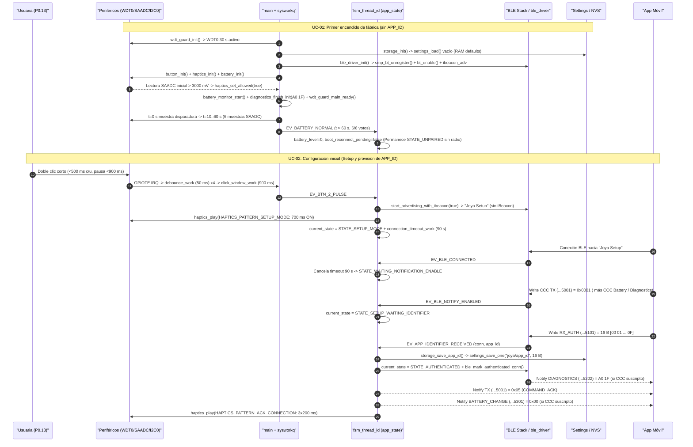
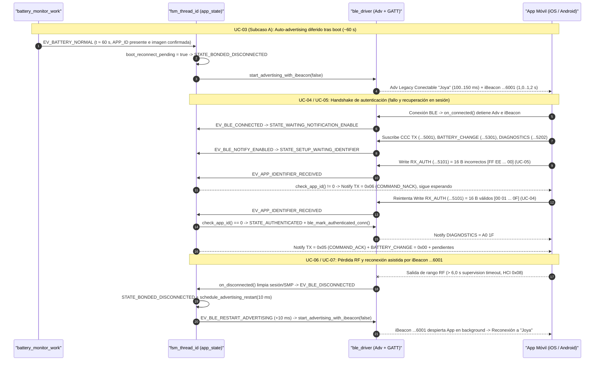
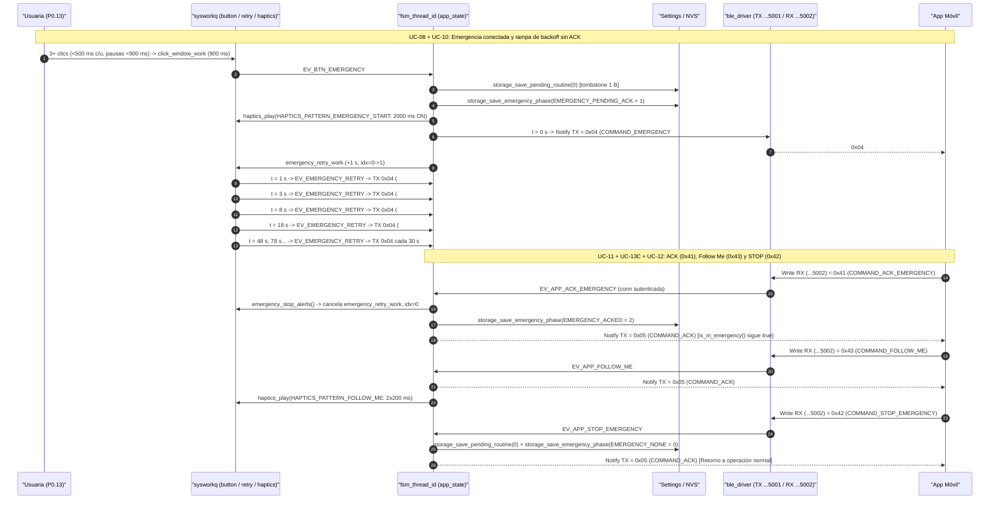
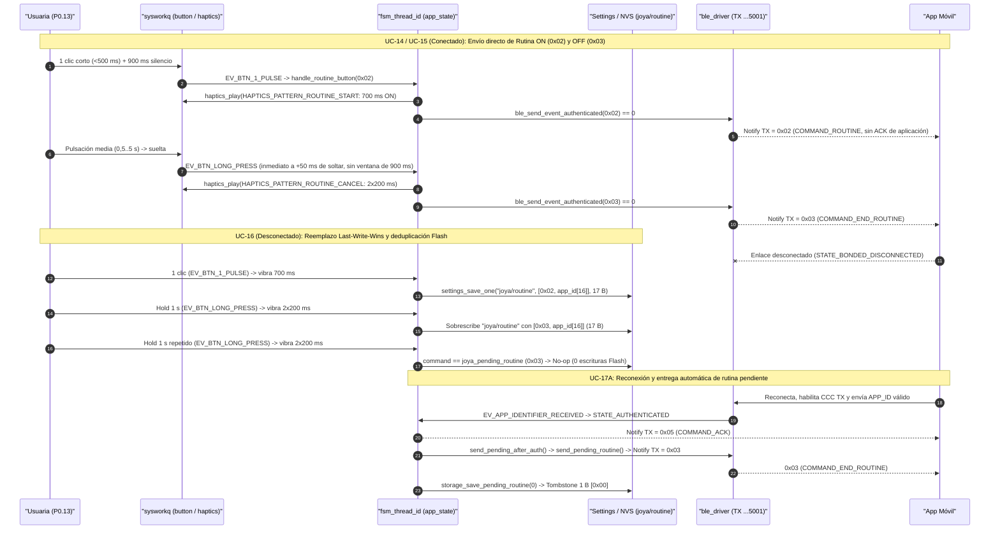
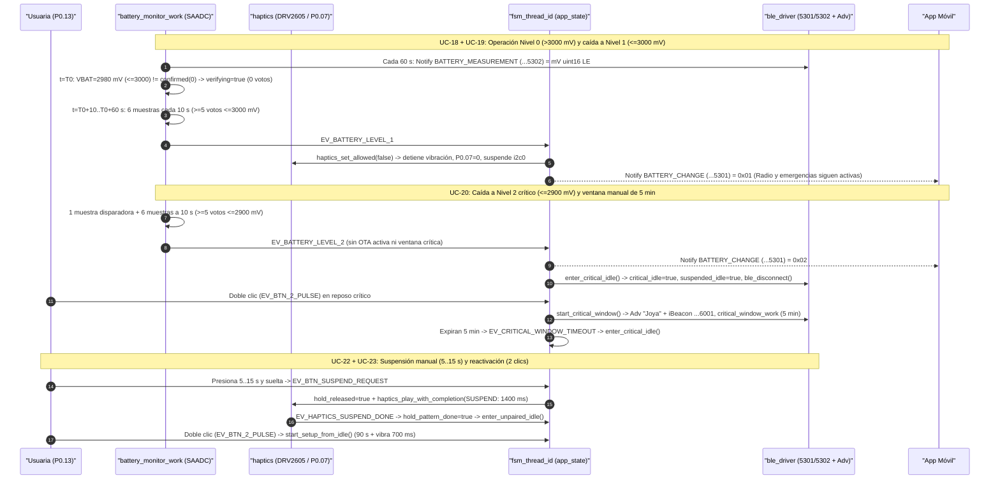
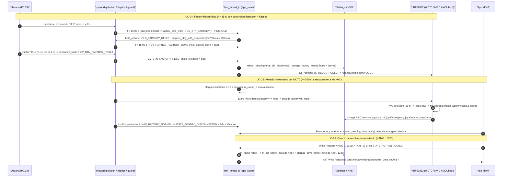
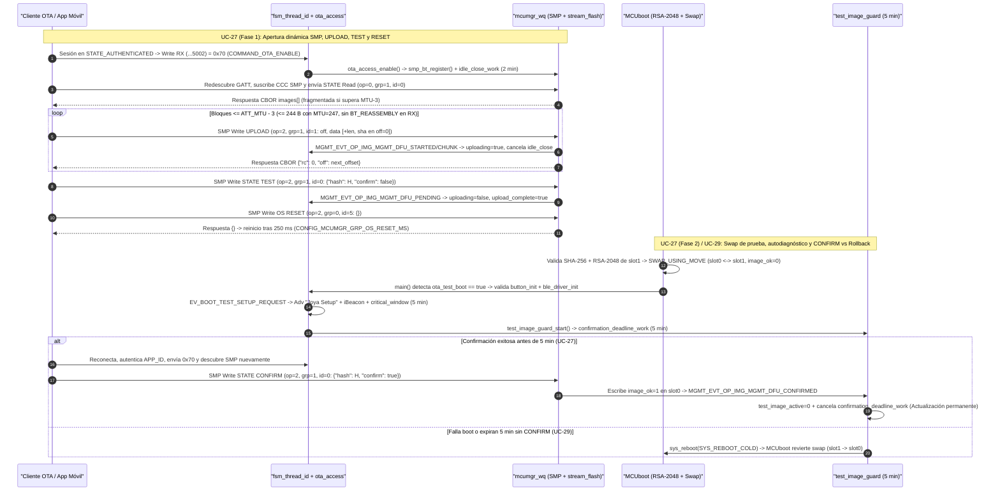
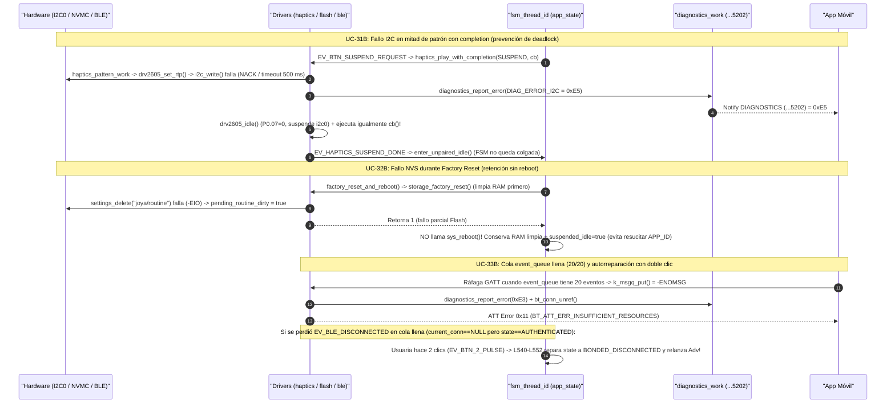

# 21. Casos de Uso Completos de Extremo a Extremo

> **Alcance y versión verificada**: Este capítulo reconstruye de principio a fin los **33 flujos operativos, de gestión energética, de mantenimiento OTA y de tolerancia a fallas** del firmware de Joya sobre la implementación exacta del commit `c1128e5d0c0d6f98be0a580d287c0926ca27f01f` (Zephyr RTOS `4.2.0`, `MCUboot` con `SWAP_USING_MOVE` y `RSA-2048`, SoC `nRF52832-QFAA`). Cada flujo traza sin omisiones la cadena causal completa desde el estímulo físico o radioeléctrico hasta la persistencia en `Settings/NVS`, las notificaciones GATT y el estado estacionario resultante. Para el detalle modular de cada subsistema véanse [04_boot_initialization.md](04_boot_initialization.md), [05_state_machine.md](05_state_machine.md), [06_concurrency.md](06_concurrency.md), [07_ble_architecture.md](07_ble_architecture.md), [08_ibeacon.md](08_ibeacon.md), [09_gatt_protocol.md](09_gatt_protocol.md), [10_authentication.md](10_authentication.md), [11_button.md](11_button.md), [12_emergency_routines.md](12_emergency_routines.md), [13_haptic_system.md](13_haptic_system.md), [14_battery_power.md](14_battery_power.md), [15_flash_persistence.md](15_flash_persistence.md), [16_ota_mcuboot.md](16_ota_mcuboot.md), [17_security_privacy.md](17_security_privacy.md), [18_error_handling.md](18_error_handling.md) y [19_timers_parameters.md](19_timers_parameters.md).

---

## 21.1. Metodología de trazabilidad y convenciones del capítulo

### 21.1.1. Clasificación epistemológica estricta

En cada caso de uso se distingue explícitamente la naturaleza de la evidencia técnica mediante cinco categorías:

- **(a) Comportamiento implementado**: lógica verificada línea por línea sobre el código fuente compilado en `c1128e5d0c0d6f98be0a580d287c0926ca27f01f`.
- **(b) Intención de diseño**: propósito arquitectónico respaldado por comentarios en el código fuente, mensajes de commit, aserciones en `tests/` o herramientas del árbol (`ota/joya_console.py`).
- **(c) Comportamiento inferido**: consecuencia determinista derivada de la interacción del código de aplicación con el kernel de Zephyr `4.2.0`, el controlador BLE Split Link Layer (`BT_LL_SW_SPLIT`), `MCUmgr`/`MCUboot` o el hardware del `nRF52832`.
- **(d) Código experimental / residual / no utilizado**: símbolos, ramas o funciones presentes en el árbol pero inalcanzables o sin invocador activo en `c1128e5` (p. ej. `COMMAND_FRIEND_STOP_EMERGENCY = 0x45`, `battery_request_recheck()`, `nbm_bypass_init()`, `STATE_EMERGENCY`).
- **(e) Pendiente de validación experimental / dependiente de hardware externo**: magnitudes físicas que dependen del esquemático analógico de la PCB de Joya, la curva química bajo carga de la celda LiPo/Li-ion o el comportamiento en segundo plano de iOS/Android.

### 21.1.2. Contextos de ejecución concurrente referenciados

Para interpretar con precisión en qué contexto corre cada función C citada en los 33 casos de uso, la tabla siguiente resume los contextos de ejecución activos (analizados en profundidad en [06_concurrency.md](06_concurrency.md)):

| Contexto / Hilo | Prioridad Zephyr | Pila | Responsabilidad principal en los casos de uso |
|---|---|---|---|
| **ISR Hardware (`GPIOTE`, Radio/RTC, `SAADC`)** | Excepción ARM IRQ | Pila de interrupción (`CONFIG_ISR_STACK_SIZE`) | `button_isr_handler()` en [src/button.c](../../src/button.c#L54-L63): agenda `debounce_work` sin bloquear. |
| **`sysworkq` (System Workqueue)** | `-1` (cooperativa) | `4096 B` ([prj.conf](../../prj.conf#L38)) | Ejecuta todos los `k_work` / `k_work_delayable`: antirrebote y gestos del botón (`debounce_work`, `click_window_work`, `factory_hold_work`), pasos hápticos I2C (`haptics_pattern_work`, `haptics_effect_work`), muestreo SAADC (`battery_monitor_work`), temporizadores FSM (`connection_timeout_work`, `advertising_restart_work`, `emergency_retry_work`, `critical_window_work`), cierre diferido SMP (`idle_close_work`), apagado de iBeacon (`ibeacon_stop_work`), envío diferido de diagnósticos (`diagnostics_work`), rollback Test (`confirmation_deadline_work`) y guardia de watchdog (`guard_work`). |
| **`main` Thread** | `0` (preemptiva) | `4096 B` ([prj.conf](../../prj.conf#L37)) | Ejecuta `main()` en [src/main.c](../../src/main.c#L11-L89) durante el arranque y luego duerme permanentemente en `k_sleep(K_FOREVER)`. |
| **`mcumgr_wq` (MCUmgr Transport WQ)** | `3` (preemptiva) | `2048 B` (`.config`) | Procesa tramas SMP CBOR (`STATE`, `UPLOAD`, `TEST`, `CONFIRM`, `RESET`), escribe en `slot1_partition` vía `stream_flash` y dispara callbacks `image_status_handler()` e `image_confirmed_handler()`. |
| **`fsm_thread_id` (Hilo FSM)** | `5` (preemptiva) | `4098 B` ([src/app_state.c](../../src/app_state.c#L36)) | Bucle infinito `fsm_thread_loop()` bloqueado en `k_msgq_get(&event_queue, ..., K_FOREVER)` y ejecución serializada de `process_event()`. |
| **Hilos BLE Host/Controller (`BT RX` / `BT TX`)** | Cooperativas (`PRIO 8` / `7` / `6` en subsistema BT) | Configuradas por Zephyr BT | Ejecuta callbacks de conexión (`on_connected`, `on_disconnected`), cambios `CCC` (`on_ccc_changed`, `on_*_ccc_changed`) y lecturas/escrituras GATT (`on_rx_write`, `on_rx_auth_write`, `on_name_write`, `on_name_read`, `on_diagnostics_read`). |

### 21.1.3. Vectores sintéticos de prueba utilizados

Por política estricta de seguridad y privacidad (véase [17_security_privacy.md](17_security_privacy.md)), todos los ejemplos de este capítulo emplean exclusivamente **vectores sintéticos de laboratorio**:
- **`APP_ID` válido de ejemplo (`16 B`)**: `00 01 02 03 04 05 06 07 08 09 0A 0B 0C 0D 0E 0F`
- **`APP_ID` inválido / ajeno de ejemplo (`16 B`)**: `FF EE DD CC BB AA 99 88 77 66 55 44 33 22 11 00`
- **Sufijo de nombre personalizado de ejemplo**: `"Ana"` (`41 6E 61` en UTF-8, `3 B`) → nombre completo `"Joya de Ana\0"` (`12 B`).

---

## 21.2. Índice Maestro de los 33 Casos de Uso

| ID | Caso de uso | Familia funcional | Estado inicial típico | Estado final nominal | Claves NVS tocadas |
|---|---|---|---|---|---|
| **UC-01** | Primer encendido de fábrica (sin `APP_ID`) | 1. Puesta en marcha y vinculación | Reset POR / Flash virgen | `STATE_UNPAIRED` (radio silenciosa, `battery_level = 0` a `~60 s`) | Lectura vacía (`settings_load`) |
| **UC-02** | Configuración inicial (Setup y provisión de `APP_ID`) | 1. Puesta en marcha y vinculación | `STATE_UNPAIRED`, sin `APP_ID` | `STATE_AUTHENTICATED` (`APP_ID` guardado) | Escritura `joya/app_id` (`16 B`) |
| **UC-03** | Conexión normal (unidad provisionada: auto-adv `~60 s` vs `2 clics`) | 2. Conectividad, autenticación y reconexión | `STATE_UNPAIRED` o `STATE_BONDED_DISCONNECTED` con `APP_ID` | `STATE_WAITING_NOTIFICATION_ENABLE` | Solo lectura en RAM |
| **UC-04** | Autenticación exitosa y despacho automático post-auth | 2. Conectividad, autenticación y reconexión | `STATE_WAITING_NOTIFICATION_ENABLE` con `APP_ID` | `STATE_AUTHENTICATED` (`0x05`, batería, `A0 1F`, pendientes) | Tombstone `joya/routine` si aplica |
| **UC-05** | Autenticación fallida (`COMMAND_NACK 0x06`) y recuperación en sesión | 2. Conectividad, autenticación y reconexión | `STATE_SETUP_WAITING_IDENTIFIER` con `APP_ID` | Permanece en `STATE_SETUP_WAITING_IDENTIFIER` → `STATE_AUTHENTICATED` | Ninguna |
| **UC-06** | Desconexión involuntaria (pérdida de enlace / salida de rango RF) | 2. Conectividad, autenticación y reconexión | `STATE_AUTHENTICATED` | `STATE_BONDED_DISCONNECTED` + timer `10 ms` | Ninguna (preserva emergencia/rutina) |
| **UC-07** | Reconexión asistida por advertising conectable + iBeacon `...6001` | 2. Conectividad, autenticación y reconexión | `STATE_BONDED_DISCONNECTED` (`+10 ms` post-corte) | `STATE_AUTHENTICATED` (iBeacon apagado al conectar) | Lectura `joya/name` en RAM |
| **UC-08** | Emergencia conectada y autenticada | 3. Rutinas de seguridad y emergencias | `STATE_AUTHENTICATED`, `EMERGENCY_NONE` | `STATE_AUTHENTICATED`, `EMERGENCY_PENDING_ACK` (`0x04` + retry `1 s`) | `joya/routine=0` (`1 B`), `joya/emergency=1` (`1 B`) |
| **UC-09** | Emergencia desconectada (con `APP_ID` vs sin `APP_ID`) | 3. Rutinas de seguridad y emergencias | `STATE_BONDED_DISCONNECTED` o `STATE_UNPAIRED` | Adv activo + `EMERGENCY_PENDING_ACK` (con `APP_ID`) o `STATE_SETUP_MODE` sin fase (sin `APP_ID`) | Con `APP_ID`: `joya/routine=0`, `joya/emergency=1` |
| **UC-10** | Emergencia sin `ACK` (progresión completa `1→2→5→10→30 s...`) | 3. Rutinas de seguridad y emergencias | `STATE_AUTHENTICATED`, `EMERGENCY_PENDING_ACK` | Retransmisión indefinida cada `30 s` hasta `0x41`/`0x42`/desconexión | Ninguna adicional |
| **UC-11** | `ACK` de emergencia (`0x41` → `EMERGENCY_ACKED`) | 3. Rutinas de seguridad y emergencias | `STATE_AUTHENTICATED`, `EMERGENCY_PENDING_ACK` | `STATE_AUTHENTICATED`, `EMERGENCY_ACKED` (reintentos detenidos, modo emergencia activo) | `joya/emergency=2` (`1 B`) |
| **UC-12** | `STOP` de emergencia (`0x42` → `EMERGENCY_NONE`) | 3. Rutinas de seguridad y emergencias | `STATE_AUTHENTICATED`, `EMERGENCY_PENDING_ACK` o `ACKED` | `STATE_AUTHENTICATED`, `EMERGENCY_NONE` (operación normal restaurada) | `joya/routine=0`, `joya/emergency=0` (`1 B`) |
| **UC-13** | Emergencias consecutivas y comandos `0x43` / `0x44` / `0x45` | 3. Rutinas de seguridad y emergencias | En `PENDING_ACK`, `ACKED` o `EMERGENCY_NONE` | Re-disparo desde `ACKED`, idempotencia en `PENDING_ACK`, `Follow Me` o `Friend` | `joya/emergency=1` (solo desde `ACKED`) |
| **UC-14** | Rutina `ON` (`0x02` `COMMAND_ROUTINE`: conectado vs desconectado) | 4. Rutinas cotidianas y cola de último valor | Con `APP_ID`, `EMERGENCY_NONE` | Envío inmediato `0x02` (conectado) o pendiente en NVS (desconectado) | `joya/routine` (`0x00` o `17 B` `[0x02, app_id]`) |
| **UC-15** | Rutina `OFF` (`0x03` `COMMAND_END_ROUTINE`: `0,5..5 s`) | 4. Rutinas cotidianas y cola de último valor | Con `APP_ID`, `EMERGENCY_NONE` | Envío inmediato `0x03` (conectado) o pendiente en NVS (desconectado) | `joya/routine` (`0x00` o `17 B` `[0x03, app_id]`) |
| **UC-16** | Rutinas consecutivas desconectadas (*last-write-wins*) | 4. Rutinas cotidianas y cola de último valor | `STATE_BONDED_DISCONNECTED`, `EMERGENCY_NONE` | Último comando (`0x02` o `0x03`) retenido sin cola ni cancelación mutua | Sobrescritura / deduplicación `joya/routine` |
| **UC-17** | Entrega de pendientes tras reconexión y preempción por emergencia | 4. Rutinas cotidianas y cola de último valor | `joya/routine != 0` en desconexión | Envío y limpieza tras auth, o descarte irreversible ante `EV_BTN_EMERGENCY` | `joya/routine=0` (y `joya/emergency=1` si aplica) |
| **UC-18** | Operación estacionaria en batería normal (Nivel 0 y telemetría mV) | 5. Batería, suspensión y ciclo de energía | Arranque o régimen estacionario (`> 3000 mV`) | `battery_level = 0`, háptica permitida, muestreo cada `60 s` (`...5302`) | Ninguna |
| **UC-19** | Transición a batería baja (Nivel 1 `<= 3000 mV`, votación `5/6`) | 5. Batería, suspensión y ciclo de energía | `battery_level = 0` | `battery_level = 1`, háptica bloqueada, notificación `0x01` en `...5301` | Ninguna |
| **UC-20** | Transición a batería crítica (Nivel 2 `<= 2900 mV` y ventana de `5 min`) | 5. Batería, suspensión y ciclo de energía | `battery_level = 0/1` | `critical_idle = true`, `suspended_idle = true`, `STATE_UNPAIRED` (o ventana `5 min` tras `2 clics`) | Ninguna |
| **UC-21** | Recuperación de batería (histéresis `+50 mV`, auto-wake vs manual) | 5. Batería, suspensión y ciclo de energía | `battery_level = 2` o `1` | Nivel `1` (`> 2950 mV`) o `0` (`> 3050 mV`); auto-adv si `boot_reconnect_pending` o manual con `2 clics` | Ninguna |
| **UC-22** | Suspensión lógica manual (pulsación `5..15 s`) | 5. Batería, suspensión y ciclo de energía | Cualquier estado sin OTA activa | `STATE_UNPAIRED`, `suspended_idle = true`, radio y alertas apagadas | Ninguna (conserva datos NVS) |
| **UC-23** | Reactivación desde suspensión lógica (`EV_BTN_2_PULSE`) | 5. Batería, suspensión y ciclo de energía | `STATE_UNPAIRED`, `suspended_idle = true` | `STATE_SETUP_MODE` (`suspended_idle = false`, adv + ventana `90 s`) | Ninguna |
| **UC-24** | Factory reset físico (pulsación `>= 15 s` + liberación + reboot) | 6. Mantenimiento, reinicios e identidad | Cualquier estado sin OTA activa | Borrado de las 4 claves NVS + `sys_reboot(SYS_REBOOT_COLD)` → **UC-01** | `settings_delete` de `routine`, `app_id`, `emergency`, `name` |
| **UC-25** | Reinicio involuntario (fatal error, assert BT, `WDT0` o corte VBAT) | 6. Mantenimiento, reinicios e identidad | Operación activa con bloqueo o fallo | Reset hardware → `~60 s` verificación ADC → auto-adv y restauración de emergencia/rutina | Lectura `settings_load()` en re-arranque |
| **UC-26** | Cambio de nombre personalizado (`NAME ...5201` → `"Joya de <sufijo>"`) | 6. Mantenimiento, reinicios e identidad | `STATE_AUTHENTICATED` | Nombre actualizado en RAM, GAP (`0x2A00`) y NVS; visible en próxima publicidad | Escritura `joya/name` (`9..32 B`) |
| **UC-27** | Actualización OTA exitosa completa (`0x70` → `UPLOAD` → `TEST` → `CONFIRM`) | 7. Actualización OTA y MCUboot | `STATE_AUTHENTICATED` (imagen confirmada) | Nueva imagen ejecutándose y confirmada (`image_ok = 1`) en `slot0_partition` | Trailer MCUboot + preservación de `storage_partition` |
| **UC-28** | Actualización OTA interrumpida (corte BLE en `UPLOAD` y reanudación) | 7. Actualización OTA y MCUboot | `UPLOAD` SMP en progreso | SMP cerrado al desconectar; reanudación por offset tras reconectar + auth + `0x70` | Escrituras parciales `stream_flash` en `slot1_partition` |
| **UC-29** | Rollback automático de imagen OTA Test (`5 min` o fallo de boot) | 7. Actualización OTA y MCUboot | Arranque con `ota_test_boot == true` | `sys_reboot` → swap inverso MCUboot → imagen previa confirmada restaurada | Trailer MCUboot |
| **UC-30** | Fallas de inicialización en arranque (Confirmada vs Test) | 8. Degradación controlada y manejo de fallas | Arranque en `main()` con fallo de driver | Degradación con `A0 MM` o reinicio/rollback según criticidad y modo de imagen | Depende del fallo (`0xE2` si falla `settings_load`) |
| **UC-31** | Fallas del sistema háptico (`DRV2605` ausente o error I2C `0xE5`) | 8. Degradación controlada y manejo de fallas | Arranque o reproducción de patrón con `completion` | `P0.07=0`, `i2c0` suspendido, emisión `0xE5` y ejecución garantizada de `completion()` | Ninguna |
| **UC-32** | Errores de persistencia Flash/NVS (`0xE1`, retención en reset y `dirty`) | 8. Degradación controlada y manejo de fallas | Escritura o borrado NVS con error | Continuidad *RAM-first*, `0xE1`, no-reboot en reset fallido y bloqueo de fuga con `pending_routine_dirty` | Intento fallido sobre `storage_partition` |
| **UC-33** | Errores de comunicación BLE (`0xE4`) y saturación de `event_queue` (`0xE3`) | 8. Degradación controlada y manejo de fallas | Fallo HCI/GATT o `event_queue` llena (`20/20`) | Reintentos de adv (`10 ms`, `5 s`, `5 s`), liberación `bt_conn_unref`, error ATT `0x11` y autorreparación con `2 clics` | Ninguna |

---

## 21.3. Familia 1: Puesta en Marcha y Vinculación Inicial (UC-01 a UC-02)

---

### UC-01 — Primer encendido de fábrica (sin `APP_ID`)

1. **Precondiciones del sistema**:
   - Imagen de aplicación firmada y **confirmada** (`image_ok = 0x01`) en `slot0_partition` (`0x0000C000..0x00043000`), verificada criptográficamente por `MCUboot` (`SHA-256` + `RSA-2048` con `CONFIG_BOOT_VALIDATE_SLOT0=y`).
   - Partición `storage_partition` (`0x0007A000..0x00080000`, `24 KiB` = 6 sectores físicos de `4 KiB`) virgen o recién borrada: no existen entradas válidas para `joya/app_id`, `joya/emergency`, `joya/routine` ni `joya/name`.
   - Celda de batería conectada con tensión nominal sana (`VBAT > 3000 mV`, p. ej. `3850 mV`) y botón `P0.13` en reposo eléctrico (`3,3 V` vía pull-up interno).

2. **Acciones de la usuaria / estímulo externo**:
   - Inserción de batería o aplicación por primera vez de alimentación `VDD`/`VBAT` en línea de ensamble o al desembalar el producto (Power-On Reset, `POR`), sin presionar el botón.

3. **Eventos de hardware e interrupciones**:
   - Arranque del oscilador `LFCLK RC` interno de `32,768 kHz` (`CONFIG_CLOCK_CONTROL_NRF_K32SRC_RC=y`, calibrado cada `4000 ms` contra `&temp`).
   - Arranque del periférico hardware `WDT0` (`CRV = 983040` ticks ≈ `30,00003 s`, activo durante `SLEEP`).
   - Pulso temporal de `10 ms` sobre `P0.07` (`haptic_en_gpios = 1` y retorno a `0`), transacciones I2C a `100 kHz` en `TWIM0` (`P0.08` SDA / `P0.06` SCL) hacia `DRV2605` (`0x5A`), y paso posterior de `TWIM0` a estado `sleep` (`low-power-enable`).
   - Habilitación de interrupción `GPIOTE` por ambos flancos (`GPIO_INT_EDGE_BOTH`) sobre `P0.13`.
   - Una conversión síncrona inicial `SAADC` en `AIN7` (`P0.31`) durante `battery_init()`, seguida de 1 muestra disparadora en `t ≈ 0 s` y 6 muestras de verificación separadas `10 s` (`t = 10, 20, 30, 40, 50, 60 s`).

4. **Ruta de ejecución C e hilos involucrados** *(a) Comportamiento implementado*:
   - **Antes de `main()` (arranque del kernel Zephyr)**: se instancia `fsm_thread_id` (prioridad `5`, [src/app_state.c](../../src/app_state.c#L36)), que inicializa los 4 *work items* diferibles de la FSM y queda bloqueado en `k_msgq_get(&event_queue, &entry, K_FOREVER)` ([src/app_state.c](../../src/app_state.c#L356-L365)). `MCUmgr` auto-registra inicialmente el transporte SMP BT durante `SYS_INIT`.
   - **Hilo `main` (prioridad `0`, [src/main.c](../../src/main.c#L11-L89))**:
     1. `wdt_guard_init()` ([src/wdt_guard.c](../../src/wdt_guard.c#L84-L107)): instala el canal `0` en `WDT0`, ejecuta `wdt_setup(wdt, WDT_OPT_PAUSE_HALTED_BY_DBG)`, comprueba `wdt_registers_match()` y programa `guard_work` a `10000 ms` (sin alimentar aún porque `main_ready == 0`).
     2. `ota_test_boot = !boot_is_img_confirmed()` evalúa a `false` ([src/main.c](../../src/main.c#L13)).
     3. `storage_init()` ([src/flash_memory.c](../../src/flash_memory.c#L197-L248)): inicializa los valores por defecto en RAM, monta `NVS` (`settings_subsys_init()`), ejecuta `settings_load()` (0 claves leídas), activa `storage_persistent_available = true` y registra `DIAG_INIT_SETTINGS` (`0x04`).
     4. `ble_driver_init()` ([src/ble_driver.c](../../src/ble_driver.c#L494-L517)): invoca `ota_access_init()` ([src/ota_access.c](../../src/ota_access.c#L83-L94), que ejecuta **`smp_bt_unregister()` antes de `bt_enable()`** para ocultar la superficie OTA), habilita el stack BLE (`bt_enable(NULL)`), y crea/configura el conjunto publicitario `ibeacon_adv` sin iniciarlo. Registra `DIAG_INIT_BLE` (`0x01`).
     5. `button_init()` ([src/button.c](../../src/button.c#L157-L200)): configura `P0.13`, captura `last_stable_pressed = false` y habilita `GPIOTE`. Registra `DIAG_INIT_BUTTON` (`0x02`).
     6. `haptics_init()` ([src/haptics.c](../../src/haptics.c#L485-L580)): energiza `P0.07`, detecta `DRV2605` en `0x5A` (o `0x5B`), configura motor ERM en lazo abierto con `OD_CLAMP = 0x72` (`~2,5 V`), y llama `drv2605_idle()` (standby, `P0.07 = 0`, `PM_DEVICE_ACTION_SUSPEND` en `i2c0`). Nota *(d)*: el bloque comentado en [src/main.c](../../src/main.c#L68-L74) muestra que una vibración de arranque (`HAPTICS_PATTERN_ACK_CONNECTION`) fue deliberadamente desactivada. Registra `DIAG_INIT_HAPTIC` (`0x08`).
     7. `battery_init()` ([src/battery.c](../../src/battery.c#L45-L72)): configura `SAADC` y toma una lectura inmediata; al ser `voltage_mv > 3000`, habilita tempranamente la háptica (`haptics_set_allowed(true)`) sin alterar la FSM. Acto seguido, `battery_monitor_start()` agenda `battery_monitor_work` con `K_NO_WAIT`. Registra `DIAG_INIT_BATTERY` (`0x10`).
     8. `diagnostics_finish_init()` ([src/diagnostics.c](../../src/diagnostics.c#L46-L50)) sella el mensaje `A0 1F`, `wdt_guard_main_ready()` ([src/wdt_guard.c](../../src/wdt_guard.c#L109-L116)) marca `main_ready = 1` y dispara el primer `wdt_feed()` inmediato en `sysworkq`, y `main()` duerme en `k_sleep(K_FOREVER)`.
   - **Hilo `sysworkq` → `fsm_thread_id` (`t ≈ 0..60 s`)**:
     - En `t ≈ 0 s`, `battery_monitor_work_handler()` ([src/battery.c](../../src/battery.c#L210-L304)) observa `was_verifying == false` y `battery_classify(voltage_mv) (0) != confirmed_level (-1)` → activa `verifying = true`, `verification_count = 0`, `votes = {0,0,0}` y se reprograma a `10 s`.
     - Tras las 6 muestras (`t = 10..60 s`), `battery_finish_verification()` ([src/battery.c](../../src/battery.c#L166-L208)) confirma `votes[0] == 6 >= 5` ([src/battery.c](../../src/battery.c#L192-L195)), fija `confirmed_level = 0` y encola `EV_BATTERY_NORMAL`.
     - `process_event()` ([src/app_state.c](../../src/app_state.c#L425-L476)) fija `battery_level = 0`, `boot_battery_seen = true`, y evalúa `boot_reconnect_pending = !is_app_id_empty() && boot_is_img_confirmed()` → **`false`**.

5. **Transiciones de estado y banderas**:
   - `current_state`: permanece en `STATE_UNPAIRED`.
   - `is_app_id_empty() == true`, `joya_emergency_phase = EMERGENCY_NONE (0)`, `joya_pending_routine = 0`, `joya_name = "Joya"`.
   - `suspended_idle = false`, `critical_idle = false`, `critical_window_open = false`.
   - `battery_level`: `-1` (`t = 0..60 s`) → `0` (`t ≈ 60 s`); `boot_battery_seen`: `false → true`; `boot_reconnect_pending = false`.
   - `haptics_ready = true`, `haptics_allowed = 1` (desde `battery_init()` en `t ≈ 0 s`).

6. **Acciones locales y patrones hápticos**:
   - **Ninguna vibración** al encender *(a)*. El pin `P0.07` solo sube `10 ms` + tiempo de configuración I2C durante `haptics_init()` sin activar el registro `GO` ni amplitud `RTP > 0`.

7. **Tramas BLE e interacción con la app móvil**:
   - **Cero emisiones RF**: ni el conjunto conectable Legacy (`connectable_adv_running == 0`) ni `ibeacon_adv` (`ibeacon_running == false`) se inician. El dispositivo es completamente invisible en el espectro de `2,4 GHz` hasta que la usuaria interactúe físicamente con el botón *(b) Intención de diseño: ahorro energético en estantería/transporte y prevención de vinculación no solicitada*.

8. **Lecturas y escrituras en NVS (`Settings`)**:
   - Solo recorrido de lectura `settings_load()` al montar los 6 sectores de `storage_partition` (`0x0007A000`); **cero escrituras Flash**.

9. **Temporizadores y *work items* involucrados**:
   - `guard_work`: `0 ms` al terminar `main()`, luego periódico cada `10000 ms` alimentando `WDT0` (`30000 ms`).
   - `battery_monitor_work`: `0 ms` (disparo), `6 × 10000 ms` (verificación inicial), y luego estacionario cada `60000 ms`.

10. **Estado final, consecuencias de ingeniería e impacto ante interrupción**:
    - **Estado final**: `STATE_UNPAIRED` en reposo profundo `System ON Idle` de Zephyr, despertando la CPU únicamente cada `4 s` (calibración LFCLK RC), `10 s` (`guard_work`) y `60 s` (`battery_monitor_work`), minimizando el autodescargado en almacén *(c)*.
    - **Interrupción a mitad del arranque**: si se corta la energía antes de `wdt_guard_main_ready()` o durante los primeros `60 s`, al no haberse escrito nada en NVS, el siguiente encendido repite exactamente la misma secuencia idempotente. Si un driver se colgara antes de `wdt_guard_main_ready()`, `WDT0` reinicia el SoC a los `30 s`.

---

### UC-02 — Configuración inicial (Setup y provisión de `APP_ID`)

1. **Precondiciones del sistema**:
   - Unidad en estado de fábrica tras **UC-01**: `current_state == STATE_UNPAIRED`, `is_app_id_empty() == true`, `suspended_idle == false`, `haptics_allowed == 1` (ya sea antes o después de los `60 s` iniciales gracias a la lectura rápida en `battery_init()`).

2. **Acciones de la usuaria / estímulo externo**:
   - La usuaria realiza un **doble clic corto** en el botón físico (`2` pulsaciones de duración `< 500 ms` separadas por `< 900 ms`), abre la aplicación móvil de Joya, selecciona el dispositivo `"Joya Setup"` y completa el registro de cuenta/dispositivo.

3. **Eventos de hardware e interrupciones**:
   - `4` interrupciones `GPIOTE` en `P0.13` (bajada-subida del clic 1 y bajada-subida del clic 2).
   - Activación de `P0.07 = 1` y reanudación de `TWIM0` (`i2c0`) dos veces: al entrar en modo Setup (`800 ms`) y al confirmar la provisión (`900 ms`).
   - Actividad de radio BLE `2,4 GHz` (advertising Legacy en canales 37/38/39 cada `100..150 ms`, establecimiento de enlace `CONNECT_IND` y transacciones L2CAP/ATT).
   - Programación de palabra/registro en Flash interna (`NVMC`) sobre `storage_partition` al guardar `joya/app_id`.

4. **Ruta de ejecución C e hilos involucrados** *(a) Comportamiento implementado*:
   - **Detección del doble clic (`ISR` → `sysworkq` → `fsm_thread_id`)**:
     1. Cada flanco en `P0.13` ejecuta `button_isr_handler()` ([src/button.c](../../src/button.c#L54-L63)), que reprograma `debounce_work` a `50 ms` (`DEBOUNTE_TIME_MS`).
     2. En cada liberación corta (`press_time_ms < 500 ms`), `debounce_work_handler()` ([src/button.c](../../src/button.c#L65-L136)) incrementa `pulse_count` (`1`, luego `2`) y reprograma `click_window_work` a `900 ms` (`CLICK_WINDOW_MS`).
     3. Transcurridos `900 ms` desde la segunda liberación sin un tercer clic, `click_window_work_handler()` ([src/button.c](../../src/button.c#L138-L155)) lee y resetea atómicamente `count = 2` y encola `EV_BTN_2_PULSE`.
   - **Entrada a `STATE_SETUP_MODE` (`fsm_thread_id`)**:
     4. `process_event()` llega al `switch (current_state)` en `case STATE_UNPAIRED:` ([src/app_state.c](../../src/app_state.c#L887-L892)) e invoca `start_setup_from_idle()` ([src/app_state.c](../../src/app_state.c#L165-L175)).
     5. `start_advertising_with_ibeacon(true)` llama `ble_start_setup_advertising(true)` ([src/ble_driver.c](../../src/ble_driver.c#L608-L647)): ejecuta `bt_set_name("Joya Setup")` y `bt_le_adv_start(&joya_adv_param, ad, ...)`, fijando `connectable_adv_running = 1`. Luego `sync_ibeacon_mode()` evalúa `ibeacon_mode_for_state(false) == BLE_IBEACON_OFF`, manteniendo el iBeacon apagado.
     6. Se fija `suspended_idle = false`, `current_state = STATE_SETUP_MODE`, se dispara `haptics_play(HAPTICS_PATTERN_SETUP_MODE)` y se reprograma `connection_timeout_work` a `90000 ms` (`BLE_SETUP_TIMEOUT_MS`).
   - **Conexión BLE y habilitación de canal `TX` (`BT RX` → `fsm_thread_id`)**:
     7. Al conectar el teléfono, `on_connected()` ([src/ble_driver.c](../../src/ble_driver.c#L217-L244)) toma referencia `current_conn = bt_conn_ref(conn)`, incrementa `diagnostics_session_epoch`, limpia `connectable_adv_running = 0` y todas las banderas `current_conn_authenticated` / `*_notify_enabled`, envía `ibeacon_stop_work` y encola `EV_BLE_CONNECTED`.
     8. `process_event(EV_BLE_CONNECTED)` ([src/app_state.c](../../src/app_state.c#L569-L573), [src/app_state.c](../../src/app_state.c#L894-L900)) cancela `connection_timeout_work`, cambia `current_state = STATE_WAITING_NOTIFICATION_ENABLE` e invoca `ble_stop_advertising()`.
     9. Cuando la app escribe `0x0001` en el descriptor `CCC` de `TX` (`...5001`), `on_ccc_changed()` ([src/ble_driver.c](../../src/ble_driver.c#L156-L172)) fija `notify_enabled = true` y encola `EV_BLE_NOTIFY_ENABLED` con `conn`.
     10. `process_event(EV_BLE_NOTIFY_ENABLED)` verifica `ble_commands_subscribed_for_conn(entry->conn)` ([src/app_state.c](../../src/app_state.c#L392-L395)) y en `case STATE_WAITING_NOTIFICATION_ENABLE:` ([src/app_state.c](../../src/app_state.c#L909-L920)) avanza `current_state = STATE_SETUP_WAITING_IDENTIFIER`.
   - **Recepción y persistencia del `APP_ID` (`BT RX` → `fsm_thread_id`)**:
     11. La app escribe los `16 B` en `RX_AUTH` (`...5101`). `on_rx_auth_write_handler()` ([src/app_comm.c](../../src/app_comm.c#L43-L58)) valida `offset == 0` y `len == 16`, copia los 16 bytes en `entry.app_id` y encola `EV_APP_IDENTIFIER_RECEIVED`.
     12. En `case STATE_SETUP_WAITING_IDENTIFIER:` ([src/app_state.c](../../src/app_state.c#L922-L953)), `is_app_id_empty()` es `true`; tras comprobar `ble_is_current_conn(entry->conn)`, llama `save_received_app_id(entry->app_id)` → `storage_save_app_id()` ([src/flash_memory.c](../../src/flash_memory.c#L263-L289)).
     13. Si `!is_app_id_empty()` se cumple ([src/app_state.c](../../src/app_state.c#L932)), ejecuta `sync_ibeacon_mode()`, cambia `current_state = STATE_AUTHENTICATED`, llama `ble_mark_authenticated_conn(entry->conn)` (que activa `current_conn_authenticated = true` e invoca `diagnostics_request_init_notification()`), envía `COMMAND_ACK (0x05)` mediante `ble_send_event_for_conn()`, llama `notify_current_battery_level()`, reproduce `HAPTICS_PATTERN_ACK_CONNECTION` e invoca `send_pending_after_auth()`.

5. **Transiciones de estado y banderas**:
   - `current_state`: `STATE_UNPAIRED` → `STATE_SETUP_MODE` → `STATE_WAITING_NOTIFICATION_ENABLE` → `STATE_SETUP_WAITING_IDENTIFIER` → `STATE_AUTHENTICATED`.
   - `joya_app_id`: `16 × 0x00` → `[00 01 ... 0F]` (`is_app_id_empty()`: `true → false`).
   - `current_conn_authenticated`: `false → true`; `notify_enabled`: `false → true`.

6. **Acciones locales y patrones hápticos**:
   - Al entrar en `STATE_SETUP_MODE`: `HAPTICS_PATTERN_SETUP_MODE` = `[700 ms @ 100, 100 ms @ 0]` (`800 ms` totales, vibración continua media-larga, [src/haptics.c](../../src/haptics.c#L59-L62)).
   - Al completar provisión: `HAPTICS_PATTERN_ACK_CONNECTION` = `3 × [200 ms @ 100, 100 ms @ 0]` (`900 ms` totales, triple pulso rítmico, [src/haptics.c](../../src/haptics.c#L64-L71)).

7. **Tramas BLE e interacción con la app móvil**:
   - **Advertising**: PDU `ADV_IND` conectable (`BT_LE_ADV_OPT_ONE_TIME | BT_LE_ADV_OPT_USE_NAME`), intervalo `100..150 ms`, `AD Flags = 0x06` y Complete Local Name `"Joya Setup"`. **Sin iBeacon** *(a)*.
   - **Orden obligatorio de handshaking GATT**:
     1. `Write Request` (`0x01 0x00` LE) al `CCC` de `TX` (`...5001`). *(Si la app escribiera `RX_AUTH` antes de habilitar `CCC` de `TX`, el evento llegaría en `STATE_WAITING_NOTIFICATION_ENABLE` y sería ignorado intencionalmente según [src/app_state.c](../../src/app_state.c#L910-L915)).*
     2. Opcionalmente `Write Request` (`0x01 0x00`) a los `CCC` de `BATTERY_CHANGE` (`...5301`), `BATTERY_MEASUREMENT` (`...5302`) y `DIAGNOSTICS` (`...5202`).
     3. `Write Request` o `Write Without Response` en `RX_AUTH` (`...5101`) con `16 B` exactos (p. ej. `00 01 02 03 04 05 06 07 08 09 0A 0B 0C 0D 0E 0F`). Nota *(a)*: un `APP_ID` compuesto por 16 ceros exactos (`00..00`) sería rechazado silenciosamente en [src/app_state.c](../../src/app_state.c#L932) porque `is_app_id_empty()` seguiría devolviendo `true`.
     4. Recepción de `Notify` en `TX` (`...5001`): `05` (`COMMAND_ACK`), `Notify` en `DIAGNOSTICS` (`...5202`): `A0 1F` (si se suscribió) y `Notify` en `BATTERY_CHANGE` (`...5301`): `00` (si `battery_level == 0` ya fue confirmado y se suscribió).

8. **Lecturas y escrituras en NVS (`Settings`)**:
   - `settings_save_one("joya/app_id", joya_app_id, 16)` escribe un registro clave-valor de `16 B` de payload en `storage_partition` ([src/flash_memory.c](../../src/flash_memory.c#L279)).

9. **Temporizadores y *work items* involucrados**:
   - `debounce_work` (`50 ms`), `click_window_work` (`900 ms`), `connection_timeout_work` (`90000 ms`, armado en `STATE_SETUP_MODE` y cancelado al recibir `EV_BLE_CONNECTED`), `haptics_pattern_work` y `diagnostics_work`.

10. **Estado final, consecuencias de ingeniería e impacto ante interrupción**:
    - **Estado final**: `STATE_AUTHENTICATED`, vinculada permanentemente al `APP_ID` provisto.
    - **Observación arquitectónica importante *(a)* (`STATE_WAITING_NOTIFICATION_ENABLE` / `STATE_SETUP_WAITING_IDENTIFIER`)**: al establecerse la conexión BLE en [src/app_state.c](../../src/app_state.c#L897), `connection_timeout_work` (`90 s`) se cancela y **no existe un temporizador secundario de timeout de autenticación**. Si un cliente malicioso o defectuoso se conecta a `"Joya Setup"` y mantiene el enlace LL abierto sin enviar `APP_ID`, la joya permanece en `STATE_WAITING_NOTIFICATION_ENABLE` o `STATE_SETUP_WAITING_IDENTIFIER` hasta que el cliente se desconecte o la usuaria fuerce suspensión (`5..15 s`) / factory reset (`>= 15 s`).
    - **Interrupción a mitad del flujo**:
      - Si pasan `90 s` sin conexión BLE: `EV_BLE_TIMEOUT` ([src/app_state.c](../../src/app_state.c#L901-L905)) detiene el advertising y regresa limpiamente a `STATE_UNPAIRED`.
      - Si el enlace cae después de conectar pero *antes* de escribir `RX_AUTH`: `EV_BLE_DISCONNECTED` ([src/app_state.c](../../src/app_state.c#L617-L624)) ve `is_app_id_empty() == true`, transiciona a `STATE_UNPAIRED` y **no** reinicia el advertising automáticamente (requiere nuevo doble clic).
      - Si se corta la batería justo *después* de `settings_save_one("joya/app_id", ...)` pero antes de que la app reciba el `0x05`: la joya ya quedó vinculada a ese `APP_ID` en NVS; si la app no guardó localmente ese mismo `APP_ID`, en el siguiente intento recibirá `0x06` (`COMMAND_NACK`) y la usuaria deberá ejecutar **UC-24** (Factory Reset de `15 s`).

---

## 21.4. Familia 2: Conectividad Normal, Autenticación y Reconexión (UC-03 a UC-07)

---

### UC-03 — Conexión normal (unidad ya provisionada: auto-advertising a `~60 s` vs doble clic manual)

1. **Precondiciones del sistema**:
   - Unidad ya provisionada en NVS (`!is_app_id_empty() == true`, nombre `"Joya"` o `"Joya de <sufijo>"`), imagen confirmada (`boot_is_img_confirmed() == true`), sin conexión activa (`current_conn == NULL`) y batería sana (`battery_level` en vía de confirmación `0`/`1` tras arranque, o ya confirmada).

2. **Acciones de la usuaria / estímulo externo**:
   - **Subcaso 3A (Automático post-encendido, introducido en `c1128e5`)**: ninguna acción de la usuaria; la joya arranca y espera a que el monitor de batería confirme la primera medición a los `~60 s`.
   - **Subcaso 3B (Manual anticipado o desde reposo `STATE_UNPAIRED`)**: la usuaria ejecuta `2 clics` (`EV_BTN_2_PULSE`) antes de los `60 s` (o tras un timeout previo de `STATE_SETUP_MODE`).
   - **Subcaso 3C (Reintento manual en `STATE_BONDED_DISCONNECTED`)**: la usuaria ejecuta `2 clics` cuando la unidad ya estaba en `STATE_BONDED_DISCONNECTED` (p. ej. si los 3 reintentos automáticos de advertising hubieran fallado).
   - A continuación, el teléfono dentro del alcance RF inicia la conexión BLE.

3. **Eventos de hardware e interrupciones**:
   - Subcaso 3A: 7 conversiones `SAADC` (`t = 0, 10, 20, 30, 40, 50, 60 s`) sin interrupción de botón ni activación de `P0.07`.
   - Subcasos 3B/3C: `4` interrupciones `GPIOTE` en `P0.13` + activación háptica en `P0.07`/`TWIM0` (`800 ms` si `battery_level == 0`).
   - Radio `2,4 GHz`: transmisión concurrente de dos conjuntos publicitarios (Legacy conectable `100..150 ms` + Legacy no conectable iBeacon `1000..1200 ms`) hasta recibir `CONNECT_IND`.

4. **Ruta de ejecución C e hilos involucrados** *(a) Comportamiento implementado*:
   - **Subcaso 3A (`sysworkq` → `fsm_thread_id`)**: al llegar el primer `EV_BATTERY_NORMAL` o `EV_BATTERY_LEVEL_1` en `t ≈ 60 s`, `process_event()` ([src/app_state.c](../../src/app_state.c#L429-L433), [src/app_state.c](../../src/app_state.c#L462-L475)) marca `boot_battery_seen = true` y `boot_reconnect_pending = true`, transiciona `current_state = STATE_BONDED_DISCONNECTED` y ejecuta `start_advertising_with_ibeacon(false)` (si devuelve `0`, limpia `boot_reconnect_pending = false`; si falla, invoca `schedule_advertising_restart()`).
   - **Subcaso 3B (`STATE_UNPAIRED` + `EV_BTN_2_PULSE`)**: `start_setup_from_idle()` ([src/app_state.c](../../src/app_state.c#L165-L175), [src/app_state.c](../../src/app_state.c#L888-L891)) llama `start_advertising_with_ibeacon(false)` (porque `is_app_id_empty() == false`), pasa a `current_state = STATE_SETUP_MODE`, reproduce `HAPTICS_PATTERN_SETUP_MODE` y programa `connection_timeout_work` a `90 s`. *(Nótese la diferencia sutil: si la usuaria hace `2 clics` a `t = 5 s` del boot y el teléfono no conecta, en `t ≈ 60 s` llega `EV_BATTERY_NORMAL`, fija `boot_reconnect_pending = true`, pero como `current_state` es `STATE_SETUP_MODE`, no entra en el `else if` de la línea 462; luego, al vencer los `90 s` de `EV_BLE_TIMEOUT`, pasa a `STATE_UNPAIRED` con `boot_reconnect_pending` aún en `true`, por lo que recién el **siguiente** cambio de nivel de batería reactivaría ese flag salvo nuevo doble clic).*
   - **Subcaso 3C (`STATE_BONDED_DISCONNECTED` + `EV_BTN_2_PULSE`)**: [src/app_state.c](../../src/app_state.c#L1003-L1009) llama `start_advertising_with_ibeacon(false)`, cancela `advertising_restart_work` y reproduce `HAPTICS_PATTERN_SETUP_MODE`, permaneciendo en `STATE_BONDED_DISCONNECTED` **sin** programar timeout de `90 s`.
   - **Recepción de la conexión (`BT RX` → `fsm_thread_id`)**: `on_connected()` ([src/ble_driver.c](../../src/ble_driver.c#L217-L244)) registra `current_conn`, limpia `connectable_adv_running = 0` (ya que `BT_LE_ADV_OPT_ONE_TIME` detiene automáticamente el set conectable en el Link Layer al aceptar el enlace), envía `ibeacon_stop_work` ([src/ble_driver.c](../../src/ble_driver.c#L122-L139)) para apagar `ibeacon_adv` y encola `EV_BLE_CONNECTED`. En `process_event(EV_BLE_CONNECTED)` ([src/app_state.c](../../src/app_state.c#L569-L573), [src/app_state.c](../../src/app_state.c#L1000-L1002)), limpia `boot_reconnect_pending = false`, asegura `ble_set_ibeacon_mode(BLE_IBEACON_OFF)` y pasa `current_state = STATE_WAITING_NOTIFICATION_ENABLE`.

5. **Transiciones de estado y banderas**:
   - Subcaso 3A: `STATE_UNPAIRED` → `STATE_BONDED_DISCONNECTED` (publicidad indefinida) → `STATE_WAITING_NOTIFICATION_ENABLE`.
   - Subcaso 3B: `STATE_UNPAIRED` → `STATE_SETUP_MODE` (publicidad acotada a `90 s`) → `STATE_WAITING_NOTIFICATION_ENABLE`.
   - `connectable_adv_running`: `0 → 1 → 0`; `ibeacon_running`: `0 → 1 → 0`.

6. **Acciones locales y patrones hápticos**:
   - Subcaso 3A: **sin vibración** (inicio silencioso en segundo plano).
   - Subcasos 3B y 3C: `HAPTICS_PATTERN_SETUP_MODE` (`700 ms` ON, `100 ms` OFF), siempre que `haptics_allowed == 1`.

7. **Tramas BLE e interacción con la app móvil**:
   - **Set 0 (Legacy conectable)**: nombre `"Joya"` (o `"Joya de <sufijo>"`), Flags `0x06`, intervalo `100..150 ms`.
   - **Set 1 (`ibeacon_adv`)**: PDU no conectable, intervalo `1,0..1,2 s`, UUID `a407e00a-00c1-464d-9173-2cb8be586001`, Major `1`, Minor `1`, TxPower `0xC8` (`-56 dBm`).
   - Al conectar, el periférico propone parámetros preferidos GAP (`CONFIG_BT_GAP_PERIPHERAL_PREF_PARAMS=y`, [prj.conf](../../prj.conf#L58-L66)): `min_int = 45 ms` (`36 × 1,25 ms`), `max_int = 90 ms` (`72 × 1,25 ms`), `latency = 4`, `timeout = 6000 ms` (`600 × 10 ms`), diseñados explícitamente para cumplir las *Accessory Design Guidelines* de Apple iOS *(b)*.

8. **Lecturas y escrituras en NVS (`Settings`)**:
   - Ninguna operación en Flash (usa `joya_app_id` y `joya_name` cacheados en SRAM).

9. **Temporizadores y *work items* involucrados**:
   - `battery_monitor_work` (`60 s` de verificación inicial en 3A), `connection_timeout_work` (`90 s` solo en 3B), `ibeacon_stop_work` (inmediato al conectar).

10. **Estado final, consecuencias de ingeniería e impacto ante interrupción**:
    - **Estado final**: enlace físico LL activo en `STATE_WAITING_NOTIFICATION_ENABLE`, con ambos sets publicitarios detenidos (`current_conn_authenticated == false`).
    - **Interrupción**: si una segunda central intentara conectarse simultáneamente (carrera rara con `CONFIG_BT_MAX_CONN=1`), `on_connected()` ([src/ble_driver.c](../../src/ble_driver.c#L224-L228)) rechaza la conexión intrusa con `BT_HCI_ERR_REMOTE_USER_TERM_CONN` (`0x13`), y `process_event()` descarta cualquier `EV_BLE_CONNECTED` cuyo `entry->conn` no coincida con `current_conn` ([src/app_state.c](../../src/app_state.c#L386-L388)).

---

### UC-04 — Autenticación exitosa y despacho automático post-autenticación

1. **Precondiciones del sistema**:
   - Enlace BLE establecido tras **UC-03**: `current_state == STATE_WAITING_NOTIFICATION_ENABLE`, `!is_app_id_empty() == true`, `current_conn != NULL`, `current_conn_authenticated == false`.

2. **Acciones de la usuaria / estímulo externo**:
   - Proceso transparente ejecutado automáticamente por la app móvil al detectar la conexión GATT con la joya registrada.

3. **Eventos de hardware e interrupciones**:
   - Interrupciones de radio BLE (`RADIO` / `RTC0`) por intercambio de paquetes ATT/GATT.
   - Activación de `P0.07 = 1` y bus `TWIM0` (`100 kHz`) para reproducir `HAPTICS_PATTERN_ACK_CONNECTION` (`900 ms`, si `battery_level == 0`).
   - Escritura en Flash (`storage_partition`) **únicamente** si existía una rutina pendiente que se despacha con éxito y requiere grabar su tombstone `0x00`.

4. **Ruta de ejecución C e hilos involucrados** *(a) Comportamiento implementado*:
   1. **Suscripción de `CCC` (`BT RX` → `fsm_thread_id`)**:
      - La app habilita `CCC` en `TX` (`...5001`) → `on_ccc_changed()` fija `notify_enabled = true` y encola `EV_BLE_NOTIFY_ENABLED` → `process_event()` avanza a `STATE_SETUP_WAITING_IDENTIFIER` ([src/app_state.c](../../src/app_state.c#L916-L919)).
      - Si la app habilita `CCC` en `BATTERY_CHANGE` (`...5301`), `BATTERY_MEASUREMENT` (`...5302`) y `DIAGNOSTICS` (`...5202`) *antes* de enviar `APP_ID`, las notificaciones iniciales aún no salen porque `current_conn_authenticated` sigue siendo `false` y `current_state != STATE_AUTHENTICATED`.
   2. **Validación del `APP_ID` (`BT RX` → `fsm_thread_id`)**:
      - La app escribe los `16 B` en `RX_AUTH` (`...5101`) → `on_rx_auth_write_handler()` encola `EV_APP_IDENTIFIER_RECEIVED`.
      - En [src/app_state.c](../../src/app_state.c#L954-L973), `is_app_id_empty()` es `false`, `ble_is_current_conn(entry->conn)` es `true` y `check_app_id(entry->app_id, storage_get_app_id())` ejecuta `memcmp(..., 16) == 0` ([src/app_comm.c](../../src/app_comm.c#L70-L72)).
   3. **Cascada exacta de despacho post-autenticación ([src/app_state.c](../../src/app_state.c#L962-L973))**:
      - **Paso A**: `current_state = STATE_AUTHENTICATED;`
      - **Paso B**: `ble_mark_authenticated_conn(entry->conn)` ([src/ble_driver.c](../../src/ble_driver.c#L546-L559)) fija `current_conn_authenticated = true` bajo `conn_mutex` y llama `diagnostics_request_init_notification()` ([src/diagnostics.c](../../src/diagnostics.c#L58-L70)). Si `diagnostics_notify_enabled` ya era `true`, agenda `diagnostics_work` en `sysworkq`, el cual notifica los `2 B` de estado de boot (`A0 1F`) en `...5202`. *(Si la app suscribe `DIAGNOSTICS` después de autenticar, `on_diagnostics_ccc_changed()` en [src/ble_driver.c](../../src/ble_driver.c#L194-L203) dispara exactamente esa misma notificación en ese instante).*
      - **Paso C**: `ble_send_event_for_conn(entry->conn, COMMAND_ACK)` notifica `0x05` en `TX` (`...5001`).
      - **Paso D**: `notify_current_battery_level()` ([src/app_state.c](../../src/app_state.c#L49-L54)): si `battery_level >= 0` y `battery_change_notify_enabled == true`, notifica `1 B` (`0x00`, `0x01` o `0x02`) en `BATTERY_CHANGE` (`...5301`). *(Si la app suscribe `BATTERY_CHANGE` después de autenticar, `on_battery_change_ccc_changed()` encola `EV_BLE_BATTERY_NOTIFY_ENABLED` y [src/app_state.c](../../src/app_state.c#L483-L485) envía el nivel en ese momento).*
      - **Paso E**: `send_pending_after_auth()` ([src/app_state.c](../../src/app_state.c#L245-L253)): si `joya_emergency_phase == EMERGENCY_PENDING_ACK`, lanza `emergency_restart_alerts()` (`0x04` en `TX` + retry `1 s`) e invoca `haptics_play(HAPTICS_PATTERN_EMERGENCY_START)`; en caso contrario, llama `send_pending_routine()` (`0x02` o `0x03` en `TX` + tombstone `0` en NVS).
      - **Paso F**: `haptics_play(HAPTICS_PATTERN_ACK_CONNECTION)` ([src/app_state.c](../../src/app_state.c#L972)).

   > **Hallazgo de implementación sobre el orden de las líneas 971–972 ([src/app_state.c](../../src/app_state.c#L971-L972))** *(a)*: En re-autenticación de una unidad ya vinculada, `send_pending_after_auth()` se invoca en la línea `971` e inmediatamente después `haptics_play(HAPTICS_PATTERN_ACK_CONNECTION)` en la línea `972`. Si había una emergencia pendiente (`EMERGENCY_PENDING_ACK`), `send_pending_after_auth()` inicia `HAPTICS_PATTERN_EMERGENCY_START` (`2000 ms`), pero microsegundos después la línea `972` cancela sincrónicamente `haptics_pattern_work` ([src/haptics.c](../../src/haptics.c#L638)) y lo reemplaza por `HAPTICS_PATTERN_ACK_CONNECTION` (`3 × 200 ms`). El comando BLE crítico `0x04` y sus reintentos **no** se ven afectados en absoluto, pero la vibración percibida al reconectar es la de conexión (`3 × 200 ms`) en vez de la de emergencia (`2000 ms`).

5. **Transiciones de estado y banderas**:
   - `current_state`: `STATE_WAITING_NOTIFICATION_ENABLE` → `STATE_SETUP_WAITING_IDENTIFIER` → `STATE_AUTHENTICATED`.
   - `current_conn_authenticated`: `false → true`.
   - `ble_diagnostics_session()` pasa de `0` a `diagnostics_session_epoch` (`!= 0`), habilitando también errores en tiempo real `0xE1..0xE5` si el `CCC` de `...5202` está activo.

6. **Acciones locales y patrones hápticos**:
   - `HAPTICS_PATTERN_ACK_CONNECTION`: `3 × [200 ms @ 100, 100 ms @ 0]` (`900 ms` totales), condicionado a `haptics_allowed == 1` (`battery_level == 0`).

7. **Tramas BLE e interacción con la app móvil**:
   - Entrada: `CCC` writes (`01 00`) + `Write` en `RX_AUTH` (`...5101`) de `16 B` (`00 01 ... 0F`).
   - Salida automática desde Joya:
     - `TX` (`...5001`): `05` (`COMMAND_ACK`), seguido opcionalmente de `04` (`COMMAND_EMERGENCY`) o `02`/`03` (`COMMAND_ROUTINE` / `COMMAND_END_ROUTINE`).
     - `BATTERY_CHANGE` (`...5301`): `00`, `01` o `02` (si `battery_level >= 0` y suscripto).
     - `DIAGNOSTICS` (`...5202`): `A0 1F` (en arranque sano con los 5 bits activos, si suscripto).
     - `BATTERY_MEASUREMENT` (`...5302`): `2 B` LE en mV en la siguiente ejecución periódica de `battery_monitor_work`.

8. **Lecturas y escrituras en NVS (`Settings`)**:
   - Comparación contra `joya_app_id` en RAM; escritura de `1 B` (`0x00`) en `joya/routine` solo si se entregó una rutina pendiente.

9. **Temporizadores y *work items* involucrados**:
   - `diagnostics_work` (envío asíncrono de `A0 MM`), `haptics_pattern_work` (`900 ms`), y `emergency_retry_work` (`1000 ms` si había `EMERGENCY_PENDING_ACK`).

10. **Estado final, consecuencias de ingeniería e impacto ante interrupción**:
    - **Estado final**: sesión autenticada plena (`STATE_AUTHENTICATED`), apta para comandos bidireccionales, configuración de nombre y apertura dinámica de OTA SMP.
    - **Re-suscripción de `CCC` en caliente**: si la app deshabilita y vuelve a habilitar el `CCC` de `TX` estando ya en `STATE_AUTHENTICATED`, [src/app_state.c](../../src/app_state.c#L488-L492) vuelve a ejecutar `send_pending_after_auth()`, garantizando que ningún evento pendiente se pierda por una renegociación de descriptores GATT.

---

### UC-05 — Autenticación fallida (`COMMAND_NACK 0x06`) y recuperación en la misma conexión

1. **Precondiciones del sistema**:
   - Unidad con `APP_ID` almacenado (`00 01 ... 0F`), conectada y con `CCC` de `TX` (`...5001`) habilitado: `current_state == STATE_SETUP_WAITING_IDENTIFIER`, `current_conn_authenticated == false`.

2. **Acciones de la usuaria / estímulo externo**:
   - Un teléfono no autorizado (otra cuenta de usuaria) o una sesión desincronizada escribe un `APP_ID` distinto (`FF EE ... 00`) en `RX_AUTH` (`...5101`), y posteriormente en la misma conexión el cliente corrige y envía el `APP_ID` legítimo (`00 01 ... 0F`) — o bien intenta escribir longitud inválida.

3. **Eventos de hardware e interrupciones**:
   - Interrupciones de radio BLE (`RADIO`) para recepción ATT y envío de notificación `0x06`. **Cero actividad en GPIO/I2C/SAADC/Flash** durante el intento fallido.

4. **Ruta de ejecución C e hilos involucrados** *(a) Comportamiento implementado*:
   - **Caso longitud u offset inválido (`BT RX`)**: si `offset != 0` o `len != 16`, `on_rx_auth_write_handler()` ([src/app_comm.c](../../src/app_comm.c#L46-L51)) rechaza inmediatamente en la capa GATT con `BT_ATT_ERR_INVALID_OFFSET` (`0x07`) o `BT_ATT_ERR_INVALID_ATTRIBUTE_LEN` (`0x0D`), **sin encolar evento a la FSM**.
   - **Caso `16 B` con valor incorrecto (`BT RX` → `fsm_thread_id`)**:
     1. `on_rx_auth_write_handler()` encola `EV_APP_IDENTIFIER_RECEIVED`.
     2. En `process_event()` ([src/app_state.c](../../src/app_state.c#L960-L982)), `check_app_id(entry->app_id, storage_get_app_id())` retorna `!= 0`.
     3. Entra en la rama `else` ([src/app_state.c](../../src/app_state.c#L974-L982)) e invoca `ble_send_event_for_conn(entry->conn, COMMAND_NACK)` ([src/ble_driver.c](../../src/ble_driver.c#L662-L679)). Obsérvese por qué existe `ble_send_event_for_conn()` separada de `ble_send_event_authenticated()`: permite enviar `0x06` sobre la conexión actual con `notify_enabled == true` **sin** marcar `current_conn_authenticated = true`.
   - **Bloqueo de operaciones privilegiadas mientras no autentica**:
     - Cualquier escritura en `RX` (`0x41..0x44`, `0x70`, `0x71`) es descartada en los filtros de `process_event()` ([src/app_state.c](../../src/app_state.c#L396-L400) y [src/app_state.c](../../src/app_state.c#L704-L705)) porque `!ble_is_authenticated_conn(entry->conn)`.
     - Cualquier escritura en `NAME` (`...5201`) falla con `BT_ATT_ERR_AUTHORIZATION` (`0x08`, [src/ble_driver.c](../../src/ble_driver.c#L279-L281)).
     - Cualquier lectura en `DIAGNOSTICS` (`...5202`) falla con `BT_ATT_ERR_AUTHORIZATION` (`0x08`, [src/ble_driver.c](../../src/ble_driver.c#L352-L354)). *(Excepción documentada en [10_authentication.md](10_authentication.md) y [17_security_privacy.md](17_security_privacy.md): `on_name_read()` en [src/ble_driver.c](../../src/ble_driver.c#L322-L345) sí permite leer el sufijo del nombre sin exigir autenticación, dado que el nombre completo ya es público en los paquetes de advertising).*
   - **Recuperación en la misma conexión**: como `current_state` permanece en `STATE_SETUP_WAITING_IDENTIFIER` y el enlace no fue cerrado, cuando la app escribe los `16 B` correctos (`00 01 ... 0F`), se ejecuta íntegramente **UC-04** (`0x05` `COMMAND_ACK`, vibración y despacho de pendientes).

5. **Transiciones de estado y banderas**:
   - En el fallo: `current_state` permanece invariante en `STATE_SETUP_WAITING_IDENTIFIER`; `current_conn_authenticated` permanece en `false`.
   - En la recuperación: `STATE_SETUP_WAITING_IDENTIFIER` → `STATE_AUTHENTICATED`, `current_conn_authenticated = true`.

6. **Acciones locales y patrones hápticos**:
   - **Ninguna vibración en `COMMAND_NACK`** *(b) Intención de diseño: un intento de acceso no autorizado en el entorno físico cercano no molesta ni alerta erróneamente a la portadora*. Vibra `HAPTICS_PATTERN_ACK_CONNECTION` únicamente tras la recuperación exitosa.

7. **Tramas BLE e interacción con la app móvil**:
   - Intento fallido: `Write RX_AUTH` (`FF EE ... 00`) → `Notify TX` (`...5001`) = `06` (`COMMAND_NACK`).
   - Recuperación: `Write RX_AUTH` (`00 01 ... 0F`) → `Notify TX` = `05` (`COMMAND_ACK`) + `A0 1F` + `BATTERY_CHANGE`.

8. **Lecturas y escrituras en NVS (`Settings`)**:
   - Cero escrituras Flash.

9. **Temporizadores y *work items* involucrados**:
   - Ninguno durante el rechazo (ejecución puramente reactiva sobre `event_queue`).

10. **Estado final, consecuencias de ingeniería e impacto ante interrupción**:
    - **Seguridad y tasa de intentos *(a)/(c)*:** en [src/app_state.c](../../src/app_state.c#L976) consta el comentario explícito `// (improvement) max retry attempts? or just wait for the next connection?`. No hay límite de reintentos ni desconexión forzada tras `N` `NACK`. No obstante, frente a fuerza bruta ciega sobre un espacio de `128 bits` ($2^{128} \approx 3{,}4 \times 10^{38}$ combinaciones) limitado por intervalos de conexión BLE (`45..90 ms`), la probabilidad de adivinación es criptográficamente despreciable; y `check_app_id()` (`memcmp`), aunque no es de tiempo constante en CPU (diferencia de nanosegundos), queda completamente enmascarado por el jitter del scheduler BLE de milisegundos *(c)*. (El riesgo real es la ausencia de cifrado de enlace `BT_SMP=n` ante un sniffer pasivo durante el envío legítimo, documentado en [17_security_privacy.md](17_security_privacy.md)).

---

### UC-06 — Desconexión involuntaria (pérdida de enlace / salida de rango RF)

1. **Precondiciones del sistema**:
   - Dispositivo conectado y autenticado (`current_state == STATE_AUTHENTICATED`, `current_conn != NULL`, `current_conn_authenticated == true`, `!is_app_id_empty() == true`), con `battery_level != 2` y `critical_window_open == false`.

2. **Acciones de la usuaria / estímulo externo**:
   - La usuaria se aleja del teléfono superando el alcance de radiofrecuencia, apaga el Bluetooth del móvil o el teléfono se apaga sin enviar `LL_TERMINATE_IND`.

3. **Eventos de hardware e interrupciones**:
   - Ausencia de paquetes válidos del maestro BLE durante el *Connection Supervision Timeout* negociado (`CONFIG_BT_PERIPHERAL_PREF_TIMEOUT = 600` → **`6,00 segundos`**, o el valor que haya impuesto el SO móvil). El temporizador del Split Link Layer sobre `RTC0` expira y notifica la caída del enlace con razón HCI `BT_HCI_ERR_CONN_TIMEOUT` (`0x08`).

4. **Ruta de ejecución C e hilos involucrados** *(a) Comportamiento implementado*:
   1. **Limpieza síncrona inmediata en hilo `BT RX` (`on_disconnected()`, [src/ble_driver.c](../../src/ble_driver.c#L247-L271))**:
      - Adquiere `conn_mutex`. Si `current_conn == conn`, guarda `old_conn = current_conn`, anula `current_conn = NULL`, revoca `current_conn_authenticated = false` e incrementa `diagnostics_session_epoch++` (invalidando instantáneamente cualquier notificación `diagnostics_work` encolada para la sesión fenecida).
      - Pone en `false` los cuatro descriptores cacheados: `notify_enabled`, `battery_change_notify_enabled`, `battery_measurement_notify_enabled` y `diagnostics_notify_enabled`. Libera `conn_mutex`.
      - Invoca `ota_access_on_disconnect()` ([src/ota_access.c](../../src/ota_access.c#L129-L138)), que limpia `uploading`/`upload_complete`/`close_requested`, cancela `idle_close_work` y desregistra dinámicamente el servicio GATT SMP si hubiese quedado abierto.
      - Libera la referencia `bt_conn_unref(old_conn)` y llama `on_disconnected_handler(conn, reason)` ([src/app_comm.c](../../src/app_comm.c#L65-L68)), encolando `EV_BLE_DISCONNECTED` (con su propia referencia temporal `bt_conn_ref(conn)` tomada en `add_event_for_conn()` y liberada al final de `fsm_thread_loop()`).
   2. **Transición en hilo `fsm_thread_id` (`process_event()`, [src/app_state.c](../../src/app_state.c#L598-L627))**:
      - Verifica primero la guarda anti-carrera [src/app_state.c](../../src/app_state.c#L389-L391): `if (event == EV_BLE_DISCONNECTED && ble_has_connection()) return;`.
      - Sin emergencia activa (`!is_in_emergency()`): entra en [src/app_state.c](../../src/app_state.c#L617-L625), cambia `current_state = STATE_BONDED_DISCONNECTED` e invoca `schedule_advertising_restart()` ([src/app_state.c](../../src/app_state.c#L305-L313)), que fija `advertising_attempts = 0` y reprograma `advertising_restart_work` a **`10 ms`**.
      - *(Variante con emergencia activa `is_in_emergency() == true`, [src/app_state.c](../../src/app_state.c#L605-L609))*: detiene el timer de retransmisión en el vacío (`emergency_stop_alerts()`), conserva intacto `joya_emergency_phase` en RAM y NVS, pasa a `STATE_BONDED_DISCONNECTED` y llama igualmente `schedule_advertising_restart()`.

5. **Transiciones de estado y banderas**:
   - `current_state`: `STATE_AUTHENTICATED` → `STATE_BONDED_DISCONNECTED`.
   - `current_conn`: `conn → NULL`; `current_conn_authenticated`: `true → false`; `notify_enabled` y demás flags `CCC`: `true → false`; `diagnostics_session_epoch`: incrementado en `+1`.

6. **Acciones locales y patrones hápticos**:
   - **Ninguna vibración** ante desconexión involuntaria *(b) Intención de diseño: evitar falsas alarmas táctiles por fluctuaciones RF cotidianas en interiores*.

7. **Tramas BLE e interacción con la app móvil**:
   - Expiración silenciosa del enlace LL en ambos extremos tras `~6,0 s` sin paquetes RF; durante los `10 ms` siguientes no hay transmisión RF mientras el stack BLE termina de reciclar el contexto `bt_conn`.

8. **Lecturas y escrituras en NVS (`Settings`)**:
   - Cero lecturas/escrituras Flash.

9. **Temporizadores y *work items* involucrados**:
   - Supervisión LL (`6000 ms`), cancelación de `idle_close_work` y `emergency_retry_work` (si corrían), y programación de `advertising_restart_work` a **`10 ms`**.

10. **Estado final, consecuencias de ingeniería e impacto ante interrupción**:
    - **Por qué existe el retardo deliberado de `10 ms` (`schedule_advertising_restart`)** *(b)*: como documenta el comentario en [src/app_state.c](../../src/app_state.c#L308), con `CONFIG_BT_MAX_CONN=1` el stack BLE de Zephyr solo recicla completamente el slot de conexión conectable cuando retorna el callback `on_disconnected` **y** `fsm_thread_loop()` ejecuta `bt_conn_unref(entry.conn)` ([src/app_state.c](../../src/app_state.c#L368-L370)). Si `bt_le_adv_start()` se llamara sincrónicamente *dentro* de `process_event(EV_BLE_DISCONNECTED)` antes de ese `bt_conn_unref()`, el Host BLE aún vería el objeto `bt_conn` con `ref > 0` y podría fallar con `-ENOMEM`! Diferir el arranque `10 ms` mediante `advertising_restart_work` garantiza que `entry.conn` ya fue liberado al salir de `process_event()`.

---

### UC-07 — Reconexión asistida por advertising conectable + iBeacon `...6001`

1. **Precondiciones del sistema**:
   - `10 ms` después de **UC-06**: `current_state == STATE_BONDED_DISCONNECTED`, `!is_app_id_empty() == true`, `ble_has_connection() == false`, `suspended_idle == false`, `advertising_attempts == 0`.

2. **Acciones de la usuaria / estímulo externo**:
   - La usuaria regresa al radio de cobertura RF del teléfono (con la app móvil en primer plano, en segundo plano o incluso terminada por presión de memoria en iOS/Android).

3. **Eventos de hardware e interrupciones**:
   - Expiración del tick de `10 ms` de `advertising_restart_work` en el reloj del sistema.
   - Multiplexación temporal en el periférico `RADIO` (`2,4 GHz`) del `nRF52832` de dos conjuntos publicitarios concurrentes gestionados por el Split Link Layer (`CONFIG_BT_EXT_ADV=y`, `CONFIG_BT_EXT_ADV_MAX_ADV_SET=2`, [prj.conf](../../prj.conf#L134-L135)).

4. **Ruta de ejecución C e hilos involucrados** *(a) Comportamiento implementado*:
   1. `advertising_restart_work_handler()` ([src/app_state.c](../../src/app_state.c#L288-L295)) en `sysworkq` encola `EV_BLE_RESTART_ADVERTISING`.
   2. `process_event(EV_BLE_RESTART_ADVERTISING)` ([src/app_state.c](../../src/app_state.c#L575-L595)) verifica que no haya reboot ni suspensión, que `advertising_attempts < 3`, `!ble_has_connection()` y `current_state == STATE_BONDED_DISCONNECTED && !is_app_id_empty()`, incrementa `advertising_attempts = 1` y llama `start_advertising_with_ibeacon(false)` ([src/app_state.c](../../src/app_state.c#L156-L163)).
   3. `ble_start_setup_advertising(false)` ([src/ble_driver.c](../../src/ble_driver.c#L608-L647)):
      - Asegura parada previa de `ibeacon_stop()` y `bt_le_adv_stop()`.
      - Fija el nombre GAP almacenado (`bt_set_name(storage_get_name())`, p. ej. `"Joya"` o `"Joya de Ana"`).
      - Inicia el advertising conectable (`bt_le_adv_start(&joya_adv_param, ad, 1, NULL, 0)`) y marca `connectable_adv_running = 1`.
   4. `sync_ibeacon_mode()` ([src/app_state.c](../../src/app_state.c#L150-L154)): evalúa `ibeacon_mode_for_state(true) == BLE_IBEACON_CONNECTION` y llama `ble_set_ibeacon_mode(BLE_IBEACON_CONNECTION)` ([src/ble_driver.c](../../src/ble_driver.c#L85-L120)), que bajo `ibeacon_mutex` comprueba `connectable_adv_running == 1 && !ble_has_connection()` e inicia `bt_le_ext_adv_start(ibeacon_adv, BT_LE_EXT_ADV_START_DEFAULT)` (`ibeacon_running = true`).
   5. Cuando el teléfono detecta las emisiones y establece conexión: `on_connected()` apaga `connectable_adv_running` y lanza `ibeacon_stop_work`, mientras `EV_BLE_CONNECTED` llama además `ble_set_ibeacon_mode(BLE_IBEACON_OFF)` ([src/app_state.c](../../src/app_state.c#L572)) y enlaza directamente con **UC-04** para autenticar y despachar pendientes.

5. **Transiciones de estado y banderas**:
   - Durante la espera RF: `current_state == STATE_BONDED_DISCONNECTED`, `connectable_adv_running = 1`, `ibeacon_running = true`, `advertising_attempts = 1`.
   - Al reconectar: `STATE_BONDED_DISCONNECTED` → `STATE_WAITING_NOTIFICATION_ENABLE` → `STATE_SETUP_WAITING_IDENTIFIER` → `STATE_AUTHENTICATED`; `connectable_adv_running = 0`, `ibeacon_running = false`.

6. **Acciones locales y patrones hápticos**:
   - Sin vibración durante la publicidad de reconexión; al completarse la re-autenticación (**UC-04**), vibra `HAPTICS_PATTERN_ACK_CONNECTION` (`3 × 200 ms`, si `battery_level == 0`).

7. **Tramas BLE e interacción con la app móvil**:
   - **Conjunto 1 — Advertising Legacy Conectable (`joya_adv_param`, [src/ble_driver.c](../../src/ble_driver.c#L33-L40), [src/ble_driver.c](../../src/ble_driver.c#L464-L466))**:
     - Tipo PDU: `ADV_IND` + `SCAN_RSP` con nombre (`BT_LE_ADV_OPT_CONNECTABLE | BT_LE_ADV_OPT_ONE_TIME | BT_LE_ADV_OPT_USE_NAME`).
     - Intervalo: `BT_GAP_ADV_FAST_INT_MIN_2` (`100 ms`) a `BT_GAP_ADV_FAST_INT_MAX_2` (`150 ms`).
     - Payload `AD`: `02 01 06` (`Flags: General Discoverable | BR/EDR Not Supported`), más nombre completo en `SCAN_RSP` / `ADV_IND` (`"Joya"` o `"Joya de <sufijo>"`).
   - **Conjunto 2 — iBeacon de Conexión (`ibeacon_adv_param` + `connection_ibeacon_ad`, [src/ble_driver.c](../../src/ble_driver.c#L45-L58))**:
     - Tipo PDU: `ADV_NONCONN_IND` Legacy (`options = 0`).
     - Intervalo: `BT_GAP_ADV_SLOW_INT_MIN` (`1000 ms`) a `BT_GAP_ADV_SLOW_INT_MAX` (`1200 ms`).
     - Payload exacto de `30 bytes` de datos `AD`:
       - `02 01 04`: `BT_DATA_FLAGS` = `BT_LE_AD_NO_BREDR`.
       - `1A FF`: `BT_DATA_MANUFACTURER_DATA` (`26 bytes` siguientes).
       - `4C 00`: Apple Company ID (`0x004C` little-endian).
       - `02 15`: Subtipo iBeacon (`0x02`) y longitud restante (`21 = 0x15` bytes).
       - `A4 07 E0 0A 00 C1 46 4D 91 73 2C B8 BE 58 60 01`: UUID `a407e00a-00c1-464d-9173-2cb8be586001` en orden big-endian de red.
       - `00 01`: `Major = 1` (big-endian).
       - `00 01`: `Minor = 1` (big-endian).
       - `C8`: Measured Power a 1 m = `-56 dBm` en complemento a 2 *(e) Pendiente de calibración en hardware definitivo según comentario en [src/ble_driver.c](../../src/ble_driver.c#L42-L44)*.
   - **Nota histórica crítica (`c1128e5`)** *(a)*: a diferencia de versiones anteriores (`v2.3.1`), **solo existe este único iBeacon (`...6001`)** y su emisión depende exclusivamente de tener `APP_ID` registrado y advertising conectable activo, nunca de si hay o no emergencia (véase [08_ibeacon.md](08_ibeacon.md) y aserciones en [tests/test_emergency_phase.c](../../tests/test_emergency_phase.c#L57-L70)).

8. **Lecturas y escrituras en NVS (`Settings`)**:
   - Lectura en RAM de `storage_get_name()`.

9. **Temporizadores y *work items* involucrados**:
   - `advertising_restart_work` (`10 ms` inicial; hasta 2 reintentos adicionales a `5 s` si fallara el controlador, véase **UC-33**). **No** se activa `connection_timeout_work`: en `STATE_BONDED_DISCONNECTED` la publicidad continúa indefinidamente hasta reconectar o caer en batería crítica (`battery_level == 2`).

10. **Estado final, consecuencias de ingeniería e impacto ante interrupción**:
    - **Impacto en consumo energético y confiabilidad móvil *(c)/(e)*:** mantener publicidad conectable rápida (`100..150 ms`) + iBeacon lento (`1..1,2 s`) de forma continua mientras la joya está fuera de alcance prioriza deliberadamente la **mínima latencia de reconexión y disponibilidad de seguridad personal** frente al consumo de radio en desconexión; si la usuaria desea apagar deliberadamente el enlace durante un vuelo o guardado prolongado, dispone de la suspensión manual de `5..15 s` (**UC-22**). En iOS, el iBeacon `...6001` permite a CoreLocation despertar la app terminada al cruzar la región, tras lo cual CoreBluetooth conecta al set conectable `"Joya"`.

---

## 21.5. Familia 3: Gestión de Emergencias y Comandos Críticos (UC-08 a UC-13)

---

### UC-08 — Emergencia conectada y autenticada

1. **Precondiciones del sistema**:
   - Dispositivo vinculado, conectado y autenticado (`current_state == STATE_AUTHENTICATED`, `current_conn_authenticated == true`, `notify_enabled == true`, `!is_app_id_empty() == true`), sin emergencia previa (`joya_emergency_phase == EMERGENCY_NONE`).

2. **Acciones de la usuaria / estímulo externo**:
   - La usuaria realiza **tres o más clics rápidos** sobre el botón único (`press_time_ms < 500 ms` en cada pulsación, con separación `< 900 ms` entre liberación y siguiente presión).

3. **Eventos de hardware e interrupciones**:
   - `>= 6` flancos `GPIOTE` en `P0.13` (`3` presiones + `3` liberaciones).
   - Escrituras en Flash `NVMC` sobre `storage_partition` (`joya/routine` si había rutina previa o estaba `dirty`, y `joya/emergency = 0x01`).
   - Activación de `P0.07 = 1` y `TWIM0` (`100 kHz`) durante `2100 ms` (`HAPTICS_PATTERN_EMERGENCY_START`, si `battery_level == 0`).
   - Transmisión inmediata de PDU L2CAP/ATT Notification (`0x04`) en la radio `2,4 GHz`.

4. **Ruta de ejecución C e hilos involucrados** *(a) Comportamiento implementado*:
   1. **Clasificación multiclic (`ISR` → `sysworkq`)**: tras la última liberación corta, `debounce_work_handler()` ([src/button.c](../../src/button.c#L132-L135)) deja `pulse_count >= 3` y reprograma `click_window_work` a `900 ms`. Al expirar esos `900 ms`, `click_window_work_handler()` ([src/button.c](../../src/button.c#L138-L155)) cae en el `else` (`count >= 3`) y encola `EV_BTN_EMERGENCY`.
   2. **Persistencia prioritaria y feedback local (`fsm_thread_id`, [src/app_state.c](../../src/app_state.c#L715-L743))**:
      - Verifica `!emergency_phase_needs_notification(storage_get_emergency_phase())` (cierto, pues estaba en `EMERGENCY_NONE`).
      - Como `!is_app_id_empty()` es `true`:
        - **Primero** llama `storage_save_pending_routine(0)` ([src/app_state.c](../../src/app_state.c#L725)) para grabar el tombstone de rutina antes de elevar la emergencia.
        - **Segundo** llama `storage_save_emergency_phase(emergency_phase_transition(EMERGENCY_NONE, EMERGENCY_TRIGGER))` ([src/app_state.c](../../src/app_state.c#L728-L730)), actualizando `joya_emergency_phase = EMERGENCY_PENDING_ACK (1)` en RAM y escribiendo `0x01` en `joya/emergency`.
      - Dispara `haptics_play(HAPTICS_PATTERN_EMERGENCY_START)` ([src/app_state.c](../../src/app_state.c#L736)).
   3. **Envío inmediato y arranque de reintentos (`fsm_thread_id`)**:
      - Al estar en `STATE_AUTHENTICATED` ([src/app_state.c](../../src/app_state.c#L739-L742)), invoca `emergency_restart_alerts()` ([src/app_state.c](../../src/app_state.c#L211-L229)):
        - Fija `emergency_alerts_active = true`, cancela `emergency_retry_work` y resetea `current_retry_index = 0`.
        - Llama `ble_send_event_authenticated(COMMAND_EMERGENCY)` (`0x04` en `TX` `...5001`).
        - Invoca `emergency_schedule_next_retry()` ([src/app_state.c](../../src/app_state.c#L201-L209)): reprograma `emergency_retry_work` a `EMERGENCY_RETRY_MS[0] = 1000 ms` e incrementa `current_retry_index` de `0` a `1`.

5. **Transiciones de estado y banderas**:
   - `current_state`: permanece en `STATE_AUTHENTICATED` *(nota histórica *(d)*: el símbolo `STATE_EMERGENCY` del enum `app_state_t` nunca se asigna; la emergencia se modela ortogonalmente mediante `joya_emergency_phase`, véase [05_state_machine.md](05_state_machine.md) y [12_emergency_routines.md](12_emergency_routines.md))*.
   - `joya_emergency_phase`: `EMERGENCY_NONE (0)` → `EMERGENCY_PENDING_ACK (1)` (`is_in_emergency() == true`).
   - `joya_pending_routine`: forzado a `0`.
   - `emergency_alerts_active`: `false → true`; `current_retry_index`: `0 → 1`.

6. **Acciones locales y patrones hápticos**:
   - `HAPTICS_PATTERN_EMERGENCY_START` = `[2000 ms @ 100, 100 ms @ 0]` (`2,1 s` totales, vibración única prolongada e inconfundible, [src/haptics.c](../../src/haptics.c#L85-L88)), siempre que `battery_level == 0 && !critical_idle`.

7. **Tramas BLE e interacción con la app móvil**:
   - `Notify` inmediata sobre `TX` (`...5001`): `04` (`COMMAND_EMERGENCY`, `1 byte`).

8. **Lecturas y escrituras en NVS (`Settings`)**:
   - `joya/routine`: escribe `1 B` (`0x00`) **solo** si `joya_pending_routine != 0 || pending_routine_dirty` (si ya era `0` limpio, `storage_save_pending_routine(0)` evita tocar Flash en [src/flash_memory.c](../../src/flash_memory.c#L158-L160)).
   - `joya/emergency`: escribe `1 B` (`0x01`) mediante `settings_save_one("joya/emergency", &stored, 1)` ([src/flash_memory.c](../../src/flash_memory.c#L310)).

9. **Temporizadores y *work items* involucrados**:
   - `debounce_work` (`50 ms`), `click_window_work` (`900 ms` de latencia inherente tras soltar el tercer clic para confirmar fin de ráfaga), `haptics_pattern_work` (`2000 ms` + `100 ms`), `emergency_retry_work` (`1000 ms` para el primer reintento).

10. **Estado final, consecuencias de ingeniería e impacto ante interrupción**:
    - **Latencia extremo a extremo *(c)*:** desde que la usuaria suelta el tercer clic hasta que el paquete `0x04` se encola en la cola TX del Link Layer transcurren `50 ms` (debounce) + `900 ms` (ventana multiclic) + `< 5 ms` (escritura NVS + ejecución FSM) + `1` intervalo de conexión BLE (`45..90 ms`, o hasta `450 ms` con `latency = 4` si el esclavo estaba saltando eventos vacíos, aunque una notificación saliente despierta en el siguiente evento de conexión inmediato), totalizando **`~1,00 a 1,05 segundos`**.
    - **Interrupción**: como la escritura NVS (`joya/emergency = 1`) ocurre **antes** del envío BLE ([src/app_state.c](../../src/app_state.c#L728-L741)), incluso si el enlace BLE se corta o la batería colapsa en el preciso milisegundo en que intenta transmitir `0x04` o activar el motor ERM, la emergencia ya quedó grabada en Flash no volátil y se retransmitirá automáticamente al reconectar o reiniciar.

---

### UC-09 — Emergencia desconectada (con `APP_ID` vs sin `APP_ID`)

1. **Precondiciones del sistema**:
   - Sin enlace BLE activo (`ble_has_connection() == false`), `suspended_idle == false`:
     - **Subcaso 9A (Unidad provisionada, `!is_app_id_empty()`)**: en `STATE_BONDED_DISCONNECTED` (régimen normal desconectado) o en `STATE_UNPAIRED` (p. ej. dentro de los primeros `60 s` tras un encendido/reinicio antes de confirmarse la batería, o tras expirar los `90 s` de un `STATE_SETUP_MODE`).
     - **Subcaso 9B (Unidad no provisionada de fábrica, `is_app_id_empty()`)**: en `STATE_UNPAIRED` o `STATE_SETUP_MODE`.

2. **Acciones de la usuaria / estímulo externo**:
   - La usuaria realiza `3 o más clics cortos` (`EV_BTN_EMERGENCY`) estando fuera del alcance de su teléfono (9A) o sobre una joya aún no vinculada (9B).

3. **Eventos de hardware e interrupciones**:
   - `GPIOTE` en `P0.13` → `debounce_work` + `click_window_work` (`900 ms`).
   - Vibración `HAPTICS_PATTERN_EMERGENCY_START` (`2000 ms` en `P0.07`/`TWIM0` si `haptics_allowed == 1`).
   - Escritura Flash `NVMC` (solo en Subcaso 9A).
   - Inicio o refresco de advertising BLE en `RADIO` (`2,4 GHz`).

4. **Ruta de ejecución C e hilos involucrados** *(a) Comportamiento implementado*:
   - **Subcaso 9A — Con `APP_ID` ([src/app_state.c](../../src/app_state.c#L721-L759))**:
     1. Graba tombstone `storage_save_pending_routine(0)` y persiste `storage_save_emergency_phase(EMERGENCY_PENDING_ACK)` (`0x01` en `joya/emergency`).
     2. Reproduce `HAPTICS_PATTERN_EMERGENCY_START` (`2,0 s`).
     3. Como `current_state != STATE_AUTHENTICATED`, cancela `emergency_retry_work` y resetea `current_retry_index = 0` (no intenta notificar al vacío).
     4. Si estaba en `STATE_BONDED_DISCONNECTED` ([src/app_state.c](../../src/app_state.c#L749-L750)), llama `start_advertising_with_ibeacon(false)`. Si estaba en `STATE_UNPAIRED` ([src/app_state.c](../../src/app_state.c#L751-L753), p. ej. a los `5 s` de arrancar sin esperar los `60 s` del ADC), **fuerza inmediatamente `current_state = STATE_BONDED_DISCONNECTED` e inicia `start_advertising_with_ibeacon(false)`** (`"Joya"` + iBeacon `...6001`). *(Si estaba en `STATE_SETUP_MODE` con `connection_timeout_work` corriendo, al vencer los `90 s`, el bloque `if (is_in_emergency())` en [src/app_state.c](../../src/app_state.c#L845-L860) intercepta `EV_BLE_TIMEOUT`, pasa a `STATE_BONDED_DISCONNECTED` y mantiene el advertising encendido indefinidamente)*.
     5. En cuanto el teléfono entra en rango, conecta y autentica (**UC-04**), `send_pending_after_auth()` ([src/app_state.c](../../src/app_state.c#L245-L253)) detecta `EMERGENCY_PENDING_ACK` y dispara `emergency_restart_alerts()` enviando `0x04` + backoff `1→2→5→10→30 s`.
   - **Subcaso 9B — Sin `APP_ID` ([src/app_state.c](../../src/app_state.c#L721-L759))**:
     1. `if (!is_app_id_empty())` es **`false`**: **no** modifica `joya_emergency_phase` (permanece en `EMERGENCY_NONE (0)`) ni escribe en NVS.
     2. Reproduce igualmente `HAPTICS_PATTERN_EMERGENCY_START` (`2,0 s`) ([src/app_state.c](../../src/app_state.c#L736)).
     3. Si estaba en `STATE_UNPAIRED` ([src/app_state.c](../../src/app_state.c#L754-L757)), transiciona a `current_state = STATE_SETUP_MODE` y llama `start_advertising_with_ibeacon(true)` (`"Joya Setup"`, sin iBeacon). **Sutileza de implementación *(a)*:** a diferencia de `start_setup_from_idle()`, esta ruta en líneas `754-757` **no** programa `connection_timeout_work` (`90 s`), por lo que `"Joya Setup"` quedará publicitando indefinidamente hasta que una app se conecte o se suspenda/reinicie; sin embargo, al haberse mantenido `joya_emergency_phase == EMERGENCY_NONE`, tras completar el Setup **no** se enviará automáticamente `0x04` (la usuaria tendría que volver a pulsar `3 clics` una vez vinculada).

5. **Transiciones de estado y banderas**:
   - Subcaso 9A: `STATE_UNPAIRED` / `STATE_BONDED_DISCONNECTED` → `STATE_BONDED_DISCONNECTED`, `joya_emergency_phase = EMERGENCY_PENDING_ACK (1)`, `emergency_alerts_active = false` (hasta autenticar).
   - Subcaso 9B: `STATE_UNPAIRED` → `STATE_SETUP_MODE`, `joya_emergency_phase = EMERGENCY_NONE (0)`.

6. **Acciones locales y patrones hápticos**:
   - En ambos subcasos vibra `HAPTICS_PATTERN_EMERGENCY_START` (`2000 ms` ON, `100 ms` OFF). *(Observación crítica de interfaz de usuario: en Subcaso 9A la vibración confirma que la alerta quedó encolada y buscando el teléfono; en Subcaso 9B vibra igual pese a no tener cuenta vinculada a quien alertar, como advierte el comentario en [src/app_state.c](../../src/app_state.c#L737)).*

7. **Tramas BLE e interacción con la app móvil**:
   - Subcaso 9A: Advertising conectable `"Joya"` (`100..150 ms`) + iBeacon `...6001` (`1,0..1,2 s`); al reconectar y autenticar → `0x05` (`ACK` auth) + `0x04` (`COMMAND_EMERGENCY`).
   - Subcaso 9B: Advertising conectable `"Joya Setup"` (`100..150 ms`), sin iBeacon.

8. **Lecturas y escrituras en NVS (`Settings`)**:
   - Subcaso 9A: `joya/routine = 0` (si aplicaba) y `joya/emergency = 1`. Subcaso 9B: ninguna.

9. **Temporizadores y *work items* involucrados**:
   - `click_window_work` (`900 ms`), `haptics_pattern_work` (`2100 ms`); `emergency_retry_work` permanece cancelado hasta alcanzar `STATE_AUTHENTICATED`.

10. **Estado final, consecuencias de ingeniería e impacto ante interrupción**:
    - **Advertencia crítica sobre `suspended_idle` y `critical_idle` *(a)*:** si el dispositivo se encontraba previamente en suspensión manual (`5..15 s`, **UC-22**) o en reposo crítico por batería Nivel 2 (**UC-20**), la guarda global de [src/app_state.c](../../src/app_state.c#L562-L567) (`if (suspended_idle && event != EV_BTN_2_PULSE && ...)`) **descarta `EV_BTN_EMERGENCY`**. En esos dos modos de reposo profundo, la usuaria debe despertar primero la unidad con **doble clic (`EV_BTN_2_PULSE`)** y luego pulsar **triple clic (`EV_BTN_EMERGENCY`)**.

---

### UC-10 — Emergencia sin `ACK` (progresión completa del backoff `1 s → 2 s → 5 s → 10 s → 30 s → 30 s...`)

1. **Precondiciones del sistema**:
   - Emergencia recién disparada en `STATE_AUTHENTICATED` (**UC-08**) o recién reanudada al autenticar tras reconexión (**UC-09A** / **UC-04**): `joya_emergency_phase == EMERGENCY_PENDING_ACK (1)`, `emergency_alerts_active == true`, primera trama `0x04` ya enviada en `t = 0 s`, `current_retry_index == 1`, y `emergency_retry_work` programado a `+1000 ms`.

2. **Acciones de la usuaria / estímulo externo**:
   - El enlace BLE sigue conectado a nivel Link Layer, pero la aplicación móvil (p. ej. bloqueada en una llamada HTTP sin conectividad celular o congelada en segundo plano) **no envía `0x41` (`COMMAND_ACK_EMERGENCY`) ni `0x42` (`COMMAND_STOP_EMERGENCY`)**.

3. **Eventos de hardware e interrupciones**:
   - Expiraciones sucesivas del reloj del kernel (`RTC1` de Zephyr sobre `LFCLK 32,768 kHz`) y transmisiones GATT `Notify` (`0x04`) en la radio `2,4 GHz`. **Sin nuevas vibraciones ni escrituras Flash** en los reintentos.

4. **Ruta de ejecución C e hilos involucrados** *(a) Comportamiento implementado*:
   1. Al vencer cada plazo, `emergency_retry_work_handler()` ([src/app_state.c](../../src/app_state.c#L273-L278)) en `sysworkq` ejecuta `add_event(EV_EMERGENCY_RETRY)`.
   2. En `fsm_thread_id`, `process_event()` entra en `if (is_in_emergency())` → `case EV_EMERGENCY_RETRY:` ([src/app_state.c](../../src/app_state.c#L769-L790)):
      - Comprueba tres condiciones de guarda: `emergency_phase_needs_notification(storage_get_emergency_phase()) == true`, `emergency_alerts_active == true` y `current_state == STATE_AUTHENTICATED`.
      - Llama `ble_send_event_authenticated(COMMAND_EMERGENCY)` (`0x04` en `TX`). Aunque `bt_gatt_notify` devolviera error transitorio (p. ej. `-ENOMEM` si los `CONFIG_BT_BUF_ACL_TX_COUNT = 3` buffers ACL TX están llenos), continúa sin abortar ([src/app_state.c](../../src/app_state.c#L784-L789)).
      - Llama `emergency_schedule_next_retry()` ([src/app_state.c](../../src/app_state.c#L201-L209)): lee `idx = current_retry_index`, reprograma `emergency_retry_work` a `EMERGENCY_RETRY_MS[idx]` e invoca `increment_emergency_retry_index()` ([src/app_state.c](../../src/app_state.c#L80-L84)), que incrementa `current_retry_index` hasta saturar en `4` (`sizeof(EMERGENCY_RETRY_MS)/sizeof(uint32_t) - 1`).

5. **Cronograma exacto de emisiones y transiciones de `current_retry_index`**:

   | N.º de envío `0x04` | Tiempo acumulado nominal | Origen del envío | Intervalo programado hacia el siguiente | Valor de `current_retry_index` tras programar |
   |---|---|---|---|---|
   | **#1 (inicial)** | `t = 0,0 s` | `emergency_restart_alerts()` | `EMERGENCY_RETRY_MS[0] = 1000 ms` (`1 s`) | `0 → 1` |
   | **#2 (reintento 1)** | `t = 1,0 s` | `EV_EMERGENCY_RETRY` | `EMERGENCY_RETRY_MS[1] = 2000 ms` (`2 s`) | `1 → 2` |
   | **#3 (reintento 2)** | `t = 3,0 s` | `EV_EMERGENCY_RETRY` | `EMERGENCY_RETRY_MS[2] = 5000 ms` (`5 s`) | `2 → 3` |
   | **#4 (reintento 3)** | `t = 8,0 s` | `EV_EMERGENCY_RETRY` | `EMERGENCY_RETRY_MS[3] = 10000 ms` (`10 s`) | `3 → 4` |
   | **#5 (reintento 4)** | `t = 18,0 s` | `EV_EMERGENCY_RETRY` | `EMERGENCY_RETRY_MS[4] = 30000 ms` (`30 s`) | `4 → 4` (saturado) |
   | **#6 (reintento 5)** | `t = 48,0 s` | `EV_EMERGENCY_RETRY` | `EMERGENCY_RETRY_MS[4] = 30000 ms` (`30 s`) | `4` |
   | **#k ($k \ge 6$)** | $t = 18 + 30 \cdot (k - 5)\text{ s}$ | `EV_EMERGENCY_RETRY` | `30000 ms` (`30 s`) indefinidamente | `4` |

6. **Acciones locales y patrones hápticos**:
   - **Cero vibraciones en los reintentos** *(b) Intención de diseño: no agotar la batería con el motor ERM ni delatar sonoramente a la usuaria cada 30 s en una situación de riesgo*.

7. **Tramas BLE e interacción con la app móvil**:
   - Secuencia de notificaciones `04` en `TX` (`...5001`) según la tabla anterior (y `0xE4` en `DIAGNOSTICS` solo si fallara un `bt_gatt_notify`).

8. **Lecturas y escrituras en NVS (`Settings`)**:
   - Ninguna escritura adicional en NVS (`joya/emergency` ya vale `1`).

9. **Temporizadores y *work items* involucrados**:
   - `emergency_retry_work` con escalera `1 s → 2 s → 5 s → 10 s → 30 s...`.

10. **Estado final, consecuencias de ingeniería e impacto ante interrupción**:
    - **Consumo y confiabilidad**: la rampa escalonada concentra **5 intentos en los primeros `18 segundos`** para superar pérdidas transitorias de buffers en la app móvil con mínima latencia, y luego cae a **`1 paquete de 1 byte cada 30 segundos`**, cuyo impacto energético sobre un enlace BLE ya abierto es prácticamente nulo *(c)*.
    - **Interrupción / desconexión**: si el enlace BLE se cae en `t = 50 s`, `EV_BLE_DISCONNECTED` llama `emergency_stop_alerts()` (`current_retry_index = 0`); en cuanto reconecte y autentique, la rampa vuelve a empezar desde `0 s, +1 s, +2 s, +5 s...`.

---

### UC-11 — `ACK` de emergencia (`0x41` → paso a `EMERGENCY_ACKED` manteniendo restricciones)

1. **Precondiciones del sistema**:
   - Unidad en `STATE_AUTHENTICATED`, conexión autenticada (`ble_is_authenticated_conn(conn) == true`), `joya_emergency_phase == EMERGENCY_PENDING_ACK (1)` y bucle de reintentos activo (**UC-08** / **UC-10**).

2. **Acciones de la usuaria / estímulo externo**:
   - La app móvil recibe `0x04` (`COMMAND_EMERGENCY`), registra/despacha la alerta hacia los servidores o contactos de emergencia y confirma la recepción escribiendo `0x41` (`COMMAND_ACK_EMERGENCY`) en `RX` (`...5002`).

3. **Eventos de hardware e interrupciones**:
   - Recepción BLE ATT en `RADIO` → escritura de `1 B` en Flash `NVMC` (`joya/emergency = 0x02`) → transmisión BLE ATT `Notify` (`0x05`). Sin actividad en `GPIOTE` ni `TWIM0`.

4. **Ruta de ejecución C e hilos involucrados** *(a) Comportamiento implementado*:
   1. **Hilo `BT RX`**: `on_rx_write_handler()` ([src/app_comm.c](../../src/app_comm.c#L6-L41)) verifica `offset == 0`, `len == 1`, traduce `val == 0x41` a `EV_APP_ACK_EMERGENCY` y llama `add_event_for_conn(EV_APP_ACK_EMERGENCY, conn, NULL)`.
   2. **Hilo `fsm_thread_id`**: `process_event()` valida `ble_is_authenticated_conn(entry->conn)` ([src/app_state.c](../../src/app_state.c#L396-L400)), entra en `if (is_in_emergency())` → `case EV_APP_ACK_EMERGENCY:` ([src/app_state.c](../../src/app_state.c#L804-L821)):
      - Ejecuta `emergency_stop_alerts()` (`emergency_alerts_active = false`, cancela `emergency_retry_work`, `current_retry_index = 0`).
      - Calcula `emergency_phase_transition(EMERGENCY_PENDING_ACK, EMERGENCY_ACK)` → **`EMERGENCY_ACKED (2)`** ([src/emergency_phase.c](../../src/emergency_phase.c#L10-L11)) y lo persiste con `storage_save_emergency_phase(EMERGENCY_ACKED)` ([src/flash_memory.c](../../src/flash_memory.c#L291-L320)).
      - Envía confirmación de aplicación `ble_send_event_authenticated(COMMAND_ACK)` (`0x05` en `TX` `...5001`).

5. **Transiciones de estado y banderas**:
   - `current_state`: permanece en `STATE_AUTHENTICATED`.
   - `joya_emergency_phase`: `EMERGENCY_PENDING_ACK (1)` → **`EMERGENCY_ACKED (2)`**.
   - **Propiedad invariante clave**: `is_in_emergency()` ([src/flash_memory.c](../../src/flash_memory.c#L133-L135): `return joya_emergency_phase != EMERGENCY_NONE;`) **sigue valiendo `true`**, mientras que `emergency_phase_needs_notification(EMERGENCY_ACKED)` ([src/emergency_phase.c](../../src/emergency_phase.c#L19-L22)) pasa a **`false`**.
   - `emergency_alerts_active`: `true → false`; `current_retry_index`: `→ 0`.

6. **Acciones locales y patrones hápticos**:
   - **Sin vibración** al recibir `0x41` *(b) Intención de diseño: confirmar silenciosamente en capa de transporte sin alertar al entorno; la retroalimentación háptica humana durante el seguimiento se reserva para `0x43` (`COMMAND_FOLLOW_ME`)*.

7. **Tramas BLE e interacción con la app móvil**:
   - App → Joya (`RX ...5002`): `41` (`COMMAND_ACK_EMERGENCY`).
   - Joya → App (`TX ...5001`): `05` (`COMMAND_ACK`). Cesa toda emisión futura de `04`.

8. **Lecturas y escrituras en NVS (`Settings`)**:
   - `settings_save_one("joya/emergency", &stored, 1)` escribe `stored = 0x02` en `storage_partition`.

9. **Temporizadores y *work items* involucrados**:
   - Cancelación definitiva de `emergency_retry_work`.

10. **Estado final, consecuencias de ingeniería e impacto ante interrupción**:
    - **Por qué existe el estado intermedio `EMERGENCY_ACKED (2)` separado de `EMERGENCY_NONE (0)`** *(b)* (verificado en [tests/test_emergency_phase.c](../../tests/test_emergency_phase.c#L26-L37)):
      1. Si la conexión BLE se pierde o la joya se reinicia en mitad de la emergencia ya acusada, al reconectar **no vuelve a disparar falsamente una segunda emergencia `0x04`** (`emergency_phase_needs_notification(2) == false`).
      2. Sin embargo, mientras la emergencia no sea cerrada explícitamente por la usuaria/contactos desde la app (`0x42`), el firmware **mantiene activas todas las reglas de protección de emergencia**: acepta `0x43` (`COMMAND_FOLLOW_ME`), ignora pulsaciones accidentales de rutina (`1 clic` / `0,5..5 s`) e ignora `0x44` (`COMMAND_FRIEND_EMERGENCY`), y fuerza reconexión indefinida si cae el enlace.
    - *(Nota: si la app enviara `0x41` cuando `joya_emergency_phase == EMERGENCY_NONE`, `is_in_emergency()` es `false`, cae al `switch (current_state)` sin manejador y se ignora silenciosamente sin responder `0x05`)*.

---

### UC-12 — `STOP` de emergencia (`0x42` → limpieza de `joya/routine` y retorno a `EMERGENCY_NONE`)

1. **Precondiciones del sistema**:
   - Unidad en `STATE_AUTHENTICATED`, conexión autenticada, y emergencia activa tanto en `EMERGENCY_PENDING_ACK (1)` (cierre directo sin `ACK` previo) como en `EMERGENCY_ACKED (2)` (cierre normal tras seguimiento).

2. **Acciones de la usuaria / estímulo externo**:
   - La usuaria cancela/finaliza la emergencia en la interfaz de la app móvil (p. ej. mediante PIN o confirmación en pantalla), y la app escribe `0x42` (`COMMAND_STOP_EMERGENCY`) en `RX` (`...5002`).

3. **Eventos de hardware e interrupciones**:
   - Recepción BLE ATT (`0x42`) → escrituras NVS en `NVMC` (`joya/routine` si estaba sucia, y `joya/emergency = 0x00`) → transmisión BLE ATT `Notify` (`0x05`).

4. **Ruta de ejecución C e hilos involucrados** *(a) Comportamiento implementado*:
   1. **Hilo `BT RX`**: `on_rx_write_handler()` ([src/app_comm.c](../../src/app_comm.c#L21-L22)) valida `1 B` y encola `EV_APP_STOP_EMERGENCY` con `conn`.
   2. **Hilo `fsm_thread_id`**: `process_event()` verifica `ble_is_authenticated_conn(entry->conn)` ([src/app_state.c](../../src/app_state.c#L396-L400)) y entra en `if (is_in_emergency())` → `case EV_APP_STOP_EMERGENCY:` ([src/app_state.c](../../src/app_state.c#L823-L843)):
      - Llama `emergency_stop_alerts()` (detiene `emergency_retry_work` si aún estaba en `EMERGENCY_PENDING_ACK`).
      - Ejecuta `storage_save_pending_routine(0)` ([src/app_state.c](../../src/app_state.c#L830)) para garantizar que ninguna rutina rezagada o con `pending_routine_dirty` sobreviva al cierre de la emergencia.
      - Llama `storage_save_emergency_phase(emergency_phase_transition(..., EMERGENCY_STOP))` ([src/app_state.c](../../src/app_state.c#L833-L835)), que pasa `joya_emergency_phase` a `EMERGENCY_NONE (0)` y graba `0x00` en `joya/emergency`.
      - Envía `ble_send_event_authenticated(COMMAND_ACK)` (`0x05` en `TX`).

5. **Transiciones de estado y banderas**:
   - `current_state`: permanece en `STATE_AUTHENTICATED`.
   - `joya_emergency_phase`: `1` o `2` → **`EMERGENCY_NONE (0)`** (`is_in_emergency() == false`).
   - `emergency_alerts_active`: `false`; `current_retry_index`: `0`; `joya_pending_routine`: `0`.

6. **Acciones locales y patrones hápticos**:
   - **Sin vibración** al procesar `0x42` *(a)*.

7. **Tramas BLE e interacción con la app móvil**:
   - App → Joya (`RX ...5002`): `42` (`COMMAND_STOP_EMERGENCY`).
   - Joya → App (`TX ...5001`): `05` (`COMMAND_ACK`).

8. **Lecturas y escrituras en NVS (`Settings`)**:
   - `joya/routine`: `0x00` (`1 B`, solo si `joya_pending_routine != 0 || pending_routine_dirty`).
   - `joya/emergency`: `0x00` (`1 B`). *(Guarda de integridad crítica en [src/flash_memory.c](../../src/flash_memory.c#L298-L302): si `pending_routine_dirty` era `true` y reintentar `storage_save_pending_routine(0)` vuelve a fallar en Flash, `storage_save_emergency_phase(EMERGENCY_NONE)` actualiza `joya_emergency_phase = EMERGENCY_NONE` en RAM pero **omite escribir `0x00` en `joya/emergency` en Flash** y retorna `1`, impidiendo que un reinicio posterior exponga una rutina obsoleta; véase **UC-32C**)*.

9. **Temporizadores y *work items* involucrados**:
   - Cancelación de `emergency_retry_work` (si seguía activo).

10. **Estado final, consecuencias de ingeniería e impacto ante interrupción**:
    - **Estado final**: operación normal restaurada en `STATE_AUTHENTICATED`; quedan rehabilitados `EV_BTN_1_PULSE` (`0x02`), `EV_BTN_LONG_PRESS` (`0x03`) y `EV_APP_FRIEND_EMERGENCY` (`0x44`), y queda deshabilitado `EV_APP_FOLLOW_ME` (`0x43`).
    - **Interrupción**: si el enlace cae antes de que la app reciba el `0x05` de `ACK`, la joya ya quedó en `EMERGENCY_NONE`; si la app reintenta `0x42` tras reconectar, `is_in_emergency()` ya es `false`, por lo que ese segundo `0x42` será ignorado sin enviar `0x05` *(detalle que el cliente móvil debe contemplar con timeout idempotente)*.

---

### UC-13 — Emergencias consecutivas y comandos sociales (`0x43`, `0x44` y `0x45`)

1. **Precondiciones del sistema**:
   - Cuatro subescenarios operativos mutuamente complementarios sobre una unidad autenticada (`STATE_AUTHENTICATED`, `current_conn_authenticated == true`):
     - **Subcaso 13A**: triple clic físico (`EV_BTN_EMERGENCY`) mientras `joya_emergency_phase == EMERGENCY_PENDING_ACK (1)`.
     - **Subcaso 13B**: triple clic físico (`EV_BTN_EMERGENCY`) mientras `joya_emergency_phase == EMERGENCY_ACKED (2)`.
     - **Subcaso 13C**: recepción BLE de `COMMAND_FOLLOW_ME` (`0x43`) en emergencia vs fuera de emergencia.
     - **Subcaso 13D**: recepción BLE de `COMMAND_FRIEND_EMERGENCY` (`0x44`) fuera de emergencia vs en emergencia, y envío de `COMMAND_FRIEND_STOP_EMERGENCY` (`0x45`).

2. **Acciones de la usuaria / estímulo externo**:
   - 13A/13B: la usuaria vuelve a pulsar `3+ clics` en `P0.13` por nerviosismo (13A) o para escalar/reactivar una alerta ya acusada (13B).
   - 13C: un contacto de confianza confirma que está siguiendo la ubicación en vivo de la usuaria y la app envía `0x43`.
   - 13D: una amiga de la red de contactos entra en emergencia y la app de la usuaria envía `0x44` (y posteriormente `0x45`).

3. **Eventos de hardware e interrupciones**:
   - 13A/13B: `GPIOTE` en `P0.13` + `TWIM0`/`P0.07` (`2000 ms`) + escritura Flash en 13B.
   - 13C/13D: recepción GATT en `RADIO` + `TWIM0`/`P0.07` (`600 ms` en `0x43`; `2300 ms` en `0x44`) + notificación GATT `0x05`.

4. **Ruta de ejecución C e hilos involucrados** *(a) Comportamiento implementado*:
   - **Subcaso 13A — Triple clic durante `EMERGENCY_PENDING_ACK` ([src/app_state.c](../../src/app_state.c#L715-L719))**:
     - `emergency_phase_needs_notification(EMERGENCY_PENDING_ACK)` es **`true`**.
     - Ejecuta únicamente `haptics_play(HAPTICS_PATTERN_EMERGENCY_START)` y hace **`return` inmediato**.
     - **Consecuencia clave**: no reescribe NVS, no envía un `0x04` duplicado fuera de cadencia ni resetea `current_retry_index` (evita que pulsar compulsivamente el botón cada medio segundo reinicie continuamente el timer de `1 s` o sature Flash/BLE, a la vez que entrega confirmación táctil tranquilizadora a la usuaria *(b)*).
   - **Subcaso 13B — Triple clic durante `EMERGENCY_ACKED` ([src/app_state.c](../../src/app_state.c#L716-L743), [tests/test_emergency_phase.c](../../tests/test_emergency_phase.c#L54-L55))**:
     - `emergency_phase_needs_notification(EMERGENCY_ACKED)` es **`false`**.
     - `emergency_phase_transition(EMERGENCY_ACKED, EMERGENCY_TRIGGER)` devuelve **`EMERGENCY_PENDING_ACK (1)`**.
     - Persiste `0x01` en `joya/emergency`, vibra `HAPTICS_PATTERN_EMERGENCY_START` (`2000 ms`) y llama `emergency_restart_alerts()`, enviando un **nuevo `0x04` inmediato** y relanzando la escalera de reintentos desde `1 s`!
   - **Subcaso 13C — `COMMAND_FOLLOW_ME` (`0x43`) ([src/app_state.c](../../src/app_state.c#L792-L802))**:
     - **En emergencia (`is_in_emergency() == true`, fase `1` o `2`)**: envía `COMMAND_ACK (0x05)` en `TX` y ejecuta `haptics_play(HAPTICS_PATTERN_FOLLOW_ME)` (`2 × [200 ms @ 100, 100 ms @ 0] = 600 ms`, [src/haptics.c](../../src/haptics.c#L90-L95)). No altera `joya_emergency_phase` ni detiene `emergency_retry_work` si seguía en fase `1`.
     - **Fuera de emergencia (`EMERGENCY_NONE`)**: `EV_APP_FOLLOW_ME` salta el `if (is_in_emergency())`, llega a `case STATE_AUTHENTICATED:` ([src/app_state.c](../../src/app_state.c#L987-L997)) donde solo se maneja `EV_APP_FRIEND_EMERGENCY`, y **se descarta silenciosamente** (sin vibrar ni enviar `0x05`).
   - **Subcaso 13D — `COMMAND_FRIEND_EMERGENCY` (`0x44`) y `COMMAND_FRIEND_STOP_EMERGENCY` (`0x45`)**:
     - **`0x44` fuera de emergencia (`EMERGENCY_NONE`)**: en `case STATE_AUTHENTICATED:` ([src/app_state.c](../../src/app_state.c#L989-L996)), reproduce `HAPTICS_PATTERN_FRIEND_EMERGENCY` y envía `COMMAND_ACK (0x05)` en `TX`. *(Nótese el orden inverso respecto a `0x43`: en `0x43` primero envía `0x05` y luego llama `haptics_play`, mientras que en `0x44` primero llama `haptics_play` —que despierta `DRV2605` con `k_msleep(10)` en `drv2605_wake()`— y luego envía `0x05`, añadiendo `~10–12 ms` al `ACK` BLE).*
     - **`0x44` durante emergencia propia (`is_in_emergency() == true`)**: cae en `case EV_APP_FRIEND_EMERGENCY:` dentro del bloque de emergencia ([src/app_state.c](../../src/app_state.c#L867-L872)) y **se ignora por completo** (sin vibración ni `0x05`), priorizando la emergencia propia de la usuaria *(b)*.
     - **`0x45` (`COMMAND_FRIEND_STOP_EMERGENCY`)** *(d) Código definido pero no implementado*: aunque figura en el enum de [include/app_comm.h](../../include/app_comm.h#L81), en `on_rx_write_handler()` ([src/app_comm.c](../../src/app_comm.c#L21-L35)) no tiene rama `else if`, por lo que cae en `else { return len; }`: el stack GATT devuelve éxito ATT al cliente, pero no se encola ningún evento ni se ejecuta acción alguna.

5. **Transiciones de estado y banderas**:
   - Solo el Subcaso 13B cambia estado: `joya_emergency_phase: EMERGENCY_ACKED (2) → EMERGENCY_PENDING_ACK (1)`, `emergency_alerts_active = true`, `current_retry_index = 1`.

6. **Acciones locales y patrones hápticos**:
   - 13A y 13B: `HAPTICS_PATTERN_EMERGENCY_START` (`2000 ms` ON, `100 ms` OFF).
   - 13C (`0x43` en emergencia): `HAPTICS_PATTERN_FOLLOW_ME` = `[200 ms @ 100, 100 ms @ 0, 200 ms @ 100, 100 ms @ 0]` (`600 ms` totales, doble pulso corto).
   - 13D (`0x44` sin emergencia): `HAPTICS_PATTERN_FRIEND_EMERGENCY` = `3` pares dobles separados por pausas de `350 ms`: `[200, 100, 200, 350, 200, 100, 200, 350, 200, 100, 200, 100]` (`2300 ms` totales, patrón SOS/alerta social distintivo, [src/haptics.c](../../src/haptics.c#L97-L110)).

7. **Tramas BLE e interacción con la app móvil**:
   - 13A: ninguna trama BLE nueva inmediata.
   - 13B: `Notify TX = 04` + rampa de reintentos.
   - 13C (en emergencia): `RX = 43` → `Notify TX = 05`.
   - 13D (sin emergencia): `RX = 44` → `Notify TX = 05`; `RX = 45` → aceptado en ATT sin `Notify TX`.

8. **Lecturas y escrituras en NVS (`Settings`)**:
   - Solo 13B escribe `joya/emergency = 0x01` (`1 B`).

9. **Temporizadores y *work items* involucrados**:
   - `haptics_pattern_work` (`2100 ms` / `600 ms` / `2300 ms`) y `emergency_retry_work` (reiniciado a `1000 ms` en 13B).

10. **Estado final, consecuencias de ingeniería e impacto ante interrupción**:
    - Garantiza aislamiento estricto de prioridades: una emergencia activa jamás puede ser enmascarada ni su vibración alterada por alertas externas de amigas (`0x44`), pero sí admite re-escalamiento voluntario (`13B`) y confirmación humana de acompañamiento (`0x43`).

---

## 21.6. Familia 4: Rutinas Cotidianas y Semántica *Last-Write-Wins* (UC-14 a UC-17)

---

### UC-14 — Rutina `ON` (`0x02` `COMMAND_ROUTINE`: conectado vs desconectado)

1. **Precondiciones del sistema**:
   - Unidad provisionada (`!is_app_id_empty() == true`), sin emergencia activa (`is_in_emergency() == false`), `suspended_idle == false`:
     - **Subcaso 14A (Conectado)**: `current_state == STATE_AUTHENTICATED`, `current_conn_authenticated == true`, `notify_enabled == true`.
     - **Subcaso 14B (Desconectado o aún no autenticado)**: `STATE_BONDED_DISCONNECTED`, `STATE_UNPAIRED`, `STATE_SETUP_MODE`, `STATE_WAITING_NOTIFICATION_ENABLE` o `STATE_SETUP_WAITING_IDENTIFIER`.
   - *(Si `is_app_id_empty() == true` o `is_in_emergency() == true`, el evento es rechazado limpiamente sin vibrar ni escribir en NVS).*

2. **Acciones de la usuaria / estímulo externo**:
   - La usuaria realiza **1 clic corto** (`press_time_ms < 500 ms`) y no vuelve a tocar el botón durante los siguientes `900 ms` (p. ej. al salir de casa para iniciar una rutina de acompañamiento "Camino a casa").

3. **Eventos de hardware e interrupciones**:
   - `2` interrupciones `GPIOTE` en `P0.13` (presión + liberación).
   - Activación de `P0.07 = 1` y `TWIM0` (`800 ms`, si `battery_level == 0`).
   - Subcaso 14A: transmisión GATT `Notify` (`0x02`) en `RADIO`. Subcaso 14B: escritura `NVMC` de `17 B` en `storage_partition`.

4. **Ruta de ejecución C e hilos involucrados** *(a) Comportamiento implementado*:
   1. `debounce_work_handler()` ([src/button.c](../../src/button.c#L132-L135)) incrementa `pulse_count = 1` y agenda `click_window_work` a `900 ms`. Al expirar, `click_window_work_handler()` ([src/button.c](../../src/button.c#L148-L149)) encola `EV_BTN_1_PULSE`.
   2. `process_event()` ([src/app_state.c](../../src/app_state.c#L880-L884)) invoca `handle_routine_button(COMMAND_ROUTINE)` ([src/app_state.c](../../src/app_state.c#L255-L271)):
      - Evalúa `pending_routine_next(storage_get_pending_routine(), 0x02, !is_app_id_empty(), is_in_emergency())` ([include/pending_routine.h](../../include/pending_routine.h#L8-L15)). Como hay `APP_ID` y no hay emergencia, retorna `0x02`.
      - Reproduce `haptics_play(HAPTICS_PATTERN_ROUTINE_START)`.
      - **Subcaso 14A**: `current_state == STATE_AUTHENTICATED` y `ble_send_event_authenticated(0x02) == 0` → notifica `0x02` en `TX` (`...5001`) y llama `storage_save_pending_routine(0)` para limpiar cualquier pendiente anterior.
      - **Subcaso 14B**: no está en `STATE_AUTHENTICATED` (o falló `ble_send_event_authenticated`) → llama `storage_save_pending_routine(0x02)` ([src/flash_memory.c](../../src/flash_memory.c#L146-L185)), actualizando `joya_pending_routine = 0x02`, copiando `pending_routine_owner = joya_app_id` y persistiendo `record[17] = {0x02, joya_app_id[0..15]}` en `joya/routine`.

5. **Transiciones de estado y banderas**:
   - `current_state`: invariante (p. ej. sigue en `STATE_AUTHENTICATED` en 14A o en `STATE_BONDED_DISCONNECTED` en 14B).
   - `joya_pending_routine`: `0` en 14A; `0x02` en 14B.

6. **Acciones locales y patrones hápticos**:
   - `HAPTICS_PATTERN_ROUTINE_START` = `[700 ms @ 100, 100 ms @ 0]` (`800 ms` totales, pulso largo único; nótese que comparte exactamente los mismos escalones físicos que `HAPTICS_PATTERN_SETUP_MODE` en [src/haptics.c](../../src/haptics.c#L59-L62) y [src/haptics.c](../../src/haptics.c#L73-L76)).

7. **Tramas BLE e interacción con la app móvil**:
   - Subcaso 14A: `Notify TX` (`...5001`) = `02` (`COMMAND_ROUTINE`). **Importante**: a diferencia de `COMMAND_EMERGENCY (0x04)`, el protocolo de aplicación **no define `ACK` ni reintentos periódicos para rutinas**; se confía en el transporte confiable L2CAP/LL de la notificación GATT activa.
   - Subcaso 14B: sin trama GATT inmediata (se entregará en **UC-17A** al reconectar).

8. **Lecturas y escrituras en NVS (`Settings`)**:
   - Subcaso 14A: `0` escrituras si `joya_pending_routine` ya era `0` limpio; `1 B` (`0x00`) si limpió una pendiente previa.
   - Subcaso 14B: escritura de **`17 bytes`** (`[0x02, owner_app_id[0..15]]`) en `joya/routine` (salvo si ya valía `0x02` limpio).

9. **Temporizadores y *work items* involucrados**:
   - `debounce_work` (`50 ms`), `click_window_work` (`900 ms`), `haptics_pattern_work` (`800 ms`).

10. **Estado final, consecuencias de ingeniería e impacto ante interrupción**:
    - **Observación operativa en desconexión *(a)*:** a diferencia de `EV_BTN_EMERGENCY` ([src/app_state.c](../../src/app_state.c#L749-L757)), `handle_routine_button()` **no invoca `start_advertising_with_ibeacon()`**. En operación normal desconectada (`STATE_BONDED_DISCONNECTED`) esto es transparente porque el advertising + iBeacon ya están encendidos de forma continua; pero si la unidad estaba en `STATE_UNPAIRED` (p. ej. en los primeros `60 s` tras un reinicio antes de confirmarse la batería, o tras vencer los `90 s` de un `STATE_SETUP_MODE`), la rutina queda guardada en NVS y esperará a que venza el minuto inicial del ADC (o a que la usuaria haga `2 clics`) para encender la radio y sincronizarse.

---

### UC-15 — Rutina `OFF` (`0x03` `COMMAND_END_ROUTINE`: pulsación `0,5..5 s` conectado vs desconectado)

1. **Precondiciones del sistema**:
   - Idénticas a **UC-14**: `!is_app_id_empty() == true`, `is_in_emergency() == false`, `suspended_idle == false` (conectado en `STATE_AUTHENTICATED` o desconectado). El firmware es *stateless* respecto a si una rutina lógica estaba "abierta" en el servidor: permite emitir `0x03` en cualquier momento en que la usuaria desee finalizar su rutina.

2. **Acciones de la usuaria / estímulo externo**:
   - La usuaria mantiene presionado el botón entre **`500 ms` (`BUTTON_ROUTINE_CANCEL_HOLD_MS`) y `4999 ms` (`< BUTTON_SUSPEND_HOLD_MS`)** y lo suelta (p. ej. al llegar sana y salva a su destino).

3. **Eventos de hardware e interrupciones**:
   - `2` interrupciones `GPIOTE` en `P0.13` (presión en `t = 0` y liberación en `500 ms <= Δt < 5000 ms`).
   - Activación de `P0.07 = 1` y `TWIM0` (`600 ms` totales para `HAPTICS_PATTERN_ROUTINE_CANCEL`).
   - Envío BLE `Notify` (`0x03`) si está autenticada, o escritura NVS (`17 B`) si está desconectada.

4. **Ruta de ejecución C e hilos involucrados** *(a) Comportamiento implementado*:
   1. Al presionar (`debounce_work` a `+50 ms`), `debounce_work_handler()` ([src/button.c](../../src/button.c#L84-L96)) registra `press_start_ms`, arma `factory_hold_work` (`15 s`) y cancela `click_window_work` si había pulsos cortos previos.
   2. Al soltar con `500 <= press_time_ms < 5000` ([src/button.c](../../src/button.c#L102-L129)), cancela `factory_hold_work` y `click_window_work`, anula `pulse_count = 0` (descartando cualquier clic corto que hubiera precedido inmediatamente a esta pulsación media) y encola **de inmediato** `EV_BTN_LONG_PRESS` **sin esperar los `900 ms` de `CLICK_WINDOW_MS`**.
   3. En `fsm_thread_id`, `process_event()` ([src/app_state.c](../../src/app_state.c#L880-L884)) llama `handle_routine_button(COMMAND_END_ROUTINE)` ([src/app_state.c](../../src/app_state.c#L255-L271)):
      - Vibra `HAPTICS_PATTERN_ROUTINE_CANCEL`.
      - Conectado (`STATE_AUTHENTICATED`): notifica `0x03` en `TX` (`...5001`) y limpia pendiente con `storage_save_pending_routine(0)`.
      - Desconectado: persiste `[0x03, joya_app_id[0..15]]` (`17 B`) en `joya/routine`.

5. **Transiciones de estado y banderas**:
   - `current_state`: invariante.
   - `joya_pending_routine`: `0` (conectado) o `0x03` (desconectado).

6. **Acciones locales y patrones hápticos**:
   - `HAPTICS_PATTERN_ROUTINE_CANCEL` = `[200 ms @ 100, 100 ms @ 0, 200 ms @ 100, 100 ms @ 0]` (`600 ms` totales, doble pulso corto claramente diferenciable del pulso único de `700 ms` de inicio de rutina, [src/haptics.c](../../src/haptics.c#L78-L83)).

7. **Tramas BLE e interacción con la app móvil**:
   - Conectado: `Notify TX` (`...5001`) = `03` (`COMMAND_END_ROUTINE`, `1 B`, sin `ACK` de aplicación).
   - Desconectado: diferido hasta reconexión (**UC-17A**).

8. **Lecturas y escrituras en NVS (`Settings`)**:
   - Desconectado: `17 B` (`[0x03, owner_app_id[0..15]]`) en `joya/routine`.

9. **Temporizadores y *work items* involucrados**:
   - `debounce_work` (`50 ms`), `factory_hold_work` (armado a `15 s` al pulsar y cancelado al soltar), `haptics_pattern_work` (`600 ms`).

10. **Estado final, consecuencias de ingeniería e impacto ante interrupción**:
    - **Respuesta táctil inmediata al soltar *(c)*:** como `EV_BTN_LONG_PRESS` no pasa por `click_window_work` (`900 ms`), la vibración de cancelación comienza apenas **`~50–65 ms`** después de levantar el dedo del botón (`50 ms` debounce + `10 ms` wake del `DRV2605`).
    - **Frontera con suspensión (`5000 ms`)**: si la usuaria retiene el botón involuntariamente `>= 5000 ms`, el gesto deja de ser `EV_BTN_LONG_PRESS` y se convierte en `EV_BTN_SUSPEND_REQUEST` (**UC-22**), apagando el enlace BLE sin enviar `0x03`.

---

### UC-16 — Rutinas consecutivas desconectadas (reemplazo *last-write-wins* en `joya/routine`)

1. **Precondiciones del sistema**:
   - Dispositivo desconectado (`STATE_BONDED_DISCONNECTED`), con `APP_ID` válido, `is_in_emergency() == false`, `joya_pending_routine == 0`.

2. **Acciones de la usuaria / estímulo externo**:
   - Estando sin teléfono cerca (p. ej. en el subterráneo o con el móvil sin batería), la usuaria ejecuta varios gestos sucesivos de rutina:
     1. `1 clic` → Rutina `ON` (`0x02`).
     2. Pulsación de `1 s` → Rutina `OFF` (`0x03`).
     3. Pulsación de `1 s` nuevamente → Rutina `OFF` (`0x03` repetida).
     4. `1 clic` → Rutina `ON` (`0x02`).

3. **Eventos de hardware e interrupciones**:
   - Interrupciones `GPIOTE` y patrones hápticos en **cada uno** de los 4 gestos, pero **solo 3 escrituras reales en Flash `NVMC`** (el paso 3 es suprimido por deduplicación en RAM).

4. **Ruta de ejecución C e hilos involucrados** *(a) Comportamiento implementado*:
   - En cada gesto, `handle_routine_button(command)` ([src/app_state.c](../../src/app_state.c#L255-L271)) consulta `pending_routine_next(current, generated, true, false)` ([include/pending_routine.h](../../include/pending_routine.h#L8-L15)), que devuelve siempre `generated` (`generated != 0 ? generated : current`).
   - Luego `storage_save_pending_routine(command)` ([src/flash_memory.c](../../src/flash_memory.c#L146-L185)) evalúa:
     - **Paso 1 (`0 → 0x02`)**: `0x02 != 0` → escribe `17 B` (`[0x02, app_id]`) en NVS.
     - **Paso 2 (`0x02 → 0x03`)**: `0x03 != 0x02` → **sobrescribe** `joya/routine` con `17 B` (`[0x03, app_id]`).
     - **Paso 3 (`0x03 → 0x03`)**: cumple `if (command == joya_pending_routine && !pending_routine_dirty) return 0;` ([src/flash_memory.c](../../src/flash_memory.c#L158-L160)) → **retorna `0` inmediatamente sin llamar a `settings_save_one()`**.
     - **Paso 4 (`0x03 → 0x02`)**: `0x02 != 0x03` → **sobrescribe** `joya/routine` con `17 B` (`[0x02, app_id]`).

5. **Transiciones de estado y banderas**:
   - `joya_pending_routine`: `0 → 0x02 → 0x03 → 0x03 → 0x02`.

6. **Acciones locales y patrones hápticos**:
   - Paso 1: `700 ms`; Paso 2: `2 × 200 ms`; Paso 3: `2 × 200 ms` (vibra igual aunque NVS deduplica); Paso 4: `700 ms`.

7. **Tramas BLE e interacción con la app móvil**:
   - Al reconectar posteriormente, la app móvil recibirá **únicamente un paquete de rutina** en `TX` (`...5001`): el último estado deseado (`02` tras el Paso 4, o `03` si se hubiera detenido en el Paso 3).

8. **Lecturas y escrituras en NVS (`Settings`)**:
   - Cada cambio efectivo de valor añade una entrada de `17 B` de datos + metadatos NVS (`8 B` ATE + clave `"joya/routine"` = `~38 B` totales por mutación en el sector activo de `4096 B` de NVS); las repeticiones idénticas consumen **`0 bytes`** de desgaste Flash.

9. **Temporizadores y *work items* involucrados**:
   - `debounce_work`, `click_window_work` (en clics simples) y `haptics_pattern_work`.

10. **Estado final, consecuencias de ingeniería e impacto ante interrupción**:
    - **Justificación de diseño (*last-write-wins* vs cancelación por pares o cola FIFO) *(b)*:** verificada explícitamente en [tests/test_pending_routine.c](../../tests/test_pending_routine.c#L15-L18) (`/* OFF replaces ON; no queue or pair cancellation. */`). Si la usuaria inició su rutina estando aún **conectada** al salir de casa (`0x02` ya entregado en vivo), perdió cobertura en el trayecto y al llegar a destino mantiene presionado para finalizarla (`0x03`), `joya/routine` debe retener `0x03`; y si estuvo desconectada todo el tiempo, hizo `ON` y luego `OFF`, enviar el estado final `0x03` permite a la app cerrar cualquier rutina previa o ignorar un cierre idempotente sin reproducir un historial ruidoso de aperturas/cierres vencidos, acotando además el uso de RAM y Flash a una sola ranura fija.

---

### UC-17 — Comandos pendientes tras reconexión y descarte prioritario de rutina ante emergencia

1. **Precondiciones del sistema**:
   - Dispositivo desconectado (`STATE_BONDED_DISCONNECTED`) con una rutina pendiente almacenada en RAM y NVS (`joya_pending_routine == 0x02` o `0x03`, `joya/routine` = `17 B`). Se bifurca en dos flujos críticos:
     - **Subcaso 17A (Reconexión limpia sin emergencia)**: `joya_emergency_phase == EMERGENCY_NONE`.
     - **Subcaso 17B (Ocurrencia de emergencia antes de lograr entregar la rutina)**: la usuaria dispara `3 clics` (`EV_BTN_EMERGENCY`) mientras `joya_pending_routine != 0`.

2. **Acciones de la usuaria / estímulo externo**:
   - Subcaso 17A: el teléfono vuelve al alcance RF y se autentica.
   - Subcaso 17B: la usuaria sufre una emergencia y pulsa `3 clics` antes de reconectar, y minutos después el teléfono reconecta y se autentica.

3. **Eventos de hardware e interrupciones**:
   - Subcaso 17A: conexión/autenticación BLE + escritura NVS de tombstone `1 B` (`0x00`) tras enviar la rutina.
   - Subcaso 17B: `GPIOTE` (`3 clics`) → **dos escrituras NVS ordenadas** (`joya/routine = 0x00` primero, `joya/emergency = 0x01` segundo) + vibración `2000 ms` → posterior conexión BLE y envío exclusivo de `0x04`.

4. **Ruta de ejecución C e hilos involucrados** *(a) Comportamiento implementado*:
   - **Subcaso 17A (`fsm_thread_id`, [src/app_state.c](../../src/app_state.c#L231-L253))**:
     1. Al autenticar `APP_ID` (**UC-04**), `send_pending_after_auth()` comprueba `emergency_phase_needs_notification(EMERGENCY_NONE) == false` y llama `send_pending_routine()`.
     2. `send_pending_routine()` lee `command = storage_get_pending_routine()` (`0x02` o `0x03`), verifica `current_state == STATE_AUTHENTICATED && !is_in_emergency()` e invoca `ble_send_event_authenticated(command)`.
     3. **Solo si `ble_send_event_authenticated(command) == 0`**, invoca `storage_save_pending_routine(0)`, grabando el tombstone de `1 byte` (`0x00`) en `joya/routine`. *(Si `bt_gatt_notify` fallara por falta de buffers TX, conserva `joya_pending_routine` intacto para la próxima reconexión o re-habilitación de `CCC`)*.
   - **Subcaso 17B (`fsm_thread_id`, [src/app_state.c](../../src/app_state.c#L721-L734) y [src/flash_memory.c](../../src/flash_memory.c#L240-L245))**:
     1. Al procesar `EV_BTN_EMERGENCY`, ejecuta en orden estricto:
        - `storage_save_pending_routine(0)` → limpia `joya_pending_routine = 0` y `pending_routine_owner = {0}` en RAM y graba `0x00` (`1 B`) en `joya/routine` (NVS).
        - `storage_save_emergency_phase(EMERGENCY_PENDING_ACK)` → fija `joya_emergency_phase = 1` y graba `0x01` en `joya/emergency` (NVS).
     2. Mientras `is_in_emergency() == true`, cualquier intento posterior de pulsar rutina es bloqueado tanto en `process_event()` ([src/app_state.c](../../src/app_state.c#L862-L872)) como en `storage_save_pending_routine()` (`return -EBUSY` en [src/flash_memory.c](../../src/flash_memory.c#L155-L157)).
     3. Al reconectar y autenticar, `send_pending_after_auth()` entra por la rama `if (emergency_phase_needs_notification(...))` y envía únicamente `0x04` (`COMMAND_EMERGENCY`).

5. **Transiciones de estado y banderas**:
   - Subcaso 17A: `joya_pending_routine: 0x02/0x03 → 0` tras `bt_gatt_notify` exitoso.
   - Subcaso 17B: `joya_pending_routine: 0x02/0x03 → 0` y `joya_emergency_phase: 0 → 1` en el instante mismo del triple clic.

6. **Acciones locales y patrones hápticos**:
   - Subcaso 17A: `HAPTICS_PATTERN_ACK_CONNECTION` (`3 × 200 ms`) al autenticar.
   - Subcaso 17B: `HAPTICS_PATTERN_EMERGENCY_START` (`2000 ms`) al disparar la emergencia, y `HAPTICS_PATTERN_ACK_CONNECTION` al reconectar.

7. **Tramas BLE e interacción con la app móvil**:
   - Subcaso 17A: `TX` emite `05` (`COMMAND_ACK` de auth) seguido inmediatamente en el mismo turno de `process_event()` por `02` o `03`.
   - Subcaso 17B: `TX` emite `05` (`COMMAND_ACK` de auth) seguido por `04` (`COMMAND_EMERGENCY`) + rampa de reintentos; la rutina vieja jamás se transmite.

8. **Lecturas y escrituras en NVS (`Settings`)**:
   - Uso de tombstone compacto de **`1 byte` (`0x00`)** en `settings_save_one("joya/routine", record, 1)` ([src/flash_memory.c](../../src/flash_memory.c#L177-L178)) en lugar de `settings_delete()` durante operación normal.

9. **Temporizadores y *work items* involucrados**:
   - Ninguno en 17A; `emergency_retry_work` (`1→2→5→10→30 s`) en 17B.

10. **Estado final, consecuencias de ingeniería e impacto ante interrupción**:
    - **Doble barrera frente a corte de alimentación o rollback OTA *(b)/(a)*:**
      1. *Por qué se graba el tombstone `joya/routine = 0` ANTES de `joya/emergency = 1`* ([src/app_state.c](../../src/app_state.c#L722-L727)): si el equipo hiciera un rollback OTA posterior o se cortara la energía entre ambas escrituras, la rutina ya quedó invalidada.
      2. *Qué ocurre si se corta la energía después de escribir `joya/emergency = 1` cuando el tombstone había fallado*: en el siguiente arranque, `storage_init()` ([src/flash_memory.c](../../src/flash_memory.c#L241-L245), verificado en [tests/test_pending_storage.c](../../tests/test_pending_storage.c#L138-L143)) detecta `joya_pending_routine != 0 && joya_emergency_phase != EMERGENCY_NONE` e invoca inmediatamente `storage_save_pending_routine(0)`, garantizando consistencia atómica lógica tras cualquier corte de energía.

---

## 21.7. Familia 5: Monitoreo de Batería, Ventana Crítica y Suspensión Lógica (UC-18 a UC-23)

---

### UC-18 — Operación estacionaria en batería normal (Nivel 0: confirmación a `60 s` y telemetría `BATTERY_MEASUREMENT`)

1. **Precondiciones del sistema**:
   - Tensión real de batería `VBAT > 3000 mV` (`BATTERY_LEVEL_1_MV`, [include/battery.h](../../include/battery.h#L12)), canal `SAADC` inicializado en `AIN7` (`P0.31`) sobre el divisor resistivo externo `120 kΩ` arriba / `82 kΩ` abajo ([src/battery.c](../../src/battery.c#L15-L16)).

2. **Acciones de la usuaria / estímulo externo**:
   - Uso cotidiano continuo sin intervención especial; opcionalmente una app móvil conectada y autenticada con los descriptores `CCC` de `BATTERY_CHANGE` (`...5301`) y `BATTERY_MEASUREMENT` (`...5302`) habilitados.

3. **Eventos de hardware e interrupciones**:
   - Conversión analógico-digital `SAADC` single-ended en `AIN7` (`12 bits`, ganancia `1/3`, referencia interna `0,6 V` → fondo de escala `1800 mV` en pin, equivalente a `4434 mV` en `VBAT`, tiempo de adquisición `40 µs`, [boards/joya/joya_nrf52/joya_nrf52_nrf52832.dts](../../boards/joya/joya_nrf52/joya_nrf52_nrf52832.dts#L111-L118)).

4. **Ruta de ejecución C e hilos involucrados** *(a) Comportamiento implementado*:
   1. **Arranque (`t = 0..60 s`)**:
      - `battery_init()` ([src/battery.c](../../src/battery.c#L67-L70)) toma una muestra puntual; si `voltage_mv > 3000`, llama `haptics_set_allowed(true)` para habilitar la vibración de inmediato.
      - `battery_monitor_start()` lanza `battery_monitor_work` con `K_NO_WAIT`. En `t ≈ 0 s`, `confirmed_level` vale `BATTERY_STATE_UNKNOWN (-1)`, por lo que `battery_classify(voltage_mv) (0) != -1` activa `verifying = true` (`verification_count = 0`, `votes = {0,0,0}`) y agenda `10 s` ([src/battery.c](../../src/battery.c#L284-L291)).
      - En `t = 10, 20, 30, 40, 50, 60 s`, `was_verifying` es `true`: acumula `6` votos en `votes[BATTERY_STATE_NORMAL]`. En `t ≈ 60 s`, `battery_finish_verification()` ([src/battery.c](../../src/battery.c#L192-L207)) confirma `confirmed_level = 0` y encola `EV_BATTERY_NORMAL`.
      - `process_event(EV_BATTERY_NORMAL)` ([src/app_state.c](../../src/app_state.c#L425-L476)) fija `battery_level = 0`, `haptics_set_allowed(true)`, llama `notify_current_battery_level()` (envía `0x00` en `...5301` si ya estaba autenticada y suscripta) y activa el auto-advertising si tenía `APP_ID` (**UC-03A**).
   2. **Régimen estacionario (`t > 60 s`, cada `60000 ms`)**:
      - En cada tick de `60 s`, `battery_get_voltage_mv()` ([src/battery.c](../../src/battery.c#L74-L107)) ejecuta `adc_read_dt()`, convierte a mV en pin con `adc_raw_to_millivolts_dt()` y deshace el divisor resistivo con redondeo al entero más cercano:
        $$\text{voltage\_mv} = \left\lfloor \frac{\text{adc\_mv} \cdot (120 + 82) + 41}{82} \right\rfloor = \left\lfloor \frac{202 \cdot \text{adc\_mv} + 41}{82} \right\rfloor$$
      - Actualiza atómicamente `last_voltage_mv` y `last_valid = 1`.
      - Al cumplirse `battery_classify(voltage_mv) == confirmed_level (0)`, entra en el `else` ([src/battery.c](../../src/battery.c#L293-L297)) y se reprograma a `BATTERY_MONITOR_INTERVAL_MS` (`60000 ms`) **sin encolar eventos a la FSM**.
      - Fuera del `battery_monitor_lock` ([src/battery.c](../../src/battery.c#L301-L303)), invoca `ble_send_battery_measurement(voltage_mv)`.

5. **Transiciones de estado y banderas**:
   - `confirmed_level`: `-1 → 0`; `battery_level`: `-1 → 0`; `verifying`: `false → true (0..60 s) → false`; `haptics_allowed = 1`.

6. **Acciones locales y patrones hápticos**:
   - Subsistema háptico plenamente habilitado (`haptics_allowed == 1`), sin vibración propia del monitoreo.

7. **Tramas BLE e interacción con la app móvil**:
   - `BATTERY_CHANGE` (`...5301`): `1 B` (`00`) únicamente al confirmar el nivel inicial o al suscribirse `CCC` (`EV_BLE_BATTERY_NOTIFY_ENABLED`).
   - `BATTERY_MEASUREMENT` (`...5302`): `2 B` `uint16_t` little-endian en cada muestra válida (`cada 60 s` en estacionario, o `cada 10 s` durante una ventana de verificación) siempre que `current_state == STATE_AUTHENTICATED`, `current_conn_authenticated == true` y `battery_measurement_notify_enabled == true` ([src/ble_driver.c](../../src/ble_driver.c#L695-L728)). Por ejemplo, `3850 mV` (`0x0F0A`) se transmite como `0A 0F`.

8. **Lecturas y escrituras en NVS (`Settings`)**:
   - Ninguna (el nivel de batería no se persiste en Flash para forzar re-verificación fresca tras cada reinicio).

9. **Temporizadores y *work items* involucrados**:
   - `battery_monitor_work` (`0 ms`, `6 × 10000 ms`, luego `60000 ms`).

10. **Estado final, consecuencias de ingeniería e impacto ante interrupción**:
    - **Advertencia sobre corriente de fuga del divisor resistivo *(e)*:** en [boards/joya/joya_nrf52/joya_nrf52_nrf52832.dts](../../boards/joya/joya_nrf52/joya_nrf52_nrf52832.dts#L34-L38) no figura ningún GPIO de corte de rama alta para el divisor `120 kΩ + 82 kΩ = 202 kΩ`. Si en la PCB física el divisor está conectado permanentemente entre `VBAT` y `GND`, drena una corriente continua $I_{\text{div}} = \frac{3{,}8\text{ V}}{202\text{ k}\Omega} \approx 18{,}8\text{ }\mu\text{A}$ las 24 horas (véase [14_battery_power.md](14_battery_power.md) y [22_resources_performance.md](22_resources_performance.md)).

---

### UC-19 — Transición a batería baja (Nivel 1 `<= 3000 mV`: votación `5/6` en `60 s`, corte háptico y `BATTERY_CHANGE = 1`)

1. **Precondiciones del sistema**:
   - Sistema operando con `confirmed_level == BATTERY_STATE_NORMAL (0)` y `battery_level == 0`.
   - **Nota sobre umbrales compilados *(a)/(b)*:** en [include/battery.h](../../include/battery.h#L12-L13) los valores efectivos compilados en `c1128e5` son **`BATTERY_LEVEL_1_MV = 3000`** (comentario adyacente `//3500`) y **`BATTERY_LEVEL_2_MV = 2900`** (comentario adyacente `//3400`).

2. **Acciones de la usuaria / estímulo externo**:
   - Descarga progresiva de la celda (o caída por temperatura fría) que sitúa `VBAT` en el rango `2901 mV <= VBAT <= 3000 mV` de forma sostenida.

3. **Eventos de hardware e interrupciones**:
   - `1` conversión `SAADC` disparadora en el ciclo regular de `60 s` (`t = T0`), seguida de **`6` conversiones `SAADC` a intervalos de `10 s`** (`T0 + 10 s` a `T0 + 60 s`).
   - Si en `T0 + 60 s` había una vibración activa en curso, corte inmediato de `P0.07 = 0` y suspensión `PM_DEVICE_ACTION_SUSPEND` de `TWIM0` (`i2c0`).

4. **Ruta de ejecución C e hilos involucrados** *(a) Comportamiento implementado*:
   1. **Detección inicial (`t = T0`, `sysworkq`)**: `battery_monitor_work_handler()` mide p. ej. `2980 mV`. `battery_classify(2980)` devuelve `BATTERY_STATE_LEVEL_1 (1) != confirmed_level (0)` ([src/battery.c](../../src/battery.c#L284-L291)). Fija `verifying = true`, `verification_count = 0`, limpia `votes = {0, 0, 0}` y reprograma `battery_monitor_work` a `10000 ms`. **Importante**: la lectura de `T0` solo abre la ventana de verificación; **no suma voto**.
   2. **Ventana de votación (`T0 + 10..60 s`, `sysworkq`)**: durante las 6 ejecuciones siguientes (`was_verifying == true`), incrementa `votes[battery_classify(voltage_mv)]++` y `verification_count++` ([src/battery.c](../../src/battery.c#L248-L253)).
   3. **Resolución por votos acumulados (`T0 + 60 s`, [src/battery.c](../../src/battery.c#L166-L208))**:
      - `battery_finish_verification()` evalúa primero Nivel 2 (`votes_at_or_below(2) = votes[2]`) y luego Nivel 1 (`votes_at_or_below(1) = votes[1] + votes[2]`).
      - **Propiedad clave de acumulación hacia abajo** ([src/battery.c](../../src/battery.c#L132-L141)): si durante el minuto hubo 3 lecturas de `2960 mV` (`votes[1] = 3`), 2 lecturas de `2890 mV` (`votes[2] = 2`) y 1 rebote de `3010 mV` (`votes[0] = 1`), Nivel 2 no alcanza mayoría (`2 < 5`), pero Nivel 1 suma **`3 + 2 = 5 >= 5`** (`BATTERY_VERIFY_MIN_VOTES`) y queda confirmado!
      - Encola `EV_BATTERY_LEVEL_1`, actualiza `confirmed_level = 1`, apaga `verifying = false` y vuelve al intervalo de `60000 ms`.
   4. **Aplicación de política energética (`fsm_thread_id`, [src/app_state.c](../../src/app_state.c#L425-L452))**:
      - Fija `battery_level = 1`.
      - Invoca `haptics_set_allowed(false)` ([src/haptics.c](../../src/haptics.c#L681-L691)): pone `haptics_allowed = 0`, llama `haptics_stop()` (cancela sincrónicamente `haptics_pattern_work` y `haptics_effect_work`, escribe `RTP = 0`, `STANDBY`, `P0.07 = 0` y suspende `i2c0`), **y si había un callback `completion` registrado (`suspend_pattern_finished` o `factory_pattern_finished`), lo invoca inmediatamente** para no dejar bloqueada la submáquina `hold_action`.
      - Llama `notify_current_battery_level()` → `ble_send_battery_change(1)` (`0x01` en `...5301`).

5. **Transiciones de estado y banderas**:
   - `current_state`: invariante (la sesión BLE o el advertising continúan sin interrupción).
   - `confirmed_level`: `0 → 1`; `battery_level`: `0 → 1`; `haptics_allowed`: `1 → 0`.

6. **Acciones locales y patrones hápticos**:
   - Toda vibración futura queda suprimida (`-EACCES` en `drv2605_wake()` y `haptics_play_with_completion()`).

7. **Tramas BLE e interacción con la app móvil**:
   - Durante la verificación (`T0, +10..+60 s`): 7 notificaciones `BATTERY_MEASUREMENT` (`...5302`) con los mV medidos.
   - Al confirmar en `T0 + 60 s`: `Notify BATTERY_CHANGE` (`...5301`) = `01`. *(Nota histórica *(d)*: el código `LOW_BATTERY_LEVEL_1 = 0x07` en [include/app_comm.h](../../include/app_comm.h#L71) es obsoleto y nunca se emite por `TX ...5001`)*.

8. **Lecturas y escrituras en NVS (`Settings`)**:
   - Ninguna.

9. **Temporizadores y *work items* involucrados**:
   - `battery_monitor_work` (`60 s` → `6 × 10 s` → `60 s`).

10. **Estado final, consecuencias de ingeniería e impacto ante interrupción**:
    - **Protección contra colapso por corriente de pico *(b)/(c)*:** el motor vibrador ERM es por amplio margen la carga de mayor pico de corriente del sistema (decenas de mA frente a pocos mA pico de la radio BLE). Deshabilitar la háptica en `<= 3000 mV` evita que un patrón de emergencia de `2000 ms` provoque una caída resistiva $I \cdot R_{\text{int}}$ en la celda envejecida o fría que dispare un *brownout reset* justo antes de lograr transmitir `0x04` por radio. Toda la funcionalidad crítica de seguridad (emergencias, rutinas, reconexión e incluso OTA) permanece 100% operativa en Nivel 1.

---

### UC-20 — Transición a batería crítica (Nivel 2 `<= 2900 mV`: `enter_critical_idle()` y ventana crítica manual de `5 min`)

1. **Precondiciones del sistema**:
   - Unidad en Nivel 0 o Nivel 1 (`battery_level` `0` o `1`), sin ventana crítica abierta (`critical_window_open == false`, que sería `true` en los primeros 5 min de una imagen Test OTA).

2. **Acciones de la usuaria / estímulo externo**:
   - **Fase A (Entrada automática a reposo crítico)**: descarga de la celda hasta `VBAT <= 2900 mV` (`BATTERY_LEVEL_2_MV`).
   - **Fase B (Apertura manual de emergencia/último recurso)**: estando ya en reposo crítico, la usuaria necesita usar el dispositivo (p. ej. para enviar una emergencia o diagnóstico) y ejecuta **doble clic (`EV_BTN_2_PULSE`)**.

3. **Eventos de hardware e interrupciones**:
   - Fase A: 1 muestra `SAADC` disparadora + 6 muestras `SAADC` cada `10 s` con `votes[2] >= 5` → terminación de enlace BLE (`LL_TERMINATE_IND` con `0x13`) y parada de `RADIO`.
   - Fase B: `4` flancos `GPIOTE` en `P0.13` → reencendido temporal de `RADIO` por `5 minutos` (`300000 ms`), **sin encender `P0.07` ni `TWIM0`**.

4. **Ruta de ejecución C e hilos involucrados** *(a) Comportamiento implementado*:
   - **Fase A — Entrada a `critical_idle` (`sysworkq` → `fsm_thread_id`, [src/app_state.c](../../src/app_state.c#L425-L461))**:
     1. `battery_finish_verification()` confirma `votes[2] >= 5` y encola `EV_BATTERY_LEVEL_2`.
     2. `process_event()` fija `battery_level = 2`, ejecuta `haptics_set_allowed(false)` y llama **`notify_current_battery_level()` antes de desconectar**, encolando `0x02` en `BATTERY_CHANGE` (`...5301`) hacia el stack BLE si estaba autenticado y suscripto.
     3. Comprueba `updating = ota_access_is_update_active()` ([src/app_state.c](../../src/app_state.c#L455)):
        - Si `!critical_window_open`, invoca `ota_access_disable()` (si `updating == true`, solo marca `close_requested = true` sin abortar el `UPLOAD` en curso!).
        - Si `!updating && !critical_window_open`, llama `enter_critical_idle()` ([src/app_state.c](../../src/app_state.c#L135-L148)): marca `critical_idle = true`, limpia `HOLD_SUSPEND` si estaba a mitad de gesto, e invoca `enter_unpaired_idle()` ([src/app_state.c](../../src/app_state.c#L122-L133)), que cancela `advertising_restart_work`, `connection_timeout_work` y `critical_window_work`, detiene reintentos de emergencia (`emergency_stop_alerts()`), fija `suspended_idle = true`, `current_state = STATE_UNPAIRED` y llama `ble_disconnect()`.
        - *(Si había un `UPLOAD` OTA en curso `updating == true`, difiere el apagado hasta recibir `EV_OTA_UPDATE_STOPPED` en [src/app_state.c](../../src/app_state.c#L506-L514) o `EV_BLE_DISCONNECTED` en [src/app_state.c](../../src/app_state.c#L603-L604)).*
   - **Fase B — Apertura manual de ventana crítica de `5 minutos` (`fsm_thread_id`, [src/app_state.c](../../src/app_state.c#L527-L538))**:
     4. Con `suspended_idle == true && critical_idle == true && battery_level == 2`, al llegar `EV_BTN_2_PULSE`, llama `start_critical_window()` ([src/app_state.c](../../src/app_state.c#L177-L194)):
        - Inicia `start_advertising_with_ibeacon(is_app_id_empty())` (`"Joya"` + iBeacon `...6001` si tiene `APP_ID`, o `"Joya Setup"` si no).
        - Cancela `connection_timeout_work` (para que no corte a los `90 s`), pone `suspended_idle = false`, `current_state = STATE_SETUP_MODE` *(incluso teniendo `APP_ID`, estado desde el cual `EV_BLE_CONNECTED` pasa igualmente a `STATE_WAITING_NOTIFICATION_ENABLE`)*, `critical_window_open = true`, `critical_window_deadline_ms = k_uptime_get() + 300000`, y reprograma `critical_window_work` a `300000 ms` (`5 minutos`).
     5. Durante esos `5 minutos`: `suspended_idle` es `false` (por lo que se aceptan conexiones, autenticación, **emergencias `3 clics`**, rutinas y OTA, aunque `haptics_allowed` sigue en `0` porque `critical_idle == true`); si el teléfono se desconecta antes de los `5 min`, [src/app_state.c](../../src/app_state.c#L599-L602) pasa a `STATE_BONDED_DISCONNECTED` (con `APP_ID`) y reinicia el advertising automáticamente; y si la usuaria vuelve a pulsar `2 clics` sin conexión dentro de la ventana, [src/app_state.c](../../src/app_state.c#L554-L560) refresca el advertising sin extender el deadline original.
     6. Al vencer los `5 minutos`, `critical_window_work_handler()` ([src/app_state.c](../../src/app_state.c#L297-L303)) encola `EV_CRITICAL_WINDOW_TIMEOUT` → [src/app_state.c](../../src/app_state.c#L494-L503) verifica `k_uptime_get() >= critical_window_deadline_ms`, cierra `critical_window_open = false` y, si `battery_level == 2 && !ota_access_is_update_active()`, vuelve a ejecutar `enter_critical_idle()`.

5. **Transiciones de estado y banderas**:
   - Fase A: `current_state → STATE_UNPAIRED`, `battery_level = 2`, `critical_idle = true`, `suspended_idle = true`, `critical_window_open = false`.
   - Fase B: `suspended_idle: true → false`, `current_state: STATE_UNPAIRED → STATE_SETUP_MODE (→ STATE_AUTHENTICATED)`, `critical_window_open: false → true` (`5 min`) → retorno a Fase A al expirar.

6. **Acciones locales y patrones hápticos**:
   - **Cero vibraciones** tanto al caer en Nivel 2 como durante toda la ventana crítica de `5 minutos` (`critical_idle == true` mantiene `haptics_allowed == 0` en [src/app_state.c](../../src/app_state.c#L451)).

7. **Tramas BLE e interacción con la app móvil**:
   - Fase A: intento best-effort de `Notify BATTERY_CHANGE` (`...5301`) = `02` inmediatamente seguido de `bt_conn_disconnect(..., 0x13)`. *(Observación de carrera BLE *(c)*: como `ble_send_battery_change(2)` y `ble_disconnect()` se llaman en el mismo turno de `process_event()` separados por pocas instrucciones C, existe la posibilidad de que `bt_conn_disconnect()` en el Host/Controller aborte la cola TX antes de que el paquete `0x02` salga en el siguiente Connection Event si había `latency = 4`; aun así, la app ya venía observando las 7 lecturas `<= 2900 mV` en `BATTERY_MEASUREMENT`)*.
   - Fase B: Advertising normal + sesión GATT completa durante `5 minutos`.

8. **Lecturas y escrituras en NVS (`Settings`)**:
   - Al entrar en `critical_idle`, NVS no se altera: si había una emergencia en `EMERGENCY_PENDING_ACK (1)`, el byte `1` **permanece intacto en `joya/emergency`** para poder enviarse si se abre la ventana crítica o tras cambiar/cargar la batería.

9. **Temporizadores y *work items* involucrados**:
   - `battery_monitor_work` (`60 s`, sigue corriendo aun en `critical_idle`), `critical_window_work` (`300000 ms`, con reintento cada `1000 ms` si `event_queue` estuviera llena en [src/app_state.c](../../src/app_state.c#L300-L302)).

10. **Estado final, consecuencias de ingeniería e impacto ante interrupción**:
    - Equilibra la preservación de la celda LiPo frente a sobredescarga profunda con un mecanismo explícito de *override* humano de `5 minutos` para situaciones reales de emergencia con batería agonizante *(b)*.

---

### UC-21 — Recuperación de batería (histéresis `+50 mV` → `> 2950 mV` / `> 3050 mV`, despertar automático vs manual)

1. **Precondiciones del sistema**:
   - Unidad confirmada previamente en `BATTERY_STATE_LEVEL_2` (`battery_level == 2`, en `critical_idle`) o en `BATTERY_STATE_LEVEL_1` (`battery_level == 1`, háptica deshabilitada).

2. **Acciones de la usuaria / estímulo externo**:
   - Recarga de la batería, reemplazo de celda sin pérdida total de RAM o recuperación térmica/química de la tensión en circuito abierto, seguida opcionalmente de **doble clic (`EV_BTN_2_PULSE`)** de la usuaria.

3. **Eventos de hardware e interrupciones**:
   - `1` lectura `SAADC` periódica (en el tick de `60 s`) que supera el umbral más histéresis, seguida de **`6` lecturas `SAADC` cada `10 s`** (`~60 s` adicionales; latencia total desde que sube `VBAT` hasta confirmación: entre **`60 s` y `120 s`**).

4. **Ruta de ejecución C e hilos involucrados** *(a) Comportamiento implementado*:
   1. **Clasificación con histéresis ascendente (`BATTERY_HYSTERESIS_MV = 50`, [src/battery.c](../../src/battery.c#L110-L130))**:
      - Si `confirmed_level == 2`: sigue clasificando como Nivel 2 mientras `voltage_mv <= 2950 mV` (`2900 + 50`). Solo si `voltage_mv >= 2951 mV` sale de Nivel 2: entre `2951..3050 mV` vota por Nivel 1 (`confirmed_level >= 1` activa también la histéresis de Nivel 1!), y con **`voltage_mv >= 3051 mV`** (`3000 + 50`) vota directamente por Nivel 0 (`BATTERY_STATE_NORMAL`).
      - Si `confirmed_level == 1`: exige **`voltage_mv >= 3051 mV`** para votar por Nivel 0.
   2. **Votación acumulada hacia arriba ([src/battery.c](../../src/battery.c#L143-L152), [src/battery.c](../../src/battery.c#L180-L190))**:
      - `battery_finish_verification()` evalúa primero Nivel 0 (`votes[0] >= 5`); si no alcanza, estando en Nivel 2 evalúa Nivel 1 mediante `votes_at_or_above(1) = votes[0] + votes[1] >= 5` (una muestra Normal también cuenta a favor de salir de Nivel 2 hacia Nivel 1!). Encola `EV_BATTERY_NORMAL` o `EV_BATTERY_LEVEL_1`.
   3. **Tres rutas de salida en `process_event()` ([src/app_state.c](../../src/app_state.c#L434-L476) y [src/app_state.c](../../src/app_state.c#L527-L534))**:
      - **Ruta 21A — Estaba activa (no suspendida, p. ej. conectada en Nivel 1 o dentro de una `critical_window_open`)**:
        - Si `critical_window_open` estaba activa en una imagen confirmada sin conexión, la cancela y restaura `connection_timeout_work` (`90 s`, [src/app_state.c](../../src/app_state.c#L435-L443)).
        - Como `!suspended_idle`, limpia `critical_idle = false`, actualiza `haptics_set_allowed(battery_level == 0)` (rehabilita el motor ERM al llegar a Nivel 0) y notifica `0x00` en `BATTERY_CHANGE` (`...5301`).
      - **Ruta 21B — Cayó a Nivel 2 en el primer chequeo de arranque y nunca llegó a publicitar (`boot_reconnect_pending == true`)**:
        - Entra en el `else if (boot_reconnect_pending && !ble_has_connection() && ...)` ([src/app_state.c](../../src/app_state.c#L462-L475)): **despierta de forma totalmente automática**, limpiando `suspended_idle = false`, `critical_idle = false`, fijando `haptics_set_allowed(battery_level == 0)`, pasando a `STATE_BONDED_DISCONNECTED` e iniciando `start_advertising_with_ibeacon(false)`!
      - **Ruta 21C — Entró en `critical_idle` durante la operación normal (`boot_reconnect_pending == false`, `suspended_idle == true`, `critical_idle == true`)**:
        - Al llegar `EV_BATTERY_NORMAL` (o `EV_BATTERY_LEVEL_1`), actualiza `battery_level = 0` (o `1`), pero como `suspended_idle` es `true`, **no limpia `critical_idle` ni `suspended_idle`** ([src/app_state.c](../../src/app_state.c#L444-L446)): permanece con la radio apagada hasta que la usuaria haga **doble clic (`EV_BTN_2_PULSE`)**. En ese doble clic, [src/app_state.c](../../src/app_state.c#L527-L534) ve `battery_level == 0 || battery_level == 1`, invoca `start_setup_from_idle()`, limpia `critical_idle = false` y llama `haptics_set_allowed(battery_level == 0)` *(nótese un detalle sutil de orden en líneas `529-532`: `start_setup_from_idle()` llama `haptics_play(SETUP_MODE)` en la línea `171` **antes** de que la línea `532` ejecute `haptics_set_allowed(true)`, por lo que ese primer doble clic de despertar desde `critical_idle` recuperado inicia el advertising pero no vibra; a partir de ese milisegundo la háptica ya queda habilitada para la conexión y demás gestos)*.

5. **Transiciones de estado y banderas**:
   - `confirmed_level` / `battery_level`: `2 → 1` (`> 2950 mV`) o `2/1 → 0` (`> 3050 mV`).
   - En Ruta 21B: `STATE_UNPAIRED (suspended_idle=true, critical_idle=true) → STATE_BONDED_DISCONNECTED (ambos false)`.
   - En Ruta 21C: permanece en `STATE_UNPAIRED` hasta `EV_BTN_2_PULSE` → `STATE_SETUP_MODE (ambos false)`.

6. **Acciones locales y patrones hápticos**:
   - Rehabilitación de `haptics_allowed = 1` al alcanzar Nivel 0 (`> 3050 mV`) fuera de `critical_idle`.

7. **Tramas BLE e interacción con la app móvil**:
   - Si estaba conectada (Ruta 21A): `Notify BATTERY_CHANGE` (`...5301`) = `00` (o `01`) + lecturas mV en `BATTERY_MEASUREMENT` (`...5302`).
   - Si estaba desconectada (Ruta 21B automática o 21C tras `2 clics`): inicio de advertising `"Joya"` + iBeacon `...6001`.

8. **Lecturas y escrituras en NVS (`Settings`)**:
   - Ninguna.

9. **Temporizadores y *work items* involucrados**:
   - `battery_monitor_work` (`60 s` + `6 × 10 s`).
   - **Código residual no utilizado *(d)*:** en [src/battery.c](../../src/battery.c#L357-L385) existen las funciones públicas `battery_request_recheck()` y `battery_get_recheck_level()` diseñadas para lanzar un muestreo rápido de 6 muestras a `1000 ms` (`BATTERY_RECHECK_INTERVAL_MS`) y encolar `EV_BATTERY_RECHECK_DONE`. Sin embargo, en `c1128e5` **ningún archivo invoca `battery_request_recheck()`** y `process_event()` ignora `EV_BATTERY_RECHECK_DONE` con un `return` vacío ([src/app_state.c](../../src/app_state.c#L479-L481)), habiéndose optado en su lugar por usar directamente `battery_level` ya actualizado en segundo plano por el monitor periódico.

10. **Estado final, consecuencias de ingeniería e impacto ante interrupción**:
    - La banda muerta de `+50 mV` combinada con la exigencia de `5/6` muestras a lo largo de `60 s` elimina por completo el *chattering* (oscilación encender/apagar radio) cuando la batería relaja su tensión interna unos milivoltios tras desconectar la carga BLE *(b)/(c)*.

---

### UC-22 — Suspensión lógica manual (pulsación `5..15 s`, coordinación liberación + háptica y entrada a `suspended_idle`)

1. **Precondiciones del sistema**:
   - Unidad en cualquier estado operativo (`STATE_UNPAIRED`, `STATE_SETUP_MODE`, `STATE_BONDED_DISCONNECTED`, `STATE_AUTHENTICATED`, e incluso con emergencia activa), **siempre que no haya una transferencia OTA activa** (`ota_access_is_update_active() == false`, es decir, `!uploading && !upload_complete`).

2. **Acciones de la usuaria / estímulo externo**:
   - La usuaria mantiene presionado el botón durante al menos **`5000 ms` (`BUTTON_SUSPEND_HOLD_MS`)** y lo **suelta antes de `15000 ms` (`< BUTTON_FACTORY_RESET_HOLD_MS`)** (p. ej. al abordar un avión o guardar la joya varios días).

3. **Eventos de hardware e interrupciones**:
   - `2` interrupciones `GPIOTE` en `P0.13` (bajada en `t = 0` y subida al soltar en `5000 <= Δt < 15000 ms`).
   - Al soltar: activación de `P0.07 = 1` y `TWIM0` para reproducir `HAPTICS_PATTERN_SUSPEND` (`1400 ms` totales, si `haptics_allowed == 1`), seguida de `P0.07 = 0`, suspensión de `TWIM0`, desconexión BLE y parada total de `RADIO`.

4. **Ruta de ejecución C e hilos involucrados** *(a) Comportamiento implementado*:
   1. **En la liberación del botón (`sysworkq`, [src/button.c](../../src/button.c#L115-L120))**: `debounce_work_handler()` calcula `5000 <= press_time_ms < 15000`, cancela `factory_hold_work` y `click_window_work`, anula `pulse_count = 0` y encola `EV_BTN_SUSPEND_REQUEST`. *(Nótese que mientras el dedo sigue apretado entre `5 s` y `14,99 s` aún **no** vibra ni entra en suspensión, porque el sistema aún no sabe si la usuaria pretende llegar a los `15 s` de Factory Reset!).*
   2. **Inicio de la barrera dual (`fsm_thread_id`, [src/app_state.c](../../src/app_state.c#L634-L651))**:
      - Si `ota_access_is_update_active()` es `true`, ignora el evento con `return`.
      - Limpia `boot_reconnect_pending = false`, fija `hold_action = HOLD_SUSPEND`, `hold_released = true`, `hold_pattern_done = false`, e invoca `haptics_play_with_completion(HAPTICS_PATTERN_SUSPEND, suspend_pattern_finished)`.
      - **Fallback sin háptica**: si `haptics_play_with_completion()` retorna `!= 0` (p. ej. `battery_level == 1` o fallo de `DRV2605`), llama inmediatamente `enter_unpaired_idle()` y resetea `hold_action = HOLD_NONE`, `hold_released = false`.
   3. **Fin del patrón háptico y apagado lógico (`sysworkq` → `fsm_thread_id`)**:
      - Tras completar los 6 pasos de `pattern_suspend` (`1400 ms`), `haptics_pattern_work_handler()` ([src/haptics.c](../../src/haptics.c#L423-L430)) lleva `DRV2605` a reposo (`drv2605_idle()`) e invoca `suspend_pattern_finished()` ([src/app_state.c](../../src/app_state.c#L65-L68)), que encola `EV_HAPTICS_SUSPEND_DONE`.
      - En `process_event(EV_HAPTICS_SUSPEND_DONE)` ([src/app_state.c](../../src/app_state.c#L673-L700)), se marca `hold_pattern_done = true`. Al cumplirse `hold_released && hold_pattern_done` (y seguír `!ota_access_is_update_active()`), ejecuta `enter_unpaired_idle()` ([src/app_state.c](../../src/app_state.c#L122-L133)):
        - Cancela `advertising_restart_work`, `connection_timeout_work` y `critical_window_work` (`critical_window_open = false`).
        - Detiene alertas activas de emergencia (`emergency_stop_alerts()`).
        - Cierra SMP si estaba habilitado (`ota_access_disable()`).
        - Fija **`suspended_idle = true`** y **`current_state = STATE_UNPAIRED`**.
        - Ejecuta `ble_disconnect()` (cierra el enlace activo con `0x13` y detiene advertising conectable + iBeacon).

5. **Transiciones de estado y banderas**:
   - `hold_action`: `HOLD_NONE → HOLD_SUSPEND → HOLD_NONE`; `hold_released`: `false → true → false`; `hold_pattern_done`: `false → true`.
   - `current_state`: cualquiera → `STATE_UNPAIRED`; `suspended_idle`: `false → true`; `critical_idle`: permanece `false`.

6. **Acciones locales y patrones hápticos**:
   - `HAPTICS_PATTERN_SUSPEND` = `[200 ms @ 100, 100 ms @ 0, 700 ms @ 100, 100 ms @ 0, 200 ms @ 100, 100 ms @ 0]` (**`1400 ms` totales**, cadencia corto–largo–corto, [src/haptics.c](../../src/haptics.c#L121-L128)). Además, mientras corre un patrón con `pattern_completion != NULL`, llamadas normales `haptics_play(..., NULL)` o `haptics_play_effect()` devuelven `-EBUSY` / se bloquean ([src/haptics.c](../../src/haptics.c#L589), [src/haptics.c](../../src/haptics.c#L628-L630)), impidiendo que otro evento cancele el callback de finalización!

7. **Tramas BLE e interacción con la app móvil**:
   - Si estaba conectada, transcurridos los `1400 ms` del patrón háptico se envía `LL_TERMINATE_IND` (`BT_HCI_ERR_REMOTE_USER_TERM_CONN = 0x13`) y **no** se reinicia el advertising al llegar el posterior `EV_BLE_DISCONNECTED` porque la barrera `if (suspended_idle && ...)` ([src/app_state.c](../../src/app_state.c#L562-L567)) descarta `EV_BLE_DISCONNECTED`.

8. **Lecturas y escrituras en NVS (`Settings`)**:
   - **Cero escrituras ni borrados en NVS**: `joya/app_id`, `joya/name`, `joya/emergency` y `joya/routine` se conservan intactos. *(Sin embargo, `suspended_idle` vive solo en RAM: si se extrae y recoloca la batería, el equipo arrancará normalmente según **UC-03A**)*.

9. **Temporizadores y *work items* involucrados**:
   - Cancelación de todos los timers BLE/emergencia; continúan activos únicamente `guard_work` (`10 s` / `WDT0`), `battery_monitor_work` (`60 s`) y la calibración del RC LFCLK (`4 s`).

10. **Estado final, consecuencias de ingeniería e impacto ante interrupción**:
    - **Modo avión lógico efectivo *(b)/(c)*:** no usa `System OFF` profundo del nRF52832 porque `WDT0` está activo con `WDT_CONFIG_SLEEP_Msk` (en nRF52832 entrar en `System OFF` con `WDT` corriendo provocaría un reset al expirar los `30 s`). En su lugar utiliza `System ON Idle` con radio e I2C apagados, consumiendo solo microamperios mientras mantiene vivo el supervisor `WDT0` y el monitor de batería.

---

### UC-23 — Reactivación desde suspensión lógica (doble clic `EV_BTN_2_PULSE`)

1. **Precondiciones del sistema**:
   - Unidad en suspensión lógica manual tras **UC-22**: `current_state == STATE_UNPAIRED`, `suspended_idle == true`, `critical_idle == false`, `battery_level` en `0` o `1`.

2. **Acciones de la usuaria / estímulo externo**:
   - La usuaria realiza un **doble clic corto (`EV_BTN_2_PULSE`)** sobre el botón `P0.13`. *(Cualquier clic simple `1 clic`, pulsación media `0,5..5 s`, nueva suspensión `5..15 s` o triple clic `3 clics` es bloqueado por la barrera de [src/app_state.c](../../src/app_state.c#L562-L567)).*

3. **Eventos de hardware e interrupciones**:
   - `4` flancos `GPIOTE` en `P0.13` → activación de `P0.07`/`TWIM0` (`800 ms` si `battery_level == 0`) y encendido de `RADIO` BLE (`2,4 GHz`).

4. **Ruta de ejecución C e hilos involucrados** *(a) Comportamiento implementado*:
   1. `click_window_work_handler()` encola `EV_BTN_2_PULSE` `900 ms` después del segundo clic.
   2. En `process_event()`:
      - Supera [src/app_state.c](../../src/app_state.c#L516-L560) (no hay conexión, `suspended_idle` es `true`, pero `critical_idle` es `false` —salvo que mientras estuvo suspendida la batería hubiese caído a Nivel 2, en cuyo caso `EV_BATTERY_LEVEL_2` fue filtrado por `suspended_idle` en `L562`? **¡No! Verificación exacta del pipeline**: los eventos de batería `L425-L477` están **ANTES** de la barrera `suspended_idle` de `L562`! Por tanto, si la batería cayó a Nivel 2 mientras estaba en suspensión manual, `L427` actualizó `battery_level = 2` y `L460` vio `if (!suspended_idle)` en `enter_critical_idle()` dejando `critical_idle = true` en `L137`! Así, si la batería cayó a Nivel 2 durante la suspensión manual, al hacer `2 clics` entra limpiamente en `L527` (`suspended_idle && critical_idle`) y abre `start_critical_window()` de 5 min!).
      - Con batería sana (`critical_idle == false`), pasa la barrera `L562`, llega a `switch (current_state)` → `case STATE_UNPAIRED:` ([src/app_state.c](../../src/app_state.c#L887-L892)) e invoca `start_setup_from_idle()` ([src/app_state.c](../../src/app_state.c#L165-L175)):
        - Llama `start_advertising_with_ibeacon(is_app_id_empty())` (`"Joya"` + iBeacon `...6001` si tiene `APP_ID`; `"Joya Setup"` sin iBeacon si no tiene `APP_ID`).
        - Limpia **`suspended_idle = false`**, fija **`current_state = STATE_SETUP_MODE`**, vibra `HAPTICS_PATTERN_SETUP_MODE` (`700 ms` ON) y programa `connection_timeout_work` a `90000 ms`.

5. **Transiciones de estado y banderas**:
   - `suspended_idle`: `true → false`; `current_state`: `STATE_UNPAIRED → STATE_SETUP_MODE`.

6. **Acciones locales y patrones hápticos**:
   - `HAPTICS_PATTERN_SETUP_MODE` (`700 ms @ 100, 100 ms @ 0`), si `battery_level == 0`.

7. **Tramas BLE e interacción con la app móvil**:
   - Con `APP_ID`: advertising conectable `"Joya"` / `"Joya de <sufijo>"` (`100..150 ms`) + iBeacon `...6001` (`1,0..1,2 s`). Si la app conecta dentro de los `90 s`, autentica (**UC-04**) y despacha cualquier emergencia (`EMERGENCY_PENDING_ACK`) o rutina que hubiese quedado guardada en NVS desde antes de suspenderse.

8. **Lecturas y escrituras en NVS (`Settings`)**:
   - Ninguna.

9. **Temporizadores y *work items* involucrados**:
   - `connection_timeout_work` (`90000 ms`).

10. **Estado final, consecuencias de ingeniería e impacto ante interrupción**:
    - **Qué ocurre si el teléfono no está cerca al reactivar y expiran los `90 s` (`EV_BLE_TIMEOUT`) *(a)*:**
      - Si había una emergencia activa en NVS (`is_in_emergency() == true`), [src/app_state.c](../../src/app_state.c#L845-L860) transiciona a `STATE_BONDED_DISCONNECTED` y **mantiene el advertising + iBeacon encendidos indefinidamente**.
      - Si **no** había emergencia activa (`is_in_emergency() == false`), [src/app_state.c](../../src/app_state.c#L901-L905) detiene el advertising y vuelve a `STATE_UNPAIRED` (pero ya con `suspended_idle == false`, por lo que los gestos de emergencia `3 clics` y rutinas quedan nuevamente habilitados).

---

## 21.8. Familia 6: Factory Reset, Reinicios Involuntarios y Personalización de Nombre (UC-24 a UC-26)

---

### UC-24 — Factory reset físico (pulsación `>= 15 s`: aviso `EV_BTN_FACTORY_THRESHOLD`, liberación, borrado NVS y `sys_reboot`)

1. **Precondiciones del sistema**:
   - Dispositivo en cualquier estado (`STATE_AUTHENTICATED`, `STATE_BONDED_DISCONNECTED`, `STATE_UNPAIRED`, e incluso en `suspended_idle` o `critical_idle`), con la única excepción de una carga OTA en curso (`ota_access_is_update_active() == false`).

2. **Acciones de la usuaria / estímulo externo**:
   - La usuaria mantiene presionado el botón ininterrumpidamente durante **`>= 15000 ms` (`BUTTON_FACTORY_RESET_HOLD_MS`)**, percibe la vibración triple a los `15 s` y suelta el botón.

3. **Eventos de hardware e interrupciones**:
   - `GPIOTE` bajada en `t = 0` → expiración de `factory_hold_work` a `t ≈ 15,05 s` → vibración `P0.07`/`TWIM0` (`900 ms`, si `haptics_allowed == 1`) → `GPIOTE` subida al soltar → desconexión BLE → escrituras de borrado NVS en `NVMC` → reinicio frío `NVIC_SystemReset()` vía `sys_reboot(SYS_REBOOT_COLD)`.

4. **Ruta de ejecución C e hilos involucrados** *(a) Comportamiento implementado*:
   1. **Inicio de presión (`t = 0,05 s`, `sysworkq`)**: `debounce_work_handler()` ([src/button.c](../../src/button.c#L84-L90)) guarda `press_start_ms`, marca `press_active = true`, `factory_threshold_sent = false` y programa `factory_hold_work` a `15000 ms`.
   2. **Umbral de `15 s` con dedo aún presionado (`t ≈ 15,05 s`, `sysworkq` → `fsm_thread_id`)**:
      - `factory_hold_work_handler()` ([src/button.c](../../src/button.c#L33-L52)) lee físicamente el pin (`gpio_pin_get_dt(&button) > 0`), verifica `elapsed_ms >= 15000`, marca `factory_threshold_sent = true`, limpia `pulse_count = 0` y encola `EV_BTN_FACTORY_THRESHOLD`.
      - `process_event(EV_BTN_FACTORY_THRESHOLD)` ([src/app_state.c](../../src/app_state.c#L653-L670)):
        - Si `ota_access_is_update_active()` es `true`: fija `hold_action = HOLD_NONE`, **`hold_blocked = true`** y retorna (cuando luego suelte el botón, [src/app_state.c](../../src/app_state.c#L629-L632) consume `EV_BTN_FACTORY_RESET` limpiando `hold_blocked = false` sin reiniciar!).
        - Si no hay OTA activa: fija `hold_action = HOLD_FACTORY_RESET`, `hold_released = false`, `hold_pattern_done = false`, llama `haptics_stop()` y lanza `haptics_play_with_completion(HAPTICS_PATTERN_FACTORY_RESET, factory_pattern_finished)`. Si la háptica devuelve `ret != 0` (p. ej. en Nivel 1 o Nivel 2 de batería), fija inmediatamente `hold_pattern_done = true` ([src/app_state.c](../../src/app_state.c#L667-L669)) para que el Factory Reset funcione siempre aunque la batería esté baja o el motor roto!
   3. **Conjunción independiente del orden (`hold_released && hold_pattern_done`, [src/app_state.c](../../src/app_state.c#L673-L700))**:
      - Al terminar los `900 ms` de vibración llega `EV_HAPTICS_FACTORY_DONE` (`hold_pattern_done = true`).
      - Al levantar el dedo llega `EV_BTN_FACTORY_RESET` desde `debounce_work_handler()` ([src/button.c](../../src/button.c#L106-L114)) (`hold_released = true`). *(Defensa extra en líneas `109-111`: si por latencia del scheduler la usuaria soltó en `15005 ms` antes de correr `factory_hold_work_handler`, `debounce_work_handler` envía en secuencia ambos eventos `EV_BTN_FACTORY_THRESHOLD` y `EV_BTN_FACTORY_RESET`!).*
      - Tanto si la usuaria suelta a los `15,2 s` (antes de que acabe el patrón de `900 ms`) como si suelta a los `18 s` (después de acabar el patrón), **exactamente cuando ambos booleanos son `true`** se invoca `factory_reset_and_reboot()` ([src/app_state.c](../../src/app_state.c#L101-L120)).
   4. **Ejecución de `factory_reset_and_reboot()`**:
      - Activa el cerrojo terminal `reboot_pending = true` ([src/app_state.c](../../src/app_state.c#L103), descartando cualquier evento posterior en la línea `382`).
      - Cancela `advertising_restart_work`, pone `current_state = STATE_UNPAIRED`, llama `ble_disconnect()` y `emergency_stop_alerts()`.
      - Ejecuta `storage_factory_reset()` ([src/flash_memory.c](../../src/flash_memory.c#L357-L398)): borra primero todas las variables en SRAM (`joya_app_id`, `joya_emergency_phase`, `joya_pending_routine`, `pending_routine_owner`, `joya_name = "Joya"`) y ejecuta `settings_delete()` en orden deliberado: **1.º `"joya/routine"`, 2.º `"joya/app_id"`, 3.º `"joya/emergency"`, 4.º `"joya/name"`**.
      - Si retorna `0`: sincroniza `sync_ibeacon_mode()` (`BLE_IBEACON_OFF`) e invoca `sys_reboot(SYS_REBOOT_COLD)`.

5. **Transiciones de estado y banderas**:
   - `hold_action`: `HOLD_NONE → HOLD_FACTORY_RESET → HOLD_NONE`; `reboot_pending`: `false → true` → reinicio completo del SoC hacia **UC-01**.

6. **Acciones locales y patrones hápticos**:
   - A los `15 s` (con el botón aún presionado): `HAPTICS_PATTERN_FACTORY_RESET` = `3 × [200 ms @ 100, 100 ms @ 0]` (`900 ms` totales, [src/haptics.c](../../src/haptics.c#L112-L119)).

7. **Tramas BLE e interacción con la app móvil**:
   - Si había enlace activo, `ble_disconnect()` inicia desconexión (`0x13`) milisegundos antes de `sys_reboot(SYS_REBOOT_COLD)`. *(La app móvil perderá la conexión y, si intenta reconectar luego, ya no verá `"Joya"` ni su `APP_ID` será aceptado)*.

8. **Lecturas y escrituras en NVS (`Settings`)**:
   - `4` operaciones `settings_delete()` en `storage_partition`. *(Nota sobre Zephyr NVS: `settings_delete()` en NVS escribe una entrada ATE de longitud `0` que invalida lógicamente la clave; los bytes antiguos solo desaparecen físicamente cuando NVS compacta/borra el sector de `4 KiB` durante garbage collection, analizado en [15_flash_persistence.md](15_flash_persistence.md) y [17_security_privacy.md](17_security_privacy.md)).*

9. **Temporizadores y *work items* involucrados**:
   - `debounce_work` (`50 ms`), `factory_hold_work` (`15000 ms`), `haptics_pattern_work` (`900 ms`).

10. **Estado final, consecuencias de ingeniería e impacto ante interrupción**:
    - **Por qué se exige soltar el botón ANTES de `sys_reboot`** *(b)*: si el dispositivo reiniciara a los `15,95 s` mientras la usuaria sigue apretando el botón (o si una prenda en un bolso mantiene el botón presionado permanentemente), al arrancar `button_init()` ([src/button.c](../../src/button.c#L170-L176)) capturaría `last_stable_pressed = true` y `press_active = false`, ignorando esa presión atascada sin entrar en un bucle infinito de Factory Resets!

---

### UC-25 — Reinicio involuntario (`k_sys_fatal_error_handler`, `bt_ctlr_assert_handle`, expiración de `WDT0` o corte de batería)

1. **Precondiciones del sistema**:
   - Unidad en operación normal con estado persistido en NVS (p. ej. `joya/app_id` registrado, más opcionalmente `joya/emergency = 1` o `2`, o `joya/routine = 0x02`/`0x03`, y `joya/name = "Joya de Ana"`).

2. **Acciones de la usuaria / estímulo externo**:
   - Ocurrencia de una falla grave de software/hardware en cualquiera de sus cuatro vectores:
     - **Vector 25A (Excepción fatal de CPU/Kernel)**: fallo de bus, instrucción ilegal o `k_panic()` / `k_oops()`. *(Nota *(a)*: `CONFIG_ARM_MPU` y `CONFIG_HW_STACK_PROTECTION` están desactivados en `prj.conf:79`, por lo que un desbordamiento de pila solo dispara excepción si corrompe un puntero o dirección de retorno inválida; en `MCUboot` sí está activo `CONFIG_ARM_MPU=y`, [sysbuild/mcuboot.conf](../../sysbuild/mcuboot.conf#L1)).*
     - **Vector 25B (Aserción del controlador BLE)**: fallo de tiempo real en el Split Link Layer (`BT_CTLR_ASSERT_HANDLER`).
     - **Vector 25C (Bloqueo lógico de hilos / inanición de `event_queue`)**: `process_event()` bloqueado `> 15 s`, `event_queue` con elementos sin avance de `fsm_progress` por `> 15 s`, o `sysworkq` bloqueada `> 30 s`.
     - **Vector 25D (Microcorte mecánico de contacto de batería o reemplazo de celda)**: caída de `VDD` por debajo del umbral de *Power-On / Brownout Reset* (`BOR`) del nRF52832 (`~1,7 V`).

3. **Eventos de hardware e interrupciones**:
   - Vectores 25A/25B: escritura en `SCB->AIRCR` (`NVIC_SystemReset()`) → *warm/system reset* del Cortex-M4 (periféricos se resetean salvo `NRF_WDT`, que **sigue corriendo** con su configuración previa!).
   - Vector 25C: desbordamiento del contador hardware `WDT0` (`CRV = 983040` ticks @ `32768 Hz` ≈ `30,00003 s` + 2 ciclos de `LFCLK` de pulso reset) → *watchdog hardware reset*.
   - Vector 25D: *Power-On Reset* completo.

4. **Ruta de ejecución C e hilos involucrados** *(a) Comportamiento implementado*:
   1. **Disparo del reinicio**:
      - **25A**: `k_sys_fatal_error_handler()` ([src/fatal_recovery.c](../../src/fatal_recovery.c#L5-L11)) ejecuta `NVIC_SystemReset()` sin volcar logs (consola deshabilitada).
      - **25B**: `bt_ctlr_assert_handle()` ([src/fatal_recovery.c](../../src/fatal_recovery.c#L13-L19)) ejecuta `NVIC_SystemReset()`.
      - **25C**: `guard_work_handler()` ([src/wdt_guard.c](../../src/wdt_guard.c#L52-L82)), ejecutado cada `10000 ms` (`GUARD_INTERVAL_MS`) en `sysworkq`, evalúa:
        - Condición 1 ([src/wdt_guard.c](../../src/wdt_guard.c#L61-L64)): `fsm_processing == 1` y `now - fsm_started_ms > 15000` (`FSM_STALL_MS`) → `healthy = false`.
        - Condición 2 ([src/wdt_guard.c](../../src/wdt_guard.c#L66-L73)): `app_state_pending_events() > 0` y `progress == observed_progress` durante `now - pending_since_ms > 15000` → `healthy = false`. *(En cambio, si `event_queue` está vacía y `fsm_thread_id` duerme en `K_FOREVER` durante horas, `healthy` es **`true`** y alimenta `WDT0` normalmente!).*
        - Al ser `healthy == false`, omite `wdt_feed()`, dejando que `WDT0` expire. **Ventana temporal exacta hasta el reset en Vector 25C *(c)*:** desde el inicio del bloqueo transcurren `15..25 s` hasta el primer `guard_work` que declara `healthy == false`, más los `20..30 s` restantes del contador `WDT0` desde el último `wdt_feed()` previo → **`~35 a 55 segundos` totales** (típicamente **`~40–45 s`**; si la que se cuelga por completo es `sysworkq`, el reset ocurre en **`20 a 30 s`** directos desde el último feed).
   2. **Tránsito por `MCUboot` y `wdt_guard_init()`**:
      - Tras `NVIC_SystemReset()` (25A/25B), `WDT0` sigue activo en hardware; `MCUboot` tiene `CONFIG_BOOT_WATCHDOG_FEED=y` y `CONFIG_BOOT_WATCHDOG_FEED_NRFX_WDT=y`, por lo que alimenta `RR[0]` mientras valida `RSA-2048` de `slot0_partition`. Al entrar en `main()`, `wdt_guard_init()` ([src/wdt_guard.c](../../src/wdt_guard.c#L92-L103)) comprueba `wdt_registers_match()` (`CRV == 983040`, `RREN == 1`, `CONFIG == 0x01`), reinstala limpiamente el canal y continúa.
   3. **Restauración desde NVS y reanudación diferida a los `~60 s`**:
      - `storage_init()` ([src/flash_memory.c](../../src/flash_memory.c#L221-L246)) ejecuta `settings_load()` y reconstruye en RAM `joya_app_id`, `joya_emergency_phase` (`0`, `1` o `2`), `joya_pending_routine` (`0`, `2` o `3`) y `joya_name` (descartando `joya_pending_routine` si `joya_emergency_phase != 0`).
      - Durante **`t = 0..60 s`**, la unidad permanece en `STATE_UNPAIRED` sin radio mientras el monitor `SAADC` reúne las 6 muestras de verificación (**UC-03A**), salvo que la usuaria pulse `2 clics` o `3 clics` antes.
      - En **`t ≈ 60 s`**, llega `EV_BATTERY_NORMAL` (o `EV_BATTERY_LEVEL_1`): `boot_reconnect_pending == true` pasa la FSM a `STATE_BONDED_DISCONNECTED` e inicia `start_advertising_with_ibeacon(false)` (`"Joya de Ana"` + iBeacon `...6001`).
      - Cuando el teléfono reconecta y autentica (**UC-04**), `send_pending_after_auth()` restaura transparentemente el flujo previo al fallo!

5. **Matriz de preservación de estado tras reinicio involuntario**:

   | Dato / Estado previo al reinicio | ¿Sobrevive al reinicio? | Comportamiento exacto tras re-arrancar y pasar los `~60 s` de batería |
   |---|---|---|
   | `joya/app_id` (`16 B`) y `joya/name` | **Sí (NVS)** | Activa auto-advertising `"Joya"` / `"Joya de <sufijo>"` + iBeacon `...6001` en `t ≈ 60 s`. |
   | Emergencia en `EMERGENCY_PENDING_ACK (1)` | **Sí (NVS)** | Al reconectar y autenticar, `send_pending_after_auth()` **reenvía automáticamente `0x04`** y reinicia el backoff `1→2→5→10→30 s`. *(Nota: durante los primeros `60 s` antes de `EV_BATTERY_NORMAL`, el advertising aún no arrancó salvo intervención manual).* |
   | Emergencia en `EMERGENCY_ACKED (2)` | **Sí (NVS)** | Al reconectar **no** reenvía `0x04`, pero mantiene `is_in_emergency() == true` (`0x43` habilitado, rutinas bloqueadas) hasta recibir `0x42` (`STOP`). |
   | Rutina desconectada (`0x02` o `0x03`) | **Sí (NVS)** | Si `joya/emergency == 0`, al reconectar y autenticar envía automáticamente `0x02`/`0x03` y escribe tombstone `0`. |
   | Suspensión manual (`suspended_idle == true`) | **No (solo RAM)** | Despierta como arranque normal y a los `~60 s` vuelve a iniciar advertising si tenía `APP_ID`. |
   | Sesión SMP OTA abierta / `UPLOAD` parcial | **SMP cerrado (RAM)** | SMP arranca desregistrado (`ota_access_init()`); requiere reconectar + auth + `0x70`. |

6. **Acciones locales y patrones hápticos**:
   - Sin vibración al reiniciar ni al activar auto-advertising a los `60 s`; vibra `HAPTICS_PATTERN_ACK_CONNECTION` al reconectar y autenticar con el teléfono.

7. **Tramas BLE e interacción con la app móvil**:
   - Caída abrupta del enlace anterior por *Supervision Timeout* (`6,0 s` en el móvil) → silencio RF durante `~60 s` → advertising `"Joya"` + iBeacon `...6001` → reconexión, autenticación, `A0 1F` y entrega de emergencia/rutina pendiente.

8. **Lecturas y escrituras en NVS (`Settings`)**:
   - `settings_load()` en `storage_init()` (y limpieza de `joya/routine` tras entrega o si coexistía con emergencia).

9. **Temporizadores y *work items* involucrados**:
   - `guard_work` (`10 s`), `WDT0` (`30 s`), `battery_monitor_work` (`0 s` + `6 × 10 s`).

10. **Estado final, consecuencias de ingeniería e impacto ante interrupción**:
    - **Observación importante de latencia post-crash en emergencia *(a)/(c)*:** si un reinicio involuntario ocurre justo mientras había una emergencia `EMERGENCY_PENDING_ACK` sin entregar, el dispositivo esperará los **`~60 segundos`** de verificación inicial de batería antes de encender automáticamente el advertising BLE. Esta espera protege a una batería agotada de entrar en un *boot-loop* infinito de picos de radio al arrancar, a costa de añadir `60 s` al tiempo de reconexión tras un crash.

---

### UC-26 — Cambio de nombre personalizado (`NAME ...5201` → `"Joya de <sufijo>"` y efecto en publicidad)

1. **Precondiciones del sistema**:
   - Unidad conectada y autenticada (`current_state == STATE_AUTHENTICATED`, `current_conn != NULL`). Nombre inicial por defecto `"Joya"` (`JOYA_ADV_NAME_DEFAULT`, [include/flash_memory.h](../../include/flash_memory.h#L13)).

2. **Acciones de la usuaria / estímulo externo**:
   - Desde la pantalla de ajustes de la app móvil, la usuaria configura su nombre o alias (p. ej. `"Ana"`) para distinguir su joya de otras cercanas.

3. **Eventos de hardware e interrupciones**:
   - Recepción BLE ATT `Write Request` sobre `NAME` (`...5201`) → escritura síncrona en Flash `NVMC` (`storage_partition`) → transmisión BLE ATT `Write Response`.

4. **Ruta de ejecución C e hilos involucrados** *(a) Comportamiento implementado*:
   1. **Escritura en hilo `BT RX` (`on_name_write()`, [src/ble_driver.c](../../src/ble_driver.c#L273-L320))**:
      - **Ejecución directa sin pasar por `event_queue` / `fsm_thread_id`**: `on_name_write()` corre directamente en el callback GATT del hilo `BT RX`.
      - Comprueba autorización: `if (get_current_state() != STATE_AUTHENTICATED) return BT_GATT_ERR(BT_ATT_ERR_AUTHORIZATION);` (`0x08`). *(Nota de concurrencia menor documentada en [06_concurrency.md](06_concurrency.md) y [10_authentication.md](10_authentication.md): evalúa `get_current_state()` en lugar de `ble_is_authenticated_conn(conn)`, aunque con `CONFIG_BT_MAX_CONN=1` coinciden salvo durante el tránsito de eventos en cola).*
      - Valida `offset == 0` (`BT_ATT_ERR_INVALID_OFFSET = 0x07`), longitud `1 <= len <= 23` (`JOYA_SUFFIX_MAX_LEN = 31 - 8 = 23`, si es `0` o `> 23` devuelve `BT_ATT_ERR_INVALID_ATTRIBUTE_LEN = 0x0D`), y ausencia de bytes NUL embebidos `memchr(buf, '\0', len) == NULL` (`BT_ATT_ERR_VALUE_NOT_ALLOWED = 0x13`).
      - Construye en pila `name` concatenando el prefijo fijo `"Joya de "` (`8 B`) + el sufijo recibido (`1..23 B`) + `'\0'` → longitud útil `9..31 B` (`10..32 B` con terminador, cabiendo exactamente en `CONFIG_BT_DEVICE_NAME_MAX = 32`, [prj.conf](../../prj.conf#L52)).
      - Llama `bt_set_name(name)` (actualiza el Device Name dinámico del stack GAP `0x2A00`) y luego `storage_save_name(name)` ([src/flash_memory.c](../../src/flash_memory.c#L322-L351)), que copia primero a `joya_name` en RAM y persiste `settings_save_one("joya/name", joya_name, len + 1)` en NVS.
      - Aunque `storage_save_name()` devuelva `1` (fallo de escritura Flash no crítico), `on_name_write()` retorna `len` (éxito ATT) porque `RAM` y `bt_set_name` ya quedaron actualizados ([src/ble_driver.c](../../src/ble_driver.c#L318-L319)).
   2. **Lectura en hilo `BT RX` (`on_name_read()`, [src/ble_driver.c](../../src/ble_driver.c#L322-L345))**:
      - Si `joya_name` es `"Joya"`, devuelve `0 bytes` (`""`). Si empieza por `"Joya de "`, devuelve únicamente el sufijo (`"Ana"`, `3 B`). *(Nota: no existe comando GATT para volver al nombre por defecto `"Joya"` porque `len == 0` es rechazado con `0x0D`; solo **UC-24** Factory Reset restaura `"Joya"`).*

5. **Transiciones de estado y banderas**:
   - `current_state`: permanece en `STATE_AUTHENTICATED`.
   - `joya_name`: `"Joya"` → `"Joya de Ana"`.

6. **Acciones locales y patrones hápticos**:
   - Ninguna vibración.

7. **Tramas BLE e interacción con la app móvil**:
   - `Write Request` en `...5201` con payload `41 6E 61` (`"Ana"`) → `Write Response`.
   - `Read Request` en `...5201` → `Read Response` con payload `41 6E 61` (`"Ana"`).
   - **Efecto en la siguiente publicidad**: mientras sigue conectada no hay advertising; en cuanto se desconecta (**UC-06** → **UC-07**), `ble_start_setup_advertising(false)` llama `bt_set_name(storage_get_name())`, haciendo que los paquetes publicitarios anuncien **`"Joya de Ana"`**. *(En cambio, si entrara en modo Test OTA o tras un Factory Reset donde `is_new_connection == true`, anunciará `"Joya Setup"`).*
   - **Observación sobre `0x2A00` estándar GAP *(a)/(c)*:** al estar activo `CONFIG_BT_DEVICE_NAME_DYNAMIC=y` sin deshabilitar explícitamente `CONFIG_BT_DEVICE_NAME_GATT_WRITABLE=y` en `prj.conf`, Zephyr permite escribir en la característica estándar `0x2A00`; sin embargo, cualquier valor escrito en `0x2A00` **no** modifica `joya_name` y es sobrescrito automáticamente por `bt_set_name(storage_get_name())` en el siguiente inicio de advertising ([src/ble_driver.c](../../src/ble_driver.c#L625)).

8. **Lecturas y escrituras en NVS (`Settings`)**:
   - `settings_save_one("joya/name", "Joya de Ana", 12)` (`strlen + 1` bytes). Nota de validación UTF-8 *(a)*: `on_name_write()` valida longitud en **bytes** (`<= 23 B`) y ausencia de `\0`, sin validar secuencias multibyte UTF-8 truncadas (responsabilidad de la app móvil no cortar un carácter acentuado o emoji en el byte 23).

9. **Temporizadores y *work items* involucrados**:
   - Ninguno (operación síncrona en `BT RX`).

10. **Estado final, consecuencias de ingeniería e impacto ante interrupción**:
    - Persistencia inmediata en NVS. Nótese en términos de privacidad RF ([17_security_privacy.md](17_security_privacy.md)) que incluir un nombre propio en el `Complete Local Name` de los paquetes publicitarios sin cifrado hace visible ese texto a cualquier escáner BLE pasivo cercano cuando la joya está desconectada buscando su teléfono.

---

## 21.9. Familia 7: Actualización OTA sobre BLE y Ciclo de Vida MCUboot (UC-27 a UC-29)

---

### UC-27 — Actualización OTA exitosa completa (`0x70` → descubrimiento SMP → `UPLOAD` → `TEST` → `RESET` → arranque Test → reconexión + auth + `0x70` → `CONFIRM`)

1. **Precondiciones del sistema**:
   - Unidad ejecutando una imagen **confirmada** en `slot0_partition` (`0x0000C000..0x00043000`, `220 KiB`), conectada y autenticada con el cliente móvil o consola OTA (`current_state == STATE_AUTHENTICATED`, `ble_is_authenticated_conn(conn) == true`).
   - Servicio GATT SMP inicialmente **desregistrado** (`service_enabled == false`, oculto desde `ota_access_init()` antes de `bt_enable()`).
   - Nueva imagen `.signed.bin` firmada con la clave privada `RSA-2048` correspondiente a la clave pública compilada en `MCUboot`, de tamaño total `<= 220 KiB` (menos el trailer de swap de `MCUboot`).

2. **Acciones de la usuaria / estímulo externo**:
   - La usuaria inicia la actualización de firmware desde la app móvil (o el ingeniero ejecuta `UPLOAD` → `TEST` → `RESET` → `CONFIRM` en [ota/joya_console.py](../../ota/joya_console.py#L623-L730)).

3. **Eventos de hardware e interrupciones**:
   - Tráfico intensivo BLE (`RADIO`) con `ATT_MTU = 247` y `Data Length Extension = 251 B` ([prj.conf](../../prj.conf#L119-L123)).
   - Borrado bajo demanda de páginas de `4096 B` y escritura `NVMC` en `slot1_partition` (`0x00043000..0x0007A000`) mediante `stream_flash` (buffer RAM de `512 B`, `CONFIG_IMG_BLOCK_BUF_SIZE=512`).
   - Reinicio por software (`250 ms` tras comando SMP `RESET`), permutación de páginas Flash en `MCUboot` alimentando `WDT0`, segundo arranque en modo `Test` y escritura final del byte `image_ok` en el trailer de `slot0_partition`.

4. **Ruta de ejecución C e hilos involucrados** *(a) Comportamiento implementado*:
   1. **Habilitación autenticada del servicio SMP (`BT RX` → `fsm_thread_id`)**:
      - El cliente escribe `0x70` (`COMMAND_OTA_ENABLE`) en `RX` (`...5002`) → `on_rx_write_handler()` encola `EV_APP_OTA_ENABLE`.
      - En `process_event()` ([src/app_state.c](../../src/app_state.c#L703-L713)), tras validar `current_state == STATE_AUTHENTICATED && ble_is_authenticated_conn(entry->conn)`, invoca `ota_access_enable()` ([src/ota_access.c](../../src/ota_access.c#L96-L115)).
      - `ota_access_enable()` toma `ota_mutex`, llama `smp_bt_register()` (registrando dinámicamente el servicio `8d53dc1d-1db7-4cd3-868b-8a527460aa84` y emitiendo *Service Changed* `0x2A05` gracias a `CONFIG_BT_GATT_SERVICE_CHANGED=y`), fija `service_enabled = true`, `close_requested = false` y arma `idle_close_work` a **`2 minutos`** (`OTA_IDLE_TIMEOUT`). *(Nota: `0x70` **no** genera `0x05` `COMMAND_ACK` en `TX`; la confirmación para el cliente es descubrir el servicio SMP en GATT).*
   2. **Transferencia `UPLOAD` hacia `slot1_partition` (`BT RX` → `mcumgr_wq`)**:
      - El cliente descubre la característica SMP (`da2e7828-fbce-4e01-ae9e-261174997c48`), activa su `CCC` y envía tramas SMP `IMAGE UPLOAD` (`op = 2`, `group = 1`, `id = 1`) mediante `Write Without Response`.
      - **Restricción crítica de MTU en recepción *(a)*:** como `# CONFIG_MCUMGR_TRANSPORT_BT_REASSEMBLY is not set` en `.config`, **cada comando SMP enviado hacia Joya debe caber completo en un único paquete ATT** (`8 B` de cabecera SMP + mapa CBOR `<= ATT_MTU - 3`, es decir, `<= 244 B` con `MTU = 247`, tal como calcula [ota/joya_console.py](../../ota/joya_console.py#L641-L648)). En sentido inverso (Joya → App), las respuestas SMP como `STATE` (`op = 1, group = 1, id = 0`) sí pueden fragmentarse en múltiples notificaciones GATT y el cliente las reensambla leyendo `length` en los bytes `2..3` big-endian del encabezado SMP.
      - Al llegar el primer chunk (`MGMT_EVT_OP_IMG_MGMT_DFU_STARTED`) y cada chunk sucesivo (`DFU_CHUNK`), `image_status_handler()` ([src/ota_access.c](../../src/ota_access.c#L35-L73)) fija **`uploading = true`**, `upload_complete = false` y **cancela `idle_close_work`**. Mientras `ota_access_is_update_active() == true`, la FSM **bloquea** gestos de suspensión (`5..15 s`), Factory Reset (`>= 15 s`) y entrada a `critical_idle` por batería Nivel 2!
   3. **Marcado `TEST` y `RESET` (`mcumgr_wq`)**:
      - Completado el último byte, el cliente envía `STATE Write` (`op = 2, group = 1, id = 0`, CBOR `{"hash": <32B>, "confirm": false}`). `MCUmgr` escribe el trailer `swap-test` en `slot1_partition` y dispara `MGMT_EVT_OP_IMG_MGMT_DFU_PENDING` → `uploading = false`, **`upload_complete = true`** ([src/ota_access.c](../../src/ota_access.c#L54-L56)).
      - El cliente envía `OS RESET` (`op = 2, group = 0, id = 5`, CBOR `{}`). `MCUmgr` responde `{}` (`op = 3`) y tras `250 ms` (`CONFIG_MCUMGR_GRP_OS_RESET_MS=250`) ejecuta `sys_reboot()`.
   4. **Intercambio en `MCUboot` y arranque vigilado en modo `Test` (`main` + `fsm_thread_id`)**:
      - `MCUboot` valida `SHA-256` y firma `RSA-2048` de `slot1_partition`, permuta las imágenes con `CONFIG_BOOT_SWAP_USING_MOVE=y` (respaldando la imagen vieja en `slot1_partition` y colocando la nueva en `slot0_partition` con `image_ok` sin confirmar) y salta a `main()`.
      - En `main()` ([src/main.c](../../src/main.c#L13), [src/main.c](../../src/main.c#L22-L40)), `ota_test_boot = !boot_is_img_confirmed()` es **`true`**:
        1. `test_image_guard_init()` ([src/test_image_guard.c](../../src/test_image_guard.c#L42-L44)) registra el observador `MGMT_EVT_OP_IMG_MGMT_DFU_CONFIRMED`.
        2. Exige retorno `0` en `button_init()`, `ble_driver_init()` y `app_start_test_setup()` (de lo contrario ejecuta `sys_reboot(SYS_REBOOT_COLD)` inmediato).
        3. `app_start_test_setup()` ([src/app_state.c](../../src/app_state.c#L324-L332), [src/app_state.c](../../src/app_state.c#L402-L423)) encola `EV_BOOT_TEST_SETUP_REQUEST` y toma `test_setup_sem` (timeout `10 s`): la FSM inicia **de inmediato** advertising con `is_new_connection = true` (nombre **`"Joya Setup"`** + iBeacon `...6001` si hay `APP_ID`), pasa a `STATE_SETUP_MODE` y abre `critical_window_open = true` por **`5 minutos`** (evitando tanto el corte de `90 s` como un apagado por batería Nivel 2).
        4. `test_image_guard_start()` ([src/test_image_guard.c](../../src/test_image_guard.c#L46-L61)) marca `test_image_active = 1` y agenda `confirmation_deadline_work` a **`5 minutos`** (`K_MINUTES(5)`).
   5. **Reconexión, segunda autenticación y `CONFIRM` definitivo**:
      - Como en el nuevo arranque `ota_access_init()` volvió a cerrar SMP y la sesión BLE previa murió en el reset, el cliente **debe**: (a) reconectar a `"Joya Setup"` (misma MAC BLE), (b) suscribir `CCC` de `TX` y autenticar nuevamente con el mismo `APP_ID` conservado en `storage_partition` (**UC-04**), (c) volver a enviar `0x70` (`COMMAND_OTA_ENABLE`), (d) descubrir SMP y suscribir su `CCC`, y (e) enviar `STATE Write` (`op = 2, group = 1, id = 0`, CBOR `{"hash": <hash_slot0>, "confirm": true}`).
      - `MCUmgr` graba `image_ok = 0x01` en el trailer de `slot0_partition` y emite `MGMT_EVT_OP_IMG_MGMT_DFU_CONFIRMED` → `image_confirmed_handler()` ([src/test_image_guard.c](../../src/test_image_guard.c#L22-L35)) comprueba `boot_is_img_confirmed() == true`, limpia `test_image_active = 0` y **cancela `confirmation_deadline_work`**. *(Si se desea cerrar SMP antes de los `2 min` de inactividad, la app envía `0x71` `COMMAND_OTA_DISABLE`).*

5. **Transiciones de estado y banderas**:
   - Sesión 1: `STATE_AUTHENTICATED` (`service_enabled: false → true`, `uploading: false → true → false`, `upload_complete: false → true`) → Reboot.
   - Sesión 2 (Test): `STATE_UNPAIRED → STATE_SETUP_MODE (critical_window_open=true, test_image_active=1)` → `STATE_WAITING_NOTIFICATION_ENABLE → STATE_SETUP_WAITING_IDENTIFIER → STATE_AUTHENTICATED` → tras `CONFIRM`: `boot_is_img_confirmed() == true`, `test_image_active = 0`.

6. **Acciones locales y patrones hápticos**:
   - Al iniciar `EV_BOOT_TEST_SETUP_REQUEST` en arranque Test **no** vibra (`haptics_init()` ni siquiera se ha ejecutado aún en [src/main.c](../../src/main.c#L35-L61)!); sí vibra `HAPTICS_PATTERN_ACK_CONNECTION` al re-autenticar en la Sesión 2 (si `battery_level == 0` / lectura inicial `> 3000 mV`).

7. **Tramas BLE e interacción con la app móvil**:
   - Comandos propietarios `RX ...5002`: `70` (habilitar SMP) y opcionalmente `71` (deshabilitar SMP).
   - Comandos estándar SMP (`da2e7828-fbce-4e01-ae9e-261174997c48`): `STATE Read` (`0,1,0`), `UPLOAD Write` (`2,1,1`), `STATE Write` (`2,1,0` con `confirm: false` y luego `confirm: true`) y `OS RESET` (`2,0,5`).

8. **Lecturas y escrituras en NVS (`Settings`)**:
   - `storage_partition` (`0x0007A000..0x00080000`) **no es tocada por MCUboot**: `joya/app_id`, `joya/name`, `joya/emergency` y `joya/routine` sobreviven intactos a través de la actualización OTA.

9. **Temporizadores y *work items* involucrados**:
   - `idle_close_work` (`2 min`, cancelado durante `UPLOAD`), `OS_RESET_MS` (`250 ms`), `test_setup_sem` (`10 s`), `critical_window_work` (`5 min`), `confirmation_deadline_work` (`5 min`), `guard_work` (`10 s` / `WDT0` `30 s`).

10. **Estado final, consecuencias de ingeniería e impacto ante interrupción**:
    - Arquitectura *fail-safe* de grado industrial: el servicio SMP nunca queda expuesto a atacantes no autenticados en reposo, y ninguna imagen defectuosa que rompa el botón o la pila BLE puede *brickear* el dispositivo gracias a la confirmación diferida post-reboot (**UC-29**).

---

### UC-28 — Actualización OTA interrumpida (corte BLE a mitad de `UPLOAD`, cierre automático de SMP y reanudación por offset)

1. **Precondiciones del sistema**:
   - Transferencia `UPLOAD` SMP activa en `STATE_AUTHENTICATED` (`service_enabled == true`, `uploading == true`, p. ej. `98.304 B` escritos de `160.000 B` en `slot1_partition`).

2. **Acciones de la usuaria / estímulo externo**:
   - **Subcaso 28A (Caída del enlace BLE)**: la usuaria se aleja con la joya o se cierra la app móvil a mitad de la carga.
   - **Subcaso 28B (Aborto / pausa de `UPLOAD` sin caída BLE, o `0x71` durante carga)**: el cliente aborta el stream SMP (disparando `MGMT_EVT_OP_IMG_MGMT_DFU_STOPPED`) o envía `0x71` (`COMMAND_OTA_DISABLE`) mientras `uploading == true`.
   - Posteriormente, el cliente reconecta y relanza `UPLOAD` de la misma imagen `.signed.bin`.

3. **Eventos de hardware e interrupciones**:
   - Expiración del *Supervision Timeout* BLE (`6,0 s`) en 28A → posterior reconexión RF y continuación de escrituras `NVMC` en `slot1_partition` a partir de la última frontera grabada por `stream_flash`.

4. **Ruta de ejecución C e hilos involucrados** *(a) Comportamiento implementado*:
   - **En Subcaso 28A (Desconexión BLE)**:
     1. `on_disconnected()` ([src/ble_driver.c](../../src/ble_driver.c#L264-L267)) invoca sincrónicamente `ota_access_on_disconnect()` ([src/ota_access.c](../../src/ota_access.c#L129-L138)).
     2. Bajo `ota_mutex`, limpia `uploading = false`, `upload_complete = false`, `close_requested = false`, cancela `idle_close_work` y ejecuta `close_service_locked()` (`smp_bt_unregister()`, `service_enabled = false`).
     3. `EV_BLE_DISCONNECTED` lleva la FSM a `STATE_BONDED_DISCONNECTED` (o a `enter_critical_idle()` si la batería ya había caído a Nivel 2 durante la carga, [src/app_state.c](../../src/app_state.c#L603-L604)!) y reinicia el advertising en `+10 ms`.
   - **En Subcaso 28B (Parada sin desconexión o cierre diferido)**:
     1. Si se envió `0x71` (`EV_APP_OTA_DISABLE`) mientras `uploading || upload_complete`, `ota_access_disable()` ([src/ota_access.c](../../src/ota_access.c#L117-L127)) **no** desregistra SMP abruptamente: solo marca `close_requested = true`.
     2. Si `MCUmgr` reporta `MGMT_EVT_OP_IMG_MGMT_DFU_STOPPED` sin haber llegado a `PENDING` ([src/ota_access.c](../../src/ota_access.c#L57-L71)): pone `uploading = false`; si `close_requested == true` reprograma `idle_close_work` a **`1 segundo`**, o si no a **`2 minutos`**; y encola `EV_OTA_UPDATE_STOPPED` hacia la FSM (la cual, si `battery_level == 2`, cierra SMP y entra inmediatamente en `enter_critical_idle()` en [src/app_state.c](../../src/app_state.c#L506-L514)!).
   - **Reanudación inteligente por offset al reconectar (`mcumgr_wq`)**:
     - La imagen activa en `slot0_partition` **no sufrió ninguna alteración**.
     - El cliente reconecta, autentica `APP_ID`, vuelve a enviar `0x70` (`COMMAND_OTA_ENABLE`), descubre SMP y envía el paquete inicial de `UPLOAD` (`off = 0, len = 160000, sha = <SHA256_archivo>, data = chunk0`).
     - Si **no** hubo reinicio del SoC entre el corte y la reconexión y el campo `sha` coincide con el estado en RAM de `img_mgmt`, `MCUmgr` responde inmediatamente `{"rc": 0, "off": <bytes_ya_flasheados>}` (múltiplo del bloque volcado por `stream_flash`), y el cliente salta directamente a ese `next_offset` sin retransmitir los primeros `98 KiB` ([ota/joya_console.py](../../ota/joya_console.py#L668-L670)). Si hubo reinicio del SoC en medio, `img_mgmt` perdió su contexto RAM y responde `off = len(chunk0)`, reiniciando limpiamente desde `0`.

5. **Transiciones de estado y banderas**:
   - Al caer el enlace: `service_enabled: true → false`, `uploading: true → false`, `current_state: STATE_AUTHENTICATED → STATE_BONDED_DISCONNECTED` (o `STATE_UNPAIRED` con `critical_idle = true` si `battery_level == 2`).

6. **Acciones locales y patrones hápticos**:
   - Vibración `HAPTICS_PATTERN_ACK_CONNECTION` únicamente al volver a autenticar tras reconectar.

7. **Tramas BLE e interacción con la app móvil**:
   - Tras reconectar: obligatorio repetir handshake completo (`CCC TX` → `RX_AUTH` → `0x05` → `RX 0x70` → GATT Service Discovery SMP → `UPLOAD` con `sha`).

8. **Lecturas y escrituras en NVS (`Settings`)**:
   - `storage_partition` intacta; `slot1_partition` conserva las páginas ya grabadas hasta ser continuadas o sobrescritas.

9. **Temporizadores y *work items* involucrados**:
   - `advertising_restart_work` (`10 ms`), `idle_close_work` (`2 min` o `1 s` si `close_requested`).

10. **Estado final, consecuencias de ingeniería e impacto ante interrupción**:
    - La revocación automática de SMP en cada desconexión (`ota_access_on_disconnect()`) garantiza que una carga abortada nunca deje la puerta trasera SMP abierta para un tercero que se conecte después sin conocer el `APP_ID` *(b)*.

---

### UC-29 — Rollback automático de imagen OTA Test (ausencia de `CONFIRM` tras `5 minutos` o fallo de autodiagnóstico en `main()`)

1. **Precondiciones del sistema**:
   - Se completaron `UPLOAD`, `TEST` y `RESET` de **UC-27**, y `MCUboot` acaba de permutar la imagen candidata a `slot0_partition` sin marcar `image_ok` (`boot_is_img_confirmed() == false` → `ota_test_boot == true`), conservando la imagen anterior válida en `slot1_partition`.

2. **Acciones de la usuaria / estímulo externo**:
   - Tres escenarios posibles de falla de la nueva imagen o del entorno:
     - **Escenario 29A (Fallo temprano de autodiagnóstico en `main()`)**: la nueva imagen tiene un Devicetree o configuración defectuosa que hace fallar `button_init()`, `ble_driver_init()`, `app_start_test_setup()` o `test_image_guard_start()`.
     - **Escenario 29B (Expiración del plazo de `5 minutos` sin `CONFIRM`)**: la nueva imagen arranca y anuncia `"Joya Setup"`, pero el teléfono se quedó sin batería, se alejó o la nueva imagen tiene un defecto funcional en GATT/autenticación que impide recibir `CONFIRM`.
     - **Escenario 29C (Crash fatal o bloqueo de `WDT0` antes de confirmar)**: la nueva imagen sufre un *HardFault*, assert BLE o cuelgue de la FSM en sus primeros minutos de vida.

3. **Eventos de hardware e interrupciones**:
   - Pulso de reinicio frío `sys_reboot(SYS_REBOOT_COLD)` (en 29A y 29B) o reset de `NVIC` / `WDT0` (en 29C).
   - En `MCUboot`: lectura del trailer de `slot0_partition` (`swap_info` de tipo Test con `image_ok == 0xFF` no confirmado) → borrado y copia inversa de todas las páginas ocupadas (`slot1_partition → slot0_partition`) alimentando `WDT0`.

4. **Ruta de ejecución C e hilos involucrados** *(a) Comportamiento implementado*:
   - **En Escenario 29A (`main`, [src/main.c](../../src/main.c#L22-L40))**:
     - Si `button_init() != 0` ([src/main.c](../../src/main.c#L27-L29)), `ble_driver_init() != 0` ([src/main.c](../../src/main.c#L32-L34)) o `app_start_test_setup() != 0` ([src/main.c](../../src/main.c#L36-L38)), invoca inmediatamente **`sys_reboot(SYS_REBOOT_COLD)`** en menos de `1 s` (o `10 s` si expiró `test_setup_sem`).
   - **En Escenario 29B (`sysworkq`, [src/test_image_guard.c](../../src/test_image_guard.c#L11-L18))**:
     - Al cumplirse exactamente `300000 ms` (`K_MINUTES(5)`) desde `test_image_guard_start()`, se ejecuta `confirmation_deadline_handler()`.
     - Evalúa `if (atomic_get(&test_image_active) && !boot_is_img_confirmed())` → **verdadero** → ejecuta **`sys_reboot(SYS_REBOOT_COLD)`** (incluso si había una conexión BLE abierta a mitad de negociación que aún no completó `CONFIRM`!).
   - **Reversión en `MCUboot` y arranque de la imagen restaurada**:
     - `MCUboot` revierte el swap moviendo la imagen respaldada de `slot1_partition` de vuelta a `slot0_partition` y marcándola con `image_ok = 0x01` (`boot_is_img_confirmed() == true`).
     - La imagen anterior arranca por la rama normal `else` de `main()` ([src/main.c](../../src/main.c#L40-L58)), verifica la batería durante `~60 s` y reanuda automáticamente el advertising `"Joya"` + iBeacon `...6001` (**UC-03A**).

5. **Transiciones de estado y banderas**:
   - Imagen candidata (`ota_test_boot == true`) → Reinicio → Swap inverso `MCUboot` → Imagen anterior (`ota_test_boot == false`, `boot_is_img_confirmed() == true`) → `STATE_UNPAIRED (0..60 s)` → `STATE_BONDED_DISCONNECTED`.

6. **Acciones locales y patrones hápticos**:
   - Ninguna vibración durante el rollback ni en el re-arranque restaurado.

7. **Tramas BLE e interacción con la app móvil**:
   - Durante los `5 min` de Escenario 29B anuncia `"Joya Setup"` (+ iBeacon `...6001` si tenía `APP_ID`). Tras el rollback y los `60 s` de verificación ADC, vuelve a anunciar su nombre habitual `"Joya"` / `"Joya de <sufijo>"` + iBeacon `...6001`, y si el cliente consulta `STATE` vía SMP verá nuevamente activa y confirmada la versión anterior en el slot `0` (y la candidata fallida desplazada de vuelta al slot `1` sin flag `pending`).

8. **Lecturas y escrituras en NVS (`Settings`)**:
   - `storage_partition` permanece intacta. *(Nota de compatibilidad hacia atrás verificada en [src/app_state.c](../../src/app_state.c#L722-L724): gracias a grabar el tombstone de `joya/routine` antes de `joya/emergency` y codificar `EMERGENCY_NONE/PENDING_ACK` como `0/1`, incluso un rollback hacia un firmware anterior conserva compatibilidad limpia en NVS)*.

9. **Temporizadores y *work items* involucrados**:
   - `confirmation_deadline_work` (`5 min`), `critical_window_work` (`5 min`), `WDT0` (`30 s`, alimentado por `MCUboot` durante ambos swaps).

10. **Estado final, consecuencias de ingeniería e impacto ante interrupción**:
    - Si se corta la alimentación *en pleno swap* de `MCUboot` (`CONFIG_BOOT_SWAP_USING_MOVE=y`), `MCUboot` registra el progreso paso a paso en los sectores de estado del trailer y, al restablecerse la energía, **retoma y termina el movimiento de páginas exactamente donde quedó interrumpido** sin corromper ninguno de los dos slots *(c)*.

---

## 21.10. Familia 8: Degradación Controlada, Fallas de Hardware/Flash y Saturación (UC-30 a UC-33)

---

### UC-30 — Fallas de inicialización en arranque (`storage_init`, `ble_driver_init`, `button_init`, `haptics_init`, `battery_init` en imagen confirmada vs imagen Test)

1. **Precondiciones del sistema**:
   - Arranque del SoC (`main()` en [src/main.c](../../src/main.c#L11-L89)) en presencia de una falla física o lógica de algún periférico/subsistema, distinguiendo si la imagen activa está **confirmada (`ota_test_boot == false`)** o en **prueba OTA (`ota_test_boot == true`)**.

2. **Acciones de la usuaria / estímulo externo**:
   - Encendido o reinicio con periférico averiado (p. ej. bus I2C en corto, cristal/radio fallando, Flash degradada o pin del botón dañado).

3. **Eventos de hardware, ruta C y matriz completa de respuesta por subsistema** *(a) Comportamiento implementado*:

   | Orden en `main()` | Función e hilo (`main`) | Bit en `init_bits` ([include/diagnostics.h](../../include/diagnostics.h#L6-L10)) | `A0 MM` resultante si solo falla este módulo | Respuesta en **Imagen Confirmada** (`ota_test_boot == false`) | Respuesta en **Imagen Test OTA** (`ota_test_boot == true`) | Justificación de ingeniería e impacto operativo |
   |---|---|---|---|---|---|---|
   | **1** | `wdt_guard_init()` ([src/wdt_guard.c](../../src/wdt_guard.c#L84-L107)) | *(Sin bit)* | `A0 1F` | Si `WDT0` ya corría con otros registros: lazo `for(;;) __NOP()` hasta reset HW. Si el driver falló sin `WDT0` activo: retorna `false` y **continúa sin WDT**. | Igual que Confirmada. | Evita un bucle rápido de resets por software que impediría rescatar el equipo por OTA ([src/wdt_guard.c](../../src/wdt_guard.c#L43-L46)). |
   | **2** | `storage_init()` ([src/flash_memory.c](../../src/flash_memory.c#L197-L248)) | `DIAG_INIT_SETTINGS` (`0x04`) | **`A0 1B`** | Continúa con defaults seguros en RAM (`storage_persistent_available = false`, sin `APP_ID`). | Continúa con defaults en RAM (si ya tenía `APP_ID` ilegible, requeriría vincular en RAM para confirmar). | Permite que una unidad con NVS corrupta siga operando en RAM y reciba diagnóstico/OTA. |
   | **3 (Conf.) / 4 (Test)** | `ble_driver_init()` ([src/ble_driver.c](../../src/ble_driver.c#L494-L517)) | `DIAG_INIT_BLE` (`0x01`) | *(Inobservable por BLE)* | **Fallo fatal**: si `watchdog_active == true`, duerme en `k_sleep(K_FOREVER)` hasta el reset HW de `WDT0` (`~30 s`); si `!watchdog_active`, `k_sleep(30 s)` + `sys_reboot(SYS_REBOOT_COLD)`. | **`sys_reboot(SYS_REBOOT_COLD)` inmediato** → Rollback a imagen previa (**UC-29A**). | Sin radio BLE la joya carece de su función primaria de alerta remota; reintenta cada `30 s` sin agotar la batería en un spin-loop. |
   | **4 (Conf.) / 3 (Test)** | `button_init()` ([src/button.c](../../src/button.c#L157-L200)) | `DIAG_INIT_BUTTON` (`0x02`) | **`A0 1D`** | **Continúa degradado sin botón** ([src/main.c](../../src/main.c#L55-L57)). Si tenía `APP_ID`, a los `~60 s` auto-publicita por BLE (**UC-03A**), permitiendo conectar, leer `A0 1D` y actualizar por OTA! | **`sys_reboot(SYS_REBOOT_COLD)` inmediato** → Rollback (**UC-29A**). | En Test se prohíbe aceptar una imagen que deje muerta la vía física de recuperación; en Confirmada se prioriza mantener vivo BLE para diagnóstico y OTA. |
   | **5** | `haptics_init()` ([src/haptics.c](../../src/haptics.c#L485-L580)) | `DIAG_INIT_HAPTIC` (`0x08`) | **`A0 17`** | Pone `P0.07 = 0`, `haptics_ready = false` y continúa normalmente sin vibración. | Continúa sin vibración (no bloquea confirmación OTA). | La falla del actuador táctil nunca debe impedir disparar ni transmitir una emergencia BLE. |
   | **6** | `battery_init()` + `battery_monitor_start()` ([src/main.c](../../src/main.c#L76-L80)) | `DIAG_INIT_BATTERY` (`0x10`) | **`A0 0F`** | Continúa con `battery_level = -1` y `haptics_allowed = 0`. **Efecto colateral crítico *(a)*:** al no correr el monitor, nunca llega `EV_BATTERY_NORMAL`, por lo que **no hay auto-advertising a los `60 s`** (requiere `2 clics` o `3 clics` físicos para publicitar!). | Continúa normalmente: `EV_BOOT_TEST_SETUP_REQUEST` ya encendió `"Joya Setup"` y abrió `critical_window` de `5 min` sin depender del ADC! | En Test se protegió explícitamente contra fallo de ADC ([src/app_state.c](../../src/app_state.c#L410-L412)); en Confirmada la usuaria aún puede conectar manualmente con el botón y la app leerá `A0 0F`. |

4. **Transiciones de estado, tramas BLE (`DIAGNOSTICS ...5202`), NVS y temporizadores**:
   - Cuando el arranque completa `diagnostics_finish_init()` ([src/main.c](../../src/main.c#L81)), `init_complete` pasa a `1` y el mensaje estático de `2 bytes` `0xA0 | init_bits` queda disponible toda la vida del arranque tanto por lectura GATT autenticada (`on_diagnostics_read()`, [src/ble_driver.c](../../src/ble_driver.c#L347-L358)) como por notificación automática al confluir autenticación + suscripción `CCC` de `...5202` (`A0 1F` si los 5 subsistemas iniciaron con `0`).
   - *(Detalle sobre `0xE2` `DIAG_ERROR_SETTINGS_LOAD` *(a)*: `storage_init()` llama `diagnostics_report_error(0xE2)` en [src/flash_memory.c](../../src/flash_memory.c#L223) durante `main()`, instante en el que `ble_driver_init()` ni siquiera se ha ejecutado aún, por lo que `ble_diagnostics_session()` es `0` y el byte `0xE2` se descarta siempre en arranque; la app diagnostica ese fallo observando el bit `0x04` apagado en `A0 1B`).*

---

### UC-31 — Fallas del sistema háptico (`DRV2605` no detectado en arranque o fallo I2C en mitad de patrón con `completion`, emisión de `0xE5`)

1. **Precondiciones del sistema**:
   - **Subcaso 31A (Falla en arranque)**: `DRV2605` desconectado, sin alimentación en `P0.07` o sin resistencias pull-up externas en `P0.08`/`P0.06` ([boards/joya/joya_nrf52/joya_nrf52-pinctrl.dtsi](../../boards/joya/joya_nrf52/joya_nrf52-pinctrl.dtsi#L9) deshabilita pull-ups internos).
   - **Subcaso 31B (Falla en ejecución durante patrón crítico)**: `haptics_ready == true`, `haptics_allowed == 1`, sesión autenticada con `CCC` de `DIAGNOSTICS` (`...5202`) suscripto, y la usuaria ejecuta suspensión (`5..15 s`, `HOLD_SUSPEND`) o alcanza los `15 s` de Factory Reset (`HOLD_FACTORY_RESET`) justo cuando ocurre un ruido/fallo en el bus I2C (`TWIM0`).

2. **Acciones de la usuaria / estímulo externo**:
   - Arranque con avería háptica (31A) o ejecución de cualquier gesto con retroalimentación táctil bajo perturbación I2C (31B).

3. **Eventos de hardware e interrupciones**:
   - `TWIM0` (`100 kHz`): error `ADDRESS NACK` / `DATA NACK` o expiración del timeout del driver nRFX (`CONFIG_I2C_NRFX_TRANSFER_TIMEOUT = 500 ms`). Caída de `P0.07 = 0` y paso de `TWIM0` a `PM_DEVICE_ACTION_SUSPEND`.

4. **Ruta de ejecución C e hilos involucrados** *(a) Comportamiento implementado*:
   - **Subcaso 31A (`main`, [src/haptics.c](../../src/haptics.c#L485-L580))**:
     1. `haptics_init()` sube `P0.07 = 1`, espera `10 ms`, ejecuta `i2c_recover_bus(haptic_i2c)` y prueba `drv2605_probe_addr(0x5A)` y luego `0x5B`.
     2. Al fallar ambos, salta a `fail:` ([src/haptics.c](../../src/haptics.c#L576-L580)): baja `P0.07 = 0`, pone `haptic_enabled = false`, deja `haptics_ready = false` y devuelve `-ENODEV` (`DIAG_INIT_HAPTIC` queda en `0` → `A0 17`). *(Observación menor de consumo en la ruta de error `fail:` *(a)*: a diferencia del camino exitoso que llama `drv2605_idle()` → `haptics_i2c_suspend()`, la etiqueta `fail:` apaga `P0.07` pero **omite llamar `haptics_i2c_suspend()`**, dejando `TWIM0` en estado `default` en lugar de `sleep`)*.
     3. En adelante, toda llamada `haptics_play_with_completion()` retorna inmediatamente `-ENODEV`, y tanto `EV_BTN_SUSPEND_REQUEST` ([src/app_state.c](../../src/app_state.c#L645-L649)) como `EV_BTN_FACTORY_THRESHOLD` ([src/app_state.c](../../src/app_state.c#L667-L669)) contemplan `ret != 0` para completar la suspensión o el Factory Reset sin depender del motor!
   - **Subcaso 31B (`sysworkq` → `diagnostics_work` + `fsm_thread_id`)**:
     1. Si falla `drv2605_wake()` al iniciar `haptics_play_with_completion()` ([src/haptics.c](../../src/haptics.c#L640-L644)): `drv2605_write_reg()` detecta `err < 0`, llama `diagnostics_report_error(DIAG_ERROR_I2C)` (`0xE5`), ejecuta `drv2605_idle()` y retorna `err < 0` a `process_event()`, que aplica de inmediato el fallback sin háptica.
     2. Si el fallo I2C ocurre **en mitad de los escalones del patrón** dentro de `haptics_pattern_work_handler()` ([src/haptics.c](../../src/haptics.c#L433-L442)):
        - `drv2605_set_rtp(amplitude)` falla y reporta `0xE5` vía `diagnostics_report_error(DIAG_ERROR_I2C)`.
        - Llama `drv2605_idle()` (`P0.07 = 0`, `i2c0` suspendido).
        - Extrae `completion = pattern_completion`, limpia `pattern_completion = NULL` **y ejecuta obligatoriamente `completion()`** ([src/haptics.c](../../src/haptics.c#L436-L440)), encolando `EV_HAPTICS_SUSPEND_DONE` o `EV_HAPTICS_FACTORY_DONE`!
     3. *(Protección análoga en efectos de librería `haptics_effect_work_handler()`, [src/haptics.c](../../src/haptics.c#L447-L459), nota *(d)* ya que `haptics_play_effect()` no tiene invocadores activos en `c1128e5`)*: si falla `drv2605_read_reg(DRV2605_REG_GO)` o el chip nunca baja el bit `GO` tras `1000` lecturas (`10 s`), fuerza `drv2605_idle()`.
     4. *(Código huérfano histórico *(d)*)*: `static int nbm_bypass_init(void)` ([src/haptics.c](../../src/haptics.c#L465-L479)) para el antiguo supercapacitor booster `NBM5100A` (`0x2E`) permanece definido pero jamás es invocado.

5. **Transiciones de estado y banderas**:
   - Subcaso 31A: `haptics_ready = false`, `haptic_enabled = false`.
   - Subcaso 31B: `active_pattern → HAPTICS_PATTERN_NONE`, `haptic_enabled → false`, `i2c_suspended → true`, `hold_pattern_done → true` (permitiendo completar `HOLD_SUSPEND` o `HOLD_FACTORY_RESET`).

6. **Acciones locales y patrones hápticos**:
   - Cese inmediato y seguro de excitación eléctrica sobre el motor ERM (`P0.07 = 0`). *(En placas de desarrollo `nrf52dk_nrf52832` con `CONFIG_JOYA_HAPTICS_TEST_INDICATOR=y`, [src/haptics_test_indicator.c](../../src/haptics_test_indicator.c#L23-L42) pulsa `led0` por `200 ms` antes de verificar `haptics_ready` siempre que la política de batería lo permita)*.

7. **Tramas BLE e interacción con la app móvil**:
   - Subcaso 31A: `DIAGNOSTICS` (`...5202`) reporta `A0 17`.
   - Subcaso 31B: `Notify DIAGNOSTICS` (`...5202`) = **`E5`** (`1 byte`, `DIAG_ERROR_I2C`), despachado de forma no bloqueante por `diagnostics_work` si la sesión está autenticada y suscripta.

8. **Lecturas y escrituras en NVS (`Settings`)**:
   - Ninguna (los errores de diagnóstico en tiempo real son *best-effort* en RAM sin escritura Flash para no desgastar ni bloquear NVS durante fallas).

9. **Temporizadores y *work items* involucrados**:
   - Timeout hardware `TWIM0` (`500 ms` máx.), cancelación/fin de `haptics_pattern_work` y ejecución de `diagnostics_work`.

10. **Estado final, consecuencias de ingeniería e impacto ante interrupción**:
    - Garantiza **ausencia total de deadlocks** entre el subsistema háptico y la FSM: ni un fallo de arranque, ni un corte de batería a Nivel 1 a mitad de vibración (`haptics_set_allowed(false)`), ni un cable I2C roto en pleno patrón pueden dejar `hold_action` esperando eternamente un callback que nunca llegaría.

---

### UC-32 — Errores de persistencia Flash/NVS (continuidad en RAM, `0xE1`, retención sin reboot en Factory Reset fallido y guarda `pending_routine_dirty`)

1. **Precondiciones del sistema**:
   - Degradación física de celdas NOR Flash en `storage_partition`, corrupción de metadatos NVS o `storage_persistent_available == false` tras un fallo previo de `storage_init()`.

2. **Acciones de la usuaria / estímulo externo**:
   - Tres situaciones críticas de escritura/borrado NVS con fallo (`settings_save_one() != 0` o `settings_delete() != 0`):
     - **Subcaso 32A**: guardado normal de `APP_ID`, fase de emergencia, rutina pendiente o nombre personalizado.
     - **Subcaso 32B**: ejecución de Factory Reset (`>= 15 s`, **UC-24**) cuando falla el borrado en Flash.
     - **Subcaso 32C**: fallo al limpiar `joya/routine` antes de un `STOP` de emergencia (`0x42`) o antes de provisionar un **nuevo `APP_ID`** tras un Factory Reset parcial.

3. **Eventos de hardware e interrupciones**:
   - Error devuelto por el controlador `NVMC` / subsistema `NVS` en `storage_partition` (`0x0007A000..0x00080000`).

4. **Ruta de ejecución C e hilos involucrados** *(a) Comportamiento implementado*:
   - **Subcaso 32A — Continuidad *RAM-first* y reporte `0xE1` ([src/flash_memory.c](../../src/flash_memory.c#L146-L185), [src/flash_memory.c](../../src/flash_memory.c#L263-L351))**:
     - Las cuatro funciones `storage_save_app_id()`, `storage_save_emergency_phase()`, `storage_save_pending_routine()` y `storage_save_name()` actualizan **primero** el estado en SRAM (`joya_app_id`, `joya_emergency_phase`, `joya_pending_routine`, `joya_name`) y luego invocan `settings_save_one()`.
     - Si `settings_save_one()` falla, llaman `diagnostics_report_error(DIAG_ERROR_FLASH_WRITE)` (**`0xE1`** en `...5202`) y retornan `1` (código positivo de advertencia no crítica). *(Detalle menor *(a)*: cuando falla `storage_save_pending_routine()`, reporta `0xE1` tanto dentro de `flash_memory.c:181` como nuevamente en el llamador `app_state.c:240/266/269/726/831`, lo que se coalesce limpiamente en `pending_error_code` bajo spinlock en [src/diagnostics.c](../../src/diagnostics.c#L78-L82)!).*
     - Gracias a ello, una emergencia disparada con Flash rota **se envía igualmente por BLE y mantiene sus reintentos desde RAM** mientras no se corte la energía!
   - **Subcaso 32B — Inhibición deliberada de `sys_reboot` en Factory Reset fallido ([src/app_state.c](../../src/app_state.c#L101-L117))**:
     - En `factory_reset_and_reboot()`, `storage_factory_reset()` limpia primero toda la RAM (`joya_app_id = 0`, etc.) e intenta los `4` `settings_delete()` incluso si alguno falla ([src/flash_memory.c](../../src/flash_memory.c#L375-L397)).
     - Si `storage_factory_reset() != 0`, `factory_reset_and_reboot()` reporta `0xE1`, fija **`suspended_idle = true`**, revierte **`reboot_pending = false`**, actualiza `sync_ibeacon_mode()` (`BLE_IBEACON_OFF`) y ejecuta **`return` SIN llamar `sys_reboot(SYS_REBOOT_COLD)`**!
     - **Por qué no reinicia *(b)*:** como explica el comentario en [src/app_state.c](../../src/app_state.c#L110-L112), si reiniciara tras haber fallado `settings_delete("joya/app_id")`, `settings_load()` en el nuevo arranque restauraría silenciosamente el `APP_ID` viejo cuya eliminación falló! Al quedarse encendido en `suspended_idle` con la RAM limpia, el `APP_ID` viejo queda revocado en memoria y la usuaria puede reintentar el gesto.
   - **Subcaso 32C — Invariante de seguridad `pending_routine_dirty` ([src/flash_memory.c](../../src/flash_memory.c#L8), [tests/test_pending_storage.c](../../tests/test_pending_storage.c#L152-L173))**:
     - Si existía una rutina en Flash (`0x02`) y falla su limpieza (`storage_save_pending_routine(0)` o `settings_delete("joya/routine")`), queda `pending_routine_dirty = true`.
     - **Barrera 1 (`STOP` de emergencia, [src/flash_memory.c](../../src/flash_memory.c#L297-L302))**: `storage_save_emergency_phase(EMERGENCY_NONE)` intenta limpiar de nuevo `storage_save_pending_routine(0)`; si vuelve a fallar, pone `joya_emergency_phase = EMERGENCY_NONE` en RAM (para no bloquear la sesión actual), pero **retorna `1` antes de escribir `0` en `joya/emergency` en Flash**. Si luego ocurre un reboot, Flash sigue conteniendo `joya/emergency != 0` y `storage_init()` purgará la rutina vieja sin entregársela jamás a la app como si fuera nueva!
     - **Barrera 2 (Nueva vinculación tras Factory Reset parcial, [src/flash_memory.c](../../src/flash_memory.c#L266-L270) y [src/app_state.c](../../src/app_state.c#L931-L935))**: cuando una nueva usuaria intenta provisionar su `new_app_id`, `storage_save_app_id()` ve `is_app_id_empty() && pending_routine_dirty`, reintenta `storage_save_pending_routine(0)` y, si sigue fallando, **aborta antes de copiar `new_app_id` a `joya_app_id`**, devolviendo `1`; `process_event()` ve `is_app_id_empty() == true` y aborta el Setup sin enviar `ACK`, impidiendo asociar datos residuales a una nueva propietaria. Además, el formato de `17 B` de `joya/routine` incluye `pending_routine_owner[16]`, verificado con `memcmp` en `storage_init()` ([src/flash_memory.c](../../src/flash_memory.c#L243)).

5. **Transiciones de estado y banderas**:
   - 32A: transición funcional normal en RAM + `0xE1`.
   - 32B: `STATE_UNPAIRED`, `suspended_idle = true`, `reboot_pending = false`, `joya_app_id = {0}` en RAM.
   - 32C: `pending_routine_dirty = true` bloquea persistencia inconsistente en `joya/emergency` o nuevo `joya/app_id`.

6. **Acciones locales, BLE, NVS y temporizadores**:
   - Notificación `Notify DIAGNOSTICS` (`...5202`) = **`E1`** (`DIAG_ERROR_FLASH_WRITE`, siempre que el enlace esté autenticado y suscripto; en 32B `ble_disconnect()` se llamó justo antes en `L106`, por lo que `0xE1` habitualmente no saldrá al aire en ese subcaso).

7. **Estado final, consecuencias de ingeniería e impacto ante interrupción**:
    - Demuestra un diseño defensivo riguroso de sistemas críticos: prioriza disponibilidad inmediata en RAM para emergencias en vivo, pero aplica cerrojos *fail-closed* cuando un fallo parcial de Flash podría violar el aislamiento entre usuarias o resucitar comandos descartados tras un reinicio.

---

### UC-33 — Errores de comunicación BLE (`0xE4`) y saturación de `event_queue` (`0xE3`)

1. **Precondiciones del sistema**:
   - **Subcaso 33A (Errores del subsistema BLE)**: contención temporal de buffers en el Host/Controller BLE (`-ENOMEM`, `-EBUSY`, `-EAGAIN`) al iniciar/detener advertising o al enviar notificaciones GATT.
   - **Subcaso 33B (Saturación de `event_queue`)**: ráfaga extrema de eventos concurrentes (p. ej. cliente GATT enviando decenas de comandos por segundo mientras `fsm_thread_id` está momentáneamente ocupado en una escritura NVS o despertar I2C de `10 ms`) que llena las **`20` ranuras** de `event_queue` (`K_MSGQ_DEFINE(event_queue, sizeof(app_event_t), 20, 4)`, `20 × 24 B = 480 B`, [src/app_state.c](../../src/app_state.c#L28)).

2. **Acciones de la usuaria / estímulo externo**:
   - Desconexión/reconexión rápida, congestión RF que llena los `3` buffers ACL TX (`CONFIG_BT_BUF_ACL_TX_COUNT=3`), o inundación de escrituras GATT seguida opcionalmente de **doble clic (`EV_BTN_2_PULSE`)** de la usuaria.

3. **Eventos de hardware e interrupciones**:
   - Retornos de error del stack BLE de Zephyr / cola de mensajes del kernel sin bloquear nunca contextos ISR ni callbacks del hilo `BT RX` (`K_NO_WAIT`).

4. **Ruta de ejecución C e hilos involucrados** *(a) Comportamiento implementado*:
   - **Subcaso 33A — Reporte `0xE4` y reintentos escalonados de advertising**:
     1. Cualquier error negativo real (distinto de `-EALREADY`) en `ibeacon_stop()`, `ble_set_ibeacon_mode()`, `ibeacon_stop_on_connection()`, `ble_start_setup_advertising()`, `ble_stop_advertising()`, `ble_send_event_for_conn()` o `ble_send_event_authenticated()` invoca `diagnostics_report_error(DIAG_ERROR_BLE)` (**`0xE4`** en `...5202`).
     2. Si al intentar levantar advertising tras desconexión o en el auto-inicio de boot falla `start_advertising_with_ibeacon()`, `schedule_advertising_restart()` ([src/app_state.c](../../src/app_state.c#L305-L313)) y `EV_BLE_RESTART_ADVERTISING` ([src/app_state.c](../../src/app_state.c#L575-L595)) ejecutan una política acotada de **hasta `3` intentos**:
        - **Intento 1** (`advertising_attempts = 1`): a **`+10 ms`**.
        - **Intento 2** (`advertising_attempts = 2`, solo si `ret` fue `-ENOMEM`, `-EBUSY` o `-EAGAIN`): a **`+5000 ms` (`5 s`)**.
        - **Intento 3** (`advertising_attempts = 3`, misma condición): a **`+10000 ms` (`+5 s` adicionales)**.
     3. Tras 3 fallos (o ante un error no transitorio como `-EINVAL`), detiene el reintento automático para no drenar la batería en bucle; la usuaria conserva recuperación manual pulsando **`2 clics` (`EV_BTN_2_PULSE`)** en `STATE_BONDED_DISCONNECTED` ([src/app_state.c](../../src/app_state.c#L1003-L1009)).
   - **Subcaso 33B — Cinco defensas coordinadas ante `event_queue` llena (`k_msgq_put == -ENOMSG`)**:
     1. **Prevención de fuga de `bt_conn` y diagnóstico `0xE3` ([src/app_state.c](../../src/app_state.c#L340-L354))**: `add_event_for_conn()` toma `bt_conn_ref(conn)` antes de `k_msgq_put(..., K_NO_WAIT)`. Si `err != 0`, reporta `diagnostics_report_error(DIAG_ERROR_EVENT_QUEUE_FULL)` (**`0xE3`**) y ejecuta inmediatamente **`bt_conn_unref(entry.conn)`**. *(Sin ese `bt_conn_unref`, con `CONFIG_BT_MAX_CONN=1` una sola caída en cola llena fugaría la única estructura `bt_conn` del sistema, dejando el Bluetooth muerto hasta reiniciar!).*
     2. **Backpressure estándar ATT hacia la app móvil ([src/app_comm.c](../../src/app_comm.c#L36-L38), [src/app_comm.c](../../src/app_comm.c#L53-L55))**: `on_rx_write_handler()` y `on_rx_auth_write_handler()` traducen el fallo de `add_event_for_conn()` en `BT_GATT_ERR(BT_ATT_ERR_INSUFFICIENT_RESOURCES)` (**`0x11`**), informando al cliente GATT (cuando usa *Write Request*) que debe reintentar.
     3. **Retención de `confirmed_level` en el monitor de batería ([src/battery.c](../../src/battery.c#L205-L207))**: `battery_finish_verification()` ejecuta `if (add_event(...) == 0) { confirmed_level = next; }`. Si la cola estaba llena al confirmar una caída a Nivel 1 o Nivel 2, **conserva el `confirmed_level` anterior**, forzando automáticamente una nueva ventana de verificación en el siguiente ciclo para que la transición crítica jamás se pierda silenciosamente!
     4. **Reintento persistente de cierre de ventana crítica ([src/app_state.c](../../src/app_state.c#L297-L303))**: `critical_window_work_handler()` comprueba `if (add_event(EV_CRITICAL_WINDOW_TIMEOUT) != 0)` y se **reprograma cada `1 segundo`** hasta lograr encolar el evento y apagar la radio en batería crítica.
     5. **Autorreparación de `current_state` tras pérdida de `EV_BLE_DISCONNECTED` ([src/app_state.c](../../src/app_state.c#L540-L552))**: si el teléfono se desconectó en el preciso instante en que `event_queue` estaba llena (`20/20`), `on_disconnected()` en `ble_driver.c` **sí** limpió `current_conn = NULL`, `current_conn_authenticated = false` y cerró SMP bajo `conn_mutex`, pero `EV_BLE_DISCONNECTED` se perdió y `current_state` habría quedado atascado en `STATE_AUTHENTICATED` sin advertising! Cuando la usuaria pulsa **doble clic (`EV_BTN_2_PULSE`)**, el bloque de autorreparación de las líneas `540–552` detecta `!ble_has_connection()` con `current_state` en un estado conectado, ejecuta `emergency_stop_alerts()`, repara `current_state` a `STATE_UNPAIRED` o `STATE_BONDED_DISCONNECTED` **sin hacer `return`**, y cae limpiamente al `switch (current_state)` para reiniciar el advertising de inmediato!

5. **Transiciones de estado y banderas**:
   - Subcaso 33A: `advertising_attempts`: `0 → 1 → 2 → 3`.
   - Subcaso 33B (autorreparación): `STATE_AUTHENTICATED` (huérfano sin `current_conn`) + `EV_BTN_2_PULSE` → `STATE_BONDED_DISCONNECTED` (con advertising activo y vibración `HAPTICS_PATTERN_SETUP_MODE`).

6. **Acciones locales, tramas BLE, NVS y temporizadores**:
   - Tramas `DIAGNOSTICS` (`...5202`): `E4` (`DIAG_ERROR_BLE`) o `E3` (`DIAG_ERROR_EVENT_QUEUE_FULL`); respuesta ATT `Error Response` con código `0x11` en `RX`/`RX_AUTH`. *(Nota de diseño de `diagnostics.c` ([src/diagnostics.c](../../src/diagnostics.c#L8-L35)): `pending_error_code` guarda una única ranura de último error protegida por `k_spinlock` para no alojar memoria dinámica ni bloquear hilos críticos).*
   - Si la saturación de `event_queue` no fuera una ráfaga pasajera sino un bloqueo real de `fsm_thread_id` durante `> 15 s`, entra en acción `wdt_guard` (**UC-25C**) y reinicia el SoC por hardware.

---

## 21.11. Matrices de Síntesis Transversal

### 21.11.1. Resumen consolidado de códigos de diagnóstico (`...5202`) observados en los casos de uso

| Formato / Byte | Nombre simbólico | Momento de generación | Casos de uso asociados | Persistencia |
|---|---|---|---|---|
| **`A0 1F`** (`2 B`) | `0xA0 \| (BLE \| BUTTON \| SETTINGS \| HAPTIC \| BATTERY)` | Fin de `main()` (lectura GATT o notificación post-auth) | **UC-01**, **UC-02**, **UC-04** | Fijo en RAM durante todo el ciclo de encendido |
| **`A0 MM`** (`MM != 0x1F`) | Máscara parcial de inicialización | Fallo de algún subsistema en `main()` (`A0 1B` Settings, `A0 1D` Button, `A0 17` Haptic, `A0 0F` Battery) | **UC-30**, **UC-31A** | Fijo en RAM durante todo el ciclo de encendido |
| **`0xE1`** (`1 B`) | `DIAG_ERROR_FLASH_WRITE` | Fallo de `settings_save_one()` o `storage_factory_reset()` | **UC-32A**, **UC-32B**, **UC-32C** | Volátil best-effort (`1` slot en `diagnostics_work`) |
| **`0xE2`** (`1 B`) | `DIAG_ERROR_SETTINGS_LOAD` | Fallo de `settings_load()` en `storage_init()` *(emitido antes de `bt_enable`, reflejado en `A0 1B`)* | **UC-30**, **UC-32** | Volátil (no sale por BLE en boot; véase bit `0x04`) |
| **`0xE3`** (`1 B`) | `DIAG_ERROR_EVENT_QUEUE_FULL` | `k_msgq_put(&event_queue, ..., K_NO_WAIT) != 0` (`20/20` ocupados) | **UC-33B** | Volátil best-effort |
| **`0xE4`** (`1 B`) | `DIAG_ERROR_BLE` | Fallo en start/stop de advertising, iBeacon, `bt_set_name` o `bt_gatt_notify` | **UC-10**, **UC-33A** | Volátil best-effort |
| **`0xE5`** (`1 B`) | `DIAG_ERROR_I2C` | Fallo de escritura/lectura I2C hacia `DRV2605` en `TWIM0` | **UC-31B** | Volátil best-effort |

### 21.11.2. Respuesta efectiva a cada gesto físico del botón según el régimen del sistema

| Gesto físico en `P0.13` | Régimen normal conectado (`STATE_AUTHENTICATED`, sin emergencia) | Régimen normal desconectado (`STATE_BONDED_DISCONNECTED` con `APP_ID`) | En emergencia activa (`EMERGENCY_PENDING_ACK` o `EMERGENCY_ACKED`) | En suspensión manual (`suspended_idle == true`, `critical_idle == false`) | En reposo crítico Nivel 2 (`suspended_idle == true`, `critical_idle == true`) | Durante carga OTA activa (`uploading \|\| upload_complete`) |
|---|---|---|---|---|---|---|
| **`1 clic` (`< 0,5 s`)** `EV_BTN_1_PULSE` | Vibra `700 ms` + envía `0x02` (**UC-14A**) | Vibra `700 ms` + persiste `0x02` en `joya/routine` (**UC-14B**) | **Ignorado** (**UC-11/13**) | **Ignorado** (barrera `suspended_idle`) | **Ignorado** (barrera `suspended_idle`) | Procesado normal (si no hay emergencia) |
| **`2 clics` (`< 0,5 s` c/u)** `EV_BTN_2_PULSE` | **Ignorado** (`ble_has_connection() == true`) | Reintenta Adv + iBeacon + vibra `700 ms` (**UC-03C**) | Si desconectado: permite reconectar; si conectado: ignorado | **Reactiva** hacia `STATE_SETUP_MODE` (`90 s`) + vibra `700 ms` (**UC-23**) | Si sigue Nivel 2: abre **ventana crítica `5 min`** (**UC-20B**); si recuperó batería: reactiva (**UC-21C**) | Ignorado (hay conexión BLE activa) |
| **`3+ clics` (`< 0,5 s` c/u)** `EV_BTN_EMERGENCY` | Vibra `2000 ms`, borra rutina, persiste `1` y envía `0x04` + retries (**UC-08**) | Vibra `2000 ms`, borra rutina, persiste `1` y asegura Adv + iBeacon (**UC-09A**) | En `PENDING_ACK`: solo vibra `2000 ms` (**UC-13A**); en `ACKED`: re-dispara a `PENDING_ACK` (**UC-13B**) | **Ignorado** (exige despertar antes con `2 clics`, **UC-09/23**) | **Ignorado** hasta abrir ventana crítica con `2 clics` (**UC-20B**) | Dispara emergencia normalmente (máxima prioridad humana) |
| **Hold medio (`0,5..5 s`)** `EV_BTN_LONG_PRESS` | Vibra `2×200 ms` + envía `0x03` (**UC-15**) | Vibra `2×200 ms` + persiste `0x03` en `joya/routine` (**UC-15/16**) | **Ignorado** (**UC-11/13**) | **Ignorado** (barrera `suspended_idle`) | **Ignorado** (barrera `suspended_idle`) | Procesado normal (si no hay emergencia) |
| **Hold largo (`5..15 s`)** `EV_BTN_SUSPEND_REQUEST` | Vibra `1400 ms` al soltar → desconecta y entra en `suspended_idle` (**UC-22**) | Vibra `1400 ms` al soltar → apaga Adv y entra en `suspended_idle` (**UC-22**) | Detiene alertas activas y entra en `suspended_idle` (conserva fase en NVS) | **Ignorado** (ya está en `suspended_idle`) | **Ignorado** (ya está en `suspended_idle`) | **Bloqueado / ignorado** (`ota_access_is_update_active()`, **UC-22/27**) |
| **Hold muy largo (`>= 15 s`)** `FACTORY_THRESHOLD` + `FACTORY_RESET` | Vibra `3×200 ms` a los `15 s` + al soltar borra NVS y `sys_reboot` (**UC-24**) | Igual (**UC-24**) | Detiene emergencia, borra NVS y `sys_reboot` (**UC-24**) | **Ejecuta Factory Reset completo** (atraviesa barrera `suspended_idle`, **UC-24**) | **Ejecuta Factory Reset completo** (sin vibración, `hold_pattern_done=true`, **UC-24**) | **Bloqueado** (`hold_blocked = true`, **UC-24/27**) |

---

## 21.12. Referencias Cruzadas del Manual Técnico

- Arquitectura general y particionado: [01_system_architecture.md](01_system_architecture.md), [02_hardware_devicetree.md](02_hardware_devicetree.md), [03_firmware_configuration.md](03_firmware_configuration.md).
- Secuencia de arranque, FSM y concurrencia: [04_boot_initialization.md](04_boot_initialization.md), [05_state_machine.md](05_state_machine.md), [06_concurrency.md](06_concurrency.md).
- Subsistema BLE, iBeacon, GATT y autenticación: [07_ble_architecture.md](07_ble_architecture.md), [08_ibeacon.md](08_ibeacon.md), [09_gatt_protocol.md](09_gatt_protocol.md), [10_authentication.md](10_authentication.md).
- Botón, emergencias, rutinas, háptica y batería: [11_button.md](11_button.md), [12_emergency_routines.md](12_emergency_routines.md), [13_haptic_system.md](13_haptic_system.md), [14_battery_power.md](14_battery_power.md).
- Persistencia NVS, OTA/MCUboot, seguridad, fallas y temporizadores: [15_flash_persistence.md](15_flash_persistence.md), [16_ota_mcuboot.md](16_ota_mcuboot.md), [17_security_privacy.md](17_security_privacy.md), [18_error_handling.md](18_error_handling.md), [19_timers_parameters.md](19_timers_parameters.md).
- Referencia exhaustiva de código, recursos, limitaciones, glosario y cobertura: [20_code_reference.md](20_code_reference.md) ([code_reference/20a_core_fsm_comm.md](code_reference/20a_core_fsm_comm.md), [code_reference/20b_ble_ota.md](code_reference/20b_ble_ota.md), [code_reference/20c_peripherals_storage_wdt.md](code_reference/20c_peripherals_storage_wdt.md)), [22_resources_performance.md](22_resources_performance.md), [23_known_limitations.md](23_known_limitations.md), [24_glossary.md](24_glossary.md), [25_documentation_coverage.md](25_documentation_coverage.md).
