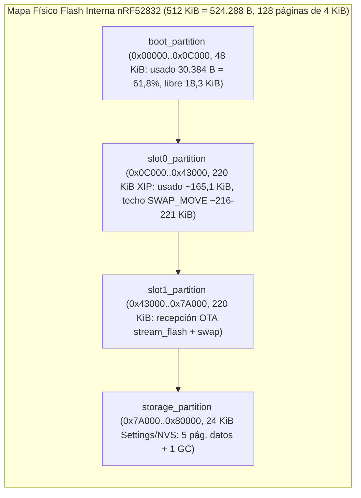

# 22. Análisis de Recursos, Memoria y Rendimiento

> **Alcance del capítulo**: Caracterización cuantitativa exhaustiva del consumo de memoria no volátil (Flash interna), memoria volátil (SRAM), dimensionamiento de pilas de ejecución (*stacks*), pools de buffers de red/eventos, costes computacionales, presupuestos de latencia extremo a extremo, cadencia de despertares periódicos de CPU y cuellos de botella del firmware Joya sobre el SoC **Nordic Semiconductor `nRF52832-QFAA`** (`ARM Cortex-M4` a `64 MHz`, `512 KiB` Flash, `64 KiB` SRAM).
>
> **Referencias cruzadas**: Mapa de hardware y particiones en [02_hardware_devicetree.md](02_hardware_devicetree.md), configuración Kconfig en [03_firmware_configuration.md](03_firmware_configuration.md), modelo de hilos en [06_concurrency.md](06_concurrency.md), arquitectura BLE y OTA en [07_ble_architecture.md](07_ble_architecture.md) y [16_ota_mcuboot.md](16_ota_mcuboot.md), persistencia en [15_flash_persistence.md](15_flash_persistence.md), temporizadores en [19_timers_parameters.md](19_timers_parameters.md) y referencia línea por línea en [code_reference/20c_peripherals_storage_wdt.md](code_reference/20c_peripherals_storage_wdt.md).

---

## 1. Metodología y Trazabilidad de los Artefactos Analizados

Las cifras exactas de secciones ELF y tamaños de símbolos de este capítulo se extraen directamente de los artefactos compilados con **Zephyr RTOS `4.2.0`** y **Zephyr SDK `0.17.4`** (`arm-zephyr-eabi-gcc`, flags ELF `0x5000200`: ARMv7E-M Thumb-2, **ABI `soft-float`**) contenidos en:
- `build_joya/app/zephyr/zephyr.stat` y `build_joya/app/zephyr/zephyr.elf` (aplicación principal).
- `build_joya/mcuboot/zephyr/zephyr.stat` y `build_joya/mcuboot/zephyr/zephyr.elf` (gestor de arranque `MCUboot`).

> [!IMPORTANT]
> **Nota de trazabilidad entre `build_joya` (`b48aa45`) y `HEAD` (`c1128e5`)**:
> El árbol de compilación local `build_joya/` fue generado sobre el corte inmediatamente anterior `b48aa4577e768b6e0df82769f535bb0df92d189a` (`v2.3.2`). Entre `b48aa45` y el snapshot documentado `c1128e5d0c0d6f98be0a580d287c0926ca27f01f` **no hubo ningún cambio** en [`prj.conf`](../../prj.conf), [`Kconfig`](../../Kconfig), [`CMakeLists.txt`](../../CMakeLists.txt), [`sysbuild/mcuboot.conf`](../../sysbuild/mcuboot.conf) ni en [`boards/joya/joya_nrf52/joya_nrf52_nrf52832.dts`](../../boards/joya/joya_nrf52/joya_nrf52_nrf52832.dts):
> - **En `MCUboot`**: el binario es **100 % idéntico** byte a byte.
> - **En la aplicación (`c1128e5`)**: la sección `noinit` (todos los stacks y pools `net_buf`) es **100 % idéntica** (`28.292 B`). En `.bss` se añaden exactamente **4 variables estáticas (`+19 B` brutos, `<= 24 B` con alineación)**: `joya_pending_routine` (`1 B`), `pending_routine_owner` (`16 B`) y `pending_routine_dirty` (`1 B`) en [`src/flash_memory.c:6-8`](../../src/flash_memory.c#L6-L8), más `boot_reconnect_pending` (`1 B`) en [`src/app_state.c:45`](../../src/app_state.c#L45). En `.rodata` se **ahorran `~30 B`** al eliminar el descriptor AD del antiguo iBeacon de emergencia, y en `.text` se añade la lógica de `joya/routine` y reconexión diferida (**`< +600 B`, `< 0,3 %` del slot**).

---

## 2. Presupuesto Global de Memoria Flash (`512 KiB`)

La Flash interna del `nRF52832-QFAA` abarca `524.288 B` (`512 KiB`), organizada físicamente en **128 páginas de `4.096 B` (`4 KiB`)** entre `0x00000000` y `0x00080000` ([`boards/joya/joya_nrf52/joya_nrf52_nrf52832.dts:46-72`](../../boards/joya/joya_nrf52/joya_nrf52_nrf52832.dts#L46-L72)).

### 2.1 Desglose de `MCUboot` (`boot_partition`: `49.152 B` / `48,0 KiB`)

Extraído de `build_joya/mcuboot/zephyr/zephyr.stat`:

| Sección ELF / Segmento | Dirección Flash (LMA) | Tamaño Hex | Tamaño Bytes | % de `boot_partition` | Contenido técnico |
|---|---|---|---|---|---|
| `rom_start` | `0x00000000` | `0x0000dc` | `220 B` | `0,45 %` | Tabla de vectores ARMv7-M inicial (`Reset_Handler` en `0x00001add`). |
| `text` | `0x000000dc` | `0x006948` | `26.952 B` | `54,83 %` | Lógica `bootutil` (`SWAP_USING_MOVE`), `mbedTLS` (`RSA-2048` + `SHA-256`), drivers NVMC, WDT y relojes. |
| `.ARM.exidx` + `initlevel` + `device_area` | `0x00006a24` | `0x000098` | `152 B` | `0,31 %` | Índice de desenrollado (`8 B`), entradas `SYS_INIT` (`48 B`) y dispositivos (`96 B`). |
| `sw_isr_table` | `0x00006abc` | `0x000138` | `312 B` | `0,63 %` | Tabla de interrupciones en software de Zephyr (`39 × 8 B`). |
| Áreas API drivers + `log_const_area` (+ pad) | `0x00006bf4` | `0x00006c` | `108 B` | `0,22 %` | Punteros API de `flash` (`24 B`), `gpio` (`36 B`), `clock_control` (`28 B`), `log` (`8 B`) y `12 B` de alineación a 16 B. |
| `rodata` | `0x00006c60` | `0x0009a8` | `2.472 B` | `5,03 %` | Clave pública RSA-2048 embebida (ASN.1 DER), constantes SHA-256 (`K[64]`) y cadenas de banner. |
| `datas` + `device_states` (LMA) | `0x00007608` | `0x0000a4` | `164 B` | `0,33 %` | Imagen inicial en ROM copiada a `0x20000000` al arrancar `MCUboot`. |
| `.last_section` | `0x000076ac` | `0x000004` | `4 B` | `0,01 %` | Marcador final de enlazado (`0x000076b0`). |
| **Total ocupado `MCUboot`** | `0x00000000..0x000076b0` | **`0x0076b0`** | **`30.384 B` (`29,67 KiB`)** | **`61,82 %`** | — |
| **Margen libre en `boot_partition`** | `0x000076b0..0x0000c000` | **`0x004950`** | **`18.768 B` (`18,33 KiB`)** | **`38,18 %`** | Más de 4 páginas de `4 KiB` libres para instrumentación o migración futura de firmas. |

### 2.2 Desglose de la Aplicación (`slot0_partition`: `225.280 B` / `220,0 KiB`)

Extraído de `build_joya/app/zephyr/zephyr.stat`:

| Sección ELF / Grupo | Dirección Flash (LMA) | Tamaño Hex | Tamaño Bytes | % del Slot bruto | Contenido técnico detallado |
|---|---|---|---|---|---|
| `rom_start` | `0x0000c000` | `0x0002dc` | `732 B` | `0,32 %` | **`512 B` (`0x200`) de cabecera `MCUboot`** (`__rom_start_address`) + **`220 B` (`0x0dc`)** de tabla de vectores Cortex-M4 (`Entry = 0x12461`). |
| `text` | `0x0000c2e0` | `0x025c34` | `154.676 B` | `68,66 %` | Aplicación Joya, kernel Zephyr, pila BLE completa (Host GATT/ATT/L2CAP + `BT_LL_SW_SPLIT`), `MCUmgr`/`zcbor`, `Settings`/`NVS`, drivers (`SAADC`, `TWIM`, `GPIOTE`, `NVMC`, `WDT`, `CLOCK`). |
| `.ARM.exidx` + `initlevel` | `0x00031f14` | `0x000090` | `144 B` | `0,06 %` | Tabla de excepción (`8 B`) + 17 niveles de inicialización `SYS_INIT` (`136 B`). |
| `device_area` | `0x00031fa4` | `0x000144` | `324 B` | `0,14 %` | Instancias estáticas `struct device` del árbol Devicetree activo. |
| `sw_isr_table` | `0x000320e8` | `0x000138` | `312 B` | `0,14 %` | 39 entradas `_isr_table_entry` (`8 B` c/u). |
| `_static_thread_data_area` | `0x00032220` | `0x000030` | `48 B` | `0,02 %` | Descriptor estático de `K_THREAD_DEFINE(fsm_thread_id, ...)`. |
| Áreas de APIs de drivers | `0x00032250` | `0x0000bc` | `188 B` | `0,08 %` | `adc` (`12 B`), `entropy` (`8 B`), `flash` (`24 B`), `gpio` (`36 B`), `i2c` (`24 B`), `sensor` (`28 B`, `&temp`), `wdt` (`16 B`), `bt_hci` (`12 B`), `clock_control` (`28 B`). |
| Áreas estáticas BLE / Settings / MCUmgr (+ pad) | `0x0003230c` | `0x0000b4` | `180 B` | `0,08 %` | `bt_l2cap_fixed_chan` (`36 B`), `bt_conn_cb` (`48 B`), `bt_gatt_service_static` (`48 B`, 4 servicios Joya + GAP/GATT), `settings_handler_static` (`24 B`, `"joya"`), `mcumgr_handler` (`12 B`, grupos `IMG` y `OS`) + `12 B` alineación. |
| `rodata` | `0x000323c0` | `0x0013cc` | `5.068 B` | `2,25 %` | UUIDs de 128 bits, tablas GATT estáticas, secuencias hápticas (`pattern_*`), trama iBeacon, tabla `EMERGENCY_RETRY_MS` y tablas constantes del Link Layer. |
| `datas` + áreas kernel RAM (LMA) | `0x0003378c` | `0x000be0` | `3.040 B` | `1,35 %` | Valores iniciales copiados a `0x20000000..0x20000be0` por `z_data_copy()` antes de `main()`. |
| `.last_section` | `0x0003436c` | `0x000004` | `4 B` | `< 0,01 %` | Fin del binario crudo en `0x00034370`. |
| **Total binario ELF en Flash** | `0x0000c000..0x00034370` | **`0x028370`** | **`164.720 B` (`160,86 KiB`)** | **`73,12 %`** | Equivalente a `~164,7 kB` decimales (`~165,1 kB` tras anexar el área TLV `SHA-256` + firma `RSA-2048` de `~350 B` con `imgtool`). |

#### Capacidad bruta vs. techo real útil para `SWAP_USING_MOVE`
Aunque cada slot mide `225.280 B` (`55 × 4.096 B = 220,0 KiB`), `MCUboot` opera con `CONFIG_BOOT_SWAP_USING_MOVE=y` (sin partición `scratch` dedicada). Esta estrategia impone dos reservas geométricas obligatorias:
1. **Un sector libre de desplazamiento (`4.096 B`) en `slot0_partition`**: `MCUboot` mueve primero cada sector de `slot0` un sector hacia arriba para abrir hueco antes de copiar desde `slot1`, por lo que una imagen nunca puede ocupar el sector 55 del slot primario.
2. **El `boot_swap_state` / `image_trailer` al final de ambos slots**: `55 sectores × 3 pasos × 4 B (write-align nRF52) = 660 B` de registro de progreso `swap_status` + `swap_size` + `copy_done` + `image_ok` + `BOOT_MAGIC` (`16 B`) $\approx 720\,\text{B}$ al final del último sector de cada slot (`0x00042D30..0x00043000` y `0x00079D30..0x0007A000`).

En consecuencia, el **techo efectivo admisible para una imagen firmada `.signed.bin`** es de `54 sectores - trailer` $\approx$ **`220.416 B` (`215,25 KiB`, o `53 sectores completos = 217.088 B = 212,0 KiB` si `imgtool --max-sectors` reserva el sector íntegro del trailer)** — es decir, **`~216–221 kB`**. Con `~165,1 kB` firmados en `c1128e5` (incluyendo los `< 0,6 kB` añadidos respecto a `b48aa45`), el firmware disfruta de un **margen neto seguro de crecimiento de `~51–55 KiB` (`~24 %` del slot útil)**.

---

## 3. Presupuesto Global de SRAM (`64 KiB`) y Política 100 % Estática

### 3.1 Política de Asignación Dinámica Cero (`Zero-Heap Architecture`)

Verificado en `build_joya/app/zephyr/.config` y `build_joya/mcuboot/zephyr/.config`:
- `CONFIG_HEAP_MEM_POOL_SIZE=0` y `CONFIG_SYS_HEAP_ARRAY_SIZE=0`: **no existe heap del kernel (`k_malloc` / `k_free`)**.
- Aunque `CONFIG_COMMON_LIBC_MALLOC=y` aparece habilitado por defecto en Kconfig con `CONFIG_COMMON_LIBC_MALLOC_ARENA_SIZE=-1`, el código de aplicación y subsistemas activos **no invocan `malloc`, `calloc`, `realloc` ni `free`** (ninguno de estos símbolos existe en `.symtab` de `zephyr.elf`).
- **Consecuencia de confiabilidad**: El dispositivo es **matemáticamente inmune a la fragmentación externa de memoria y a fugas acumulativas de heap (*memory leaks*)** durante meses o años de funcionamiento ininterrumpido. Todo agotamiento transitorio de recursos ocurre exclusivamente sobre pools acotados de tamaño fijo (`event_queue`, `net_buf`, `k_mem_slab`), cuyos fallos retornan códigos de error deterministas (`-ENOMSG`/`-EAGAIN`, `-ENOMEM`, `BT_ATT_ERR_INSUFFICIENT_RESOURCES`) sin corromper otros subsistemas.

### 3.2 Uso Transitorio de SRAM en `MCUboot`

Durante el arranque, `MCUboot` ocupa `0x20000000..0x200052e8` (**`21.215 B` netos / `21.224 B` alineados = `20,73 KiB` ≈ `21,2 kB`**, `32,4 %` de los `64 KiB`):
- `datas` + `device_states`: `164 B` (`0x00a4`).
- `bss`: `8.763 B` (`0x223b`), dominado por el pool estático de enteros grandes RSA de `mbedTLS` (`mempool = 6.144 B`), buffers de lectura/hash SHA-256 (`buf.2 = 1.024 B`, `tmpbuf.1 = 256 B`) y tabla de sectores (`sector_buffers = 880 B`).
- `noinit`: `12.288 B` (`0x3000`), compuesto por `z_interrupt_stacks` (`2.048 B`) y `z_main_stack` (`10.240 B`, dimensionado holgadamente para aritmética modular `RSA-2048` en pila).

Al transferir el control al `Reset_Handler` de `slot0_partition` (`CONFIG_MCUBOOT_CLEANUP_ARM_CORE=y`), **el 100 % de estos `~21,2 kB` queda liberado** y es sobrescrito por el mapa de memoria de la aplicación. *(Nota de seguridad: `# CONFIG_MCUBOOT_CLEANUP_RAM is not set`, lo cual es inocuo porque `MCUboot` solo maneja la clave pública RSA-2048 e imágenes no cifradas).*

### 3.3 Desglose Exacto de SRAM de la Aplicación (`65.536 B` = `64,0 KiB`)

| Región SRAM | Rango de direcciones | Tamaño Hex | Tamaño Bytes (KiB) | % de `64 KiB` | Desglose interno verificado en `zephyr.stat` y `zephyr.elf` |
|---|---|---|---|---|---|
| **Datos inicializados (`LOAD` RW)** | `0x20000000..0x20000be0` | `0x0be0` | **`3.040 B`** (`2,97 KiB`) | `4,64 %` | `datas` (`2.302 B`, incl. `bt_dev` `368 B`, `joya_name` `32 B`, `attr_smp_bt_svc` `80 B`, 6 `k_work_delayable` definidos con `K_WORK_DELAYABLE_DEFINE` `288 B`) + `device_states` (`22 B` + `2 B` pad) + `k_timer_area` (`56 B`: `backoff_timer`) + `k_mem_slab_area` (`84 B`: 3 slabs × `28 B`) + `k_mutex_area` (`100 B`: 5 mutexes × `20 B`) + `k_msgq_area` (`48 B`: `event_queue`) + `k_sem_area` (`48 B`: 2 semáforos × `24 B`) + `k_fifo_area` (`24 B`) + `net_buf_pool_area` (`352 B`: 8 pools × `44 B`). |
| **`bss` (inicializada a cero)** | `0x20000be0..0x2000431e` *(+`2 B` pad)* | `0x373e` | **`14.142 B`** (`13,81 KiB`) | `21,58 %` | Estructuras del controlador BLE `BT_LL_SW_SPLIT` (`mem_pdu_rx` `2.844 B`, `mem_pdu` `904 B`, `mem_conn_tx` `784 B`, `ticker_user_ops` `672 B`, `buffer_mem_local_ctx` `480 B`, `ticker_nodes` `432 B`, `conn_pool` `416 B`, `_ccm_scratch` `267 B`, `mfifo_fifo_prep` `260 B`, `_pkt_scratch` `258 B`, `ll_adv` `256 B`, `_pkt_empty` `255 B`, `acl_conns` `208 B`, `adv_pool` `176 B`, `ll_adv_aux_pool` `136 B`), contexto OTA `ctx.0` (`556 B`), 6 objetos `k_thread` (`720 B`), 3 `k_work_q` (`456 B`), 9 `k_work_delayable` (`432 B`) y estado de módulos Joya (`~150 B`, `+19 B` en `c1128e5`). |
| **`noinit` (sin borrar en boot)** | `0x20004320..0x2000b1a4` | `0x6e84` | **`28.292 B`** (`27,63 KiB`) | `43,17 %` | 9 stacks de hilos/ISR (`19.312 B`), buffer circular `_k_fifo_buf_event_queue` (`480 B`), 8 pools de buffers `net_buf` + metadatos (`8.232 B`) y 3 buffers `k_mem_slab` (`268 B`). |
| **Total SRAM asignada** | `0x20000000..0x2000b1a4` | **`0xb1a4`** | **`45.474 B` netos** (`45.476 B` span = `44,41 KiB`) | **`69,39 %`** | En `c1128e5` sube a `~45.496 B` (`69,42 %`). |
| **SRAM libre sin asignar** | `0x2000b1a4..0x20010000` | **`0x4e5c`** | **`20.060 B`** (`19,59 KiB` / `~20,1 kB`) | **`30,61 %`** | Espacio físicamente desocupado (inactivo en RAM pero retenido por los bancos SRAM de `nRF52832` en System ON). |

---

## 4. Auditoría Completa de Stacks de Hilos e Interrupciones

### 4.1 Mapa Físico en `noinit` y Opciones Kconfig

En ARM Cortex-M4 (`CONFIG_STACK_GROWS_UP` no activo), **todas las pilas crecen hacia direcciones decrecientes** (desde `Addr + Size` hacia `Addr`). La tabla siguiente presenta en orden exacto de direcciones en `noinit` los **9 stacks instanciados en el binario ELF**, seguidos de los **3 parámetros de stack adicionales declarados en `.config`** que el enlazador elide por la arquitectura `BT_LL_SW_SPLIT` de Zephyr 4.2:

| Símbolo ELF / Opción Kconfig | Dirección en `noinit` | Tamaño real (Solicitado) | Prioridad Zephyr | Rol y cadena de llamadas más profunda | Vecino inmediatamente inferior (víctima si desborda) |
|---|---|---|---|---|---|
| `_k_thread_stack_fsm_thread_id` ([`src/app_state.c:36`](../../src/app_state.c#L36)) | `0x20004320..0x20005328` | **`4.104 B`** (`4.098 B` redondeado a múltiplo de `8 B` AAPCS) | `5` (preemptiva) | Hilo principal de negocio (`fsm_thread_loop` $\to$ `process_event` $\to$ `storage_save_*` / `nvs_gc` + `ble_start_setup_advertising` + `haptics_play*` + `smp_bt_register`). | **Fin de `.bss` (`0x2000431e`, `_kernel` en `0x20004260`)** |
| `smp_work_queue_stack` (`MCUMGR_TRANSPORT_WORKQUEUE_STACK_SIZE`) | `0x20005328..0x20005b28` | **`2.048 B`** | `3` (preemptiva) | Cola SMP dedicada de `MCUmgr`: decodificación CBOR (`zcbor`), `img_mgmt_upload`, `flash_img_buffered_write` (`stream_flash`), lectura de `boot_swap_state` y borrado/escritura NVMC de `slot1`. | `_k_thread_stack_fsm_thread_id` |
| `rx_thread_stack` (`BT_RX_STACK_SIZE`, hilo `BT_RX`) | `0x20005b28..0x20005fd8` | **`1.200 B`** | `-8` (cooperativa, `BT_RX_PRIO=8`) | Hilo RX del Host BLE: L2CAP, ATT/GATT callbacks (`on_rx_write`, `on_rx_auth_write`, `on_ccc_changed`, **`on_name_write` $\to$ `bt_set_name` + `storage_save_name` $\to$ `settings_save_one` $\to$ `nvs_gc`**) y encolado SMP. | **`smp_work_queue_stack`** *(tras `_k_mem_slab_buf_chan_slab` `176 B` arriba)* |
| `prio_recv_thread_stack` (`BT_CTLR_RX_PRIO_STACK_SIZE`) | `0x20006088..0x20006248` | **`448 B`** | Cooperativa alta (`ULL_HIGH`) | Recepción prioritaria de eventos críticos de radio/LLCP entre Link Layer (`BT_LL_SW_SPLIT`) y Host. | `_k_mem_slab_buf_chan_slab` (`0x20005fd8..0x20006088`) |
| `recv_thread_stack` (`BT_CTLR_RX_STACK_SIZE`) | `0x20006248..0x200065c8` | **`896 B`** | `-6` (cooperativa, `BT_DRIVER_RX_HIGH_PRIO=6`) | Hilo driver HCI interno del controlador `BT_LL_SW_SPLIT` (`recv_thread` $\to$ `bt_recv`, entrega ACL y eventos HCI al Host). | `prio_recv_thread_stack` |
| `z_interrupt_stacks` (`ISR_STACK_SIZE`, puntero `MSP`) | `0x200065c8..0x20006dc8` | **`2.048 B`** | Excepciones / IRQ hardware | Pila única compartida por todas las ISRs anidadas: `RADIO` / `TIMER0` / `RTC0` (`LLL`), `SWI4`/`SWI5` (`ULL`), `GPIOTE`, `TWIM0`, `SAADC`, `CLOCK_POWER`, `TEMP`. | `recv_thread_stack` |
| `z_idle_stacks` (`IDLE_STACK_SIZE`) | `0x20006dc8..0x20006f08` | **`320 B`** | `15` (preemptiva mínima) | Hilo `idle`: ejecuta `k_cpu_idle()` (`WFE` / entrada a System ON Sleep). | `z_interrupt_stacks` |
| `z_main_stack` (`MAIN_STACK_SIZE`) | `0x20006f08..0x20007f08` | **`4.096 B`** | `0` (preemptiva) | Inicialización del kernel (`SYS_INIT`) y secuencia completa de `main()` (`storage_init` + `ble_driver_init` / `bt_enable` + `button_init` + `haptics_init` + `battery_init`). **Queda retenido inactivo en `k_sleep(K_FOREVER)` ([`src/main.c:88`](../../src/main.c#L88))**. | `z_idle_stacks` |
| `sys_work_q_stack` (`SYSTEM_WORKQUEUE_STACK_SIZE`) | `0x20007f08..0x20008f08` | **`4.096 B`** | `-1` (cooperativa) | Ejecuta **todos** los `k_work` / `k_work_delayable` de Joya (`debounce_work`, `click_window_work`, `factory_hold_work`, `haptics_pattern_work`, `haptics_effect_work`, `battery_monitor_work`, `guard_work`, `diagnostics_work`, `ibeacon_stop_work`, `idle_close_work`, `confirmation_deadline_work`, timers FSM) y works internos BLE/calibración RC. | `z_main_stack` |
| *`CONFIG_BT_HCI_TX_STACK_SIZE`* *(solo `.config`)* | *No instanciado en `noinit`* | *`768 B` configurados (`0 B` RAM)* | *`7` (`BT_HCI_TX_PRIO`)* | En Zephyr 4.2 con controlador local `BT_LL_SW_SPLIT` sin `BT_SEND_ECC_EMULATION`, el envío HCI TX se despacha mediante `bt_conn_tx_processor` / `bt_workq` sin crear un hilo `tx_thread` dedicado. | — |
| *`CONFIG_BT_DRV_RX_STACK_SIZE`* *(solo `.config`)* | *No instanciado en `noinit`* | *`512 B` configurados (`0 B` RAM)* | — | Parámetro genérico para drivers HCI externos; `BT_LL_SW_SPLIT` lo reemplaza por `recv_thread_stack` (`896 B`) y `prio_recv_thread_stack` (`448 B`). | — |
| *`CONFIG_BT_DRV_TX_STACK_SIZE`* *(solo `.config`)* | *No instanciado en `noinit`* | *`256 B` configurados (`0 B` RAM)* | — | No instanciado por `hci_driver` de `BT_LL_SW_SPLIT` (entrega directa en memoria compartida). | — |

### 4.2 Evaluación Crítica de Márgenes de Stack sin `CONFIG_ARM_MPU`

En [`prj.conf:79`](../../prj.conf#L79), la línea `#CONFIG_ARM_MPU=y` está comentada (`# CONFIG_ARM_MPU is not set`, `# CONFIG_HW_STACK_PROTECTION is not set`, `# CONFIG_STACK_SENTINEL is not set`), a diferencia de `MCUboot` donde `CONFIG_ARM_MPU=y` sí está activo ([`sysbuild/mcuboot.conf:1`](../../sysbuild/mcuboot.conf#L1)). Esto significa que **un desbordamiento de pila en la aplicación NO dispara `MemManage_Handler` ni `k_sys_fatal_error_handler()`, sino que corrompe silenciosamente la memoria adyacente inferior**:

1. **Punto de mayor riesgo estructural — `rx_thread_stack` (`BT_RX`, `1.200 B` en `0x20005b28`)**:
   - Para `on_rx_write`, `on_rx_auth_write` y `on_ccc_changed`, el callback solo construye `app_event_t` (`24 B`) y llama a `k_msgq_put`, consumiendo `< 450 B` totales de pila.
   - **Excepción crítica en `on_name_write()` ([`src/ble_driver.c:273-320`](../../src/ble_driver.c#L273-L320))**: a diferencia del resto del protocolo, la escritura GATT del nombre **no delega en `fsm_thread_id`**, sino que ejecuta síncronamente dentro de `BT_RX`:
     `rx_thread` $\to$ `bt_conn_recv` $\to$ `bt_l2cap_recv` $\to$ `bt_att_recv` $\to$ `att_write_req` $\to$ `write_cb` $\to$ `on_name_write` (`char name[32]` en pila) $\to$ `bt_set_name` + `storage_save_name` $\to$ `settings_save_one` $\to$ `settings_nvs_save` (`char name_buf` + lectura historial) $\to$ `nvs_write` $\to$ **(en caso de sector NVS lleno) `nvs_gc()` (`410 B` de código con buffers de copia ATE/datos en pila)** $\to$ `flash_write`/`flash_erase` $\to$ `soc_flash_nrf` (`ticker_job` sync).
   - Esta cadena combinada (pila ATT/L2CAP + Settings + `nvs_gc` + driver Flash sincronizado con radio) se aproxima peligrosamente al techo de **`1.200 B` (`~850–1.100 B` estimados)**. Si llegase a superar `1.200 B`, sobrescribiría la cima de `smp_work_queue_stack` (`0x20005328..0x20005b28`).
2. **Desperdicio evitable en `z_main_stack` (`4.096 B`)**:
   - Tras alcanzar `k_sleep(K_FOREVER)` en [`src/main.c:88`](../../src/main.c#L88), el hilo `main` nunca vuelve a despertarse, manteniendo `4.096 B` (`6,25 %` de toda la SRAM del SoC) inmovilizados permanentemente. *(Nota: en Zephyr, retornar `0` desde `main()` permitiría reutilizar o reducir nada en RAM estática salvo que se ajuste `MAIN_STACK_SIZE`, pero `4.096 B` sí son útiles durante `bt_enable()` y `settings_load()` en el arranque).*
3. **Holgura confortable en los demás stacks principales**:
   - `fsm_thread_id` (`4.104 B` reales; nótese el literal inusual `4098` en `K_THREAD_DEFINE`, redondeado automáticamente a `4104` por la macro `Z_KERNEL_STACK_SIZE_ADJUST` de 8 bytes), `sys_work_q_stack` (`4.096 B`), `z_interrupt_stacks` (`2.048 B`) y `smp_work_queue_stack` (`2.048 B`, ayudado además porque `ctx.0` de `556 B` es `static` en `.bss` y no local en pila) presentan márgenes amplios con `CONFIG_LOG=n` y `CONFIG_PRINTK=n` (sin `vsnprintf` pesado en trazas).

---

## 5. Inventario y Dimensionamiento de Buffers, Colas y Particiones

| Subsistema / Símbolo ELF | Configuración Kconfig / Código | Cardinalidad × Unidad | Huella total SRAM / Flash | Comportamiento ante saturación e impacto |
|---|---|---|---|---|
| **Cola FSM `event_queue`** (`_k_fifo_buf_event_queue`) | `K_MSGQ_DEFINE(..., 20, 4)` ([`src/app_state.c:28`](../../src/app_state.c#L28)) | `20 × 24 B` (`sizeof(app_event_t)`) | `480 B` (`noinit`) + `48 B` (`k_msgq_area`) = **`528 B`** | `k_msgq_put(..., K_NO_WAIT)` falla inmediato, libera `bt_conn_unref` si había `conn`, y emite `DIAG_ERROR_EVENT_QUEUE_FULL` (`0xE3`). |
| **Pool SMP `MCUmgr` (`pkt_pool`)** | `MCUMGR_TRANSPORT_NETBUF_COUNT=4`, `NETBUF_SIZE=384` | `4 × 384 B` datos + `4 × 32 B` meta + `44 B` pool | **`1.708 B`** (`1.536 B` datos) | Soporta ráfagas de hasta 4 tramas SMP en vuelo (`<= 244 B` en RX sin reensamblado; respuestas CBOR `slot_info` hasta `384 B`). |
| **Buffer escritura OTA (`ctx.0`)** | `CONFIG_IMG_BLOCK_BUF_SIZE=512` (`zephyr_img_mgmt.c`) | `1 × 512 B` + `44 B` `stream_flash_ctx` | **`556 B`** (`.bss`) | Acumula fragmentos CBOR hasta completar `512 B` alineados antes de invocar escritura física NVMC en `slot1_partition`. |
| **Pool BLE `hci_rx_pool`** | `BT_BUF_EVT_RX_COUNT=10`, `EVT_RX_SIZE=68` (+ cabecera/ACL RX) | `10` buffers (fijos en `3.072 B` totales) | `3.072 B` + `336 B` + `44 B` = **`3.452 B`** | Absorbe ráfagas de eventos HCI y paquetes entrantes del Link Layer sin pérdida de sincronismo. |
| **Pool BLE `acl_tx_pool` + `fragments`** | `BT_BUF_ACL_TX_COUNT=3`, `ACL_TX_SIZE=251` (+ `4 B` HCI + `1 B`) | `3 × 256 B` datos + `120 B` meta + `40 B` frags | **`972 B`** | Limita a 3 PDUs LL Data Length Extension (`251 B`) simultáneos en cola hacia el controlador de radio. |
| **Pool BLE `att_pool` + slabs ATT/L2CAP** | `BT_L2CAP_TX_BUF_COUNT=3`, `BT_L2CAP_TX_MTU=247` | `3 × 258 B` (`774 B`) + `120 B` + slabs (`268 B` + `84 B`) | **`1.290 B`** | Si la app móvil no drena notificaciones (`TX`, `BATTERY_*`, `DIAGNOSTICS`), `bt_gatt_notify` retorna `-ENOMEM`/`-EAGAIN`. |
| **Pool BLE `hci_cmd_pool` / `sync_evt` / `discardable`** | `CMD_TX=1×255`, `DISCARDABLE=3×58` | `777 B` + `258 B` + `183 B` (+ `168 B` meta) | **`1.518 B`** | Gestión de comandos HCI internos Host $\leftrightarrow$ `BT_LL_SW_SPLIT` (start/stop adv, disconnect, conn update). |
| **Buffers Link Layer `BT_LL_SW_SPLIT`** | `BT_CTLR_DATA_LENGTH_MAX=251`, `RX_BUFFERS=1`, `MAX_CONN=1`, `MAX_ADV_SET=2` | `mem_pdu_rx` (`2.844 B`), `mem_pdu` (`904 B`), `mem_conn_tx` (`784 B`), `conn_pool` (`416 B`), `ll_adv` (`256 B`), `adv_pool` (`176 B`), `ll_adv_aux_pool` (`136 B`) | **`~5.516 B`** (`.bss`) | Soporta **1 conexión ACL** con DLE completo de `251 B` y **2 conjuntos de advertising simultáneos** (`joya_adv` conectable + `ibeacon_adv`). |
| **Partición `Settings/NVS`** | `CONFIG_SETTINGS_NVS_SECTOR_COUNT=8` vs `storage_partition = 24 KiB` | **6 sectores físicos efectivos × `4.096 B`** (`5` útiles + `1` GC) | **`24.576 B` Flash** + `64 B` (`default_settings_nvs.0` en `.bss`) | `settings_nvs_backend_init()` recorta `8` a `6` sectores. Cada clave ocupa `8 B` ATE + clave ASCII + valor alineado a `4 B` (`~24–48 B` por actualización), permitiendo **~400–650 actualizaciones** antes de disparar un ciclo de compactación `nvs_gc` de 1 sector. |

---

## 6. Operaciones Computacionalmente Costosas o Bloqueantes

1. **Verificación Criptográfica en `MCUboot` (`SHA-256` + `RSA-2048` en software)**:
   - Con `CONFIG_BOOT_VALIDATE_SLOT0=y` y `CONFIG_MBEDTLS_SHA256_SMALLER=y` (implementación compacta en ROM a cambio de ~25 % más de ciclos por bloque) y ABI `soft-float`, **cada arranque en frío o reinicio** hashea los `~165 KiB` de `slot0_partition` (`~2.640` bloques SHA-256 de 64 B) y ejecuta una exponenciación modular pública `RSA-2048` en `mbedTLS`.
   - Coste típico en Cortex-M4 a `64 MHz`: **`~90–140 ms`** en arranque normal; durante la aplicación de una actualización OTA o rollback con `SWAP_USING_MOVE` (moviendo/intercambiando ~42 sectores × 2–3 borrados/copias + doble validación SHA-256/RSA-2048), el tiempo de permanencia en `MCUboot` asciende a **`~6–11 segundos`**, cubierto sin percances gracias a `CONFIG_BOOT_WATCHDOG_FEED_NRFX_WDT=y`.
2. **Escritura y Borrado de Flash Interna (`NVMC` + `SOC_FLASH_NRF_RADIO_SYNC_TICKER=y`)**:
   - El controlador `NVMC` del `nRF52832` **detiene por hardware las lecturas de instrucciones XIP de la CPU** mientras programa una palabra de 32 bits (`t_WRITE ≈ 41 us` típ., `338 us` máx.) o borra una página de `4 KiB` (`t_ERASEPAGE ≈ 2,05–85,0 ms` según desgaste/lote, especificación máxima Nordic = **`85 ms`**).
   - Para evitar que una parada de CPU de `85 ms` destruya una ventana de conexión BLE activa o dispare `bt_ctlr_assert_handle()`, Zephyr compila `CONFIG_SOC_FLASH_NRF_RADIO_SYNC_TICKER=y` con `CONFIG_SOC_FLASH_NRF_TIMEOUT_MULTIPLIER=10`: el driver `soc_flash_nrf` negocia ranuras temporales libres (*timeslots*) con el planificador `ticker` del Link Layer BLE entre eventos de radio.
   - **Impacto**: Mantiene viva la conexión BLE durante `settings_save_one` y durante la descarga OTA (`stream_flash`), pero hace que un borrado de página de `4 KiB` (cada `4.096 B` de imagen OTA recibida o durante un `nvs_gc` / `storage_factory_reset`) bloquee al hilo llamante (`smp_work_queue`, `fsm_thread_id` o `BT_RX`) entre **`~25 ms` y `~180 ms`** mientras aguarda la ranura libre de radio.
3. **Retardos Síncronos e I2C Háptico (`drv2605_wake` y `TWIM0` a `100 kHz`)**:
   - `haptics_init()` y `drv2605_wake()` ejecutan `k_msleep(10)` síncrono ([`src/haptics.c:280, 509`](../../src/haptics.c#L280)), suspendiendo `fsm_thread_id` durante `10 ms` (cediendo la CPU a `idle`/BLE) más `~0,7–1,5 ms` de transacciones `TWIM0` a `100 kHz`.
   - En caso de fallo físico de bus (p. ej. línea `SCL` o `SDA` derivada a `GND` o ausencia de pull-up), cada intento I2C puede bloquear hasta `CONFIG_I2C_NRFX_TRANSFER_TIMEOUT = 500 ms`; sin embargo, como incluso una cadena de varias transferencias fallidas dura `< 2,5 s`, jamás se acerca al umbral de `FSM_STALL_MS = 15.000 ms` del `wdt_guard`.

---

## 7. Presupuestos de Latencia Extremo a Extremo por Operación

### 7.1 Disparo de Emergencia (`3+ clics`) y Rutinas (`1 clic` vs. Pulsación Media)

Con parámetros de conexión preferidos en [`prj.conf:58-66`](../../prj.conf#L58-L66) (`MIN_INT = 36` $\to$ `45 ms`, `MAX_INT = 72` $\to$ `90 ms`, `PERIPHERAL_PREF_LATENCY = 4`, `TIMEOUT = 600` $\to$ `6,0 s`):
- Nota crucial sobre `Peripheral Latency = 4`: cuando el **periférico (Joya)** encola una notificación GATT (`0x04`, `0x02`, `0x03`), el controlador `BT_LL_SW_SPLIT` **rompe inmediatamente la latencia esclava en el próximo evento de conexión** (no espera los 4 eventos omitidos), por lo que la espera de aire es de **`0` a `1` intervalo de conexión (`0..90 ms`, media `22,5..45 ms`)**. En cambio, cuando el **teléfono (Central)** envía un comando hacia Joya (`0x41`..`0x44`) mientras Joya está durmiendo eventos vacíos, la entrega al periférico puede demorar hasta $(1 + 4) \times T_{\text{conn}} = 5 \times [45..90]\,\text{ms} =$ **`225..450 ms`**.

| Operación de usuaria | Tramo 1: Captura física y ventana botón | Tramo 2: Procesamiento FSM + NVS + Háptica | Tramo 3: Transporte BLE hasta App | Latencia total (desde soltar botón) |
|---|---|---|---|---|
| **Emergencia (`3 clics`) en `STATE_AUTHENTICATED`** | `50 ms` (`DEBOUNTE_TIME_MS`) + `900 ms` (`CLICK_WINDOW_MS`) = **`950 ms`** | `storage_save_pending_routine(0)` (`0 ms` si ya era `0`, o `~1–3 ms` NVS) + `storage_save_emergency_phase(1)` (`~1–3 ms`, hasta `~90 ms` si coincide con `nvs_gc`) + `drv2605_wake` (`~10,7 ms`) + `bt_gatt_notify(0x04)` (`< 0,5 ms`) $\approx$ **`12–15 ms`** típ. | `0..1 × T_conn` (`0..90 ms`, media `~35 ms`) | **`~962 ms` hasta vibración + cola TX; `~985–1.055 ms` en App** |
| **Emergencia (`3 clics`) desconectado (`BONDED_DISCONNECTED` / `UNPAIRED`)** | **`950 ms`** tras 3.er clic | Persistencia NVS (`~2–5 ms`) + vibración `2,1 s` (`~11 ms` inicio) + arranque advertising (`100–150 ms` + iBeacon `1000–1200 ms`) $\approx$ **`15 ms`** | Escaneo OS móvil (`~0,2–5+ s` según foreground/background iOS/Android) + Handshake Auth (`~300–900 ms`) | **`~965 ms` persistido en Flash; `~1,5–7+ s` en App tras reconexión** |
| **Inicio de rutina (`1 clic` `< 500 ms`) conectado** | `50 ms` + `900 ms` = **`950 ms`** | `drv2605_wake` (`~10,7 ms`) + `bt_gatt_notify(0x02)` + `storage_save_pending_routine(0)` (`0 ms` si limpio) $\approx$ **`11 ms`** | `0..90 ms` | **`~961–1.050 ms`** |
| **Fin/Cancelación de rutina (pulsación `0,5..5 s`) conectado** | Solo **`50 ms`** de debounce al soltar (**omite `CLICK_WINDOW_MS` de `900 ms`**) | `drv2605_wake` (`~10,7 ms`) + `bt_gatt_notify(0x03)` $\approx$ **`11 ms`** | `0..90 ms` | **`~61–150 ms`** *(respuesta táctil casi instantánea al soltar)* |
| **Reconexión automática tras reinicio en frío (`c1128e5`)** | Sin botón: gobernado por `battery_monitor_start()` | `1` muestra exploratoria (`t=0`) + `6` muestras de verificación (`t=10..60 s`) = **`~60.000 ms`** antes de activar `start_advertising_with_ibeacon(false)` | Escaneo móvil + Handshake Auth | **`~60,5–66 s` tras reset** *(o inmediato si la usuaria hace `2` o `3` clics antes)* |

### 7.2 Presupuesto del Handshake de Autenticación y del Throughput OTA BLE

1. **Handshake de conexión y autenticación (`STATE_SETUP_MODE` / `STATE_BONDED_DISCONNECTED` $\to$ `STATE_AUTHENTICATED`)**:
   - Establecimiento LL + intercambio automático MTU (`247 B`) / DLE (`251 B`) + descubrimiento GATT (o caché GATT en reconexión): **`~150–600 ms`** (`1` a `6` intervalos de conexión según caché del sistema operativo móvil).
   - Escritura `CCC = 0x0001` en `TX (...5001)` (`Write Request` $\to$ `Write Response`, `1..2 × T_conn`) + encolado `EV_BLE_NOTIFY_ENABLED` $\to$ `STATE_SETUP_WAITING_IDENTIFIER`: **`~45–180 ms`**.
   - Escritura de `16 B` en `RX_AUTH (...5101)` $\to$ `EV_APP_IDENTIFIER_RECEIVED` $\to$ comparación `memcmp` (`< 5 us`; o escritura NVS `joya/app_id` de `~2 ms` en el primer emparejamiento) $\to$ envío `COMMAND_ACK (0x05)` + notificación nivel batería + despacho de emergencia/rutina pendiente + `drv2605_wake`: **`~12–100 ms`**.
   - **Total extremo a extremo desde `CONNECT_IND` hasta sesión autenticada operativa**: **`~250–900 ms`**.

2. **Throughput efectivo de transferencia OTA (`MCUmgr SMP` sobre BLE)**:
   - **Restricción de tamaño de trama entrante**: Como `# CONFIG_MCUMGR_TRANSPORT_BT_REASSEMBLY is not set` (`build_joya/app/zephyr/.config:232`), cada solicitud `img_mgmt_upload` debe caber en **un único PDU ATT (`ATT_MTU - 3 = 244 B`)**. Restando los `8 B` de cabecera SMP y `~32–48 B` de sobrecarga del mapa CBOR (`data`, `off`, `len`, `sha`, `image`), cada paquete transporta **`~188–204 B` de firmware útil**; para una imagen firmada de `~165.100 B`, ello exige **`~810–880` transacciones petición-respuesta SMP** (`~323` escrituras de bloque de `512 B` en `stream_flash` y **`41` borrados de página de `4.096 B`** en `slot1_partition`).
   - **Cálculo de caudal según el intervalo de conexión gobernado por el Central**:
     $$\text{Throughput}_{\text{efectivo}} \approx \frac{B_{\text{chunk}}}{T_{\text{RTT\_SMP}} + \bar{t}_{\text{flash}}}$$
     - **Escenario A — Central conserva parámetros preferidos de Joya (`T_conn = 45..90 ms`, 1 RTT por chunk = `1..2 × T_conn`)**: con `T_RTT ≈ 67,5..90 ms` + amortización de `41` borrados de página (`~41 × 50 ms ≈ 2,05 s`), el caudal neto es de **`~2,1–2,9 KiB/s`**, completando la subida de `165 KiB` en **`~57–80 segundos`**.
     - **Escenario B — Central fuerza parámetros rápidos durante DFU (`T_conn = 7,5..15 ms` en Android / `15..30 ms` en iOS)**: con `T_RTT ≈ 15..30 ms`, el caudal sube a **`~6,0–11,5 KiB/s`**, completando la subida en **`~15–28 segundos`** (verificado compatible con el cliente [`ota/joya_console.py`](../../ota/joya_console.py)).

---

## 8. Cadencia de Despertares Periódicos de CPU y Cuellos de Botella

### 8.1 Matriz de Actividad Periódica de CPU y Radio

Cuando ningún hilo está listo, `z_idle_threads` pone al Cortex-M4 en `System ON Idle` (`WFE`, relojes de alta frecuencia apagados bajo demanda). La tabla siguiente resume **todas las fuentes periódicas de despertar** activas por estado:

| Fuente de despertar | Período exacto | Contexto | Duración activa por evento | Activa en `suspended_idle` / `critical_idle` | Activa en Advertising | Activa en `STATE_AUTHENTICATED` |
|---|---|---|---|---|---|---|
| **Calibración `LFCLK RC` (`32,768 kHz`)** (`CLOCK_CONTROL_NRF_CALIBRATION_PERIOD`) | **`4.000 ms`** (`TEMP_DIFF=2`, `MAX_SKIP=1`) | ISR `CLOCK`/`TEMP` + `k_sys_work_q` | `~0,05 ms` (lectura `&temp`; `+ ~17 ms` de tarea hardware `CAL` con HFXO solo si $\Delta T \ge 0{,}5\,^\circ\text{C}$ o `MAX_SKIP`) | **Sí** | **Sí** | **Sí** |
| **Supervisor Watchdog (`guard_work`)** ([`src/wdt_guard.c:11`](../../src/wdt_guard.c#L11)) | **`10.000 ms`** | `k_sys_work_q` | `< 0,03 ms` (lecturas atómicas + escritura `NRF_WDT->RR[0]`) | **Sí** | **Sí** | **Sí** |
| **Monitor de Batería (`battery_monitor_work`)** ([`include/battery.h:6-10`](../../include/battery.h#L6-L10)) | **`60.000 ms`** (`10.000 ms` en verificación de 6 muestras) | `k_sys_work_q` | `~0,12 ms` (`SAADC` `40 us` + conversión + notificación BLE opcional) | **Sí** *(nunca se llama a `battery_monitor_stop`)* | **Sí** | **Sí** |
| **Advertising conectable (`joya_adv_param`)** ([`src/ble_driver.c:33-40`](../../src/ble_driver.c#L33-L40)) | **`100..150 ms`** (`BT_GAP_ADV_FAST_INT_MIN_2..MAX_2`) | ISR `RADIO`/`LLL` | `~1,8–2,5 ms` (TX en canales 37, 38 y 39 + ventana RX scan/connect) | No | **Sí** (`90 s` en Setup; continuo en `BONDED_DISCONNECTED`) | No |
| **Advertising iBeacon (`ibeacon_adv_param`)** ([`src/ble_driver.c:45-50`](../../src/ble_driver.c#L45-L50)) | **`1.000..1.200 ms`** (`BT_GAP_ADV_SLOW_INT_MIN..MAX`) | ISR `RADIO`/`LLL` | `~1,2 ms` (TX no conectable en 3 canales) | No | **Sí** *(solo si hay `APP_ID`)* | No |
| **Eventos de Conexión BLE ACL** ([`prj.conf:58-66`](../../prj.conf#L58-L66)) | **`225..450 ms`** efectivos en reposo (`[45..90 ms] × (1 + latency 4)`) | ISR `RADIO`/`LLL` | `~0,8–1,4 ms` (intercambio PDU vacío + ensanchamiento de ventana por `500 ppm` RC) | No | No | **Sí** |
| **Reintento Emergencia / Háptica / Sondeo Efecto** | `1s..30s` / pasos RTP / `10 ms` | `k_sys_work_q` + `fsm_thread_id` | `~0,5–11 ms` (I2C + GPIO + BLE TX) | No | Solo si emergencia pendiente | Solo durante alerta o vibración |

> [!NOTE]
> **Impacto energético del `LFCLK RC` (`500 ppm`) sobre conexiones BLE**: Al carecer de cristal externo `LFXTAL` de `20 ppm` (`CONFIG_CLOCK_CONTROL_NRF_K32SRC_RC=y`), el Link Layer del periférico debe abrir antes su ventana de recepción (`window widening`) proporcionalmente a `(SCA_central + 500 ppm) × T_sleep_efectivo`. Con `T_sleep = 450 ms` (`90 ms × 5`), el ensanchamiento adicional es de `~250–300 us` de receptor de radio encendido en cada despertar de conexión, más el pulso periódico de calibración HFXO cada `4–8 s`.

### 8.2 Síntesis de Cuellos de Botella del Sistema

1. **Ausencia de reensamblado SMP BLE (`CONFIG_MCUMGR_TRANSPORT_BT_REASSEMBLY=n`) + stop-and-wait de 1 ventana**: Limita cada chunk OTA a `<= 244 B` ATT (`~195 B` útiles), haciendo que el tiempo total de actualización esté dominado por la latencia RTT del intervalo de conexión BLE más que por el ancho de banda físico de `1 Mbps` o la velocidad de escritura de NVMC.
2. **Margen ajustado de `rx_thread_stack` (`1.200 B`) sin `CONFIG_ARM_MPU`**: Ejecutar `on_name_write()` $\to$ `settings_save_one()` $\to$ `nvs_gc()` directamente sobre el hilo `BT_RX` concentra la cadena de llamadas más profunda del sistema en una pila de `1.200 B` sin guarda MPU de desbordamiento.
3. **Latencia intencional de gestos cortos (`950 ms`) y reconexión post-reset (`~60 s`)**: El diseño de botón único impone una espera irreducible de `900 ms` (`CLICK_WINDOW_MS`) + `50 ms` (`DEBOUNTE_TIME_MS`) para desambiguar `1`, `2` o `3+` clics, mientras que la exigencia de 6 muestras de verificación separadas `10 s` en `battery.c` posterga `~60 s` el inicio automático de advertising tras cualquier reinicio si la usuaria no pulsa el botón.
4. **Advertising indefinido en `STATE_BONDED_DISCONNECTED`**: Cuando Joya tiene `APP_ID` registrado y pierde alcance del teléfono (sin estar suspendida ni en batería Nivel 2), mantiene indefinidamente `joya_adv_param` a intervalo rápido (`100..150 ms`) más el `ibeacon_adv` (`1,0..1,2 s`), convirtiendo a la radio TX/RX de `100..150 ms` en el consumidor dominante del presupuesto energético fuera de alcance.
