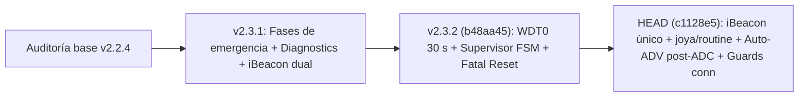

# 23. Limitaciones Conocidas, Supuestos, Deuda Técnica y Riesgos

> **Versión analizada (HEAD):** commit `c1128e5d0c0d6f98be0a580d287c0926ca27f01f` sobre rama `develop` (`VERSION = 2.3.1+0` en cabecera de imagen MCUboot; un commit posterior al tag `v2.3.2` / `b48aa4577e768b6e0df82769f535bb0df92d189a`).
> **Alcance epistemológico:** Este capítulo consolida mediante análisis estático riguroso y contraste documental las restricciones arquitectónicas, limitaciones funcionales, riesgos de concurrencia/seguridad, deuda técnica y puntos pendientes de validación experimental vigentes **exclusivamente** en el commit `c1128e5`. Ningún defecto cerrado en revisiones previas se reporta aquí como fallo activo.

---

## 23.1. Metodología, Taxonomía Epistemológica y Criterios de Evaluación

Para evitar ambigüedades entre el comportamiento real del binario compilado, los propósitos documentados y las hipótesis sobre circuitos externos ajenos al repositorio, cada afirmación técnica de este capítulo se clasifica según cinco niveles de evidencia:

| Categoría epistemológica | Definición operativa | Fuente de respaldo |
|---|---|---|
| **(a) Comportamiento implementado** | Ejecución determinista directamente verificable en el código fuente C, Devicetree, Kconfig y `.config` efectivos del commit `c1128e5`. | Archivos en [`src/`](../../src/), [`include/`](../../include/), [`boards/`](../../boards/), [`prj.conf`](../../prj.conf) y [`sysbuild/`](../../sysbuild/). |
| **(b) Intención de diseño** | Propósito explícito declarado por los autores en comentarios del código, mensajes de commit, tests unitarios o documentos del repositorio. | Comentarios en fuente, [`tests/`](../../tests/), [`docs/IBEACON.md`](../../docs/IBEACON.md), [`docs/DIAGNOSTICS.md`](../../docs/DIAGNOSTICS.md), [`docs/RECOVERY_VALIDATION.md`](../../docs/RECOVERY_VALIDATION.md) y [`docs/auditorias/Avances.md`](../../docs/auditorias/Avances.md). |
| **(c) Comportamiento inferido** | Consecuencia lógica necesaria derivada de combinar el código de aplicación con las garantías documentadas de Zephyr RTOS `4.2.0`, MCUboot o el hardware `nRF52832`. | Interacción entre aplicación, pila BLE/NVS de Zephyr y especificaciones del SoC Nordic `nRF52832`. |
| **(d) Código experimental / residual / no utilizado** | Símbolos, enumeradores, archivos, funciones o configuraciones presentes en el árbol de código que carecen de invocadores activos o corresponden a iteraciones previas. | Verificación global de referencias cruzadas sobre la totalidad de [`CMakeLists.txt`](../../CMakeLists.txt), [`src/`](../../src/) e [`include/`](../../include/). |
| **(e) Pendiente de validación experimental / dependiente de hardware externo** | Comportamiento condicionado a detalles del esquemático eléctrico de la PCB Joya, química de la celda, tolerancias físicas o políticas de Android/iOS no presentes en el repositorio. | Ausencia de esquemático/BOM en el repositorio y checklists abiertos en [`docs/RECOVERY_VALIDATION.md`](../../docs/RECOVERY_VALIDATION.md) y [`docs/auditorias/Avances.md`](../../docs/auditorias/Avances.md). |

Cada hallazgo técnico documentado en la [Sección 23.4](#234-catálogo-exhaustivo-de-limitaciones-riesgos-y-deuda-técnica-vigentes-en-c1128e5) incluye obligatoriamente **ocho campos estructurados**:
1. **Descripción**
2. **Evidencia en el código**
3. **Archivos y funciones involucrados**
4. **Condiciones necesarias**
5. **Consecuencia potencial**
6. **Severidad** (`Crítica`, `Alta`, `Media`, `Baja`)
7. **Grado de certeza** (*Defecto comprobado*, *Riesgo razonable / condicionado*, *Limitación de diseño*, *Hipótesis*)
8. **Posibles alternativas conceptuales de mejora**

---

## 23.2. Trazabilidad Evolutiva: De la Auditoría `v2.2.4` al Snapshot `c1128e5`

El archivo [`docs/auditorias/Avances.md`](../../docs/auditorias/Avances.md) registra una matriz histórica de 20 observaciones (`N-01`..`N-16` y `D-01`..`D-04`) formuladas sobre la versión `v2.2.4`. Entre aquella línea base y el commit actual `c1128e5` mediaron tres hitos sustanciales:
- **`v2.3.1` (`3256001`)**: Incorporación de fases persistentes de emergencia (`emergency_phase_t`), servicio GATT `DIAGNOSTICS` e iBeacon inicial.
- **`v2.3.2` (`b48aa45`)**: Incorporación del watchdog hardware `WDT0` (`30 s`), supervisor periódico `guard_work` (`10 s`) y manejadores de reset inmediato ante fallos fatales (`k_sys_fatal_error_handler`) y aserciones del controlador BLE (`bt_ctlr_assert_handle`).
- **`HEAD` (`c1128e5`)**: Eliminación del segundo UUID iBeacon de emergencia para unificar toda reconexión bajo `BLE_IBEACON_CONNECTION`, persistencia de la última rutina pendiente en NVS (`joya/routine` ligada a `owner_app_id`), inicio automático diferido de advertising tras arranque normal confirmado con batería no crítica (`boot_reconnect_pending`), y refuerzo de validación de sesión autenticada por `struct bt_conn *` (`ble_is_authenticated_conn`, `ble_is_current_conn`).



La siguiente tabla establece con exactitud qué puntos históricos fueron **cerrados o mitigados** y qué porción residual permanece **vigente** en `c1128e5`:

| ID histórico (`v2.2.4`) | Resumen original | Qué se resolvió en `v2.3.1` / `v2.3.2` / `c1128e5` | Estado exacto en `c1128e5` y residuo vigente | Ref. en este cap. |
|---|---|---|---|---|
| `N-01` | Sin restauración de emergencia ni reconexión tras reset | `joya/emergency` persiste `EMERGENCY_PENDING_ACK` (`1`) y `EMERGENCY_ACKED` (`2`), reanudando `0x04` tras autenticar (`send_pending_after_auth`). En `c1128e5` se persiste `joya/routine` y se auto-inicia advertising tras la primera confirmación de batería no crítica (`boot_reconnect_pending`). | **Parcialmente mitigado.** Subsiste una ventana ciega de `~60 s` (6 muestras SAADC × `10 s`) tras cualquier reinicio antes de abrir advertising automático, incluso con `EMERGENCY_PENDING_ACK` activo. | **LIM-02** |
| `N-02` | Triple clic descartado en suspensión y batería crítica | Sin cambios en el filtro `suspended_idle` de `process_event()`. | **Vigente (`Crítica`).** `EV_BTN_EMERGENCY` se descarta silenciosamente cuando `suspended_idle == true` (tanto en suspensión manual de 5 s como en `critical_idle`). | **LIM-01** |
| `N-03` | Sin watchdog, sin protección de stacks y sin reset ante fallos | En `b48aa45` se añadieron [`src/wdt_guard.c`](../../src/wdt_guard.c) (`WDT0` a `30 s`, supervisor cada `10 s`) y [`src/fatal_recovery.c`](../../src/fatal_recovery.c) (`NVIC_SystemReset()`). Validado en DK para bloqueo de FSM y OTA entre imágenes con WDT ([`docs/auditorias/pruebas.md`](../../docs/auditorias/pruebas.md)). | **Parcialmente mitigado.** `CONFIG_ARM_MPU` permanece desactivado en la app; registros `NRF_WDT` rígidos ante downgrade voluntario a versiones sin WDT; sin vía de advertising si `button_init()` falla sin `APP_ID`. | **LIM-13** |
| `N-04` / `D-02` | Cola `K_NO_WAIT` pierde eventos; bypass de comandos y desincronización FSM | En `c1128e5`: **cerrado** el bypass de autorización de `0x41..0x44` y `0x70`/`0x71` exigiendo `ble_is_authenticated_conn(entry->conn)`; **cerrado** el cruce de eventos obsoletos (`EV_BLE_CONNECTED`, `EV_BLE_DISCONNECTED`, `EV_BLE_NOTIFY_ENABLED`); añadido rescate manual con `EV_BTN_2_PULSE`. | **Parcialmente mitigado.** Si `event_queue` (20 slots, `K_NO_WAIT`) descarta `EV_BLE_DISCONNECTED`, `current_state` queda atascada en `STATE_AUTHENTICATED` con `current_conn == NULL`, bloqueando la apertura de advertising en `EV_BTN_EMERGENCY` y permitiendo `on_name_write` sin autenticar en una nueva conexión entrante. | **LIM-03** |
| `N-05` | Debounce de `50 ms` fusiona clics rápidos | Sin cambios en [`src/button.c`](../../src/button.c). | **Vigente (`Alta`).** Pulsos rápidos con `T_off < 50 ms` reprograman `debounce_work` y pueden clasificarse como `EV_BTN_LONG_PRESS` (`0x03`). | **LIM-04** |
| `N-06` | Imagen OTA Test comparte `critical_window_open` y anuncia `"Joya Setup"` | Sin cambios estructurales en `EV_BOOT_TEST_SETUP_REQUEST`. | **Vigente (`Alta`).** La primera confirmación de batería `!= 2` a los `60 s` limpia `critical_window_open` en Test boot, y `start_advertising_with_ibeacon(true)` fuerza `"Joya Setup"` sin iBeacon aunque exista `APP_ID`. | **LIM-05** |
| `N-07` | `DRV2605` pierde registros al despertar, bloqueo I2C, carreras y fallo en `fail:` | Sin cambios en [`src/haptics.c`](../../src/haptics.c). | **Vigente (`Alta`).** `drv2605_wake()` omite `FEEDBACK_CONTROL`, `CONTROL3` y `OD_CLAMP`; sin mutex sobre estado háptico; `k_msleep(10)` en hilo FSM; `fail:` de `haptics_init()` no suspende `i2c0`. | **LIM-07** |
| `N-08` | Escritura NVS desde `BT_RX` y carrera en `joya_name` | Sin cambios en `on_name_write()` ni `storage_get_name()`. | **Vigente (`Alta`).** `settings_save_one("joya/name", ...)` corre en el stack `BT_RX` (`1200 B`); `joya_name` carece de mutex; `on_name_read` no exige autenticación; GAP `0x2A00` es escribible. | **LIM-08** |
| `N-09` | `upload_complete` bloquea Factory Reset y cierre SMP no reintenta | Sin cambios en [`src/ota_access.c`](../../src/ota_access.c). | **Vigente (`Alta`).** `upload_complete` queda en `true` hasta desconexión física BLE, bloqueando Factory Reset (15 s), suspensión (5 s) y corte por batería Nivel 2; `smp_bt_unregister()` no reintenta si falla. | **LIM-06** |
| `N-10` | Privacidad RF: nombre personal, MAC estática e iBeacon de emergencia | En `c1128e5` se **eliminó por completo** el UUID iBeacon de emergencia (`...6002`), quedando solo `BLE_IBEACON_CONNECTION` (`...6001`) fijo para todo dispositivo registrado. | **Parcialmente mitigado.** Ya no se filtra estado de emergencia por iBeacon, pero persisten `"Joya de <Nombre>"` en claro y dirección MAC estática (`CONFIG_BT_CTLR_PRIVACY=n`). | **LIM-09** |
| `N-11` | Consumo por advertising rápido, LDO, LFRC, divisor y notificaciones | Sin cambios en intervalos de radio, regulador ni reloj LF. | **Vigente (`Media`).** Advertising conectable continuo a `100..150 ms`, regulador en LDO por defecto, `LFRC` calibrado cada `4 s`, divisor `202 kΩ` permanente y `BATTERY_MEASUREMENT` cada `60 s`. | **LIM-14** |
| `N-12` | Ventana Setup de `90 s` se corta tras conexión fallida | Sin cambios en `EV_BLE_DISCONNECTED` para `STATE_SETUP_MODE` / `WAITING_*`. | **Vigente (`Media`).** Una conexión abortada antes de autenticar lleva a `STATE_UNPAIRED` sin reabrir advertising durante el resto de los `90 s`. | **LIM-14** |
| `N-13` | Reporte inicial `0xA0 MM` puede perderse por `K_NO_WAIT` | Sin cambios en [`src/diagnostics.c`](../../src/diagnostics.c) ni `ble_diagnostics_notify_for_session()`. | **Vigente (`Baja`).** Contención puntual en `conn_mutex` descarta la notificación `0xA0 MM` (aunque `READ` permanece disponible). | **LIM-11** |
| `N-14` | SAADC negativo en single-ended y votación inicial inconclusa | Umbrales ajustados en [`include/battery.h`](../../include/battery.h) a `3000` / `2900 mV` (`//3500`, `//3400`), manteniendo el algoritmo de `battery.c`. | **Vigente (`Media`).** Falta clamping `sample < 0` y una oscilación `4/2` en el arranque deja `confirmed_level == BATTERY_STATE_UNKNOWN` otros `60 s`. | **LIM-12** |
| `N-15` | Endurecimiento OTA, sectores NVS y claves | Sin cambios en particiones ni MCUboot (por restricción de compatibilidad con unidades selladas). | **Vigente (`Media`).** `TOO_LARGE_DISABLED=y`, `NVS_SECTOR_COUNT=8` sobre 6 páginas físicas, sin `DOWNGRADE_PREVENTION` y gestión crítica de clave RSA-2048. | **LIM-13** |
| `N-16` | Código residual, discrepancias de versión y docs obsoletos | Se limpió el iBeacon de emergencia, pero quedaron símbolos huérfanos y versiones desalineadas. | **Vigente (`Baja`).** `VERSION` `2.3.1+0` vs `v2.3.2` vs `CMake` `2.0`, comentario `P0.13`/`P0.14` en overlay, estados/comandos/funciones sin llamador y scripts truncados. | **LIM-15** |
| `D-01` | `APP_ID` en claro, sin límite de `NACK` y aceptación de `00..00` | Sin cambios criptográficos en el protocolo de autenticación. | **Vigente (`Alta`).** `CONFIG_BT_SMP=n`, `APP_ID` viaja sin cifrado de enlace, reintentos ilimitados y `00..00` deja `is_app_id_empty() == true`. | **LIM-09** |
| `D-03` | Deshabilitación dinámica de CCC (`0x0000`) no notificada a FSM | Sin cambios en `on_ccc_changed()`. | **Vigente (`Media`).** Si el cliente desactiva CCC en `STATE_SETUP_WAITING_IDENTIFIER` o `STATE_AUTHENTICATED`, la FSM no retrocede de estado. | **LIM-10** |
| `D-04` | Vibración háptica previa a confirmar envío BLE de rutina | En `c1128e5` se añadió persistencia automática en `joya/routine` cuando `ble_send_event_authenticated()` devuelve error (`!= 0`). | **Parcialmente mitigado (`Baja`).** Ya no se pierde la rutina si falla `bt_gatt_notify()`, pero la usuaria percibe vibración inmediata aunque la entrega quede diferida o el enlace caiga tras encolar el paquete ATT. | **LIM-10** |

---

## 23.3. Supuestos Arquitectónicos y Restricciones Operativas Fundamentales

Antes de catalogar defectos o riesgos puntuales, es indispensable explicitar los **supuestos estructurales del producto** bajo los cuales opera el firmware en [`src/`](../../src/) (véase también [01_system_architecture.md](01_system_architecture.md)):

1. **Dependencia total del smartphone para conectividad WAN, geolocalización y despacho de alertas** *(Limitación de diseño — categoría (a)/(b))*:
   Joya carece de módem celular, Wi-Fi, receptor GNSS/GPS y almacenamiento de contactos de emergencia. Su función exclusiva es detectar gestos mecánicos en el botón físico ([`src/button.c`](../../src/button.c)), persistir intenciones críticas en Flash NOR ([`src/flash_memory.c`](../../src/flash_memory.c)), anunciar su presencia mediante BLE Legacy + iBeacon ([`src/ble_driver.c`](../../src/ble_driver.c)) y entregar comandos de 1 byte a la aplicación móvil autenticada sobre GATT ([`src/app_state.c`](../../src/app_state.c)). Si el teléfono está apagado, fuera de alcance RF (`~10–30 m` típicos en interiores), con Bluetooth desactivado o sin red de datos, la alerta permanece retenida localmente en `joya/emergency` (`EMERGENCY_PENDING_ACK`) hasta que el enlace autenticado se restablezca.
2. **Celda conectada permanentemente sin interruptor físico de alimentación** *(Limitación de diseño — categoría (a)/(b))*:
   El dispositivo no posee llave mecánica de corte de batería ni PMIC con modo *ship-mode* controlado por firmware. El gesto de suspensión de `5..15 s` (`EV_BTN_SUSPEND_REQUEST`, [`src/app_state.c`](../../src/app_state.c) líneas `634–650`) y el estado de batería crítica (`enter_critical_idle()`, [`src/app_state.c`](../../src/app_state.c) líneas `135–148`) implementan **reposo lógico** (`System ON` idle en Zephyr con radio BLE apagada e I2C suspendido), pero el `nRF52832`, el `WDT0` (`30 s`), el `LFCLK RC` (con calibración cada `4 s`), el monitor periódico de batería (`60 s`), la interrupción `GPIOTE` del botón y el divisor resistivo externo siguen energizados.
3. **Encapsulado final sin acceso SWD/JTAG: dependencia exclusiva de BLE OTA** *(Restricción física de ingeniería — categoría (b))*:
   Según consta en [`docs/auditorias/Avances.md`](../../docs/auditorias/Avances.md) (líneas `27–40`), las unidades físicas ensambladas carecen de conectores o *test-points* accesibles para programación SWD. Toda actualización correctiva o evolutiva depende íntegramente del servicio SMP/MCUmgr sobre BLE y del bootloader `MCUboot` preinstalado en `0x00000000..0x0000C000`. En consecuencia:
   - El bootloader `MCUboot`, la clave pública RSA-2048 embebida en él, el algoritmo `CONFIG_BOOT_SWAP_USING_MOVE=y` y la tabla `fixed-partitions` en [`boards/joya/joya_nrf52/joya_nrf52_nrf52832.dts`](../../boards/joya/joya_nrf52/joya_nrf52_nrf52832.dts) (líneas `46–72`) son **inmutables en campo**.
   - Cualquier regresión que impida simultáneamente iniciar advertising BLE conectable y confirmar/revertir la imagen implica bloqueo irreversible (*brick*) de la unidad sellada hasta agotar físicamente la batería (y aun tras un *power-on reset*, si el defecto reside en una imagen confirmada en `slot0_partition`).
4. **Relación 1 a 1 (`CONFIG_BT_MAX_CONN=1` y un único `APP_ID`)** *(Limitación de diseño — categoría (a))*:
   Definido en [`prj.conf`](../../prj.conf) línea `54` y [`src/flash_memory.c`](../../src/flash_memory.c) línea `4`. Joya admite exactamente una conexión BLE concurrente y un único propietario lógico (`joya/app_id` de `16 B`). Cambiar de teléfono o reinstalar la app sin conservar el `APP_ID` exige ejecutar el gesto físico de Factory Reset de `15 s` (`BUTTON_FACTORY_RESET_HOLD_MS = 15000`, [`include/button.h`](../../include/button.h) línea `16`).
5. **Ausencia de reloj de tiempo real (RTC calendario) y de consola de diagnóstico local** *(Limitación de diseño — categoría (a))*:
   El firmware solo dispone de tiempo monotónico desde el último arranque (`k_uptime_get()` / `k_uptime_get_32()`), por lo que las rutinas o emergencias persistidas en NVS carecen de marca temporal absoluta (*timestamp*) para descartar eventos caducos tras horas o días sin conexión. Asimismo, `UART`, `SPI`, `LOG`, `PRINTK` y `SEGGER_RTT` están desactivados en [`prj.conf`](../../prj.conf) (líneas `15–32`) y en [`boards/joya/joya_nrf52/joya_nrf52_nrf52832.dts`](../../boards/joya/joya_nrf52/joya_nrf52_nrf52832.dts) (líneas `90–104`), limitando toda telemetría en producción a los mensajes efímeros de `DIAGNOSTICS` (`0xA0 MM` y `0xE1..0xE5`, véase [18_error_handling.md](18_error_handling.md)).
6. **Pin `P0.21` sin función `nRESET` hardware** *(Restricción de PCB — categoría (a)/(b))*:
   En [`boards/joya/joya_nrf52/joya_nrf52_nrf52832_defconfig`](../../boards/joya/joya_nrf52/joya_nrf52_nrf52832_defconfig) (líneas `3–4`) se documenta explícitamente que `P0.21` carece de resistencia de *pull-up* en la PCB Joya y que jamás debe activarse `CONFIG_GPIO_AS_PINRESET`, pues induciría reinicios espurios por ruido en un pin flotante.

---

## 23.4. Catálogo Exhaustivo de Limitaciones, Riesgos y Deuda Técnica Vigentes en `c1128e5`

### Resumen Ejecutivo de Severidades

| ID | Título sintetizado | Subsistema principal | Severidad | Grado de certeza |
|---|---|---|---|---|
| **LIM-01** | Descarte de `EV_BTN_EMERGENCY` en `suspended_idle` y `critical_idle` | FSM / Emergencias | **Crítica** | Defecto comprobado |
| **LIM-02** | Ventana ciega de `~60 s` (o mayor) tras reinicio antes de auto-iniciar advertising | Boot / Batería / FSM | **Alta** | Defecto comprobado |
| **LIM-03** | Desincronización de `current_state` si `event_queue` llena descarta `EV_BLE_DISCONNECTED` | Concurrencia / FSM / BLE | **Alta** | Defecto comprobado (condicionado a saturación de cola) |
| **LIM-04** | Fusión de clics rápidos (`T_off < 50 ms`) en `EV_BTN_LONG_PRESS` (`0x03`) | Botón / Gestos | **Alta** | Defecto comprobado |
| **LIM-05** | Colisión de `critical_window_open` y nombre `"Joya Setup"` en arranque OTA Test | OTA / FSM / BLE | **Alta** | Defecto comprobado |
| **LIM-06** | Retención indefinida de `upload_complete` tras DFU y fallo no reintentado en `smp_bt_unregister()` | OTA / Recuperación | **Alta** | Defecto comprobado |
| **LIM-07** | Omisión de registros en `drv2605_wake()`, bloqueo I2C en `sysworkq`, falta de mutex y fuga PM en `fail:` | Háptica / I2C / PM | **Alta** | Riesgo razonable / Defecto comprobado |
| **LIM-08** | Escritura NVS en hilo `BT_RX` (`1200 B`), carrera en `joya_name`, `on_name_read` abierto y GAP `0x2A00` escribible | GATT / NVS / Stacks | **Alta** | Defecto comprobado / Riesgo razonable |
| **LIM-09** | `APP_ID` en claro (`BT_SMP=n`), sin límite de `NACK`, `APP_ID` nulo `00..00` y exposición de nombre/MAC | Seguridad / Privacidad BLE | **Alta** | Limitación de diseño / Defecto comprobado |
| **LIM-10** | Deshabilitación dinámica de CCC no notificada a FSM y vibración previa a entrega efectiva de rutina | Protocolo GATT / Rutinas | **Media** | Defecto comprobado / Limitación de diseño |
| **LIM-11** | Posible pérdida de notificación inicial `0xA0 MM` por `k_mutex_lock(..., K_NO_WAIT)` | Diagnóstico BLE | **Baja** | Defecto comprobado (baja probabilidad) |
| **LIM-12** | Falta de clamping negativo en SAADC single-ended, votación inicial `4/2` inconclusa y corte en `factory_reset` | Batería SAADC / NVS | **Media** | Defecto comprobado |
| **LIM-13** | `TOO_LARGE_DISABLED=y`, `NVS_SECTOR_COUNT=8` vs 6 páginas, `ARM_MPU=n`, rigidez WDT en downgrade y fallo de botón | OTA / WDT / Memoria | **Media** | Riesgo razonable / Limitación de diseño |
| **LIM-14** | Factores de consumo energético continuo y cierre prematuro de ventana Setup (`90 s`) tras conexión fallida | Energía / BLE GAP | **Media** | Limitación de diseño / Defecto comprobado |
| **LIM-15** | Discrepancias de versión, error documental en overlay, manuales desactualizados y código muerto/huérfano | Mantenibilidad / Build | **Baja** | Defecto comprobado |

---

### LIM-01 — Descarte de `EV_BTN_EMERGENCY` cuando `suspended_idle == true` (Suspensión Manual y Batería Crítica)

- **Descripción:** *(Comportamiento implementado — categoría (a))*
  Cuando el firmware se encuentra en reposo lógico (`suspended_idle == true`), ya sea porque la usuaria ejecutó la pulsación de suspensión (`5..15 s`, `EV_BTN_SUSPEND_REQUEST` → `enter_unpaired_idle()`) o porque el monitor de batería confirmó Nivel 2 (`<= 2900 mV`, `enter_critical_idle()` → `enter_unpaired_idle()`), una barrera temprana en `process_event()` descarta todos los eventos salvo `EV_BTN_2_PULSE` y los tres eventos de Factory Reset. Como resultado paradójico, en batería crítica (`critical_idle == true`) **dos clics (`EV_BTN_2_PULSE`) sí despiertan la joya** abriendo la ventana de emergencia de 5 minutos (`start_critical_window()`), mientras que **el gesto de emergencia de tres o más clics (`EV_BTN_EMERGENCY`) es ignorado por completo**, sin persistir `EMERGENCY_PENDING_ACK`, sin vibrar y sin encender la radio BLE.
- **Evidencia en el código:**
  En [`src/app_state.c`](../../src/app_state.c), líneas `527–538`, `EV_BTN_2_PULSE` se intercepta antes de la barrera y llama a `start_critical_window()` si `suspended_idle && critical_idle`. Inmediatamente después, en las líneas `562–567`:
  ```c
  if (suspended_idle && event != EV_BTN_2_PULSE &&
      event != EV_BTN_FACTORY_THRESHOLD &&
      event != EV_BTN_FACTORY_RESET &&
      event != EV_HAPTICS_FACTORY_DONE) {
      return;
  }
  ```
  El manejador de `EV_BTN_EMERGENCY` recién aparece en las líneas `715–760`, por lo que nunca es alcanzado cuando `suspended_idle == true`.
- **Archivos y funciones involucrados:**
  - [`src/app_state.c`](../../src/app_state.c): `enter_unpaired_idle()` (líneas `122–133`), `enter_critical_idle()` (líneas `135–148`), `start_critical_window()` (líneas `177–194`), `process_event()` (líneas `527–538`, `562–567` y `715–760`).
  - Véanse detalles operativos en [05_state_machine.md](05_state_machine.md), [11_button.md](11_button.md) y [12_emergency_routines.md](12_emergency_routines.md).
- **Condiciones necesarias:**
  1. Dispositivo en `suspended_idle == true` (por gesto previo de `5..15 s` o por caída de batería a Nivel 2 `<= 2900 mV` fuera de `critical_window_open`).
  2. La usuaria presiona 3 o más veces seguidas el botón intentando disparar una alerta de emergencia.
- **Consecuencia potencial:**
  Fallo silencioso total del gesto principal de auxilio del producto justo en situaciones de estrés donde la usuaria no recuerda (o desconoce) que el dispositivo entró automáticamente en `critical_idle` por batería baja o quedó suspendido manualmente.
- **Severidad:** **Crítica**.
- **Grado de certeza:** *Defecto comprobado*.
- **Posibles alternativas conceptuales de mejora:**
  Permitir el paso de `EV_BTN_EMERGENCY` a través del filtro `suspended_idle` (al menos cuando `critical_idle == true`, y evaluando como decisión de producto si también debe despertar de la suspensión manual de 5 s): persistir primero `EMERGENCY_PENDING_ACK` en NVS, limpiar `suspended_idle = false`, abrir `start_critical_window()` si `battery_level == 2` (o `STATE_BONDED_DISCONNECTED` + advertising con iBeacon si `battery_level != 2`) para que la app detecte el iBeacon, conecte, autentique y reciba inmediatamente `0x04`.

---

### LIM-02 — Ventana Ciega de `~60 s` (o Mayor) tras Reinicio antes de Auto-Iniciar Advertising

- **Descripción:** *(Comportamiento implementado — categoría (a)/(b))*
  En `c1128e5`, tras un arranque normal de una imagen confirmada (`ota_test_boot == false`), `main()` no inicia publicidad BLE directamente, sino que deja `current_state = STATE_UNPAIRED` con la radio en reposo. La apertura automática de advertising + iBeacon (`STATE_BONDED_DISCONNECTED`) depende de que la FSM reciba el primer evento confirmado de batería (`EV_BATTERY_NORMAL` o `EV_BATTERY_LEVEL_1`) y evalúe `boot_reconnect_pending`. Sin embargo, `battery_init()` toma una lectura inicial que solo habilita háptica (`src/battery.c:67-70`) sin emitir evento FSM, y `battery_monitor_start()` ejecuta en `t = 0` una primera pasada de `battery_monitor_work_handler()` con `was_verifying == false` que detecta `battery_classify(voltage_mv) != confirmed_level` (`BATTERY_STATE_UNKNOWN = -1`) y recién entonces activa `verifying = true`, programando **6 muestras separadas por `BATTERY_VERIFY_INTERVAL_MS = 10000 ms`** (`t = 10, 20, 30, 40, 50, 60 s`). Además, si al reiniciar existía una emergencia pendiente en NVS (`joya_emergency_phase == EMERGENCY_PENDING_ACK`), tampoco existe ruta rápida que anticipe el advertising antes de esa confirmación de ~60 s. Peor aún: si durante esas 6 muestras iniciales la tensión oscila alrededor de `3000 mV` (p. ej., 4 votos `NORMAL` y 2 votos `LEVEL_1`), `confirmed_level` permanece en `BATTERY_STATE_UNKNOWN`, `battery_finish_verification()` no publica evento (véase **LIM-12**) y el monitor pasa a dormir `60 s` antes de volver a detectar discrepancia e iniciar otros `60 s` de verificación (`>= 180 s` sin advertising).
- **Evidencia en el código:**
  ```
  Cronograma exacto de arranque normal con APP_ID guardado (batería estable > 3000 mV):
  t = 0,0 s  : main() -> storage_init() carga APP_ID (y posible EMERGENCY_PENDING_ACK)
  t = 0,1 s  : battery_init() lee VBAT > 3000 mV -> haptics_set_allowed(true), sin evento FSM
  t = 0,1 s  : battery_monitor_start() agenda battery_monitor_work con K_NO_WAIT
  t = 0,1 s  : Muestra #0 (was_verifying=false): classify(VBAT)=0 != UNKNOWN(-1) -> verifying=true, votes={0}
  t = 10..50s: Muestras #1..#5 de verificación (votos 1..5); radio BLE sigue apagada
  t = 60,1 s : Muestra #6 (verification_count == 6) -> battery_finish_verification() encola EV_BATTERY_NORMAL
  t = 60,1 s : process_event() fija boot_reconnect_pending=true -> STATE_BONDED_DISCONNECTED + advertising + iBeacon
  ```
- **Archivos y funciones involucrados:**
  - [`src/main.c`](../../src/main.c): `main()` (líneas `40–83`).
  - [`src/battery.c`](../../src/battery.c): `battery_init()` (líneas `45–72`), `battery_finish_verification()` (líneas `166–208`), `battery_monitor_work_handler()` (líneas `210–304`), `battery_monitor_start()` (líneas `306–325`).
  - [`src/app_state.c`](../../src/app_state.c): `process_event()` (líneas `425–476`).
  - Véase también [04_boot_initialization.md](04_boot_initialization.md) y [14_battery_power.md](14_battery_power.md).
- **Condiciones necesarias:**
  Cualquier reinicio de una imagen confirmada con `APP_ID` registrado (por disparo de `WDT0`, `k_sys_fatal_error_handler()`, `bt_ctlr_assert_handle()`, microcorte de contacto de batería o `OS Reset` post-confirmación OTA) sin que la usuaria pulse manualmente el botón tras el reinicio.
- **Consecuencia potencial:**
  1. Si el dispositivo sufrió un reset inesperado (por WDT o aserción BLE) en medio de una emergencia no confirmada (`EMERGENCY_PENDING_ACK`), permanece **invisible en RF durante al menos ~60 segundos** antes de volver a emitir advertising e iBeacon para reenviar `0x04`.
  2. Tras confirmar una OTA y reiniciar (`await link.reset()`), un cliente automatizado que espere reconexión rápida ve un silencio RF de ~60 s salvo intervención humana (obsérvese que [`otros/test/ota_ble.py`](../../otros/test/ota_ble.py) línea `42` todavía imprime el mensaje histórico pidiendo doble pulsación manual).
- **Severidad:** **Alta**.
- **Grado de certeza:** *Defecto comprobado* (para la demora de `60 s` y su interacción con `EMERGENCY_PENDING_ACK` y oscilación `4/2`).
- **Posibles alternativas conceptuales de mejora:**
  1. Usar intervalo rápido de verificación inicial al arranque (p. ej., `BATTERY_RECHECK_INTERVAL_MS = 1000 ms` durante la primera ventana cuando `confirmed_level == BATTERY_STATE_UNKNOWN`, reduciendo la latencia de `60 s` a `~6 s`).
  2. Si `storage_get_emergency_phase() == EMERGENCY_PENDING_ACK` al arrancar y la lectura síncrona de `battery_init()` supera `BATTERY_LEVEL_2_MV`, abrir inmediatamente advertising de reconexión (o `start_critical_window()` si está en Nivel 2) sin esperar el ciclo lento.

---

### LIM-03 — Desincronización entre `ble_driver` y `current_state` si `event_queue` Descarta `EV_BLE_DISCONNECTED`

- **Descripción:** *(Comportamiento implementado / inferido — categoría (a)/(c))*
  La cola `event_queue` posee capacidad fija de `20` mensajes y `add_event_for_conn()` inserta con `K_NO_WAIT` sin reservar espacio para eventos críticos de control de enlace (`EV_BLE_DISCONNECTED`). El commit `c1128e5` mitigó exitosamente la vulnerabilidad de ejecución de comandos no autenticados (`0x41..0x44` y `0x70`/`0x71`) al exigir `ble_is_authenticated_conn(entry->conn)` ([`src/app_state.c`](../../src/app_state.c) líneas `396–400` y `703–705`). No obstante, cuando se corta el enlace físico BLE, `on_disconnected()` limpia inmediatamente `current_conn = NULL` y `current_conn_authenticated = false` en [`src/ble_driver.c`](../../src/ble_driver.c) (líneas `251–256`), pero la transición de `current_state` depende de que `EV_BLE_DISCONNECTED` entre a `event_queue` (`on_disconnected_handler()`, [`src/app_comm.c`](../../src/app_comm.c) línea `67`). Si en ese instante la cola está llena (p. ej., por ráfagas de escrituras GATT en `RX` o `RX_AUTH` que **no** requieren autenticación previa para encolar eventos, unidas a eventos de batería/reintentos mientras la FSM está bloqueada temporalmente en I2C o NVS), `EV_BLE_DISCONNECTED` se pierde irremediablemente y `current_state` queda estancado en `STATE_AUTHENTICATED` (o `STATE_WAITING_NOTIFICATION_ENABLE` / `STATE_SETUP_WAITING_IDENTIFIER`) con `current_conn == NULL`.
- **Evidencia en el código:**
  ```mermaid
  sequenceDiagram
      participant Peer as "Cliente BLE"
      participant Driver as "ble_driver.c / app_comm.c"
      participant Queue as "event_queue (20 slots)"
      participant FSM as "app_state.c (FSM)"
      Note over FSM: current_state == STATE_AUTHENTICATED
      Peer->>Driver: Ráfaga de writes GATT + Desconexión enlace
      Driver->>Driver: on_disconnected(): current_conn = NULL
      Driver->>Queue: k_msgq_put(EV_BLE_DISCONNECTED, K_NO_WAIT) -> -ENOMSG!
      Note over FSM: Tras vaciar la cola: current_state sigue en STATE_AUTHENTICATED sin conexión
      Note over FSM: Caso A: Usuaria hace 3 clics (EV_BTN_EMERGENCY)
      FSM->>FSM: if (current_state == STATE_AUTHENTICATED) -> emergency_restart_alerts() -> return!
      Note over FSM: ¡No abre advertising ni iBeacon! Dispositivo aislado.
      Note over FSM: Caso B: Si advertising seguía activo y entra nueva conexión
      Peer->>Driver: Nueva conexión -> EV_BLE_CONNECTED
      Driver->>FSM: STATE_AUTHENTICATED no maneja EV_BLE_CONNECTED
      Peer->>Driver: Write característica NAME (...5201) sin autenticar
      Driver->>Driver: on_name_write(): get_current_state() == STATE_AUTHENTICATED -> ACEPTADO!
  ```
  Puntos exactos del código:
  1. En [`src/app_state.c`](../../src/app_state.c) líneas `739–743`, dentro de `EV_BTN_EMERGENCY`:
     ```c
     if (current_state == STATE_AUTHENTICATED) {
         emergency_restart_alerts();
         return;
     }
     ```
     `emergency_restart_alerts()` llama a `ble_send_event_authenticated(COMMAND_EMERGENCY)`, que devuelve `-ENOTCONN` (valor ignorado), agenda inútilmente `emergency_retry_work` (que también fallará con `-ENOTCONN` en bucle cada `1..30 s`), y **retorna sin transicionar a `STATE_BONDED_DISCONNECTED` ni llamar a `start_advertising_with_ibeacon(false)`**.
  2. En [`src/app_state.c`](../../src/app_state.c) líneas `598–627`, tampoco se reinicia el advertising automático de reconexión tras la caída del enlace porque `EV_BLE_DISCONNECTED` nunca llegó.
  3. En [`src/ble_driver.c`](../../src/ble_driver.c) línea `279`, `on_name_write()` solo comprueba `if (get_current_state() != STATE_AUTHENTICATED)` y **no** invoca `ble_is_authenticated_conn(conn)`. Si una nueva conexión lograra establecerse mientras `current_state == STATE_AUTHENTICATED` (por ejemplo, si el evento perdido fue previo o coexistió con un advertising activo), `STATE_AUTHENTICATED` en [`src/app_state.c`](../../src/app_state.c) líneas `987–997` ignora `EV_BLE_CONNECTED`, dejando abierta la escritura no autenticada de `NAME` (`joya/name`).
- **Archivos y funciones involucrados:**
  - [`src/app_state.c`](../../src/app_state.c): `event_queue` (línea `28`), `add_event_for_conn()` (líneas `340–354`), `process_event()` (líneas `540–552`, `739–743`, `987–997`).
  - [`src/app_comm.c`](../../src/app_comm.c): `on_rx_write_handler()` (líneas `6–41`), `on_rx_auth_write_handler()` (líneas `43–58`), `on_disconnected_handler()` (líneas `65–68`).
  - [`src/ble_driver.c`](../../src/ble_driver.c): `on_disconnected()` (líneas `247–271`), `on_name_write()` (líneas `273–320`).
  - Véase análisis de colas y prioridades en [06_concurrency.md](06_concurrency.md).
- **Condiciones necesarias:**
  Ocupación simultánea de las 20 ranuras de `event_queue` en el instante exacto en que se ejecuta `on_disconnected()` en el hilo `BT_RX` (facilitado porque `RX` y `RX_AUTH` aceptan `WRITE_WITHOUT_RESP` sin autenticar y encolan eventos mientras la FSM de prioridad cooperativa/preemptiva `5` esté ocupada en `k_msleep(10)`, I2C con timeout `500 ms` o `settings_save_one()`).
- **Consecuencia potencial:**
  Dispositivo desconectado e invisible en RF que no reabre advertising automático ni siquiera al pulsar triple clic de emergencia (solo se recupera si la usuaria adivina hacer exactamente doble clic `EV_BTN_2_PULSE`, contemplado en [`src/app_state.c`](../../src/app_state.c) líneas `540–552`, o mediante Factory Reset). Adicionalmente, potencial bypass de autorización en `on_name_write()`.
- **Severidad:** **Alta**.
- **Grado de certeza:** *Defecto comprobado* (bajo condición de saturación de `event_queue`).
- **Posibles alternativas conceptuales de mejora:**
  1. Registrar la desconexión pendiente en un flag atómico (`disconnect_latch`) cuando `add_event_for_conn(EV_BLE_DISCONNECTED, ...)` devuelva error, drenándolo con máxima prioridad en `fsm_thread_loop()` antes de `k_msgq_get()`.
  2. Filtrar en `on_rx_write_handler()` y `on_rx_auth_write_handler()` según `ble_is_authenticated_conn(conn)` / estado actual antes de insertar en `event_queue`.
  3. Comprobar `!ble_has_connection()` al inicio de `EV_BTN_EMERGENCY` cuando `current_state == STATE_AUTHENTICATED`, y exigir `ble_is_authenticated_conn(conn)` en `on_name_write()`.

---

### LIM-04 — Fusión de Clics Rápidos (`T_off < 50 ms`) en `EV_BTN_LONG_PRESS` (`0x03`)

- **Descripción:** *(Comportamiento implementado — categoría (a))*
  La rutina de interrupción `button_isr_handler()` está configurada para dispararse en ambos flancos (`GPIO_INT_EDGE_BOTH`) y en cada transición llama incondicionalmente a `k_work_reschedule(&debounce_work, K_MSEC(DEBOUNTE_TIME_MS))` con `DEBOUNTE_TIME_MS = 50` (nótese además la errata ortográfica en el nombre de la macro `DEBOUNTE_TIME_MS`). `k_work_reschedule()` reinicia desde cero la cuenta de `50 ms` cada vez que ocurre un flanco. Si una usuaria bajo pánico o estrés motor presiona el botón repetidamente a alta cadencia (> 4–5 pulsaciones por segundo) de modo que el intervalo de liberación entre dos pulsos consecutivos sea inferior a `50 ms` (`T_off < 50 ms`), el flanco de bajada del segundo clic cancela la expiración pendiente del flanco de subida del primero. Cuando `debounce_work_handler()` finalmente corre con el botón nuevamente presionado, lee `pressed == true == last_stable_pressed` y retorna sin registrar el clic intermedio. La variable `press_start_ms` conserva la marca del primer pulso; al soltar tras ~3 clics rápidos cuya duración total acumulada supere `BUTTON_ROUTINE_CANCEL_HOLD_MS = 500 ms`, el gestor calcula `press_time_ms >= 500 ms` y emite **`EV_BTN_LONG_PRESS` (`COMMAND_END_ROUTINE = 0x03`) en lugar de `EV_BTN_EMERGENCY` (`0x04`)**. De forma simétrica, un pulso muy breve con `T_on < 50 ms` se pierde por completo porque al vencer los `50 ms` tras la liberación `pressed == false == last_stable_pressed`.
- **Evidencia en el código:**
  ```
  Cronograma de fusión de 3 clics rápidos en cancelación de rutina:
  t = 0 ms   : Clic 1 (press)   -> ISR agenda debounce_work para t = 50 ms
  t = 50 ms  : debounce_work lee pressed=true -> last_stable_pressed=true, press_start_ms = 50 ms
  t = 190 ms : Clic 1 (release) -> ISR reprograma debounce_work para t = 240 ms
  t = 225 ms : Clic 2 (press, T_off = 35 ms < 50 ms!) -> ISR reprograma debounce_work para t = 275 ms
  t = 275 ms : debounce_work lee pressed=true == last_stable_pressed -> return! (liberación invisible)
  t = 420 ms : Clic 2 (release) -> ISR reprograma debounce_work para t = 470 ms
  t = 455 ms : Clic 3 (press, T_off = 35 ms < 50 ms!) -> ISR reprograma debounce_work para t = 505 ms
  t = 505 ms : debounce_work lee pressed=true == last_stable_pressed -> return!
  t = 620 ms : Clic 3 (release final) -> ISR agenda debounce_work para t = 670 ms
  t = 670 ms : debounce_work lee pressed=false; press_time_ms = 670 - 50 = 620 ms >= 500 ms
               -> Emite EV_BTN_LONG_PRESS (COMMAND_END_ROUTINE 0x03) y borra pulse_count = 0!
  ```
- **Archivos y funciones involucrados:**
  - [`include/button.h`](../../include/button.h): `DEBOUNTE_TIME_MS` (`50`), `BUTTON_ROUTINE_CANCEL_HOLD_MS` (`500`) (líneas `12–16`).
  - [`src/button.c`](../../src/button.c): `button_isr_handler()` (líneas `54–63`), `debounce_work_handler()` (líneas `65–136`).
  - Véase análisis temporal completo en [11_button.md](11_button.md).
- **Condiciones necesarias:**
  Secuencia de pulsaciones rápidas donde el tiempo de botón liberado entre dos clics sea `< 50 ms` y la envolvente total entre el primer cierre y la liberación final se ubique en `500..4999 ms` (o incluso `>= 5000 ms`, lo que dispararía `EV_BTN_SUSPEND_REQUEST` suspendiendo el dispositivo).
- **Consecuencia potencial:**
  Un intento frenético de activar la alarma de emergencia no solo no dispara `COMMAND_EMERGENCY` (`0x04`), sino que puede cancelar una rutina de acompañamiento activa (`COMMAND_END_ROUTINE` `0x03`).
- **Severidad:** **Alta**.
- **Grado de certeza:** *Defecto comprobado*.
- **Posibles alternativas conceptuales de mejora:**
  1. Reducir el tiempo de asentamiento de rebote mecánico a `15–20 ms` (valor estándar para microswitches táctiles SMD, cuyo rebote físico típico es `< 5–10 ms`).
  2. Emplear antirrebote de flanco inmediato con inhibición posterior (*cooldown* o muestreo periódico cada `5–10 ms` durante actividad) en lugar de rearmar una ventana ciega de `50 ms` en cada transición.

---

### LIM-05 — Colisión de `critical_window_open` y Nombre Fijo `"Joya Setup"` en Arranque de Imagen OTA Test

- **Descripción:** *(Comportamiento implementado — categoría (a))*
  Cuando MCUboot arranca por primera vez una nueva imagen OTA en estado *Test* (`!boot_is_img_confirmed()`), `main()` llama a `app_start_test_setup()`, que encola `EV_BOOT_TEST_SETUP_REQUEST`. En `process_event()`, este manejador presenta dos anomalías acopladas:
  1. **Reutilización conflictiva de `critical_window_open`:** Para mantener el advertising de la imagen Test abierto durante `5 minutos` (`CRITICAL_WINDOW_MS`) en paralelo con `test_image_guard_start()`, `EV_BOOT_TEST_SETUP_REQUEST` pone `critical_window_open = true` y agenda `critical_window_work` a `5 min` ([`src/app_state.c`](../../src/app_state.c) líneas `413–416`). Sin embargo, a los `~60 s` del arranque, el monitor SAADC publica el primer evento de batería (`EV_BATTERY_NORMAL` o `EV_BATTERY_LEVEL_1`). En las líneas `434–443` de [`src/app_state.c`](../../src/app_state.c):
     ```c
     if (battery_level != 2) {
         if (critical_window_open) {
             (void)k_work_cancel_delayable(&critical_window_work);
             critical_window_open = false;
             if (current_state == STATE_SETUP_MODE &&
                 !ble_has_connection() && boot_is_img_confirmed()) {
                 (void)k_work_reschedule(&connection_timeout_work,
                                         K_MSEC(BLE_SETUP_TIMEOUT_MS));
             }
         }
     ```
     Como `!boot_is_img_confirmed()`, no reprograma `connection_timeout_work`, pero **sí limpia `critical_window_open = false` a los 60 s**. Si la aplicación móvil se conecta en `t = 65 s` y sufre una desconexión transitoria en `t = 70 s` antes de autenticar y enviar `CONFIRM` por SMP, `EV_BLE_DISCONNECTED` (líneas `598–625`) ve `critical_window_open == false`, no entra en la rama de reapertura de advertising para imagen sin `APP_ID` (o si `current_state == STATE_SETUP_MODE` detiene el advertising y pasa a `STATE_UNPAIRED`), dejando la imagen Test sin posibilidad de reconexión automática hasta que venza `confirmation_deadline_work` a los `5 min` y ejecute un rollback innecesario. Asimismo, si después de `t = 60 s` la batería cae a Nivel 2, la protección prevista por el comentario de las líneas `410–412` ya fue borrada y el dispositivo entra en `enter_critical_idle()` cortando la radio antes de poder confirmar la OTA.
  2. **Nombre de advertising forzado a `"Joya Setup"` sin iBeacon:** En la línea `407`, `EV_BOOT_TEST_SETUP_REQUEST` invoca `start_advertising_with_ibeacon(true)` pasando `is_new_connection = true` de forma literal en lugar de `is_app_id_empty()`. Internamente, `ble_start_setup_advertising(true)` fija el nombre GAP a `"Joya Setup"` en vez del nombre persistido (`"Joya"` o `"Joya de <Nombre>"`). En clientes móviles que filtran reconexión post-OTA por nombre esperado o que dependen de un flujo distinto de Setup inicial, el cambio temporal de nombre durante el Test boot puede impedir o retrasar la reconexión de confirmación (nótese que `sync_ibeacon_mode()` sí usa `!is_app_id_empty()`, por lo que emite `"Joya Setup"` en connectable adv junto con el iBeacon de conexión si había `APP_ID`).
- **Evidencia en el código:**
  [`src/app_state.c`](../../src/app_state.c) líneas `402–423` (`EV_BOOT_TEST_SETUP_REQUEST`), líneas `434–461` (`EV_BATTERY_*` limpiando `critical_window_open`) y líneas `598–627` (`EV_BLE_DISCONNECTED`).
- **Archivos y funciones involucrados:**
  - [`src/main.c`](../../src/main.c): `main()` (líneas `22–40`).
  - [`src/app_state.c`](../../src/app_state.c): `app_start_test_setup()` (líneas `324–332`), `process_event()` (líneas `402–461`, `598–627`).
  - [`src/ble_driver.c`](../../src/ble_driver.c): `ble_start_setup_advertising()` (líneas `608–647`).
  - [`src/test_image_guard.c`](../../src/test_image_guard.c): `test_image_guard_start()` (líneas `46–61`).
  - Véase el flujo completo de confirmación OTA en [16_ota_mcuboot.md](16_ota_mcuboot.md).
- **Condiciones necesarias:**
  Arranque de una imagen OTA sin confirmar (`!boot_is_img_confirmed()`) que supere los primeros `60 s` con batería en estado Normal o Nivel 1, seguido de una desconexión antes de confirmar o de una caída posterior a Nivel 2, o cliente móvil que filtre por el nombre persistido en lugar de `"Joya Setup"`.
- **Consecuencia potencial:**
  Fallo de reconexión durante la ventana de prueba de 5 minutos y reversión (*rollback*) espuria de una actualización OTA válida.
- **Severidad:** **Alta**.
- **Grado de certeza:** *Defecto comprobado*.
- **Posibles alternativas conceptuales de mejora:**
  Separar el estado de ventana OTA Test en una bandera dedicada `ota_test_window_open` (sincronizada con `!boot_is_img_confirmed()`) independiente de `critical_window_open`, e invocar `start_advertising_with_ibeacon(is_app_id_empty())` en `EV_BOOT_TEST_SETUP_REQUEST`.

---

### LIM-06 — Retención Indefinida de `upload_complete` tras DFU y Ausencia de Reintento en `smp_bt_unregister()`

- **Descripción:** *(Comportamiento implementado — categoría (a))*
  El módulo de control de acceso OTA ([`src/ota_access.c`](../../src/ota_access.c)) presenta dos fragilidades en la máquina de estados del servicio SMP:
  1. **`upload_complete` bloquea gestos de recuperación y protección energética:** Cuando finaliza la transferencia del último bloque de imagen hacia `slot1_partition`, MCUmgr emite `MGMT_EVT_OP_IMG_MGMT_DFU_PENDING` y `image_status_handler()` fija `uploading = false; upload_complete = true;` (líneas `54–56`). A partir de ese instante, `ota_access_is_update_active()` devuelve `true` (`uploading || upload_complete`, línea `145`) **por tiempo indefinido mientras la conexión BLE permanezca abierta**, ya que no existe temporizador de expiración post-subida ni limpieza si el cliente no envía `OS Reset` (o si borra el slot secundario). Mientras `ota_access_is_update_active() == true`, `process_event()` bloquea deliberadamente:
     - El gesto físico de **Factory Reset de 15 s** (`EV_BTN_FACTORY_THRESHOLD` y ejecución en líneas `655–659` y `684–688`).
     - El gesto de **suspensión manual de 5 s** (`EV_BTN_SUSPEND_REQUEST`, líneas `636–638`).
     - El cierre del servicio SMP (`ota_access_disable()`, comando `0x71`) y la **entrada en `enter_critical_idle()` por batería crítica Nivel 2** (`EV_BATTERY_LEVEL_2`, líneas `455–461`).
  2. **Fallo silencioso en `close_service_locked()`:** La función `close_service_locked()` ejecuta `if (service_enabled && smp_bt_unregister() == 0)` (línea `19`). En Zephyr 4.2, `smp_bt_unregister()` puede fallar temporalmente (p. ej., devolviendo `-EAGAIN` o `-EBUSY` si un paquete SMP en tránsito aún está siendo procesado en `mcumgr_wq`). Si retorna distinto de cero durante `ota_access_disable()`, `idle_close_handler()` o `ota_access_on_disconnect()`, el error se ignora sin reprogramar `idle_close_work`, dejando el servicio GATT SMP (`8d53dc1d-...`) permanentemente registrado y accesible sin autenticación de aplicación para futuras conexiones hasta el próximo reinicio del SoC.
- **Evidencia en el código:**
  [`src/ota_access.c`](../../src/ota_access.c) líneas `17–33`, `48–68` y `117–148`; [`src/app_state.c`](../../src/app_state.c) líneas `453–461`, `634–660` y `683–688`.
- **Archivos y funciones involucrados:**
  - [`src/ota_access.c`](../../src/ota_access.c): `close_service_locked()`, `idle_close_handler()`, `image_status_handler()`, `ota_access_disable()`, `ota_access_on_disconnect()`, `ota_access_is_update_active()`.
  - [`src/app_state.c`](../../src/app_state.c): `process_event()`.
  - Véase también [16_ota_mcuboot.md](16_ota_mcuboot.md) y [17_security_privacy.md](17_security_privacy.md).
- **Condiciones necesarias:**
  1. Para `upload_complete`: cliente BLE autenticado que completa una subida DFU (o mantiene la sesión abierta tras `DFU_PENDING` sin emitir `OS Reset` ni desconectar).
  2. Para `smp_bt_unregister()`: solicitud de cierre SMP concurrente con actividad residual en el transporte MCUmgr BT.
- **Consecuencia potencial:**
  Inhibición del gesto de rescate de último recurso (Factory Reset de 15 s) y de la protección por batería crítica mientras el cliente BLE mantenga abierto el enlace tras subir una imagen; o exposición persistente del servicio SMP sin requerir `0x70` en conexiones subsiguientes si falla `smp_bt_unregister()`.
- **Severidad:** **Alta**.
- **Grado de certeza:** *Defecto comprobado*.
- **Posibles alternativas conceptuales de mejora:**
  1. Acotar la vigencia de `upload_complete` mediante un timeout máximo (p. ej., `60–120 s` esperando `OS Reset`) y permitir siempre que el gesto deliberado de `15 s` de Factory Reset predomine sobre `upload_complete` (resguardando únicamente el instante exacto de escritura activa `uploading` si fuera indispensable, aunque `storage_partition` y `slot1_partition` están separadas).
  2. Si `smp_bt_unregister() != 0` en `close_service_locked()`, conservar `close_requested = true` y reprogramar `idle_close_work` a `K_SECONDS(1)` hasta lograr la desregistración efectiva.

---

### LIM-07 — Subsistema Háptico: Pérdida Potencial de Configuración en `drv2605_wake()`, Bloqueo I2C en `sysworkq`, Concurrencia y Fuga PM en `fail:`

- **Descripción:** *(Comportamiento implementado y riesgo condicionado a PCB — categorías (a)/(c)/(e))*
  El controlador háptico ([`src/haptics.c`](../../src/haptics.c)) concentra cinco vulnerabilidades técnicas interrelacionadas:
  1. **Reconfiguración incompleta en `drv2605_wake()`:** Durante el arranque, `haptics_init()` habilita `haptic_en` (`P0.07 = 1`), configura el `DRV2605` como actuador **ERM en lazo abierto (`DRV2605_ERM_OPEN_LOOP`) con formato RTP con signo** en `FEEDBACK_CONTROL` (`0x1A`) y `CONTROL3` (`0x1D`), fija el límite de sobretensión `OD_CLAMP = 0x72` (`~2,5 V`) en `0x17`, y de inmediato invoca `drv2605_idle()`, poniendo `P0.07 = 0` ([`src/haptics.c`](../../src/haptics.c) líneas `503–570`). Sin embargo, cada vez que se reproduce un patrón posteriormente, `drv2605_wake()` sube `P0.07 = 1`, espera `10 ms` y **solo escribe `DRV2605_REG_MODE` (`0x01`) y `DRV2605_REG_LIBRARY` (`0x03`)**, omitiendo `FEEDBACK_CONTROL`, `CONTROL3` y `OD_CLAMP` (líneas `282–289`).
     - *Si `P0.07` está cableado únicamente al pin lógico `EN` del `DRV2605` manteniendo `VDD` alimentado*, el integrado entra en *shutdown* lógico pero **conserva sus registros I2C**, por lo que la configuración de `haptics_init()` sobrevive.
     - *Si `P0.07` conmuta un interruptor de carga externo (MOSFET/LDO) que corta `VDD` del `DRV2605`* (práctica común para eliminar corrientes de fuga y que explicaría la espera de `10 ms` de *power-up* frente a los `< 1 ms` del pin `EN` nativo), cada `drv2605_idle()` provoca un *power-on reset* del `DRV2605`, restaurando en el siguiente `drv2605_wake()` los valores de fábrica (`OD_CLAMP = 0x8C` ≈ `3,07 V`, lazo cerrado *auto-calibration* en lugar de *open-loop*), pudiendo sobrealimentar un motor ERM nominal de `2,5 V` o distorsionar la vibración.
  2. **Bloqueo cooperativo de `sysworkq` ante fallo I2C:** `haptics_pattern_work_handler()` corre en la cola del sistema `sysworkq` (hilo cooperativo de prioridad `-1`, compartida con `guard_work` del watchdog, `debounce_work` del botón, `battery_monitor_work` y temporizadores BLE). Si el bus `i2c0` sufre un fallo eléctrico (línea `SDA`/`SCL` retenida baja, soldadura fría o caída de tensión del `DRV2605`), cada transacción `TWIM` bloquea hasta `CONFIG_I2C_NRFX_TRANSFER_TIMEOUT = 500 ms`. Un paso fallido en `haptics_pattern_work_handler()` realiza `drv2605_set_rtp()` (1 escritura fallida = `500 ms`) seguido de `drv2605_idle()` (2 escrituras adicionales `RTP_INPUT` + `MODE` = `1000 ms`), **congelando `sysworkq` durante ~1,5 segundos continuos** y cegando el antirrebote del botón durante ese lapso.
  3. **Ausencia de mutex sobre el estado interno y `pattern_work_sync` global:** Las variables `active_pattern`, `active_step_index`, `pattern_completion`, `haptic_enabled`, `i2c_suspended` y las estructuras `struct k_work_sync pattern_work_sync` / `effect_work_sync` carecen de `k_mutex`. En Zephyr, reutilizar la misma instancia `struct k_work_sync` concurrentemente desde dos hilos distintos está prohibido por contrato del kernel (corrupción interna). Aunque hoy la mayoría de llamadas ocurren desde `fsm_thread_id`, `haptics_init()` se llama desde `main()` mientras `fsm_thread_id` ya existe (`K_THREAD_DEFINE` arranca en `0 ms`), existiendo ventana teórica de acceso concurrente si se dispara un evento temprano.
  4. **Retardo bloqueante `k_msleep(10)` en el hilo de la FSM:** `drv2605_wake()` ejecuta `k_msleep(10)` (línea `280`) de forma síncrona dentro de `haptics_play_with_completion()`, reteniendo al hilo `fsm_thread_id` durante `10 ms` en cada inicio de vibración antes siquiera de enviar notificaciones BLE posteriores (véase `send_pending_after_auth()` o `EV_BTN_EMERGENCY`).
  5. **Fuga de consumo de `TWIM0` en la ruta de error `fail:` de `haptics_init()`:** En [`src/haptics.c`](../../src/haptics.c) líneas `576–580`, si falla el *probe* I2C o cualquiera de las escrituras iniciales, el salto a `fail:` apaga `haptic_en` (`P0.07 = 0`), pero **omite llamar a `haptics_i2c_suspend()`**. Como `haptics_ready` queda en `false`, `drv2605_idle()` nunca volverá a ejecutarse y el periférico `i2c0` (`TWIM0`) quedará permanentemente activo en estado `default` en lugar de `sleep` (`PM_DEVICE_ACTION_SUSPEND`), incrementando el consumo base de batería durante toda la sesión.
- **Evidencia en el código:**
  [`src/haptics.c`](../../src/haptics.c): variables estáticas (líneas `33–48`, `199`), `drv2605_idle()` (líneas `234–255`), `drv2605_wake()` (líneas `257–296`), `haptics_pattern_work_handler()` (líneas `415–445`), `haptics_init()` y etiqueta `fail:` (líneas `485–580`), `haptics_stop()` (líneas `666–679`); `.config`: `CONFIG_I2C_NRFX_TRANSFER_TIMEOUT=500`.
- **Archivos y funciones involucrados:**
  - [`src/haptics.c`](../../src/haptics.c) e [`include/haptics.h`](../../include/haptics.h).
  - [`boards/joya/joya_nrf52/joya_nrf52-pinctrl.dtsi`](../../boards/joya/joya_nrf52/joya_nrf52-pinctrl.dtsi) (líneas `3–20`).
  - Véase análisis en detalle en [13_haptic_system.md](13_haptic_system.md).
- **Condiciones necesarias:**
  - Subpunto 1: PCB donde `P0.07` corte alimentación `VDD` del `DRV2605`.
  - Subpuntos 2 y 5: fallo transitorio o permanente en el bus I2C / integrado `DRV2605` (incluyendo pruebas sobre `nRF52 DK` sin `DRV2605` conectado, donde `haptics_init()` cae siempre por `fail:` dejando `i2c0` sin suspender).
- **Consecuencia potencial:**
  Sobretensión sobre el motor ERM o vibración anómala si `VDD` se conmuta; congelamiento de `1,5 s` del botón y temporizadores ante avería I2C; drenaje parásito continuo del periférico `TWIM0` cuando `haptics_init()` falla.
- **Severidad:** **Alta**.
- **Grado de certeza:** *Defecto comprobado* (para `fail:` sin `haptics_i2c_suspend()`, bloqueo de `1,5 s` en `sysworkq`, ausencia de mutex y `k_msleep(10)` en FSM) y *Riesgo razonable / condicionado a esquemático* (para pérdida de registros en `drv2605_wake()`).
- **Posibles alternativas conceptuales de mejora:**
  1. Reaplicar `FEEDBACK_CONTROL`, `CONTROL3` y `OD_CLAMP` dentro de `drv2605_wake()` (cuesta < `1 ms` a `100 kHz` y elimina toda dependencia del esquemático de `P0.07`).
  2. Invocar `(void)haptics_i2c_suspend();` en la etiqueta `fail:` de `haptics_init()`.
  3. Trasladar toda la secuencia `drv2605_wake()` + pasos RTP a un work item serializado o proteger el subsistema con un `k_mutex` e instancias locales `struct k_work_sync` en pila, reduciendo además `CONFIG_I2C_NRFX_TRANSFER_TIMEOUT` a `50–100 ms` y omitiendo escrituras redundantes en `drv2605_idle()` si ya falló el bus.

---

### LIM-08 — Escritura NVS desde `BT_RX` (`1200 B` sin MPU), Carrera en `joya_name`, `on_name_read` sin Autenticación y GAP `0x2A00` Escribible

- **Descripción:** *(Comportamiento implementado — categoría (a)/(c))*
  La gestión del nombre personalizable del dispositivo exhibe cuatro deficiencias de concurrencia, memoria y control de acceso:
  1. **Escritura síncrona de Flash/NVS sobre el stack reducido del hilo `BT_RX`:** Cuando la app escribe en la característica `NAME` (`...5201`), el callback `on_name_write()` se ejecuta directamente en el contexto del hilo receptor Bluetooth `BT_RX` (`CONFIG_BT_RX_STACK_SIZE = 1200` bytes en `.config` línea `1425`, prioridad cooperativa `8`). Dentro de `on_name_write()`, el código aloja `char name[32]` en pila y llama síncronamente a `bt_set_name(name)` y `storage_save_name(name)` → `settings_save_one("joya/name", ...)` → `nvs_write()` (que puede disparar recolección de basura `nvs_gc()` con borrado de sector Flash de `~85 ms`). Con `CONFIG_ARM_MPU=n` y `CONFIG_HW_STACK_PROTECTION=n` ([`prj.conf`](../../prj.conf) línea `79`), un pico de anidamiento entre la pila ATT/L2CAP/HCI de `BT_RX`, `settings` y el driver `flash_nrf` carece de guarda hardware contra corrupción silenciosa de SRAM adyacente, además de retener el hilo `BT_RX` durante decenas de milisegundos.
  2. **Condición de carrera sobre el buffer global `joya_name`:** `storage_get_name()` devuelve un puntero directo `const char *` al arreglo estático mutable `static char joya_name[32]` sin ningún `k_mutex` ni copia defensiva ([`src/flash_memory.c`](../../src/flash_memory.c) líneas `12` y `15–17`). Mientras `on_name_write()` sobrescribe `joya_name` con `memcpy()` en `BT_RX` (línea `335`), `fsm_thread_id` puede estar leyendo `storage_get_name()` en `ble_start_setup_advertising()` (línea `625`), u otra operación GATT puede ejecutar `strlen`/`strncmp` en `on_name_read()`, pudiendo observar una cadena parcialmente escrita o con longitud transitoria inconsistente antes del terminador `\0`.
  3. **Falta de validación por conexión en `on_name_write()` y ausencia total de autenticación en `on_name_read()`:** `on_name_write()` verifica `get_current_state() != STATE_AUTHENTICATED` (línea `279`) en vez de `ble_is_authenticated_conn(conn)` (Afectado por **LIM-03**). Por su parte, `on_name_read()` (líneas `322–345`) **no realiza ninguna comprobación de autenticación**, permitiendo a cualquier escáner BLE que se conecte leer el sufijo personal configurado sin presentar `APP_ID` (en contraste con `on_diagnostics_read()`, que sí exige `ble_is_authenticated_conn(conn)` en la línea `352`).
  4. **Característica estándar GAP `Device Name` (`0x2A00`) escribible sin autenticación:** Al habilitar `CONFIG_BT_DEVICE_NAME_DYNAMIC=y` ([`prj.conf`](../../prj.conf) línea `51`), Zephyr activa por defecto `CONFIG_BT_DEVICE_NAME_GATT_WRITABLE=y` (`.config` línea `1474`). Como `CONFIG_BT_SMP` está desactivado (`CONFIG_BT_DEVICE_NAME_GATT_WRITABLE_ENCRYPT` no aplica sin SMP), el servidor GATT estándar de Zephyr permite que **cualquier cliente conectado no autenticado escriba arbitrariamente en `0x2A00`**, alterando en RAM el nombre BLE usado por `bt_get_name()` hasta el siguiente `bt_set_name()` o reinicio, sin pasar por `on_name_write()`.
- **Evidencia en el código:**
  [`src/ble_driver.c`](../../src/ble_driver.c) líneas `273–345`; [`src/flash_memory.c`](../../src/flash_memory.c) líneas `12–17` y `322–351`; [`prj.conf`](../../prj.conf) líneas `50–52` y `79`; `build_joya/app/zephyr/.config` líneas `729`, `1425` y `1474`.
- **Archivos y funciones involucrados:**
  - [`src/ble_driver.c`](../../src/ble_driver.c): `on_name_write()`, `on_name_read()`.
  - [`src/flash_memory.c`](../../src/flash_memory.c): `storage_get_name()`, `storage_save_name()`.
  - [`prj.conf`](../../prj.conf).
  - Véase detalle en [06_concurrency.md](06_concurrency.md), [09_gatt_protocol.md](09_gatt_protocol.md) y [15_flash_persistence.md](15_flash_persistence.md).
- **Condiciones necesarias:**
  - Subpunto 1: escritura GATT en `NAME` cuando NVS requiere compactación de sector o bajo carga de pila en `BT_RX`.
  - Subpunto 3/4: cualquier dispositivo BLE dentro de radio de alcance mientras Joya publicita en modo conectable.
- **Consecuencia potencial:**
  Riesgo de desbordamiento de pila no detectado sobre `BT_RX` (`1200 B`); lectura sin autorización del nombre de la usuaria; modificación no autorizada en RAM del nombre GAP vía `0x2A00`.
- **Severidad:** **Alta**.
- **Grado de certeza:** *Defecto comprobado* (para `0x2A00` escribible, `on_name_read` sin auth, falta de mutex en `joya_name` y ejecución NVS en `BT_RX`) y *Riesgo razonable* (para el margen exacto de stack en `BT_RX`, pendiente de medición con marcas de agua).
- **Posibles alternativas conceptuales de mejora:**
  1. Añadir `CONFIG_BT_DEVICE_NAME_GATT_WRITABLE=n` en [`prj.conf`](../../prj.conf).
  2. Exigir `ble_is_authenticated_conn(conn)` tanto en `on_name_write()` como en `on_name_read()`.
  3. Proteger `joya_name` con un `k_mutex` (copiando a buffer del llamador, p. ej. `storage_copy_name(char *out, size_t size)`) y delegar la persistencia `storage_save_name()` hacia `fsm_thread_id` (`4098 B`) o `sysworkq` (`4096 B`) en lugar de correrla en `BT_RX` (`1200 B`).

---

### LIM-09 — Seguridad y Privacidad BLE: `APP_ID` en Claro (`BT_SMP=n`), Sin Límite de `NACK`, `APP_ID` Todo-Cero y Huella RF Estática

- **Descripción:** *(Limitación de diseño y defecto de validación — categorías (a)/(b))*
  El modelo criptográfico y de privacidad radioeléctrica de Joya presenta cinco debilidades frente a adversarios locales en proximidad RF:
  1. **Transmisión del secreto `APP_ID` en texto claro sin cifrado de enlace (`# CONFIG_BT_SMP is not set`):** El firmware prescinde del *Security Manager Protocol* de BLE (sin *LE Secure Connections*, sin cifrado AES-CCM de capa de enlace y sin *bonding* nativo). En cada reconexión, la app móvil transmite los `16 bytes` estáticos de `APP_ID` sin cifrar sobre `RX_AUTH` (`...5101`) ([`src/app_comm.c`](../../src/app_comm.c) líneas `43–58`). Un *sniffer* BLE pasivo económico que capture una única reconexión (o el aprovisionamiento inicial en `STATE_SETUP_MODE`) obtiene el `APP_ID` completo y puede suplantar a la app legítima en adelante: enviar `0x41` (`ACK_EMERGENCY`) o `0x42` (`STOP_EMERGENCY`) para silenciar una emergencia real, o enviar `0x70` (`OTA_ENABLE`) para abrir el servicio SMP. (Nota: un atacante que abra SMP sigue sin poder instalar firmware malicioso si no posee la clave privada RSA-2048 de firma MCUboot, pero sí podría subir basura a `slot1_partition` o provocar denegación de servicio).
  2. **Ausencia de límite de intentos fallidos (`NACK`) y de desconexión punitiva:** En `STATE_SETUP_WAITING_IDENTIFIER`, si `check_app_id()` falla, el firmware envía `COMMAND_NACK` (`0x06`) y permanece indefinidamente en el mismo estado y conexión aceptando nuevos intentos a velocidad de enlace BLE ([`src/app_state.c`](../../src/app_state.c) líneas `974–982`, donde un comentario en línea `976` deja explícito `// (improvement) max retry attempts?`). Además, `check_app_id()` usa `memcmp()` estándar ([`src/app_comm.c`](../../src/app_comm.c) línea `71`), no constante en tiempo (aunque el jitter de BLE/RTOS enmascara en gran medida ataques temporales remotos).
  3. **Aceptación de un `APP_ID` compuesto por 16 ceros (`00 00 ... 00`):** Durante el aprovisionamiento inicial (`is_app_id_empty() == true`), `on_rx_auth_write_handler()` y `STATE_SETUP_WAITING_IDENTIFIER` no rechazan un vector recibido de 16 bytes nulos (`00..00`). Al llamar a `save_received_app_id(entry->app_id)`, `joya_app_id` sigue conteniendo 16 ceros, por lo que `is_app_id_empty()` ([`src/flash_memory.c`](../../src/flash_memory.c) líneas `250–253`) **continúa devolviendo `true`**. La línea `932` de [`src/app_state.c`](../../src/app_state.c) (`if (is_app_id_empty()) return;`) aborta silenciosamente la transición sin enviar `ACK` ni `NACK`, pero habiendo ejecutado una escritura innecesaria `settings_save_one("joya/app_id", zeros, 16)` en Flash NVS en cada intento.
  4. **Exposición de identidad personal y rastreabilidad física permanente en RF:** Cuando Joya publicita para reconexión (`is_new_connection == false`), emite en texto claro por canal de advertising público el nombre completo `"Joya de <Nombre>"` (p. ej., identificando personalmente a la portadora y el tipo de dispositivo de seguridad personal), acompañado del iBeacon fijo `a407e00a-00c1-464d-9173-2cb8be586001` (`Major=1, Minor=1`) y de una **dirección MAC estática aleatoria invariable** grabada en `FICR` (`# CONFIG_BT_CTLR_PRIVACY is not set`, sin *Resolvable Private Addresses* RPA). Cualquier receptor pasivo puede rastrear la presencia e identidad de la portadora a lo largo del tiempo. *(Nota de trazabilidad: en `c1128e5` sí se corrigió la filtración adicional que existía en `v2.3.1`, donde un segundo UUID iBeacon revelaba públicamente que la usuaria estaba en emergencia).*
  5. **Encolado previo a autenticación en `RX` y `RX_AUTH`:** `on_rx_write_handler()` y `on_rx_auth_write_handler()` insertan eventos en `event_queue` antes de verificar si la conexión está autenticada o en el estado protocolar adecuado, facilitando que un cliente hostil agote las 20 entradas de `event_queue` (véase **LIM-03**).
- **Evidencia en el código:**
  [`src/app_comm.c`](../../src/app_comm.c) líneas `6–58` y `70–79`; [`src/app_state.c`](../../src/app_state.c) líneas `922–985`; [`src/flash_memory.c`](../../src/flash_memory.c) líneas `250–289`; [`src/ble_driver.c`](../../src/ble_driver.c) líneas `33–58` y `621–635`; `build_joya/app/zephyr/.config` líneas `1445` (`# CONFIG_BT_SMP is not set`) y `1585` (`# CONFIG_BT_CTLR_PRIVACY is not set`).
- **Archivos y funciones involucrados:**
  - [`src/app_comm.c`](../../src/app_comm.c), [`src/app_state.c`](../../src/app_state.c), [`src/flash_memory.c`](../../src/flash_memory.c), [`src/ble_driver.c`](../../src/ble_driver.c), [`prj.conf`](../../prj.conf).
  - Véase tratamiento completo en [10_authentication.md](10_authentication.md) y [17_security_privacy.md](17_security_privacy.md).
- **Condiciones necesarias:**
  Atacante pasivo o activo dentro del alcance radioeléctrico BLE durante una reconexión o ventana de publicidad.
- **Consecuencia potencial:**
  Captura del `APP_ID` por escucha pasiva y posterior anulación maliciosa de alertas de emergencia (`0x42`); inundación de NVS con `00..00` en modo Setup; rastreo físico e identificación nominal de la portadora mediante escaneo BLE pasivo.
- **Severidad:** **Alta**.
- **Grado de certeza:** *Limitación de diseño* (ausencia de `BT_SMP`, RPA y cifrado/challenge-response; exposición de `"Joya de <Nombre>"`) y *Defecto comprobado* (falta de rechazo temprano de `00..00`, ausencia de límite de `NACK` y encolado sin filtro previo).
- **Posibles alternativas conceptuales de mejora:**
  1. Sin necesidad de activar `BT_SMP` (si se desea evitar diálogos de emparejamiento del SO móvil), reemplazar el envío de `APP_ID` en claro por un esquema *challenge-response* `HMAC-SHA256(key = APP_ID, msg = server_nonce_16B)` usando `mbedTLS` / `PSA Crypto` (aprovisionando `APP_ID` una sola vez o mediante ECDH).
  2. Rechazar explícitamente en `on_rx_auth_write_handler()` cualquier payload de 16 ceros con `BT_ATT_ERR_VALUE_NOT_ALLOWED`, limitar `NACK` a 3 intentos por conexión antes de llamar a `bt_conn_disconnect()`, y evitar incluir el nombre de pila de la usuaria en el paquete de advertising público.

---

### LIM-10 — Deshabilitación Dinámica de CCC (`0x0000`) sin Evento de Bajada y Vibración Previa a Entrega Efectiva de Rutina

- **Descripción:** *(Comportamiento implementado — categorías (a)/(b))*
  1. **Deshabilitación de CCC ignorada por la FSM:** En `on_ccc_changed()` ([`src/ble_driver.c`](../../src/ble_driver.c) líneas `156–172`), cuando el cliente escribe `0x0001` (`BT_GATT_CCC_NOTIFY`) se actualiza `notify_enabled = true` y se encola `EV_BLE_NOTIFY_ENABLED`. Sin embargo, si el cliente posteriormente escribe `0x0000` desactivando las notificaciones del canal `TX` (`...5001`) sin desconectar el enlace BLE, `notify_enabled` pasa correctamente a `false` en `ble_driver.c`, pero **no se emite ningún evento `EV_BLE_NOTIFY_DISABLED` hacia la FSM**.
     - Si esto ocurre en `STATE_SETUP_WAITING_IDENTIFIER` justo antes de enviar `APP_ID`, la FSM acepta el `APP_ID`, transiciona a `STATE_AUTHENTICATED`, intenta enviar `COMMAND_ACK` (`0x05`) —que falla con `-ENOTCONN` porque `notify_enabled == false`— y queda autenticada sin canal de notificaciones operativo hasta que el cliente vuelva a suscribirse.
     - Si ocurre ya en `STATE_AUTHENTICATED`, la FSM permanece en `STATE_AUTHENTICATED` mientras `ble_send_event_authenticated()` devuelve `-ENOTCONN` (afortunadamente, en `c1128e5`, si el cliente vuelve a escribir `0x0001`, `process_event()` en líneas `488–491` reejecuta `send_pending_after_auth()`).
  2. **Confirmación háptica anticipada en gestos de rutina (`0x02` / `0x03`) y ventana at-most-once en caída de enlace:** En `handle_routine_button()` ([`src/app_state.c`](../../src/app_state.c) líneas `255–271`), el firmware ejecuta `haptics_play(...)` **antes** de intentar `ble_send_event_authenticated(command)`. En el commit `c1128e5`, este punto fue **sustancialmente mitigado** respecto de `v2.2.4`: si el dispositivo no está autenticado o si `ble_send_event_authenticated()` falla sincrónicamente, el comando ahora se persiste en NVS (`storage_save_pending_routine(command)`) y se entrega al reconectar. Sin embargo, subsisten dos matices documentados honestamente en [`docs/IBEACON.md`](../../docs/IBEACON.md) (líneas `19–24`):
     - La usuaria siente exactamente la misma vibración tanto si la rutina llegó en tiempo real al teléfono como si quedó guardada localmente porque el teléfono estaba fuera de alcance.
     - A diferencia de las emergencias (`0x04`), las rutinas (`0x02`/`0x03`) carecen de `ACK` de aplicación: en cuanto `bt_gatt_notify()` encola exitosamente el PDU en los buffers TX del host BLE (`ret == 0`), el firmware borra `joya/routine` (`storage_save_pending_routine(0)`). Si el enlace radioeléctrico se corta por interferencia antes de que el controlador reciba confirmación LL del teléfono, esa notificación de rutina se pierde sin retransmisión; inversamente, si ocurre un reset entre `bt_gatt_notify()` y `storage_save_pending_routine(0)`, la rutina se enviará duplicada tras reiniciar.
- **Evidencia en el código:**
  [`src/ble_driver.c`](../../src/ble_driver.c) líneas `156–172`; [`src/app_state.c`](../../src/app_state.c) líneas `231–271` y `488–491`; [`docs/IBEACON.md`](../../docs/IBEACON.md) líneas `19–24`.
- **Archivos y funciones involucrados:**
  - [`src/ble_driver.c`](../../src/ble_driver.c): `on_ccc_changed()`, `ble_send_event_for_conn()`, `ble_send_event_authenticated()`.
  - [`src/app_state.c`](../../src/app_state.c): `handle_routine_button()`, `send_pending_routine()`, `process_event()`.
  - Véase también [09_gatt_protocol.md](09_gatt_protocol.md) y [12_emergency_routines.md](12_emergency_routines.md).
- **Condiciones necesarias:**
  1. Para CCC: cliente BLE que deshabilita dinámicamente el descriptor CCCD de `TX` durante una sesión activa.
  2. Para rutinas: corte abrupto del enlace RF en los milisegundos posteriores a `bt_gatt_notify() == 0`, o pulsación de rutina sin conexión activa (percepción háptica idéntica a entrega inmediata).
- **Consecuencia potencial:**
  Fallo silencioso del envío de `COMMAND_ACK` si se desactiva CCC antes de autenticar; pérdida puntual de una notificación de rutina ante corte RF en vuelo o falsa sensación de entrega inmediata cuando la rutina solo quedó encolada localmente.
- **Severidad:** **Media**.
- **Grado de certeza:** *Defecto comprobado* (para `on_ccc_changed` con `0x0000`) y *Limitación de diseño documentada* (para la entrega sin ACK de aplicación en rutinas).
- **Posibles alternativas conceptuales de mejora:**
  1. En `STATE_SETUP_WAITING_IDENTIFIER`, verificar `ble_commands_subscribed_for_conn(entry->conn)` antes de aceptar `EV_APP_IDENTIFIER_RECEIVED` (o emitir `EV_BLE_NOTIFY_DISABLED` al escribir `0x0000` para regresar a `STATE_WAITING_NOTIFICATION_ENABLE`).
  2. Diferenciar opcionalmente el patrón háptico de rutina enviada en vivo frente a rutina almacenada pendiente de conexión, o emplear `bt_gatt_notify_cb()` / ACK de aplicación si se requiriera entrega extremo a extremo garantizada también para rutinas.

---

### LIM-11 — Posible Pérdida de la Notificación Inicial `0xA0 MM` de `DIAGNOSTICS` por `k_mutex_lock(..., K_NO_WAIT)`

- **Descripción:** *(Comportamiento implementado — categoría (a)/(b))*
  Cuando confluyen la finalización del arranque (`init_complete == 1`), la autenticación de la conexión y la suscripción al CCC de `DIAGNOSTICS` (`...5202`), `diagnostics_request_init_notification()` guarda el `session` epoch en `pending_init_session` y encola `diagnostics_work` en `sysworkq`. Cuando corre `diagnostics_work_handler()`, **primero limpia `pending_init_session = 0` y `pending_error_session = 0` bajo `pending_lock`** y luego invoca `ble_diagnostics_notify_for_session()` ([`src/diagnostics.c`](../../src/diagnostics.c) líneas `17–34`). Sin embargo, tanto `ble_diagnostics_session()` como `ble_diagnostics_notify_for_session()` intentan adquirir `conn_mutex` con **`K_NO_WAIT`** ([`src/ble_driver.c`](../../src/ble_driver.c) líneas `574` y `588`). Si en ese preciso instante otro hilo (`fsm_thread_id` enviando `COMMAND_ACK` / `BATTERY_CHANGE` tras autenticar, o `BT_RX` habilitando otro CCC) sostiene brevemente `conn_mutex`, `k_mutex_lock(&conn_mutex, K_NO_WAIT)` falla y retorna sin enviar `0xA0 MM` y sin restaurar `pending_init_session`. De igual modo, si `diagnostics_request_init_notification()` encuentra `conn_mutex` tomado en `ble_diagnostics_session()`, ni siquiera agenda el envío. Además, como documenta [`docs/DIAGNOSTICS.md`](../../docs/DIAGNOSTICS.md) línea `39`, `DIAG_ERROR_SETTINGS_LOAD` (`0xE2`) ocurre durante `storage_init()` antes de `bt_enable()`, por lo que nunca puede emitirse en tiempo real por notificación.
- **Evidencia en el código:**
  [`src/diagnostics.c`](../../src/diagnostics.c) líneas `8` (comentario explícito: `/* One pending message of each kind; overwritten or discarded on contention. */`), `14–35` y `58–83`; [`src/ble_driver.c`](../../src/ble_driver.c) líneas `571–606`.
- **Archivos y funciones involucrados:**
  - [`src/diagnostics.c`](../../src/diagnostics.c): `diagnostics_work_handler()`, `diagnostics_request_init_notification()`, `diagnostics_report_error()`.
  - [`src/ble_driver.c`](../../src/ble_driver.c): `ble_diagnostics_session()`, `ble_diagnostics_notify_for_session()`.
  - Véase también [18_error_handling.md](18_error_handling.md).
- **Condiciones necesarias:**
  Contención microscópica sobre `conn_mutex` justo cuando `fsm_thread_id` invoca `ble_mark_authenticated_conn()` → `diagnostics_request_init_notification()` o cuando `sysworkq` ejecuta `diagnostics_work_handler()` concurrentemente con notificaciones iniciales post-autenticación.
- **Consecuencia potencial:**
  El cliente suscripto a notificaciones `DIAGNOSTICS` puede no recibir automáticamente la trama `0xA0 MM` al conectar (aunque siempre puede obtenerla de forma determinista realizando una lectura GATT `READ` sobre `...5202`, ya que `on_diagnostics_read()` construye `0xA0 MM` bajo demanda desde `init_bits`). Los errores `0xE1..0xE5` sí se pierden definitivamente si hay contención o desconexión.
- **Severidad:** **Baja**.
- **Grado de certeza:** *Defecto comprobado / Limitación de diseño asumida* (documentada en código como *best-effort*).
- **Posibles alternativas conceptuales de mejora:**
  En `diagnostics_work_handler()` (que corre en contexto de hilo `sysworkq`, nunca en ISR), permitir espera acotada `K_MSEC(5)` sobre `conn_mutex` en `ble_diagnostics_notify_for_session()`, o reescribir `pending_init_session` si el mutex estaba ocupado; y reflejar `DIAG_ERROR_SETTINGS_LOAD` mediante el bit 2 (`DIAG_INIT_SETTINGS = 0`) ya presente en `0xA0 MM` más un registro en RAM de último código `0xEx` consultable por `READ`.

---

### LIM-12 — SAADC y Batería: Lecturas Negativas en Single-Ended, Votación Inicial Inconclusa (`4/2`) y Corte Parcial en `storage_factory_reset()`

- **Descripción:** *(Comportamiento implementado — categorías (a)/(c))*
  1. **Ausencia de saturación (*clamping*) para muestras SAADC negativas en modo single-ended:** El periférico `SAADC` del `nRF52832` devuelve resultados en complemento a dos (`int16_t`) incluso cuando se configura en modo *single-ended* (`zephyr,input-positive = <NRF_SAADC_AIN7>` sin entrada negativa definida). Debido al offset interno del comparador analógico de Nordic, una tensión muy cercana a `0 V` (por ejemplo, divisor desconectado en banco sobre `nRF52 DK` o cortocircuito a `GND`) produce cuentas crudas ligeramente negativas (`-1` a `-15`). En `battery_get_voltage_mv()` ([`src/battery.c`](../../src/battery.c) líneas `97–106`), `sample` se asigna a `int32_t adc_mv` sin truncar valores `< 0`, produciendo `*voltage_mv < 0`. Al pasar dicho valor a `ble_send_battery_measurement(voltage_mv)` ([`src/ble_driver.c`](../../src/ble_driver.c) línea `705`), la guardia `if (value < 0 || value > UINT16_MAX) return -EINVAL;` descarta silenciosamente la notificación GATT en vez de reportar `0 mV`.
  2. **Votación inicial inconclusa si las 6 muestras oscilan sin alcanzar 5 votos compatibles:** En el arranque, `confirmed_level` vale `BATTERY_STATE_UNKNOWN` (`-1`). Si durante las 6 muestras de verificación la tensión de batería ronda exactamente el umbral `BATTERY_LEVEL_1_MV = 3000 mV` produciendo, por ejemplo, **4 muestras `NORMAL` (`3002 mV`) y 2 muestras `LEVEL_1` (`2998 mV`)**:
     - `votes_at_or_below(LEVEL_2)` = `0 < 5`.
     - `votes_at_or_below(LEVEL_1)` = `2 < 5`.
     - El bucle de recuperación (`level < confirmed_level`) no se ejecuta porque `confirmed_level == -1`.
     - La condición especial de arranque (`votes[BATTERY_STATE_NORMAL] >= 5`, líneas `192–195`) tampoco se cumple (`4 < 5`).
     En consecuencia, `battery_finish_verification()` retorna con `next == BATTERY_STATE_UNKNOWN`, `confirmed_level` permanece en `-1`, **no se publica ningún evento de batería a la FSM** (extendiendo la ventana ciega de **LIM-02**), y `battery_monitor_work_handler()` apaga `verifying = false` durmiendo `60 s` completos (`BATTERY_MONITOR_INTERVAL_MS`, líneas `273–275`) antes de tomar otra muestra aislada que volverá a disparar otros `60 s` de verificación. Lógicamente, si las 6 muestras están por encima de `2900 mV` (`4 NORMAL + 2 LEVEL_1 = 6` muestras no críticas), al menos `BATTERY_STATE_LEVEL_1` es un límite inferior seguro (`votes_at_or_above(LEVEL_1) == 6 >= 5`).
  3. **Inconsistencia parcial en NVS si se corta alimentación a mitad de `storage_factory_reset()`:** `storage_factory_reset()` ([`src/flash_memory.c`](../../src/flash_memory.c) líneas `378–395`) ejecuta cuatro borrados secuenciales independientes en NVS: `joya/routine` → `joya/app_id` → `joya/emergency` → `joya/name`. Si la energía se interrumpe tras borrar `joya/routine` y `joya/app_id` pero antes de borrar `joya/emergency` y `joya/name`, en el siguiente arranque `storage_init()` (líneas `240–245`) limpia correctamente cualquier `joya/routine` huérfana cuando `is_app_id_empty()`, pero **no purga `joya/emergency` ni `joya/name` cuando `is_app_id_empty()`**. Así, una unidad recién reseteada a medias arrancaría sin `APP_ID` pero con `is_in_emergency() == true` y conservando en NVS el nombre `"Joya de <Antigua Usuaria>"`.
- **Evidencia en el código:**
  [`src/battery.c`](../../src/battery.c) líneas `74–107` y `166–282`; [`src/ble_driver.c`](../../src/ble_driver.c) líneas `705–708`; [`src/flash_memory.c`](../../src/flash_memory.c) líneas `240–247` y `377–396`.
- **Archivos y funciones involucrados:**
  - [`src/battery.c`](../../src/battery.c): `battery_get_voltage_mv()`, `battery_finish_verification()`, `battery_monitor_work_handler()`.
  - [`src/flash_memory.c`](../../src/flash_memory.c): `storage_init()`, `storage_factory_reset()`.
  - Véanse detalles en [14_battery_power.md](14_battery_power.md) y [15_flash_persistence.md](15_flash_persistence.md).
- **Condiciones necesarias:**
  1. Tensión en `AIN7` muy próxima a `0 V` con offset negativo del SAADC.
  2. Tensión de batería estacionada exactamente sobre `3000 mV` (± ruido ADC) durante el primer minuto de arranque.
  3. Desconexión física de batería o caída por brownout en la ventana de milisegundos entre `settings_delete("joya/app_id")` y `settings_delete("joya/name")`.
- **Consecuencia potencial:**
  Supresión de lecturas `0 mV` en banco; retraso de varios minutos en confirmar el estado inicial de batería y abrir advertising tras el arranque; persistencia residual de `joya/emergency` y `joya/name` tras un Factory Reset interrumpido por corte eléctrico.
- **Severidad:** **Media**.
- **Grado de certeza:** *Defecto comprobado*.
- **Posibles alternativas conceptuales de mejora:**
  1. En `battery_get_voltage_mv()`, aplicar `if (sample < 0) { sample = 0; }` antes de `adc_raw_to_millivolts_dt()`.
  2. En `battery_finish_verification()`, cuando `confirmed_level == BATTERY_STATE_UNKNOWN` y `next == BATTERY_STATE_UNKNOWN`, evaluar `votes_at_or_above(BATTERY_STATE_LEVEL_1) >= BATTERY_VERIFY_MIN_VOTES` para confirmar al menos `BATTERY_STATE_LEVEL_1` si las muestras oscilaron entre Normal y Nivel 1.
  3. En `storage_init()`, si `is_app_id_empty()`, restablecer también `joya_emergency_phase = EMERGENCY_NONE` y `joya_name = "Joya"` (eliminando las claves huérfanas en NVS).

---

### LIM-13 — Configuración OTA, NVS, Memoria y Watchdog: `TOO_LARGE_DISABLED`, `NVS_SECTOR_COUNT=8`, `ARM_MPU=n`, Downgrade WDT y Fallo de Botón

- **Descripción:** *(Comportamiento implementado y riesgos de configuración — categorías (a)/(b)/(c))*
  1. **`CONFIG_MCUMGR_GRP_IMG_TOO_LARGE_DISABLED=y` en `.config`:** MCUmgr no rechaza anticipadamente en el primer paquete de `img upload` una imagen cuyo tamaño total declarado exceda el espacio neto utilizable de `slot1_partition` (`225.280 B` menos el *image trailer* de `MCUboot`), postergando el fallo hasta que `stream_flash` alcance físicamente el final de la partición tras transferir ~220 KiB por BLE.
  2. **Desajuste entre `CONFIG_SETTINGS_NVS_SECTOR_COUNT=8` y las 6 páginas físicas de `storage_partition`:** En `.config` línea `1881`, `CONFIG_SETTINGS_NVS_SECTOR_COUNT` conserva el valor por defecto de Zephyr (`8` sectores × `4096 B` = `32 KiB`), mientras que `storage_partition` en [`boards/joya/joya_nrf52/joya_nrf52_nrf52832.dts`](../../boards/joya/joya_nrf52/joya_nrf52_nrf52832.dts) línea `69` mide `0x06000` (`24 KiB` = **6 sectores**). En Zephyr `4.2.0`, `settings_nvs_backend_init()` recorta dinámicamente `nvs_sector_cnt` al máximo que cabe en la partición (`6` sectores: 5 de datos + 1 de *garbage collection*), evitando corrupción fuera de rango, pero dejando una discrepancia latente entre Kconfig y DTS.
  3. **Ausencia de protección anti-downgrade (`# CONFIG_BOOT_UPGRADE_ONLY is not set`, sin `DOWNGRADE_PREVENTION`) y gestión crítica de clave RSA-2048:** En `build_joya/mcuboot/zephyr/.config` línea `20`, la compilación de referencia enlaza la ruta de clave de desarrollo del contenedor Docker (`joya_dev-private.pem`). Dado que `MCUboot` en unidades selladas no se actualiza por OTA, la seguridad de integridad de firmware depende por completo de qué clave pública fue flasheada originalmente en fábrica en esas unidades y de resguardar su clave privada correspondiente; además, un atacante con acceso a SMP podría cargar una versión antigua válidamente firmada con la misma clave (*downgrade attack*).
  4. **Interacción de registros bloqueados `NRF_WDT` ante rollback o downgrade hacia versiones históricas sin watchdog:** En el `nRF52832`, una vez iniciado el `WDT0` (`TASKS_START = 1`), los registros `CRV`, `RREN` y `CONFIG` quedan bloqueados por hardware hasta un reset por watchdog, pin reset o *power-on reset* (un *soft reset* como `sys_reboot(SYS_REBOOT_COLD)` / `NVIC_SystemReset()` **no** detiene ni desbloquea el `WDT0`).
     - `wdt_registers_match()` ([`src/wdt_guard.c`](../../src/wdt_guard.c) líneas `25–30`) exige igualdad exacta (`CRV == 983040`, `RREN == 1`, `CONFIG == 0x01`); si una versión futura cambia cualquiera de esos parámetros y reinicia por software, el nuevo firmware entrará deliberadamente en el lazo activo `for (;;) { __NOP(); }` de `wdt_init_failed()` esperando hasta `30 s` a que el reset hardware del WDT limpie los registros.
     - Si se realiza un **downgrade voluntario por OTA** desde `c1128e5` (con WDT activo de `30 s`) hacia una imagen histórica `<= v2.3.1` (que no alimenta `WDT0`), tras el `OS Reset` MCUboot permutará la imagen antigua en modo *Test* heredando el `WDT0` corriendo (`MCUboot` sí lo alimenta durante el swap gracias a `CONFIG_BOOT_WATCHDOG_FEED=y`). Una vez en la app antigua sin WDT, el contador expirará a los **`30 s`**: si el operador no logró conectar, autenticar, abrir SMP y enviar `CONFIRM` en menos de `30 s`, el reset por WDT hará que MCUboot ejecute **rollback automático** de vuelta a la versión con WDT (impidiendo el downgrade salvo confirmación ultrarrápida `< 30 s`).
  5. **Desactivación de `CONFIG_ARM_MPU` en la aplicación y brechas residuales del supervisor WDT:** Como documenta [`docs/auditorias/Avances.md`](../../docs/auditorias/Avances.md) (líneas `96`, `261–267` y `411–437`), `CONFIG_ARM_MPU` se postergó en la aplicación (`prj.conf:79`) hasta medir el consumo real de pilas (`BT_RX = 1200 B`, `mcumgr_wq = 2048 B`, `main = 4096 B`, `sysworkq = 4096 B`, `fsm = 4098 B`), por lo que un desbordamiento de stack hoy corrompe memoria silenciosamente en vez de disparar un `UsageFault`/`MemManage` inmediato hacia `k_sys_fatal_error_handler()`. Asimismo, si `button_init()` falla en una imagen confirmada **sin `APP_ID` guardado** (`src/main.c:53-57`), el dispositivo nunca auto-inicia advertising (`boot_reconnect_pending` requiere `!is_app_id_empty()`) ni dispone del botón para entrar en `STATE_SETUP_MODE`, quedando inaccesible por BLE OTA.
- **Evidencia en el código:**
  [`prj.conf`](../../prj.conf) líneas `37–38`, `79–88`; [`src/wdt_guard.c`](../../src/wdt_guard.c) líneas `10–47`, `84–107`; [`src/main.c`](../../src/main.c) líneas `40–58`; `build_joya/app/zephyr/.config` líneas `729`, `1785`, `1881`; `build_joya/mcuboot/zephyr/.config` líneas `16–31`, `67–68`, `903`.
- **Archivos y funciones involucrados:**
  - [`src/wdt_guard.c`](../../src/wdt_guard.c), [`src/fatal_recovery.c`](../../src/fatal_recovery.c), [`src/main.c`](../../src/main.c), [`prj.conf`](../../prj.conf), [`sysbuild/mcuboot.conf`](../../sysbuild/mcuboot.conf), [`boards/joya/joya_nrf52/joya_nrf52_nrf52832.dts`](../../boards/joya/joya_nrf52/joya_nrf52_nrf52832.dts).
  - Véase detalle en [03_firmware_configuration.md](03_firmware_configuration.md), [16_ota_mcuboot.md](16_ota_mcuboot.md), [18_error_handling.md](18_error_handling.md) y [22_resources_performance.md](22_resources_performance.md).
- **Condiciones necesarias:**
  Subida de imagen excesivamente grande; downgrade OTA hacia firmware antiguo sin WDT; desbordamiento de pila bajo carga; o fallo de hardware/pin en `P0.13` en una unidad no vinculada.
- **Consecuencia potencial:**
  Desperdicio de tiempo/energía en OTA fallida al final del slot; imposibilidad práctica de hacer downgrade a versiones pre-WDT si la confirmación tarda `> 30 s`; corrupción silenciosa ante *stack overflow*; pérdida de vía OTA si falla el botón en unidad sin `APP_ID`.
- **Severidad:** **Media**.
- **Grado de certeza:** *Limitación de diseño documentada* (`ARM_MPU=n` preventivo, rigidez `NRF_WDT`, sin anti-downgrade en MCUboot inmutable) y *Defecto comprobado de configuración* (`NVS_SECTOR_COUNT=8` vs 6 páginas, `TOO_LARGE_DISABLED=y`).
- **Posibles alternativas conceptuales de mejora:**
  1. Fijar explícitamente `CONFIG_SETTINGS_NVS_SECTOR_COUNT=6` y `CONFIG_MCUMGR_GRP_IMG_TOO_LARGE_SYSBUILD=y` (o `TOO_LARGE_DISABLED=n`) en [`prj.conf`](../../prj.conf).
  2. Tras perfilar stacks con `CONFIG_INIT_STACKS=y` + `CONFIG_THREAD_ANALYZER=y` en DK, activar `CONFIG_ARM_MPU=y` y `CONFIG_HW_STACK_PROTECTION=y` ajustando `CONFIG_BT_RX_STACK_SIZE` (p. ej. `2048 B`).
  3. Si `button_init() != 0` en arranque confirmado aun sin `APP_ID`, abrir una ventana de rescate de advertising para preservar recuperabilidad OTA.

---

### LIM-14 — Factores de Consumo Energético y Cierre Prematuro de la Ventana Setup (`90 s`) tras Conexión Fallida

- **Descripción:** *(Comportamiento implementado — categorías (a)/(c)/(e))*
  1. **Cinco factores acumulativos de consumo energético:**
     - **Advertising conectable rápido indefinido en `STATE_BONDED_DISCONNECTED`:** Cuando Joya tiene `APP_ID` y pierde conexión con el teléfono (usuaria lejos del móvil o Bluetooth del móvil apagado), `joya_adv_param` ([`src/ble_driver.c`](../../src/ble_driver.c) líneas `33–40`) mantiene indefinidamente intervalos **rápidos** de `100..150 ms` (`BT_GAP_ADV_FAST_INT_MIN_2` / `MAX_2`) en simultáneo con el iBeacon lento de `1000..1200 ms`, sin escalonar hacia un intervalo lento (`500..1000 ms`) tras los primeros minutos de desconexión.
     - **Regulador interno en modo LDO por defecto:** En `build_joya/app/zephyr/zephyr.dts` y `.config` (`# CONFIG_REGULATOR is not set`), el bloque `regulator@40000578` opera en modo lineal **LDO** en lugar del convertidor conmutado **DC/DC** (`NRF5X_REG_MODE_DCDC`). En el `nRF52832`, alimentar la radio TX/RX desde `3,7 V` vía LDO casi duplica la corriente pico tomada de batería respecto de DC/DC (~`7,5 mA` vs ~`3,7 mA` a `0 dBm`), **condicionado a que la PCB Joya monte físicamente los inductores/capacitores externos en el pin `DCC`**.
     - **Oscilador `LFRC` con tolerancia `500 ppm` y calibración térmica cada `4 s`:** Tanto [`prj.conf`](../../prj.conf) (líneas `126–128`) como [`sysbuild/mcuboot.conf`](../../sysbuild/mcuboot.conf) (líneas `4–6`) usan `CONFIG_CLOCK_CONTROL_NRF_K32SRC_RC=y` (`500 ppm`). Esto obliga a Zephyr a encender periódicamente `HFCLK` (`64 MHz` cristal) y el sensor `&temp` cada `4000 ms` (`CONFIG_CLOCK_CONTROL_NRF_CALIBRATION_PERIOD=4000`) y ensancha las ventanas de escucha (*sleep clock accuracy* `500 ppm`) durante conexiones BLE con `Peripheral Latency = 4`.
     - **Divisor resistivo permanente de `202 kΩ` sobre `VBAT`:** El divisor `120 kΩ + 82 kΩ` ([`src/battery.c`](../../src/battery.c) líneas `15–16`), si está conectado directamente entre `VBAT` y `GND` sin MOSFET de corte alto, drena continuamente $I_{\text{div}} = \frac{3{,}7\text{ V}}{202\text{ k}\Omega} \approx 18{,}3\ \mu\text{A}$ las 24 horas (equivalente a `~13,2 mAh/mes` por sí solo, superando el consumo *idle* del propio SoC).
     - **Notificaciones `BATTERY_MEASUREMENT` cada `60 s` (y cada `10 s` en verificación):** Mientras el cliente autenticado mantenga habilitado el CCC de `BATTERY_MEASUREMENT` (`...5302`), cada muestra del monitor despierta transmisión GATT ([`src/battery.c`](../../src/battery.c) líneas `300–303`).
  2. **Interrupción prematura de la ventana Setup de `90 s` tras una conexión abortada:** Cuando una unidad sin `APP_ID` entra en `STATE_SETUP_MODE` con doble clic (`start_setup_from_idle()`), programa `connection_timeout_work` a `90 s` (`BLE_SETUP_TIMEOUT_MS = 90000`, [`include/app_state.h`](../../include/app_state.h) línea `21`). En cuanto cualquier teléfono establece conexión física (incluso un escaneo accidental del sistema operativo o un intento de conexión que falla antes de escribir `APP_ID`), `STATE_SETUP_MODE` cancela `connection_timeout_work` y pasa a `STATE_WAITING_NOTIFICATION_ENABLE` ([`src/app_state.c`](../../src/app_state.c) líneas `895–900`). Si esa conexión se desconecta `2 segundos` después sin haber guardado `APP_ID`, `EV_BLE_DISCONNECTED` (líneas `617–625`) evalúa `is_app_id_empty() == true`, **regresa directamente a `STATE_UNPAIRED` y no reanuda el advertising por los `88 s` restantes**, obligando a la usuaria a repetir manualmente el doble clic.
- **Evidencia en el código:**
  [`src/ble_driver.c`](../../src/ble_driver.c) líneas `33–50`; [`prj.conf`](../../prj.conf) líneas `58–66`, `126–128`; [`src/battery.c`](../../src/battery.c) líneas `15–16`, `300–303`; [`src/app_state.c`](../../src/app_state.c) líneas `165–175`, `610–625` y `894–906`.
- **Archivos y funciones involucrados:**
  - [`src/ble_driver.c`](../../src/ble_driver.c), [`src/battery.c`](../../src/battery.c), [`src/app_state.c`](../../src/app_state.c), [`prj.conf`](../../prj.conf), [`boards/joya/joya_nrf52/joya_nrf52_nrf52832.dts`](../../boards/joya/joya_nrf52/joya_nrf52_nrf52832.dts).
  - Véase presupuesto energético en [14_battery_power.md](14_battery_power.md), [19_timers_parameters.md](19_timers_parameters.md) y [22_resources_performance.md](22_resources_performance.md).
- **Condiciones necesarias:**
  Uso cotidiano con desconexiones prolongadas respecto del teléfono (para el consumo de advertising rápido) o intento fallido de conexión inicial durante el emparejamiento Setup.
- **Consecuencia potencial:**
  Reducción severa de la autonomía por carga de la celda miniatura de la joya (especialmente fuera del alcance del teléfono, donde la radio transmite cada `100..150 ms` sin descanso) y fricción de experiencia de usuario durante el Setup inicial.
- **Severidad:** **Media**.
- **Grado de certeza:** *Limitación de diseño / Defecto comprobado* (advertising rápido fijo y corte de ventana Setup) y *Condicionado a esquemático* (disponibilidad de red LC para DC/DC, cristal `LFXO` de `32,768 kHz` y conmutación del divisor `VBAT`).
- **Posibles alternativas conceptuales de mejora:**
  1. Escalonar el advertising conectable en `STATE_BONDED_DISCONNECTED`: usar intervalo rápido (`100..150 ms`) durante los primeros `30–60 s` tras desconexión o gesto, y conmutar luego a intervalo de bajo consumo (`800..1285 ms`, alineado con directrices Apple Accessory Design Guidelines), dejando al iBeacon despertar a la app cuando entre en rango.
  2. Si el esquemático de la PCB incluye los componentes LC en `DCC`, habilitar el regulador DC/DC en Devicetree.
  3. Conservar el deadline absoluto de `90 s` en Setup inicial para reabrir advertising si una conexión no autenticada cae antes de agotar el plazo.

---

### LIM-15 — Deuda Técnica Documental, Discrepancias de Versión y Código Muerto / Residual

- **Descripción:** *(Código residual / inconsistencias documentales — categoría (d))*
  El árbol del repositorio en `c1128e5` acumula discrepancias de metadatos, documentación desfasada y elementos de código inalcanzables que dificultan el mantenimiento y las pruebas:
  1. **Triple discrepancia de versión:**
     - [`VERSION`](../../VERSION) (líneas `1–4`): declara `2.3.1+0` (`VERSION_MAJOR = 2`, `VERSION_MINOR = 3`, `PATCHLEVEL = 1`, `VERSION_TWEAK = 0`), valor que `sysbuild`/`imgtool` estampa en la cabecera MCUboot del binario firmado, pese a ser posterior al tag Git `v2.3.2` (`b48aa45`).
     - [`CMakeLists.txt`](../../CMakeLists.txt) (línea `11`): declara `project(joya_phone_connection_fw VERSION 2.0 ...)`.
     - [`include/battery.h`](../../include/battery.h) (líneas `12–13`): compila `BATTERY_LEVEL_1_MV = 3000//3500` y `BATTERY_LEVEL_2_MV = 2900//3400`, mientras que [`otros/docs/otros/MANUAL_FIRMWARE.md`](../../otros/docs/otros/MANUAL_FIRMWARE.md) (línea `225`) aún afirma que los umbrales son `3500 mV` y `3400 mV` y describe el corte antiguo `v2.2.2` sin watchdog, sin `DIAGNOSTICS`, sin `joya/routine` y sin iBeacon.
  2. **Comentario contradictorio de pin en [`nrf52dk_nrf52832.overlay`](../../nrf52dk_nrf52832.overlay):** El comentario de la línea `8` dice explícitamente `This configuration uses the nRF52 DK user button (P0.13)`, pero la propiedad real en la línea `17` configura `gpios = <&gpio0 14 (GPIO_PULL_UP | GPIO_ACTIVE_LOW)>;` (`P0.14`, que en la `nRF52 DK` corresponde a **Button 2**, no Button 1).
  3. **Herramientas de prueba desalineadas o truncadas en `otros/test/`:**
     - [`otros/test/ota_ble.py`](../../otros/test/ota_ble.py) está truncado en su inicio (la línea `1` comienza a mitad de un bloque indentado `await link.close()`, faltando imports y definición de clases; la herramienta completa se encuentra en [`ota/joya_console.py`](../../ota/joya_console.py)).
     - Los scripts bajo `otros/test/python/` utilizan UUIDs históricos anteriores al esquema `...5000`–`...5300`.
  4. **Inventario completo de código muerto, prototipos sin cuerpo y configuraciones duplicadas:**
     - **Estados FSM nunca asignados** en [`include/app_state.h`](../../include/app_state.h) (líneas `27` y `31`): `STATE_SETUP_WAITING_NEW_IDENTIFIER` y `STATE_EMERGENCY` (solo referenciados defensivamente en la guarda de rescate de `src/app_state.c:543-545`, jamás asignados a `current_state`).
     - **Evento FSM sin efecto real:** `EV_BATTERY_RECHECK_DONE` (`include/app_state.h:51`, ignorado con `return;` vacío en `src/app_state.c:479-481` y emitido solo desde la función no llamada `battery_request_recheck()`).
     - **Códigos de comando en `include/app_comm.h` (líneas `65–85`) no emitidos ni procesados:** `INIT_JOYA_COMMAND` (`0x01`), `LOW_BATTERY_LEVEL_1` (`0x07`), `LOW_BATTERY_LEVEL_2` (`0x08`), `BATTERY_NORMAL` (`0x09`), `END_JOYA_COMMAND` (`0x0A`), `INIT_APP_COMMAND` (`0x40`), `COMMAND_FRIEND_STOP_EMERGENCY` (`0x45`, definido pero ignorado silenciosamente en `on_rx_write_handler()` devolviendo `len = 1`) y `END_APP_COMMAND` (`0x46`). Asimismo, `COMMAND_FOLLOW_ME` (`0x43`) es ignorado silenciosamente si `is_in_emergency() == false`.
     - **Prototipo huérfano sin definición:** `int ble_start_setup_advertising_backup(void);` en [`include/ble_driver.h`](../../include/ble_driver.h) línea `90`.
     - **Funciones compiladas pero nunca invocadas en la aplicación:**
       - `static int nbm_bypass_init(void)` en [`src/haptics.c`](../../src/haptics.c) líneas `465–479` (remanente del supercapacitor booster `NBM5100A` en I2C `0x2E`).
       - `haptics_play_effect()`, `drv2605_play_effect()`, `haptics_effect_work_handler()`, `enum haptics_effect` y `haptics_is_ready()` en [`src/haptics.c`](../../src/haptics.c) líneas `303–332`, `447–459`, `586–611`, `697–700` e [`include/haptics.h`](../../include/haptics.h) líneas `54–57`, `76`, `92`.
       - `battery_monitor_stop()`, `battery_get_last_voltage_mv()`, `battery_request_recheck()` y `battery_get_recheck_level()` en [`src/battery.c`](../../src/battery.c) líneas `328–385`.
       - `storage_is_persistent_available()` en [`src/flash_memory.c`](../../src/flash_memory.c) líneas `19–21` (sin prototipo en header ni llamadores).
     - **Archivo de cabecera completamente vacío:** [`include/main.h`](../../include/main.h) (`0 bytes`).
     - **Duplicación en [`prj.conf`](../../prj.conf):** `CONFIG_FLASH=y` y `CONFIG_FLASH_MAP=y` aparecen repetidos en las líneas `71–72` y `94–95`; además `extern struct k_msgq event_queue;` permanece expuesto en [`include/button.h`](../../include/button.h) línea `10` sin usarse en `button.c`.
- **Evidencia en el código:**
  Todas las líneas exactas citadas en los subpuntos 1 a 4 anteriores.
- **Archivos y funciones involucrados:**
  [`VERSION`](../../VERSION), [`CMakeLists.txt`](../../CMakeLists.txt), [`prj.conf`](../../prj.conf), [`nrf52dk_nrf52832.overlay`](../../nrf52dk_nrf52832.overlay), [`include/main.h`](../../include/main.h), [`include/app_state.h`](../../include/app_state.h), [`include/app_comm.h`](../../include/app_comm.h), [`include/ble_driver.h`](../../include/ble_driver.h), [`include/button.h`](../../include/button.h), [`src/haptics.c`](../../src/haptics.c), [`src/battery.c`](../../src/battery.c), [`src/flash_memory.c`](../../src/flash_memory.c), [`otros/test/ota_ble.py`](../../otros/test/ota_ble.py).
  Véase cobertura de símbolos en [20_code_reference.md](20_code_reference.md) y [25_documentation_coverage.md](25_documentation_coverage.md).
- **Condiciones necesarias:**
  Inspección de código, pruebas en `nRF52 DK` guiándose por comentarios del overlay, o verificación de versiones OTA mediante MCUmgr `image list` (`2.3.1+0` invariante entre builds si no se actualiza `VERSION`).
- **Consecuencia potencial:**
  Confusión operativa al distinguir imágenes firmadas en campo (`VERSION` congelada en `2.3.1+0` puede hacer que `ota_ble.py` o un operador confundan builds distintas si no comparan el hash SHA-256), cableado erróneo del botón en DK (`P0.13` vs `P0.14`) e incremento menor innecesario en `.bss`/`.data` para objetos `k_work_delayable` no utilizados (`haptics_effect_work`), si bien el enlazador con `-ffunction-sections -Wl,--gc-sections` descarta parte del código muerto no referenciado.
- **Severidad:** **Baja**.
- **Grado de certeza:** *Defecto comprobado*.
- **Posibles alternativas conceptuales de mejora:**
  Sincronizar [`VERSION`](../../VERSION) y [`CMakeLists.txt`](../../CMakeLists.txt) en cada corte candidato; corregir el comentario de [`nrf52dk_nrf52832.overlay`](../../nrf52dk_nrf52832.overlay); decidir con el equipo de la aplicación móvil si `0x45` (`COMMAND_FRIEND_STOP_EMERGENCY`) debe implementarse (`haptics_stop()` + `ACK`) o retirarse del enum; y depurar prototipos/archivos vacíos e invocaciones huérfanas.

---

## 23.5. Dependencias de Hardware Externo y de Sistemas Operativos Móviles (Android / iOS)

Los siguientes comportamientos críticos **no dependen únicamente del código del repositorio**, sino de características físicas del hardware de la PCB Joya o de las pilas Bluetooth de iOS y Android (categoría epistemológica **(e)**):

### 23.5.1. Dependencias del Esquemático y Hardware Físico de Joya

| Aspecto hardware no presente en el repositorio | Impacto directo sobre el comportamiento del firmware `c1128e5` |
|---|---|
| **Topología eléctrica de `P0.07` (`haptic_en_gpios`) respecto del `DRV2605`** | Si `P0.07` corta `VDD` mediante un MOSFET/LDO externo en vez de atacar solo el pin lógico `EN` del `DRV2605`, cada ciclo `drv2605_idle()` → `drv2605_wake()` resetea los registros internos a valores por defecto, perdiendo `ERM_OPEN_LOOP` y `OD_CLAMP = 2,5 V` (**LIM-07**). |
| **Presencia o ausencia del integrado `NBM5100A` (`0x2E`) en revisiones de PCB** | Si alguna serie física de PCBs ensambladas aún intercala el supercapacitor booster Nexperia `NBM5100A` entre la batería y el `DRV2605` con `VDHHIZ = 1` por defecto (alta impedancia en `VDH`), al no invocarse `nbm_bypass_init()` en `c1128e5`, el `DRV2605` o el motor ERM quedarían desenergizados en esas placas. Si la PCB actual alimenta el `DRV2605` directo desde `VBAT`, `nbm_bypass_init()` es simplemente código residual inocuo. |
| **Resistencias de *pull-up* externas en `P0.08` (`SDA`) y `P0.06` (`SCL`)** | [`boards/joya/joya_nrf52/joya_nrf52-pinctrl.dtsi`](../../boards/joya/joya_nrf52/joya_nrf52-pinctrl.dtsi) deshabilita expresamente los *pull-ups* internos del `nRF52832`. La operación de `i2c0` depende al 100 % de *pull-ups* físicos en la PCB y de a qué riel están conectados (si cuelgan de un riel conmutado por `P0.07`, no hay fuga en reposo; si cuelgan de `VBAT`/`VDD` permanente, una línea retenida baja drenaría corriente continua). |
| **Red LC externa en pin `DCC` del `nRF52832`** | Determina si es viable habilitar el regulador interno **DC/DC** (`NRF5X_REG_MODE_DCDC`) en una futura OTA para reducir casi a la mitad el consumo de radio TX/RX; habilitar DC/DC por software en una PCB sin el inductor de `10 µH` + `15 nH` en `DCC` dejaría el SoC inoperante (**brick irreversible en unidades sin SWD**). |
| **Química exacta, capacidad e impedancia interna (ESR) de la celda** | Los umbrales compilados `3000 mV` (`BATTERY_LEVEL_1_MV`) y `2900 mV` (`BATTERY_LEVEL_2_MV`) en [`include/battery.h`](../../include/battery.h) corresponden al tramo final escarpado de descarga de una celda LiPo (`3,7 V` nominal) o a una celda primaria `LiMnO2` (`3,0 V`). En una LiPo miniatura envejecida o a baja temperatura, a `3000 mV` la capacidad remanente real puede ser `< 2–3 %` y un pulso del motor ERM (`~60–120 mA`) o ráfaga de borrado Flash OTA puede hundir `VBAT` por debajo del umbral de *brownout* (`1,7 V` del `nRF52832`) antes de que el monitor confirme Nivel 2 (que tarda `60 s`). |
| **Calibración radioeléctrica de `Measured Power` del iBeacon (`0xC8 = -56 dBm`)** | Como señala el comentario en [`src/ble_driver.c`](../../src/ble_driver.c) líneas `42–44`, el byte final `0xC8` es un marcador de posición sin calibrar a `1 metro` con la antena y carcasa reales (y la absorción corporal al llevarse como joya). Esto afecta las estimaciones de proximidad (`Immediate`/`Near`/`Far`) en iOS/Android, aunque no impide la detección de entrada en región. |

### 23.5.2. Dependencias Críticas de Android e iOS

1. **Latencia de detección de `BLE_IBEACON_CONNECTION` en segundo plano (iOS `CoreLocation` vs Android `BluetoothLeScanner`):**
   - En **iOS**, cuando la app está suspendida o terminada por el sistema, la detección de entrada en región `CLBeaconRegion` (`UUID = a407e00a-00c1-464d-9173-2cb8be586001`) utiliza ventanas de escaneo de bajo consumo del hardware de Apple que pueden tardar desde pocos segundos (con pantalla encendida) hasta varios minutos con pantalla bloqueada; además, si el teléfono **ya se encontraba físicamente dentro de la región** cuando la app cayó y Joya nunca dejó de emitir o reinició rápido, iOS no dispara un nuevo `didEnterRegion` salvo que la app mantenga simultáneamente una solicitud de reconexión `CBCentralManager.connect(peripheral)` pendiente (*background BLE auto-reconnect*).
   - En **Android** (`12+` / `14+`), las restricciones de ahorro de batería OEM (Samsung, Xiaomi, Motorola), permisos `BLUETOOTH_SCAN` / `ACCESS_BACKGROUND_LOCATION` y límites de filtros hardware pueden retrasar la apertura de conexión si la app no mantiene un *Foreground Service* o `PendingIntent` de escaneo filtrado.
2. **Requisito estricto de `ATT_MTU >= 60..247` y ausencia de reensamblado RX en SMP OTA:**
   Como `# CONFIG_MCUMGR_TRANSPORT_BT_REASSEMBLY is not set` en `.config` (línea `1813`), el cliente móvil OTA **debe negociar `ATT_MTU`** (idealmente `247 B`) antes de iniciar `img upload` y dimensionar cada fragmento CBOR para que el paquete SMP completo quepa en un único comando ATT `Write Without Response` (`<= ATT_MTU - 3`). Si un cliente envía un comando SMP fragmentado en dos escrituras ATT o deja el `ATT_MTU` por defecto de `23 B` (`20 B` útiles), la transferencia OTA fallará irremediablemente (véase [16_ota_mcuboot.md](16_ota_mcuboot.md)).
3. **Caché de tabla GATT en móviles cuando se registra/desregistra dinámicamente SMP (`0x70` / `0x71`):**
   Aunque `CONFIG_BT_GATT_SERVICE_CHANGED=y` está activo en `.config` (línea `1462`), al estar deshabilitado el *bonding* (`CONFIG_BT_SMP=n`), algunos stacks móviles (particularmente iOS `CoreBluetooth` y ciertas pilas Android) no suscriben o cachean agresivamente la tabla de servicios descubierta al inicio de la conexión si la indicación `Service Changed` (`0x2A05`) ocurre después del descubrimiento inicial, exigiendo que la app gestione explícitamente el redescubrimiento tras enviar `0x70`.

---

## 23.6. Lista Consolidada y Priorizada de Validación Experimental Pendiente

De acuerdo con el estado registrado en [`docs/auditorias/Avances.md`](../../docs/auditorias/Avances.md) (secciones `8` y `9`), [`docs/auditorias/pruebas.md`](../../docs/auditorias/pruebas.md) y [`docs/RECOVERY_VALIDATION.md`](../../docs/RECOVERY_VALIDATION.md), a la fecha únicamente se han ejecutado sobre `nRF52 DK` cuatro ensayos del bloque WDT/OTA entre imágenes homogéneas (`v2.3.1 ↔ v2.3.2/v2.3.3` y loop infinito en FSM). La totalidad de los puntos siguientes permanece **pendiente de validación experimental formal** antes de autorizar despliegues sobre unidades físicas selladas:

### Prioridad P0 — Bloqueantes de Recuperabilidad OTA y Seguridad de Unidades Ensambladas (sin SWD)
- [ ] **Verificar correspondencia criptográfica exacta de la clave de firma MCUboot** de las unidades físicas ensambladas frente a la clave empleada para firmar `zephyr.signed.bin` antes de cualquier carga OTA real.
- [ ] **Ensayar en `nRF52 DK` la transición OTA desde una versión histórica sin watchdog (`<= v2.3.1`) hacia `c1128e5`**, verificando arranque Test, ventana de `60 s` vs `5 min` (**LIM-05**), confirmación SMP y reinicio posterior.
- [ ] **Ensayar en `nRF52 DK` el rollback automático desde `c1128e5` (Test sin confirmar) hacia una versión histórica sin watchdog**, midiendo `RESETREAS` y verificando que tras el único reset heredado de `WDT0` a los `30 s` la imagen antigua queda completamente estable y actualizable.
- [ ] **Ensayar en `nRF52 DK` el downgrade voluntario desde `c1128e5` (confirmada) hacia una imagen sin watchdog**, cuantificando si el cliente móvil real logra reconectar, autenticar, abrir SMP y confirmar antes del corte de `30 s` del `WDT0` heredado.
- [ ] **Perfilar en `nRF52 DK` el consumo pico real de stacks** (`BT_RX` de `1200 B`, `mcumgr_wq` de `2048 B`, `sysworkq` de `4096 B`, `main` de `4096 B` y `fsm_thread_id` de `4098 B`) bajo carga combinada de escritura `NAME` con recolección de basura NVS (`nvs_gc`), subida OTA máxima y notificaciones concurrentes, como requisito previo a habilitar `CONFIG_ARM_MPU=y`.

### Prioridad P1 — Confiabilidad de Emergencias, Hardware Real de PCB Joya y Batería
- [ ] **Inspeccionar el esquemático eléctrico de la PCB Joya** para confirmar: (a) si `P0.07` corta `VDD` o controla `EN` del `DRV2605` (y medir con analizador lógico I2C + osciloscopio la amplitud sobre el motor ERM tras `drv2605_wake()`), (b) si existe red LC en `DCC`, (c) si alguna revisión de PCB monta `NBM5100A`, y (d) el cableado exacto del divisor `120 kΩ / 82 kΩ`.
- [ ] **Caracterizar la curva real de descarga bajo carga pulsada (ERM + TX BLE + borrado Flash)** de la celda física de Joya entre `4,2 V` y `2,7 V` para validar si los umbrales `3000 mV` / `2900 mV` dejan margen energético suficiente contra *brownout* durante una emergencia o transferencia OTA.
- [ ] **Validar sobre hardware e iOS/Android los tiempos de reconexión extremo a extremo** tras reinicio con `EMERGENCY_PENDING_ACK` y con `joya/routine` pendiente (tanto en primer plano como con app móvil bloqueada en segundo plano durante horas).
- [ ] **Ejecutar pruebas de estrés humano sobre el botón físico de la carcasa final** (series de 3–5 clics rápidos de pánico) para medir la tasa de falsos `EV_BTN_LONG_PRESS` ocasionada por `DEBOUNTE_TIME_MS = 50` (**LIM-04**).

### Prioridad P2 — Autonomía, RF y Endurecimiento de Protocolo
- [ ] **Medir el perfil real de corriente** ($\mu\text{A}$ / $\text{mA}$ con *Power Profiler Kit II* o equivalente) en los cinco regímenes operativos: `suspended_idle`, `critical_idle`, `STATE_BONDED_DISCONNECTED` (advertising `100..150 ms` + iBeacon `1..1,2 s`), `STATE_AUTHENTICATED` en reposo y reproducción háptica.
- [ ] **Calibrar en cámara/campo abierto y sobre cuerpo el byte `Measured Power`** del iBeacon a `1 metro` (actualmente `0xC8 = -56 dBm`).
- [ ] **Validar compatibilidad de redescubrimiento GATT dinámico del servicio SMP** tras `0x70` y `0x71` en las versiones objetivo de Android e iOS sin *bonding* BLE.

---

## 23.7. Referencias Cruzadas del Manual

- Arquitectura general y particionamiento: [01_system_architecture.md](01_system_architecture.md) y [02_hardware_devicetree.md](02_hardware_devicetree.md).
- Opciones Kconfig, Sysbuild y MPU: [03_firmware_configuration.md](03_firmware_configuration.md) y [22_resources_performance.md](22_resources_performance.md).
- Secuencia de arranque y ventana post-reset: [04_boot_initialization.md](04_boot_initialization.md).
- Máquina de estados, `event_queue` y concurrencia: [05_state_machine.md](05_state_machine.md) y [06_concurrency.md](06_concurrency.md).
- Radio BLE, iBeacon, protocolo GATT y seguridad: [07_ble_architecture.md](07_ble_architecture.md), [08_ibeacon.md](08_ibeacon.md), [09_gatt_protocol.md](09_gatt_protocol.md), [10_authentication.md](10_authentication.md) y [17_security_privacy.md](17_security_privacy.md).
- Periféricos, rutinas/emergencias, NVS, OTA y WDT: [11_button.md](11_button.md), [12_emergency_routines.md](12_emergency_routines.md), [13_haptic_system.md](13_haptic_system.md), [14_battery_power.md](14_battery_power.md), [15_flash_persistence.md](15_flash_persistence.md), [16_ota_mcuboot.md](16_ota_mcuboot.md) y [18_error_handling.md](18_error_handling.md).
