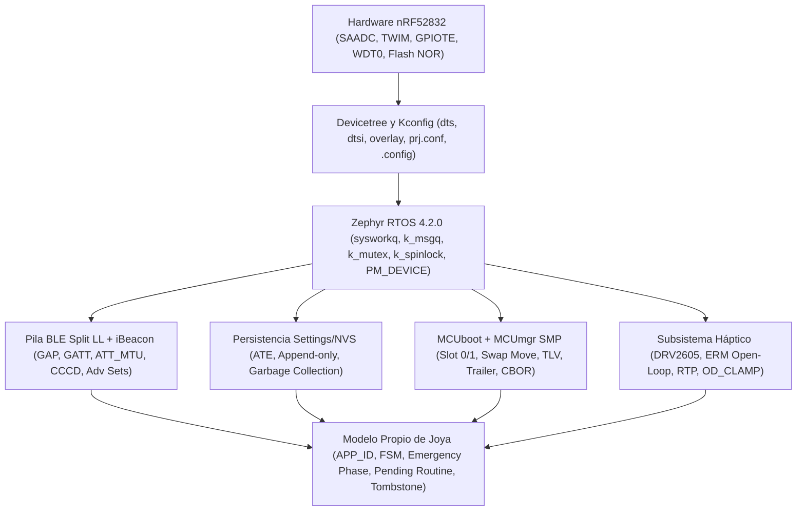
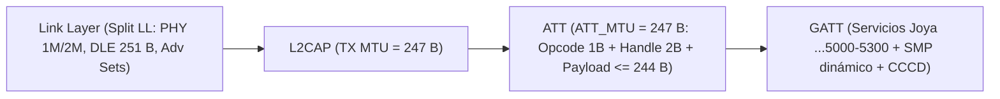
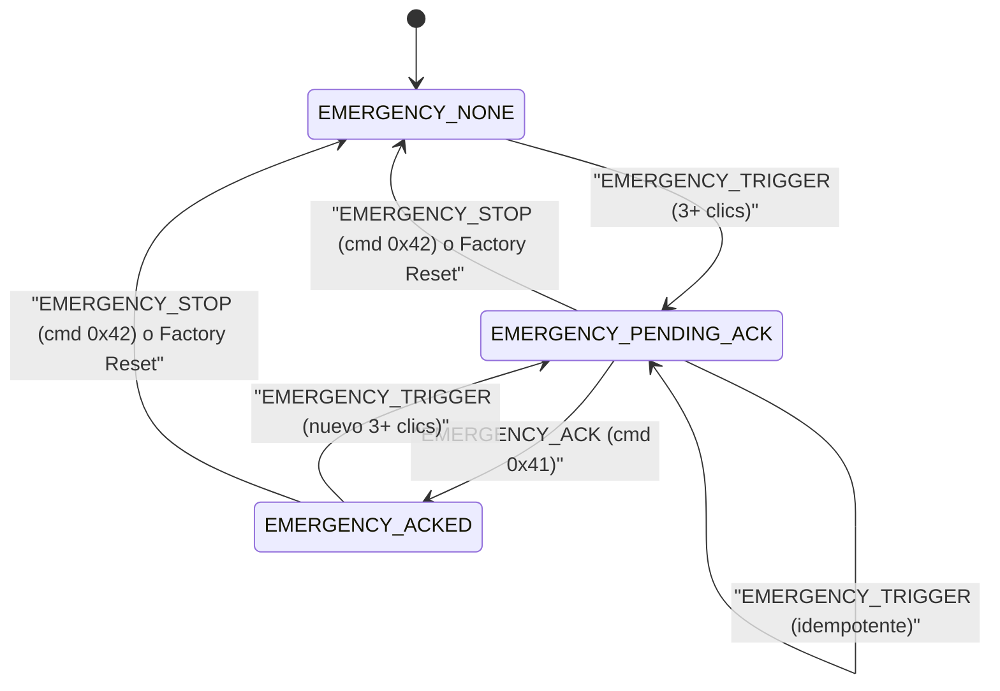

# 24. Glosario Técnico Integral del Firmware de Joya

> **Propósito del capítulo:** Proveer una referencia terminológica rigurosa, autocontenida y verificada contra el código del commit `c1128e5d0c0d6f98be0a580d287c0926ca27f01f`. Cada entrada define primero el **significado estándar en ingeniería de sistemas embebidos** y detalla a continuación su **materialización exacta en el firmware de Joya** (archivos, funciones, registros, parámetros y consecuencias sobre consumo, latencia, memoria o confiabilidad).

---

## 24.1. Organización del Glosario y Mapa Conceptual de Dominios

El glosario se organiza en dos niveles complementarios de acceso:
1. **Desarrollo Técnico por Dominio ([Secciones 24.2 a 24.12](#242-zephyr-rtos-y-primitivas-del-kernel)):** Agrupa los conceptos en once áreas temáticas de arquitectura del sistema, ordenando **alfabéticamente** los términos dentro de cada dominio.
2. **Índice Alfabético Maestro `A-Z` ([Sección 24.13](#2413-índice-alfabético-maestro-a-z)):** Tabla de consulta rápida que enlaza alfabéticamente los más de 80 términos documentados con su dominio, archivo principal de implementación y capítulo de profundización.



---

## 24.2. Zephyr RTOS y Primitivas del Kernel

*(Profundización transversal en [01_system_architecture.md](01_system_architecture.md), [04_boot_initialization.md](04_boot_initialization.md) y [06_concurrency.md](06_concurrency.md)).*

### `k_msgq` (Message Queue)
- **Definición estándar:** Cola FIFO de tamaño fijo y paso por valor del kernel Zephyr para comunicar datos tipados de longitud uniforme entre contextos de interrupción (ISR) e hilos, o entre hilos productores y consumidores, con garantías de atomicidad internas del planificador.
- **Aplicación en Joya:** Implementa la columna vertebral reactiva de la máquina de estados mediante `K_MSGQ_DEFINE(event_queue, sizeof(app_event_t), 20, 4)` en [`src/app_state.c`](../../src/app_state.c) (línea `28`). Aloja hasta `20` eventos de `24 bytes` (`type`, puntero `struct bt_conn *` con conteo de referencia y `uint8_t app_id[16]`), alineados a `4 bytes` (`480 B` de buffer en `.bss`). Los productores (`button_c`, callbacks BLE en `BT_RX`, `battery_c` y temporizadores en `sysworkq`) insertan mediante `k_msgq_put(&event_queue, &entry, K_NO_WAIT)` en `add_event_for_conn()` (línea `346`); si las 20 posiciones están ocupadas, devuelve `-ENOMSG`, libera `bt_conn_unref()` y reporta `DIAG_ERROR_EVENT_QUEUE_FULL` (`0xE3`). El único consumidor (`fsm_thread_id`) extrae con `k_msgq_get(&event_queue, &entry, K_FOREVER)` (línea `364`), durmiendo con cero consumo de CPU cuando la cola está vacía.

### `k_mutex` (Mutual Exclusion Lock)
- **Definición estándar:** Primitiva bloqueante y reentrante de exclusión mutua para hilos en Zephyr, equipada con herencia de prioridad (*priority inheritance*) para mitigar inversiones de prioridad. No puede invocarse desde rutinas de interrupción (ISR).
- **Aplicación en Joya:** El firmware instancia cuatro `k_mutex` estáticos para proteger invariantes compartidos entre hilos (`BT_RX`, `fsm_thread_id`, `sysworkq` y `mcumgr_wq`):
  1. `conn_mutex` ([`src/ble_driver.c`](../../src/ble_driver.c) línea `150`): serializa el acceso a `current_conn`, `current_conn_authenticated`, banderas de suscripción CCC y `diagnostics_session_epoch`. Se toma con `K_FOREVER` salvo en las consultas *best-effort* de diagnóstico (`ble_diagnostics_session()` y `ble_diagnostics_notify_for_session()`, líneas `574` y `588`), que usan `K_NO_WAIT`.
  2. `ibeacon_mutex` ([`src/ble_driver.c`](../../src/ble_driver.c) línea `64`): serializa `ibeacon_running` y las operaciones HCI `bt_le_ext_adv_start()` / `bt_le_ext_adv_stop()`.
  3. `ota_mutex` ([`src/ota_access.c`](../../src/ota_access.c) línea `10`): protege `service_enabled`, `uploading`, `upload_complete` y `close_requested` entre callbacks de `mcumgr_wq`, `sysworkq` y `fsm_thread_id`.
  4. `battery_monitor_lock` ([`src/battery.c`](../../src/battery.c) línea `32`): protege `monitoring`, `verifying`, `monitor_generation`, `verification_count` y `votes[]`, liberándose deliberadamente alrededor de `battery_get_voltage_mv()` (líneas `229–235`) para no retener el cerrojo durante la conversión analógica SAADC.

### `k_spinlock` (Spinlock / IRQ Lock)
- **Definición estándar:** Cerrojo ultrarrápido de sección crítica que en arquitecturas mononúcleo Cortex-M (`nRF52832`) enmascara temporalmente interrupciones (`BASEPRI`/`PRIMASK`) devolviendo una clave `k_spinlock_key_t`. Es seguro tanto desde hilos como desde ISR, siempre que la sección protegida sea de duración constante y libre de llamadas bloqueantes.
- **Aplicación en Joya:** Se emplea `static struct k_spinlock pending_lock;` en [`src/diagnostics.c`](../../src/diagnostics.c) (líneas `9`, `17–23`, `65–67` y `78–81`) para actualizar y extraer de forma atómica el par `(pending_error_code, pending_error_session)` y `pending_init_session` antes de despachar `diagnostics_work` a `sysworkq`.

### `k_work` (Workqueue Item)
- **Definición estándar:** Unidad de trabajo diferido no temporizada (`struct k_work`) que permite delegar la ejecución de una función callback desde una ISR o un hilo restringido hacia el contexto de un hilo servidor de *workqueue* (por defecto `sysworkq`), permitiendo allí invocar APIs bloqueantes como mutexes o subsistemas BLE.
- **Aplicación en Joya:** Se definen dos instancias puras `K_WORK_DEFINE`:
  1. `ibeacon_stop_work` ([`src/ble_driver.c`](../../src/ble_driver.c) línea `139`): encolado desde `on_connected()` para detener el conjunto extendido del iBeacon fuera del callback directo de conexión.
  2. `diagnostics_work` ([`src/diagnostics.c`](../../src/diagnostics.c) línea `37`): desacopla el envío de `bt_gatt_notify()` de cualquier contexto que invoque `diagnostics_report_error()` o `diagnostics_request_init_notification()`.

### `k_work_delayable` (Delayable Work Item)
- **Definición estándar:** Extensión de `k_work` combinada con un temporizador del kernel (`_timeout`) que inserta automáticamente el ítem en la *workqueue* destino una vez transcurrido el plazo programado mediante `k_work_schedule()` o `k_work_reschedule()`.
- **Aplicación en Joya:** El firmware articula la totalidad de sus temporizadores de negocio sobre **13 instancias de `k_work_delayable`** despachadas sobre `sysworkq` (véase catálogo completo en [19_timers_parameters.md](19_timers_parameters.md)): `connection_timeout_work`, `emergency_retry_work`, `advertising_restart_work` y `critical_window_work` en [`src/app_state.c`](../../src/app_state.c) (`16–19`); `debounce_work`, `click_window_work` y `factory_hold_work` en [`src/button.c`](../../src/button.c) (`14–16`); `haptics_pattern_work` y `haptics_effect_work` en [`src/haptics.c`](../../src/haptics.c) (`43–45`); `battery_monitor_work` en [`src/battery.c`](../../src/battery.c) (`43`); `idle_close_work` en [`src/ota_access.c`](../../src/ota_access.c) (`11`); `confirmation_deadline_work` en [`src/test_image_guard.c`](../../src/test_image_guard.c) (`20`); y `guard_work` en [`src/wdt_guard.c`](../../src/wdt_guard.c) (`50`) (más `test_led_off_work` en compilaciones de diagnóstico DK).

### `PM_DEVICE` (Device Runtime / System Power Management)
- **Definición estándar:** Subsistema de Zephyr (`CONFIG_PM_DEVICE=y`) que expone una interfaz uniforme (`pm_device_action_run()`) para transicionar controladores de periféricos individuales entre estados activos (`PM_DEVICE_ACTION_RESUME`) y estados de mínimo consumo (`PM_DEVICE_ACTION_SUSPEND`), desconectando relojes internos y aplicando configuraciones `pinctrl` de sueño (`sleep`).
- **Aplicación en Joya:** Habilitado en [`prj.conf`](../../prj.conf) (línea `131`) y utilizado en [`src/haptics.c`](../../src/haptics.c) (`haptics_i2c_suspend()` y `haptics_i2c_resume()`, líneas `201–229`) sobre el controlador `i2c0` (`TWIM0`). Al finalizar cada patrón vibratorio (`drv2605_idle()`), `PM_DEVICE_ACTION_SUSPEND` apaga el bloque `TWIM0` del `nRF52832` y conmuta los pines `P0.08`/`P0.06` al grupo `i2c0_sleep` (`low-power-enable`), evitando drenar ~`200–400 µA` del generador de reloj de periféricos mientras la háptica está inactiva.

### `Sysbuild` (System Build)
- **Definición estándar:** Metasistema de construcción multi-imagen integrado en `west` (Zephyr `3.7+` / `4.x`) que coordina en una sola invocación la configuración, compilación, firmado criptográfico y enlazado de particiones de múltiples dominios independientes (típicamente bootloader + aplicación + núcleos de radio).
- **Aplicación en Joya:** Activado mediante [`sysbuild.conf`](../../sysbuild.conf) (`SB_CONFIG_BOOTLOADER_MCUBOOT=y`), [`sysbuild/CMakeLists.txt`](../../sysbuild/CMakeLists.txt) y [`sysbuild/mcuboot.conf`](../../sysbuild/mcuboot.conf). Genera en paralelo dos ejecutables autónomos: `mcuboot` (`48 KiB`, con `CONFIG_ARM_MPU=y`) y `app` (`JoyaPhoneConnectionFirmware`, firmada automáticamente con RSA-2048 produciendo `zephyr.signed.bin` para OTA y `merged.hex` para programación inicial de fábrica).

### `sysworkq` (System Workqueue)
- **Definición estándar:** Hilo compartido predefinido por el kernel Zephyr que procesa secuencialmente los objetos `k_work` y `k_work_delayable` encolados con las APIs por defecto. Corre con prioridad **cooperativa** (`CONFIG_SYSTEM_WORKQUEUE_PRIORITY = -1`), lo que significa que otro hilo de aplicación de prioridad numérica `>= 0` no puede desalojarlo hasta que el handler en curso termine o bloquee voluntariamente.
- **Aplicación en Joya:** Dimensionado con `CONFIG_SYSTEM_WORKQUEUE_STACK_SIZE=4096` en [`prj.conf`](../../prj.conf) (línea `38`). Ejecuta la lectura SAADC periódica, las escrituras I2C de cada paso háptico RTP, el antirrebote del botón, los envíos de diagnóstico y la alimentación periódica del watchdog (`guard_work`). Por ser una única cola secuencial, si `guard_work` no logra correr debido a un bloqueo indefinido en otro handler de `sysworkq`, `WDT0` deja de alimentarse y reinicia el SoC en `<= 30 s` ([`src/wdt_guard.c`](../../src/wdt_guard.c)).

---

## 24.3. Devicetree y Descripción Hardware

*(Profundización en [02_hardware_devicetree.md](02_hardware_devicetree.md)).*

### `aliases`
- **Definición estándar:** Nodo especial `/aliases` en la raíz del Devicetree que asigna nombres lógicos cortos (identificadores simbólicos consultables con `DT_ALIAS()`) a rutas completas de nodos físicos, desacoplando el código C de la topología concreta de una placa.
- **Aplicación en Joya:** En [`boards/joya/joya_nrf52/joya_nrf52_nrf52832.dts`](../../boards/joya/joya_nrf52/joya_nrf52_nrf52832.dts) (líneas `40–43`) se declaran `boton-emergencia = &emergency_button;` y `sw0 = &emergency_button;`. [`src/button.c`](../../src/button.c) (línea `10`) resuelve el GPIO con `DT_ALIAS(boton_emergencia)` (convirtiendo guiones a guiones bajos), mientras que [`src/haptics_test_indicator.c`](../../src/haptics_test_indicator.c) (línea `6`) consume `DT_ALIAS(led0)` sobre la `nRF52 DK`.

### `chosen`
- **Definición estándar:** Nodo `/chosen` del Devicetree que comunica decisiones globales de integración software/sistema al kernel y subsistemas de Zephyr (memoria principal, consola, partición de código ejecutable o partición de almacenamiento), en lugar de describir hardware externo adicional.
- **Aplicación en Joya:** En [`boards/joya/joya_nrf52/joya_nrf52_nrf52832.dts`](../../boards/joya/joya_nrf52/joya_nrf52_nrf52832.dts) (líneas `16–21`) fija cuatro asignaciones críticas: `zephyr,sram = &sram0` (`64 KiB`), `zephyr,flash = &flash0` (`512 KiB`), `zephyr,code-partition = &slot0_partition` (reubicando el vector de interrupciones de la aplicación a `0x0000C000` más cabecera MCUboot) y `zephyr,settings-partition = &storage_partition` (`0x0007A000..0x00080000`).

### `dts` (Devicetree Source)
- **Definición estándar:** Archivo fuente principal (`.dts`) que instancia y parametriza el árbol completo de hardware de una placa específica (SoC, relojes, memorias, pines y periféricos habilitados).
- **Aplicación en Joya:** [`boards/joya/joya_nrf52/joya_nrf52_nrf52832.dts`](../../boards/joya/joya_nrf52/joya_nrf52_nrf52832.dts) define la placa de producción `joya_nrf52/nrf52832` (`model = "Joya nRF52 PCB"`), habilitando únicamente `gpio0`, `gpiote`, `i2c0`, `adc` y `temp`, y deshabilitando explícitamente `i2c1`, `uart0`, `spi0` y `spi1` para minimizar superficie eléctrica y consumo.

### `dtsi` (Devicetree Source Include)
- **Definición estándar:** Archivo modular reutilizable (`.dtsi`) incluido mediante `#include` por uno o varios archivos `.dts` para compartir definiciones comunes del SoC (registros base, IRQs) o grupos de multiplexación de pines.
- **Aplicación en Joya:** [`boards/joya/joya_nrf52/joya_nrf52_nrf52832.dts`](../../boards/joya/joya_nrf52/joya_nrf52_nrf52832.dts) incluye `<nordic/nrf52832_qfaa.dtsi>` (provisto por Zephyr para el encapsulado QFAA de `512 KiB / 64 KiB`) y el archivo propio [`boards/joya/joya_nrf52/joya_nrf52-pinctrl.dtsi`](../../boards/joya/joya_nrf52/joya_nrf52-pinctrl.dtsi).

### `fixed-partitions`
- **Definición estándar:** Esquema (`compatible = "fixed-partitions"`) bajo un nodo controlador de Flash que divide estáticamente el espacio lineal de direcciones no volátiles en regiones con nombre, offset y tamaño inmutables en tiempo de compilación, consumidas por `flash_map`, `MCUboot` y `NVS`.
- **Aplicación en Joya:** Divide los `512 KiB` (`0x80000 B`) de `&flash0` en [`boards/joya/joya_nrf52/joya_nrf52_nrf52832.dts`](../../boards/joya/joya_nrf52/joya_nrf52_nrf52832.dts) (líneas `46–72`) en cuatro particiones contiguas sin huecos: `boot_partition` (`mcuboot`, `48 KiB`), `slot0_partition` (`image-0`, `220 KiB`), `slot1_partition` (`image-1`, `220 KiB`) y `storage_partition` (`storage`, `24 KiB`).

### `overlay` (Devicetree Overlay)
- **Definición estándar:** Fragmento `.overlay` superpuesto en tiempo de compilación (`-DDTC_OVERLAY_FILE=...`) sobre el `.dts` base de una placa para añadir, sobrescribir o eliminar nodos/propiedades sin alterar la definición original de la placa.
- **Aplicación en Joya:** Permite ensayar el firmware sobre el kit de desarrollo estándar `nrf52dk/nrf52832` mediante dos archivos en la raíz: [`nrf52dk_nrf52832.overlay`](../../nrf52dk_nrf52832.overlay) (que mapea el botón a `P0.14`, `haptic_en_gpios` a `P0.07`, `i2c0` a `P0.08`/`P0.06`, apaga `uart0` y borra `gpio-as-nreset` de `&uicr`) y [`nrf52dk_battery_adc.overlay`](../../nrf52dk_battery_adc.overlay) (que inyecta el canal SAADC `AIN7` en `P0.31`).

### `pinctrl` (Pin Control)
- **Definición estándar:** Modelo declarativo de Zephyr para asignar señales internas de periféricos (como `TWIM_SDA`/`TWIM_SCL` mediante la matriz crossbar `PSEL` de Nordic) y características eléctricas de pad (pull-up/down, drive strength, desconexión en bajo consumo) asociadas a estados nombrados (`default`, `sleep`).
- **Aplicación en Joya:** [`boards/joya/joya_nrf52/joya_nrf52-pinctrl.dtsi`](../../boards/joya/joya_nrf52/joya_nrf52-pinctrl.dtsi) define `i2c0_default` (`SDA = P0.08`, `SCL = P0.06`, **sin pull-up interno** del SoC) e `i2c0_sleep` (añadiendo `low-power-enable` cuando `PM_DEVICE` suspende `i2c0`).

### `zephyr,user`
- **Definición estándar:** Nodo convencional `/zephyr,user` libre de *binding* de driver específico, provisto por Zephyr para declarar propiedades hardware a medida de la aplicación (GPIOs discretos o canales ADC) accesibles directamente con `DT_PATH(zephyr_user)`.
- **Aplicación en Joya:** En [`boards/joya/joya_nrf52/joya_nrf52_nrf52832.dts`](../../boards/joya/joya_nrf52/joya_nrf52_nrf52832.dts) (líneas `34–38`) aloja `haptic_en_gpios = <&gpio0 7 GPIO_ACTIVE_HIGH>` (leído en [`src/haptics.c`](../../src/haptics.c) línea `18`) y el canal `io-channels = <&adc 0>` con `io-channel-names = "battery"` (leído con `ADC_DT_SPEC_GET_BY_NAME` en [`src/battery.c`](../../src/battery.c) línea `19`).

---

## 24.4. Sistema de Configuración Kconfig

*(Profundización en [03_firmware_configuration.md](03_firmware_configuration.md)).*

### `.config`
- **Definición estándar:** Archivo generado automáticamente por CMake/Kconfig dentro del directorio de compilación (`zephyr/.config`) tras resolver todas las dependencias, valores por defecto del SoC, `defconfig` de placa y fragmentos de usuario. Constituye la **única fuente de verdad efectiva** de qué símbolos `CONFIG_*` compilaron realmente en el binario final (expuestos a C en `autoconf.h`).
- **Aplicación en Joya:** Permite constatar en `build_joya/app/zephyr/.config` y `build_joya/mcuboot/zephyr/.config` opciones implícitas cruciales no escritas en `prj.conf`, tales como `CONFIG_BT_RX_STACK_SIZE=1200`, `# CONFIG_BT_SMP is not set`, `# CONFIG_MCUMGR_TRANSPORT_BT_REASSEMBLY is not set`, `CONFIG_BT_DEVICE_NAME_GATT_WRITABLE=y`, `CONFIG_SETTINGS_NVS_SECTOR_COUNT=8` e `CONFIG_I2C_NRFX_TRANSFER_TIMEOUT=500`.

### `defconfig` (`<board>_defconfig`)
- **Definición estándar:** Archivo base de configuración Kconfig propio de una definición de placa (`boards/.../*_defconfig`) que fija los defaults mínimos indispensables para que ese hardware opere correctamente antes de aplicar `prj.conf`.
- **Aplicación en Joya:** [`boards/joya/joya_nrf52/joya_nrf52_nrf52832_defconfig`](../../boards/joya/joya_nrf52/joya_nrf52_nrf52832_defconfig) habilita `CONFIG_GPIO=y` y deja asentada la prohibición explícita de activar `CONFIG_GPIO_AS_PINRESET` porque el pin `P0.21` carece de resistencia de pull-up en la PCB de Joya.

### `prj.conf`
- **Definición estándar:** Fragmento principal de configuración Kconfig de la aplicación que selecciona subsistemas del RTOS, dimensiona pilas/buffers y ajusta políticas de red, almacenamiento y energía.
- **Aplicación en Joya:** [`prj.conf`](../../prj.conf) (`135` líneas) anula toda salida de consola/logs (`CONFIG_LOG=n`, `CONFIG_CONSOLE=n`), dimensiona stacks (`MAIN` y `SYSTEM_WORKQUEUE` a `4096 B`), configura BLE Peripheral con `MTU = 247` / `DLE = 251` y `EXT_ADV` (`2` sets), habilita `NVS`/`Settings`, `WDT0` sin IRQ, `MCUboot`/`MCUmgr` sobre BT con registro dinámico, reloj `LFRC` (`500 ppm`) y `CONFIG_PM_DEVICE=y`. Además, el archivo raíz [`Kconfig`](../../Kconfig) declara el símbolo propio `CONFIG_JOYA_HAPTICS_TEST_INDICATOR` (por defecto `n`, exclusivo para `nRF52 DK`).

---

## 24.5. Arquitectura y Protocolos Bluetooth Low Energy (BLE)

*(Profundización en [07_ble_architecture.md](07_ble_architecture.md), [09_gatt_protocol.md](09_gatt_protocol.md), [10_authentication.md](10_authentication.md) y [17_security_privacy.md](17_security_privacy.md)).*



### `ADV_IND`
- **Definición estándar:** PDU de publicidad Legacy en canales primarios (`37, 38, 39`) de tipo **conectable y escaneable no dirigido** (*Connectable Undirected / Scannable*). Permite tanto recibir solicitudes de escaneo (`SCAN_REQ` → `SCAN_RSP`) como peticiones de establecimiento de enlace (`CONNECT_IND`).
- **Aplicación en Joya:** Tipo de trama emitido por el conjunto de publicidad por defecto iniciado en `ble_start_setup_advertising()` ([`src/ble_driver.c`](../../src/ble_driver.c) líneas `33–40` y `633–635`) con `BT_LE_ADV_OPT_CONNECTABLE | BT_LE_ADV_OPT_ONE_TIME | BT_LE_ADV_OPT_USE_NAME` a intervalos de `100..150 ms`. Transporta los flags LE (`0x06`) y el nombre completo (`"Joya Setup"`, `"Joya"` o `"Joya de <Nombre>"`).

### `ADV_NONCONN_IND`
- **Definición estándar:** PDU de publicidad Legacy **no conectable y no escaneable** (*Non-Connectable Non-Scannable Undirected*). El emisor solo transmite en radio sin encender el receptor tras cada paquete, minimizando consumo en balizas unidireccionales (*beacons*).
- **Aplicación en Joya:** Tipo de trama emitido por el segundo conjunto de publicidad (`ibeacon_adv`) configurado con `.options = 0` e intervalos lentos `1000..1200 ms` (`BT_GAP_ADV_SLOW_INT_MIN` / `MAX`) en [`src/ble_driver.c`](../../src/ble_driver.c) (líneas `45–58`), dedicado exclusivamente al payload Apple iBeacon de `30 bytes` totales de datos AD.

### `Advertising Set`
- **Definición estándar:** Instancia independiente de estado de publicidad en el Link Layer BLE (introducida en Bluetooth 5.0) con sus propios parámetros de intervalo, tipo de PDU, potencia y datos de anuncio, multiplexada en el tiempo por el planificador de radio.
- **Aplicación en Joya:** Con `CONFIG_BT_EXT_ADV_MAX_ADV_SET=2` ([`prj.conf`](../../prj.conf) línea `135`), Joya mantiene **dos Advertising Sets concurrentes** cuando está desconectada y tiene `APP_ID` guardado: (1) el conjunto conectable implícito gestionado con `bt_le_adv_start()` y (2) el conjunto explícito `struct bt_le_ext_adv *ibeacon_adv` creado en `ble_driver_init()` (línea `504`).

### `ATT` (Attribute Protocol)
- **Definición estándar:** Protocolo cliente-servidor ligero sobre el canal fijo L2CAP `0x0004` que organiza todos los datos expuestos por un dispositivo BLE como una tabla plana de atributos direccionados por un *handle* de 16 bits, un UUID, permisos de acceso y un valor binario, definiendo operaciones como `Read Request/Response`, `Write Request/Response`, `Write Command` (sin respuesta) y `Handle Value Notification`.
- **Aplicación en Joya:** Todas las interacciones de comandos (`RX`/`TX`), autenticación (`RX_AUTH`), nombre (`NAME`), diagnóstico (`DIAGNOSTICS`), batería y transferencia OTA (`SMP`) se transportan como PDUs ATT.

### `ATT_MTU` (ATT Maximum Transmission Unit)
- **Definición estándar:** Tamaño máximo en bytes de un único PDU del protocolo ATT entre cliente y servidor (mínimo por defecto `23 bytes` en BLE 4.0; negociable mediante `Exchange MTU Request/Response`). En una escritura o notificación ATT, `1 byte` corresponde al opcode y `2 bytes` al handle, dejando `ATT_MTU - 3` bytes de carga útil de aplicación.
- **Aplicación en Joya:** Configurado hasta **`247 bytes`** (`CONFIG_BT_L2CAP_TX_MTU=247` y `CONFIG_BT_BUF_ACL_RX_SIZE=251` en [`prj.conf`](../../prj.conf) líneas `119–121`), ofreciendo hasta **`244 bytes` útiles** por paquete ATT. Mientras los servicios propios de Joya usan tramas pequeñas (`1 B` a `23 B`), un `ATT_MTU` alto es **crítico para OTA SMP**, ya que con `CONFIG_MCUMGR_TRANSPORT_BT_REASSEMBLY` deshabilitado cada comando `img upload` debe entrar completo en `ATT_MTU - 3` bytes.

### `CCC` / `CCCD` (Client Characteristic Configuration Descriptor)
- **Definición estándar:** Descriptor estándar Bluetooth SIG (UUID `0x2902`) adjunto a toda característica con propiedad `NOTIFY` o `INDICATE`. El cliente escribe `0x0001` (`BT_GATT_CCC_NOTIFY`) para suscribirse a notificaciones asíncronas del servidor o `0x0000` para cancelar la suscripción.
- **Aplicación en Joya:** Joya declara **cuatro descriptores CCC independientes** en [`src/ble_driver.c`](../../src/ble_driver.c) (más un quinto dinámico cuando se registra SMP):
  1. `TX` (`...5001`, `on_ccc_changed()`): **obligatorio en el handshake de sesión**; escribir `0x0001` encola `EV_BLE_NOTIFY_ENABLED` haciendo avanzar la FSM de `STATE_WAITING_NOTIFICATION_ENABLE` a `STATE_SETUP_WAITING_IDENTIFIER`.
  2. `DIAGNOSTICS` (`...5202`, `on_diagnostics_ccc_changed()`): dispara el envío inicial `0xA0 MM` si la conexión ya está autenticada y habilita errores `0xE1..0xE5`.
  3. `BATTERY_CHANGE` (`...5301`, `on_battery_change_ccc_changed()`): encola `EV_BLE_BATTERY_NOTIFY_ENABLED` para notificar el nivel confirmado actual (`0/1/2`).
  4. `BATTERY_MEASUREMENT` (`...5302`, `on_battery_measurement_ccc_changed()`): habilita el flujo periódico de milivoltios (`uint16_t` LE).
  Como no hay *bonding* (`CONFIG_BT_SMP=n`), todas las banderas CCC se reinician a `false` en cada nueva conexión (`on_connected()`, líneas `234–237`).

### `DLE` (Data Length Extension)
- **Definición estándar:** Función introducida en Bluetooth 4.2 (`LE Data Packet Length Extension`) que amplía la carga útil de un único paquete físico de Link Layer desde los `27 bytes` clásicos hasta **`251 bytes`** (`247 B` ATT + `4 B` cabecera L2CAP), evitando fragmentar un `ATT_MTU` de `247 B` en ~10 paquetes de radio separados.
- **Aplicación en Joya:** Habilitado al máximo en [`prj.conf`](../../prj.conf) (`CONFIG_BT_CTLR_DATA_LENGTH_MAX=251`, `CONFIG_BT_BUF_ACL_TX_SIZE=251`, `CONFIG_BT_DATA_LEN_UPDATE=y`), multiplicando por ~5–6× el caudal efectivo y reduciendo drásticamente el tiempo de radio encendida durante una actualización OTA de `~165 KiB`.

### `Extended Advertising`
- **Definición estándar:** Subsistema del controlador y host Bluetooth 5.0 (`CONFIG_BT_EXT_ADV=y`) que soporta tanto múltiples conjuntos simultáneos de publicidad (`Advertising Sets`) como canales secundarios de datos extendidos.
- **Aplicación en Joya:** Joya habilita `CONFIG_BT_EXT_ADV=y` **no** para emitir PDUs extendidos en canales secundarios (incompatibles con el formato estándar iBeacon en muchos escáneres), sino exclusivamente por su capacidad de gestionar **dos conjuntos de publicidad Legacy en paralelo** (`connectable` + `ibeacon_adv`).

### `GAP` (Generic Access Profile)
- **Definición estándar:** Perfil base de BLE que gobierna la visibilidad en radio (modos de descubrimiento, intervalos de advertising), el establecimiento de conexiones, la negociación de intervalos de enlace y la identidad pública/privada del dispositivo (incluyendo el servicio obligatorio `0x1800` con `Device Name` `0x2A00` y `Peripheral Preferred Connection Parameters` `0x2A04`).
- **Aplicación en Joya:** Gestiona la conmutación dinámica del nombre entre `"Joya Setup"` y `"Joya"` / `"Joya de <Nombre>"` (`bt_set_name()`) y publica los parámetros preferidos de conexión compatibles con iOS/Android definidos en [`prj.conf`](../../prj.conf) (líneas `58–66`).

### `GATT` (Generic Attribute Profile)
- **Definición estándar:** Capa jerárquica construida sobre `ATT` que estructura los atributos en **Servicios Primarios**, **Características** (definición + valor) y **Descriptores** (como `CCCD`), definiendo los procedimientos de descubrimiento y transferencia de datos de aplicación.
- **Aplicación en Joya:** Definido en [`src/ble_driver.c`](../../src/ble_driver.c) (líneas `398–459`) con cuatro servicios estáticos de 128 bits bajo la base `a407e00a-00c1-464d-9173-2cb8be58XXXX` (`Commands ...5000`, `Auth ...5100`, `Config ...5200`, `Battery ...5300`) más el servicio dinámico `SMP` habilitado con `CONFIG_BT_GATT_DYNAMIC_DB=y`.

### `Legacy PDU`
- **Definición estándar:** Formato clásico de paquete de publicidad Bluetooth 4.x transmitido sobre los tres canales primarios a `1 Mbps` con carga útil máxima de **`31 bytes`** de datos de anuncio (`AdvData`).
- **Aplicación en Joya:** Ambos conjuntos de publicidad de Joya transmiten **Legacy PDUs** (`ADV_IND` y `ADV_NONCONN_IND`), garantizando compatibilidad universal con el motor hardware de `iBeacon` de iOS y cualquier teléfono Android.

### `Peripheral Latency` (Slave Latency)
- **Definición estándar:** Número entero de eventos de conexión consecutivos que el periférico BLE está autorizado a ignorar (manteniendo su radio completamente dormida) cuando no tiene datos pendientes que transmitir hacia el Central, sin que este considere roto el enlace.
- **Aplicación en Joya:** Configurado en `CONFIG_BT_PERIPHERAL_PREF_LATENCY=4` ([`prj.conf`](../../prj.conf) línea `63`). Con un `Connection Interval` de `45..90 ms` (`36..72` unidades de `1,25 ms`), permite a Joya dormir entre `225 ms` y `450 ms` seguidos en reposo conectado, pero responder en `< 90 ms` apenas la usuaria presiona el botón.

### `PHY 1M/2M`
- **Definición estándar:** Modulación de capa física BLE en la banda ISM de `2,4 GHz`: **`LE 1M`** (`1 Msym/s`, obligatoria en todos los canales primarios y al iniciar conexión) y **`LE 2M`** (`2 Msym/s`, introducida en Bluetooth 5.0 para enlaces conectados, reduciendo a la mitad la duración en aire por bit transmitido y el consumo energético por paquete).
- **Aplicación en Joya:** El `nRF52832` y la compilación efectiva habilitan `CONFIG_BT_CTLR_PHY_2M=y` y `CONFIG_BT_PHY_UPDATE=y` (`build_joya/app/zephyr/.config` líneas `1395` y `1586`), permitiendo negociar automáticamente `2 Mbps` con smartphones modernos durante sesiones conectadas y cargas OTA.

### `RPA` (Resolvable Private Address)
- **Definición estándar:** Mecanismo de privacidad de capa de enlace BLE (`LE Privacy`) mediante el cual un dispositivo rota periódicamente (p. ej. cada `15 minutos`) su dirección MAC aleatoria en el aire generando un hash de 24 bits con una clave `IRK` (*Identity Resolving Key*) compartida solo con pares vinculados (*bonded*), impidiendo el rastreo físico por observadores externos.
- **Aplicación en Joya:** **No utilizado en `c1128e5`** (`# CONFIG_BT_CTLR_PRIVACY is not set` y `# CONFIG_BT_SMP is not set`). Al carecer de *bonding* e intercambio de `IRK`, Joya opera siempre con una dirección estática invariable (véase **LIM-09** en [23_known_limitations.md](23_known_limitations.md)).

### `Service Changed`
- **Definición estándar:** Característica estándar del servicio *Generic Attribute* (`0x1801` / característica `0x2A05`) mediante la cual un servidor con base de datos GATT dinámica (`CONFIG_BT_GATT_DYNAMIC_DB=y`) indica al cliente qué rango de *handles* ATT fue añadido o eliminado para invalidar cachés locales.
- **Aplicación en Joya:** Compilada (`CONFIG_BT_GATT_SERVICE_CHANGED=y` en `.config` línea `1462`) debido al alta y baja en caliente del servicio SMP (`smp_bt_register()` / `smp_bt_unregister()` tras los comandos `0x70` y `0x71` en [`src/ota_access.c`](../../src/ota_access.c)).

### `Split Link Layer` (`BT_LL_SW_SPLIT`)
- **Definición estándar:** Arquitectura abierta del controlador BLE nativo de Zephyr que divide el Link Layer en una capa superior independiente de silicio (`ull`, planificación de roles y máquinas de estado LL) y una capa inferior específica del transceptor hardware (`lll` sobre el periférico `RADIO` de Nordic), sustituyendo al binario cerrado *SoftDevice* de nRF5 SDK.
- **Aplicación en Joya:** Ejecuta directamente en el mismo espacio de Flash y SRAM de la aplicación en el `nRF52832`, canalizando cualquier fallo interno de temporización de radio hacia `bt_ctlr_assert_handle()` en [`src/fatal_recovery.c`](../../src/fatal_recovery.c) (`CONFIG_BT_CTLR_ASSERT_HANDLER=y`), donde se fuerza un `NVIC_SystemReset()` limpio.

### `Static Random Address`
- **Definición estándar:** Dirección MAC BLE de 48 bits cuyos dos bits más significativos valen `11` (`0xC0..0xFF` en el octeto superior) y cuyos 46 bits restantes son fijos durante toda la vida del chip (o ciclo de encendido), sin requerir registro OUI IEEE.
- **Aplicación en Joya:** Identidad de radio efectiva de cada unidad Joya, derivada por el controlador Zephyr a partir de los registros de fábrica `NRF_FICR->DEVICEADDR[0..1]` grabados en silicio por Nordic Semiconductor.

### `Supervision Timeout`
- **Definición estándar:** Tiempo máximo que tanto el Central como el Periférico toleran sin recibir ningún paquete de radio válido del par antes de declarar caído el enlace físico (razón HCI `BT_HCI_ERR_CONN_TIMEOUT = 0x08`) e invocar el callback de desconexión.
- **Aplicación en Joya:** Solicitado en `CONFIG_BT_PERIPHERAL_PREF_TIMEOUT=600` (`600 × 10 ms = 6,0 segundos`, [`prj.conf`](../../prj.conf) línea `65`), cumpliendo la cota inferior exigida por Apple (`>= 6 s`). Determina cuánto tarda Joya en detectar que la usuaria se alejó abruptamente del teléfono para ejecutar `on_disconnected()`, iniciar el advertising de reconexión y activar el iBeacon.

---

## 24.6. Subsistema iBeacon

*(Profundización en [08_ibeacon.md](08_ibeacon.md) y [`docs/IBEACON.md`](../../docs/IBEACON.md)).*

Estructura exacta en aire del paquete `connection_ibeacon_ad` ([`src/ble_driver.c`](../../src/ble_driver.c) líneas `52–58`, `30 bytes` totales):

| Bytes (índice) | Campo AD / iBeacon | Valor Hex en Joya | Orden de bytes | Significado |
|---|---|---|---|---|
| `0..2` | AD Element #1 (`Flags`) | `02 01 04` | — | Longitud `2`, tipo `0x01`, `BT_LE_AD_NO_BREDR` (`0x04`) |
| `3..4` | Cabecera AD Element #2 | `1A FF` | — | Longitud `26` (`0x1A`), tipo `0xFF` (*Manufacturer Specific Data*) |
| `5..6` | `Company ID` | `4C 00` | Little-Endian | Identificador Bluetooth SIG de Apple Inc. (`0x004C`) |
| `7..8` | Subtipo + Longitud iBeacon | `02 15` | — | Tipo proximidad `0x02`, `21 bytes` (`0x15`) restantes |
| `9..24` | `Proximity UUID` | `A4 07 E0 0A ... 60 01` | Big-Endian | `a407e00a-00c1-464d-9173-2cb8be586001` |
| `25..26` | `Major` | `00 01` | Big-Endian | Grupo lógico `1` |
| `27..28` | `Minor` | `00 01` | Big-Endian | Subgrupo lógico `1` |
| `29` | `Measured Power` | `C8` | Complemento a 2 | `-56 dBm` a `1 m` (marcador sin calibrar) |

### `Company ID`
- **Definición estándar:** Identificador de fabricante de 16 bits asignado por el Bluetooth SIG y transmitido en orden *little-endian* en los dos primeros octetos de un elemento AD `0xFF` (*Manufacturer Specific Data*).
- **Aplicación en Joya:** Fijado en `0x004C` (`0x4c, 0x00` en [`src/ble_driver.c`](../../src/ble_driver.c) línea `55`), valor registrado por Apple Inc. requerido por iOS `CoreLocation` y librerías Android para reconocer la trama como formato `iBeacon`.

### `Major`
- **Definición estándar:** Entero sin signo de 16 bits en orden *big-endian* dentro del payload iBeacon destinado a particionar un mismo `Proximity UUID` en subgrupos regionales o funcionales.
- **Aplicación en Joya:** Constante fija `0x0001` (`0x00, 0x01`, línea `57`).

### `Measured Power`
- **Definición estándar:** Entero con signo de 8 bits en complemento a dos al final del paquete iBeacon que indica el RSSI promedio esperado (en $\text{dBm}$) a exactamente `1 metro` de distancia en línea de vista, utilizado por el receptor para estimar distancia mediante modelos de pérdida de propagación.
- **Aplicación en Joya:** Codificado como `0xC8` ($200 - 256 = -56\text{ dBm}$, línea `57`). Según consta en el comentario de `ble_driver.c:42-44`, permanece como *placeholder* pendiente de calibración experimental con carcasa final.

### `Minor`
- **Definición estándar:** Entero sin signo de 16 bits en orden *big-endian* ubicado tras `Major` para identificar nodos individuales dentro de un grupo iBeacon.
- **Aplicación en Joya:** Constante fija `0x0001` (`0x00, 0x01`, línea `57`). No varía por unidad ni por estado de emergencia para no exponer metadatos diferenciadores en radio.

### `Proximity UUID`
- **Definición estándar:** Identificador universalmente único de 128 bits transmitido en orden de red (*big-endian*) en los bytes `4..19` de los datos de fabricante iBeacon, empleado para distinguir las balizas de una organización/aplicación respecto del resto del espectro.
- **Aplicación en Joya:** En el commit `c1128e5` existe **un único `Proximity UUID`**: `JOYA_IBEACON_CONNECTION_UUID_BYTES` = `a407e00a-00c1-464d-9173-2cb8be586001` ([`include/ble_driver.h`](../../include/ble_driver.h) líneas `37–39`). Notar que a diferencia de los UUIDs GATT en Zephyr (`BT_UUID_128_ENCODE`, que invierte los octetos a *little-endian*), en el iBeacon los 16 bytes se colocan en orden visual directo. El antiguo UUID de emergencia (`...6002`) fue suprimido en `c1128e5`.

### `Region Monitoring`
- **Definición estándar:** Servicio de sistema operativo móvil (particularmente `CLLocationManager.startMonitoring(for: CLBeaconRegion)` en iOS y escaneos filtrados por hardware en Android) capaz de despertar en segundo plano una aplicación cerrada o suspendida cuando el controlador Bluetooth detecta la aparición o desaparición de un `Proximity UUID` registrado.
- **Aplicación en Joya:** Mecanismo esencial por el cual Joya logra reconectar automáticamente con el smartphone tras haber estado fuera de alcance: mientras Joya tiene `APP_ID` guardado y está desconectada (y fuera de suspensión/batería crítica), emite `BLE_IBEACON_CONNECTION` junto al advertising conectable (`ibeacon_mode_for_state(true)` en [`include/ibeacon_policy.h`](../../include/ibeacon_policy.h)) para que el sistema operativo despierte a la app, esta establezca la conexión GATT, se autentique y reciba cualquier emergencia (`0x04`) o rutina (`0x02`/`0x03`) pendiente.

---

## 24.7. Modelo de Dominio Propio de Joya

*(Profundización en [05_state_machine.md](05_state_machine.md), [10_authentication.md](10_authentication.md), [12_emergency_routines.md](12_emergency_routines.md) y [14_battery_power.md](14_battery_power.md)).*

### `APP_ID` (Application Identifier)
- **Definición estándar (dominio Joya):** Token simétrico precompartido de `16 bytes` (`SIZE_APP_ID = 16`, [`include/app_state.h`](../../include/app_state.h) línea `4`) generado por la aplicación móvil durante el emparejamiento inicial (*Trust On First Use*) para vincular lógicamente una joya con una instancia de la aplicación. *(Ejemplo sintético de vector de prueba: `00 01 02 03 04 05 06 07 08 09 0A 0B 0C 0D 0E 0F`).*
- **Aplicación en Joya:** Almacenado en RAM en `uint8_t joya_app_id[16]` y persistido en NVS bajo la clave `"joya/app_id"` ([`src/flash_memory.c`](../../src/flash_memory.c) líneas `4` y `263–289`). Dieciséis bytes en `0x00` representan ausencia de vinculación (`is_app_id_empty() == true`). En cada conexión BLE, tras habilitar CCC en `TX`, el cliente escribe los 16 bytes en `RX_AUTH` (`...5101`): si `is_app_id_empty()`, Joya los guarda y responde `COMMAND_ACK` (`0x05`); si ya existía `APP_ID`, compara con `check_app_id()` (`memcmp`) devolviendo `0x05` (`ACK`) o `0x06` (`NACK`). Además, `joya_app_id` actúa como etiqueta de propiedad (`pending_routine_owner`) sobre `joya/routine`.

### `Bonded Disconnected` (`STATE_BONDED_DISCONNECTED`)
- **Definición estándar (dominio Joya):** Estado de la FSM para un dispositivo que **ya posee un `APP_ID` válido registrado** pero no mantiene actualmente una conexión BLE activa. *(Nota terminológica importante: el término `"Bonded"` en el código de Joya refiere a la vinculación lógica por `APP_ID` en NVS, **no** a un *Bonding* criptográfico SMP de la especificación Bluetooth).*
- **Aplicación en Joya:** Definido en [`include/app_state.h`](../../include/app_state.h) (línea `29`) y gestionado en [`src/app_state.c`](../../src/app_state.c) (líneas `468`, `551`, `601`, `608`, `621`, `752`, `856`, `999–1011`). En este estado Joya anuncia simultáneamente paquetes conectables con el nombre personalizado (`"Joya"` o `"Joya de <Nombre>"`) y el `BLE_IBEACON_CONNECTION` sin timeout de cierre, esperando la reconexión automática del teléfono.

### `Critical Idle` (`critical_idle`)
- **Definición estándar (dominio Joya):** Submodo protector de reposo por agotamiento energético alcanzado cuando el monitor SAADC confirma **Nivel 2 de batería (`<= 2900 mV`)** sin transferencia OTA activa ni ventana crítica abierta.
- **Aplicación en Joya:** Activado por `enter_critical_idle()` ([`src/app_state.c`](../../src/app_state.c) líneas `135–148`), que fija `critical_idle = true`, inhibe toda vibración háptica (`haptics_set_allowed(false)`), deshabilita OTA, cancela reintentos, corta la conexión BLE vigente y coloca la FSM en `STATE_UNPAIRED` con `suspended_idle = true`. Solo se abandona si la batería se recupera por encima de `2950 mV` (`BATTERY_LEVEL_2_MV + 50 mV`) y la usuaria pulsa `EV_BTN_2_PULSE` (o al abrir temporalmente la `Critical Window`).

### `Critical Window` (`critical_window_open`)
- **Definición estándar (dominio Joya):** Ventana temporal de gracia de **5 minutos** (`CRITICAL_WINDOW_MS = 300000 ms`, [`src/app_state.c`](../../src/app_state.c) línea `20`) que suspende transitoriamente el apagado por batería crítica Nivel 2 para permitir una reconexión de emergencia o la confirmación de una imagen OTA en modo *Test*.
- **Aplicación en Joya:** Se abre mediante `start_critical_window()` (líneas `177–194`) cuando la usuaria pulsa **dos clics (`EV_BTN_2_PULSE`)** estando en Nivel 2 (`<= 2900 mV`), o durante `EV_BOOT_TEST_SETUP_REQUEST` (línea `413`). Al expirar `critical_window_work` (`EV_CRITICAL_WINDOW_TIMEOUT`), si `battery_level == 2` y no hay carga OTA en curso, el dispositivo regresa automáticamente a `enter_critical_idle()`.

### `Emergency Phase` (`emergency_phase_t`)
- **Definición estándar (dominio Joya):** Autómata persistente de 3 estados ortogonal a `current_state` que modela el ciclo de vida extremo a extremo de una alerta de emergencia desde su disparo físico hasta su cierre explícito por la aplicación.
- **Aplicación en Joya:** Declarado en [`include/emergency_phase.h`](../../include/emergency_phase.h), implementado en [`src/emergency_phase.c`](../../src/emergency_phase.c) y persistido como `1 byte` en `"joya/emergency"`:
  - `EMERGENCY_NONE (0)`: Operación normal (`is_in_emergency() == false`).
  - `EMERGENCY_PENDING_ACK (1)`: Disparada por `EV_BTN_EMERGENCY` (`3+ clics`); requiere notificar `COMMAND_EMERGENCY` (`0x04`) con backoff `1, 2, 5, 10, 30, 30... s` hasta recibir `0x41` (`COMMAND_ACK_EMERGENCY`), incluso a través de desconexiones o reinicios.
  - `EMERGENCY_ACKED (2)`: La app acusó recibo (`0x41`); se detienen las retransmisiones de `0x04`, pero la emergencia **sigue activa** (`is_in_emergency() == true`: habilita `0x43` `FOLLOW_ME` y suprime rutinas y `0x44` `FRIEND_EMERGENCY`) hasta recibir `0x42` (`COMMAND_STOP_EMERGENCY`) o ejecutar un nuevo triple clic (que vuelve a `1`).



### `Pending Routine` (`joya/routine`)
- **Definición estándar (dominio Joya):** Registro persistente de un único slot que almacena el último comando de rutina (`0x02` `COMMAND_ROUTINE` por 1 clic corto o `0x03` `COMMAND_END_ROUTINE` por pulsación de `0,5..5 s`) generado cuando Joya no disponía de sesión autenticada activa (o falló el envío inmediato), ligado criptográfica/lógicamente al `APP_ID` propietario.
- **Aplicación en Joya:** Introducido en `c1128e5` mediante [`include/pending_routine.h`](../../include/pending_routine.h) y [`src/flash_memory.c`](../../src/flash_memory.c) (`storage_save_pending_routine()`, líneas `146–185`). Guarda `17 bytes` (`[cmd, owner_app_id[0..15]]`) en `"joya/routine"`. No forma cola histórica: un `0x03` reemplaza a un `0x02` previo y viceversa (`pending_routine_next()`). Al autenticar (`send_pending_after_auth()`, [`src/app_state.c`](../../src/app_state.c) línea `251`), si no hay emergencia activa, transmite el byte y escribe un `Tombstone` (`0x00`).

### `Session Epoch` (`diagnostics_session_epoch`)
- **Definición estándar (dominio Joya):** Contador monotónico de 32 bits que identifica unívocamente cada ciclo individual de conexión BLE para descartar notificaciones asíncronas encoladas durante una sesión anterior ya cerrada.
- **Aplicación en Joya:** Definido en [`src/ble_driver.c`](../../src/ble_driver.c) (línea `148`, inicializado en `1`) e incrementado bajo `conn_mutex` tanto en `on_connected()` (línea `231`) como en `on_disconnected()` (línea `255`). `diagnostics_work_handler()` pasa el `session` capturado a `ble_diagnostics_notify_for_session()`, que aborta el envío si `session != diagnostics_session_epoch`, garantizando que un error `0xEx` jamás se entregue a una conexión posterior.

### `Setup Mode` (`STATE_SETUP_MODE`)
- **Definición estándar (dominio Joya):** Ventana activa de descubrimiento y emparejamiento/reconexión iniciada explícitamente por la usuaria (doble clic `EV_BTN_2_PULSE` desde reposo), por emergencia sin vínculo previo o por el arranque de una imagen OTA *Test*.
- **Aplicación en Joya:** En `start_setup_from_idle()` ([`src/app_state.c`](../../src/app_state.c) líneas `165–175`), reproduce `HAPTICS_PATTERN_SETUP_MODE`, anuncia `"Joya Setup"` (si `is_app_id_empty()`) o el nombre guardado + iBeacon (si ya tenía `APP_ID`) y arranca el temporizador `connection_timeout_work` de `90 segundos` (`BLE_SETUP_TIMEOUT_MS`), volviendo a `STATE_UNPAIRED` con radio apagada si nadie conecta en ese plazo.

### `Suspended Idle` (`suspended_idle`)
- **Definición estándar (dominio Joya):** Modo de reposo lógico profundo en RAM donde la radio BLE (tanto conectable como iBeacon), los reintentos de emergencia y el servicio OTA están detenidos, manteniendo activos únicamente la interrupción GPIO del botón, el monitor de batería y el supervisor del watchdog.
- **Aplicación en Joya:** Establecido por `enter_unpaired_idle()` ([`src/app_state.c`](../../src/app_state.c) línea `130`) tras completar la pulsación de suspensión (`5..15 s` + vibración `HAPTICS_PATTERN_SUSPEND`), tras entrar en `Critical Idle`, o si falla el borrado Flash de un Factory Reset. Filtra todos los eventos en `process_event()` (líneas `562–567`) excepto `EV_BTN_2_PULSE` (despertar) y la secuencia de Factory Reset (`15 s`).

### `Tombstone` (Lápida de Invalidación)
- **Definición estándar:** Registro centinela corto escrito en un sistema de almacenamiento *append-only* / log-estructurado para marcar explícitamente como borrado o invalidado un valor previo sin necesidad de borrar físicamente el sector completo de Flash.
- **Aplicación en Joya:** Utilizado en dos capas:
  1. **Nivel aplicación (`joya/routine`):** `storage_save_pending_routine(0)` escribe un registro explícito de **`1 byte` con valor `0x00`** en `"joya/routine"` ([`src/flash_memory.c`](../../src/flash_memory.c) líneas `173–178`). Al disparar una emergencia (`EV_BTN_EMERGENCY`, [`src/app_state.c`](../../src/app_state.c) líneas `722–726`) o recibir `0x42` (`STOP_EMERGENCY`), este tombstone se comitea **antes** de cambiar la fase de emergencia; así, incluso tras un corte eléctrico o un rollback OTA, una rutina vieja nunca puede resucitar. Además, si falla la escritura Flash del tombstone, la bandera `pending_routine_dirty = true` impide exponer datos obsoletos.
  2. **Nivel NVS interno (`settings_delete`):** En `storage_factory_reset()`, `settings_delete()` graba en NVS una entrada ATE de longitud `0` que anula las versiones previas de cada clave.

---

## 24.8. Persistencia `Settings`, `NVS` y Memoria Flash NOR

*(Profundización en [15_flash_persistence.md](15_flash_persistence.md)).*

### `Append-only` (Escritura Secuencial sin Sobrescritura In-Place)
- **Definición estándar:** Paradigma de sistemas de archivos para Flash donde cada actualización de una clave escribe un nuevo registro en espacio virgen (`0xFF`) sin modificar físicamente la versión anterior, invalidando la antigua de forma lógica hasta una fase posterior de compactación.
- **Aplicación en Joya:** Mecanismo base de `NVS` sobre `storage_partition` (`0x0007A000..0x00080000`). Cada llamada a `settings_save_one()` agrega datos hacia adelante y un metadato `ATE` desde el final del sector hacia atrás, garantizando atomicidad ante cortes bruscos de energía: si se pierde alimentación a mitad de escritura, el registro previo permanece intacto.

### `ATE` (Allocation Table Entry)
- **Definición estándar:** Descriptor compacto de **`8 bytes`** empleado internamente por el subsistema `NVS` de Zephyr al final de cada sector Flash (creciendo desde el final del sector hacia el inicio, al encuentro de los datos que crecen desde el offset `0`). Contiene el ID numérico de 16 bits, el offset de los datos dentro del sector (`16 bits`), la longitud (`16 bits`), un byte de reserva y un **`CRC-8`** de integridad.
- **Aplicación en Joya:** El backend `Settings-NVS` asigna dos entradas NVS por cada clave lógica (`"joya/app_id"`, `"joya/emergency"`, `"joya/routine"`, `"joya/name"`): una para el nombre ASCII de la clave y otra para su valor binario. Si un corte de batería corrompe una escritura a medias, el `CRC-8` del `ATE` falla al reiniciar (`settings_load()`) y NVS ignora automáticamente el fragmento corrupto recuperando el `ATE` válido inmediatamente anterior.

### `Erase Page` (Borrado de Página Flash)
- **Definición estándar:** Única operación física capaz de restaurar bits `0` de vuelta a `1` (`0xFF`) en una memoria Flash NOR, aplicable exclusivamente sobre bloques completos de hardware (páginas/sectores), nunca sobre bytes aislados.
- **Aplicación en Joya:** En el controlador `NVMC` del `nRF52832`, cada página mide **`4096 bytes` (`4 KiB`)** y su borrado tarda hasta **`~85–89,7 ms`** (durante los cuales el controlador Flash detiene temporalmente las lecturas XIP de CPU sobre el mismo banco). Afecta tanto al *garbage collection* de los 6 sectores de `storage_partition` como al borrado progresivo de `slot1_partition` durante cargas OTA con `stream_flash` y al intercambio de páginas de `MCUboot`.

### `Flash NOR`
- **Definición estándar:** Tecnología de memoria no volátil de acceso aleatorio rápido en lectura que permite ejecutar código directamente en sitio (*eXecute In Place*, `XIP`) sin copiarlo a RAM, caracterizada por asimetría física: estado borrado = todos los bits en `1` (`0xFF`), programación rápida palabra a palabra (`1 → 0`) y borrado lento por página completa (`0 → 1`), con resistencia típica de `10.000` ciclos de borrado por página en el `nRF52832`.
- **Aplicación en Joya:** Los `512 KiB` internos (`&flash0`) alojan `MCUboot`, las dos particiones de imagen (`Slot 0` XIP y `Slot 1` OTA) y los `24 KiB` de `NVS`.

### `Garbage Collection` (`nvs_gc`)
- **Definición estándar:** Proceso de compactación en sistemas log-estructurados que se ejecuta cuando el sector activo de escritura se llena: copia únicamente la versión vigente más reciente de cada clave viva hacia un sector libre reservado (*scratch/GC sector*) y a continuación ejecuta un `Erase Page` sobre el sector antiguo agotado.
- **Aplicación en Joya:** De las `6` páginas físicas (`24 KiB`) de `storage_partition`, NVS utiliza **`5` sectores (`20 KiB`) para almacenamiento rotativo y reserva `1` sector (`4 KiB`) exclusivamente para `nvs_gc()`**. Como `settings_save_one()` evita escribir en Flash si el valor nuevo es idéntico al ya almacenado (verificado también en RAM para rutinas en [`src/flash_memory.c`](../../src/flash_memory.c) línea `158`), la frecuencia de `nvs_gc()` en uso normal es muy baja; sin embargo, cuando ocurre durante `on_name_write()`, su latencia de `~85 ms` e impacto de pila recaen sobre el hilo que invocó la escritura (véase **LIM-08** en [23_known_limitations.md](23_known_limitations.md)).

### `Wear Leveling` (Nivelación de Desgaste)
- **Definición estándar:** Distribución circular uniforme de los ciclos de programación y borrado entre todas las páginas físicas disponibles de una partición Flash para evitar que una sola página alcance prematuramente el límite de fatiga de óxido (`10.000` borrados) y falle antes que el resto.
- **Aplicación en Joya:** Provisto automáticamente por la rotación en anillo de `NVS` a lo largo de los `6` sectores de `storage_partition`, multiplicando por `6×` la vida útil frente a una página estática (~`60.000` ciclos completos de llenado de sector, equivalentes a millones de actualizaciones pequeñas de `joya/emergency` o `joya/routine`).

### `Write Word` (Programación de Palabra de 32 bits)
- **Definición estándar:** Unidad mínima de escritura física del controlador `NVMC` en la familia `nRF52`: palabra de **`4 bytes` (`32 bits`) alineada a múltiplo de 4**, con tiempo típico de programación de `~41 µs` (máximo `~338 µs`).
- **Aplicación en Joya:** Tanto `NVS` (al alinear payloads y entradas `ATE` de `8 B`) como `stream_flash` en actualizaciones OTA (con buffer `CONFIG_IMG_BLOCK_BUF_SIZE=512`, múltiplo de `4 B`) emiten escrituras alineadas a palabra sobre `&flash0`.

---

## 24.9. Conversión Analógica-Digital `SAADC` y Monitoreo de Batería

*(Profundización en [14_battery_power.md](14_battery_power.md)).*

La cadena completa de conversión implementada en [`boards/joya/joya_nrf52/joya_nrf52_nrf52832.dts`](../../boards/joya/joya_nrf52/joya_nrf52_nrf52832.dts) (líneas `106–119`) y [`src/battery.c`](../../src/battery.c) (líneas `15–17` y `74–107`) obedece la relación exacta:

$$V_{\text{ADC}} = \text{raw} \times \frac{V_{\text{ref}}}{G \cdot 2^{12}} = \text{raw} \times \frac{600\text{ mV}}{(1/3) \cdot 4096} = \text{raw} \times \frac{1800\text{ mV}}{4096}, \qquad V_{\text{BAT}} \approx V_{\text{ADC}} \times \frac{120 + 82}{82} = V_{\text{ADC}} \times \frac{202}{82}$$

### `Acquisition Time` (`TACQ`)
- **Definición estándar:** Duración durante la cual el interruptor de muestreo (*sample-and-hold*) conecta la fuente analógica externa al capacitor interno del convertidor SAR ($C_{\text{sample}}$) antes de iniciar la cuantización. Fuentes con alta impedancia equivalente de Thévenin ($R_{\text{source}}$) exigen mayor `TACQ` para cargar el capacitor con error `< 1/2 LSB`.
- **Aplicación en Joya:** El divisor resistivo de Joya (`120 kΩ` superior en paralelo AC con `82 kΩ` inferior) presenta una resistencia equivalente de Thévenin $R_{\text{Th}} = \frac{120 \times 82}{120 + 82} \approx 48{,}7\text{ k}\Omega$. Según la hoja de datos del `nRF52832`, resistencias de fuente de hasta `~400 kΩ` requieren el valor máximo **`TACQ = 40 µs`**, exactamente el configurado en DTS: `zephyr,acquisition-time = <ADC_ACQ_TIME(ADC_ACQ_TIME_MICROSECONDS, 40)>` (línea `115`).

### `AIN7`
- **Definición estándar:** Séptima entrada analógica multiplexable hacia el periférico `SAADC` del `nRF52832`, compartida físicamente en el encapsulado con el pin **`P0.31`**.
- **Aplicación en Joya:** Seleccionada en modo *single-ended* mediante `zephyr,input-positive = <NRF_SAADC_AIN7>` ([`boards/joya/joya_nrf52/joya_nrf52_nrf52832.dts`](../../boards/joya/joya_nrf52/joya_nrf52_nrf52832.dts) línea `116` y [`nrf52dk_battery_adc.overlay`](../../nrf52dk_battery_adc.overlay) línea `24`) para muestrear el nodo central del divisor de tensión de batería.

### `Gain` (`ADC_GAIN_1_3`)
- **Definición estándar:** Factor de atenuación/amplificación programable a la entrada del `SAADC` que adapta el rango dinámico de la señal medida respecto de la tensión de referencia seleccionada ($V_{\text{FS}} = V_{\text{ref}} / \text{Gain}$).
- **Aplicación en Joya:** Configurado en `ADC_GAIN_1_3` ($G = 1/3$, línea `113`). Combinado con `Vref = 0,6 V`, establece un fondo de escala en pin de **`1,8 V`**. Para una batería LiPo plenamente cargada a $V_{\text{BAT}} = 4{,}20\text{ V}$, la tensión en `AIN7` es $4{,}20 \times \frac{82}{202} \approx 1{,}705\text{ V} < 1{,}80\text{ V}$, aprovechando el `94,7 %` del rango dinámico de 12 bits (`0..4095`) sin saturar el convertidor.

### `Hysteresis` (Histéresis de Recuperación)
- **Definición estándar:** Separación intencional entre el umbral de entrada a un estado y el umbral de salida del mismo estado para suprimir oscilaciones rápidas (*chattering*) provocadas por ruido de medición o relajación transitoria de la fuente alrededor del punto de corte.
- **Aplicación en Joya:** Definida como `BATTERY_HYSTERESIS_MV = 50` en [`include/battery.h`](../../include/battery.h) (línea `16`) y aplicada unilateralmente al subir de nivel en `battery_classify()` ([`src/battery.c`](../../src/battery.c) líneas `110–130`), sumada además a una votación de **5 sobre 6 muestras** (`BATTERY_VERIFY_MIN_VOTES` / `BATTERY_VERIFY_SAMPLES`):
  - Caer a `LEVEL_1` exige `<= 3000 mV`, pero volver de `LEVEL_1` a `NORMAL` exige **`> 3050 mV`**.
  - Caer a `LEVEL_2` exige `<= 2900 mV`, pero subir de `LEVEL_2` a `LEVEL_1` exige **`> 2950 mV`**.

### `Internal Reference` (`ADC_REF_INTERNAL`)
- **Definición estándar:** Fuente de tensión bandgap interna estabilizada del bloque `SAADC` del `nRF52832` con valor nominal **`0,6 V`** (±`1,5 %`–`3 %`), independiente de las fluctuaciones de la tensión de alimentación `VDD` del microcontrolador.
- **Aplicación en Joya:** Configurada con `zephyr,reference = "ADC_REF_INTERNAL"` (línea `114`). Resulta indispensable en un sistema alimentado por batería porque si se usara `VDD/4` como referencia y `VDD` cayera junto con la batería, la lectura relativa permanecería falsamente constante ocultando la descarga.

---

## 24.10. Sistema Háptico y Electrónica Asociada

*(Profundización en [13_haptic_system.md](13_haptic_system.md)).*

### `DRV2605`
- **Definición estándar:** Controlador háptico integrado de Texas Instruments con interfaz I2C, puente H diferencial de salida, biblioteca ROM de más de 100 formas de onda inmersivas, modo de reproducción directa *Real-Time Playback* (`RTP`) y soporte tanto para motores `ERM` como actuadores `LRA`.
- **Aplicación en Joya:** Controlado en [`src/haptics.c`](../../src/haptics.c) sobre `i2c0` (`100 kHz`), sondeando automáticamente en `haptics_init()` las direcciones de 7 bits `0x5A` (`DRV2605_I2C_ADDR_LOW`, estándar de TI) y `0x5B` (`DRV2605_I2C_ADDR_HIGH`, variante/placa alternativa) y gobernando su habilitación física con el GPIO `P0.07` (`haptic_en_gpios`).

### `ERM` (Eccentric Rotating Mass)
- **Definición estándar:** Micromotor de corriente continua con un contrapeso excéntrico acoplado a su eje cuya frecuencia y amplitud de vibración aumentan conjuntamente al incrementar la tensión media aplicada (PWM), caracterizado por un tiempo de arranque mecánico de `~30–80 ms`.
- **Aplicación en Joya:** Tipo de actuador físico montado en Joya. `haptics_init()` limpia explícitamente el bit 7 (`DRV2605_N_ERM_LRA = BIT(7)`) del registro `DRV2605_REG_FEEDBACK_CONTROL` (`0x1A`) en [`src/haptics.c`](../../src/haptics.c) (líneas `540–547`) para seleccionar modo `ERM` (`0 = ERM`, `1 = LRA`).

### `LRA` (Linear Resonant Actuator)
- **Definición estándar:** Actuador vibratorio masa-resorte excitado en corriente alterna a su frecuencia estrecha de resonancia mecánica (típicamente `150–240 Hz`), con respuesta más rápida que un `ERM` pero sensible a sintonía de frecuencia.
- **Aplicación en Joya:** Soportado en silicio por el `DRV2605` (bit `N_ERM_LRA = 1`), pero **desactivado en Joya**, que opera sobre motor `ERM`.

### `NBM5100A`
- **Definición estándar:** Integrado * Coin Cell Battery Life Booster* de Nexperia (esclavo I2C `0x2E`) que carga de forma lenta y controlada un capacitor de almacenamiento a baja corriente para entregar picos elevados de potencia regulada en su pin `VDH` (o puentear `VDH` a `VBT` en modo *bypass*), protegiendo baterías de alta impedancia interna frente a caídas de tensión.
- **Aplicación en Joya:** Empleado activamente en revisiones tempranas del proyecto (`v1.0`–`v1.2`), pero **retirado del flujo activo en `c1128e5`** (no figura en Devicetree ni se llama en el arranque). Su único vestigio en el repositorio es la función estática no invocada `nbm_bypass_init()` en [`src/haptics.c`](../../src/haptics.c) (líneas `465–479`).

### `OD_CLAMP` (Overdrive Voltage Clamp — Registro `0x17`)
- **Definición estándar:** Registro de protección de 8 bits del `DRV2605` que fija el techo absoluto de tensión pico permitida en los terminales del actuador. En modo **ERM Open-Loop**, la tensión máxima de salida obedece la ecuación de hoja de datos:

$$V_{\text{ERM, clamp}} \approx \text{OD\_CLAMP} \times 21{,}96\text{ mV}$$

- **Aplicación en Joya:** Configurado en [`include/haptics.h`](../../include/haptics.h) (líneas `29–31`) y [`src/haptics.c`](../../src/haptics.c) (líneas `563–564`) con `DRV2605_OD_CLAMP_2V5 = 0x72` (`114` decimal), limitando la tensión máxima sobre el motor a $114 \times 0{,}02196\text{ V} \approx 2{,}503\text{ V}$ para proteger el motor nominal de `2,5 V` cuando la batería está a `3,7–4,2 V` (véase advertencia sobre `drv2605_wake()` en **LIM-07** de [23_known_limitations.md](23_known_limitations.md)).

### `Open-Loop` (`DRV2605_ERM_OPEN_LOOP`)
- **Definición estándar:** Modo de operación del puente de salida del `DRV2605` donde la tensión PWM entregada al motor es directamente proporcional al comando digital de entrada escalado por `OD_CLAMP`, desactivando el muestreo de fuerza contraelectromotriz (*Back-EMF*) de lazo cerrado.
- **Aplicación en Joya:** Activado en `haptics_init()` poniendo en `1` el bit 5 (`DRV2605_ERM_OPEN_LOOP = BIT(5)`) y limpiando el bit 3 (`DRV2605_DATA_FORMAT_RTP = 0`, formato con signo `-128..+127`) en el registro `DRV2605_REG_CONTROL3` (`0x1D`, [`src/haptics.c`](../../src/haptics.c) líneas `553–558`), obteniendo pulsos deterministas sin requerir autocalibración previa del motor.

### `RTP` (Real-Time Playback — Modo `0x05`)
- **Definición estándar:** Modo de control directo del `DRV2605` (`DRV2605_MODE_RTP = 0x05` en registro `0x01`) en el cual el microcontrolador anfitrión actualiza dinámicamente la amplitud instantánea del motor escribiendo en el registro `DRV2605_REG_RTP_INPUT` (`0x02`), gobernando desde software la cadencia temporal de encendido y pausa.
- **Aplicación en Joya:** Mecanismo utilizado por los **9 patrones hápticos activos** de Joya (`pattern_setup_mode`, `pattern_ack_connection`, `pattern_routine_start`, `pattern_routine_cancel`, `pattern_emergency_start`, `pattern_follow_me`, `pattern_friend_emergency`, `pattern_factory_reset` y `pattern_suspend` en [`src/haptics.c`](../../src/haptics.c) líneas `59–128`), alternando `HAPTIC_RTP_INTENSITY = 100` (~`78,7 %` de `127`, equivalente a $\approx 1{,}97\text{ V}$ sobre el motor) y `0` mediante `haptics_pattern_work`.

### `VDHHIZ` (VDH High-Impedance Bit)
- **Definición estándar:** Bit 4 (`0x10`) del registro de configuración `SET2` (`0x0A`) del integrado `NBM5100A`: cuando vale `1` (valor por defecto tras reset), la salida `VDH` permanece desconectada en alta impedancia mientras el booster está inactivo; cuando se limpia a `0` con el booster apagado, un interruptor interno conecta `VDH` directamente a `VBT` (*bypass* pasivo).
- **Aplicación en Joya:** Manipulado (`v & ~0x10`) en la función residual `nbm_bypass_init()` ([`src/haptics.c`](../../src/haptics.c) línea `478`), documentada en [13_haptic_system.md](13_haptic_system.md) y [23_known_limitations.md](23_known_limitations.md) para trazabilidad con revisiones históricas de PCB.

---

## 24.11. Bootloader `MCUboot` y Actualización `OTA` (`MCUmgr` / `SMP`)

*(Profundización en [16_ota_mcuboot.md](16_ota_mcuboot.md)).*

Disposición estructural de cada partición de imagen (`Slot 0` y `Slot 1`, `220 KiB = 0x37000 B`) en `MCUboot`:

```
Offset relativo 0x00000                                                         Offset 0x37000
+------------------+----------------------------+-----------------------+--------------------+
|  Image Header    |   Payload Ejecutable App   |  Protected/Unprot TLV |   Image Trailer    |
|  (32 B / 0x200)  |  (.text + .rodata + .data) |  (SHA-256 + RSA-2048) | (swap_status,      |
|  magic + version |       ~164,8 KiB           |   imgtool signature   |  copy_done,        |
|                  |                            |                       |  image_ok, MAGIC)  |
+------------------+----------------------------+-----------------------+--------------------+
```

### `CBOR` (Concise Binary Object Representation — RFC 8949)
- **Definición estándar:** Formato binario compacto, autodescriptivo y tipado (pares clave-valor, enteros, cadenas, arreglos y *byte strings*, conceptualmente análogo a JSON pero mucho más denso y económico de parsear sin asignación dinámica de memoria).
- **Aplicación en Joya:** Codificación del cuerpo de todos los mensajes del protocolo `SMP` de `MCUmgr` tras sus `8 bytes` de cabecera fija (p. ej., campos `"off"`, `"data"`, `"len"`, `"sha"` en `img upload`, o `"images"`, `"hash"`, `"confirm"` en `img state`).

### `Confirmed Image` (Imagen Confirmada / Permanente)
- **Definición estándar:** Imagen en `Slot 0` cuyo byte `image_ok` dentro del `Image Trailer` ha sido programado a `0x01` (o que fue flasheada originalmente como confirmada), indicando a `MCUboot` que la actualización superó las comprobaciones en campo y no debe revertirse en reinicios futuros.
- **Aplicación en Joya:** Consultada en tiempo de ejecución mediante `boot_is_img_confirmed()` en [`src/main.c`](../../src/main.c) (línea `13`), [`src/app_state.c`](../../src/app_state.c) (líneas `432`, `439`) y [`src/test_image_guard.c`](../../src/test_image_guard.c) (líneas `14`, `30`, `47`). Cuando el cliente OTA envía el comando SMP `image confirm` tras reconectar y autenticar en el *Test Boot*, `MCUmgr` graba `image_ok = 0x01` y dispara `MGMT_EVT_OP_IMG_MGMT_DFU_CONFIRMED`, cancelando el temporizador de rollback de `5 minutos`.

### `copy_done`
- **Definición estándar:** Campo de 1 byte en el `Image Trailer` del `Slot 0` escrito a `0x01` por `MCUboot` inmediatamente al concluir la permutación física de todos los sectores entre `Slot 0` y `Slot 1`. Permite distinguir en el siguiente arranque entre una imagen *Test* que **acaba de ser copiada** (arrancarla) y una imagen *Test* que **ya arrancó una vez y se reinició sin escribir `image_ok = 0x01`** (ejecutar `Rollback`).
- **Aplicación en Joya:** Gestionado íntegramente por el bootloader `MCUboot` en `0x00000..0x0C000`.

### `Image Header`
- **Definición estándar:** Estructura binaria inicial de una imagen firmada para `MCUboot` (`struct image_header`, `32 bytes` efectivos más relleno `header_size`, típicamente `0x200 = 512 B` para alinear la tabla de vectores `VTOR` de Cortex-M), que contiene el número mágico `0x96f3b83d`, tamaño de cabecera, tamaño del payload (`ih_img_size`), flags y tupla de versión (`major.minor.revision+build_num`).
- **Aplicación en Joya:** Generada en el build a partir del archivo [`VERSION`](../../VERSION) (`2.3.1+0` en el árbol actual) y verificada por `MCUboot` antes de saltar a la aplicación (`CONFIG_ROM_START_OFFSET` desplazado automáticamente por `sysbuild`).

### `image_ok`
- **Definición estándar:** Campo bandera en el `Image Trailer` (`0xFF` = sin confirmar / pendiente de prueba; `0x01` = confirmada permanentemente) que materializa el contrato de confirmación transaccional entre la aplicación recién actualizada y `MCUboot`.
- **Aplicación en Joya:** Leído por `boot_is_img_confirmed()` y escrito a `0x01` por el grupo `MCUmgr Image Management` al procesar el comando `state write (confirm=true)` enviado por el cliente OTA.

### `Image Trailer`
- **Definición estándar:** Bloque de metadatos de control ubicado en los últimos bytes del último sector de `Slot 0` y `Slot 1`, compuesto por el número mágico `BOOT_IMG_MAGIC` (`16 bytes`), `image_ok`, `copy_done`, información de cifrado opcional y el registro de progreso sector por sector (`swap_status`) que permite a `MCUboot` reanudar un intercambio interrumpido por corte de energía.
- **Aplicación en Joya:** Reserva la cola final de `slot0_partition` y `slot1_partition`, reduciendo la capacidad máxima de imagen firmada desde los `225.280 B` brutos del slot a `~216.752 B` netos utilizables (`~51,5 KiB` de margen libre sobre los `165.184 B` actuales de `zephyr.signed.bin`).

### `MCUmgr`
- **Definición estándar:** Subsistema modular de gestión remota de dispositivos en Zephyr (`subsys/mgmt/mcumgr`) dividido en grupos funcionales (`Image Management` grupo `1`, `OS Management` grupo `0`, `FS`, `Stats`, `Shell`) transportables sobre serie, UDP o Bluetooth LE.
- **Aplicación en Joya:** Habilitado en [`prj.conf`](../../prj.conf) (líneas `103–111`) únicamente con los grupos **`IMG`** (`CONFIG_MCUMGR_GRP_IMG=y`: listar slots, subir firmware, marcar *test*/*confirm*, borrar slot) y **`OS`** (`CONFIG_MCUMGR_GRP_OS=y`: reinicio remoto `OS Reset` tras carga OTA), observando sus eventos mediante `mgmt_callback_register()` en [`src/ota_access.c`](../../src/ota_access.c) y [`src/test_image_guard.c`](../../src/test_image_guard.c).

### `Rollback` (Reversión Automática de Imagen)
- **Definición estándar:** Mecanismo de autorrecuperación de `MCUboot` mediante el cual, si una imagen permutada en modo *Test* (`copy_done == 0x01` e `image_ok == 0xFF`) sufre un reinicio antes de confirmarse, el bootloader vuelve a intercambiar `Slot 0` y `Slot 1` restaurando la versión previa funcional y marcándola como definitiva.
- **Aplicación en Joya:** Constituye la red de seguridad esencial para unidades selladas sin SWD: si una nueva imagen OTA falla en `button_init()`, `ble_driver_init()`, `app_start_test_setup()` ([`src/main.c`](../../src/main.c) líneas `25–39`), sufre un cuelgue detectado por `WDT0` (`30 s`), o no recibe confirmación autenticada por BLE dentro de **5 minutos** (`confirmation_deadline_work` en [`src/test_image_guard.c`](../../src/test_image_guard.c) líneas `11–18`), el dispositivo ejecuta `sys_reboot(SYS_REBOOT_COLD)` (o reset WDT) y `MCUboot` restaura automáticamente el firmware anterior.

### `Slot 0 / Slot 1` (`slot0_partition` / `slot1_partition`)
- **Definición estándar:** Par simétrico de particiones de aplicación en `MCUboot`: **`Slot 0` (Primario)** es la región desde donde el procesador ARM ejecuta el código activo en modo `XIP`, mientras que **`Slot 1` (Secundario)** actúa como área de recepción pasiva (*staging*) donde la aplicación descarga e integra una nueva imagen candidata sin perturbar el firmware en ejecución, y donde `MCUboot` resguarda la imagen anterior tras un swap.
- **Aplicación en Joya:** Definidos en [`boards/joya/joya_nrf52/joya_nrf52_nrf52832.dts`](../../boards/joya/joya_nrf52/joya_nrf52_nrf52832.dts) (líneas `57–65`): `Slot 0` en `0x0000C000..0x00043000` (`55` páginas = `220 KiB`) y `Slot 1` en `0x00043000..0x0007A000` (`55` páginas = `220 KiB`).

### `SMP` (Simple Management Protocol)
- **Definición estándar:** Protocolo ligero de petición/respuesta de `MCUmgr` con encabezado binario de `8 bytes` (`op`, `flags`, `length` uint16 BE, `group_id` uint16 BE, `seq`, `command_id`) seguido de un mapa `CBOR`. Sobre BLE utiliza el servicio GATT estándar `8d53dc1d-1db7-4cd3-868b-8a527460aa84` y la característica `da2e7828-fbce-4e01-ae9e-261174997c48` (`WRITE_WITHOUT_RESP | NOTIFY`).
- **Aplicación en Joya:** Protegido mediante **registro GATT dinámico** (`CONFIG_MCUMGR_TRANSPORT_BT_DYNAMIC_SVC_REGISTRATION=y`): `ota_access_init()` lo desregistra antes de `bt_enable()`, permaneciendo invisible en GATT hasta que una sesión autenticada envía el comando propietario `0x70` (`COMMAND_OTA_ENABLE` → `smp_bt_register()`), y cerrándose tras `0x71`, desconexión o `2 minutos` de inactividad (`OTA_IDLE_TIMEOUT`).

### `stream_flash`
- **Definición estándar:** Subsistema de Zephyr (`CONFIG_STREAM_FLASH=y`) que abstrae la escritura progresiva de flujos arbitrarios de bytes sobre particiones Flash NOR: acumula fragmentos de red en un buffer RAM alineado, borra bajo demanda cada nueva página de `4 KiB` apenas el cursor cruza una frontera de página y vuelca bloques múltiplos de palabra de escritura.
- **Aplicación en Joya:** Utilizado internamente por `IMG_MANAGER` durante `img upload` con un buffer intermedio de `512 bytes` (`CONFIG_IMG_BLOCK_BUF_SIZE=512`), volcando los fragmentos OTA recibidos por BLE directamente sobre `slot1_partition`.

### `Swap Using Move` (`CONFIG_BOOT_SWAP_USING_MOVE=y`)
- **Definición estándar:** Algoritmo de permutación in-place de `MCUboot` que intercambia las imágenes de `Slot 0` y `Slot 1` desplazando primero un sector hacia arriba dentro del propio `Slot 0` (aprovechando un sector libre obligatorio al final del slot) y rotando luego página a página entre ambos slots **sin necesitar una partición `scratch` separada**, reduciendo el desgaste de Flash respecto de una partición scratch pequeña.
- **Aplicación en Joya:** Configurado en `build_joya/mcuboot/zephyr/.config` (línea `31`, con `CONFIG_BOOT_WATCHDOG_FEED=y` en línea `67` para alimentar `WDT0` en cada paso de borrado/copia del swap). Explica por qué la tabla de particiones de Joya tiene únicamente 4 regiones (`mcuboot`, `image-0`, `image-1`, `storage`) sin partición `scratch`.

### `Test Boot` (Arranque de Prueba Temporal)
- **Definición estándar:** Modalidad de actualización en dos fases de `MCUboot` (`img test` con `confirm = false` antes del reset): el cliente marca el hash de `Slot 1` como *pending test*; tras reiniciar, `MCUboot` valida su firma RSA-2048, ejecuta el swap hacia `Slot 0` dejando `image_ok = 0xFF` y arranca la nueva imagen a prueba. Si no se confirma antes del próximo reset, `MCUboot` revierte el cambio.
- **Aplicación en Joya:** Detectado en `main()` con `bool ota_test_boot = !boot_is_img_confirmed();` ([`src/main.c`](../../src/main.c) línea `13`), activando una ruta de arranque estricta que exige éxito en `button_init()`, `ble_driver_init()` y `app_start_test_setup()` e inicia `test_image_guard_start()` (`5 minutos` máximos para reconectar, autenticar y confirmar).

### `TLV` (Type-Length-Value — Área de Metadatos Criptográficos)
- **Definición estándar:** Sección binaria estructurada concatenada inmediatamente después del payload ejecutable de una imagen `MCUboot` (`IMAGE_TLV_INFO_MAGIC = 0x6907`), que empaqueta registros `[tipo, longitud, valor]` como el resumen criptográfico **`SHA-256`** (`IMAGE_TLV_SHA256`), el hash de la clave pública (`KEYHASH`) y la **firma digital `RSA-2048` PSS** (`IMAGE_TLV_RSA2048_PSS`, `256 bytes`).
- **Aplicación en Joya:** Generada al firmar con `imgtool` durante el build de `sysbuild` y verificada matemáticamente por `MCUboot` (`CONFIG_BOOT_SIGNATURE_TYPE_RSA=y`, `LEN=2048`, `CONFIG_BOOT_VALIDATE_SLOT0=y`) tanto antes de aceptar una imagen OTA desde `Slot 1` como en cada arranque normal sobre `Slot 0`.

---

## 24.12. Confiabilidad, Protocolos de Aplicación, Concurrencia y Watchdog

*(Profundización en [06_concurrency.md](06_concurrency.md), [12_emergency_routines.md](12_emergency_routines.md) y [18_error_handling.md](18_error_handling.md)).*

### `ACK` / `NACK` (Acknowledgement / Negative Acknowledgement)
- **Definición estándar:** Señales explícitas de control de protocolo en capa de aplicación mediante las cuales el receptor confirma que un mensaje fue validado y procesado (`ACK`) o informa que fue rechazado (`NACK`), independientemente de los acuses de capa de enlace radioeléctrica.
- **Aplicación en Joya:** Implementados en [`include/app_comm.h`](../../include/app_comm.h) y [`src/app_state.c`](../../src/app_state.c) sobre dos sentidos:
  - **Joya → App (`TX ...5001`):** `COMMAND_ACK` (`0x05`) confirma autenticación válida de `APP_ID` y la ejecución de `0x41`, `0x42`, `0x43` y `0x44`; `COMMAND_NACK` (`0x06`) rechaza un `APP_ID` incorrecto. (Los comandos OTA `0x70`/`0x71` no emiten `0x05`).
  - **App → Joya (`RX ...5002`):** `COMMAND_ACK_EMERGENCY` (`0x41`) confirma que el smartphone recibió y procesó `COMMAND_EMERGENCY` (`0x04`), deteniendo la escalera de retransmisiones `1..30 s` y pasando `joya/emergency` a `EMERGENCY_ACKED`.

### `At-least-once` (Entrega Al Menos Una Vez)
- **Definición estándar:** Garantía de entrega confiable en sistemas distribuidos según la cual el emisor conserva el estado del mensaje en memoria persistente y lo retransmite periódicamente hasta recibir un `ACK` explícito de aplicación del receptor, asegurando que ningún fallo de red o reinicio provoque la pérdida del evento, a cambio de que el receptor pueda recibir duplicados y deba manejarlos de manera **idempotente**.
- **Aplicación en Joya:** Semántica implementada estrictamente para **alertas de emergencia (`COMMAND_EMERGENCY = 0x04`)**: persistidas en `"joya/emergency"` (`EMERGENCY_PENDING_ACK`) y reenviadas con backoff exponencial acotado (`1 s, 2 s, 5 s, 10 s, 30 s, 30 s...`) en cada sesión autenticada hasta recibir `0x41` (`ACK`) o `0x42` (`STOP`).

### `Best-effort` (Mejor Esfuerzo sin Garantía de Entrega)
- **Definición estándar:** Modalidad de transmisión liviana sin acuse de recibo de aplicación, sin cola de retransmisión y sin respaldo persistente: si el canal está disponible en ese instante el mensaje se envía una vez; si hay contención o desconexión se descarta para no comprometer ni bloquear las funciones críticas del sistema.
- **Aplicación en Joya:** Aplicada deliberadamente a las notificaciones de errores en tiempo real de `DIAGNOSTICS` (`0xE1..0xE5` en [`src/diagnostics.c`](../../src/diagnostics.c)) y a las lecturas periódicas de tensión en mV (`BATTERY_MEASUREMENT` `...5302`). *(Las rutinas `0x02`/`0x03` ocupan un punto híbrido intermedio: se persisten en `joya/routine` mientras no haya conexión o falle `bt_gatt_notify()`, pero se dan por entregadas apenas `bt_gatt_notify()` retorna `0`, sin `ACK` de aplicación).*

### `CRV` (Counter Reload Value — Registro `NRF_WDT->CRV`)
- **Definición estándar:** Registro de 32 bits del periférico Watchdog (`NRF_WDT`) de Nordic que define el número de ciclos del reloj de baja frecuencia (`32.768 Hz`) cargados en el contador descendente cada vez que se inicia o recarga el watchdog. El período físico hasta el reset hardware responde a la fórmula exacta del *Product Specification* del `nRF52832`:

$$T_{\text{WDT}} = \frac{\text{CRV} + 1}{32\,768\text{ Hz}}$$

- **Aplicación en Joya:** En [`src/wdt_guard.c`](../../src/wdt_guard.c) (líneas `10` y `13`), para `WDT_TIMEOUT_MS = 30000U`, se calcula con aritmética de 64 bits `WDT_CRV_TICKS = (30000 * 32768) / 1000 = 983040` (`0x000F0000`), resultando en $T_{\text{WDT}} = 983\,041 / 32\,768 \approx 30{,}00003\text{ s}$. `wdt_registers_match()` comprueba que `NRF_WDT->CRV == 983040` tras cualquier soft reset.

### `Deadlock` (Interbloqueo Circular)
- **Definición estándar:** Condición de bloqueo permanente en la que dos o más hilos esperan indefinidamente recursos (como `k_mutex` o semáforos) retenidos entre sí formando un ciclo en el grafo de adquisición (*Coffman conditions*).
- **Aplicación en Joya:** Evitado arquitectónicamente porque los cuatro mutexes de Joya (`conn_mutex`, `ibeacon_mutex`, `ota_mutex`, `battery_monitor_lock`) son **hojas disjuntas que nunca se adquieren de forma anidada** uno dentro de otro (p. ej., `ble_start_setup_advertising()` llama a `ibeacon_stop()`, que toma y suelta `ibeacon_mutex`, y recién al final consulta `ble_has_connection()`, que toma y suelta `conn_mutex`; `battery_monitor_work_handler()` libera `battery_monitor_lock` antes de llamar a `ble_send_battery_measurement()`). Si un bug futuro introdujera un deadlock que detuviera `fsm_thread_id` o `sysworkq`, el supervisor `wdt_guard` dejaría de alimentar `WDT0` y recuperaría el sistema por reset hardware.

### `FSM` (Finite State Machine — Máquina de Estados Finitos)
- **Definición estándar:** Modelo matemático y arquitectónico de control reactivo compuesto por un conjunto discreto de estados, un alfabeto de eventos de entrada, guardias condicionales y funciones de transición/acción deterministas ejecutadas secuencialmente (*Run-to-Completion* por evento).
- **Aplicación en Joya:** Núcleo rector del firmware implementado en [`src/app_state.c`](../../src/app_state.c) sobre el hilo dedicado `fsm_thread_id` (`4098 B` de stack, prioridad `5`). Combina un estado principal de conexión `current_state` (`6` valores efectivos: `STATE_UNPAIRED`, `STATE_SETUP_MODE`, `STATE_WAITING_NOTIFICATION_ENABLE`, `STATE_SETUP_WAITING_IDENTIFIER`, `STATE_AUTHENTICATED`, `STATE_BONDED_DISCONNECTED`) con subestados ortogonales (`joya_emergency_phase`, `suspended_idle`, `critical_idle`, `critical_window_open`, `hold_action`).

### `Idempotencia`
- **Definición estándar:** Propiedad algebraica y de protocolos según la cual aplicar una misma operación o recibir un mismo mensaje $N \ge 1$ veces produce exactamente el mismo estado final observable y efectos persistentes que aplicarlo una sola vez ($f(f(x)) = f(x)$).
- **Aplicación en Joya:** Aplicada tanto en el receptor móvil (que debe tratar múltiples notificaciones `0x04` `COMMAND_EMERGENCY` retransmitidas como una única alerta en curso) como internamente en el firmware:
  - Disparar `EV_BTN_EMERGENCY` cuando ya está en `EMERGENCY_PENDING_ACK` mantiene `EMERGENCY_PENDING_ACK` sin duplicar escrituras NVS ([`src/app_state.c`](../../src/app_state.c) líneas `716–719` y [`src/emergency_phase.c`](../../src/emergency_phase.c) línea `9`).
  - Recibir múltiples comandos `0x41` (`ACK_EMERGENCY`) o `0x42` (`STOP_EMERGENCY`) conserva el estado `EMERGENCY_ACKED` o `EMERGENCY_NONE` respondiendo `0x05` (`ACK`) de forma segura.
  - Enviar `0x70` (`OTA_ENABLE`) cuando `service_enabled == true` no vuelve a registrar SMP y solo renueva el timeout de inactividad si no está subiendo ([`src/ota_access.c`](../../src/ota_access.c) líneas `101–112`).

### `Preemptive` vs `Cooperative` (Planificación Apropiativa vs Cooperativa)
- **Definición estándar:** En el planificador por prioridades de Zephyr, los hilos con **prioridad negativa (`< 0`) son cooperativos**: una vez en ejecución, ningún otro hilo (salvo rutinas de interrupción hardware ISR) puede quitarles la CPU hasta que cedan explícitamente el control (`k_sleep`, bloqueo en mutex/cola o retorno de su handler). En cambio, los hilos con **prioridad no negativa (`>= 0`) son apropiativos (*preemptive*)**: pueden ser interrumpidos en cualquier instrucción por una ISR o por el despertar de otro hilo de mayor urgencia (menor valor numérico o cooperativo).
- **Aplicación en Joya:** Define la jerarquía exacta de concurrencia del firmware:
  - **ISRs hardware** (`RADIO` BLE máxima prioridad, `GPIOTE` botón, `TWIM0`, `SAADC`, `RTC1` system clock).
  - **Hilos cooperativos (`prio < 0`):** hilos internos del controlador BLE (`ULL`/`LLL`), hilo receptor **`BT_RX`** (`prio = -8` / `CONFIG_BT_RX_PRIO=8` en espacio coop) y **`sysworkq`** (`CONFIG_SYSTEM_WORKQUEUE_PRIORITY = -1`).
  - **Hilos apropiativos (`prio >= 0`):** **`main`** (`prio = 0`, dormido tras el boot), **`mcumgr_wq`** (`CONFIG_MCUMGR_TRANSPORT_WORKQUEUE_THREAD_PRIO = 3`, stack `2048 B`) y **`fsm_thread_id`** (`prio = 5`, stack `4098 B`). Esto implica que un callback GATT en `BT_RX` o un temporizador en `sysworkq` siempre desaloja a `fsm_thread_id` y corre sin interrupción de `fsm_thread_id` hasta finalizar.

### `Priority Inversion` (Inversión de Prioridad)
- **Definición estándar:** Anomalía de tiempo real en la que un hilo de alta prioridad queda bloqueado esperando un recurso compartido retenido por un hilo de baja prioridad, el cual a su vez es desalojado por un tercer hilo de prioridad intermedia que no utiliza ese recurso, postergando de forma no acotada al hilo urgente.
- **Aplicación en Joya:** Mitigada en los cuatro `k_mutex` del código porque la primitiva `k_mutex` de Zephyr implementa **herencia automática de prioridad** (*priority ceiling / inheritance*): si `BT_RX` o `sysworkq` (cooperativos) esperan `conn_mutex` mientras lo sostiene `fsm_thread_id` (`prio 5`), el kernel eleva temporalmente la prioridad efectiva de `fsm_thread_id` sobre hilos intermedios como `mcumgr_wq` (`prio 3`) hasta que suelte `conn_mutex`.

### `Race Condition` (Condición de Carrera)
- **Definición estándar:** Defecto de concurrencia donde el resultado funcional o la integridad de memoria dependen del orden relativo impredecible de entrelazamiento temporal entre dos contextos de ejecución que acceden a estado compartido, siendo al menos uno de los accesos una escritura sin sincronización suficiente.
- **Aplicación en Joya:** Prevenida en las rutas críticas mediante `event_queue`, `conn_mutex`, `ota_mutex`, `battery_monitor_lock` (+ contador `monitor_generation`), `pending_lock` y variables `atomic_t`, pero documentada como riesgo residual en dos puntos específicos del commit `c1128e5`: el buffer estático `joya_name` leído sin mutex en `storage_get_name()` (**LIM-08**) y las variables internas / `k_work_sync` de [`src/haptics.c`](../../src/haptics.c) (**LIM-07**).

### `RR[0]` (Reload Request Register 0 — `NRF_WDT->RR[0]`)
- **Definición estándar:** Primero de los hasta 8 canales independientes de petición de recarga del periférico `NRF_WDT` habilitados en la máscara `NRF_WDT->RREN`. Para reiniciar el contador regresivo al valor `CRV` ("alimentar" o *kick* al perro guardián), el software debe escribir el valor mágico exacto **`0x6E524635`** (`"nRF5"` en ASCII, `NRF_WDT_RR_VALUE`) en todos los registros `RR[i]` habilitados antes de que expire el plazo.
- **Aplicación en Joya:** Único canal instalado por `wdt_install_timeout()` en [`src/wdt_guard.c`](../../src/wdt_guard.c) (líneas `28` y `97–98`: `wdt_channel == 0`, `NRF_WDT->RREN == 1U`), alimentado cada `10 segundos` mediante `wdt_feed(wdt, wdt_channel)` desde `guard_work_handler()` únicamente cuando `main_ready == 1` y la FSM no exhibe bloqueo `> 15 s`.

### `Watchdog` / `WDT` (Hardware Watchdog Timer)
- **Definición estándar:** Temporizador hardware autónomo alimentado por un oscilador independiente que fuerza un reset físico completo del SoC (equivalente a reinicio de periféricos y CPU, registrando el bit `DOG` en `NRF_POWER->RESETREAS`) si el software deja de recargarlo periódicamente debido a bucles infinitos, interbloqueos, corrupción del planificador o fallos no capturados.
- **Aplicación en Joya:** Implementado sobre `wdt0` (`NRF_WDT`) en [`src/wdt_guard.c`](../../src/wdt_guard.c) con timeout de **`30 s`**, corriendo durante `System ON` sleep (`CONFIG = 0x01`) y pausado ante depurador SWD (`HALT = 0`), supervisado cada `10 s` con umbral de atasco FSM de `15 s` y complementado por `CONFIG_BOOT_WATCHDOG_FEED_NRFX_WDT=y` dentro de `MCUboot` para evitar resets espurios mientras el bootloader verifica firmas RSA-2048 o intercambia imágenes OTA.

### `zcbor`
- **Definición estándar:** Biblioteca C ultracompacta de codificación y decodificación `CBOR` desarrollada por Nordic Semiconductor e integrada en Zephyr (`CONFIG_ZCBOR=y`), diseñada específicamente para microcontroladores sin `malloc` (opera directamente sobre cursores de buffer con huella mínima de Flash y pila).
- **Aplicación en Joya:** Habilitada en [`prj.conf`](../../prj.conf) (línea `100`) como motor serializador requerido por `MCUmgr` para interpretar comandos `img` y `os` y construir las respuestas `SMP` durante sesiones OTA BLE.

---

## 24.13. Índice Alfabético Maestro (`A-Z`)

| Término | Dominio (Sección) | Archivo principal en Joya | Capítulo de referencia |
|---|---|---|---|
| `ACK` / `NACK` | Confiabilidad ([24.12](#ack--nack-acknowledgement--negative-acknowledgement)) | [`include/app_comm.h`](../../include/app_comm.h), [`src/app_state.c`](../../src/app_state.c) | [09_gatt_protocol.md](09_gatt_protocol.md), [12_emergency_routines.md](12_emergency_routines.md) |
| `Acquisition Time` (`TACQ`) | SAADC ([24.9](#acquisition-time-tacq)) | [`boards/joya/joya_nrf52/joya_nrf52_nrf52832.dts`](../../boards/joya/joya_nrf52/joya_nrf52_nrf52832.dts) | [02_hardware_devicetree.md](02_hardware_devicetree.md), [14_battery_power.md](14_battery_power.md) |
| `ADV_IND` | BLE ([24.5](#adv_ind)) | [`src/ble_driver.c`](../../src/ble_driver.c) | [07_ble_architecture.md](07_ble_architecture.md) |
| `ADV_NONCONN_IND` | BLE ([24.5](#adv_nonconn_ind)) | [`src/ble_driver.c`](../../src/ble_driver.c) | [08_ibeacon.md](08_ibeacon.md) |
| `Advertising Set` | BLE ([24.5](#advertising-set)) | [`src/ble_driver.c`](../../src/ble_driver.c), [`prj.conf`](../../prj.conf) | [07_ble_architecture.md](07_ble_architecture.md), [08_ibeacon.md](08_ibeacon.md) |
| `AIN7` | SAADC ([24.9](#ain7)) | [`boards/joya/joya_nrf52/joya_nrf52_nrf52832.dts`](../../boards/joya/joya_nrf52/joya_nrf52_nrf52832.dts) | [02_hardware_devicetree.md](02_hardware_devicetree.md), [14_battery_power.md](14_battery_power.md) |
| `aliases` | Devicetree ([24.3](#aliases)) | [`boards/joya/joya_nrf52/joya_nrf52_nrf52832.dts`](../../boards/joya/joya_nrf52/joya_nrf52_nrf52832.dts) | [02_hardware_devicetree.md](02_hardware_devicetree.md) |
| `APP_ID` | Joya ([24.7](#app_id-application-identifier)) | [`src/flash_memory.c`](../../src/flash_memory.c), [`src/app_state.c`](../../src/app_state.c) | [10_authentication.md](10_authentication.md), [17_security_privacy.md](17_security_privacy.md) |
| `Append-only` | Settings / NVS ([24.8](#append-only-escritura-secuencial-sin-sobrescritura-in-place)) | [`src/flash_memory.c`](../../src/flash_memory.c) | [15_flash_persistence.md](15_flash_persistence.md) |
| `ATE` (Allocation Table Entry) | Settings / NVS ([24.8](#ate-allocation-table-entry)) | [`prj.conf`](../../prj.conf) (`CONFIG_NVS=y`) | [15_flash_persistence.md](15_flash_persistence.md) |
| `At-least-once` | Confiabilidad ([24.12](#at-least-once-entrega-al-menos-una-vez)) | [`src/app_state.c`](../../src/app_state.c) | [12_emergency_routines.md](12_emergency_routines.md) |
| `ATT` | BLE ([24.5](#att-attribute-protocol)) | [`src/ble_driver.c`](../../src/ble_driver.c) | [07_ble_architecture.md](07_ble_architecture.md), [09_gatt_protocol.md](09_gatt_protocol.md) |
| `ATT_MTU` | BLE ([24.5](#att_mtu-att-maximum-transmission-unit)) | [`prj.conf`](../../prj.conf) | [07_ble_architecture.md](07_ble_architecture.md), [16_ota_mcuboot.md](16_ota_mcuboot.md) |
| `Best-effort` | Confiabilidad ([24.12](#best-effort-mejor-esfuerzo-sin-garantía-de-entrega)) | [`src/diagnostics.c`](../../src/diagnostics.c) | [18_error_handling.md](18_error_handling.md) |
| `Bonded Disconnected` | Joya ([24.7](#bonded-disconnected-state_bonded_disconnected)) | [`src/app_state.c`](../../src/app_state.c) | [05_state_machine.md](05_state_machine.md) |
| `CBOR` | MCUboot / OTA ([24.11](#cbor-concise-binary-object-representation--rfc-8949)) | [`prj.conf`](../../prj.conf) (`CONFIG_MCUMGR=y`) | [16_ota_mcuboot.md](16_ota_mcuboot.md) |
| `CCC` / `CCCD` | BLE ([24.5](#ccc--cccd-client-characteristic-configuration-descriptor)) | [`src/ble_driver.c`](../../src/ble_driver.c) | [09_gatt_protocol.md](09_gatt_protocol.md) |
| `chosen` | Devicetree ([24.3](#chosen)) | [`boards/joya/joya_nrf52/joya_nrf52_nrf52832.dts`](../../boards/joya/joya_nrf52/joya_nrf52_nrf52832.dts) | [02_hardware_devicetree.md](02_hardware_devicetree.md) |
| `Company ID` | iBeacon ([24.6](#company-id)) | [`src/ble_driver.c`](../../src/ble_driver.c) | [08_ibeacon.md](08_ibeacon.md) |
| `.config` | Kconfig ([24.4](#config)) | `build_joya/app/zephyr/.config` | [03_firmware_configuration.md](03_firmware_configuration.md) |
| `Confirmed Image` | MCUboot / OTA ([24.11](#confirmed-image-imagen-confirmada--permanente)) | [`src/main.c`](../../src/main.c), [`src/test_image_guard.c`](../../src/test_image_guard.c) | [16_ota_mcuboot.md](16_ota_mcuboot.md) |
| `copy_done` | MCUboot / OTA ([24.11](#copy_done)) | [`sysbuild.conf`](../../sysbuild.conf) (`MCUboot`) | [16_ota_mcuboot.md](16_ota_mcuboot.md) |
| `Critical Idle` | Joya ([24.7](#critical-idle-critical_idle)) | [`src/app_state.c`](../../src/app_state.c) | [05_state_machine.md](05_state_machine.md), [14_battery_power.md](14_battery_power.md) |
| `Critical Window` | Joya ([24.7](#critical-window-critical_window_open)) | [`src/app_state.c`](../../src/app_state.c) | [05_state_machine.md](05_state_machine.md), [14_battery_power.md](14_battery_power.md) |
| `CRV` | Confiabilidad ([24.12](#crv-counter-reload-value--registro-nrf_wdt-crv)) | [`src/wdt_guard.c`](../../src/wdt_guard.c) | [18_error_handling.md](18_error_handling.md), [19_timers_parameters.md](19_timers_parameters.md) |
| `Deadlock` | Confiabilidad ([24.12](#deadlock-interbloqueo-circular)) | [`src/ble_driver.c`](../../src/ble_driver.c), [`src/battery.c`](../../src/battery.c) | [06_concurrency.md](06_concurrency.md) |
| `defconfig` | Kconfig ([24.4](#defconfig-board_defconfig)) | [`boards/joya/joya_nrf52/joya_nrf52_nrf52832_defconfig`](../../boards/joya/joya_nrf52/joya_nrf52_nrf52832_defconfig) | [03_firmware_configuration.md](03_firmware_configuration.md) |
| `DLE` | BLE ([24.5](#dle-data-length-extension)) | [`prj.conf`](../../prj.conf) | [07_ble_architecture.md](07_ble_architecture.md), [22_resources_performance.md](22_resources_performance.md) |
| `DRV2605` | Háptica ([24.10](#drv2605)) | [`src/haptics.c`](../../src/haptics.c), [`include/haptics.h`](../../include/haptics.h) | [13_haptic_system.md](13_haptic_system.md) |
| `dts` | Devicetree ([24.3](#dts-devicetree-source)) | [`boards/joya/joya_nrf52/joya_nrf52_nrf52832.dts`](../../boards/joya/joya_nrf52/joya_nrf52_nrf52832.dts) | [02_hardware_devicetree.md](02_hardware_devicetree.md) |
| `dtsi` | Devicetree ([24.3](#dtsi-devicetree-source-include)) | [`boards/joya/joya_nrf52/joya_nrf52-pinctrl.dtsi`](../../boards/joya/joya_nrf52/joya_nrf52-pinctrl.dtsi) | [02_hardware_devicetree.md](02_hardware_devicetree.md) |
| `Emergency Phase` | Joya ([24.7](#emergency-phase-emergency_phase_t)) | [`src/emergency_phase.c`](../../src/emergency_phase.c), [`src/flash_memory.c`](../../src/flash_memory.c) | [12_emergency_routines.md](12_emergency_routines.md) |
| `Erase Page` | Settings / NVS ([24.8](#erase-page-borrado-de-página-flash)) | [`boards/joya/joya_nrf52/joya_nrf52_nrf52832.dts`](../../boards/joya/joya_nrf52/joya_nrf52_nrf52832.dts) | [15_flash_persistence.md](15_flash_persistence.md), [16_ota_mcuboot.md](16_ota_mcuboot.md) |
| `ERM` | Háptica ([24.10](#erm-eccentric-rotating-mass)) | [`src/haptics.c`](../../src/haptics.c) | [13_haptic_system.md](13_haptic_system.md) |
| `Extended Advertising` | BLE ([24.5](#extended-advertising)) | [`prj.conf`](../../prj.conf), [`src/ble_driver.c`](../../src/ble_driver.c) | [07_ble_architecture.md](07_ble_architecture.md), [08_ibeacon.md](08_ibeacon.md) |
| `fixed-partitions` | Devicetree ([24.3](#fixed-partitions)) | [`boards/joya/joya_nrf52/joya_nrf52_nrf52832.dts`](../../boards/joya/joya_nrf52/joya_nrf52_nrf52832.dts) | [02_hardware_devicetree.md](02_hardware_devicetree.md), [16_ota_mcuboot.md](16_ota_mcuboot.md) |
| `Flash NOR` | Settings / NVS ([24.8](#flash-nor)) | [`boards/joya/joya_nrf52/joya_nrf52_nrf52832.dts`](../../boards/joya/joya_nrf52/joya_nrf52_nrf52832.dts) | [15_flash_persistence.md](15_flash_persistence.md) |
| `FSM` | Confiabilidad ([24.12](#fsm-finite-state-machine--máquina-de-estados-finitos)) | [`src/app_state.c`](../../src/app_state.c) | [05_state_machine.md](05_state_machine.md) |
| `Gain` | SAADC ([24.9](#gain-adc_gain_1_3)) | [`boards/joya/joya_nrf52/joya_nrf52_nrf52832.dts`](../../boards/joya/joya_nrf52/joya_nrf52_nrf52832.dts) | [14_battery_power.md](14_battery_power.md) |
| `GAP` | BLE ([24.5](#gap-generic-access-profile)) | [`src/ble_driver.c`](../../src/ble_driver.c), [`prj.conf`](../../prj.conf) | [07_ble_architecture.md](07_ble_architecture.md) |
| `Garbage Collection` | Settings / NVS ([24.8](#garbage-collection-nvs_gc)) | [`src/flash_memory.c`](../../src/flash_memory.c) | [15_flash_persistence.md](15_flash_persistence.md) |
| `GATT` | BLE ([24.5](#gatt-generic-attribute-profile)) | [`src/ble_driver.c`](../../src/ble_driver.c) | [09_gatt_protocol.md](09_gatt_protocol.md) |
| `Hysteresis` | SAADC ([24.9](#hysteresis-histéresis-de-recuperación)) | [`include/battery.h`](../../include/battery.h), [`src/battery.c`](../../src/battery.c) | [14_battery_power.md](14_battery_power.md) |
| `Idempotencia` | Confiabilidad ([24.12](#idempotencia)) | [`src/emergency_phase.c`](../../src/emergency_phase.c), [`src/ota_access.c`](../../src/ota_access.c) | [12_emergency_routines.md](12_emergency_routines.md) |
| `Image Header` | MCUboot / OTA ([24.11](#image-header)) | [`VERSION`](../../VERSION) | [16_ota_mcuboot.md](16_ota_mcuboot.md) |
| `image_ok` | MCUboot / OTA ([24.11](#image_ok)) | [`src/main.c`](../../src/main.c), [`src/test_image_guard.c`](../../src/test_image_guard.c) | [16_ota_mcuboot.md](16_ota_mcuboot.md) |
| `Image Trailer` | MCUboot / OTA ([24.11](#image-trailer)) | [`sysbuild.conf`](../../sysbuild.conf) | [16_ota_mcuboot.md](16_ota_mcuboot.md) |
| `Internal Reference` | SAADC ([24.9](#internal-reference-adc_ref_internal)) | [`boards/joya/joya_nrf52/joya_nrf52_nrf52832.dts`](../../boards/joya/joya_nrf52/joya_nrf52_nrf52832.dts) | [14_battery_power.md](14_battery_power.md) |
| `k_msgq` | Zephyr ([24.2](#k_msgq-message-queue)) | [`src/app_state.c`](../../src/app_state.c) | [05_state_machine.md](05_state_machine.md), [06_concurrency.md](06_concurrency.md) |
| `k_mutex` | Zephyr ([24.2](#k_mutex-mutual-exclusion-lock)) | [`src/ble_driver.c`](../../src/ble_driver.c), [`src/ota_access.c`](../../src/ota_access.c), [`src/battery.c`](../../src/battery.c) | [06_concurrency.md](06_concurrency.md) |
| `k_spinlock` | Zephyr ([24.2](#k_spinlock-spinlock--irq-lock)) | [`src/diagnostics.c`](../../src/diagnostics.c) | [06_concurrency.md](06_concurrency.md), [18_error_handling.md](18_error_handling.md) |
| `k_work` | Zephyr ([24.2](#k_work-workqueue-item)) | [`src/ble_driver.c`](../../src/ble_driver.c), [`src/diagnostics.c`](../../src/diagnostics.c) | [06_concurrency.md](06_concurrency.md) |
| `k_work_delayable` | Zephyr ([24.2](#k_work_delayable-delayable-work-item)) | [`src/app_state.c`](../../src/app_state.c), [`src/button.c`](../../src/button.c), [`src/haptics.c`](../../src/haptics.c) | [19_timers_parameters.md](19_timers_parameters.md) |
| `Legacy PDU` | BLE ([24.5](#legacy-pdu)) | [`src/ble_driver.c`](../../src/ble_driver.c) | [07_ble_architecture.md](07_ble_architecture.md), [08_ibeacon.md](08_ibeacon.md) |
| `LRA` | Háptica ([24.10](#lra-linear-resonant-actuator)) | [`include/haptics.h`](../../include/haptics.h) | [13_haptic_system.md](13_haptic_system.md) |
| `Major` | iBeacon ([24.6](#major)) | [`src/ble_driver.c`](../../src/ble_driver.c) | [08_ibeacon.md](08_ibeacon.md) |
| `MCUmgr` | MCUboot / OTA ([24.11](#mcumgr)) | [`prj.conf`](../../prj.conf), [`src/ota_access.c`](../../src/ota_access.c) | [16_ota_mcuboot.md](16_ota_mcuboot.md) |
| `Measured Power` | iBeacon ([24.6](#measured-power)) | [`src/ble_driver.c`](../../src/ble_driver.c) | [08_ibeacon.md](08_ibeacon.md) |
| `Minor` | iBeacon ([24.6](#minor)) | [`src/ble_driver.c`](../../src/ble_driver.c) | [08_ibeacon.md](08_ibeacon.md) |
| `NBM5100A` | Háptica ([24.10](#nbm5100a)) | [`src/haptics.c`](../../src/haptics.c) (`nbm_bypass_init`) | [13_haptic_system.md](13_haptic_system.md), [23_known_limitations.md](23_known_limitations.md) |
| `OD_CLAMP` | Háptica ([24.10](#od_clamp-overdrive-voltage-clamp--registro-0x17)) | [`include/haptics.h`](../../include/haptics.h), [`src/haptics.c`](../../src/haptics.c) | [13_haptic_system.md](13_haptic_system.md) |
| `Open-Loop` | Háptica ([24.10](#open-loop-drv2605_erm_open_loop)) | [`src/haptics.c`](../../src/haptics.c) | [13_haptic_system.md](13_haptic_system.md) |
| `overlay` | Devicetree ([24.3](#overlay-devicetree-overlay)) | [`nrf52dk_nrf52832.overlay`](../../nrf52dk_nrf52832.overlay), [`nrf52dk_battery_adc.overlay`](../../nrf52dk_battery_adc.overlay) | [02_hardware_devicetree.md](02_hardware_devicetree.md) |
| `Pending Routine` | Joya ([24.7](#pending-routine-joyaroutine)) | [`include/pending_routine.h`](../../include/pending_routine.h), [`src/flash_memory.c`](../../src/flash_memory.c) | [12_emergency_routines.md](12_emergency_routines.md), [15_flash_persistence.md](15_flash_persistence.md) |
| `Peripheral Latency` | BLE ([24.5](#peripheral-latency-slave-latency)) | [`prj.conf`](../../prj.conf) | [07_ble_architecture.md](07_ble_architecture.md), [14_battery_power.md](14_battery_power.md) |
| `PHY 1M/2M` | BLE ([24.5](#phy-1m2m)) | `build_joya/app/zephyr/.config` | [07_ble_architecture.md](07_ble_architecture.md) |
| `pinctrl` | Devicetree ([24.3](#pinctrl-pin-control)) | [`boards/joya/joya_nrf52/joya_nrf52-pinctrl.dtsi`](../../boards/joya/joya_nrf52/joya_nrf52-pinctrl.dtsi) | [02_hardware_devicetree.md](02_hardware_devicetree.md) |
| `PM_DEVICE` | Zephyr ([24.2](#pm_device-device-runtime--system-power-management)) | [`src/haptics.c`](../../src/haptics.c), [`prj.conf`](../../prj.conf) | [13_haptic_system.md](13_haptic_system.md), [14_battery_power.md](14_battery_power.md) |
| `Preemptive` vs `Cooperative` | Confiabilidad ([24.12](#preemptive-vs-cooperative-planificación-apropiativa-vs-cooperativa)) | [`src/app_state.c`](../../src/app_state.c), [`prj.conf`](../../prj.conf) | [06_concurrency.md](06_concurrency.md) |
| `Priority Inversion` | Confiabilidad ([24.12](#priority-inversion-inversión-de-prioridad)) | [`src/ble_driver.c`](../../src/ble_driver.c) | [06_concurrency.md](06_concurrency.md) |
| `prj.conf` | Kconfig ([24.4](#prjconf)) | [`prj.conf`](../../prj.conf) | [03_firmware_configuration.md](03_firmware_configuration.md) |
| `Proximity UUID` | iBeacon ([24.6](#proximity-uuid)) | [`include/ble_driver.h`](../../include/ble_driver.h), [`src/ble_driver.c`](../../src/ble_driver.c) | [08_ibeacon.md](08_ibeacon.md) |
| `Race Condition` | Confiabilidad ([24.12](#race-condition-condición-de-carrera)) | [`src/flash_memory.c`](../../src/flash_memory.c), [`src/haptics.c`](../../src/haptics.c) | [06_concurrency.md](06_concurrency.md), [23_known_limitations.md](23_known_limitations.md) |
| `Region Monitoring` | iBeacon ([24.6](#region-monitoring)) | [`docs/IBEACON.md`](../../docs/IBEACON.md), [`src/ble_driver.c`](../../src/ble_driver.c) | [08_ibeacon.md](08_ibeacon.md), [21_use_cases.md](21_use_cases.md) |
| `Rollback` | MCUboot / OTA ([24.11](#rollback-reversión-automática-de-imagen)) | [`src/test_image_guard.c`](../../src/test_image_guard.c), [`src/main.c`](../../src/main.c) | [16_ota_mcuboot.md](16_ota_mcuboot.md), [18_error_handling.md](18_error_handling.md) |
| `RPA` | BLE ([24.5](#rpa-resolvable-private-address)) | `build_joya/app/zephyr/.config` | [17_security_privacy.md](17_security_privacy.md), [23_known_limitations.md](23_known_limitations.md) |
| `RR[0]` | Confiabilidad ([24.12](#rr0-reload-request-register-0--nrf_wdt-rr0)) | [`src/wdt_guard.c`](../../src/wdt_guard.c) | [18_error_handling.md](18_error_handling.md) |
| `RTP` | Háptica ([24.10](#rtp-real-time-playback--modo-0x05)) | [`src/haptics.c`](../../src/haptics.c) | [13_haptic_system.md](13_haptic_system.md) |
| `Service Changed` | BLE ([24.5](#service-changed)) | [`src/ota_access.c`](../../src/ota_access.c) | [07_ble_architecture.md](07_ble_architecture.md), [16_ota_mcuboot.md](16_ota_mcuboot.md) |
| `Session Epoch` | Joya ([24.7](#session-epoch-diagnostics_session_epoch)) | [`src/ble_driver.c`](../../src/ble_driver.c), [`src/diagnostics.c`](../../src/diagnostics.c) | [18_error_handling.md](18_error_handling.md) |
| `Setup Mode` | Joya ([24.7](#setup-mode-state_setup_mode)) | [`src/app_state.c`](../../src/app_state.c) | [05_state_machine.md](05_state_machine.md), [10_authentication.md](10_authentication.md) |
| `Slot 0 / Slot 1` | MCUboot / OTA ([24.11](#slot-0--slot-1-slot0_partition--slot1_partition)) | [`boards/joya/joya_nrf52/joya_nrf52_nrf52832.dts`](../../boards/joya/joya_nrf52/joya_nrf52_nrf52832.dts) | [02_hardware_devicetree.md](02_hardware_devicetree.md), [16_ota_mcuboot.md](16_ota_mcuboot.md) |
| `SMP` | MCUboot / OTA ([24.11](#smp-simple-management-protocol)) | [`src/ota_access.c`](../../src/ota_access.c), [`prj.conf`](../../prj.conf) | [09_gatt_protocol.md](09_gatt_protocol.md), [16_ota_mcuboot.md](16_ota_mcuboot.md) |
| `Split Link Layer` | BLE ([24.5](#split-link-layer-bt_ll_sw_split)) | [`src/fatal_recovery.c`](../../src/fatal_recovery.c), [`prj.conf`](../../prj.conf) | [01_system_architecture.md](01_system_architecture.md), [07_ble_architecture.md](07_ble_architecture.md) |
| `Static Random Address` | BLE ([24.5](#static-random-address)) | `build_joya/app/zephyr/.config` | [07_ble_architecture.md](07_ble_architecture.md), [17_security_privacy.md](17_security_privacy.md) |
| `stream_flash` | MCUboot / OTA ([24.11](#stream_flash)) | [`prj.conf`](../../prj.conf) | [16_ota_mcuboot.md](16_ota_mcuboot.md) |
| `Supervision Timeout` | BLE ([24.5](#supervision-timeout)) | [`prj.conf`](../../prj.conf) | [07_ble_architecture.md](07_ble_architecture.md), [19_timers_parameters.md](19_timers_parameters.md) |
| `Suspended Idle` | Joya ([24.7](#suspended-idle-suspended_idle)) | [`src/app_state.c`](../../src/app_state.c) | [05_state_machine.md](05_state_machine.md), [11_button.md](11_button.md) |
| `Swap Using Move` | MCUboot / OTA ([24.11](#swap-using-move-config_boot_swap_using_movey)) | [`sysbuild/mcuboot.conf`](../../sysbuild/mcuboot.conf) | [16_ota_mcuboot.md](16_ota_mcuboot.md) |
| `Sysbuild` | Zephyr ([24.2](#sysbuild-system-build)) | [`sysbuild.conf`](../../sysbuild.conf), [`sysbuild/CMakeLists.txt`](../../sysbuild/CMakeLists.txt) | [03_firmware_configuration.md](03_firmware_configuration.md), [16_ota_mcuboot.md](16_ota_mcuboot.md) |
| `sysworkq` | Zephyr ([24.2](#sysworkq-system-workqueue)) | [`prj.conf`](../../prj.conf), [`src/wdt_guard.c`](../../src/wdt_guard.c) | [06_concurrency.md](06_concurrency.md) |
| `Test Boot` | MCUboot / OTA ([24.11](#test-boot-arranque-de-prueba-temporal)) | [`src/main.c`](../../src/main.c), [`src/test_image_guard.c`](../../src/test_image_guard.c) | [04_boot_initialization.md](04_boot_initialization.md), [16_ota_mcuboot.md](16_ota_mcuboot.md) |
| `TLV` | MCUboot / OTA ([24.11](#tlv-type-length-value--área-de-metadatos-criptográficos)) | `build_joya/mcuboot/zephyr/.config` | [16_ota_mcuboot.md](16_ota_mcuboot.md), [17_security_privacy.md](17_security_privacy.md) |
| `Tombstone` | Joya / NVS ([24.7](#tombstone-lápida-de-invalidación)) | [`src/flash_memory.c`](../../src/flash_memory.c), [`src/app_state.c`](../../src/app_state.c) | [12_emergency_routines.md](12_emergency_routines.md), [15_flash_persistence.md](15_flash_persistence.md) |
| `VDHHIZ` | Háptica ([24.10](#vdhhiz-vdh-high-impedance-bit)) | [`src/haptics.c`](../../src/haptics.c) | [13_haptic_system.md](13_haptic_system.md), [23_known_limitations.md](23_known_limitations.md) |
| `Watchdog` / `WDT` | Confiabilidad ([24.12](#watchdog--wdt-hardware-watchdog-timer)) | [`src/wdt_guard.c`](../../src/wdt_guard.c), [`prj.conf`](../../prj.conf) | [18_error_handling.md](18_error_handling.md) |
| `Wear Leveling` | Settings / NVS ([24.8](#wear-leveling-nivelación-de-desgaste)) | [`boards/joya/joya_nrf52/joya_nrf52_nrf52832.dts`](../../boards/joya/joya_nrf52/joya_nrf52_nrf52832.dts) | [15_flash_persistence.md](15_flash_persistence.md) |
| `Write Word` | Settings / NVS ([24.8](#write-word-programación-de-palabra-de-32-bits)) | [`prj.conf`](../../prj.conf) | [15_flash_persistence.md](15_flash_persistence.md), [16_ota_mcuboot.md](16_ota_mcuboot.md) |
| `zcbor` | MCUboot / OTA ([24.11](#zcbor)) | [`prj.conf`](../../prj.conf) | [03_firmware_configuration.md](03_firmware_configuration.md), [16_ota_mcuboot.md](16_ota_mcuboot.md) |
| `zephyr,user` | Devicetree ([24.3](#zephyruser)) | [`boards/joya/joya_nrf52/joya_nrf52_nrf52832.dts`](../../boards/joya/joya_nrf52/joya_nrf52_nrf52832.dts) | [02_hardware_devicetree.md](02_hardware_devicetree.md) |
