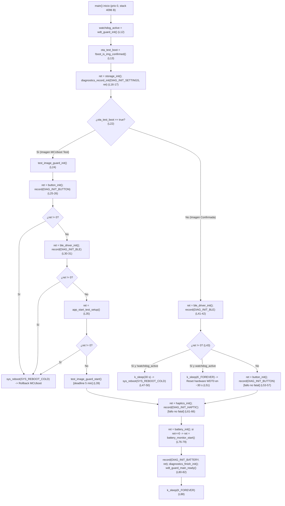
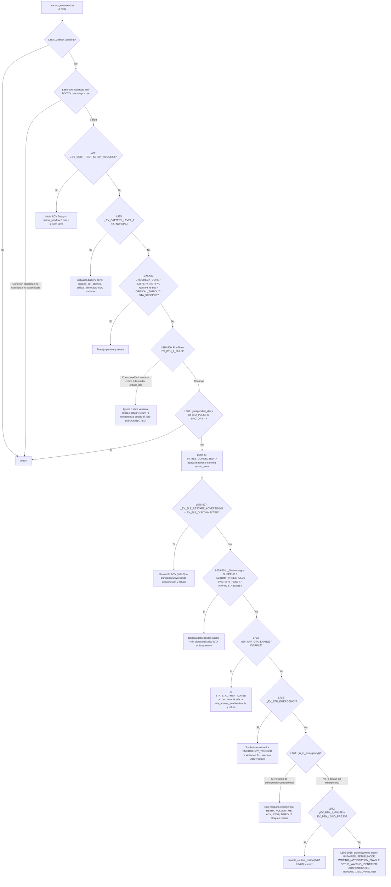
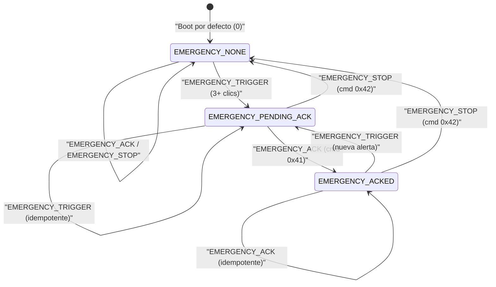

# 20a. Referencia Exhaustiva de Código: Núcleo, FSM y Lógica de Dominio

> **Alcance y corte documental**: Este volumen desarrolla la referencia de ingeniería línea por línea y función por función de los nueve artefactos que conforman el núcleo de arranque, la máquina de estados finitos (`FSM`), la pasarela de protocolo GATT↔FSM y las políticas puras de dominio del firmware de Joya en el commit exacto `c1128e5d0c0d6f98be0a580d287c0926ca27f01f`:
> 1. [`include/main.h`](../../../include/main.h) y [`src/main.c`](../../../src/main.c)
> 2. [`include/app_state.h`](../../../include/app_state.h) y [`src/app_state.c`](../../../src/app_state.c)
> 3. [`include/app_comm.h`](../../../include/app_comm.h) y [`src/app_comm.c`](../../../src/app_comm.c)
> 4. [`include/emergency_phase.h`](../../../include/emergency_phase.h) y [`src/emergency_phase.c`](../../../src/emergency_phase.c)
> 5. [`include/pending_routine.h`](../../../include/pending_routine.h)
>
> Véase el índice maestro e inventarios globales en [`../20_code_reference.md`](../20_code_reference.md), y los volúmenes hermanos [`20b_ble_ota.md`](20b_ble_ota.md) y [`20c_peripherals_storage_wdt.md`](20c_peripherals_storage_wdt.md).

---

## 20a.1. Módulo de Arranque: `include/main.h` y `src/main.c`

### 20a.1.1. Análisis de `include/main.h` (0 líneas, 0 bytes)

| Dimensión (22 puntos) | Especificación verificada |
|---|---|
| **1. Responsabilidad** | Ninguna. Archivo completamente vacío (`0 bytes`) conservado en [`include/main.h`](../../../include/main.h). |
| **2. Dependencias** | Ninguna directiva `#include` entrante ni saliente en todo el repositorio (ni siquiera [`src/main.c`](../../../src/main.c) lo incluye). |
| **3–21. Símbolos, ejecución y recursos** | `0` macros, `0` tipos, `0` funciones, `0` variables, `0 B` Flash/RAM, sin efecto alguno en compilación ni ejecución. |
| **22. Clasificación epistemológica** | **(d) Artefacto residual histórico** de la plantilla inicial del proyecto. No afecta la compilación por no estar referenciado. |

---

### 20a.1.2. Ficha integral de módulo: `src/main.c` (líneas 1–89)

| Dimensión (22 puntos) | Especificación verificada en [`src/main.c`](../../../src/main.c) |
|---|---|
| **1. Responsabilidad** | Secuenciador determinista de inicialización de subsistemas de aplicación tras `SYS_INIT` de Zephyr, bifurcación de políticas de arranque según el estado de confirmación MCUboot (`boot_is_img_confirmed()`), registro del vector de autodiagnóstico inicial (`0xA0 MM`) y habilitación final del supervisor de watchdog (`wdt_guard_main_ready()`). |
| **2. Dependencias** | Cabeceras Zephyr: `<zephyr/kernel.h>`, `<zephyr/dfu/mcuboot.h>`, `<zephyr/sys/reboot.h>` (líneas 1–3). Cabeceras Joya: [`include/button.h`](../../../include/button.h), [`include/app_state.h`](../../../include/app_state.h) (que arrastra transitivamente `ble_driver.h`, `app_comm.h`, `flash_memory.h`, `haptics.h`), [`include/battery.h`](../../../include/battery.h), [`include/test_image_guard.h`](../../../include/test_image_guard.h), [`include/diagnostics.h`](../../../include/diagnostics.h), [`include/wdt_guard.h`](../../../include/wdt_guard.h) (líneas 4–9). |
| **3. API pública** | `int main(void)` (líneas 11–89), punto de entrada estándar invocado por `bg_thread_main()` del kernel Zephyr. |
| **4. Funciones internas** | Ninguna función `static`. |
| **5–7. Parámetros, retorno y errores** | `void` → `int` (nunca retorna: todas las rutas terminan en `k_sleep(K_FOREVER)` o `sys_reboot(SYS_REBOOT_COLD)`). |
| **8. Precondiciones** | MCUboot ya validó RSA-2048/SHA-256 de `slot0_partition` y cedió control; los niveles `EARLY`, `PRE_KERNEL_1`, `PRE_KERNEL_2`, `POST_KERNEL` y `APPLICATION` de Zephyr completaron `SYS_INIT` (incluyendo drivers `gpio0`, `i2c0`, `adc`, `flash`, `wdt0` y el auto-registro inicial de `smp_bt` por MCUmgr); `fsm_thread_id` (prioridad `5`) ya fue creado por `K_THREAD_DEFINE`, pero permanece en cola `ready` detrás de `main` (prioridad `0`) hasta el primer bloqueo de `main`. |
| **9. Postcondiciones** | En arranque normal exitoso: `WDT0` armado (`30 s`) y supervisado cada `10 s` con `main_ready = 1`; `Settings`/`NVS` cargado en RAM; pila BLE + `ibeacon_adv` creados con SMP cerrado; `P0.13` con IRQ en ambos flancos; `DRV2605` configurado para ERM `2,5 V` y puesto en `STANDBY` con `TWIM0` suspendido; `battery_monitor_work` programado en `sysworkq`; `init_bits == 0x1F` (`A0 1F`) y `init_complete == 1`; hilo `main` suspendido indefinidamente en `k_sleep(K_FOREVER)`. En arranque `Test` (`ota_test_boot == true`): además el dispositivo queda en `STATE_SETUP_MODE` publicitando `"Joya Setup"` con ventana crítica de `5 min` y `confirmation_deadline_work` corriendo a `5 min`. |
| **10. Efectos secundarios** | Configura periféricos `WDT0`, `NVMC`/`NVS`, `RADIO`, `GPIOTE`, `TWIM0` y `SAADC`; puede provocar un reset frío inmediato (`NVIC_SystemReset` vía `sys_reboot(SYS_REBOOT_COLD)`) si falla un subsistema crítico para OTA en modo `Test` o si falla BLE sin watchdog activo. |
| **11–12. Estado interno y variables** | Sin variables globales ni estáticas propias; solo automáticas en pila de `main`: `bool watchdog_active` (L12), `bool ota_test_boot` (L13), `int ret` (L15). |
| **13. Contexto de ejecución** | Hilo `main` del kernel Zephyr: prioridad preemptiva `0` (`CONFIG_MAIN_THREAD_PRIORITY=0`), pila `4096 B` (`CONFIG_MAIN_STACK_SIZE=4096` en [`prj.conf:37`](../../../prj.conf#L37)). Es más prioritario que `fsm_thread_id` (`prio = 5`) y `mcumgr_wq` (`prio = 3`), pero menos prioritario que los hilos cooperativos `sysworkq` (`prio = -1`), `BT_HCI_TX` (`-8`) y `BT_RX` (`-9`). |
| **14. Interacciones con otros módulos** | Invoca secuencialmente: `wdt_guard_init()` → `boot_is_img_confirmed()` → `storage_init()` → `diagnostics_record_init()` → (`test_image_guard_init` / `button_init` / `ble_driver_init` / `app_start_test_setup` / `test_image_guard_start`) → `haptics_init()` → `battery_init()` → `battery_monitor_start()` → `diagnostics_finish_init()` → `wdt_guard_main_ready()`. |
| **15. Recursos utilizados** | Consume temporalmente ~300–600 B del stack de `4096 B` de `main` durante `settings_load()` y `bt_enable(NULL)`. Tras la línea 88 (`k_sleep(K_FOREVER)`), los `4096 B` de pila de `main` quedan ociosos en SRAM durante el resto de la vida útil del encendido (véase [`../22_resources_performance.md`](../22_resources_performance.md)). |
| **16. Concurrencia** | Cuando `main` se bloquea por primera vez (en I/O de Flash o en `bt_enable`), `fsm_thread_id` toma la CPU, ejecuta `k_work_init_delayable` sobre sus 4 works y se duerme en `k_msgq_get(K_FOREVER)`. En modo `Test`, `app_start_test_setup()` sincroniza `main` con `fsm_thread_id` mediante `test_setup_sem` (timeout `10 s`). |
| **17. Consideraciones temporales** | Toda la secuencia entre `wdt_guard_init()` (L12) y `wdt_guard_main_ready()` (L82) **debe completarse en menos de `30.000 ms`**, porque `guard_work` no alimenta `WDT0` mientras `main_ready == 0`. El arranque nominal insume `< 50 ms` (incluyendo los `10 ms` de `k_msleep(10)` en `haptics_init()`). La publicidad automática en arranque confirmado **no** se inicia en `main()`, sino ~60 s después tras completarse las 6 muestras de `battery_monitor_work` (véase Sección 20a.2). |
| **18–19. Acceso a HW y Flash** | Indirecto: `boot_is_img_confirmed()` lee el tráiler `image_ok` de `slot0_partition` en Flash; `storage_init()` lee/compacta `storage_partition`; `wdt_guard_init()` escribe registros `NRF_WDT`; `haptics_init()` conmuta `P0.07` e `i2c0`; `battery_init()` ejecuta una conversión inicial `SAADC`. |
| **20–21. Eventos y BLE** | En arranque `Test` encola `EV_BOOT_TEST_SETUP_REQUEST` e inicia publicidad `"Joya Setup"`. En arranque confirmado solo inicializa el stack BLE sin publicitar aún. |
| **22. Clasificación epistemológica** | **(a)** Implementado activo en líneas 11–66 y 76–89. **(d)** Bloque comentado en líneas 68–74 (`haptics_play(HAPTICS_PATTERN_ACK_CONNECTION)`): prueba de arranque desactivada; nótese además que en la línea 72 `haptics_allowed` aún vale `0` (recién se habilita en `battery_init()` línea 69), por lo que si se descomentara en esa posición sería rechazada con `-EACCES`. |

#### Diagrama de flujo exacto de `main()` (`src/main.c:11-89`)



> **Inconsistencia menor observada en `src/main.c` (documentada sin alterar código)**: En la línea 63 se evalúa `if (ret < 0)` tras `haptics_init()`, mientras que en el resto del archivo (`storage_init`, `button_init`, `ble_driver_init`) se evalúa `if (ret != 0)`. Funcionalmente es inocuo porque `haptics_init()` solo devuelve `0` o códigos negativos (`-ENODEV`, `-EIO`, etc.) y el cuerpo del `if` solo contiene comentarios.

---

## 20a.2. Máquina de Estados Finitos (FSM) y Cola de Eventos: `include/app_state.h` y `src/app_state.c`

### 20a.2.1. Ficha integral de módulo (`include/app_state.h` L1–112 + `src/app_state.c` L1–1017)

| Dimensión (22 puntos) | Especificación verificada |
|---|---|
| **1. Responsabilidad** | Actuar como **cerebro coordinador único (actor serializado)** de todo el producto: recibir eventos asíncronos desde periféricos, temporizadores, BLE y MCUmgr en una cola FIFO acotada (`event_queue`), gobernar el ciclo de vida de emparejamiento/reconexión/autenticación BLE, coordinar la sub-máquina ortogonal de emergencias con backoff exponencial acotado, persistir/entregar rutinas offline, aplicar la política energética de batería (`critical_idle` y ventana de rescate de 5 min), proteger transferencias OTA activas y ejecutar gestos críticos de doble barrera (suspensión `5 s` y factory reset `15 s`). |
| **2. Dependencias** | [`include/app_state.h`](../../../include/app_state.h) incluye `"ble_driver.h"`, `"app_comm.h"`, `"flash_memory.h"`, `"haptics.h"`, `<stdbool.h>`, `<stdint.h>`, `<zephyr/kernel.h>`. [`src/app_state.c`](../../../src/app_state.c) añade `"battery.h"`, `"ota_access.h"`, `"diagnostics.h"`, `"wdt_guard.h"`, `"pending_routine.h"`, `<errno.h>`, `<zephyr/dfu/mcuboot.h>` y `<zephyr/sys/reboot.h>`. |
| **3. API pública** | 7 funciones declaradas en `app_state.h`: `process_event`, `fsm_thread_loop`, `add_event`, `add_event_for_conn`, `app_state_pending_events`, `get_current_state`, `app_start_test_setup`. Además `src/app_state.c` exporta accidentalmente sin `static` `increment_emergency_retry_index` y `reset_emergency_retry_index`, y expone el objeto `event_queue` (declarado `extern` en [`include/button.h:10`](../../../include/button.h#L10)). |
| **4. Funciones internas** | 21 funciones `static` divididas en notificadores/callbacks (`notify_current_battery_level`, `suspend_pattern_finished`, `factory_pattern_finished`), transiciones y publicidad (`emergency_stop_alerts`, `factory_reset_and_reboot`, `enter_unpaired_idle`, `enter_critical_idle`, `sync_ibeacon_mode`, `start_advertising_with_ibeacon`, `start_setup_from_idle`, `start_critical_window`, `schedule_advertising_restart`), alertas/rutinas (`emergency_schedule_next_retry`, `emergency_restart_alerts`, `send_pending_routine`, `send_pending_after_auth`, `handle_routine_button`) y 4 manejadores `k_work` (`emergency_retry_work_handler`, `connection_timeout_work_handler`, `advertising_restart_work_handler`, `critical_window_work_handler`). |
| **5–7. Tipos, retornos y errores** | `app_state_t` (8 estados), `event_type_t` (30 eventos), `app_event_t` (`24 B`). Retornos estándar Zephyr: `0` éxito, `-ENOMSG` cuando `event_queue` está llena (`k_msgq_put` con `K_NO_WAIT`), `-EAGAIN` si expira `k_sem_take` en `app_start_test_setup()`, `-EBUSY` / `-EIO` en `test_setup_result`. |
| **8–9. Precondiciones y postcondiciones** | `event_queue` y `fsm_thread_id` son inicializados estáticamente por el kernel antes de `main()`. Todo cambio en `current_state` y banderas internas ocurre exclusivamente dentro de `fsm_thread_id`, garantizando transiciones atómicas respecto de otros eventos de la cola. |
| **10–12. Estado y variables** | 1 constante en `.rodata` (`EMERGENCY_RETRY_MS[5] = {1000, 2000, 5000, 10000, 30000}`), 3 objetos kernel globales (`test_setup_sem`, `event_queue`, `fsm_thread_id`), 1 global escalar (`current_retry_index`) y 20 variables `static` detalladas en la Tabla 20a.2.2. |
| **13. Contexto de ejecución** | Productores `add_event*`: cualquier hilo o ISR (`K_NO_WAIT`). Consumidor `fsm_thread_loop` / `process_event`: exclusivamente `fsm_thread_id` (prioridad preemptiva `5`, stack `4098 B` ajustado a `4104 B`). Handlers de `k_work_delayable`: `sysworkq` (prioridad cooperativa `-1`, stack `4096 B`), que delegan inmediatamente a `event_queue`. |
| **14–15. Interacciones y recursos** | Orquesta todos los módulos excepto `button.c` (que solo empuja hacia `event_queue`). Memoria estática clave: `480 B` de buffer `event_queue` (`20 × 24 B`) + estructura `k_msgq`, `4104 B` de pila de `fsm_thread_id`, 4 estructuras `k_work_delayable`, 1 `k_sem`. |
| **16. Concurrencia** | Modelo **Actor MPSC (Multiple-Producer, Single-Consumer)**: múltiples productores concurrentes insertan `app_event_t` por valor en `event_queue` (protegida por spinlock interno de Zephyr); `add_event_for_conn()` adquiere `bt_conn_ref(conn)` antes de encolar y `fsm_thread_loop()` ejecuta `bt_conn_unref(entry.conn)` al terminar `process_event(&entry)` (o `add_event_for_conn` revierte el `ref` si la cola está llena), impidiendo *use-after-free* sobre `struct bt_conn`. `current_state` es `volatile` para lecturas sin lock desde `get_current_state()`. |
| **17. Consideraciones temporales** | Cada llamada a `process_event()` debe finalizar en `<< 15.000 ms` (`FSM_STALL_MS` de `wdt_guard`). Las operaciones más lentas dentro de `process_event()` son borrados/compactaciones puntuales de NVS (~20–100 ms) y `drv2605_wake()` (`k_msleep(10)` + transacciones I2C ~1 ms). Temporizadores propios: `90 s` (`connection_timeout_work`), `1/2/5/10/30 s` (`emergency_retry_work`), `10 ms` inicial + `5 s` × 2 reintentos (`advertising_restart_work`), `5 min` (`critical_window_work`). |
| **18–21. HW, Flash, Eventos y BLE** | Lee indirectamente el tráiler MCUboot (`boot_is_img_confirmed()`) y reinicia la CPU (`sys_reboot`); persiste `APP_ID`, fase de emergencia, rutina pendiente y borrado de fábrica vía `flash_memory.c`; consume los 30 `event_type_t` (y auto-produce 7 de ellos desde sus works/callbacks); gobierna publicidad, autenticación de conexión, apertura/cierre OTA y notificaciones de comandos/batería. |
| **22. Clasificación epistemológica** | **(a)** Implementado activo en su totalidad salvo: **(d)** `STATE_SETUP_WAITING_NEW_IDENTIFIER` y `STATE_EMERGENCY` (estados residuales nunca asignados), `EV_BATTERY_RECHECK_DONE` (descartado con `return` vacío en L479–481), y comentario desactualizado sobre `reset_emergency_retry_index` en L88. |

### 20a.2.2. Variables globales y estáticas de `src/app_state.c`

| Símbolo (Línea) | Tipo e inicializador | Propósito exacto e invariantes de estado |
|---|---|---|
| `EMERGENCY_RETRY_MS` (L12) | `const uint32_t[5] = {1000, 2000, 5000, 10000, 30000}` | Escala de reintentos de `COMMAND_EMERGENCY` (`0x04`). Al llegar al índice `4` (`30 s`), permanece clavado en `30 s` indefinidamente hasta recibir `0x41`/`0x42`, desconectar o suspender. |
| `current_retry_index` (L14) | `uint8_t = 0` | Índice actual `[0..4]` en `EMERGENCY_RETRY_MS`. Nota: carece de `static`, pero solo se accede en `fsm_thread_id`. |
| `connection_timeout_work` (L16) | `static struct k_work_delayable` | Ventana de `90 s` (`BLE_SETUP_TIMEOUT_MS`) en `STATE_SETUP_MODE` cuando `critical_window_open == false`. |
| `emergency_retry_work` (L17) | `static struct k_work_delayable` | Temporizador de retransmisión de `0x04` mientras `emergency_alerts_active && current_state == STATE_AUTHENTICATED`. |
| `advertising_restart_work` (L18) | `static struct k_work_delayable` | Reintento diferido de publicidad (`10 ms` tras desconexión para dejar liberar referencias del stack BLE, luego hasta 2 reintentos adicionales a `5 s` si HCI devuelve `-ENOMEM`/`-EBUSY`/`-EAGAIN`). |
| `critical_window_work` (L19) | `static struct k_work_delayable` | Ventana de gracia de `5 min` (`CRITICAL_WINDOW_MS`) que impide caer en `critical_idle` durante arranque de imagen `Test` o tras rescate manual por 2 clics en batería nivel 2. |
| `advertising_attempts` (L21) | `static uint8_t` (`0`) | Contador `[0..3]` de ejecuciones de `EV_BLE_RESTART_ADVERTISING` por ráfaga. |
| `test_setup_sem` (L22) | `K_SEM_DEFINE(..., 0, 1)` | Barrera binaria entre `app_start_test_setup()` (hilo `main`) y `EV_BOOT_TEST_SETUP_REQUEST` (`fsm_thread_id`). |
| `test_setup_result` (L23) | `static int` (`0`) | Resultado de `start_advertising_with_ibeacon(true)` y armado de `critical_window_work` devuelto a `main()`. |
| `current_state` (L26) | `static volatile app_state_t = STATE_UNPAIRED` | Estado primario actual de conectividad/autenticación (`STATE_UNPAIRED`, `STATE_SETUP_MODE`, `STATE_WAITING_NOTIFICATION_ENABLE`, `STATE_SETUP_WAITING_IDENTIFIER`, `STATE_BONDED_DISCONNECTED`, `STATE_AUTHENTICATED`). |
| `event_queue` (L28) | `K_MSGQ_DEFINE(..., 24, 20, 4)` | Cola FIFO de 20 mensajes `app_event_t` alineados a 4 bytes (`480 B` de payload). |
| `fsm_thread_id` (L36) | `K_THREAD_DEFINE(..., 4098, ..., 5, 0, 0)` | Hilo consumidor único de la FSM (stack solicitado `4098 B`, alineado a `4104 B`, prioridad `5`). |
| `emergency_alerts_active` (L38) | `static bool = false` | `true` cuando `emergency_restart_alerts()` activó el ciclo de envíos `0x04` en la conexión actual. |
| `reboot_pending` (L40) | `static bool` (`false`) | Actúa como cerrojo terminal durante `factory_reset_and_reboot()` (se revierte a `false` solo si `storage_factory_reset()` falla en Flash). |
| `suspended_idle` (L41) | `static bool` (`false`) | `true` cuando el equipo entró en reposo profundo lógico por gesto `5 s`, por batería nivel 2 (`enter_critical_idle`) o tras fallo de Flash en factory reset; bloquea eventos ordinarios salvo 2 clics y factory reset. |
| `critical_idle` (L42) | `static bool` (`false`) | Sub-bandera energética que indica que el reposo o bloqueo háptico provino de `battery_level == 2`. |
| `critical_window_open` (L43) | `static bool` (`false`) | `true` mientras corre la ventana de `5 min` que inhibe el apagado por `battery_level == 2` y el timeout de `90 s`. |
| `boot_battery_seen` (L44) | `static bool` (`false`) | Se pone a `true` una única vez al recibir el primer evento `EV_BATTERY_*` confirmado tras el arranque (~60 s). |
| `boot_reconnect_pending` (L45) | `static bool` (`false`) | `true` si al confirmarse la primera lectura de batería pos-arranque existe `APP_ID` y la imagen MCUboot está confirmada; dispara el paso automático a `STATE_BONDED_DISCONNECTED` + publicidad en cuanto `battery_level != 2`. |
| `critical_window_deadline_ms` (L46) | `static int64_t` (`0`) | Marca `k_uptime_get() + 300000` verificada en `EV_CRITICAL_WINDOW_TIMEOUT` contra disparos prematuros o encolados de una ventana anterior. |
| `battery_level` (L47) | `static int = -1` | Último nivel confirmado por votación 5/6 (`-1` desconocido en los primeros ~60 s, `0` normal, `1` bajo, `2` crítico). |
| `hold_blocked` (L56) | `static bool` (`false`) | Si `EV_BTN_FACTORY_THRESHOLD` ocurrió durante una transferencia OTA activa, marca `true` para descartar también el posterior `EV_BTN_FACTORY_RESET` al soltar el botón. |
| `hold_released`, `hold_pattern_done`, `hold_action` (L57–63) | `static bool` (×2), `static enum` | Máquina de doble barrera que garantiza que ni la suspensión (`5 s`) ni el factory reset (`15 s`) corten el enlace/reinicien antes de que (1) la usuaria haya soltado el botón **y** (2) el patrón háptico completo haya concluido. |

---

### 20a.2.3. Referencia función por función de `src/app_state.c` (las 30 funciones)

#### A. Funciones públicas y con enlace externo (9 funciones)

##### 1. `app_state_pending_events` (`src/app_state.c:30-33`, `include/app_state.h:101`)
- **Firma**: `unsigned int app_state_pending_events(void)`
- **Parámetros / Retorno / Errores**: `void` → número de mensajes actualmente almacenados en `event_queue` (`0..20`) mediante `k_msgq_num_used_get(&event_queue)`. Nunca falla.
- **Pre/Postcondiciones y Efectos**: Lectura pura no destructiva sin efectos secundarios.
- **Contexto, Concurrencia y Interacciones**: Invocada cada `10 s` desde `guard_work_handler()` en `sysworkq` ([`src/wdt_guard.c:66`](../../../src/wdt_guard.c#L66)) para detectar inanición o bloqueo del hilo `fsm_thread_id`. `k_msgq_num_used_get` es atómica/segura entre hilos. Sin acceso a HW, Flash ni BLE. **Estado**: **(a)** Activa.

##### 2. `get_current_state` (`src/app_state.c:320-322`, `include/app_state.h:107`)
- **Firma**: `app_state_t get_current_state(void)`
- **Parámetros / Retorno / Errores**: `void` → copia instantánea de `current_state` (`volatile app_state_t`). Nunca falla.
- **Contexto, Concurrencia e Interacciones**: Invocada desde `BT_RX` en `on_name_write()` ([`src/ble_driver.c:279`](../../../src/ble_driver.c#L279)) para exigir `STATE_AUTHENTICATED` antes de cambiar el nombre, y desde `fsm_thread_id` / `sysworkq` en `ble_send_battery_value()` ([`src/ble_driver.c:715`](../../../src/ble_driver.c#L715)). La lectura alineada de 32 bits en Cortex-M4 (`LDR`/`LDRB`) es atómica; al no tomar mutex evita inversión de prioridad o interbloqueo con `conn_mutex`. **Estado**: **(a)** Activa.

##### 3. `app_start_test_setup` (`src/app_state.c:324-332`, `include/app_state.h:110`)
- **Firma**: `int app_start_test_setup(void)`
- **Parámetros / Retorno / Errores**: `void` → `0` si la FSM inició `"Joya Setup"` y armó la ventana crítica de `5 min`; negativo en fallo (`-ENOMSG` si `add_event` falla, `-EAGAIN` si `k_sem_take` vence a los `10 s`, `-EBUSY` si `current_state != STATE_UNPAIRED`, `-EIO` si falló `k_work_reschedule`, o el error HCI de `ble_start_setup_advertising(true)`).
- **Pre/Postcondiciones y Efectos**: Llamada únicamente desde `main()` (L35) cuando `!boot_is_img_confirmed()`. Encola `EV_BOOT_TEST_SETUP_REQUEST`, cede la CPU en `k_sem_take(&test_setup_sem, K_SECONDS(10))` permitiendo que `fsm_thread_id` inicialice sus works y ejecute la transición a `STATE_SETUP_MODE`, y recoge `test_setup_result`. Si falla, `main()` ejecuta `sys_reboot(SYS_REBOOT_COLD)` forzando rollback inmediato en MCUboot. **Estado**: **(a)** Activa.

##### 4. `add_event` (`src/app_state.c:335-338`, `include/app_state.h:97`)
- **Firma**: `int add_event(event_type_t event)`
- **Comportamiento completo**: Envoltorio directo `return add_event_for_conn(event, NULL, NULL);`. Seguro desde cualquier hilo o ISR (`K_NO_WAIT`). **Estado**: **(a)** Activa.

##### 5. `add_event_for_conn` (`src/app_state.c:340-354`, `include/app_state.h:98`)
- **Firma**: `int add_event_for_conn(event_type_t event, struct bt_conn *conn, const uint8_t *app_id)`
- **Parámetros**: `event` (código `event_type_t`), `conn` (puntero opcional a conexión BLE originadora o `NULL`), `app_id` (buffer opcional de `16 B` para `EV_APP_IDENTIFIER_RECEIVED` o `NULL`).
- **Retorno y Errores**: `0` si el mensaje ingresó en `event_queue`; `-ENOMSG` (o `-EAGAIN`) si las 20 ranuras están ocupadas.
- **Pre/Postcondiciones, Efectos y Concurrencia**:
  1. Construye `app_event_t entry` en la pila local (`24 B`). Si `conn != NULL`, incrementa atómicamente el contador de referencias de Zephyr mediante `bt_conn_ref(conn)` **antes** de publicar el evento.
  2. Si `app_id != NULL`, copia `16 B` (`memcpy(entry.app_id, app_id, SIZE_APP_ID)`), desacoplando el buffer ATT temporal de la pila `BT_RX`.
  3. Invoca `k_msgq_put(&event_queue, &entry, K_NO_WAIT)` (tiempo constante $O(1)$, apto para ISR y callbacks BLE).
  4. Si `err != 0` (cola llena): invoca `diagnostics_report_error(DIAG_ERROR_EVENT_QUEUE_FULL)` (`0xE3`) y, si había incrementado referencia de `entry.conn`, la libera inmediatamente con `bt_conn_unref(entry.conn)` evitando fugas del único objeto `bt_conn` (`CONFIG_BT_MAX_CONN=1`).
- **Estado**: **(a)** Activa.

##### 6. `fsm_thread_loop` (`src/app_state.c:356-372`, `include/app_state.h:90`)
- **Firma**: `void fsm_thread_loop(void)`
- **Responsabilidad y Ciclo de Vida**: Punto de entrada de `fsm_thread_id` (prioridad `5`). Inicializa las cuatro estructuras `k_work_delayable` (`emergency_retry_work`, `connection_timeout_work`, `advertising_restart_work`, `critical_window_work`) y entra en un lazo infinito:
  1. `k_msgq_get(&event_queue, &entry, K_FOREVER)`: mientras no hay eventos, el hilo consume **0 % de CPU** y permite al hilo `idle` de Zephyr ejecutar `WFI`/`__WFE` (System ON Idle de bajo consumo, ~2–3 µA base CPU). `wdt_guard` considera saludable esta espera indefinida porque `fsm_processing == 0` y `event_queue` está vacía.
  2. `wdt_guard_fsm_event_begin()` → `process_event(&entry)` → `wdt_guard_fsm_event_end()`: acota exactamente el tiempo de cómputo del evento e incrementa el contador monotónico `fsm_progress`.
  3. `if (entry.conn) { bt_conn_unref(entry.conn); }`: empareja simétricamente el `bt_conn_ref` realizado en `add_event_for_conn()`.
- **Estado**: **(a)** Activa.

##### 7. `increment_emergency_retry_index` y 8. `reset_emergency_retry_index` (`src/app_state.c:80-92`)
- **Firmas**: `void increment_emergency_retry_index(void)` y `void reset_emergency_retry_index(void)`
- **Comportamiento**: `increment_emergency_retry_index()` avanza `current_retry_index` desde `0` hasta saturar en `4` (`ARRAY_SIZE(EMERGENCY_RETRY_MS) - 1`); `reset_emergency_retry_index()` lo devuelve a `0`.
- **Observación de ingeniería (`(a)` vs. `(b)`/`(d)`)**: Aunque están ubicadas bajo el bloque `PRIVATE FUNCTIONS` (L76), carecen del calificador `static` (tienen enlace externo sin prototipo en cabecera). Además, el comentario en L88 (*"route emergency retry work through the FSM to avoid shared state between workqueue and process_event()"*) es **histórico**: en `c1128e5`, `emergency_retry_work_handler` ya solo encola `EV_EMERGENCY_RETRY` y ambas funciones se ejecutan únicamente en `fsm_thread_id`, sin condición de carrera real.

##### 9. `process_event` (`src/app_state.c:378-1017`, `include/app_state.h:84`)
- **Firma**: `void process_event(const app_event_t *entry)`
- **Parámetros / Retorno**: `entry` (puntero no nulo al evento extraído de `event_queue` en la pila de `fsm_thread_id`) → `void`.
- **Arquitectura interna de despacho en 20 etapas secuenciales**: En lugar de una matriz plana `estado × evento`, `process_event()` implementa una **tubería jerárquica de guardas ortogonales** seguida de un `switch (current_state)` final. Este diseño permite que condiciones transversales (reinicio en curso, validación criptográfica/sesión de `entry->conn`, batería crítica, gestos de emergencia y gestos de `5 s`/`15 s`) dominen uniformemente sobre cualquier estado de conexión.



#### Desglose exhaustivo por bloques de líneas de `process_event()` (`src/app_state.c:378-1017`)

1. **Líneas 382–400 — Guardas de corte temprano y validación de `entry->conn` contra condiciones TOCTOU**:
   - Si `reboot_pending == true`, descarta cualquier evento mientras concluye el reinicio de fábrica.
   - Si llega `EV_BLE_CONNECTED` pero `!ble_is_current_conn(entry->conn)` (el enlace ya se cayó antes de que la FSM leyera la cola), se ignora.
   - Si llega `EV_BLE_DISCONNECTED` pero `ble_has_connection()` es verdadero (un enlace viejo terminó después de haberse establecido uno nuevo), se ignora para no derribar la sesión vigente.
   - Si llega `EV_BLE_NOTIFY_ENABLED` pero `!ble_commands_subscribed_for_conn(entry->conn)`, se ignora (evita avanzar a `STATE_SETUP_WAITING_IDENTIFIER` si el cliente se desuscribió o desconectó enseguida).
   - Si llega cualquiera de los comandos sensibles `EV_APP_ACK_EMERGENCY`, `EV_APP_STOP_EMERGENCY`, `EV_APP_FOLLOW_ME` o `EV_APP_FRIEND_EMERGENCY` desde una conexión no marcada como autenticada (`!ble_is_authenticated_conn(entry->conn)`), se descarta de plano aunque `current_state` fuese `STATE_AUTHENTICATED` de una transición en vuelo.

2. **Líneas 402–423 — Arranque de imagen MCUboot `Test` (`EV_BOOT_TEST_SETUP_REQUEST`)**:
   - Exige `current_state == STATE_UNPAIRED` (si no, devuelve `-EBUSY`). Llama a `start_advertising_with_ibeacon(true)` (anunciando `"Joya Setup"`), pasa a `STATE_SETUP_MODE` **sin** armar el timeout de `90 s` (`connection_timeout_work`) y abre `critical_window_open = true` durante `5 min` (`CRITICAL_WINDOW_MS`). Esto garantiza que una imagen OTA recién instalada en prueba siga aceptando conexión y confirmación SMP incluso si el ADC reporta `battery_level == 2` a los `60 s` del arranque. Finalmente despierta a `main()` con `k_sem_give(&test_setup_sem)`.

3. **Líneas 425–477 — Política energética y reconexión diferida de arranque (`EV_BATTERY_LEVEL_1`, `EV_BATTERY_LEVEL_2`, `EV_BATTERY_NORMAL`)**:
   - Traduce el evento a `battery_level` (`0`, `1` o `2`).
   - En la primera confirmación tras el encendido (`!boot_battery_seen`, típicamente `t ≈ 60 s`), fija `boot_battery_seen = true` y calcula `boot_reconnect_pending = !is_app_id_empty() && boot_is_img_confirmed()`.
   - Si `battery_level != 2`: cancela `critical_window_work` si estaba abierta (y si estaba en `STATE_SETUP_MODE` sin conexión en una imagen confirmada, restaura el timeout normal de `90 s`); limpia `critical_idle` si no está en `suspended_idle`.
   - Si `battery_level == 2 && critical_window_open`: marca `critical_idle = true` de forma anticipada para que `haptics_set_allowed(false)` deshabilite inmediatamente el motor ERM aunque el enlace BLE permanezca abierto hasta vencer los `5 min`.
   - Ejecuta `haptics_set_allowed(battery_level == 0 && !critical_idle)`: el motor háptico **solo** está permitido en nivel `0` (`> 3000 mV`) y fuera de `critical_idle`.
   - Notifica el nivel `0/1/2` si hay sesión autenticada (`notify_current_battery_level()`).
   - **Rama `battery_level == 2` (L453–461)**: Consulta `updating = ota_access_is_update_active()`. Si no hay ventana crítica abierta, llama a `ota_access_disable()` (que difiere el cierre si `updating == true`) y, solo si `!updating && !critical_window_open`, invoca `enter_critical_idle()` (cortando conexión, publicidad, alertas y pasando a `STATE_UNPAIRED` con `suspended_idle = true`). Así evita corromper o abortar a mitad de camino una descarga OTA hacia `slot1_partition`.
   - **Rama `else if (boot_reconnect_pending ...)` (L462–475)**: Cuando un dispositivo emparejado arranca con imagen confirmada y batería `0` o `1` (o cuando se recupera en boot desde nivel `2` a nivel `1`/`0`), sale automáticamente de `STATE_UNPAIRED` hacia `STATE_BONDED_DISCONNECTED` e invoca `start_advertising_with_ibeacon(false)` (o `schedule_advertising_restart()` si HCI está ocupado).

4. **Líneas 479–514 — Eventos auxiliares de batería, re-suscripción CCC, fin de ventana crítica y fin de OTA**:
   - `EV_BATTERY_RECHECK_DONE` (L479): `return` inmediato (**residual `(d)`** de una lógica previa de despertar síncrono reemplazada por `start_critical_window()`).
   - `EV_BLE_BATTERY_NOTIFY_ENABLED` (L483): empuja inmediatamente el `battery_level` actual al suscribirse la app al CCC de `BATTERY_CHANGE`.
   - `EV_BLE_NOTIFY_ENABLED && current_state == STATE_AUTHENTICATED` (L488): si la app ya autenticada vuelve a escribir `0x0001` en el CCC de `TX`, re-ejecuta `send_pending_after_auth()`.
   - `EV_CRITICAL_WINDOW_TIMEOUT` (L494): verifica `critical_window_open && k_uptime_get() >= critical_window_deadline_ms`; cierra la ventana y, si `battery_level == 2 && !ota_access_is_update_active()`, ejecuta `enter_critical_idle()`.
   - `EV_OTA_UPDATE_STOPPED` (L506): cuando una transferencia DFU se detiene sin completarse mientras `battery_level == 2`, cierra OTA y ejecuta el `enter_critical_idle()` que había quedado diferido.

5. **Líneas 516–567 — Pre-manejadores de `EV_BTN_2_PULSE` y cortafuegos de `suspended_idle`**:
   - Con enlace BLE activo (`ble_has_connection()`), 2 clics se ignoran siempre (L516).
   - Si `!suspended_idle && battery_level == 2 && !critical_window_open` (L520): limpia a idle crítico y abre una ventana de rescate de `5 min` (`start_critical_window()`).
   - Si `suspended_idle && critical_idle` (L527): si `battery_level` ya recuperó a `0` o `1`, sale a setup normal (`90 s`) con vibración si `battery_level == 0`; si sigue en `2` (o `-1` antes del minuto 1), abre la ventana crítica silenciosa de `5 min` sin vibrar.
   - **Auto-curación ante pérdida de `EV_BLE_DISCONNECTED` (L540–552)**: Si `!ble_has_connection()` (ya comprobado en L516) pero `current_state` quedó atrapado en un estado conectado porque `event_queue` estaba llena cuando ocurrió la desconexión BLE, detiene alertas y corrige `current_state` a `STATE_UNPAIRED` o `STATE_BONDED_DISCONNECTED` **sin hacer `return`**, permitiendo que ese mismo `EV_BTN_2_PULSE` continúe hacia las líneas 888 o 1003 y relance la publicidad.
   - Si `suspended_idle` sigue activo (p. ej. suspensión voluntaria de `5 s` sin `critical_idle`), las líneas 562–567 bloquean todos los eventos salvo `EV_BTN_2_PULSE` (que caerá a `STATE_UNPAIRED` L888 para despertar el dispositivo) y los tres eventos de `FACTORY_RESET`.

6. **Líneas 569–627 — Gestión de conexión, reintento de publicidad y desconexión universal**:
   - `EV_BLE_CONNECTED` (L569–573): limpia `boot_reconnect_pending`, cancela `advertising_restart_work` y apaga explícitamente el iBeacon (`BLE_IBEACON_OFF`), dejando que la transición de estado ocurra en el `switch (current_state)` final (`STATE_SETUP_MODE` L895 o `STATE_BONDED_DISCONNECTED` L1000). *(Nota de borde documentada: si por una carrera un enlace se estableciera cuando `current_state == STATE_UNPAIRED`, `switch (current_state)` no contiene rama `EV_BLE_CONNECTED` en `STATE_UNPAIRED`).*
   - `EV_BLE_RESTART_ADVERTISING` (L575–596): ejecuta hasta `3` intentos (`10 ms`, `+5 s`, `+5 s`) únicamente si el estado sigue siendo `STATE_BONDED_DISCONNECTED` con `APP_ID` o `STATE_SETUP_MODE` sin `APP_ID`.
   - `EV_BLE_DISCONNECTED` (L598–627): árbol prioritario al caer el enlace: (1) si `critical_window_open`, reprograma publicidad; (2) si `battery_level == 2 && !ota_access_is_update_active()`, entra en `critical_idle`; (3) si `is_in_emergency()`, detiene el timer `emergency_retry_work` (la fase persistida en Flash queda intacta en `EMERGENCY_PENDING_ACK` o `EMERGENCY_ACKED`) y agenda reinicio de publicidad en `10 ms`; (4) si estaba en `STATE_SETUP_MODE`, vuelve a `STATE_UNPAIRED` y detiene publicidad; (5) si estaba en `WAITING_NOTIFICATION_ENABLE`, `SETUP_WAITING_IDENTIFIER` o `AUTHENTICATED`, pasa a `STATE_UNPAIRED` (si no había `APP_ID`) o a `STATE_BONDED_DISCONNECTED` agendando `schedule_advertising_restart()`.

7. **Líneas 629–713 — Gestos sostenidos de doble barrera (`5 s` / `15 s`) y puerta OTA (`0x70` / `0x71`)**:
   - Si `ota_access_is_update_active()` es verdadero (`uploading || upload_complete`), **bloquea tanto la suspensión como el factory reset** (activando `hold_blocked = true` en `EV_BTN_FACTORY_THRESHOLD` para absorber también el `EV_BTN_FACTORY_RESET` al soltar), protegiendo la escritura en `slot1_partition`.
   - En suspensión (`EV_BTN_SUSPEND_REQUEST`, emitido ya al soltar entre `5` y `15 s`), marca `hold_released = true` y lanza `HAPTICS_PATTERN_SUSPEND` (`1.400 ms`) con callback `suspend_pattern_finished`; si háptica está deshabilitada/falla (`ret != 0`), ejecuta `enter_unpaired_idle()` en el acto; si no, espera `EV_HAPTICS_SUSPEND_DONE` para cortar BLE recién al terminar la vibración.
   - En factory reset (`EV_BTN_FACTORY_THRESHOLD` a los `15 s` aún presionado), lanza `HAPTICS_PATTERN_FACTORY_RESET` (`900 ms`) mientras `hold_released = false`; solo cuando convergen `hold_released && hold_pattern_done` (L683) ejecuta `factory_reset_and_reboot()`.
   - `EV_APP_OTA_ENABLE` / `EV_APP_OTA_DISABLE` (L703–713): exige doble guarda `current_state == STATE_AUTHENTICATED && ble_is_authenticated_conn(entry->conn)` antes de invocar `ota_access_enable()` o `ota_access_disable()`.

8. **Líneas 715–884 — Disparo `EV_BTN_EMERGENCY`, sub-máquina ortogonal `is_in_emergency()` y rutinas**:
   - En `EV_BTN_EMERGENCY` (L715): si ya estaba en `EMERGENCY_PENDING_ACK`, solo repite el feedback `HAPTICS_PATTERN_EMERGENCY_START` (`2 s`) y retorna sin reiniciar la cadencia de backoff en curso. Si no, y existe `APP_ID`, escribe primero el *tombstone* `0` en `joya/routine` (evitando que un rollback OTA posterior resucite una rutina vieja) y luego persiste `EMERGENCY_PENDING_ACK` (`1`) en `joya/emergency`. Si está autenticado envía `0x04` e inicia el timer `1, 2, 5, 10, 30 s`; si está desconectado fuerza publicidad inmediata.
   - Mientras `is_in_emergency()` es `true` (`EMERGENCY_PENDING_ACK` o `EMERGENCY_ACKED`), el bloque L767–878 intercepta: `EV_EMERGENCY_RETRY` (reenvía `0x04`), `EV_APP_FOLLOW_ME` (**único lugar del firmware donde se acepta `0x43`**, respondiendo `0x05` + `HAPTICS_PATTERN_FOLLOW_ME`), `EV_APP_ACK_EMERGENCY` (`0x41` → detiene reintentos, persiste `EMERGENCY_ACKED (2)` y envía `0x05`), `EV_APP_STOP_EMERGENCY` (`0x42` → detiene reintentos, escribe tombstone `0` en `joya/routine`, persiste `EMERGENCY_NONE (0)` y envía `0x05`), `EV_BLE_TIMEOUT` (rearma publicidad perpetua ignorando el timeout de `90 s`) y **suprime** `EV_BTN_1_PULSE`, `EV_BTN_LONG_PRESS` y `EV_APP_FRIEND_EMERGENCY`, dejando pasar por `default: break;` los eventos de reconexión y autenticación (`EV_BLE_CONNECTED`, `EV_BLE_NOTIFY_ENABLED`, `EV_APP_IDENTIFIER_RECEIVED`, `EV_BTN_2_PULSE`).
   - Si `!is_in_emergency()`, las líneas 880–884 despachan `EV_BTN_1_PULSE` (`0x02`) y `EV_BTN_LONG_PRESS` (`0x03`) a `handle_routine_button()`.

9. **Líneas 886–1016 — `switch (current_state)` final**:
   - `STATE_UNPAIRED`: `EV_BTN_2_PULSE` → `start_setup_from_idle()`.
   - `STATE_SETUP_MODE`: `EV_BLE_CONNECTED` cancela `connection_timeout_work`, pasa a `STATE_WAITING_NOTIFICATION_ENABLE` y llama `ble_stop_advertising()`; `EV_BLE_TIMEOUT` (si `!critical_window_open`) vuelve a `STATE_UNPAIRED` y detiene publicidad.
   - `STATE_WAITING_NOTIFICATION_ENABLE`: `EV_BLE_NOTIFY_ENABLED` avanza a `STATE_SETUP_WAITING_IDENTIFIER` (cualquier `APP_ID` enviado antes de habilitar CCC `TX` es ignorado deliberadamente por contrato de protocolo).
   - `STATE_SETUP_WAITING_IDENTIFIER`: al recibir `EV_APP_IDENTIFIER_RECEIVED`, verifica `ble_is_current_conn(entry->conn)`. Si `is_app_id_empty()`, guarda el nuevo `APP_ID` (`save_received_app_id`), verifica que no haya abortado por `pending_routine_dirty` (`if (is_app_id_empty()) return;`), sincroniza modo iBeacon, transiciona a `STATE_AUTHENTICATED`, marca la conexión autenticada (`ble_mark_authenticated_conn`), envía `COMMAND_ACK` (`0x05`), notifica nivel de batería, reproduce `HAPTICS_PATTERN_ACK_CONNECTION` y llama `send_pending_after_auth()`. Si ya existía `APP_ID`, lo compara con `check_app_id()`: si coincide (`== 0`), autentica, envía `0x05`, notifica batería, llama `send_pending_after_auth()` y luego `haptics_play(HAPTICS_PATTERN_ACK_CONNECTION)`; si difiere, envía `COMMAND_NACK` (`0x06`) permaneciendo en `STATE_SETUP_WAITING_IDENTIFIER`.
   - **Sutileza de orden háptico documentada en L971–972**: En reconexión con `APP_ID` existente y emergencia pendiente (`EMERGENCY_PENDING_ACK`), `send_pending_after_auth()` (L971) invoca `haptics_play(HAPTICS_PATTERN_EMERGENCY_START)` (`2000 ms`), pero la línea siguiente (L972) invoca inmediatamente `haptics_play(HAPTICS_PATTERN_ACK_CONNECTION)` (`3 × 200 ms`), que cancela síncronamente el patrón de emergencia recién iniciado y reproduce el patrón de conexión. En cambio, en registro de `APP_ID` nuevo (L950–951) el orden está invertido.
   - `STATE_AUTHENTICATED`: procesa `EV_APP_FRIEND_EMERGENCY` (`0x44`) reproduciendo `HAPTICS_PATTERN_FRIEND_EMERGENCY` y respondiendo `COMMAND_ACK` (`0x05`).
   - `STATE_BONDED_DISCONNECTED`: `EV_BLE_CONNECTED` pasa a `STATE_WAITING_NOTIFICATION_ENABLE`; `EV_BTN_2_PULSE` reintenta manualmente `start_advertising_with_ibeacon(false)` cancelando `advertising_restart_work` y vibrando `HAPTICS_PATTERN_SETUP_MODE`.

---

#### B. Funciones internas (`static`) de `src/app_state.c` (21 funciones)

| # | Función (`src/app_state.c`) | Líneas | Parámetros / Retorno | Análisis completo de comportamiento, efectos, recursos y concurrencia (22 puntos) |
|---:|---|---|---|---|
| 1 | `notify_current_battery_level` | L49–54 | `void` → `void` | Si `battery_level >= 0` (ya confirmado por 5/6 muestras) y `current_state == STATE_AUTHENTICATED`, invoca `(void)ble_send_battery_change((uint8_t)battery_level)`. Ejecuta en `fsm_thread_id`; toma internamente `conn_mutex` en `ble_driver.c`. No accede a HW ni Flash. **(a)** Activa. |
| 2 | `suspend_pattern_finished` | L65–68 | `void` → `void` | Callback de finalización pasado a `haptics_play_with_completion()`. Encola `EV_HAPTICS_SUSPEND_DONE` con `add_event()`. Corre en `sysworkq` al agotarse el último paso de `pattern_suspend`, o en `fsm_thread_id` si `haptics_set_allowed(false)` aborta la reproducción en vuelo. **(a)** Activa. |
| 3 | `factory_pattern_finished` | L70–73 | `void` → `void` | Análoga a la anterior para `pattern_factory_reset`: encola `EV_HAPTICS_FACTORY_DONE`. **(a)** Activa. |
| 4 | `emergency_stop_alerts` | L94–99 | `void` → `void` | Limpia `emergency_alerts_active = false`, cancela `emergency_retry_work` (`k_work_cancel_delayable`) y resetea `current_retry_index = 0`. **No** altera `joya_emergency_phase` en RAM ni Flash (por eso se usa tanto al recibir `0x41`/`0x42` como al desconectarse BLE sin perder la emergencia persistida). Confinada a `fsm_thread_id`. **(a)** Activa. |
| 5 | `factory_reset_and_reboot` | L101–120 | `void` → `void` | Ejecuta la restauración de fábrica atómica respecto de eventos: fija `reboot_pending = true`, cancela `advertising_restart_work`, pasa `current_state = STATE_UNPAIRED`, corta enlace y publicidad (`ble_disconnect()`), detiene alertas (`emergency_stop_alerts()`) y llama `storage_factory_reset()`. **Diseño defensivo ante fallo de Flash (L108–117)**: si algún `settings_delete` falla (`!= 0`), reporta `DIAG_ERROR_FLASH_WRITE` (`0xE1`), **cancela el reboot** (`reboot_pending = false`, `suspended_idle = true`, `sync_ibeacon_mode()`) y conserva el borrado en RAM para no recargar desde NVS el `APP_ID` cuyo borrado falló. Si tuvo éxito (`== 0`), ejecuta `sys_reboot(SYS_REBOOT_COLD)`. **(a)** Activa. |
| 6 | `enter_unpaired_idle` | L122–133 | `void` → `void` | Transición maestra a reposo desconectado (`suspended_idle = true`, `current_state = STATE_UNPAIRED`): cancela `advertising_restart_work`, `connection_timeout_work` y `critical_window_work`, limpia `critical_window_open = false`, detiene alertas de emergencia, solicita cierre de SMP (`ota_access_disable()`) y desconecta/detiene publicidad (`ble_disconnect()`). Confinada a `fsm_thread_id`. **(a)** Activa. |
| 7 | `enter_critical_idle` | L135–148 | `void` → `void` | Entrada en hibernación lógica por batería crítica nivel 2: fija `critical_idle = true`, cancela `critical_window_work`, limpia `critical_window_open = false`, aborta cualquier `HOLD_SUSPEND` en espera de vibración (`hold_action = HOLD_NONE`) y, si aún no estaba en `suspended_idle`, invoca `enter_unpaired_idle()`. **(a)** Activa. |
| 8 | `sync_ibeacon_mode` | L150–154 | `void` → `void` | Evalúa `ibeacon_mode_for_state(!is_app_id_empty())` y lo aplica vía `ble_set_ibeacon_mode(mode)` (bajo `ibeacon_mutex`). Asegura que `ibeacon_adv` corra si y solo si hay `APP_ID` registrado y publicidad conectable activa sin conexión. **(a)** Activa. |
| 9 | `start_advertising_with_ibeacon` | L156–163 | `bool is_new_connection` → `int` (`0` o err HCI) | Inicia primero la publicidad conectable legacy (`ble_start_setup_advertising(is_new_connection)`: `"Joya Setup"` si `true`, `storage_get_name()` si `false`) y, únicamente si retorna `0`, sincroniza el segundo advertising set con `sync_ibeacon_mode()`. **(a)** Activa. |
| 10 | `start_setup_from_idle` | L165–175 | `void` → `void` | Usada al recibir 2 clics desde reposo normal: invoca `start_advertising_with_ibeacon(is_app_id_empty())`. Si retorna `0`, limpia `suspended_idle = false`, fija `current_state = STATE_SETUP_MODE`, reproduce `HAPTICS_PATTERN_SETUP_MODE` (`700 ms`) y arma `connection_timeout_work` a `90 s`. **(a)** Activa. |
| 11 | `start_critical_window` | L177–194 | `void` → `void` | Abre una ventana de conectividad de emergencia energética de `5 min` sin vibración háptica: aborta si ya hay conexión (`ble_has_connection()`); inicia publicidad (`start_advertising_with_ibeacon(is_app_id_empty())`), cancela el timeout corto de `90 s`, limpia `suspended_idle = false`, pasa a `STATE_SETUP_MODE`, fija `critical_window_open = true` y `critical_window_deadline_ms = k_uptime_get() + 300000`, y reprograma `critical_window_work` (si `k_work_reschedule < 0`, repliega inmediatamente a `enter_critical_idle()`). **(a)** Activa. |
| 12 | `emergency_schedule_next_retry` | L201–209 | `void` → `void` | Lee `idx = current_retry_index`, programa `emergency_retry_work` a `EMERGENCY_RETRY_MS[idx]` (`1, 2, 5, 10, 30 s`) y avanza `increment_emergency_retry_index()`. **(a)** Activa. |
| 13 | `emergency_restart_alerts` | L211–229 | `void` → `void` | Si `!emergency_phase_needs_notification(storage_get_emergency_phase())` (es decir, fase `NONE` o `ACKED`), llama `emergency_stop_alerts()` y retorna. En caso contrario (`EMERGENCY_PENDING_ACK`), fija `emergency_alerts_active = true`, cancela y reinicia el índice de backoff a `0`, y si `current_state == STATE_AUTHENTICATED`, envía inmediatamente `COMMAND_EMERGENCY` (`0x04`) y agenda el primer reintento a `1 s`. **(a)** Activa. |
| 14 | `send_pending_routine` | L231–243 | `void` → `void` | Lee `command = storage_get_pending_routine()`. Si `command != 0 && current_state == STATE_AUTHENTICATED && !is_in_emergency()`, transmite `command` (`0x02` o `0x03`) con `ble_send_event_authenticated(command)`. Solo si `bt_gatt_notify` retorna `0` limpia la rutina persistida llamando `storage_save_pending_routine(0)` (reportando `DIAG_ERROR_FLASH_WRITE` si falla el tombstone en NVS; notar que en RAM ya queda `0` con `pending_routine_dirty = true`). **(a)** Activa. |
| 15 | `send_pending_after_auth` | L245–253 | `void` → `void` | Prioriza estrictamente emergencias sobre rutinas al autenticar o re-suscribir `TX`: si `storage_get_emergency_phase() == EMERGENCY_PENDING_ACK`, ejecuta `emergency_restart_alerts()` y reproduce `HAPTICS_PATTERN_EMERGENCY_START`; en caso contrario invoca `send_pending_routine()`. **(a)** Activa. |
| 16 | `handle_routine_button` | L255–271 | `uint8_t command` (`0x02` o `0x03`) → `void` | Consulta la regla pura `pending_routine_next(storage_get_pending_routine(), command, !is_app_id_empty(), is_in_emergency())`; si no devuelve `command` (porque no hay `APP_ID` o hay emergencia activa), retorna en silencio sin vibrar ni tocar Flash. Si procede, reproduce `HAPTICS_PATTERN_ROUTINE_START` (`700 ms`) o `HAPTICS_PATTERN_ROUTINE_CANCEL` (`2 × 200 ms`). Si está en `STATE_AUTHENTICATED` y `ble_send_event_authenticated(command) == 0`, asegura que `joya/routine` quede limpia (`storage_save_pending_routine(0)`); si está desconectado o falla el envío BLE, persiste `command` en `joya/routine` (`17 B` en NVS con el `APP_ID` propietario). **(a)** Activa. |
| 17 | `emergency_retry_work_handler` | L273–278 | `struct k_work *work` → `void` | Corre en `sysworkq`; encola `EV_EMERGENCY_RETRY` mediante `add_event()`. **(a)** Activa. |
| 18 | `connection_timeout_work_handler` | L284–286 | `struct k_work *work` → `void` | Corre en `sysworkq`; encola `EV_BLE_TIMEOUT`. **(a)** Activa. |
| 19 | `advertising_restart_work_handler` | L288–295 | `struct k_work *work` → `void` | Corre en `sysworkq`; encola `EV_BLE_RESTART_ADVERTISING`. **(a)** Activa. |
| 20 | `critical_window_work_handler` | L297–303 | `struct k_work *work` → `void` | Corre en `sysworkq`; intenta `add_event(EV_CRITICAL_WINDOW_TIMEOUT)`. **Resiliencia ante cola llena**: a diferencia de otros timeouts, si `add_event` retorna `!= 0`, se auto-reprograma a `+1 s` (`K_SECONDS(1)`) para impedir que una saturación transitoria deje encendido indefinidamente el radio BLE con batería crítica. **(a)** Activa. |
| 21 | `schedule_advertising_restart` | L305–313 | `void` → `void` | Pone `advertising_attempts = 0` y programa `advertising_restart_work` a `K_MSEC(10)`, dando margen para que termine el callback `on_disconnected` del stack BLE y se libere el slot único de conexión antes de invocar `bt_le_adv_start()`. **(a)** Activa. |

### 20a.2.4. Cronogramas textuales precisos de temporizadores y barreras en `src/app_state.c`

#### A. Cronograma de retransmisión escalonada de emergencia (`EMERGENCY_RETRY_MS`)

```text
Instante relativo   Evento en fsm_thread_id     current_retry_index   Acción BLE / NVS y reprogramación
-----------------   -------------------------   -------------------   -----------------------------------------------------------------
t = 0 ms            EV_BTN_EMERGENCY            0 -> 1                NVS: joya/routine=0, joya/emergency=1; TX: 0x04; retry en +1000 ms
t = 1.000 ms        EV_EMERGENCY_RETRY          1 -> 2                TX: 0x04 (reintento #1); reprograma retry_work en +2000 ms
t = 3.000 ms        EV_EMERGENCY_RETRY          2 -> 3                TX: 0x04 (reintento #2); reprograma retry_work en +5000 ms
t = 8.000 ms        EV_EMERGENCY_RETRY          3 -> 4                TX: 0x04 (reintento #3); reprograma retry_work en +10000 ms
t = 18.000 ms       EV_EMERGENCY_RETRY          4 -> 4 (saturado)     TX: 0x04 (reintento #4); reprograma retry_work en +30000 ms
t = 48.000 ms       EV_EMERGENCY_RETRY          4 -> 4 (saturado)     TX: 0x04 (reintento #5); continúa cada 30 s indefinidamente
t = 51.200 ms       EV_APP_ACK_EMERGENCY (0x41) -> 0                  Cancela retry_work; NVS: joya/emergency=2 (ACKED); TX: 0x05 (ACK)
t = 95.000 ms       EV_APP_FOLLOW_ME (0x43)     0                     Aceptado (is_in_emergency()==true); TX: 0x05 + vibración 2x200 ms
t = 180.000 ms      EV_APP_STOP_EMERGENCY(0x42) -> 0                  NVS: joya/routine=0, joya/emergency=0 (NONE); TX: 0x05 (ACK)
```

#### B. Cronograma de la doble barrera en restauración de fábrica (`15 s` + vibración + liberación)

```text
Caso 1 (suelta después de vibrar):
  t = 0 ms       Flanco bajada P0.13 -> debounce_work (+50 ms) arma factory_hold_work (+15000 ms)
  t = 15.050 ms  factory_hold_work -> EV_BTN_FACTORY_THRESHOLD: hold_action=FACTORY_RESET, hold_released=false,
                 hold_pattern_done=false; inicia HAPTICS_PATTERN_FACTORY_RESET (3x200 ms + 3x100 ms = 900 ms)
  t = 15.960 ms  haptics_pattern_work fin -> EV_HAPTICS_FACTORY_DONE: hold_pattern_done=true (espera soltar botón)
  t = 16.400 ms  Usuaria suelta P0.13 -> debounce (+50 ms) -> EV_BTN_FACTORY_RESET: hold_released=true
                 => Convergen (hold_released && hold_pattern_done) -> factory_reset_and_reboot() -> sys_reboot()

Caso 2 (suelta durante la vibración, p. ej. t = 15.300 ms):
  t = 15.350 ms  EV_BTN_FACTORY_RESET marca hold_released=true mientras hold_pattern_done==false (no corta vibración)
  t = 15.960 ms  EV_HAPTICS_FACTORY_DONE marca hold_pattern_done=true => ejecuta factory_reset_and_reboot()
```

---

## 20a.3. Pasarela de Comunicaciones y Autenticación: `include/app_comm.h` y `src/app_comm.c`

### 20a.3.1. Ficha integral de módulo (`include/app_comm.h` L1–87 + `src/app_comm.c` L1–80)

| Dimensión (22 puntos) | Especificación verificada |
|---|---|
| **1. Responsabilidad** | Definir el diccionario binario de comandos de aplicación (`0x01..0x71`), validar formato/longitud/offset de las escrituras GATT entrantes sobre `RX` (`...5002`) y `RX_AUTH` (`...5101`), traducirlas sin bloqueo a eventos tipados en `event_queue` conservando el puntero `struct bt_conn *` originador, traducir eventos GAP `connected`/`disconnected` hacia la FSM, y proveer las primitivas de comparación y guardado de `APP_ID`. |
| **2. Dependencias** | `<stdint.h>`, `<stddef.h>`, `<sys/types.h>`, `<zephyr/bluetooth/conn.h>`, `<zephyr/bluetooth/gatt.h>` y `"app_state.h"` (que aporta transitivamente `SIZE_APP_ID`, `add_event_for_conn`, `memcmp` vía `<string.h>` en `flash_memory.h` y `storage_save_app_id`). |
| **3. API pública** | 6 funciones: `on_rx_write_handler`, `on_rx_auth_write_handler`, `on_connected_handler`, `on_disconnected_handler`, `check_app_id`, `save_received_app_id`; más la enumeración anónima de 19 constantes de comando (`INIT_JOYA_COMMAND = 0x01` .. `COMMAND_OTA_DISABLE = 0x71`). |
| **4. Funciones internas** | Ninguna función `static`. |
| **5–12. Estado y variables** | Módulo **100 % sin estado propio** (`0` variables globales ni estáticas en `.bss`/`.data`). Todo estado reside en `event_queue` (`app_state.c`) y `joya_app_id` (`flash_memory.c`). |
| **13. Contexto de ejecución** | Las 4 funciones `on_*_handler` corren en el hilo receptor del Host BLE (`BT_RX`, prioridad cooperativa `-9`, stack `1200 B`). `check_app_id` y `save_received_app_id` corren exclusivamente en `fsm_thread_id` (prioridad `5`). |
| **14–21. Concurrencia, tiempos, Flash y BLE** | Ningún `on_*_handler` toma mutex ni escribe en Flash, manteniendo la latencia en `BT_RX` en pocos microsegundos. `save_received_app_id()` delega en `storage_save_app_id()` (escritura `settings_save_one("joya/app_id", ...)` en NVS desde `fsm_thread_id`). |
| **22. Clasificación epistemológica** | **(a)** Activo para `0x02..0x06`, `0x41..0x44`, `0x70`, `0x71`. **(d)** `LOW_BATTERY_LEVEL_1/2` y `BATTERY_NORMAL` (`0x07..0x09`) son obsoletos; `COMMAND_FRIEND_STOP_EMERGENCY` (`0x45`) está declarado en el enum pero no tiene rama en `on_rx_write_handler` (se descarta silenciosamente devolviendo `len = 1`). |

### 20a.3.2. Referencia función por función de `src/app_comm.c` (las 6 funciones)

#### 1. `on_rx_write_handler` (`src/app_comm.c:6-41`, `include/app_comm.h:34`)
- **Firma**: `ssize_t on_rx_write_handler(struct bt_conn *conn, const struct bt_gatt_attr *attr, const void *buf, uint16_t len, uint16_t offset, uint8_t flags)`
- **Parámetros**: Argumentos estándar de callback GATT write de Zephyr (`attr` y `flags` no inspeccionados; soporta tanto ATT `Write Request` `0x12` como `Write Command` `0x52`).
- **Valores de retorno y códigos de error ATT**:
  - `BT_GATT_ERR(BT_ATT_ERR_INVALID_OFFSET)` (`-0x07`): si `offset != 0` (rechaza escrituras preparadas/fragmentadas).
  - `BT_GATT_ERR(BT_ATT_ERR_INVALID_ATTRIBUTE_LEN)` (`-0x0d`): si `len != 1` (exige exactamente 1 byte por PDU).
  - `BT_GATT_ERR(BT_ATT_ERR_INSUFFICIENT_RESOURCES)` (`-0x11`): si `add_event_for_conn(ev, conn, NULL) != 0` (`event_queue` llena; además emite diagnóstico `0xE3`).
  - `1` (`len`): éxito al encolar, **o** si el byte recibido no coincide con ninguno de los 6 comandos soportados (`0x42`, `0x41`, `0x43`, `0x44`, `0x70`, `0x71`).
- **Mapeo exacto byte → evento**:
  - `0x42` (`COMMAND_STOP_EMERGENCY`) → `EV_APP_STOP_EMERGENCY`
  - `0x41` (`COMMAND_ACK_EMERGENCY`) → `EV_APP_ACK_EMERGENCY`
  - `0x43` (`COMMAND_FOLLOW_ME`) → `EV_APP_FOLLOW_ME`
  - `0x44` (`COMMAND_FRIEND_EMERGENCY`) → `EV_APP_FRIEND_EMERGENCY`
  - `0x70` (`COMMAND_OTA_ENABLE`) → `EV_APP_OTA_ENABLE`
  - `0x71` (`COMMAND_OTA_DISABLE`) → `EV_APP_OTA_DISABLE`
  - Cualquier otro valor (incluido `0x45` `COMMAND_FRIEND_STOP_EMERGENCY`) retorna `1` sin encolar evento ni reportar error ATT.
- **Seguridad y Concurrencia**: Nótese que `on_rx_write_handler` **no** verifica autenticación en `BT_RX`; en cambio adjunta `conn` al evento para que `process_event()` valide atómicamente `ble_is_authenticated_conn(entry->conn)` en orden FIFO estricto respecto de `EV_APP_IDENTIFIER_RECEIVED`. **Estado**: **(a)** Activa.

#### 2. `on_rx_auth_write_handler` (`src/app_comm.c:43-58`, `include/app_comm.h:60`)
- **Firma**: `ssize_t on_rx_auth_write_handler(struct bt_conn *conn, const struct bt_gatt_attr *attr, const void *buf, uint16_t len, uint16_t offset, uint8_t flags)`
- **Parámetros / Retorno / Errores ATT**:
  - Si `offset != 0` → `BT_GATT_ERR(BT_ATT_ERR_INVALID_OFFSET)`.
  - Si `len != SIZE_APP_ID` (`16`) → `BT_GATT_ERR(BT_ATT_ERR_INVALID_ATTRIBUTE_LEN)` (como incluso el `ATT_MTU` mínimo de BLE 4.0 de `23 bytes` admite `20 bytes` de payload en un solo `Write`, los `16 bytes` de `APP_ID` caben siempre sin negociar MTU).
  - Si `add_event_for_conn(EV_APP_IDENTIFIER_RECEIVED, conn, buf) != 0` → `BT_GATT_ERR(BT_ATT_ERR_INSUFFICIENT_RESOURCES)`.
  - Éxito → `16` (`len`).
- **Nota de validación**: Un vector de 16 ceros (`00..00`) enviado por un cliente **no** es rechazado aquí; si el dispositivo estaba sin vincular (`is_app_id_empty()`), `save_received_app_id()` escribiría 16 ceros, tras lo cual `process_event()` línea 932 (`if (is_app_id_empty()) return;`) abortaría la transición a `STATE_AUTHENTICATED` dejando el dispositivo sin autenticar (véase [`../10_authentication.md`](../10_authentication.md) y [`../23_known_limitations.md`](../23_known_limitations.md)). **Estado**: **(a)** Activa.

#### 3. `on_connected_handler` (`src/app_comm.c:60-63`, `include/app_comm.h:41`)
- **Firma**: `void on_connected_handler(struct bt_conn *conn, uint8_t err)`
- **Comportamiento**: Llamada desde `on_connected()` (`ble_driver.c:243`) solo cuando `err == 0` y no existía otra `current_conn`. Invoca `add_event_for_conn(EV_BLE_CONNECTED, conn, NULL)` en `BT_RX`. El valor de retorno no se comprueba (si la cola está llena, `add_event_for_conn` reporta `0xE3`). **Estado**: **(a)** Activa.

#### 4. `on_disconnected_handler` (`src/app_comm.c:65-68`, `include/app_comm.h:48`)
- **Firma**: `void on_disconnected_handler(struct bt_conn *conn, uint8_t reason)`
- **Comportamiento**: Llamada al final de `on_disconnected()` (`ble_driver.c:270`) después de haber limpiado `current_conn`, banderas CCC y SMP. Encola `EV_BLE_DISCONNECTED` con `conn` (`reason` no se propaga a la FSM). Si `event_queue` estuviera llena y el evento se descartara, `process_event()` dispone de la recuperación en `EV_BTN_2_PULSE` (líneas 540–552). **Estado**: **(a)** Activa.

#### 5. `check_app_id` (`src/app_comm.c:70-72`, `include/app_comm.h:22`)
- **Firma**: `int check_app_id(const uint8_t *received_app_id, const uint8_t *app_id)` (nota: en `app_comm.h` el segundo parámetro se nombra `saved_app_id`).
- **Comportamiento, Retorno y Seguridad**: Ejecuta `return memcmp(received_app_id, app_id, SIZE_APP_ID);` (`0` si los 16 bytes coinciden byte a byte, `< 0` o `> 0` si difieren). Precondición: ambos punteros no nulos apuntando a bloques de `16 B` (`entry->app_id` y `joya_app_id`). Observación criptográfica: `memcmp` puede cortar en el primer byte distinto (no es tiempo constante), aunque sobre BLE la incertidumbre de planificación de eventos de conexión (`45..90 ms`) y `sysworkq`/`BT_RX` enmascara por varios órdenes de magnitud diferencias de pocos ciclos de reloj a `64 MHz` (véase [`../17_security_privacy.md`](../17_security_privacy.md)). **Estado**: **(a)** Activa.

#### 6. `save_received_app_id` (`src/app_comm.c:74-80`, `include/app_comm.h:15`)
- **Firma**: `int save_received_app_id(const uint8_t *received_app_id)`
- **Comportamiento y Retorno**: Delega en `storage_save_app_id(received_app_id)` y retorna su resultado (`0` si actualizó RAM y NVS; `1` si falló la escritura en NVS o si abortó sin tocar `joya_app_id` porque `pending_routine_dirty == true` no pudo limpiarse). Corre en `fsm_thread_id`. **Estado**: **(a)** Activa.

---

## 20a.4. Sub-máquina Pura de Fases de Emergencia: `include/emergency_phase.h` y `src/emergency_phase.c`

### 20a.4.1. Ficha integral de módulo (`include/emergency_phase.h` L1–25 + `src/emergency_phase.c` L1–31)

| Dimensión (22 puntos) | Especificación verificada |
|---|---|
| **1. Responsabilidad** | Encapsular como funciones matemáticas puras (libres de efectos secundarios y desacopladas de Zephyr) las reglas de transición entre las 3 fases del ciclo de vida de una emergencia, el predicado de necesidad de retransmisión de `0x04` y la validación/decodificación retrocompatible del byte almacenado en `"joya/emergency"`. |
| **2. Dependencias** | Solo C estándar: `<stdbool.h>`, `<stdint.h>` en `.h` y `<stddef.h>` (`NULL`) en `.c`. Cero cabeceras de Zephyr, habilitando compilación directa en host mediante [`tests/run_emergency_phase.sh`](../../../tests/run_emergency_phase.sh). |
| **3–4. API pública e internas** | 3 funciones públicas (`emergency_phase_transition`, `emergency_phase_needs_notification`, `emergency_phase_decode`), 2 `typedef enum` (`emergency_phase_t`, `emergency_action_t`), `0` funciones internas, `0` variables globales/estáticas. |
| **13–21. Ejecución, recursos y concurrencia** | Funciones puras reentrantes y *thread-safe* por construcción (solo operan sobre registros/argumentos y escriben en el puntero de salida `phase` provisto por el llamador en `emergency_phase_decode`). Costo temporal $O(1)$ (< 10 instrucciones Thumb-2), `0 B` de RAM estática, sin acceso directo a HW, Flash ni BLE. |
| **22. Clasificación epistemológica** | **(a)** Implementado activo y verificado al 100 % de ramas por [`tests/test_emergency_phase.c`](../../../tests/test_emergency_phase.c) (líneas 9–56). |

### 20a.4.2. Diagrama de estados de `emergency_phase_t` y tabla de funciones



| Función (`src/emergency_phase.c`) | Líneas | Parámetros | Retorno y especificación exacta |
|---|---|---|---|
| `emergency_phase_transition` | L4–17 | `emergency_phase_t phase`, `emergency_action_t action` | `EMERGENCY_TRIGGER` → devuelve siempre `EMERGENCY_PENDING_ACK` (`1`), incluso desde `EMERGENCY_ACKED` (permitiendo re-alertar tras un ACK previo). `EMERGENCY_ACK` → devuelve `EMERGENCY_NONE` si `phase == EMERGENCY_NONE` (un ACK tardío nunca fabrica una emergencia inexistente) o `EMERGENCY_ACKED` (`2`) en otro caso. `EMERGENCY_STOP` → devuelve siempre `EMERGENCY_NONE` (`0`). `default` → conserva `phase`. |
| `emergency_phase_needs_notification` | L19–22 | `emergency_phase_t phase` | Devuelve `true` **únicamente** cuando `phase == EMERGENCY_PENDING_ACK` (`1`). Cuando vale `EMERGENCY_ACKED` (`2`), `is_in_emergency()` sigue siendo `true` (permitiendo `0x43` `FOLLOW_ME` y suprimiendo rutinas), pero Joya ya no inunda el enlace con reintentos `0x04` tras reconectar o reiniciar. |
| `emergency_phase_decode` | L24–31 | `uint8_t stored`, `emergency_phase_t *phase` | Si `phase == NULL` o `stored > EMERGENCY_ACKED` (`stored >= 3`), no modifica `*phase` y devuelve `false` (haciendo que `app_settings_set` retorne `-EINVAL` ante corrupción en Flash). Si `stored` es `0`, `1` o `2`, asigna `*phase = (emergency_phase_t)stored` y devuelve `true`. Preserva compatibilidad binaria directa con firmwares anteriores que guardaban un `bool` (`0` o `1`) en `"joya/emergency"`. |

---

## 20a.5. Política Pura de Rutina Pendiente: `include/pending_routine.h`

### 20a.5.1. Ficha exhaustiva de `pending_routine_next` (`include/pending_routine.h:1-17`)

```c
static inline uint8_t pending_routine_next(uint8_t current, uint8_t generated,
                                            bool has_app_id, bool emergency_active)
{
    if (!has_app_id || emergency_active) {
        return 0;
    }
    return generated != 0 ? generated : current;
}
```

| Dimensión (22 puntos) | Especificación verificada |
|---|---|
| **1. Responsabilidad** | Determinar de forma pura y determinista cuál debe ser el único comando de rutina pendiente (`0`, `COMMAND_ROUTINE = 0x02` o `COMMAND_END_ROUTINE = 0x03`) frente a una acción de pulsador de la usuaria, garantizando que: (a) sin `APP_ID` registrado jamás se encolen rutinas, (b) cualquier emergencia activa descarte por completo las rutinas, y (c) no exista cola histórica ni cancelación por pares (`0x03` sobrescribe a `0x02` y `0x02` sobrescribe a `0x03`, de modo que la app móvil conozca siempre la última intención real de la usuaria al reconectar). |
| **2. Dependencias** | Únicamente `<stdbool.h>` y `<stdint.h>`. Sin dependencias de Zephyr; probada directamente en host mediante [`tests/test_pending_routine.c`](../../../tests/test_pending_routine.c) y [`tests/run_pending_routine.sh`](../../../tests/run_pending_routine.sh). |
| **3–7. Firma, parámetros y retorno** | `static inline uint8_t pending_routine_next(uint8_t current, uint8_t generated, bool has_app_id, bool emergency_active)` → devuelve `0` si `!has_app_id \|\| emergency_active`; de lo contrario devuelve `generated` si `generated != 0`, o conserva `current` si `generated == 0`. Sin códigos de error. |
| **8–12. Pre/Postcondiciones y Estado** | Función pura sin estado interno ni variables estáticas. En [`src/app_state.c:257-260`](../../../src/app_state.c#L257-L260), `handle_routine_button(command)` comprueba `if (pending_routine_next(..., command, ...) != command) return;` (con `command` igual a `2` o `3`), usándola como guarda unificada de admisión antes de reproducir vibración o escribir en NVS. |
| **13–21. Ejecución, recursos y concurrencia** | Se expande *inline* dentro de `handle_routine_button()` en `fsm_thread_id` (`0` llamadas a subrutina en ensamblador optimizado, `0 B` de RAM, reentrante). |
| **22. Clasificación epistemológica** | **(a)** Implementada en el commit `c1128e5d0c0d6f98be0a580d287c0926ca27f01f` y cubierta al 100 % por [`tests/test_pending_routine.c`](../../../tests/test_pending_routine.c) (líneas 7–22). |
