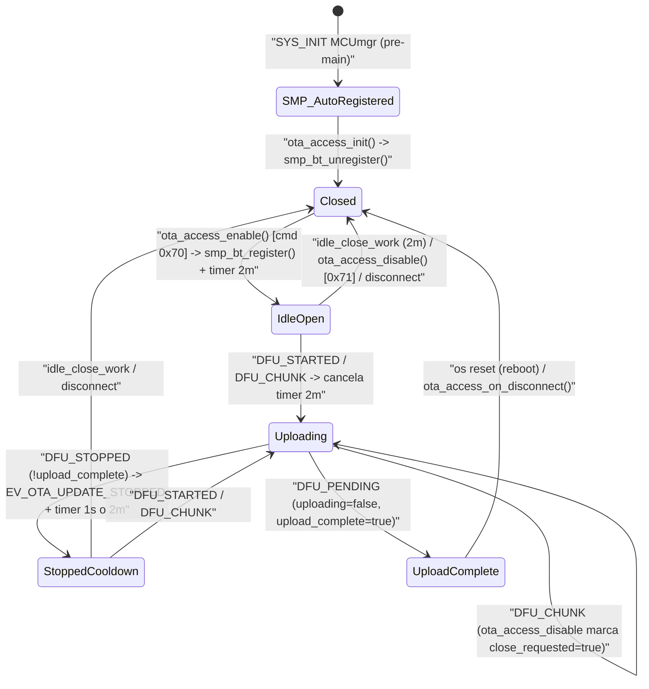

# 20b. Referencia Exhaustiva de Código: Subsistema BLE, iBeacon, OTA y Diagnósticos

> **Alcance y corte documental**: Este volumen documenta línea por línea y función por función los nueve archivos que implementan la fachada Bluetooth Low Energy (`GAP`, `GATT` e `iBeacon`), la política de activación del beacon de proximidad, el control dinámico del servicio `SMP` (`MCUmgr`), la guarda de reversión automática de imágenes MCUboot en estado `Test` y el subsistema asíncrono de autodiagnóstico y telemetría de errores en el commit exacto `c1128e5d0c0d6f98be0a580d287c0926ca27f01f`:
> 1. [`include/ble_driver.h`](../../../include/ble_driver.h) y [`src/ble_driver.c`](../../../src/ble_driver.c)
> 2. [`include/ibeacon_policy.h`](../../../include/ibeacon_policy.h)
> 3. [`include/ota_access.h`](../../../include/ota_access.h) y [`src/ota_access.c`](../../../src/ota_access.c)
> 4. [`include/test_image_guard.h`](../../../include/test_image_guard.h) y [`src/test_image_guard.c`](../../../src/test_image_guard.c)
> 5. [`include/diagnostics.h`](../../../include/diagnostics.h) y [`src/diagnostics.c`](../../../src/diagnostics.c)
>
> Véase el índice maestro en [`../20_code_reference.md`](../20_code_reference.md) y los volúmenes hermanos [`20a_core_fsm_comm.md`](20a_core_fsm_comm.md) y [`20c_peripherals_storage_wdt.md`](20c_peripherals_storage_wdt.md).

---

## 20b.1. Subsistema BLE y Tablas GATT: `include/ble_driver.h` y `src/ble_driver.c`

### 20b.1.1. Ficha integral de módulo (`include/ble_driver.h` L1–92 + `src/ble_driver.c` L1–778)

| Dimensión (22 puntos) | Especificación verificada |
|---|---|
| **1. Responsabilidad** | Encapsular la inicialización de la pila BLE de Zephyr (`bt_enable`), la gestión coordinada de dos conjuntos de publicidad simultáneos (Set 0 conectable `ADV_IND` + Set 1 no conectable `iBeacon` `ADV_NONCONN_IND`), el registro estático de los 4 servicios GATT propietarios de Joya (`22` atributos totales), la custodia thread-safe de la sesión única (`current_conn`, banderas de autenticación, suscripciones `CCC` y épocas `diagnostics_session_epoch`), la lectura/escritura del nombre personalizado y el envío validado de notificaciones de comandos, batería y diagnóstico. |
| **2. Dependencias** | [`include/ble_driver.h`](../../../include/ble_driver.h): `<stdint.h>`, `<zephyr/kernel.h>`, `<zephyr/bluetooth/bluetooth.h>`, `<zephyr/bluetooth/uuid.h>`, `<zephyr/bluetooth/gatt.h>`, `"ibeacon_policy.h"`, `"app_state.h"`, `"app_comm.h"`. [`src/ble_driver.c`](../../../src/ble_driver.c): añade `"flash_memory.h"`, `"ota_access.h"`, `"diagnostics.h"` y `<string.h>`. |
| **3. API pública** | 16 funciones públicas implementadas + **1 prototipo huérfano sin definición** (`ble_start_setup_advertising_backup` en [`include/ble_driver.h:90`](../../../include/ble_driver.h#L90)); 11 macros `BT_UUID_JOYA_*_VAL` y `JOYA_IBEACON_CONNECTION_UUID_BYTES`. |
| **4. Funciones internas** | 17 funciones `static`: control iBeacon (`ibeacon_stop`, `ibeacon_stop_on_connection`), 4 callbacks CCC (`on_ccc_changed`, `on_battery_change_ccc_changed`, `on_battery_measurement_ccc_changed`, `on_diagnostics_ccc_changed`), 5 callbacks lectura/escritura GATT (`on_rx_write`, `on_rx_auth_write`, `on_name_write`, `on_name_read`, `on_diagnostics_read`), 2 callbacks GAP (`on_connected`, `on_disconnected`) y 4 helpers de notificación/referencias (`get_authenticated_conn_ref`, `get_battery_conn_ref`, `ble_send_notify`, `ble_send_battery_value`). |
| **5–7. Parámetros, retornos y errores** | Convención POSIX/Zephyr en funciones de control y envío (`0` éxito; `-EINVAL`, `-ENOTCONN`, `-EACCES`, `-EALREADY` normalizado a `0` en paradas de publicidad, o errores HCI negativos). En callbacks GATT `read`/`write`, devuelve bytes procesados (`>= 0`) o `BT_GATT_ERR(BT_ATT_ERR_*)` negativos (`AUTHORIZATION`, `INVALID_OFFSET`, `INVALID_ATTRIBUTE_LEN`, `VALUE_NOT_ALLOWED`, `INSUFFICIENT_RESOURCES`, `UNLIKELY`). |
| **8–9. Pre/Postcondiciones** | `ble_driver_init()` debe ejecutarse una única vez en `main()` antes de cualquier llamada de publicidad; garantiza que `smp_bt` quede desregistrado antes de abrir la radio y que `ibeacon_adv` quede creado con `connection_ibeacon_ad` precargado. |
| **10–12. Estado y variables** | Dos dominios de bloqueo independientes: (1) **Dominio iBeacon** (`ibeacon_mutex`, `ibeacon_adv`, `ibeacon_running`, `connectable_adv_running`, `ibeacon_stop_work`); (2) **Dominio Conexión/Sesión** (`conn_mutex`, `current_conn`, `current_conn_authenticated`, 4 booleanos `*_notify_enabled`, `diagnostics_session_epoch`). Además 11 descriptores `bt_uuid_128` en `.data`, 4 estructuras `const` de publicidad en `.rodata`, `conn_callbacks` y 4 servicios estáticos `BT_GATT_SERVICE_DEFINE`. |
| **13. Contexto de ejecución** | Multihilo real sobre 4 contextos: `main` (`ble_driver_init`), `fsm_thread_id` (publicidad, autenticación, notificaciones de comandos/cambio batería, `ble_disconnect`), `BT_RX` (todos los callbacks GAP/GATT/CCC) y `sysworkq` (`ibeacon_stop_on_connection`, `ble_diagnostics_notify_for_session`, `ble_send_battery_measurement`). |
| **14–15. Interacciones y recursos** | Invoca `ota_access` (init y disconnect), `app_comm` (handlers GATT/GAP), `app_state` (`add_event*`, `get_current_state`), `flash_memory` (`storage_get_name`, `storage_save_name`) y `diagnostics`. Recursos BLE clave en `.config`: `CONFIG_BT_MAX_CONN=1`, `CONFIG_BT_EXT_ADV_MAX_ADV_SET=2`, `CONFIG_BT_L2CAP_TX_MTU=247`, `CONFIG_BT_BUF_ACL_TX_COUNT=3` (`251 B`), `CONFIG_BT_RX_STACK_SIZE=1200`. |
| **16. Concurrencia** | **Orden estricto de cerrojos sin interbloqueo**: `conn_mutex` e `ibeacon_mutex` **nunca se anidan** (ninguna sección crítica adquiere ambos simultáneamente; `on_connected` suelta `conn_mutex` en L239 antes de hacer `k_work_submit(&ibeacon_stop_work)` en L241, e `ibeacon_stop_on_connection` toma `ibeacon_mutex` y consulta `ble_has_connection()` que toma y libera `conn_mutex` hoja). Para evitar transmitir con `conn_mutex` retenido (lo que bloquearía `BT_RX` si `bt_gatt_notify` espera buffers ACL TX), todas las funciones de envío toman `conn_mutex`, incrementan `bt_conn_ref(current_conn)`, liberan `conn_mutex`, llaman a `bt_gatt_notify()` y finalmente hacen `bt_conn_unref()`. En la ruta de diagnóstico se usa `k_mutex_lock(&conn_mutex, K_NO_WAIT)` evitando cualquier bloqueo circular cuando `ble_driver.c` invoca `diagnostics_report_error(DIAG_ERROR_BLE)` fuera del mutex. |
| **17. Consideraciones temporales** | Publicidad conectable (`joya_adv_param`): intervalo rápido `100..150 ms` (`BT_GAP_ADV_FAST_INT_MIN_2 = 0x00A0`, `MAX_2 = 0x00F0`). Publicidad iBeacon (`ibeacon_adv_param`): intervalo lento `1000..1200 ms` (`BT_GAP_ADV_SLOW_INT_MIN = 0x0640`, `MAX = 0x0780`), reduciendo en ~10× el gasto energético del segundo set. Parámetros preferidos de conexión (`PPCP`): `45..90 ms`, `latency = 4`, `timeout = 6000 ms`. |
| **18–21. HW, Flash, Eventos y BLE** | Gobierna indirectamente el periférico `RADIO` 2,4 GHz vía Host/Split-LL; escribe en Flash únicamente desde `on_name_write()` (`storage_save_name`); emite `EV_BLE_CONNECTED`, `EV_BLE_DISCONNECTED`, `EV_BLE_NOTIFY_ENABLED`, `EV_BLE_BATTERY_NOTIFY_ENABLED`, `EV_APP_IDENTIFIER_RECEIVED` y `EV_APP_*`. |
| **22. Clasificación epistemológica** | **(a)** Implementado activo. **(d)** Prototipo huérfano `ble_start_setup_advertising_backup(void)` en [`include/ble_driver.h:90`](../../../include/ble_driver.h#L90) sin cuerpo en ningún `.c` (vestigio de una estrategia descartada de publicidad de respaldo; no rompe el enlazado porque ningún archivo lo referencia). **(e)** Byte `0xC8` (`-56 dBm`) en `connection_ibeacon_ad` pendiente de calibración radiada en hardware final. |

#### Tabla exhaustiva de objetos estáticos, descriptores y cerrojos en `src/ble_driver.c`

| Líneas | Símbolo(s) | Tipo exacto y sección ELF | Rol, ciclo de vida y sincronización |
|---|---|---|---|
| L7–9 | `JOYA_ADV_NAME_SETUP`, `JOYA_SUFFIX_MAX_LEN` | Macros (`"Joya Setup"`, `23`) | Nombre de publicidad en setup inicial y cota máxima de sufijo UTF-8 sin NUL (`31 - 8`). |
| L13–30 | `joya_commands_svc_uuid`, `joya_tx_uuid`, `joya_rx_uuid`, `joya_auth_svc_uuid`, `joya_rx_auth_uuid`, `joya_config_svc_uuid`, `joya_name_uuid`, `joya_diagnostics_uuid`, `joya_battery_svc_uuid`, `joya_battery_change_uuid`, `joya_battery_measurement_uuid` | `static struct bt_uuid_128` (11 × `20 B` = `220 B` en `.data`) | Descriptores de UUID de 128 bits en orden little-endian (`BT_UUID_INIT_128`). Nota de optimización potencial: al omitir `const`, el compilador los ubica en `.data` (SRAM + imagen de inicialización en Flash) en vez de `.rodata`. |
| L33–40 | `joya_adv_param` | `static const struct bt_le_adv_param` (`.rodata`) | `CONNECTABLE \| ONE_TIME \| USE_NAME`, intervalo `0x00A0..0x00F0` (`100..150 ms`), `peer = NULL`. |
| L45–50 | `ibeacon_adv_param` | `static const struct bt_le_adv_param` (`.rodata`) | `.options = 0` (legacy `ADV_NONCONN_IND`), intervalo `0x0640..0x0780` (`1000..1200 ms`). |
| L52–58 | `connection_ibeacon_ad` | `static const struct bt_data[2]` (`.rodata`) | `30 B` en aire: `Flags = 0x04` (`NO_BREDR`) + Apple `4C 00 02 15` + UUID BE `...6001` + Major `1` + Minor `1` + TxPwr `0xC8` (`-56 dBm`). |
| L60–64 | `ibeacon_adv`, `ibeacon_running`, `connectable_adv_running`, `ibeacon_mutex` | `bt_le_ext_adv *`, `bool`, `atomic_t`, `K_MUTEX_DEFINE` | Estado y cerrojo exclusivo del Set 1 de publicidad extendida; `connectable_adv_running` espeja de forma atómica el estado activo del Set 0 conectable. |
| L139 | `ibeacon_stop_work` | `K_WORK_DEFINE` (`.data`, enlace externo) | Tarea en `sysworkq` disparada por `on_connected()` para detener `ibeacon_adv` fuera de `BT_RX` y fuera de `conn_mutex`. |
| L142–150 | `current_conn`, `current_conn_authenticated`, `notify_enabled`, `battery_change_notify_enabled`, `battery_measurement_notify_enabled`, `diagnostics_notify_enabled`, `diagnostics_session_epoch` (`= 1`), `conn_mutex` | Puntero, 5× `bool`, `uint32_t`, `K_MUTEX_DEFINE` | Estado íntegro de la única sesión BLE admitida, custodiado por `conn_mutex`. `diagnostics_session_epoch` avanza `+1` en cada `on_connected` y `+1` en cada `on_disconnected`. |
| L360–363 | `conn_callbacks` | `BT_CONN_CB_DEFINE` (`._bt_conn_cb.static.*`) | Suscripción estática a eventos GAP `.connected` y `.disconnected`. |
| L464–466 | `ad` | `static const struct bt_data[1]` (`.rodata`) | `3 B` en aire (`02 01 06`: `BT_LE_AD_GENERAL \| BT_LE_AD_NO_BREDR`) del Set 0 conectable. |

---

### 20b.1.2. Desglose Índice por Índice de los Arreglos `attrs[]` Generados por `BT_GATT_SERVICE_DEFINE`

En Zephyr 4.2 (`<zephyr/bluetooth/gatt.h>`), las macros declarativas de servicios GATT se expanden en tiempo de compilación hacia elementos contiguos de tipo `const struct bt_gatt_attr` (`20 bytes` por entrada en ARM Cortex-M4 de 32 bits, verificado en `build_joya/app/zephyr/zephyr.map`: `.rodata.attr_joya_*`):
- **`BT_GATT_PRIMARY_SERVICE(_service)`** genera **1 atributo**: UUID `BT_UUID_GATT_PRIMARY` (`0x2800`), `perm = BT_GATT_PERM_READ`, `read = bt_gatt_attr_read_service`, `user_data = _service`.
- **`BT_GATT_CHARACTERISTIC(_uuid, _props, _perm, _read, _write, _user_data)`** genera **2 atributos consecutivos**:
  1. **Declaración de característica**: UUID `BT_UUID_GATT_CHRC` (`0x2803`), `perm = BT_GATT_PERM_READ`, `read = bt_gatt_attr_read_chrc`, `user_data = &(struct bt_gatt_chrc){ .uuid = _uuid, .value_handle = 0, .properties = _props }`.
  2. **Valor de característica**: UUID `_uuid` (128 bits de Joya), `perm = _perm`, `read = _read`, `write = _write`, `user_data = _user_data`.
- **`BT_GATT_CCC(_cfg_changed, _perm)`** genera **1 atributo**: UUID `BT_UUID_GATT_CCC` (`0x2902`), `perm = _perm`, `read = bt_gatt_attr_read_ccc`, `write = bt_gatt_attr_write_ccc`, `user_data = &(struct _bt_gatt_ccc){ ..., .cfg_changed = _cfg_changed }`.

#### Tabla maestra índice por índice de los 4 servicios GATT estáticos de Joya (`src/ble_driver.c:398-459`)

| Servicio (`struct bt_gatt_service_static`) | Tamaño en `.rodata` | Índice `attrs[i]` | Tipo de atributo GATT | UUID del atributo | Permisos ATT | Callbacks `read` / `write` / `cfg_changed` |
|---|---:|---:|---|---|---|---|
| **`joya_commands_svc`** (`L398-415`) | `120 B` (`6 × 20 B`) | `attrs[0]` | Primary Service Declaration | `0x2800` → `&joya_commands_svc_uuid` (`...5000`) | `PERM_READ` | `bt_gatt_attr_read_service` / `NULL` |
| | | `attrs[1]` | Characteristic Declaration (`TX`) | `0x2803` (`CHRC_NOTIFY`) | `PERM_READ` | `bt_gatt_attr_read_chrc` / `NULL` |
| | | **`attrs[2]`** | **Characteristic Value (`TX`)** | **`&joya_tx_uuid.uuid` (`...5001`)** | `PERM_NONE` | `NULL` / `NULL` *(usado en `ble_commands_subscribed_for_conn` L567 y `ble_send_notify` L477)* |
| | | `attrs[3]` | Client Characteristic Config (`CCC`) | `0x2902` | `PERM_READ \| PERM_WRITE` | `bt_gatt_attr_read_ccc` / `bt_gatt_attr_write_ccc` → `on_ccc_changed` |
| | | `attrs[4]` | Characteristic Declaration (`RX`) | `0x2803` (`WRITE \| WRITE_WITHOUT_RESP`) | `PERM_READ` | `bt_gatt_attr_read_chrc` / `NULL` |
| | | `attrs[5]` | Characteristic Value (`RX`) | `&joya_rx_uuid.uuid` (`...5002`) | `PERM_WRITE` | `NULL` / `on_rx_write` |
| **`joya_auth_svc`** (`L419-427`) | `60 B` (`3 × 20 B`) | `attrs[0]` | Primary Service Declaration | `0x2800` → `&joya_auth_svc_uuid` (`...5100`) | `PERM_READ` | `bt_gatt_attr_read_service` / `NULL` |
| | | `attrs[1]` | Characteristic Declaration (`RX_AUTH`) | `0x2803` (`WRITE \| WRITE_WITHOUT_RESP`) | `PERM_READ` | `bt_gatt_attr_read_chrc` / `NULL` |
| | | `attrs[2]` | Characteristic Value (`RX_AUTH`) | `&joya_rx_auth_uuid.uuid` (`...5101`) | `PERM_WRITE` | `NULL` / `on_rx_auth_write` |
| **`joya_config_svc`** (`L430-444`) | `120 B` (`6 × 20 B`) | `attrs[0]` | Primary Service Declaration | `0x2800` → `&joya_config_svc_uuid` (`...5200`) | `PERM_READ` | `bt_gatt_attr_read_service` / `NULL` |
| | | `attrs[1]` | Characteristic Declaration (`NAME`) | `0x2803` (`READ \| WRITE`) | `PERM_READ` | `bt_gatt_attr_read_chrc` / `NULL` |
| | | `attrs[2]` | Characteristic Value (`NAME`) | `&joya_name_uuid.uuid` (`...5201`) | `PERM_READ \| PERM_WRITE` | `on_name_read` / `on_name_write` |
| | | `attrs[3]` | Characteristic Declaration (`DIAGNOSTICS`) | `0x2803` (`READ \| NOTIFY`) | `PERM_READ` | `bt_gatt_attr_read_chrc` / `NULL` |
| | | `attrs[4]` | Characteristic Value (`DIAGNOSTICS`) | `&joya_diagnostics_uuid.uuid` (`...5202`) | `PERM_READ` | `on_diagnostics_read` / `NULL` |
| | | `attrs[5]` | Client Characteristic Config (`CCC`) | `0x2902` | `PERM_READ \| PERM_WRITE` | `bt_gatt_attr_read_ccc` / `bt_gatt_attr_write_ccc` → `on_diagnostics_ccc_changed` |
| **`joya_battery_svc`** (`L447-459`) | `140 B` (`7 × 20 B`) | `attrs[0]` | Primary Service Declaration | `0x2800` → `&joya_battery_svc_uuid` (`...5300`) | `PERM_READ` | `bt_gatt_attr_read_service` / `NULL` |
| | | `attrs[1]` | Characteristic Declaration (`BATTERY_CHANGE`) | `0x2803` (`CHRC_NOTIFY`) | `PERM_READ` | `bt_gatt_attr_read_chrc` / `NULL` |
| | | `attrs[2]` | Characteristic Value (`BATTERY_CHANGE`) | `&joya_battery_change_uuid.uuid` (`...5301`) | `PERM_NONE` | `NULL` / `NULL` |
| | | `attrs[3]` | Client Characteristic Config (`CCC`) | `0x2902` | `PERM_READ \| PERM_WRITE` | `bt_gatt_attr_read_ccc` / `bt_gatt_attr_write_ccc` → `on_battery_change_ccc_changed` |
| | | `attrs[4]` | Characteristic Declaration (`BATTERY_MEASUREMENT`) | `0x2803` (`CHRC_NOTIFY`) | `PERM_READ` | `bt_gatt_attr_read_chrc` / `NULL` |
| | | `attrs[5]` | Characteristic Value (`BATTERY_MEASUREMENT`) | `&joya_battery_measurement_uuid.uuid` (`...5302`) | `PERM_NONE` | `NULL` / `NULL` |
| | | `attrs[6]` | Client Characteristic Config (`CCC`) | `0x2902` | `PERM_READ \| PERM_WRITE` | `bt_gatt_attr_read_ccc` / `bt_gatt_attr_write_ccc` → `on_battery_measurement_ccc_changed` |

#### Por qué `&joya_commands_svc.attrs[2]` apunta exactamente al valor de `TX` (`src/ble_driver.c:567`)

En [`src/ble_driver.c:567-568`](../../../src/ble_driver.c#L567-L568), `ble_commands_subscribed_for_conn()` verifica:
```c
return ready && bt_gatt_is_subscribed(conn, &joya_commands_svc.attrs[2],
                                      BT_GATT_CCC_NOTIFY);
```
- `attrs[0]` es `BT_GATT_PRIMARY_SERVICE(&joya_commands_svc_uuid)`.
- `BT_GATT_CHARACTERISTIC(&joya_tx_uuid.uuid, ...)` se expande en **dos** entradas: `attrs[1]` (la declaración `0x2803` que contiene los metadatos de propiedades) y **`attrs[2]` (el atributo de valor cuya propiedad `.uuid` apunta a `&joya_tx_uuid.uuid`)**.
- En la implementación interna de Zephyr (`subsys/bluetooth/host/gatt.c`), `bt_gatt_is_subscribed(conn, attr, ccc_type)` acepta tanto el puntero a la declaración (`attrs[1]`) como el puntero al valor (`attrs[2]`), e itera hacia adelante sobre los descriptores siguientes (`attrs[3]`, que es `0x2902` `BT_GATT_CCC`) deteniéndose antes de `attrs[4]` (`0x2803` de `RX`) para comprobar si `conn` figura suscripta en `struct _bt_gatt_ccc`.
- Nótese la diferencia estilística dentro del mismo archivo: mientras `ble_commands_subscribed_for_conn()` indexa en tiempo constante $O(1)$ `&joya_commands_svc.attrs[2]`, las funciones `ble_send_notify()` (L477), `ble_diagnostics_notify_for_session()` (L599) y `ble_send_battery_value()` (L723) llaman a `bt_gatt_find_by_uuid(...)`, que recorre linealmente los `6` o `7` atributos del servicio hasta devolver exactamente `&joya_commands_svc.attrs[2]`, `&joya_config_svc.attrs[4]` y `&joya_battery_svc.attrs[2]`/`attrs[5]` respectivamente. Reordenar características en `joya_commands_svc` antes de `TX` invalidaría el índice fijo `attrs[2]` en L567.
- **Orden enlazado en `zephyr.map`**: Como el linker ordena alfabéticamente `SORT_BY_NAME(._bt_gatt_service_static.static.*)`, el orden físico de handles ATT estáticos en el binario es: `_1_gatt_svc` (`0x1801`), `_2_gap_svc` (`0x1800`), `joya_auth_svc` (`...5100`), `joya_battery_svc` (`...5300`), `joya_commands_svc` (`...5000`) y `joya_config_svc` (`...5200`), seguido dinámicamente al final por `smp_bt` cuando OTA está habilitado.

---

### 20b.1.3. Referencia función por función de `src/ble_driver.c` y `include/ble_driver.h` (34 símbolos)

#### A. API pública (16 funciones implementadas + 1 prototipo huérfano)

| # | Función | Líneas | Firma, retorno, errores y análisis exhaustivo (22 puntos) |
|---:|---|---|---|
| 1 | `ble_driver_init` | L494–517 (`.h:45`) | `int ble_driver_init(void)` → `0` o error negativo. Ejecutada una vez en `main()`. Paso 1: `ota_access_init()` retira `smp_bt` antes de encender BLE. Paso 2: `bt_enable(NULL)` inicializa síncronamente el controlador `BT_LL_SW_SPLIT` y el Host BLE (cargando el nombre estático inicial `"Joya"` de `CONFIG_BT_DEVICE_NAME`; notar que **no** sincroniza aquí `storage_get_name()` hacia `bt_set_name()`, sino que `ble_start_setup_advertising(false)` lo aplicará al iniciar publicidad de reconexión). Paso 3: `bt_le_ext_adv_create(&ibeacon_adv_param, NULL, &ibeacon_adv)` reserva el Set 1 de publicidad extendida (PDU legacy no conectable, intervalo `1,0..1,2 s`). Paso 4: `bt_le_ext_adv_set_data(...)` carga los `30 B` de `connection_ibeacon_ad`; si falla, destruye `ibeacon_adv` con `bt_le_ext_adv_delete()` y limpia el puntero a `NULL` evitando dejar un handle colgante. **(a)** Activa. |
| 2 | `ble_set_ibeacon_mode` | L85–120 (`.h:75`) | `int ble_set_ibeacon_mode(ble_ibeacon_mode_t mode)` → `0`, `-EINVAL` (si `mode > BLE_IBEACON_CONNECTION`) o error HCI negativo (reportando `DIAG_ERROR_BLE` `0xE4`). Ejecutada en `fsm_thread_id`. Adquiere `ibeacon_mutex`. Si `mode == BLE_IBEACON_OFF`, `!atomic_get(&connectable_adv_running)` o `ble_has_connection()`, detiene `ibeacon_adv` si estaba corriendo (tratando `-EALREADY` como `0`) y sale. Si `mode == BLE_IBEACON_CONNECTION`, no está corriendo aún y sigue activa la publicidad conectable sin conexión, invoca `bt_le_ext_adv_start(ibeacon_adv, BT_LE_EXT_ADV_START_DEFAULT)` y marca `ibeacon_running = true`. Garantiza el invariante de producto: el iBeacon jamás transmite mientras el equipo está conectado o en reposo sin publicidad conectable. **(a)** Activa. |
| 3 | `ble_start_setup_advertising` | L608–647 (`.h:72`) | `int ble_start_setup_advertising(bool is_new_connection)` → `0` o error negativo (emite `0xE4` en fallo). Ejecutada en `fsm_thread_id`. Primero detiene ambos sets (`ibeacon_stop()` + `bt_le_adv_stop()`, aceptando `-EALREADY`) y limpia `connectable_adv_running`. Luego configura el nombre dinámico GAP (`bt_set_name("Joya Setup")` si `is_new_connection == true`, o `bt_set_name(storage_get_name())` si `false`; como `joya_adv_param` usa `BT_LE_ADV_OPT_USE_NAME` con `sd = NULL`, Zephyr coloca automáticamente el nombre en el paquete `SCAN_RSP` dejando `ad[]` `02 01 06` en `ADV_IND`). Finalmente llama `bt_le_adv_start(&joya_adv_param, ad, 1, NULL, 0)` con `BT_LE_ADV_OPT_ONE_TIME` (se auto-detiene al conectar), fija `connectable_adv_running = 1` y re-verifica `if (ble_has_connection()) atomic_clear(&connectable_adv_running)` para cerrar la ventana de carrera en que un teléfono conecte instantáneamente antes de ejecutarse L642. **(a)** Activa. |
| 4 | `ble_stop_advertising` | L650–659 (`.h:82`) | `int ble_stop_advertising(void)` → `0`, `-EALREADY` o error HCI negativo. Detiene primero `ibeacon_stop()`, luego `bt_le_adv_stop()`; si `err == 0 \|\| err == -EALREADY` limpia `connectable_adv_running` (ojo: si era `-EALREADY`, retorna `-EALREADY` al llamador; en `ble_disconnect()` L770 se normaliza a `0`, mientras que en `app_state.c` L899/904 se ignora el retorno y en L613 un `-EALREADY` solo hace `return` al final de la rama). Si hay otro error negativo, reporta `DIAG_ERROR_BLE`. **(a)** Activa. |
| 5 | `ble_disconnect` | L741–778 (`.h:88`) | `int ble_disconnect(void)` → `0` o primer error negativo entre desconexión y parada de publicidad. Ejecutada en `fsm_thread_id` (suspensión, batería crítica o factory reset). Toma `conn_mutex`, retiene `bt_conn_ref(current_conn)` si existe, libera `conn_mutex` y solicita `bt_conn_disconnect(conn, BT_HCI_ERR_REMOTE_USER_TERM_CONN)` (`0x13`) seguido de `bt_conn_unref(conn)` (la limpieza de `current_conn` ocurrirá asíncronamente en `on_disconnected`). Luego llama `ble_stop_advertising()` normalizando `-EALREADY` a `0`. **(a)** Activa. |
| 6 | `ble_is_current_conn` | L519–526 (`.h:46`) | `bool ble_is_current_conn(struct bt_conn *conn)` → `true` si `conn != NULL && current_conn == conn` bajo `conn_mutex`. Protege a la FSM contra eventos de una conexión ya cerrada. **(a)** Activa. |
| 7 | `ble_has_connection` | L528–535 (`.h:47`) | `bool ble_has_connection(void)` → `true` si `current_conn != NULL` bajo `conn_mutex`. **(a)** Activa. |
| 8 | `ble_is_authenticated_conn` | L537–544 (`.h:48`) | `bool ble_is_authenticated_conn(struct bt_conn *conn)` → `true` si `conn != NULL && current_conn == conn && current_conn_authenticated` bajo `conn_mutex`. Guardián criptográfico/de sesión para comandos RX, OTA y lectura de `DIAGNOSTICS`. **(a)** Activa. |
| 9 | `ble_mark_authenticated_conn` | L546–559 (`.h:49`) | `bool ble_mark_authenticated_conn(struct bt_conn *conn)` → bajo `conn_mutex`, si `conn && current_conn == conn`, fija `current_conn_authenticated = true`. Fuera del mutex, si fue válido, invoca `diagnostics_request_init_notification()` por si el cliente ya había habilitado el CCC de `DIAGNOSTICS` antes de enviar `APP_ID`. **(a)** Activa. |
| 10 | `ble_commands_subscribed_for_conn` | L561–569 (`.h:50`) | `bool ble_commands_subscribed_for_conn(struct bt_conn *conn)` → comprueba `conn && current_conn == conn && notify_enabled` bajo `conn_mutex` **y** `bt_gatt_is_subscribed(conn, &joya_commands_svc.attrs[2], BT_GATT_CCC_NOTIFY)` en la tabla GATT de Zephyr. **(a)** Activa. |
| 11 | `ble_diagnostics_session` | L571–582 (`.h:52`) | `uint32_t ble_diagnostics_session(void)` → intenta `k_mutex_lock(&conn_mutex, K_NO_WAIT)` (no bloqueante: si `conn_mutex` está tomado o se llama desde ISR, retorna `0` sin bloquear). Si hay conexión autenticada con `diagnostics_notify_enabled == true`, devuelve `diagnostics_session_epoch` (`>= 1`); si no, `0`. **(a)** Activa. |
| 12 | `ble_diagnostics_notify_for_session` | L584–606 (`.h:53-54`) | `void ble_diagnostics_notify_for_session(uint32_t session, const uint8_t *data, uint16_t len)` → ejecutada desde `diagnostics_work_handler` en `sysworkq`. Toma `conn_mutex` con `K_NO_WAIT`, comprueba que `session != 0 && session == diagnostics_session_epoch && current_conn && current_conn_authenticated && diagnostics_notify_enabled`, retiene `bt_conn_ref(current_conn)`, suelta el mutex, localiza `&joya_diagnostics_uuid.uuid` (`joya_config_svc.attrs[4]`), envía `bt_gatt_notify(conn, attr, data, len)` e invoca `bt_conn_unref(conn)`. Nota: a diferencia de `ble_send_event_*`, no llama a `diagnostics_report_error` si falla `bt_gatt_notify`, evitando recursión infinita de errores de diagnóstico. **(a)** Activa. |
| 13 | `ble_send_event_for_conn` | L662–679 (`.h:57`) | `int ble_send_event_for_conn(struct bt_conn *conn, uint8_t event_byte)` → usada específicamente para enviar `COMMAND_ACK` (`0x05`) o `COMMAND_NACK` (`0x06`) durante la fase de autenticación sobre la conexión específica `entry->conn` (incluso para `NACK` cuando `current_conn_authenticated` es `false`). Exige `conn && current_conn == conn && notify_enabled` bajo `conn_mutex`; si no, devuelve `-ENOTCONN`. Si `ble_send_notify()` devuelve `< 0`, reporta `DIAG_ERROR_BLE`. **(a)** Activa. |
| 14 | `ble_send_event_authenticated` | L681–693 (`.h:59`) | `int ble_send_event_authenticated(uint8_t event_byte)` → usada para todos los comandos operativos (`0x02`, `0x03`, `0x04` y `0x05` de respuesta a comandos). Obtiene `conn` con `get_authenticated_conn_ref()` (exigiendo `current_conn && current_conn_authenticated && notify_enabled`); si es `NULL` devuelve `-ENOTCONN`. Si `ble_send_notify` falla (`< 0`), reporta `DIAG_ERROR_BLE`. **(a)** Activa. |
| 15 | `ble_send_battery_change` | L730–733 (`.h:62`) | `int ble_send_battery_change(uint8_t level)` → delega `ble_send_battery_value(level, false)` (`1 B`: `0`, `1` o `2` en `...5301`). **(a)** Activa. |
| 16 | `ble_send_battery_measurement` | L735–738 (`.h:65`) | `int ble_send_battery_measurement(int32_t voltage_mv)` → delega `ble_send_battery_value(voltage_mv, true)` (`2 B` `uint16_t` little-endian en `...5302`). **(a)** Activa. |
| 17 | `ble_start_setup_advertising_backup` | `.h:90` *(sin `.c`)* | `int ble_start_setup_advertising_backup(void);` → **Prototipo declarado en [`include/ble_driver.h:90`](../../../include/ble_driver.h#L90) sin implementación en ningún archivo `.c`**. Cualquier llamada nueva produciría error de enlazado `undefined reference`. **(d)** Declaración huérfana residual. |

#### B. Funciones internas (`static`) y callbacks de `src/ble_driver.c` (17 funciones)

| # | Función (`src/ble_driver.c`) | Líneas | Contexto | Especificación detallada de parámetros, efectos, seguridad y errores (22 puntos) |
|---:|---|---|---|---|
| 1 | `ibeacon_stop` | L66–83 | `fsm_thread_id` | `void` → `int`. Toma `ibeacon_mutex`; si `ibeacon_running`, llama `bt_le_ext_adv_stop(ibeacon_adv)`, limpia `ibeacon_running = false` si retorna `0` o `-EALREADY` (normalizando a `0`) y reporta `DIAG_ERROR_BLE` si `< 0`. **(a)** Activa. |
| 2 | `ibeacon_stop_on_connection` | L122–137 | `sysworkq` | Handler de `ibeacon_stop_work` encolado desde `on_connected()`. Bajo `ibeacon_mutex`, si `ibeacon_running && (ble_has_connection() \|\| !atomic_get(&connectable_adv_running))`, detiene `ibeacon_adv` y reporta `DIAG_ERROR_BLE` en fallo distinto de `-EALREADY`. Desacopla la parada HCI del hilo `BT_RX`. **(a)** Activa. |
| 3 | `on_ccc_changed` | L156–172 | `BT_RX` | Callback CCC de `TX` (`...5001`). Bajo `conn_mutex` actualiza `notify_enabled = (value == BT_GATT_CCC_NOTIFY)` y, si quedó habilitado con `current_conn != NULL`, toma `bt_conn_ref(current_conn)` para encolar `EV_BLE_NOTIFY_ENABLED` fuera del mutex liberando luego su `ref` local. **(a)** Activa. |
| 4 | `on_battery_change_ccc_changed` | L174–184 | `BT_RX` | Callback CCC de `BATTERY_CHANGE` (`...5301`). Actualiza `battery_change_notify_enabled` bajo `conn_mutex` y, si se activó, encola `EV_BLE_BATTERY_NOTIFY_ENABLED`. **(a)** Activa. |
| 5 | `on_battery_measurement_ccc_changed` | L186–192 | `BT_RX` | Callback CCC de `BATTERY_MEASUREMENT` (`...5302`). Actualiza `battery_measurement_notify_enabled` bajo `conn_mutex` (sin despertar a la FSM; la próxima muestra de `battery_monitor_work` la usará). **(a)** Activa. |
| 6 | `on_diagnostics_ccc_changed` | L194–203 | `BT_RX` | Callback CCC de `DIAGNOSTICS` (`...5202`). Actualiza `diagnostics_notify_enabled` bajo `conn_mutex`; si se activó, solicita `diagnostics_request_init_notification()`. **(a)** Activa. |
| 7 | `on_rx_write` | L205–209 | `BT_RX` | Adaptador `static` de `joya_commands_svc.attrs[5]` que delega directamente en `on_rx_write_handler()` (`app_comm.c`). **(a)** Activa. |
| 8 | `on_rx_auth_write` | L211–214 | `BT_RX` | Adaptador `static` de `joya_auth_svc.attrs[2]` que delega en `on_rx_auth_write_handler()` (`app_comm.c`). **(a)** Activa. |
| 9 | `on_connected` | L217–244 | `BT_RX` | Callback GAP `.connected`. Si `err != 0`, retorna sin mutar estado. Bajo `conn_mutex`: si `current_conn != NULL`, rechaza la segunda conexión con `bt_conn_disconnect(conn, BT_HCI_ERR_REMOTE_USER_TERM_CONN)` y retorna. Si está libre: guarda `current_conn = bt_conn_ref(conn)`, **incrementa `diagnostics_session_epoch++`**, limpia `connectable_adv_running` (porque `BT_LE_ADV_OPT_ONE_TIME` detuvo el Set 0 al conectar) y resetea a `false` `current_conn_authenticated` y las 4 banderas `*_notify_enabled`. Fuera del mutex despacha `ibeacon_stop_work` e invoca `on_connected_handler(conn, err)`. **(a)** Activa. |
| 10 | `on_disconnected` | L247–271 | `BT_RX` | Callback GAP `.disconnected`. Bajo `conn_mutex`: si `current_conn == conn`, extrae `old_conn`, anula `current_conn = NULL`, limpia `current_conn_authenticated = false` e **incrementa `diagnostics_session_epoch++`** (invalidando notificaciones de diagnóstico en vuelo); limpia además las 4 banderas CCC. Nota: si una conexión rechazada en L226 dispara luego `on_disconnected` con `conn != current_conn`, las líneas 258–261 limpiarían las banderas `*_notify_enabled` de la conexión activa, aunque con `CONFIG_BT_MAX_CONN=1` el controlador nunca admite un segundo enlace simultáneo. Si `old_conn != NULL`, llama `ota_access_on_disconnect()`, libera `bt_conn_unref(old_conn)` e invoca `on_disconnected_handler(conn, reason)`. **(a)** Activa. |
| 11 | `on_name_write` | L273–320 | `BT_RX` |Escritura GATT en `NAME` (`...5201`). (1) Exige `get_current_state() == STATE_AUTHENTICATED` → si no, `BT_ATT_ERR_AUTHORIZATION` (`0x08`). (2) `offset == 0` → si no, `BT_ATT_ERR_INVALID_OFFSET` (`0x07`). (3) `1 <= len <= 23` (`JOYA_SUFFIX_MAX_LEN`) → si no, `BT_ATT_ERR_INVALID_ATTRIBUTE_LEN` (`0x0d`). (4) Sin bytes `\0` embebidos (`memchr(buf, '\0', len)`) → si hay, `BT_ATT_ERR_VALUE_NOT_ALLOWED` (`0x13`). (5) Construye en pila `"Joya de " + sufijo + '\0'` (`<= 32 B`), aplica `bt_set_name(name)` y persiste con `storage_save_name(name)` (error `< 0` → `BT_ATT_ERR_UNLIKELY` `0x0e`; fallo de Flash `== 1` se tolera devolviendo `len` porque RAM y GAP ya se actualizaron). **Observación arquitectónica**: ejecuta `settings_save_one` directamente sobre la pila de `1200 B` de `BT_RX` y escribe `joya_name` sin mutex respecto de `on_name_read` o `storage_factory_reset`. **(a)** Activa. |
| 12 | `on_name_read` | L322–345 | `BT_RX` | Lectura GATT de `NAME` (`...5201`). Lee `storage_get_name()`: si es `"Joya"`, devuelve cadena vacía `""` (`0 B`); si empieza con `"Joya de "`, devuelve solo el sufijo (`name + 8`) vía `bt_gatt_attr_read()`; si el prefijo estuviera corrupto, devuelve `BT_ATT_ERR_UNLIKELY`. **Asimetría de autorización documentada**: a diferencia de `on_name_write` (L279) y `on_diagnostics_read` (L352), `on_name_read` **no comprueba autenticación** (`PERM_READ` abierto), exponiendo por GATT el mismo sufijo que se emite en `SCAN_RSP` durante publicidad de reconexión. **(a)** Activa. |
| 13 | `on_diagnostics_read` | L347–358 | `BT_RX` | Lectura GATT de `DIAGNOSTICS` (`...5202`). Comprueba `ble_is_authenticated_conn(conn)` (si `false`, retorna `BT_ATT_ERR_AUTHORIZATION`), obtiene los 2 bytes `[0xA0, init_bits]` mediante `diagnostics_get_init_message(message)` y los sirve con `bt_gatt_attr_read()`. **(a)** Activa. |
| 14 | `get_authenticated_conn_ref` | L368–377 | `fsm_thread_id` | Bajo `conn_mutex`, devuelve `bt_conn_ref(current_conn)` si `current_conn && current_conn_authenticated && notify_enabled`, o `NULL`. El llamador debe hacer `bt_conn_unref()`. **(a)** Activa. |
| 15 | `get_battery_conn_ref` | L379–391 | `fsm_thread_id`, `sysworkq` | Análoga a la anterior seleccionando `battery_measurement_notify_enabled` (si `measurement == true`) o `battery_change_notify_enabled` (si `false`). **(a)** Activa. |
| 16 | `ble_send_notify` | L473–487 | `fsm_thread_id` | Busca `joya_tx_uuid` en `joya_commands_svc` (`attrs[2]`) con `bt_gatt_find_by_uuid()` (`-EINVAL` si no hallado) e invoca `bt_gatt_notify(conn, attr, &event_byte, 1)`. **(a)** Activa. |
| 17 | `ble_send_battery_value` | L695–728 | `fsm_thread_id`, `sysworkq` | Valida rango (`0..65535` mV si `measurement`, `0..2` si nivel → `-EINVAL`), serializa 1 B o 2 B little-endian (`payload[0] = LSB`, `payload[1] = MSB`), exige `get_current_state() == STATE_AUTHENTICATED` (`-EACCES`), obtiene `conn` con `get_battery_conn_ref(measurement)` (`-ENOTCONN` si no suscripta), busca el atributo en `joya_battery_svc` y envía `bt_gatt_notify()`, liberando `bt_conn_unref(conn)`. **(a)** Activa. |

---

## 20b.2. Política de iBeacon: `include/ibeacon_policy.h`

### 20b.2.1. Ficha exhaustiva de `ibeacon_policy.h` (líneas 1–16)

```c
typedef enum {
    BLE_IBEACON_OFF,
    BLE_IBEACON_CONNECTION,
} ble_ibeacon_mode_t;

static inline ble_ibeacon_mode_t ibeacon_mode_for_state(bool has_app_id)
{
    return has_app_id ? BLE_IBEACON_CONNECTION : BLE_IBEACON_OFF;
}
```

| Dimensión (22 puntos) | Especificación verificada |
|---|---|
| **1. Responsabilidad** | Definir el dominio de modos del beacon secundario (`BLE_IBEACON_OFF = 0`, `BLE_IBEACON_CONNECTION = 1`) y la función pura de decisión `ibeacon_mode_for_state(bool has_app_id)` que vincula la elegibilidad del iBeacon **exclusivamente** a la tenencia de un `APP_ID` registrado, aislando la regla de negocio del transporte BLE para hacerla verificable en host. |
| **2. Dependencias** | Solo `<stdbool.h>`. Cero dependencias de Zephyr. Incluida por [`include/ble_driver.h:9`](../../../include/ble_driver.h#L9) y por [`tests/test_emergency_phase.c:2`](../../../tests/test_emergency_phase.c#L2). |
| **3–12. Tipos, API y estado** | `ble_ibeacon_mode_t` (2 valores) y `static inline ibeacon_mode_for_state(bool has_app_id)`. Sin variables globales ni estáticas, sin códigos de error. |
| **13–21. Ejecución, concurrencia y BLE** | Se expande *inline* dentro de `sync_ibeacon_mode()` ([`src/app_state.c:152`](../../../src/app_state.c#L152)) en `fsm_thread_id`. Su salida se entrega a `ble_set_ibeacon_mode()`, que aplica la conjunción física `has_app_id && connectable_adv_running && !ble_has_connection()`. |
| **22. Clasificación epistemológica** | **(a)** Implementada en `c1128e5d0c0d6f98be0a580d287c0926ca27f01f` (simplificando la política anterior de doble UUID conexión/emergencia) y verificada por [`tests/test_emergency_phase.c:57-70`](../../../tests/test_emergency_phase.c#L57-L70). |

---

## 20b.3. Control Dinámico de Acceso OTA (`SMP` / `MCUmgr`): `include/ota_access.h` y `src/ota_access.c`

### 20b.3.1. Ficha integral de módulo (`include/ota_access.h` L1–13 + `src/ota_access.c` L1–148)

| Dimensión (22 puntos) | Especificación verificada |
|---|---|
| **1. Responsabilidad** | Impedir que el servicio GATT `SMP` (`8d53dc1d-1db7-4cd3-868b-8a527460aa84`) de `MCUmgr` esté expuesto por defecto sin autenticación (ya que `MCUmgr` carece de cifrado/autenticación nativa en esta configuración con `BT_SMP=n`), habilitándolo dinámicamente solo tras el comando autenticado `0x70`, cerrándolo automáticamente tras `2 min` de inactividad (`OTA_IDLE_TIMEOUT`), al recibir `0x71` o al desconectar BLE, y protegiendo las descargas activas en `slot1_partition` contra cierres prematuros, apagados por batería nivel 2 o gestos de botón. |
| **2. Dependencias** | `"ota_access.h"`, `"app_state.h"` (para `add_event(EV_OTA_UPDATE_STOPPED)`), `<zephyr/kernel.h>`, `<zephyr/mgmt/mcumgr/mgmt/callbacks.h>`, `<zephyr/mgmt/mcumgr/transport/smp_bt.h>`. Requiere en Kconfig (`prj.conf:55, 107-110`): `CONFIG_BT_GATT_DYNAMIC_DB=y`, `CONFIG_MCUMGR_TRANSPORT_BT_DYNAMIC_SVC_REGISTRATION=y`, `CONFIG_MCUMGR_MGMT_NOTIFICATION_HOOKS=y`, `CONFIG_MCUMGR_GRP_IMG_STATUS_HOOKS=y`. |
| **3–4. API pública e internas** | 5 funciones públicas (`ota_access_init`, `ota_access_enable`, `ota_access_disable`, `ota_access_on_disconnect`, `ota_access_is_update_active`) y 3 funciones `static` (`close_service_locked`, `idle_close_handler`, `image_status_handler`). |
| **5–12. Estado y variables** | `ota_mutex` (`K_MUTEX_DEFINE`), `idle_close_work` (`struct k_work_delayable`), 4 banderas booleanas bajo `ota_mutex` (`service_enabled`, `uploading`, `upload_complete`, `close_requested`) y el descriptor `image_status_callback` suscripto a la máscara de 4 eventos `MGMT_EVT_OP_IMG_MGMT_DFU_{CHUNK, STARTED, PENDING, STOPPED}`. |
| **13. Contexto de ejecución** | `main` (`ota_access_init`), `fsm_thread_id` (`enable`, `disable`, `is_update_active`), `BT_RX` (`on_disconnect`), `mcumgr_wq` prioridad `3` (`image_status_handler`) y `sysworkq` prioridad `-1` (`idle_close_handler`). |
| **16. Concurrencia** | `ota_mutex` serializa limpiamente los 4 hilos que convergen sobre el módulo (`fsm_thread_id`, `BT_RX`, `mcumgr_wq`, `sysworkq`). `image_status_handler()` libera `ota_mutex` en L68 **antes** de invocar `add_event(EV_OTA_UPDATE_STOPPED)` en L70, manteniendo secciones críticas cortas y sin anidamiento de locks de aplicación (solo `smp_bt_register`/`unregister` toman internamente los cerrojos GATT de Zephyr). |
| **17–21. Tiempos, Flash, Eventos y BLE** | Temporizador `OTA_IDLE_TIMEOUT = 120 s` (y cierre rápido a `1 s` tras `DFU_STOPPED` si había `close_requested == true`). No escribe directamente en Flash (la escritura en `slot1_partition` a bloques de `512 B` la ejecuta `img_mgmt` sobre `mcumgr_wq` vía `stream_flash`), pero monitoriza sus hooks para reportar `ota_access_is_update_active()`. Al registrar/desregistrar `smp_bt`, Zephyr GATT emite indicación `Service Changed` (`0x2A05`). |
| **22. Clasificación epistemológica** | **(a)** Implementado activo. **Observación de borde documentada**: cuando termina la subida y la imagen se marca para prueba (`MGMT_EVT_OP_IMG_MGMT_DFU_PENDING`), `upload_complete` queda en `true` hasta que el cliente envíe `os reset` o desconecte BLE (`ota_access_on_disconnect()`); si el cliente subiera una imagen, la marcara `pending` y permaneciera conectado indefinidamente sin reiniciar, `ota_access_is_update_active()` seguiría devolviendo `true` durante el resto de esa conexión. |

### 20b.3.2. Máquina de estados interna de `src/ota_access.c` y referencia de funciones



| Función (`src/ota_access.c`) | Líneas | Firma y especificación completa |
|---|---|---|
| `close_service_locked` *(static)* | L17–23 | `static void close_service_locked(void)` → precondición: `ota_mutex` tomado por el llamador. Si `service_enabled && smp_bt_unregister() == 0`, limpia `service_enabled = false` y `close_requested = false`. |
| `idle_close_handler` *(static)* | L25–33 | `static void idle_close_handler(struct k_work *work)` → corre en `sysworkq` al vencer `idle_close_work` (`2 min` o `1 s`). Bajo `ota_mutex`, si `!uploading && !upload_complete`, invoca `close_service_locked()`. |
| `image_status_handler` *(static)* | L35–73 | Callback registrado en `MCUmgr` (corre en `mcumgr_wq`, prio `3`). Bajo `ota_mutex`: (1) `DFU_STARTED` o `DFU_CHUNK` → `uploading = true`, `upload_complete = false`, cancela `idle_close_work`; (2) `DFU_PENDING` → `uploading = false`, `upload_complete = true` (mantiene `is_update_active() == true` para que la app pueda enviar `os reset` sin que se cierre SMP); (3) `DFU_STOPPED` → `uploading = false`; si `!upload_complete`, marca `stopped_without_pending = true` y reprograma `idle_close_work` a `1 s` (si `close_requested`) o `2 min` (si `service_enabled`). Tras soltar `ota_mutex`, si `stopped_without_pending`, encola `EV_OTA_UPDATE_STOPPED` a la FSM y retorna `prev_status` sin interferir en MCUmgr. |
| `ota_access_init` | L83–94 (`.h:7`) | `int ota_access_init(void)` → llamada desde `ble_driver_init()` antes de `bt_enable()`. Inicializa `idle_close_work`, ejecuta `smp_bt_unregister()` para deshacer el registro automático de arranque de MCUmgr y registra `image_status_callback`. Retorna `0` o el error de `smp_bt_unregister()`. |
| `ota_access_enable` | L96–115 (`.h:8`) | `int ota_access_enable(void)` → llamada en `fsm_thread_id` al procesar `EV_APP_OTA_ENABLE` (`0x70`). Bajo `ota_mutex`, si `!service_enabled`, llama `smp_bt_register()` y marca `service_enabled = true`. Si no hubo error, limpia `close_requested = false` y, si `!uploading && !upload_complete`, reprograma `idle_close_work` a `2 min` (renovando la ventana si la app reenvía `0x70`). |
| `ota_access_disable` | L117–127 (`.h:9`) | `void ota_access_disable(void)` → llamada en `fsm_thread_id` por `0x71`, suspensión, batería nivel 2 o `EV_OTA_UPDATE_STOPPED`. Bajo `ota_mutex`: si `uploading \|\| upload_complete`, **no** corta el servicio sino que fija `close_requested = true`; de lo contrario cancela `idle_close_work` y ejecuta `close_service_locked()`. |
| `ota_access_on_disconnect` | L129–138 (`.h:10`) | `void ota_access_on_disconnect(void)` → llamada desde `on_disconnected()` en `BT_RX`. Bajo `ota_mutex`, fuerza a `false` `uploading`, `upload_complete` y `close_requested`, cancela `idle_close_work` y cierra inmediatamente `smp_bt` (`close_service_locked()`), garantizando que una reconexión posterior nunca herede una ventana SMP abierta. |
| `ota_access_is_update_active` | L140–148 (`.h:11`) | `bool ota_access_is_update_active(void)` → bajo `ota_mutex`, devuelve `uploading \|\| upload_complete`. Consultada por `process_event()` para postergar `enter_critical_idle()` y bloquear gestos de `5 s`/`15 s`. |

---

## 20b.4. Guarda de Reversión de Imagen `Test`: `include/test_image_guard.h` y `src/test_image_guard.c`

### 20b.4.1. Ficha integral y referencia de funciones (`include/test_image_guard.h` L1–10 + `src/test_image_guard.c` L1–61)

| Dimensión (22 puntos) | Especificación verificada |
|---|---|
| **1. Responsabilidad** | Imponer una **cota superior dura e independiente de `5 minutos`** (`K_MINUTES(5)`) para que una imagen nueva arrancada por MCUboot en modo `Test` (`!boot_is_img_confirmed()`) sea confirmada explícitamente mediante `MCUmgr` (`image confirm`). Si el plazo expira sin confirmación —por ejemplo, si el nuevo firmware tiene un defecto lógico en autenticación, GATT o compatibilidad con la app móvil aunque no dispare el watchdog—, fuerza un `sys_reboot(SYS_REBOOT_COLD)` para que MCUboot ejecute el `swap` inverso (rollback) hacia la imagen previa válida. |
| **2. Dependencias** | `"test_image_guard.h"`, `<zephyr/dfu/mcuboot.h>`, `<zephyr/kernel.h>`, `<zephyr/mgmt/mcumgr/mgmt/callbacks.h>`, `<zephyr/sys/atomic.h>`, `<zephyr/sys/reboot.h>`. Requiere `CONFIG_MCUMGR_MGMT_NOTIFICATION_HOOKS=y` y `CONFIG_MCUMGR_GRP_IMG_STATUS_HOOKS=y`. |
| **3–4. API pública e internas** | 2 funciones públicas (`test_image_guard_init`, `test_image_guard_start`) y 2 funciones `static` (`confirmation_deadline_handler`, `image_confirmed_handler`). |
| **5–12. Estado y variables** | `test_image_active` (`static atomic_t`), `confirmation_deadline_work` (`K_WORK_DELAYABLE_DEFINE`, enlace externo en `.data`) e `image_confirmed_callback` (`static struct mgmt_callback` suscripto a `MGMT_EVT_OP_IMG_MGMT_DFU_CONFIRMED`). |
| **13–17. Contextos, concurrencia y tiempos** | Sin mutex: coordina `main` (boot), `mcumgr_wq` (confirmación SMP) y `sysworkq` (vencimiento de `5 min` = `300.000 ms`) mediante `atomic_t` + doble verificación contra la fuente de verdad en Flash `boot_is_img_confirmed()`. Incluso si `confirmation_deadline_handler` e `image_confirmed_handler` corrieran casi al mismo instante, `confirmation_deadline_handler` consulta `!boot_is_img_confirmed()` directamente sobre el tráiler de `slot0_partition` antes de reiniciar. |
| **18–22. HW, Flash y estado epistemológico** | Lee el byte `image_ok` del tráiler MCUboot en Flash (`boot_is_img_confirmed()`) y resetea el SoC (`sys_reboot(SYS_REBOOT_COLD)`). Sin eventos hacia la FSM ni acceso directo a BLE. **(a)** Implementado activo. |

| Función (`src/test_image_guard.c`) | Líneas | Comportamiento exacto paso a paso |
|---|---|---|
| `confirmation_deadline_handler` *(static)* | L11–18 | Ejecutada en `sysworkq` a los `5 min` de `test_image_guard_start()`. Si `atomic_get(&test_image_active)` vale `1` **y** `!boot_is_img_confirmed()`, invoca `sys_reboot(SYS_REBOOT_COLD)` (no retorna; MCUboot revierte al firmware anterior). Si ya estaba confirmada, limpia `atomic_clear(&test_image_active)`. |
| `image_confirmed_handler` *(static)* | L22–35 | Callback MCUmgr para `MGMT_EVT_OP_IMG_MGMT_DFU_CONFIRMED` en `mcumgr_wq`. Si `atomic_get(&test_image_active) && boot_is_img_confirmed()`, limpia `test_image_active = 0` y cancela `confirmation_deadline_work`, desactivando el rollback para el resto del encendido. Retorna `prev_status`. |
| `test_image_guard_init` | L42–44 (`.h:5`) | Llamada en `main.c:24` **antes** de `ble_driver_init()` y `app_start_test_setup()` (para que el observador ya esté registrado antes de que cualquier cliente pueda conectarse y confirmar). Ejecuta `mgmt_callback_register(&image_confirmed_callback)`. |
| `test_image_guard_start` | L46–61 (`.h:8`) | Llamada en `main.c:39` tras iniciar `"Joya Setup"`. Si `boot_is_img_confirmed()` ya fuese `true`, retorna. De lo contrario fija `atomic_set(&test_image_active, 1)` y agenda `k_work_reschedule(&confirmation_deadline_work, K_MINUTES(5))`; si `k_work_reschedule < 0`, ejecuta inmediatamente `sys_reboot(SYS_REBOOT_COLD)` (fail-safe cerrado). |

---

## 20b.5. Subsistema de Autodiagnóstico y Telemetría de Errores: `include/diagnostics.h` y `src/diagnostics.c`

### 20b.5.1. Ficha integral de módulo (`include/diagnostics.h` L1–26 + `src/diagnostics.c` L1–83)

| Dimensión (22 puntos) | Especificación verificada |
|---|---|
| **1. Responsabilidad** | (1) Acumular de forma lock-free durante `main()` la máscara de subsistemas inicializados con éxito (`init_bits`, prefijo `0xA0`, valor nominal `0xA0 0x1F`) para servirla bajo demanda por GATT `READ` y empujarla automáticamente por GATT `NOTIFY` al converger arranque completo + sesión autenticada + suscripción CCC; (2) despachar asíncronamente en modo *best-effort* errores de tiempo de ejecución de `1 byte` (`0xE1..0xE5`) hacia la sesión autenticada activa sin bloquear hilos críticos ni ISRs y sin filtrar mensajes entre conexiones distintas. |
| **2. Dependencias** | [`include/diagnostics.h`](../../../include/diagnostics.h): `<stdint.h>`. [`src/diagnostics.c`](../../../src/diagnostics.c): `"diagnostics.h"`, `"ble_driver.h"`, `<zephyr/kernel.h>`, `<zephyr/sys/atomic.h>`. |
| **3–4. API pública e internas** | 5 funciones públicas (`diagnostics_record_init`, `diagnostics_finish_init`, `diagnostics_get_init_message`, `diagnostics_request_init_notification`, `diagnostics_report_error`) y 1 función `static` (`diagnostics_work_handler`). |
| **5–12. Estado y variables** | `init_bits` (`static atomic_t`), `init_complete` (`static atomic_t`), `pending_lock` (`static struct k_spinlock`), `pending_init_session` (`static uint32_t`), `pending_error_session` (`static uint32_t`), `pending_error_code` (`static uint8_t`) y `diagnostics_work` (`K_WORK_DEFINE`). Capacidad de cola deliberadamente unitaria: **1 slot para mensaje de init y 1 slot para último código de error** (si ocurren dos errores seguidos antes de que corra `sysworkq`, el segundo sobrescribe `pending_error_code`). |
| **13–17. Contextos, concurrencia y tiempos** | Productores seguros en cualquier contexto (hilos `main`, `fsm_thread_id`, `BT_RX`, `sysworkq`, e incluso ISR cuando `add_event` reporta `0xE3`) gracias a que `ble_diagnostics_session()` usa `K_NO_WAIT` y la escritura en `pending_*` usa `k_spin_lock(&pending_lock)` (que enmascara interrupciones durante ~10 instrucciones) seguido de `k_work_submit(&diagnostics_work)`. Consumidor único en `sysworkq` (`diagnostics_work_handler`). Cero persistencia en RAM entre desconexiones y cero acceso a Flash (evita bucles al reportar precisamente `DIAG_ERROR_FLASH_WRITE` `0xE1`). |
| **21–22. BLE y estado epistemológico** | Opera sobre la característica `DIAGNOSTICS` (`a407e00a-00c1-464d-9173-2cb8be585202`). **(a)** Implementado activo. |

### 20b.5.2. Convergencia de los 3 disparadores de `0xA0 MM` y aislamiento por época

```mermaid
sequenceDiagram
    participant MAIN as "Hilo main (boot)"
    participant BTRX as "Hilo BT_RX (CCC 0x2902)"
    participant FSM as "Hilo fsm_thread_id (Auth)"
    participant DIAG as "src/diagnostics.c (pending_lock)"
    participant SWQ as "sysworkq (diagnostics_work)"
    participant BLE as "src/ble_driver.c (epoch check)"

    Note over MAIN,BLE: "Los 3 hitos pueden ocurrir en cualquier orden temporal (p. ej. imagen Test vs boot normal)"
    MAIN->>DIAG: "1. diagnostics_finish_init() -> init_complete=1; request_init_notification()"
    BTRX->>DIAG: "2. on_diagnostics_ccc_changed(NOTIFY) -> request_init_notification()"
    FSM->>BLE: "3. ble_mark_authenticated_conn(conn) -> current_conn_authenticated=true"
    BLE->>DIAG: "diagnostics_request_init_notification()"
    DIAG->>BLE: "session = ble_diagnostics_session() [K_NO_WAIT]"
    BLE-->>DIAG: "epoch != 0 solo cuando (conn && auth && ccc_enabled)"
    DIAG->>SWQ: "pending_init_session = session; k_work_submit(&diagnostics_work)"
    SWQ->>DIAG: "diagnostics_work_handler() extrae y limpia pending_init_session"
    SWQ->>BLE: "ble_diagnostics_notify_for_session(session, [0xA0, init_bits], 2)"
    BLE->>BLE: "Verifica session == diagnostics_session_epoch -> bt_gatt_notify()"
```

### 20b.5.3. Referencia función por función de `src/diagnostics.c` (las 6 funciones)

| # | Función (`src/diagnostics.c`) | Líneas | Firma y comportamiento exacto |
|---:|---|---|---|
| 1 | `diagnostics_work_handler` *(static)* | L14–35 | `static void diagnostics_work_handler(struct k_work *work)` → corre en `sysworkq`. Adquiere `pending_lock`, extrae copias locales `init_session`, `error_session` y `error_code`, limpia `pending_init_session = 0` y `pending_error_session = 0`, y libera `pending_lock`. Si `init_session != 0`, construye `[0xA0, init_bits]` y llama `ble_diagnostics_notify_for_session(init_session, message, 2)`. Si `error_session != 0`, llama `ble_diagnostics_notify_for_session(error_session, &error_code, 1)`. Si ambos estaban pendientes, envía primero `0xA0 MM` y acto seguido el error `0xEx`. |
| 2 | `diagnostics_record_init` | L39–44 (`.h:20`) | `void diagnostics_record_init(uint8_t bit, int result)` → llamada en `main()` tras inicializar cada subsistema (`DIAG_INIT_SETTINGS`, `DIAG_INIT_BUTTON`, `DIAG_INIT_BLE`, `DIAG_INIT_HAPTIC`, `DIAG_INIT_BATTERY`). Si y solo si `result == 0`, ejecuta `atomic_or(&init_bits, bit)`. Un subsistema fallido deja su bit en `0`. |
| 3 | `diagnostics_finish_init` | L46–50 (`.h:21`) | `void diagnostics_finish_init(void)` → llamada al final de `main()` (L81). Fija `atomic_set(&init_complete, 1)` e invoca `diagnostics_request_init_notification()` (relevante en modo `Test`, donde el cliente pudo conectarse, autenticarse y suscribirse durante `haptics_init`/`battery_init` antes de que `main()` llegara a L81). |
| 4 | `diagnostics_get_init_message` | L52–56 (`.h:22`) | `void diagnostics_get_init_message(uint8_t out[2])` → escribe `out[0] = 0xA0` y `out[1] = (uint8_t)atomic_get(&init_bits)`. Usada tanto por `on_diagnostics_read()` como por `diagnostics_work_handler()`. |
| 5 | `diagnostics_request_init_notification` | L58–70 (`.h:23`) | `void diagnostics_request_init_notification(void)` → si `!atomic_get(&init_complete)` retorna de inmediato (impide enviar una máscara incompleta). Si `init_complete == 1`, consulta `session = ble_diagnostics_session()`; si `session != 0`, guarda `pending_init_session = session` bajo `pending_lock` y encola `diagnostics_work`. |
| 6 | `diagnostics_report_error` | L72–83 (`.h:24`) | `void diagnostics_report_error(diagnostics_error_t error)` → consulta `session = ble_diagnostics_session()`. Si `session == 0` (no hay cliente autenticado suscripto a diagnósticos o `conn_mutex` está momentáneamente ocupado), descarta el evento en $O(1)$ sin tocar memoria. Si `session != 0`, guarda `pending_error_code = error` y `pending_error_session = session` bajo `pending_lock` y despacha `diagnostics_work`. |

---

## 20b.6. Cronograma Textual Completo: Coexistencia BLE, Ciclo OTA Dinámico y Guarda `Test`

```text
Fase / Tiempo relativo    Contexto          Módulo / Función                         Transición en Radio, GATT, SMP y MCUboot
-----------------------   ---------------   --------------------------------------   ---------------------------------------------------------------------
1. Boot normal (t = 18ms) main              ble_driver_init() -> ota_access_init()   smp_bt_unregister() oculta SMP antes de bt_enable(); crea ibeacon_adv
2. Reconexión (t = 60 s)  fsm_thread_id     ble_start_setup_advertising(false)       Set 0: ADV_IND (100-150 ms) + SCAN_RSP "Joya de ..."; connectable=1
   (+0,5 ms)              fsm_thread_id     ble_set_ibeacon_mode(CONNECTION)         Set 1: ADV_NONCONN_IND iBeacon ...6001 (1000-1200 ms); ibeacon=true
3. Conexión GAP           BT_RX             on_connected()                           current_conn=ref, epoch=2, connectable=0; submit ibeacon_stop_work
   (+1 ms)                sysworkq          ibeacon_stop_on_connection()             bt_le_ext_adv_stop(ibeacon_adv) -> ibeacon_running=false
4. Handshake GATT/Auth    BT_RX -> FSM      on_ccc_changed + on_rx_auth_write        CCC TX=0x0001 -> APP_ID 16 B válido -> current_conn_authenticated=true
   (+0,5 ms)              BT_RX -> sysworkq on_diagnostics_ccc_changed(0x0001)       Notifica [0xA0, 0x1F] validando session == epoch (2)
5. Apertura OTA (0x70)    BT_RX -> FSM      ota_access_enable()                      smp_bt_register() inserta SMP + Service Changed; timer idle = 120 s
6. Subida DFU (chunks)    mcumgr_wq(prio 3) image_status_handler(DFU_CHUNK)          uploading=true; cancela idle_close_work; escribe bloques 512 B slot1
   (fin subida + test)    mcumgr_wq         image_status_handler(DFU_PENDING)        uploading=false, upload_complete=true (bloquea cierre por 0x71/bat=2)
7. Reset a imagen Test    mcumgr_wq -> Boot os reset -> MCUboot SWAP_USING_MOVE      Intercambia slot1->slot0 sin image_ok; alimenta WDT0 durante swap
8. Boot en modo Test      main -> FSM       app_start_test_setup() + guard_start()   ADV "Joya Setup" + critical_window (5 m) + confirmation_deadline (5 m)
9a. Confirmación exitosa  mcumgr_wq         image_confirmed_handler(DFU_CONFIRMED)   Graba image_ok en slot0; test_image_active=0; cancela deadline 5 m
9b. Sin confirmar a 5 m   sysworkq          confirmation_deadline_handler()          !boot_is_img_confirmed() -> sys_reboot(COLD) -> Rollback en MCUboot
```

