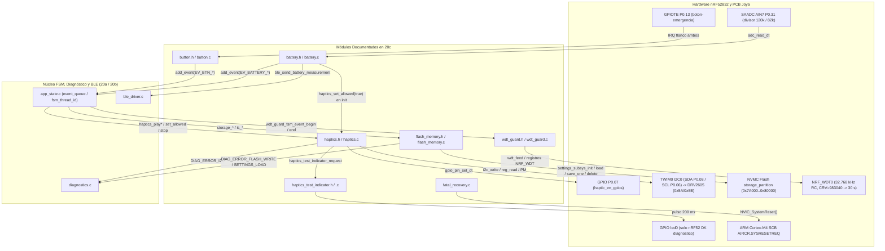
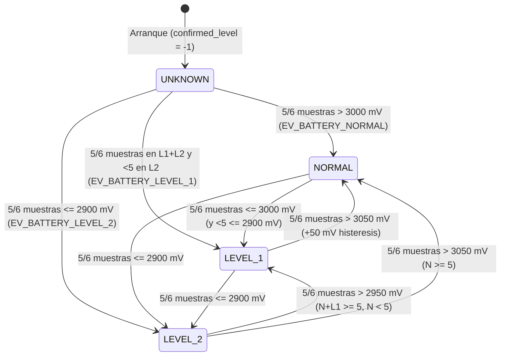
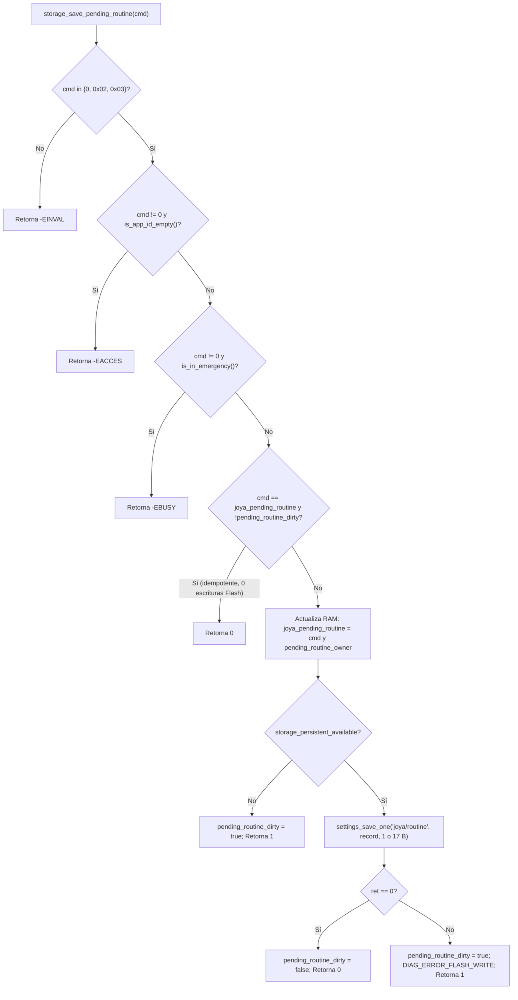
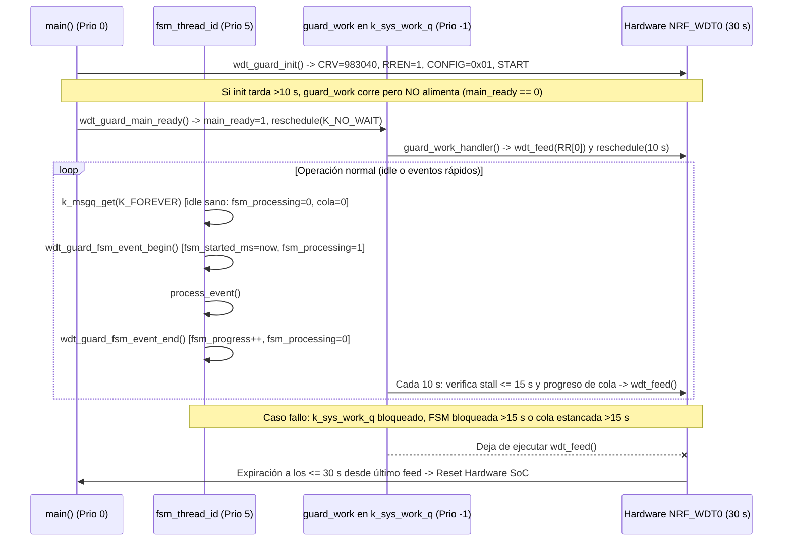

# 20c. Referencia Exhaustiva de Código: Periféricos, Persistencia, Watchdog y Recuperación Fatal

> **Alcance del documento**: Parte **20c** de la [Sección 20 — Referencia Exhaustiva del Código Fuente](../20_code_reference.md), auditada directamente sobre el snapshot canónico `c1128e5d0c0d6f98be0a580d287c0926ca27f01f` del repositorio `JoyaPhoneConnectionFirmware`. Cubre línea por línea y función por función (públicas e internas `static`) los subsistemas de botón físico, actuación háptica e indicador de prueba, monitoreo SAADC de batería, persistencia sobre `Settings`/`NVS`, supervisor de watchdog hardware, manejadores de fallos fatales y pruebas unitarias nativas en host.
>
> **Referencias cruzadas**: Para el núcleo de arranque, FSM, protocolo de comandos y diagnóstico consulte [20a_core_fsm_comm.md](20a_core_fsm_comm.md); para el driver BLE, política iBeacon y subsistema OTA consulte [20b_ble_ota.md](20b_ble_ota.md). El diseño sistémico de cada dominio se detalla en [11_button.md](../11_button.md), [13_haptic_system.md](../13_haptic_system.md), [14_battery_power.md](../14_battery_power.md), [15_flash_persistence.md](../15_flash_persistence.md) y [18_error_handling.md](../18_error_handling.md).

---

## Convención de Auditoría y Matriz de 22 Dimensiones

Cada módulo (`.h` + `.c`) se documenta verificando explícitamente las **22 dimensiones obligatorias de la Sección 20**:
1. **Responsabilidad**, 2. **Dependencias**, 3. **API pública**, 4. **Funciones internas (`static`)**, 5. **Parámetros**, 6. **Valores de retorno**, 7. **Errores**, 8. **Precondiciones**, 9. **Postcondiciones**, 10. **Efectos secundarios**, 11. **Estado interno**, 12. **Variables globales/estáticas**, 13. **Contexto de ejecución**, 14. **Interacciones**, 15. **Recursos**, 16. **Concurrencia**, 17. **Temporización**, 18. **Hardware**, 19. **Flash**, 20. **Eventos**, 21. **BLE**, y 22. **Clasificación epistemológica** — distinguiendo entre **(a) Comportamiento implementado**, **(b) Intención de diseño**, **(c) Comportamiento inferido**, **(d) Código experimental / residual / no utilizado** y **(e) Pendiente de validación experimental / dependiente de esquemático externo**.

---

## 1. Subsistema de Botón Físico (`include/button.h` y `src/button.c`)

### 1.1 Ficha Integral del Módulo

- **Archivos**: [`include/button.h`](../../../include/button.h) (líneas 1–32) y [`src/button.c`](../../../src/button.c) (líneas 1–200).
- **1. Responsabilidad**: Adquisición del único botón físico de usuaria mediante interrupción `GPIOTE` en ambos flancos, filtrado antirrebote por software (`50 ms`), medición de duración de pulsación sostenida (`0,5 s`, `5 s`, `15 s`), conteo atómico de clics cortos en ventana deslizante (`900 ms`) y traducción a eventos discretos `EV_BTN_*` hacia la cola de la FSM.
- **2. Dependencias**:
  - Headers en [`include/button.h`](../../../include/button.h#L4-L8): `<stdint.h>`, `<zephyr/kernel.h>`, `<zephyr/device.h>`, `<zephyr/drivers/gpio.h>`, [`"app_state.h"`](../../../include/app_state.h).
  - Headers adicionales en [`src/button.c`](../../../src/button.c#L1-L7): `<errno.h>`, `<stdbool.h>`, `<zephyr/sys/atomic.h>`.
  - Devicetree: alias `DT_ALIAS(boton_emergencia)` ([`src/button.c`](../../../src/button.c#L9-L10)), mapeado a `&emergency_button` en [`boards/joya/joya_nrf52/joya_nrf52_nrf52832.dts`](../../../boards/joya/joya_nrf52/joya_nrf52_nrf52832.dts#L27-L42) (`P0.13`, `GPIO_PULL_UP | GPIO_ACTIVE_LOW`) y a `P0.14` en [`nrf52dk_nrf52832.overlay`](../../../nrf52dk_nrf52832.overlay#L16-L29).
- **3. API pública**: `button_init()` y `button_isr_handler()` (expuesta con linkage externo aunque solo debería ser callback interno del driver GPIO).
- **4. Funciones internas (`static`)**: `send_button_event()`, `factory_hold_work_handler()`, `debounce_work_handler()`, `click_window_work_handler()`.
- **11–12. Estado interno y variables globales/estáticas**:

| Símbolo | Ubicación | Tipo / Linkage | Sección ELF | Propósito y semántica |
|---|---|---|---|---|
| `event_queue` | [`include/button.h:10`](../../../include/button.h#L10) | `extern struct k_msgq` | `k_msgq_area` (definida en [`src/app_state.c:28`](../../../src/app_state.c#L28)) | **(d) Declaración residual**: nunca es referenciada directamente en `button.c`, que delega la inserción en `add_event()`. |
| `button` | [`src/button.c:9-10`](../../../src/button.c#L9-L10) | `static const struct gpio_dt_spec` | `.rodata` | Descriptor inmutable de puerto `&gpio0`, pin (`13` en PCB Joya) y flags (`GPIO_PULL_UP \| GPIO_ACTIVE_LOW`). |
| `button_cb_data` | [`src/button.c:12`](../../../src/button.c#L12) | `static struct gpio_callback` | `.bss` | Nodo intrusivo registrado en la lista de callbacks de `&gpio0`. |
| `debounce_work` | [`src/button.c:14`](../../../src/button.c#L14) | `static struct k_work_delayable` (`48 B`) | `.bss` | Temporizador antirrebote reprogramado a `DEBOUNTE_TIME_MS` (`50 ms`) tras cada flanco físico. |
| `click_window_work` | [`src/button.c:15`](../../../src/button.c#L15) | `static struct k_work_delayable` (`48 B`) | `.bss` | Ventana de agrupación multiclic (`900 ms`) tras soltar una pulsación corta (`< 500 ms`). |
| `factory_hold_work` | [`src/button.c:16`](../../../src/button.c#L16) | `static struct k_work_delayable` (`48 B`) | `.bss` | Temporizador de umbral de restablecimiento de fábrica (`15000 ms`) mientras el botón sigue presionado. |
| `press_start_ms` | [`src/button.c:21`](../../../src/button.c#L21) | `static uint32_t` | `.bss` | Marca temporal `k_uptime_get_32()` del instante en que se validó el flanco de presión estable. |
| `pulse_count` | [`src/button.c:22`](../../../src/button.c#L22) | `static atomic_t` | `.bss` | Contador atómico de pulsaciones cortas (`< 500 ms`) acumuladas en la ráfaga activa. |
| `last_stable_pressed` | [`src/button.c:24`](../../../src/button.c#L24) | `static bool` | `.bss` | Último nivel lógico estable observado (`true` = activo/presionado). Inicializado al estado real del pin en `button_init()`. |
| `press_active` | [`src/button.c:25`](../../../src/button.c#L25) | `static bool` | `.bss` | Indica si existe una pulsación válida iniciada después de `button_init()` pendiente de liberación. Ignora liberaciones de pulsaciones ya activas durante el boot. |
| `factory_threshold_sent` | [`src/button.c:26`](../../../src/button.c#L26) | `static bool` | `.bss` | Evita emitir `EV_BTN_FACTORY_THRESHOLD` dos veces (en `factory_hold_work_handler` y al soltar en `debounce_work_handler`). |

- **Macros y constantes ([`include/button.h:12-16`](../../../include/button.h#L12-L16))**:
  - `DEBOUNTE_TIME_MS = 50` *(nota de auditoría: errata tipográfica en el identificador `DEBOUNTE` en lugar de `DEBOUNCE`, conservada consistente entre `.h` y `.c`)*.
  - `CLICK_WINDOW_MS = 900`: ventana inter-clic tras cada liberación corta.
  - `BUTTON_ROUTINE_CANCEL_HOLD_MS = 500`: umbral mínimo para pulsación media (`EV_BTN_LONG_PRESS`, `[500, 4999] ms`).
  - `BUTTON_SUSPEND_HOLD_MS = 5000`: umbral mínimo para solicitud de suspensión (`EV_BTN_SUSPEND_REQUEST`, `[5000, 14999] ms` al soltar).
  - `BUTTON_FACTORY_RESET_HOLD_MS = 15000`: umbral para disparo anticipado de `EV_BTN_FACTORY_THRESHOLD` (en retención) y `EV_BTN_FACTORY_RESET` (al soltar).
- **15–17. Recursos, Concurrencia y Temporización**:
  - **SRAM estática**: `3 × 48 B` (`k_work_delayable`) + `12 B` (`gpio_callback`) + `12 B` escalares ≈ `168 B` en `.bss`; `0 B` de heap.
  - **Modelo de sincronización**: `button_isr_handler` corre en contexto ISR (`GPIOTE_IRQn`) y **únicamente** invoca `k_work_reschedule(&debounce_work, K_MSEC(50))` (API ISR-safe de Zephyr). Los tres handlers `debounce_work_handler`, `click_window_work_handler` y `factory_hold_work_handler` se ejecutan exclusivamente en el hilo cooperativo `k_sys_work_q` (prioridad `-1`), lo que serializa de forma natural el acceso a `last_stable_pressed`, `press_active`, `press_start_ms` y `factory_threshold_sent` sin requerir mutexes. `pulse_count` usa primitivas `atomic_t` como defensa adicional.
  - **Aritmética modular de tiempo**: `now_ms - press_start_ms` utiliza `uint32_t` sin signo sobre `k_uptime_get_32()`; gracias a la aritmética módulo $2^{32}$, el cálculo de duración permanece exacto incluso si el contador de milisegundos desborda a los `~49,71 días` en mitad de una pulsación.
- **18–21. Hardware, Flash, Eventos y BLE**:
  - **Hardware**: Usa `GPIO0` y un canal de evento/puerto `GPIOTE` en `GPIO_INT_EDGE_BOTH`. Como el pin tiene `GPIO_ACTIVE_LOW`, `gpio_pin_get_dt(&button)` invierte la polaridad física y devuelve `1` cuando el pin está a `0 V` (botón pulsado) y `0` cuando el pull-up interno (~13 kΩ) lo mantiene a `VDD`. Consumo estático en reposo: `~0 uA` (entrada CMOS en alto); durante pulsación sostenida: $I = V_{\text{DD}} / R_{\text{pullup}} \approx 3{,}0\,\text{V} / 13\,\text{k}\Omega \approx 230\,\mu\text{A}$.
  - **Flash / BLE**: Sin acceso directo a Flash ni a la pila BLE.
  - **Eventos emitidos**: `EV_BTN_1_PULSE`, `EV_BTN_2_PULSE`, `EV_BTN_EMERGENCY`, `EV_BTN_LONG_PRESS`, `EV_BTN_SUSPEND_REQUEST`, `EV_BTN_FACTORY_THRESHOLD`, `EV_BTN_FACTORY_RESET`.

### 1.2 Referencia Función por Función (`src/button.c`)

#### `button_init` — [`src/button.c:157-200`](../../../src/button.c#L157-L200) (prototipo en [`include/button.h:22`](../../../include/button.h#L22))
- **Firma**: `int button_init(void)`
- **5–7. Parámetros, Retorno y Errores**:
  - Sin parámetros (`void`).
  - Retorna `0` en éxito; `-ENODEV` si `!gpio_is_ready_dt(&button)` (línea 161); o código negativo propagado de `gpio_pin_configure_dt` (línea 165), `gpio_pin_get_dt` (línea 170), `gpio_add_callback` (línea 188) o `gpio_pin_interrupt_configure_dt` (línea 193, deshaciendo previamente el registro con `gpio_remove_callback` en línea 195).
- **8–10. Precondiciones, Postcondiciones y Efectos secundarios**:
  - **Precondiciones**: Invocada una sola vez desde `main()` ([`src/main.c:25`](../../../src/main.c#L25) en arranque de prueba OTA antes de `ble_driver_init()`, o [`src/main.c:53`](../../../src/main.c#L53) en arranque confirmado después de `ble_driver_init()`). **No es idempotente** si se llamase una segunda vez con works activos porque reejecutaría `k_work_init_delayable()` sobre estructuras potencialmente encoladas.
  - **Postcondiciones**: Pin configurado como entrada con pull-up, `last_stable_pressed` sincronizado con el nivel físico instantáneo del arranque (`initial_pressed != 0`, línea 175), `press_active = false`, `factory_threshold_sent = false`, `pulse_count = 0`, los 3 `k_work_delayable` inicializados e interrupción `GPIO_INT_EDGE_BOTH` armada.
  - **Efecto clave de seguridad en arranque**: Si el botón ya estaba presionado al energizar o reiniciar el SoC (`initial_pressed == 1`), `last_stable_pressed` arranca en `true` y `press_active` en `false`. Cuando la usuaria finalmente suelta el botón, `debounce_work_handler` actualiza `last_stable_pressed = false`, ve `!press_active` (línea 98) e **ignora silenciosamente esa liberación** (tal como documenta el comentario de diseño en [`src/app_state.c:375-377`](../../../src/app_state.c#L375-L377)). Esto evita que el cierre de un Factory Reset de 15 s que causó un `sys_reboot()` dispare un clic espurio al soltar el dedo tras el reinicio.
- **13–22. Contexto y Clasificación**: Hilo `main` (prioridad `0`). **(a) Implementado**.

#### `button_isr_handler` — [`src/button.c:54-63`](../../../src/button.c#L54-L63) (prototipo en [`include/button.h:30`](../../../include/button.h#L30))
- **Firma**: `void button_isr_handler(const struct device *dev, struct gpio_callback *cb, uint32_t pins)`
- **5–7. Parámetros, Retorno y Errores**: Recibe `dev`, `cb`, `pins` del driver GPIO de Zephyr (todos marcados `ARG_UNUSED`); retorno `void`; ignora el retorno de `k_work_reschedule`.
- **8–10. Precondiciones, Postcondiciones y Efectos secundarios**: `debounce_work` debe haber sido inicializado en `button_init()`. Cada rebote mecánico reinicia la cuenta atrás de `50 ms` de `debounce_work` (`k_work_reschedule`), garantizando que `debounce_work_handler` solo evalúe el pin cuando hayan transcurrido `50 ms` completos sin nuevas transiciones eléctricas.
- **13 & 22. Contexto y Auditoría**: ISR de `GPIOTE`. **(a) Implementado**; observación menor de encapsulamiento: está declarada en `button.h` en vez de ser `static` en `button.c`, aunque ningún otro módulo la llama.

#### `send_button_event` — [`src/button.c:28-31`](../../../src/button.c#L28-L31) (`static`)
- **Firma**: `static void send_button_event(event_type_t event)`
- **Comportamiento**: Envoltorio mínimo que invoca `(void)add_event(event)` hacia [`src/app_state.c:335`](../../../src/app_state.c#L335). Si `event_queue` (20 slots) está llena, `add_event` reporta `DIAG_ERROR_EVENT_QUEUE_FULL` (`0xE3`) y descarta el evento sin bloquear `k_sys_work_q`. Contexto: `k_sys_work_q`. **(a) Implementado**.

#### `debounce_work_handler` — [`src/button.c:65-136`](../../../src/button.c#L65-L136) (`static`)
- **Firma**: `static void debounce_work_handler(struct k_work *work)`
- **Algoritmo paso a paso**:
  1. Captura `now_ms = k_uptime_get_32()` (línea 69) y lee `pressed_raw = gpio_pin_get_dt(&button)` (línea 71; aborta si `< 0`).
  2. Convierte a booleano lógico `pressed = pressed_raw != 0` y filtra rebotes de retorno al mismo estado: si `pressed == last_stable_pressed`, retorna sin cambios (líneas 78–80).
  3. Actualiza `last_stable_pressed = pressed` (línea 82).
  4. **Rama de presión (`if (pressed)`, líneas 84–96)**:
     - Registra `press_start_ms = now_ms` *(nota temporal: `now_ms` incluye ya los `50 ms` de asentamiento del debounce, pero como la liberación también se mide tras `50 ms` de debounce, el sesgo de `+50 ms` en ambos flancos se cancela casi exactamente al calcular `press_time_ms = now_ms - press_start_ms`!)*.
     - Marca `press_active = true`, `factory_threshold_sent = false`.
     - Programa `factory_hold_work` a `15000 ms` (`BUTTON_FACTORY_RESET_HOLD_MS`).
     - Si `atomic_get(&pulse_count) > 0`, cancela `click_window_work` (`k_work_cancel_delayable`) para evitar que la ventana multiclic expire mientras la usuaria mantiene el dedo abajo en el 2.º o 3.er clic (líneas 91–93).
  5. **Rama de liberación (`!pressed`, líneas 98–135)**:
     - Si `!press_active`, retorna inmediatamente (descarta liberación de botón retenido desde antes del boot).
     - Limpia `press_active = false`, cancela `factory_hold_work` y calcula `press_time_ms = now_ms - press_start_ms`.
     - **Árbol de clasificación por duración**:
       - `press_time_ms >= 15000 || factory_threshold_sent` (línea 106): cancela `click_window_work`, pone `pulse_count = 0`, emite `EV_BTN_FACTORY_THRESHOLD` si aún no se había emitido (caso de carrera exacta en el borde de `15000 ms`), y emite `EV_BTN_FACTORY_RESET`.
       - `5000 <= press_time_ms < 15000` (línea 115): cancela `click_window_work`, anula cualquier clic corto previo (`atomic_set(&pulse_count, 0)`) y emite `EV_BTN_SUSPEND_REQUEST`.
       - `500 <= press_time_ms < 5000` (línea 122): cancela `click_window_work`, anula `pulse_count = 0` y emite `EV_BTN_LONG_PRESS` (fin/cancelación de rutina).
       - `press_time_ms < 500` (líneas 132–135): incrementa `atomic_inc(&pulse_count)` y reprograma `click_window_work` a `CLICK_WINDOW_MS` (`900 ms`).
- **Contexto**: `k_sys_work_q`. **(a) Implementado**.

#### `factory_hold_work_handler` — [`src/button.c:33-52`](../../../src/button.c#L33-L52) (`static`)
- **Firma**: `static void factory_hold_work_handler(struct k_work *work)`
- **Algoritmo y protección contra despertar temprano**:
  1. Relee físicamente `gpio_pin_get_dt(&button)` y verifica `pressed > 0 && press_active && !factory_threshold_sent` (líneas 37–40).
  2. Comprueba `elapsed_ms = k_uptime_get_32() - press_start_ms`: si por redondeo de ticks LFCLK despertó antes de `15000 ms`, se autorreprograma por la diferencia `15000 - elapsed_ms` (líneas 41–45).
  3. Al cumplir `>= 15000 ms` con el dedo aún presionado: fija `factory_threshold_sent = true`, cancela `click_window_work`, limpia `pulse_count = 0` y emite `EV_BTN_FACTORY_THRESHOLD` (líneas 48–51). Esto permite a la FSM reproducir el patrón háptico `HAPTICS_PATTERN_FACTORY_RESET` **mientras la usuaria aún sostiene el botón**, indicándole táctilmente que ya alcanzó los 15 s y puede soltar para consumar el borrado y reinicio (`EV_BTN_FACTORY_RESET`).
- **Contexto**: `k_sys_work_q`. **(a) Implementado**.

#### `click_window_work_handler` — [`src/button.c:138-155`](../../../src/button.c#L138-L155) (`static`)
- **Firma**: `static void click_window_work_handler(struct k_work *work)`
- **Comportamiento**: Extrae y resetea atómicamente `uint32_t count = atomic_set(&pulse_count, 0)` (línea 142). Si `count == 0`, retorna; si `count == 1`, emite `EV_BTN_1_PULSE`; si `count == 2`, emite `EV_BTN_2_PULSE`; si `count >= 3`, emite `EV_BTN_EMERGENCY` (saturando 3, 4 o más clics rápidos en una única alerta de emergencia).
- **Consecuencia sobre latencia**: Todo gesto de clics cortos (`1`, `2` o `3+` pulsos) añade de forma determinista `50 ms` (debounce de última liberación) + `900 ms` (`CLICK_WINDOW_MS`) = **`950 ms`** desde que la usuaria levanta el dedo en el último clic hasta que el evento ingresa en `event_queue`. Contexto: `k_sys_work_q`. **(a) Implementado**.

---

## 2. Subsistema Háptico (`include/haptics.h` y `src/haptics.c`)

### 2.1 Ficha Integral del Módulo

- **Archivos**: [`include/haptics.h`](../../../include/haptics.h) (líneas 1–94) y [`src/haptics.c`](../../../src/haptics.c) (líneas 1–700).
- **1. Responsabilidad**: Gestión integral del controlador háptico Texas Instruments `DRV2605` / `DRV2605L` sobre `I2C0` (`TWIM0`) y su llave de alimentación/habilitación GPIO (`P0.07`), proveyendo: (i) secuenciador asíncrono de patrones RTP (*Real-Time Playback*) multipaso con soporte de callback de finalización, (ii) disparador de efectos pregrabados de librería ROM con sondeo acotado del bit `GO`, (iii) compuerta atómica de política energética (`haptics_allowed`), y (iv) suspensión/reanudación dinámica de bajo consumo (`PM_DEVICE_ACTION_SUSPEND` / `RESUME`) del periférico `TWIM0`.
- **2. Dependencias**:
  - Headers: `<zephyr/device.h>`, `<zephyr/drivers/gpio.h>`, `<zephyr/drivers/i2c.h>`, `<zephyr/kernel.h>`, `<errno.h>`, `<zephyr/pm/device.h>`, `<zephyr/sys/atomic.h>`, [`"haptics_test_indicator.h"`](../../../include/haptics_test_indicator.h), [`"diagnostics.h"`](../../../include/diagnostics.h).
  - Guardas de preprocesador ([`src/haptics.c:9-15`](../../../src/haptics.c#L9-L15)): aborta compilación con `#error` si no existe `/zephyr,user` o carece de `haptic_en_gpios`.
  - Nodos DTS: `haptic_en` (`/zephyr,user/haptic_en_gpios` → `P0.07`, `GPIO_ACTIVE_HIGH`) y `haptic_i2c` (`&i2c0` → `SDA = P0.08`, `SCL = P0.06`, `100 kHz`).
- **3. API pública**: `haptics_init`, `haptics_stop`, `haptics_set_allowed`, `haptics_is_ready`, `haptics_play`, `haptics_play_with_completion`, `haptics_play_effect`.
- **4. Funciones internas (`static`)**: `drv2605_write_reg`, `drv2605_read_reg`, `drv2605_probe_addr`, `drv2605_set_rtp`, `haptics_i2c_suspend`, `haptics_i2c_resume`, `drv2605_idle`, `drv2605_wake`, `drv2605_play_effect`, `get_pattern_steps`, `get_next_step`, `haptics_pattern_work_handler`, `haptics_effect_work_handler`, y la función huérfana `nbm_bypass_init`.
- **Registros, Constantes y Tipos en [`include/haptics.h:10-57`](../../../include/haptics.h#L10-L57)**:
  - Direcciones I2C sondeadas: `DRV2605_I2C_ADDR_LOW = 0x5A` (estándar TI DRV2605) y `DRV2605_I2C_ADDR_HIGH = 0x5B` (fallback).
  - Registros: `STATUS (0x00)`, `MODE (0x01)`, `RTP_INPUT (0x02)`, `LIBRARY (0x03)`, `WAVESEQ1 (0x04)`, `WAVESEQ2 (0x05)`, `GO (0x0C)`, `OD_CLAMP (0x17)`, `FEEDBACK_CONTROL (0x1A)`, `CONTROL3 (0x1D)`.
  - Configuración física del motor ERM:
    - `DRV2605_OD_CLAMP_2V5 = 0x72` (`114` decimal): limita la tensión pico en lazo abierto según la ecuación del datasheet del DRV2605 para ERM open-loop:
      $$V_{\text{ERM\_clamp}} = \text{OD\_CLAMP} \times 0{,}02196\,\text{V} = 114 \times 0{,}02196\,\text{V} \approx 2{,}503\,\text{V}$$
    - `HAPTIC_RTP_INTENSITY = 100` sobre `HAPTIC_RTP_MAX = 127` (`~78,7 %` de escala completa firmada `0..127` porque `DATA_FORMAT_RTP = 0`), produciendo una tensión efectiva media de excitación de $\approx 2{,}503 \times (100/127) \approx 1{,}97\,\text{V}$ durante los pasos activos y `HAPTIC_RTP_OFF = 0` durante las pausas.
    - `DRV2605_N_ERM_LRA = BIT(7)` (puesto a `0` = modo ERM), `DRV2605_ERM_OPEN_LOOP = BIT(5)` (puesto a `1` = ERM en lazo abierto), `DRV2605_DATA_FORMAT_RTP = BIT(3)` (puesto a `0` = RTP con signo `[-128..127]`).
  - `enum haptics_effect` ([`include/haptics.h:54-57`](../../../include/haptics.h#L54-L57)): `HAPTICS_EFFECT_AUTH = 0x01` (*Strong Click 100%* en ROM Library A), `HAPTICS_EFFECT_RESET = 0x2F` (*Buzz 1 100%*). **(d) Nota de auditoría**: aunque `haptics_play_effect()` y todo su motor están completamente implementados, **ningún archivo en `src/` invoca `haptics_play_effect()`** en el commit `c1128e5`; toda la retroalimentación activa de la aplicación utiliza patrones RTP mediante `haptics_play()` / `haptics_play_with_completion()`.

- **Catálogo de Patrones RTP en `.rodata` ([`src/haptics.c:59-128`](../../../src/haptics.c#L59-L128))**:

| Enum `haptics_pattern` | Arreglo `static const` | Secuencia `(ms, amp)` | Pasos | Duración total | Eventos / contextos de uso |
|---|---|---|---|---|---|
| `HAPTICS_PATTERN_NONE` (`0`) | — | — | `0` | `0 ms` | Detención explícita (`-EINVAL` tras `haptics_stop()`). |
| `HAPTICS_PATTERN_SETUP_MODE` (`1`) | `pattern_setup_mode` | `(700,100), (100,0)` *(líneas 50–56 conservan comentada una rampa previa de `540 ms`)* | `2` | `800 ms` | Entrada manual por `EV_BTN_2_PULSE` a `STATE_SETUP_MODE` o reintento en `STATE_BONDED_DISCONNECTED`. |
| `HAPTICS_PATTERN_ROUTINE_START` (`2`) | `pattern_routine_start` | `(700,100), (100,0)` | `2` | `800 ms` | `EV_BTN_1_PULSE` (`COMMAND_ROUTINE`). |
| `HAPTICS_PATTERN_ROUTINE_CANCEL` (`3`) | `pattern_routine_cancel` | `2 × [(200,100), (100,0)]` | `4` | `600 ms` | `EV_BTN_LONG_PRESS` (`COMMAND_END_ROUTINE`). |
| `HAPTICS_PATTERN_EMERGENCY_START` (`4`) | `pattern_emergency_start` | `(2000,100), (100,0)` | `2` | `2.100 ms` | `EV_BTN_EMERGENCY` y reconexión autenticada con `EMERGENCY_PENDING_ACK`. |
| `HAPTICS_PATTERN_FOLLOW_ME` (`5`) | `pattern_follow_me` | `2 × [(200,100), (100,0)]` | `4` | `600 ms` | `EV_APP_FOLLOW_ME` durante emergencia activa. |
| `HAPTICS_PATTERN_FRIEND_EMERGENCY` (`6`) | `pattern_friend_emergency` | `(200,100),(100,0),(200,100),(350,0)` × 2 + `(200,100),(100,0)` × 2 | `12` | `2.300 ms` | `EV_APP_FRIEND_EMERGENCY` en `STATE_AUTHENTICATED` sin emergencia propia. |
| `HAPTICS_PATTERN_SUSPEND` (`7`) | `pattern_suspend` | `(200,100),(100,0),(700,100),(100,0),(200,100),(100,0)` | `6` | `1.400 ms` | `EV_BTN_SUSPEND_REQUEST` (con `suspend_pattern_finished`). |
| `HAPTICS_PATTERN_FACTORY_RESET` (`8`) | `pattern_factory_reset` | `3 × [(200,100), (100,0)]` | `6` | `900 ms` | `EV_BTN_FACTORY_THRESHOLD` a los 15 s (con `factory_pattern_finished`). |
| `HAPTICS_PATTERN_ACK_CONNECTION` (`9`) | `pattern_ack_connection` | `3 × [(200,100), (100,0)]` | `6` | `900 ms` | Autenticación exitosa de `APP_ID` (nuevo o coincidente). |

- **11–12. Variables estáticas de estado ([`src/haptics.c:33-48, 199`](../../../src/haptics.c#L33-L48))**:
  - `drv2605_addr` (`uint16_t`), `haptics_ready` (`bool`), `haptic_enabled` (`bool`), `i2c_suspended` (`bool`, línea 199), `haptics_allowed` (`atomic_t`, inicializado en `0` = bloqueado hasta que `battery_init` mida `> 3000 mV` o la FSM confirme `battery_level == 0`), `active_pattern` (`enum haptics_pattern`), `active_step_index` (`size_t`), `pattern_completion` (`void (*)(void)`), `haptics_pattern_work` (`k_work_delayable`, `48 B` en `datas`), `haptics_effect_work` (`k_work_delayable`, `48 B` en `datas`), `pattern_work_sync` (`k_work_sync`, `40 B` en `bss`), `effect_work_sync` (`k_work_sync`, `40 B` en `bss`), `effect_poll_count` (`uint16_t`).
- **16. Concurrencia y restricción crítica de contexto**:
  - `haptics_play*`, `haptics_stop`, `haptics_set_allowed` y `haptics_play_effect` son llamadas desde `fsm_thread_id` (prioridad `5` preemptiva), mientras que `haptics_pattern_work_handler` y `haptics_effect_work_handler` corren en `k_sys_work_q` (prioridad `-1` cooperativa).
  - La sincronización entre ambos hilos se realiza mediante `k_work_cancel_delayable_sync(..., &pattern_work_sync)` y `&effect_work_sync`. **PRECONDICIÓN CRÍTICA**: como `k_work_cancel_delayable_sync` espera bloqueando hasta que termine cualquier ejecución en curso del work item en `k_sys_work_q`, **jamás debe llamarse `haptics_stop()`, `haptics_play*()` ni `haptics_set_allowed(false)` desde dentro de `k_sys_work_q`** (ni desde el callback `completion()`), pues provocaría un interbloqueo (*deadlock*) de `k_sys_work_q` consigo mismo. Por eso `suspend_pattern_finished` y `factory_pattern_finished` en [`src/app_state.c:65-73`](../../../src/app_state.c#L65-L73) solo encolan un evento en `event_queue`.
  - **Observación de auditoría sobre pérdida de configuración volátil tras `P0.07 = 0`**: **(e) Dependiente de esquemático externo**. Si en la PCB Joya el pin `haptic_en_gpios` (`P0.07`) controla el pin lógico `EN` del `DRV2605` manteniendo alimentado su pin `VDD`, los registros `FEEDBACK_CONTROL` (`0x1A`), `CONTROL3` (`0x1D`, ERM open-loop) y `OD_CLAMP` (`0x17 = 0x72`) escritos en `haptics_init()` **sí se conservan** cuando `EN = 0` (según datasheet TI SLOS825, `EN = 0` coloca el IC en *shutdown* preservando registros mientras `VDD` esté presente). En cambio, si `P0.07` conmutase un load-switch que corta `VDD` al `DRV2605`, al despertar en `drv2605_wake()` el chip sufriría un Power-On Reset volviendo a `OD_CLAMP` por defecto (`0x8C` ≈ `3,07 V`) y lazo cerrado ERM, dado que `drv2605_wake()` solo restaura `MODE = 0x00` y `LIBRARY = 0x01` ([`src/haptics.c:283-288`](../../../src/haptics.c#L283-L288)).

### 2.2 Referencia Función por Función (`src/haptics.c`)

#### `drv2605_write_reg` — [`src/haptics.c:137-146`](../../../src/haptics.c#L137-L146) (`static`)
- **Firma**: `static int drv2605_write_reg(uint8_t reg, uint8_t value)`
- **Comportamiento**: Construye `uint8_t data[2] = { reg, value }` y ejecuta `i2c_write(haptic_i2c, data, 2, drv2605_addr)`. Si falla (`err < 0`), invoca `diagnostics_report_error(DIAG_ERROR_I2C)` (`0xE5`) y retorna `err`. Latencia típica a `100 kHz`: 3 bytes en bus (`addr+W`, `reg`, `value` + START/ACKs/STOP ≈ 29 bits) ≈ **`0,30 ms`**; peor caso ante bloqueo SCL/fallo bus: `CONFIG_I2C_NRFX_TRANSFER_TIMEOUT = 500 ms`. Contexto: `main`, `fsm_thread_id` o `k_sys_work_q`. **(a) Implementado**.

#### `drv2605_read_reg` — [`src/haptics.c:154-161`](../../../src/haptics.c#L154-L161) (`static`)
- **Firma**: `static int drv2605_read_reg(uint8_t reg, uint8_t *value)`
- **Comportamiento**: Ejecuta `i2c_reg_read_byte(haptic_i2c, drv2605_addr, reg, value)` (transacción combinada write-restart-read de `~0,40 ms` a `100 kHz`). Ante error (`err < 0`), emite `diagnostics_report_error(DIAG_ERROR_I2C)`. **(a) Implementado**.

#### `drv2605_probe_addr` — [`src/haptics.c:168-173`](../../../src/haptics.c#L168-L173) (`static`)
- **Firma**: `static int drv2605_probe_addr(uint16_t addr)`
- **Comportamiento**: Intenta leer `DRV2605_REG_STATUS (0x00)` en `addr` directamente con `i2c_reg_read_byte` **sin** disparar `DIAG_ERROR_I2C` en caso de NACK, porque se usa durante el autodescubrimiento (`0x5A` → `0x5B`) en `haptics_init()`. **(a) Implementado**.

#### `drv2605_set_rtp` — [`src/haptics.c:180-197`](../../../src/haptics.c#L180-L197) (`static`)
- **Firma**: `static int drv2605_set_rtp(uint8_t amplitude)`
- **Comportamiento**: Escribe `DRV2605_MODE_RTP (0x05)` en `DRV2605_REG_MODE (0x01)` y luego `amplitude` en `DRV2605_REG_RTP_INPUT (0x02)` (2 escrituras I2C ≈ `0,6 ms`). Retorna `0` o el primer código negativo. **(a) Implementado**.

#### `haptics_i2c_suspend` y `haptics_i2c_resume` — [`src/haptics.c:201-229`](../../../src/haptics.c#L201-L229) (`static`)
- **Firmas**: `static int haptics_i2c_suspend(void)` / `static int haptics_i2c_resume(void)`
- **Comportamiento**: Guardadas por el flag idempotente `i2c_suspended`, ejecutan `pm_device_action_run(haptic_i2c, PM_DEVICE_ACTION_SUSPEND)` (deshabilita `TWIM0` y conmuta `P0.08`/`P0.06` al estado `i2c0_sleep` con `low-power-enable`, eliminando el consumo quiescente de `TWIM0` de ~`200–400 uA` y permitiendo que HFCLK se apague en reposo) o `PM_DEVICE_ACTION_RESUME` (restaura `i2c0_default` y re-habilita `TWIM0`). **(a) Implementado**.

#### `drv2605_idle` — [`src/haptics.c:234-255`](../../../src/haptics.c#L234-L255) (`static`)
- **Firma**: `static int drv2605_idle(void)`
- **Comportamiento**: Si `haptic_enabled == true`, ejecuta secuencialmente (continuando aunque falle un paso intermedio y reteniendo el primer error): (1) `RTP_INPUT = 0`, (2) `MODE = DRV2605_MODE_STANDBY (0x40)`, (3) `gpio_pin_set_dt(&haptic_en, 0)` y `haptic_enabled = false`. Siempre limpia `active_pattern = HAPTICS_PATTERN_NONE`, `active_step_index = 0` e invoca `haptics_i2c_suspend()`. **(a) Implementado**.

#### `drv2605_wake` — [`src/haptics.c:257-296`](../../../src/haptics.c#L257-L296) (`static`)
- **Firma**: `static int drv2605_wake(void)`
- **Comportamiento**:
  1. Verifica `atomic_get(&haptics_allowed)`; si es `0`, rechaza inmediatamente con `-EACCES` sin tocar GPIOs ni I2C.
  2. Si `haptic_enabled == true`, retorna `0` de inmediato (ya despierto).
  3. Reanuda `TWIM0` (`haptics_i2c_resume()`), sube `P0.07 = 1` (`gpio_pin_set_dt(&haptic_en, 1)`), marca `haptic_enabled = true` y **duerme `k_msleep(10)`** (`10 ms` de tiempo de encendido $t_{\text{start}}$ del DRV2605, que el datasheet especifica en `<= 1 ms` tras `EN = 1`).
  4. Escribe `MODE = DRV2605_MODE_INTERNAL_TRIGGER (0x00)` y `LIBRARY = 0x01` (ROM Library A para ERM). Si falla cualquiera de las dos escrituras, revierte `P0.07 = 0` y `haptic_enabled = false`.
- **Consecuencia de latencia**: Cuando el DRV2605 parte de reposo (`haptic_enabled == false`), `drv2605_wake()` bloquea al hilo llamante (`fsm_thread_id`) durante **`~10,7 ms`**. **(a) Implementado**.

#### `drv2605_play_effect` — [`src/haptics.c:303-332`](../../../src/haptics.c#L303-L332) (`static`)
- **Firma**: `static int drv2605_play_effect(uint8_t effect)`
- **Comportamiento**: Carga `WAVESEQ1 (0x04) = effect`, termina la cola con `WAVESEQ2 (0x05) = 0x00`, asegura `MODE (0x01) = 0x00` (*Internal Trigger*) y dispara la reproducción escribiendo `GO (0x0C) = 0x01`. **(a) Implementado** (solo llamado desde `haptics_play_effect`, actualmente sin invocadores externos).

#### `get_pattern_steps` y `get_next_step` — [`src/haptics.c:340-409`](../../../src/haptics.c#L340-L409) (`static`)
- **Firmas**: `static const struct haptic_step *get_pattern_steps(enum haptics_pattern pattern, size_t *step_count)` y `static bool get_next_step(uint8_t *amplitude, uint16_t *duration_ms)`
- **Comportamiento**: `get_pattern_steps` resuelve en $O(1)$ mediante `switch` el puntero en `.rodata` y su cardinalidad `ARRAY_SIZE`; devuelve `NULL` y `*step_count = 0` para `HAPTICS_PATTERN_NONE` o valores fuera de rango. `get_next_step` extrae el paso `steps[active_step_index]`, incrementa `active_step_index++` y devuelve `true`, o `false` al agotar la tabla. **(a) Implementado**.

#### `haptics_pattern_work_handler` — [`src/haptics.c:415-445`](../../../src/haptics.c#L415-L445) (`static`)
- **Firma**: `static void haptics_pattern_work_handler(struct k_work *work)`
- **Comportamiento**: Ejecutado en `k_sys_work_q`. Llama a `get_next_step()`:
  - Si retorna `false` (fin normal del patrón) o si `drv2605_set_rtp(amplitude)` devuelve `< 0` (fallo I2C en medio del patrón): apaga hardware e I2C con `drv2605_idle()`, captura localmente `completion = pattern_completion`, limpia `pattern_completion = NULL` **antes** de invocar `completion()` y ejecuta el callback si no era nulo.
  - Si tuvo éxito: reprograma `haptics_pattern_work` a `K_MSEC(duration_ms)`. **(a) Implementado**.

#### `haptics_effect_work_handler` — [`src/haptics.c:447-459`](../../../src/haptics.c#L447-L459) (`static`)
- **Firma**: `static void haptics_effect_work_handler(struct k_work *work)`
- **Comportamiento**: Sondea cada `10 ms` en `k_sys_work_q` el registro `DRV2605_REG_GO (0x0C)`. Cuando la lectura I2C falla, el bit `0` (`GO`) cae a `0` (efecto finalizado por el motor interno del DRV2605), o `++effect_poll_count >= 1000` (cota de seguridad máxima de `1000 × 10 ms = 10 s` frente a atascos del IC), invoca `drv2605_idle()`; de lo contrario reprograma `haptics_effect_work` a `10 ms`. **(a) Implementado**.

#### `nbm_bypass_init` — [`src/haptics.c:465-479`](../../../src/haptics.c#L465-L479) (`static`)
- **Firma**: `static int nbm_bypass_init(void)`
- **Comportamiento y análisis arqueológico**:
  - Espera `k_msleep(25)`, escribe `{0x08, 0x00}` al esclavo I2C `0x2E` (registro `COMMAND` del booster de supercapacitor Nexperia `NBM5100A`, desactivando carga activa/end-of-discharge), lee el registro `0x0A` (`SET2`) de `0x2E` y reescribe `v & ~0x10` (limpiando el bit `VDHHIZ` para conectar `VDH` en bypass directo a `VBT`).
  - **22. Clasificación**: **(d) Código residual / huérfano no utilizado**. Aunque aparece ubicada debajo del banner `PUBLIC API` (línea 462), es `static`, no tiene prototipo en `haptics.h` y no es llamada por ninguna función del repositorio (el compilador la descarta con `-ffunction-sections -Wl,--gc-sections`). Corresponde a una etapa previa de hardware con el IC `NBM5100A`, eliminado del árbol actual.

#### `haptics_init` — [`src/haptics.c:485-580`](../../../src/haptics.c#L485-L580) (prototipo en [`include/haptics.h:63`](../../../include/haptics.h#L63))
- **Firma**: `int haptics_init(void)`
- **Secuencia exacta de arranque**:
  1. Si `haptics_ready == true`, retorna `0` (idempotente).
  2. Verifica `device_is_ready(haptic_i2c)` y `gpio_is_ready_dt(&haptic_en)` (`-ENODEV` si falla).
  3. Activa `P0.07` con `gpio_pin_configure_dt(&haptic_en, GPIO_OUTPUT_ACTIVE)`, fija `haptic_enabled = true` y espera `k_msleep(10)`.
  4. Ejecuta recuperación eléctrica de bus atascado `i2c_recover_bus(haptic_i2c)` (pulsos de reloj SCL si algún esclavo retuvo SDA bajo tras un reset en mitad de trama; tolera `-ENOSYS`).
  5. Sondea `0x5A` (`DRV2605_I2C_ADDR_LOW`) y, si falla, `0x5B` (`DRV2605_I2C_ADDR_HIGH`). Si ninguno responde, salta a `fail:` (`P0.07 = 0`, `haptic_enabled = false`, retorna `-ENODEV`).
  6. Lee `STATUS (0x00)`, escribe `MODE = 0x00` (sale de standby inicial), modifica `FEEDBACK_CONTROL (0x1A)` limpiando `BIT(7)` (selecciona actuador ERM), modifica `CONTROL3 (0x1D)` activando `BIT(5)` (`ERM_OPEN_LOOP`) y limpiando `BIT(3)` (`DATA_FORMAT_RTP` con signo), y fija `OD_CLAMP (0x17) = 0x72` (`~2,5 V`).
  7. Llama a `drv2605_idle()` (apaga `RTP_INPUT`, pone `STANDBY`, baja `P0.07 = 0` y suspende `TWIM0`). Si `drv2605_idle()` triunfa, marca `haptics_ready = true` y retorna `0`.
- **Efectos sobre arranque**: No es bloqueante para la vida del producto si falla (`main()` registra el fallo en `DIAG_INIT_HAPTIC` — dejando la máscara inicial p. ej. en `0x17` en lugar de `0x1F` — y continúa operando BLE/emergencias sin vibración). Latencia en arranque normal exitoso: `~13 ms`. **(a) Implementado**.

#### `haptics_play_with_completion` y `haptics_play` — [`src/haptics.c:617-661`](../../../src/haptics.c#L617-L661)
- **Firmas**: `int haptics_play_with_completion(enum haptics_pattern pattern, void (*completion)(void))` y `void haptics_play(enum haptics_pattern pattern)`
- **Validaciones y prioridad de gestos críticos**:
  1. Notifica a `haptics_test_indicator_request(pattern != HAPTICS_PATTERN_NONE && atomic_get(&haptics_allowed))` **antes** de validar `haptics_ready`, permitiendo diagnosticar con `LED0` en una `nRF52 DK` sin `DRV2605` conectado.
  2. Si `!haptics_ready` → `-ENODEV`; si `!atomic_get(&haptics_allowed)` → `-EACCES`.
  3. **Protección de callbacks de cierre (`if (pattern_completion && !completion) return -EBUSY;`, líneas 628–630)**: impide que un patrón ordinario (`completion == NULL`, p. ej. un clic o mensaje BLE) cancele y deje huérfano un patrón crítico en curso con callback (`HAPTICS_PATTERN_SUSPEND` o `HAPTICS_PATTERN_FACTORY_RESET`), lo cual de otro modo dejaría bloqueada la máquina `hold_action` en `app_state.c`. En cambio, un nuevo patrón *con* callback (p. ej. pasar de `SUSPEND` a `FACTORY_RESET`) o una llamada previa a `haptics_stop()` sí puede reemplazarlo.
  4. Si `pattern == HAPTICS_PATTERN_NONE`, llama a `haptics_stop()` y retorna `-EINVAL`.
  5. Limpia `pattern_completion = NULL`, cancela síncronamente `haptics_pattern_work` y `haptics_effect_work`, despierta al `DRV2605` con `drv2605_wake()`, configura `active_pattern`, `active_step_index = 0`, `pattern_completion = completion` y agenda `k_work_schedule(&haptics_pattern_work, K_NO_WAIT)` (si devuelve `<= 0`, limpia y retorna `-EIO`).
  6. `haptics_play(pattern)` simplemente invoca `(void)haptics_play_with_completion(pattern, NULL)`. **(a) Implementado**.

#### `haptics_play_effect` — [`src/haptics.c:586-611`](../../../src/haptics.c#L586-L611)
- **Firma**: `void haptics_play_effect(enum haptics_effect effect)`
- **Comportamiento**: Notifica al indicador de prueba; aborta si `!haptics_ready || !atomic_get(&haptics_allowed) || pattern_completion` (respeta también patrones con callback activo); cancela síncronamente ambos works; ejecuta `drv2605_wake()`, `drv2605_play_effect((uint8_t)effect)` y agenda `haptics_effect_work` a `10 ms` con `effect_poll_count = 0`. **(a) Implementado / (d) Sin llamadores actuales en `src/`**.

#### `haptics_stop`, `haptics_set_allowed` y `haptics_is_ready` — [`src/haptics.c:666-700`](../../../src/haptics.c#L666-L700)
- `void haptics_stop(void)`: Anula `pattern_completion = NULL`, cancela síncronamente `haptics_pattern_work` y `haptics_effect_work`, y llama a `drv2605_idle()` (o fuerza `P0.07 = 0` si `haptic_enabled` quedó encendido tras un fallo parcial de init).
- `void haptics_set_allowed(bool allowed)`: Guarda localmente `void (*completion)(void) = pattern_completion` **antes** de actualizar `atomic_set(&haptics_allowed, allowed)`. Si `!allowed` (p. ej. caída de batería a Nivel 1 o Nivel 2 en pleno gesto de suspensión o factory reset), detiene el motor con `haptics_stop()` e **invoca inmediatamente `completion()`** (líneas 687–689) para garantizar que la FSM reciba `EV_HAPTICS_SUSPEND_DONE` / `EV_HAPTICS_FACTORY_DONE` y no quede atascada esperando una vibración abortada por batería baja.
- `bool haptics_is_ready(void)`: Retorna `haptics_ready`. **(a) Implementado**.

---

## 3. Indicador Visual de Diagnóstico Háptico (`include/haptics_test_indicator.h` y `src/haptics_test_indicator.c`)

### 3.1 Ficha Integral y Referencia de Funciones

- **Archivos**: [`include/haptics_test_indicator.h`](../../../include/haptics_test_indicator.h) (líneas 1–11), [`src/haptics_test_indicator.c`](../../../src/haptics_test_indicator.c) (líneas 1–42), [`Kconfig`](../../../Kconfig#L5-L11) y [`CMakeLists.txt`](../../../CMakeLists.txt#L33-L35).
- **1–4. Responsabilidad y Compilación Condicional**: Módulo auxiliar de banco que emite un pulso visual de `200 ms` sobre el alias Devicetree `led0` cada vez que se solicita una acción háptica permitida por la política de batería, aun cuando no exista un `DRV2605` físico conectado.
  - Controlado por `CONFIG_JOYA_HAPTICS_TEST_INDICATOR` (`default n`, `depends on BOARD_NRF52DK_NRF52832 && GPIO`).
  - **En producción (`joya_nrf52/nrf52832`)**: la opción Kconfig es inalcanzable (`n`), `CMakeLists.txt` excluye `src/haptics_test_indicator.c` de la compilación (`target_sources_ifdef`) y `haptics_test_indicator.h` reemplaza la llamada por `#define haptics_test_indicator_request(battery_allows) do { } while (0)` (**coste cero en Flash, cero en RAM y cero ciclos de CPU**).
  - Si se habilita sin un alias `led0` con `status = "okay"`, falla en compilación con `#error "Haptic diagnostic requires an enabled led0 alias"` ([`src/haptics_test_indicator.c:8-10`](../../../src/haptics_test_indicator.c#L8-L10)).
- **11–12. Estado estático (solo cuando `CONFIG_JOYA_HAPTICS_TEST_INDICATOR=y`)**: `test_led` (`gpio_dt_spec` sobre `DT_ALIAS(led0)`), `test_led_ready` (`bool`), `test_led_off_work` (`k_work_delayable`).
- **Funciones**:
  - `static void test_led_off(struct k_work *work)` ([`src/haptics_test_indicator.c:15-19`](../../../src/haptics_test_indicator.c#L15-L19)): Ejecutada en `k_sys_work_q` a los `200 ms`; apaga `test_led` con `gpio_pin_set_dt(&test_led, 0)`.
  - `void haptics_test_indicator_request(bool battery_allows)` ([`src/haptics_test_indicator.c:23-42`](../../../src/haptics_test_indicator.c#L23-L42)): Si `!battery_allows`, retorna sin tocar el LED. En la primera llamada válida realiza inicialización perezosa (*lazy init*) del GPIO con `GPIO_OUTPUT_INACTIVE` y fija `test_led_ready = true`. Activa `gpio_pin_set_dt(&test_led, 1)` y reprograma `test_led_off_work` a `K_MSEC(200)` (apagando inmediatamente el pin si `k_work_reschedule` devuelve `< 0`). **(a) Implementado** (diagnóstico de placa de desarrollo).

---

## 4. Subsistema de Monitoreo de Batería (`include/battery.h` y `src/battery.c`)

### 4.1 Ficha Integral del Módulo

- **Archivos**: [`include/battery.h`](../../../include/battery.h) (líneas 1–36) y [`src/battery.c`](../../../src/battery.c) (líneas 1–385).
- **1. Responsabilidad**: Adquisición analógica de la tensión `VBAT` mediante el periférico `SAADC` del `nRF52832` (`AIN7` / `P0.31`) a través de un divisor resistivo externo (`120 kΩ / 82 kΩ`), reconstrucción aritmética redondeada en milivoltios, clasificación con histéresis direccional ascendente (`+50 mV`), filtrado antirrebote estadístico mediante ventana de **6 muestras con mayoría calificada acumulada de 5 votos**, publicación de cambios de nivel confirmados (`EV_BATTERY_NORMAL`, `EV_BATTERY_LEVEL_1`, `EV_BATTERY_LEVEL_2`) hacia la FSM y telemetría periódica en mV sobre GATT (`BATTERY_MEASUREMENT`).
- **2. Dependencias**:
  - Headers: `<stdint.h>`, `<errno.h>`, `<string.h>`, `<zephyr/device.h>`, `<zephyr/drivers/adc.h>`, `<zephyr/kernel.h>`, `<zephyr/sys/atomic.h>`, [`"app_state.h"`](../../../include/app_state.h), [`"ble_driver.h"`](../../../include/ble_driver.h), [`"haptics.h"`](../../../include/haptics.h).
  - Devicetree: `ADC_DT_SPEC_GET_BY_NAME(DT_PATH(zephyr_user), battery)` → `&adc` canal `0`: `NRF_SAADC_AIN7` (`P0.31`), `ADC_REF_INTERNAL` (`0,6 V`), `ADC_GAIN_1_3` (fondo de escala en pin $= 0{,}6\,\text{V} / (1/3) = 1{,}8\,\text{V}$), resolución `12 bits` (`0..4095`), tiempo de adquisición `40 us` (`TACQ = 40 us`, apto para impedancia equivalente de fuente $R_{\text{eq}} = 120\,\text{k}\Omega \parallel 82\,\text{k}\Omega \approx 48{,}71\,\text{k}\Omega$).
- **Constantes y Umbrales ([`include/battery.h:6-16`](../../../include/battery.h#L6-L16) y [`src/battery.c:15-16`](../../../src/battery.c#L15-L16))**:
  - `BATTERY_MONITOR_INTERVAL_MS = 60000` (`60 s` en régimen estacionario).
  - `BATTERY_VERIFY_INTERVAL_MS = 10000` (`10 s` entre las 6 muestras de verificación ante sospecha de cambio de nivel).
  - `BATTERY_VERIFY_SAMPLES = 6`, `BATTERY_VERIFY_MIN_VOTES = 5` (mayoría 5/6).
  - `BATTERY_RECHECK_INTERVAL_MS = 1000` (`1 s` entre muestras para `battery_request_recheck()`).
  - `BATTERY_LEVEL_1_MV = 3000` *(con comentario `//3500` en línea 12)* y `BATTERY_LEVEL_2_MV = 2900` *(con comentario `//3400` en línea 13)*, `BATTERY_HYSTERESIS_MV = 50`.
  - **Nota crítica de auditoría**: Documentación histórica (`otros/docs/MANUAL_FIRMWARE.md`) citaba `3500 mV` y `3400 mV`, pero el binario compilado aplica **`3000 mV` (Nivel 1)** y **`2900 mV` (Nivel 2)**, con recuperación ascendente en **`> 3050 mV`** y **`> 2950 mV`** respectivamente.
  - Factor del divisor resistivo (`BATTERY_R_TOP_KOHM = 120`, `BATTERY_R_BOTTOM_KOHM = 82`):
    $$V_{\text{BAT\_max\_ADC}} = 1800\,\text{mV} \times \frac{120 + 82}{82} \approx 4434\,\text{mV}$$
    cubriendo sin saturación todo el rango Li-Po / Li-Ion (`2,50 V .. 4,20 V`, e incluso `4,35 V` HV) y monedas `CR2032` (`2,0 V .. 3,3 V`). **(e) Pendiente de esquemático externo**: si el divisor `120 kΩ + 82 kΩ = 202 kΩ` está conectado permanentemente entre `VBAT` y `GND` sin MOSFET de corte, drena de forma continua $I_{\text{div}} = V_{\text{BAT}} / 202\,\text{k}\Omega \approx 18{,}3\,\mu\text{A}$ a `3,7 V` (`~14,9 uA` a `3,0 V`).

- **3–4. Inventario de Funciones y Estado de Uso en `c1128e5`**:
  - **API pública activa**: `battery_init()`, `battery_get_voltage_mv()`, `battery_monitor_start()`.
  - **API pública implementada pero NO invocada por ningún módulo en `c1128e5` (d)**: `battery_monitor_stop()`, `battery_get_last_voltage_mv()`, `battery_request_recheck()`, `battery_get_recheck_level()` (junto con `EV_BATTERY_RECHECK_DONE`, que `process_event()` descarta inmediatamente con `return;` en [`src/app_state.c:479-481`](../../../src/app_state.c#L479-L481)). Fueron diseñadas para un flujo de despertar verificado por ADC, sustituido en la FSM actual por la ventana crítica de 5 minutos (`start_critical_window`).
  - **Funciones internas (`static`)**: `battery_classify`, `votes_at_or_below`, `votes_at_or_above`, `battery_event_for_level`, `battery_finish_verification`, `battery_monitor_work_handler`.
- **11–12 & 16. Estado interno y Concurrencia**:
  - `initialized`, `last_valid`, `last_voltage_mv` (`atomic_t`): lecturas lock-free en `O(1)`.
  - `battery_monitor_lock` (`struct k_mutex`, `20 B` en `k_mutex_area`): protege `monitoring`, `verifying`, `recheck_requested`, `recheck_level`, `monitor_generation`, `verification_count`, `votes[3]` y `confirmed_level`.
  - **Patrón de exclusión mutua con contador de generación (`monitor_generation`)**: En `battery_monitor_work_handler` ([`src/battery.c:219-239`](../../../src/battery.c#L219-L239)), el handler toma `battery_monitor_lock`, captura `generation = monitor_generation` y `was_verifying = verifying`, **libera el mutex antes de llamar a `battery_get_voltage_mv()`** (evitando retener `battery_monitor_lock` durante la conversión SAADC bloqueante) y luego readquiere el mutex verificando `!monitoring || generation != monitor_generation`. Si otro hilo ejecutó `battery_monitor_stop()` o `battery_request_recheck()` durante la lectura ADC, la muestra en vuelo queda invalidada limpiamente sin corromper la nueva ronda de votos. Del mismo modo, `ble_send_battery_measurement(voltage_mv)` se invoca **fuera** de `battery_monitor_lock` (línea 302), impidiendo cualquier inversión de orden de bloqueo con `conn_mutex` de `ble_driver.c`.

### 4.2 Referencia Función por Función (`src/battery.c`)

#### `battery_init` — [`src/battery.c:45-72`](../../../src/battery.c#L45-L72) (prototipo en [`include/battery.h:19`](../../../include/battery.h#L19))
- **Firma**: `int battery_init(void)`
- **Comportamiento**:
  1. Idempotente vía `atomic_get(&initialized)`.
  2. Comprueba `device_is_ready(battery_adc.dev)` (`-ENODEV` si falla) y configura el canal con `adc_channel_setup_dt(&battery_adc)`.
  3. Marca `atomic_set(&initialized, 1)`.
  4. **Habilitación temprana de háptica**: Toma una única lectura inmediata `battery_get_voltage_mv(&voltage_mv)`; si tiene éxito y `voltage_mv > BATTERY_LEVEL_1_MV` (`> 3000 mV`), invoca `haptics_set_allowed(true)` (líneas 67–70) sin modificar `confirmed_level` ni emitir eventos FSM. Así, si la usuaria interactúa con el botón durante los primeros 60 s del arranque antes de que concluya la primera verificación de 6 muestras, dispone ya de vibración háptica si la batería está sana. Contexto: `main()`. **(a) Implementado**.

#### `battery_get_voltage_mv` — [`src/battery.c:74-107`](../../../src/battery.c#L74-L107) (prototipo en [`include/battery.h:22`](../../../include/battery.h#L22))
- **Firma**: `int battery_get_voltage_mv(int32_t *voltage_mv)`
- **Parámetros, Retorno y Errores**: `voltage_mv` puntero de salida (`-EINVAL` si `NULL`; `-EACCES` si `!initialized`; error negativo de `adc_read_dt` o `adc_raw_to_millivolts_dt`).
- **Cálculo exacto y prevención de sesgo de truncamiento**:
  1. Ejecuta `adc_sequence_init_dt` + `adc_read_dt` sobre `int16_t sample` (`~50–100 us` bloqueando el hilo llamante por semáforo interno del driver `adc_nrfx_saadc`). Nota: en SAADC single-ended del nRF52832 el ruido térmico cerca de `0 V` podría producir una cuenta levemente negativa (`-1`..`-3`), tratada correctamente con signo en `int32_t adc_mv = sample`.
  2. Convierte cuentas crudas a mV en el pin con `adc_raw_to_millivolts_dt(&battery_adc, &adc_mv)`.
  3. Invierte el divisor resistivo redondeando al entero más cercano mediante suma de media unidad del denominador (`82 / 2 = 41`):
     $$\text{voltage\_mv} = \left\lfloor \frac{\text{adc\_mv} \times (120 + 82) + 41}{82} \right\rfloor = \left\lfloor \frac{202 \cdot \text{adc\_mv} + 41}{82} \right\rfloor$$
     Sin overflow en `int32_t` (para `adc_mv = 1800`, el numerador vale `363.641`, muy lejos de $2^{31}-1$). **(a) Implementado**.

#### `battery_classify` — [`src/battery.c:110-130`](../../../src/battery.c#L110-L130) (`static`)
- **Firma**: `static enum battery_level battery_classify(int32_t voltage_mv)`
- **Precondición**: Llamar bajo `battery_monitor_lock` (lee `confirmed_level`).
- **Lógica de histéresis asimétrica**:
  - Evalúa primero el umbral crítico: retorna `BATTERY_STATE_LEVEL_2` si `voltage_mv <= 2900 + (confirmed_level >= BATTERY_STATE_LEVEL_2 ? 50 : 0)` (es decir, `<= 2900 mV` al caer, pero exige `> 2950 mV` para salir de `LEVEL_2`).
  - Luego evalúa el umbral bajo: retorna `BATTERY_STATE_LEVEL_1` si `voltage_mv <= 3000 + (confirmed_level >= BATTERY_STATE_LEVEL_1 ? 50 : 0)` (es decir, `<= 3000 mV` al caer desde `NORMAL`, pero exige `> 3050 mV` para recuperarse a `NORMAL` tanto desde `LEVEL_1` como desde `LEVEL_2`).
  - En caso contrario retorna `BATTERY_STATE_NORMAL`. **(a) Implementado**.

#### `votes_at_or_below`, `votes_at_or_above` y `battery_event_for_level` — [`src/battery.c:132-164`](../../../src/battery.c#L132-L164) (`static`)
- `votes_at_or_below(level)`: Suma `votes[level .. BATTERY_STATE_LEVEL_2]`. Permite que una muestra aún más grave (`LEVEL_2`) cuente también a favor de degradar al menos a `LEVEL_1` (p. ej. 3 muestras `LEVEL_1` + 2 muestras `LEVEL_2` suman `5 >= 5` para confirmar `LEVEL_1`, evitando quedar ciegos en `NORMAL` cuando la batería cae rápido cruzando ambos umbrales durante la ventana de 60 s).
- `votes_at_or_above(level)`: Suma `votes[BATTERY_STATE_NORMAL .. level]`. Permite que en recuperación desde `LEVEL_2`, una mezcla como 3 muestras `NORMAL` + 2 muestras `LEVEL_1` sume `5 >= 5` para subir al menos a `LEVEL_1`.
- `battery_event_for_level(level)`: Mapea `LEVEL_2 -> EV_BATTERY_LEVEL_2`, `LEVEL_1 -> EV_BATTERY_LEVEL_1`, `NORMAL -> EV_BATTERY_NORMAL`. **(a) Implementado**.

#### `battery_finish_verification` — [`src/battery.c:166-208`](../../../src/battery.c#L166-L208) (`static`)
- **Firma**: `static void battery_finish_verification(void)`
- **Comportamiento**:
  1. Evalúa primero empeoramientos (`level` de `LEVEL_2` hacia abajo hasta `> confirmed_level` y `>= LEVEL_1`) usando `votes_at_or_below(level) >= 5`.
  2. Si no hubo empeoramiento, evalúa recuperaciones (`level` de `NORMAL` hacia arriba hasta `< confirmed_level`) usando `votes_at_or_above(level) >= 5`.
  3. Caso especial de arranque (`confirmed_level == BATTERY_STATE_UNKNOWN`, líneas 192–195): si `votes[BATTERY_STATE_NORMAL] >= 5`, fija `next = BATTERY_STATE_NORMAL`.
  4. Si `next != UNKNOWN && next != confirmed_level`, intenta `add_event(battery_event_for_level(next))`: **solo actualiza `confirmed_level = next` si `add_event` devolvió `0`** (líneas 205–207). Si `event_queue` estaba llena, conserva el `confirmed_level` previo para que la siguiente muestra periódica re-detecte la discrepancia y reintente publicar el evento en lugar de perder la transición para siempre. **(a) Implementado**.

#### `battery_monitor_work_handler` — [`src/battery.c:210-304`](../../../src/battery.c#L210-L304) (`static`)
- **Firma**: `static void battery_monitor_work_handler(struct k_work *work)`
- **Flujo temporal completo (por qué el arranque tarda ~60 s en confirmar batería)**:
  1. En `t = 0 s`, `battery_monitor_start()` agenda `battery_monitor_work` con `K_NO_WAIT` y `verifying = false`.
  2. La ejecución en `t = 0 s` toma **1 muestra exploratoria**; como `confirmed_level == -1 (UNKNOWN)` y `battery_classify(voltage_mv)` devuelve `0, 1` o `2` (`!= -1`), entra en la rama `else if` (línea 284): activa `verifying = true`, pone `verification_count = 0`, limpia `votes` (**esa primera muestra exploratoria no se contabiliza como voto**) y reprograma `battery_monitor_work` a `10 s`.
  3. En `t = 10, 20, 30, 40, 50, 60 s` (`was_verifying == true`), acumula las **6 muestras de verificación** (`verification_count` pasa de `1` a `6`). Nótese que si `battery_get_voltage_mv` fallase en una muestra (`err < 0`), `verification_count` se incrementa igualmente sin sumar voto (exigiendo que al menos 5 de los 6 intentos sean lecturas válidas concordantes).
  4. En `t = 60 s` (`verification_count == 6`), ejecuta `battery_finish_verification()` (publicando el primer `EV_BATTERY_*` que habilita el auto-advertising diferido `boot_reconnect_pending` en `app_state.c`), resuelve si había `recheck_requested`, baja `verifying = false` y pasa a cadencia estacionaria de `60000 ms`.
  5. Finalmente, fuera del mutex, si `err == 0` invoca `ble_send_battery_measurement(voltage_mv)` (emitiendo notificación de 2 bytes LE si hay sesión autenticada suscripta). Contexto: `k_sys_work_q`. **(a) Implementado**.

#### `battery_monitor_start`, `battery_monitor_stop`, `battery_get_last_voltage_mv`, `battery_request_recheck` y `battery_get_recheck_level` — [`src/battery.c:306-385`](../../../src/battery.c#L306-L385)
- `int battery_monitor_start(void)` (líneas 306–325): Requiere `initialized == 1` (`-EACCES` si no). Bajo mutex, si `!monitoring`, activa `monitoring = true`, incrementa `monitor_generation++`, resetea `verifying = false`, `verification_count = 0` y agenda `battery_monitor_work` con `K_NO_WAIT`. **(a) Implementado**.
- `int battery_monitor_stop(void)` (líneas 328–341): Bajo mutex, limpia `monitoring = false`, incrementa `monitor_generation++`, resetea banderas de verificación/recheck y llama a `k_work_cancel_delayable(&battery_monitor_work)`. **(d) API pública no invocada actualmente**.
- `int battery_get_last_voltage_mv(int32_t *voltage_mv)` (líneas 344–355): Devuelve `-EINVAL` si `NULL`, `-ENODATA` si `last_valid == 0`, o `0` copiando `atomic_get(&last_voltage_mv)`. **(d) API pública no invocada actualmente**.
- `int battery_request_recheck(void)` (líneas 357–375): Si `!monitoring`, devuelve `-EACCES`; si está activo, incrementa `monitor_generation++`, fuerza `verifying = true`, `recheck_requested = true`, `recheck_level = UNKNOWN`, `verification_count = 0`, `memset(votes, 0)` y reprograma `battery_monitor_work` con `K_NO_WAIT` (tomando 6 muestras a intervalos de `1000 ms`, total `~5 s`, tras lo cual encola `EV_BATTERY_RECHECK_DONE`). **(d) API pública no invocada actualmente**.
- `int battery_get_recheck_level(void)` (líneas 377–385): Lee `recheck_level` bajo mutex; retorna `0`, `1` o `2`, o `-ENODATA` si es `BATTERY_STATE_UNKNOWN`. **(d) API pública no invocada actualmente**.

---

## 5. Subsistema de Persistencia en Flash (`include/flash_memory.h` y `src/flash_memory.c`)

### 5.1 Ficha Integral del Módulo

- **Archivos**: [`include/flash_memory.h`](../../../include/flash_memory.h) (líneas 1–65) y [`src/flash_memory.c`](../../../src/flash_memory.c) (líneas 1–398).
- **1. Responsabilidad**: Caché autoritativo en SRAM y persistencia transaccional tolerante a fallos sobre el subsistema `Settings` / `NVS` de Zephyr (`storage_partition`, `0x0007A000..0x00080000`, `24 KiB` = 6 sectores físicos de `4096 B`) para las 4 claves no volátiles del producto bajo el árbol `"joya"`: `joya/app_id`, `joya/emergency`, `joya/routine` y `joya/name`. Implementa la política **RAM-first** (actualización inmediata en RAM con degradación controlada retornando `1` si la Flash falla) y las invariantes de aislamiento criptográfico/funcional de rutinas pendientes entre propietarios (`pending_routine_owner`) y cortes de energía (`pending_routine_dirty`).
- **2. Dependencias**:
  - Headers: `<stdint.h>`, `<stdbool.h>`, `<stddef.h>`, `<string.h>`, `<zephyr/settings/settings.h>`, [`"app_comm.h"`](../../../include/app_comm.h), [`"emergency_phase.h"`](../../../include/emergency_phase.h), [`"diagnostics.h"`](../../../include/diagnostics.h).
  - Registro estático en linker section `settings_handler_static_area`: `SETTINGS_STATIC_HANDLER_DEFINE(joya, "joya", NULL, app_settings_set, NULL, NULL)` ([`src/flash_memory.c:191`](../../../src/flash_memory.c#L191)).
- **Esquema Físico de Claves en `Settings/NVS`**:

| Clave NVS | Tamaño payload | Formato binario | Valor RAM por defecto | Reglas de integridad en `app_settings_set` y guardado |
|---|---|---|---|---|
| `joya/app_id` | `16 B` | `uint8_t[16]` opaco *(ej. sintético de test: `00 01 .. 0F`)* | `16` bytes en `0x00` (`is_app_id_empty() == true`) | Exige `len == 16`. Bloquea guardado de nuevo `APP_ID` si `pending_routine_dirty` no logra purgar `joya/routine`. |
| `joya/emergency` | `1 B` | `uint8_t` (`0`=`NONE`, `1`=`PENDING_ACK`, `2`=`ACKED`) | `EMERGENCY_NONE` (`0`) | Exige `len == 1` y `stored <= 2` vía `emergency_phase_decode()`. Retrocompatible con el `bool` (`0`/`1`) de versiones previas. |
| `joya/routine` | `1 B` o `17 B` | Tombstone `1 B` (`0x00`) o registro `17 B`: `[cmd, owner_app_id[16]]` (`cmd` $\in \{2, 3\}$) | `0` (`pending_routine_owner` = ceros) | Exige `(len == 1 && stored[0] == 0)` o `(len == 17 && stored[0] in {0x02, 0x03})`. En `storage_init()` se purga si no hay `APP_ID`, si hay emergencia activa o si `owner != joya_app_id`. |
| `joya/name` | `1..32 B` | Cadena C terminada en `'\0'` (`"Joya"` o `"Joya de <sufijo>"`) | `"Joya"` (`5 B` con `'\0'`) | Exige `1 <= len <= 32`, `temp[len-1] == '\0'` y `strlen(temp) == len - 1` (sin NULs embebidos). |

- **11–12. Variables globales/estáticas y hallazgos de auditoría ([`src/flash_memory.c:4-12`](../../../src/flash_memory.c#L4-L12))**:
  - `uint8_t joya_app_id[SIZE_APP_ID] = {0};` (línea 4): **Observación de encapsulamiento**: carece del calificador `static`, por lo que exporta el símbolo `joya_app_id` (`16 B` en `.bss`) en la tabla global del ELF, aunque todos los demás módulos acceden correctamente mediante `storage_get_app_id()`.
  - `static emergency_phase_t joya_emergency_phase = EMERGENCY_NONE;` (`1 B`/`4 B` en `.bss`).
  - `static uint8_t joya_pending_routine;` (`1 B`), `static uint8_t pending_routine_owner[SIZE_APP_ID];` (`16 B`), `static bool pending_routine_dirty;` (`1 B`).
  - `static bool storage_persistent_available = false;` (`1 B`).
  - `static char joya_name[JOYA_NAME_MAX_LEN + 1] = JOYA_ADV_NAME_DEFAULT;` (`32 B` en `datas`).
  - `bool storage_is_persistent_available(void)` ([`src/flash_memory.c:19-21`](../../../src/flash_memory.c#L19-L21)): **(d) Función pública sin prototipo en `include/flash_memory.h` y sin llamadores en el repositorio**.
- **16. Concurrencia**:
  - El módulo **no posee mutex propio** sobre sus cachés en RAM (`joya_app_id`, `joya_name`, `joya_emergency_phase`, `joya_pending_routine`, `pending_routine_dirty`).
  - Casi todas las lecturas/escrituras ocurren desde `main()` (antes de arrancar actividad BLE autenticada) o desde `fsm_thread_id`.
  - **Excepción concurrente relevante**: `on_name_write()` y `on_name_read()` en [`src/ble_driver.c:273-345`](../../../src/ble_driver.c#L273-L345) se ejecutan en el hilo **`BT_RX`** (`rx_thread_stack`, prioridad cooperativa `-8`) e invocan directamente `storage_save_name()` y `storage_get_name()`, mientras `fsm_thread_id` (prioridad preemptiva `5`) puede leer `storage_get_name()` en `ble_start_setup_advertising(false)` o escribir `joya_name` en `storage_factory_reset()`. Dentro de Zephyr, `settings_save_one()` y `settings_delete()` sí adquieren internamente `settings_lock` (mutex de Zephyr), serializando las operaciones NVS en Flash.

### 5.2 Referencia Función por Función (`src/flash_memory.c`)

#### `app_settings_set` — [`src/flash_memory.c:36-126`](../../../src/flash_memory.c#L36-L126) (`static`)
- **Firma**: `static int app_settings_set(const char *name, size_t len, settings_read_cb read_cb, void *cb_arg)`
- **Contexto**: Invocada síncronamente por `settings_load()` durante `storage_init()` en el hilo `main`.
- **Validaciones estrictas clave por clave**:
  - `"app_id"` (líneas 42–58): exige `!next` (sin subniveles) y `len == 16`; lee directo en `joya_app_id`; exige `rc == 16`.
  - `"emergency"` (líneas 61–76): exige `!next` y `len == 1`; lee `uint8_t stored`; valida con `emergency_phase_decode(stored, &joya_emergency_phase)` (`0..2`), rechazando con `-EINVAL` cualquier byte corrupto `>= 3`.
  - `"routine"` (líneas 78–96): acepta únicamente `len == 1` con `stored[0] == 0` (tombstone) o `len == 17` con `stored[0] == COMMAND_ROUTINE (0x02)` o `COMMAND_END_ROUTINE (0x03)`. Copia `joya_pending_routine = stored[0]` y `pending_routine_owner` (`16 B`, o ceros si es `0`).
  - `"name"` (líneas 99–123): exige `1 <= len <= 32`, lee primero en buffer temporal en stack `char temp[32]`, comprueba `temp[len - 1] == '\0'` y `strlen(temp) == len - 1` antes de copiar a `joya_name` (impide corromper `joya_name` si el registro en Flash estaba truncado o contenía NULs interiores).
  - Cualquier otra subclave retorna `-ENOENT` (línea 125).
- **Efecto sobre `storage_init`**: Si `app_settings_set` devuelve un código negativo en cualquier clave, `settings_load()` propaga el error y `storage_init()` restaura **todos** los valores por defecto en RAM y reporta `DIAG_ERROR_SETTINGS_LOAD` (`0xE2`). **(a) Implementado**.

#### `storage_init` — [`src/flash_memory.c:197-248`](../../../src/flash_memory.c#L197-L248) (prototipo en [`include/flash_memory.h:25`](../../../include/flash_memory.h#L25))
- **Firma**: `int storage_init(void)`
- **Secuencia paso a paso**:
  1. Fija `storage_persistent_available = false` y carga valores seguros en RAM (`joya_app_id = 0`, `joya_emergency_phase = EMERGENCY_NONE`, `joya_pending_routine = 0`, `pending_routine_owner = 0`, `pending_routine_dirty = false`, `joya_name = "Joya"`).
  2. Ejecuta `settings_subsys_init()` (monta NVS sobre `storage_partition` ajustando a 6 sectores de `4 KiB`); si falla, retorna `err` manteniendo modo solo-RAM.
  3. Ejecuta `settings_load()`; si falla, emite `diagnostics_report_error(DIAG_ERROR_SETTINGS_LOAD)`, limpia de nuevo todas las variables RAM para descartar cargas parciales y retorna `err`.
  4. Marca `storage_persistent_available = true`.
  5. **Saneamiento post-carga de `joya/routine` (líneas 241–245)**: Si `joya_pending_routine != 0` pero `is_app_id_empty()`, o `joya_emergency_phase != EMERGENCY_NONE` (p. ej. corte de energía tras persistir una emergencia o coexistencia con firmware previo tras rollback OTA), o `memcmp(pending_routine_owner, joya_app_id, 16) != 0` (otro `APP_ID` registrado por una imagen anterior que no conocía `joya/routine`), purga inmediatamente la rutina obsoleta llamando a `(void)storage_save_pending_routine(0)`. **(a) Implementado**.

#### `storage_save_pending_routine` — [`src/flash_memory.c:146-185`](../../../src/flash_memory.c#L146-L185) (prototipo en [`include/flash_memory.h:45`](../../../include/flash_memory.h#L45))
- **Firma**: `int storage_save_pending_routine(uint8_t command)`
- **Parámetros, Retorno y Errores**:
  - `command`: `0` (tombstone/limpieza), `COMMAND_ROUTINE (0x02)` o `COMMAND_END_ROUTINE (0x03)`.
  - Retorna `-EINVAL` (comando inválido), `-EACCES` (`command != 0` sin `APP_ID`), `-EBUSY` (`command != 0` con `is_in_emergency() == true`), `0` (éxito en RAM + Flash, o deduplicación sin escritura Flash), o **`1` positivo** (RAM actualizada pero Flash no disponible o `settings_save_one` falló, marcando `pending_routine_dirty = true` y emitiendo `DIAG_ERROR_FLASH_WRITE`).
- **Optimización de desgaste de Flash**: En línea 158, si `command == joya_pending_routine && !pending_routine_dirty`, retorna `0` sin llamar a `settings_save_one` (evita escrituras NVS redundantes ante clics repetidos del mismo comando o limpiezas repetidas). Además, el propio NVS de Zephyr evita escribir si el valor almacenado ya es idéntico byte a byte, pero el filtro en RAM ahorra incluso el recorrido lineal de ATEs en Flash. **(a) Implementado**.

#### `storage_save_app_id` — [`src/flash_memory.c:263-289`](../../../src/flash_memory.c#L263-L289) (prototipo en [`include/flash_memory.h:32`](../../../include/flash_memory.h#L32))
- **Firma**: `int storage_save_app_id(const uint8_t* new_app_id)`
- **Barrera de seguridad entre propietarios (líneas 267–270)**: Si `is_app_id_empty() && pending_routine_dirty` (es decir, un `storage_factory_reset()` previo no pudo borrar `joya/routine` en Flash) y el reintento `storage_save_pending_routine(0)` vuelve a fallar, **aborta retornando `1` sin copiar `new_app_id` a `joya_app_id`**. En [`src/app_state.c:932`](../../../src/app_state.c#L932), la FSM detecta `is_app_id_empty() == true` y rechaza completar el registro para impedir que un nuevo propietario herede un comando residual en NVS.
- Si pasa la guarda, actualiza `joya_app_id` en RAM primero y persiste `settings_save_one("joya/app_id", joya_app_id, 16)` (retornando `0`, o `1` + `DIAG_ERROR_FLASH_WRITE` si falla Flash). **(a) Implementado**.

#### `storage_save_emergency_phase` — [`src/flash_memory.c:291-320`](../../../src/flash_memory.c#L291-L320) (prototipo en [`include/flash_memory.h:41`](../../../include/flash_memory.h#L41))
- **Firma**: `int storage_save_emergency_phase(emergency_phase_t phase)`
- **Comportamiento y barrera ante fallo de tombstone**:
  1. Valida `phase` $\in \{\text{NONE}, \text{PENDING\_ACK}, \text{ACKED}\}$ (`-EINVAL` si no).
  2. **Guarda crítica en `EMERGENCY_STOP` (líneas 298–302)**: Si `phase == EMERGENCY_NONE && pending_routine_dirty` y `storage_save_pending_routine(0) != 0`, actualiza `joya_emergency_phase = EMERGENCY_NONE` en RAM pero **no escribe `EMERGENCY_NONE` en `joya/emergency` en Flash** y retorna `1`. Así, si ocurre un reinicio antes de poder limpiar Flash, `joya/emergency` seguirá valiendo `!= 0` en Flash y `storage_init()` (línea 242) suprimirá la rutina vieja en lugar de exponerla como válida.
  3. Persiste `uint8_t stored = (uint8_t)phase` en `"joya/emergency"` (`0` éxito, `1` fallo no crítico en Flash). **(a) Implementado**.

#### `storage_save_name` — [`src/flash_memory.c:322-351`](../../../src/flash_memory.c#L322-L351) (prototipo en [`include/flash_memory.h:19`](../../../include/flash_memory.h#L19))
- **Firma**: `int storage_save_name(const char *name)`
- **Comportamiento**: Valida `name != NULL` y `1 <= strnlen(name, 32) <= 31` (`-EINVAL` si falla). Copia `len + 1` bytes (incluyendo `'\0'`) a `joya_name` en RAM y persiste `settings_save_one("joya/name", joya_name, len + 1)` (`0` éxito, `1` fallo Flash). **Atención sobre contexto de stack**: cuando se invoca desde `on_name_write()` ([`src/ble_driver.c:312`](../../../src/ble_driver.c#L312)), corre sobre `rx_thread_stack` (`BT_RX`, `1200 B` sin MPU), ejecutando toda la pila `settings_save_one` → `nvs_write` → potencial `nvs_gc` (analizado en detalle en [22_resources_performance.md](../22_resources_performance.md)). **(a) Implementado**.

#### `storage_factory_reset` — [`src/flash_memory.c:357-398`](../../../src/flash_memory.c#L357-L398) (prototipo en [`include/flash_memory.h:38`](../../../include/flash_memory.h#L38))
- **Firma**: `int storage_factory_reset(void)`
- **Orden transaccional deliberado**:
  1. Limpia incondicionalmente en RAM `joya_app_id`, `joya_emergency_phase = EMERGENCY_NONE`, `joya_pending_routine = 0`, `pending_routine_owner = 0` y `joya_name = "Joya"`.
  2. Si `!storage_persistent_available`, retorna `1`.
  3. Intenta borrar **las 4 claves** en NVS aunque falle alguna intermedia, comenzando **primero por `settings_delete("joya/routine")`** antes que `"joya/app_id"`, `"joya/emergency"` y `"joya/name"`. Si el borrado de `"joya/routine"` falla, activa `pending_routine_dirty = true`.
  4. Retorna `0` solo si las 4 eliminaciones NVS triunfaron; si retorna `1`, `factory_reset_and_reboot()` ([`src/app_state.c:108-117`](../../../src/app_state.c#L108-L117)) cancela el `sys_reboot` y permanece en `suspended_idle` para evitar resucitar credenciales cuya eliminación en Flash falló. **(a) Implementado**.

#### Accesores de lectura rápida (`O(1)`, sin acceso a Flash)
- `const char *storage_get_name(void)` ([`src/flash_memory.c:15-17`](../../../src/flash_memory.c#L15-L17)): retorna puntero a `joya_name`.
- `bool storage_is_persistent_available(void)` ([`src/flash_memory.c:19-21`](../../../src/flash_memory.c#L19-L21)): retorna `storage_persistent_available` *(d: sin prototipo en `.h`, no usada)*.
- `const uint8_t* storage_get_app_id(void)` ([`src/flash_memory.c:23-25`](../../../src/flash_memory.c#L23-L25)): retorna `joya_app_id`.
- `bool is_in_emergency(void)` ([`src/flash_memory.c:133-135`](../../../src/flash_memory.c#L133-L135)): retorna `joya_emergency_phase != EMERGENCY_NONE` (`true` tanto en `PENDING_ACK` como en `ACKED`).
- `emergency_phase_t storage_get_emergency_phase(void)` ([`src/flash_memory.c:137-139`](../../../src/flash_memory.c#L137-L139)): retorna `joya_emergency_phase`.
- `uint8_t storage_get_pending_routine(void)` ([`src/flash_memory.c:141-144`](../../../src/flash_memory.c#L141-L144)): retorna `joya_pending_routine`.
- `bool is_app_id_empty(void)` ([`src/flash_memory.c:250-253`](../../../src/flash_memory.c#L250-L253)): compara `memcmp(joya_app_id, zeros, 16) == 0` contra un arreglo `static const uint8_t zeros[16]` en `.rodata`.

---

## 6. Supervisor de Watchdog Hardware (`include/wdt_guard.h` y `src/wdt_guard.c`)

### 6.1 Ficha Integral del Módulo

- **Archivos**: [`include/wdt_guard.h`](../../../include/wdt_guard.h) (líneas 1–14) y [`src/wdt_guard.c`](../../../src/wdt_guard.c) (líneas 1–128).
- **1. Responsabilidad**: Configuración irreversible en arranque y alimentación supervisada del periférico hardware `NRF_WDT0` (`30 s` de ventana), condicionando cada recarga (`wdt_feed`) a tres invariantes de salud de la aplicación: (i) inicialización completa de `main()` (`main_ready == 1`), (ii) ausencia de bloqueo en un handler de la FSM por más de `15 s` (`fsm_processing`), y (iii) ausencia de inanición de `event_queue` no vacía sin incremento de `fsm_progress` durante más de `15 s`, además de una estrategia anti-bucle de reinicios cuando un WDT heredado tiene registros incompatibles.
- **2. Dependencias**: `<stdbool.h>`, `<zephyr/device.h>`, `<zephyr/drivers/watchdog.h>`, `<zephyr/kernel.h>`, `<zephyr/sys/atomic.h>`, `<hal/nrf_wdt.h>`, [`"app_state.h"`](../../../include/app_state.h) (`app_state_pending_events()`). Kconfig: `CONFIG_WATCHDOG=y`, `CONFIG_WDT_NRFX_NO_IRQ=y` (ahorra código/RAM de ISR ya que `callback = NULL` y el vencimiento resetea directamente el SoC).
- **Parámetros Temporales y Registros Hardware ([`src/wdt_guard.c:10-15, 25-30`](../../../src/wdt_guard.c#L10-L30))**:
  - `WDT_TIMEOUT_MS = 30000U`, `GUARD_INTERVAL_MS = 10000U`, `FSM_STALL_MS = 15000U`.
  - `WDT_CRV_TICKS = ((uint64_t)30000 * 32768ULL) / 1000ULL = 983040` (`0x0F0000`). En el silicio `nRF52832`, el período real hasta el reset hardware es:
    $$T_{\text{WDT}} = \frac{\text{CRV} + 1}{32\,768\,\text{Hz}} = \frac{983\,041}{32\,768} \approx 30{,}0000305\,\text{s}$$
    con una tolerancia de $\pm 500\,\text{ppm}$ del oscilador `LFCLK RC` calibrado (`\pm 15 ms`).
  - `NRF_WDT->RREN == 1U`: habilitado únicamente el canal de recarga `RR[0]` (`0x6E524635` al hacer feed).
  - `NRF_WDT->CONFIG == WDT_CONFIG_SLEEP_Msk` (`0x01`): bit `0` (`SLEEP = 1`, el contador **sigue corriendo mientras la CPU duerme en `WFE`/`System ON Idle`**) y bit `3` (`HALT = 0`, el contador **se pausa cuando un depurador SWD detiene el núcleo**).
- **Compatibilidad con `MCUboot`**: Una vez iniciado `NRF_WDT0` (`TASKS_START = 1`), solo un Power-On Reset, Brownout Reset, Pin Reset o el propio Watchdog Reset pueden detenerlo; un `NVIC_SystemReset()` / `sys_reboot(SYS_REBOOT_COLD)` **mantiene el `WDT0` corriendo** durante el reinicio y durante la ejecución de `MCUboot` (incluso durante un swap `SWAP_USING_MOVE` de cientos de milisegundos o varios segundos). Por ello `MCUboot` compila con `CONFIG_BOOT_WATCHDOG_FEED=y` y `CONFIG_BOOT_WATCHDOG_FEED_NRFX_WDT=y`, alimentando `RR[0]` mientras valida o intercambia imágenes, y al saltar de nuevo a `main()`, `wdt_guard_init()` verifica `wdt_registers_match()` y reutiliza limpiamente la configuración existente.

### 6.2 Referencia Función por Función (`src/wdt_guard.c`)

#### `wdt_registers_match` — [`src/wdt_guard.c:25-30`](../../../src/wdt_guard.c#L25-L30) (`static`)
- **Firma**: `static bool wdt_registers_match(void)`
- **Comportamiento**: Inspecciona directamente los registros MMIO de `NRF_WDT` (`0x40010000`): devuelve `true` sí y solo sí `CRV == 983040`, `RREN == 1U` y `CONFIG == WDT_CONFIG_SLEEP_Msk (0x01)`. **(a) Implementado**.

#### `wdt_init_failed` — [`src/wdt_guard.c:32-47`](../../../src/wdt_guard.c#L32-L47) (`static`)
- **Firma**: `static bool wdt_init_failed(void)`
- **Análisis de ramas críticas**:
  - **Rama 1 (`nrf_wdt_started_check(NRF_WDT) == true`, líneas 37–41)**: El `WDT0` ya venía corriendo tras un soft-reset desde un firmware distinto con registros `CRV`/`RREN`/`CONFIG` incompatibles (que el hardware `nRF52` prohíbe modificar hasta un WDT reset). Entra en un bucle activo infinito `for (;;) { __NOP(); }` **sin ejecutar `WFI`/`WFE`**, garantizando que la CPU permanezca despierta incluso si el firmware anterior había configurado `CONFIG.SLEEP = 0` (pausa en sleep), forzando así un único reset limpio por hardware de watchdog que borrará los registros heredados.
  - **Rama 2 (`!started`, línea 46)**: El periférico no pudo iniciarse ni está corriendo; retorna `false` para que el dispositivo arranque degradado sin WDT pero conservando capacidad de rescate por OTA BLE en lugar de entrar en un boot-loop infinito por `sys_reboot`. **(a) Implementado**.

#### `guard_work_handler` — [`src/wdt_guard.c:52-82`](../../../src/wdt_guard.c#L52-L82) (`static`)
- **Firma**: `static void guard_work_handler(struct k_work *work)`
- **Algoritmo de evaluación de salud en `k_sys_work_q` (cada `10 s`)**:
  1. Si `atomic_get(&main_ready) == 0`, omite `wdt_feed` y solo se reprograma a `10 s` (si `main()` se cuelga antes de llegar a `wdt_guard_main_ready()`, el SoC se reiniciará a los `30 s`).
  2. **Chequeo 1 — Evento FSM colgado (líneas 61–64)**: Lee `now = k_uptime_get_32()`. Si `atomic_get(&fsm_processing) != 0` y `(uint32_t)(now - (uint32_t)atomic_get(&fsm_started_ms)) > 15000U`, marca `healthy = false`. *(Nota sutil de concurrencia: en `wdt_guard_fsm_event_begin` se escribe `fsm_started_ms` antes de poner `fsm_processing = 1`, garantizando que si `fsm_processing == 1` es visible o si una nueva iteración acaba de empezar, `now - fsm_started_ms` sea `0` o un valor coherente no falso-positivo).*
  3. **Chequeo 2 — Cola `event_queue` estancada (líneas 66–73)**: Consulta `app_state_pending_events()` (`k_msgq_num_used_get(&event_queue)`):
     - Si es `0`, resetea `pending_since_ms = 0U` (dormir indefinidamente en `K_FOREVER` sin eventos es un estado saludable).
     - Si hay eventos en cola pero era la primera observación (`pending_since_ms == 0U`) o el contador monótono `fsm_progress != observed_progress` avanzó desde la revisión anterior, actualiza `pending_since_ms = now`.
     - Si la cola lleva no vacía y `fsm_progress == observed_progress` durante `(uint32_t)(now - pending_since_ms) > 15000U` (p. ej. `fsm_thread_id` bloqueado esperando un semáforo/mutex antes de desencolar o suspendido), marca `healthy = false`.
  4. **Chequeo 3 — Salud implícita de `k_sys_work_q`**: Como `guard_work` vive en `k_sys_work_q`, cualquier bloqueo de un work item en `k_sys_work_q` (`> 20..30 s`) impide ejecutar `guard_work_handler` y dispara igualmente el reset por `WDT0`.
  5. Si `healthy == true`, llama a `wdt_feed(wdt, wdt_channel)`: si el driver devuelve error `!= 0`, retorna **sin reprogramar** `guard_work` (líneas 75–78); en caso normal reprograma `guard_work` a `10000 ms` (hasta 2 oportunidades de feed dentro de cada ventana de `30 s`). **(a) Implementado**.

#### `wdt_guard_init`, `wdt_guard_main_ready`, `wdt_guard_fsm_event_begin` y `wdt_guard_fsm_event_end` — [`src/wdt_guard.c:84-128`](../../../src/wdt_guard.c#L84-L128)
- `bool wdt_guard_init(void)`: Primera línea de `main()` ([`src/main.c:12`](../../../src/main.c#L12)). Verifica `device_is_ready(wdt)` y compatibilidad si ya estaba arrancado; instala canal `0` (`0..30000 ms`, `WDT_FLAG_RESET_SOC`), invoca `wdt_setup(wdt, WDT_OPT_PAUSE_HALTED_BY_DBG)` (nota: en `wdt_nrfx.c` de Zephyr, si `NRF_WDT` ya corría tras soft-reset desde MCUboot/app previa con los mismos parámetros, `wdt_install_timeout` + `wdt_setup` re-sincronizan el estado del driver o alimentan el canal `0` validándose enseguida con `wdt_registers_match()`), fija `watchdog_ready = true`, agenda `guard_work` a `10 s` y retorna `true`.
- `void wdt_guard_main_ready(void)`: Invocada al cierre de `main()` ([`src/main.c:82`](../../../src/main.c#L82)); si `watchdog_ready`, fija `main_ready = 1` y reprograma `guard_work` con `K_NO_WAIT` para efectuar la primera recarga inmediata.
- `void wdt_guard_fsm_event_begin(void)` / `void wdt_guard_fsm_event_end(void)`: Envuelven únicamente `process_event(&entry)` en [`src/app_state.c:365-367`](../../../src/app_state.c#L365-L367) usando operaciones atómicas en `O(1)` (`~10–15 ciclos` Cortex-M4). **(a) Implementado**.

---

## 7. Recuperación ante Errores Fatales (`src/fatal_recovery.c`)

### 7.1 Ficha Integral y Referencia de Funciones

- **Archivo**: [`src/fatal_recovery.c`](../../../src/fatal_recovery.c) (líneas 1–19; sin header propio porque redefine hooks globales del kernel Zephyr y del controlador BLE).
- **1–2. Responsabilidad y Dependencias**: Sobrescribe las implementaciones débiles (`__weak`) de Zephyr para fallos fatales de CPU/kernel y aserciones internas del Link Layer BLE (`CONFIG_BT_CTLR_ASSERT_HANDLER=y` en [`prj.conf:87`](../../../prj.conf#L87)), forzando un reinicio inmediato del sistema (`NVIC_SystemReset()`) en lugar de detener el procesador en un bucle `for (;;)` que agotaría batería o dejaría inerte el dispositivo hasta que venza el watchdog (`<= 30 s`). Incluye `<zephyr/kernel.h>`, `<zephyr/fatal.h>`, `<cmsis_core.h>`.
- **Funciones implementadas**:
  1. `void k_sys_fatal_error_handler(unsigned int reason, const struct arch_esf *esf)` ([`src/fatal_recovery.c:5-11`](../../../src/fatal_recovery.c#L5-L11)):
     - Invocada desde `z_fatal_error()` en contexto de excepción ARM (`HardFault`, `BusFault`, `MemManage`, `UsageFault`), `k_panic()` o `k_oops()`.
     - Descarta `reason` y `esf` (`ARG_UNUSED`, sin vuelco a consola ni escritura Flash para no agravar una corrupción de RAM/stack en curso), ejecuta `NVIC_SystemReset()` (`__DSB()`, escribe `0x05FA0004` en `SCB->AIRCR` activando `SYSRESETREQ`, `__DSB()`, `for(;;);`) y declara `CODE_UNREACHABLE`.
  2. `void bt_ctlr_assert_handle(char *file, uint32_t line)` ([`src/fatal_recovery.c:13-19`](../../../src/fatal_recovery.c#L13-L19)):
     - Invocada mediante `BT_CTLR_ASSERT_HANDLER` cuando falla un `LL_ASSERT` de temporización crítica de radio en `subsys/bluetooth/controller/ll_sw/` (típicamente en ISR de `RADIO` o `RTC0`/`TIMER0` con prioridad `0` / Zero-Latency IRQ).
     - Descarta `file` y `line` y ejecuta `NVIC_SystemReset()` inmediato (`< 2 us` hasta reinicio del vector de reset en `0x00000000` de MCUboot).
- **19–22. Implicaciones sobre persistencia y seguridad**: Al tratarse de un soft-reset `SYSRESETREQ`, `NRF_POWER->RESETREAS` registra el bit `SREQ` (`BIT(2)`), el `WDT0` continúa activo durante el paso por MCUboot, y todas las claves ya confirmadas en `Settings/NVS` (`joya/app_id`, `joya/emergency`, `joya/routine`, `joya/name`) se restauran íntegras en `< 1 s` al reingresar en `storage_init()` (retrasándose únicamente el auto-advertising BLE a los `~60 s` de verificación de batería si no hay gesto manual previo). **(a) Implementado**.

---

## 8. Referencia Técnica de Pruebas Unitarias Nativas en Host (`tests/`)

El directorio [`tests/`](../../../tests/) contiene tres ejecutables C puros de validación determinista en host (`x86_64`/`POSIX` con `assert()` de `<assert.h>`, independientes de Zephyr) que formalizan las **invariantes de diseño (b)** y verifican en caja blanca la lógica crítica de fases de emergencia, política iBeacon, reemplazo de rutinas y persistencia ante fallos de Flash.

### 8.1 [`tests/test_emergency_phase.c`](../../../tests/test_emergency_phase.c) (líneas 1–72)
- **Unidades bajo prueba**: [`include/emergency_phase.h`](../../../include/emergency_phase.h) / [`src/emergency_phase.c`](../../../src/emergency_phase.c) e [`include/ibeacon_policy.h`](../../../include/ibeacon_policy.h).
- **Función**: `int main(void)` (líneas 7–72).
- **Invariantes verificadas paso a paso**:
  1. **Idempotencia de disparo y necesidad de notificación (líneas 12–16)**: `EMERGENCY_NONE` + `EMERGENCY_TRIGGER` $\to$ `EMERGENCY_PENDING_ACK` (`emergency_phase_needs_notification == true`); un segundo `EMERGENCY_TRIGGER` mantiene `EMERGENCY_PENDING_ACK`.
  2. **Persistencia a través de desconexión y reinicio (líneas 19–36)**: Codificar `phase` a `uint8_t` y decodificar con `emergency_phase_decode()` preserva tanto `EMERGENCY_PENDING_ACK` (`1`, debe reanudar reenvíos `0x04`) como `EMERGENCY_ACKED` (`2`, tras `EMERGENCY_ACK`, `needs_notification == false` pero sigue `!= EMERGENCY_NONE`, es decir, emergencia activa sin reenvíos de `0x04`).
  3. **Cierre y rechazo de entradas corruptas (líneas 38–55)**: `EMERGENCY_STOP` lleva a `EMERGENCY_NONE` (`0`); un `EMERGENCY_ACK` en `EMERGENCY_NONE` no activa emergencia; retrocompatibilidad binaria con `0` y `1` del antiguo `bool` en `joya/emergency`; `emergency_phase_decode(3, &phase)` y `emergency_phase_decode(1, NULL)` retornan `false` sin alterar `phase`; un nuevo `EMERGENCY_TRIGGER` desde `EMERGENCY_ACKED` reactiva `EMERGENCY_PENDING_ACK`.
  4. **Ortogonalidad del iBeacon (líneas 58–70)**: `ibeacon_mode_for_state(has_app_id)` depende **exclusivamente** de si existe `APP_ID` (`false` $\to$ `BLE_IBEACON_OFF`, `true` $\to$ `BLE_IBEACON_CONNECTION`), permaneciendo invariante frente a `EMERGENCY_TRIGGER`, `EMERGENCY_ACK` y `EMERGENCY_STOP`.

### 8.2 [`tests/test_pending_routine.c`](../../../tests/test_pending_routine.c) (líneas 1–23)
- **Unidad bajo prueba**: `pending_routine_next()` en [`include/pending_routine.h`](../../../include/pending_routine.h#L8-L15).
- **Función**: `int main(void)` (líneas 5–23).
- **Invariantes verificadas**:
  - Sin `APP_ID` (`has_app_id == false`), cualquier comando (`2` o `3`) produce `0` (líneas 9–10, 21).
  - Con `APP_ID` y sin emergencia (`has_app_id == true, emergency_active == false`): `generated == 0` conserva `current` (línea 14); `COMMAND_END_ROUTINE (3)` **reemplaza** a `COMMAND_ROUTINE (2)` (sin cola FIFO ni anulación mutua a cero, líneas 15–16) y `2` reemplaza a `3` (líneas 17–18).
  - Con emergencia activa (`emergency_active == true`), retorna siempre `0` descartando tanto la rutina pendiente previa como cualquier nueva pulsación de rutina (líneas 19–20).

### 8.3 [`tests/test_pending_storage.c`](../../../tests/test_pending_storage.c) (líneas 1–181)
- **Técnica de prueba de caja blanca**: Define `#define FLASH_MEMORY_H`, macros y prototipos sustitutos (`SETTINGS_STATIC_HANDLER_DEFINE(...)` vacío) e **incluye directamente `#include "../src/flash_memory.c"`** (línea 27), compilando el código fuente real de producción contra un emulador en memoria de NVS con inyección determinista de fallos de escritura/borrado.
- **Dobles de prueba (*Fakes / Stubs*) internos**:
  - `settings[4]` (`fake_setting_t`, líneas 29–41): tabla en RAM para `"joya/app_id"`, `"joya/emergency"`, `"joya/routine"` y `"joya/name"`, acompañada del contador de escrituras reales `writes` y los inyectores de fallo `fail_routine_write` y `fail_routine_delete`.
  - `diagnostics_report_error` (línea 46): stub no-op.
  - `find_setting`, `settings_subsys_init`, `fake_read`, `settings_name_steq` (líneas 48–75): emulan las primitivas homónimas de Zephyr `subsys/settings`.
  - `settings_load` (líneas 77–89): recorre `settings[]` válidos e invoca directamente `app_settings_set(settings[i].key + 5, ...)`.
  - `settings_save_one` (líneas 91–106) y `settings_delete` (líneas 108–120): devuelven `-EIO` sobre `"joya/routine"` cuando `fail_routine_write` o `fail_routine_delete` están activos; contabilizan `writes++` solo cuando el contenido persistido cambia efectivamente.
- **Escenarios de fallo e invariantes verificadas en `main()` (líneas 122–181)**:
  1. **Deduplicación y reemplazo tras reboot (líneas 125–136)**: Guardar dos veces `COMMAND_ROUTINE` no incrementa `writes`; guardar luego `COMMAND_END_ROUTINE` y simular reinicio (`storage_init()`) restaura únicamente `COMMAND_END_ROUTINE`; guardar `0` deja `0` tras reinicio.
  2. **Supresión por emergencia y rechazo `-EBUSY` (líneas 138–151)**: Si un corte de energía ocurre tras guardar `EMERGENCY_PENDING_ACK` sin haber escrito el tombstone de `joya/routine`, `storage_init()` suprime la rutina a `0` conservando `EMERGENCY_PENDING_ACK`, y `storage_save_pending_routine(COMMAND_ROUTINE)` devuelve `-EBUSY`.
  3. **Inyección de fallo al limpiar tombstone antes de `EMERGENCY_NONE` (líneas 152–163)**: Con `fail_routine_write = true`, `storage_save_pending_routine(0)` retorna `1` (`pending_routine_dirty = true`) y `storage_save_emergency_phase(EMERGENCY_NONE)` retorna `1` **sin borrar `joya/emergency` en Flash**; al reiniciar (`storage_init()`), el dispositivo despierta en `EMERGENCY_PENDING_ACK` con `pending_routine == 0`, impidiendo resucitar la rutina vieja.
  4. **Inyección de fallo en `storage_factory_reset` y bloqueo de nuevo propietario (líneas 165–172)**: Con `fail_routine_delete = true`, `storage_factory_reset()` retorna `1`; si además `fail_routine_write = true` impide limpiar `joya/routine`, `storage_save_app_id(app_id)` retorna `1` y mantiene `is_app_id_empty() == true` para no vincular estado residual de la usuaria anterior a una nueva cuenta.
  5. **Cambio externo de `APP_ID` por imagen previa tras rollback (líneas 174–180)**: Si en Flash aparece un `new_app_id` distinto del `pending_routine_owner` grabado en los bytes `1..16` de `joya/routine`, `storage_init()` detecta la discrepancia de propietario y purga `storage_get_pending_routine() == 0` conservando el `new_app_id`.

---

## 9. Resumen Consolidado de Hallazgos de Auditoría (20c)

| Categoría | Ubicación exacta | Descripción técnica del hallazgo |
|---|---|---|
| **(d) Declaración `extern` no usada** | [`include/button.h:10`](../../../include/button.h#L10) | `extern struct k_msgq event_queue;` no es usada por `button.c` (que usa `add_event()`). |
| **(a) Errata tipográfica inocua** | [`include/button.h:12`](../../../include/button.h#L12), [`src/button.c:62`](../../../src/button.c#L62) | Macro escrita `DEBOUNTE_TIME_MS` (`50 ms`). |
| **(d) Función `static` huérfana** | [`src/haptics.c:465-479`](../../../src/haptics.c#L465-L479) | `nbm_bypass_init()` (esclavo I2C `0x2E` NBM5100A) nunca es llamada; residuo de revisión hardware previa. |
| **(d) API pública no invocada** | [`src/haptics.c:586-611`](../../../src/haptics.c#L586-L611) | `haptics_play_effect()` (`DRV2605` ROM effects `0x01`/`0x2F`) está completa pero carece de llamadores en `src/`. |
| **(d) APIs públicas no invocadas** | [`src/battery.c:328-385`](../../../src/battery.c#L328-L385) | `battery_monitor_stop`, `battery_get_last_voltage_mv`, `battery_request_recheck` y `battery_get_recheck_level` no tienen llamadores en `c1128e5` (`EV_BATTERY_RECHECK_DONE` hace `return` inmediato en `app_state.c`). |
| **(a)/(b) Discrepancia de comentarios de umbral** | [`include/battery.h:12-13`](../../../include/battery.h#L12-L13) | Umbrales efectivos compilados: `3000 mV` / `2900 mV` (`+50 mV` histéresis), con comentarios laterales `//3500` y `//3400`. |
| **(d) Símbolo público sin prototipo** | [`src/flash_memory.c:4, 19-21`](../../../src/flash_memory.c#L19-L21) | `joya_app_id` no es `static`, y `storage_is_persistent_available()` tiene linkage externo sin prototipo en `flash_memory.h` ni llamadores. |
| **(e) Dependencia de esquemático PCB** | [`src/haptics.c:274-289`](../../../src/haptics.c#L274-L289), [`src/battery.c:15-16`](../../../src/battery.c#L15-L16) | Verificar en esquemático si `P0.07` conmuta pin `EN` o `VDD` del `DRV2605` (retención de `OD_CLAMP = 0x72`) y si el divisor `120 kΩ / 82 kΩ` drena `~15–18 uA` continuos o dispone de llave de corte. |
